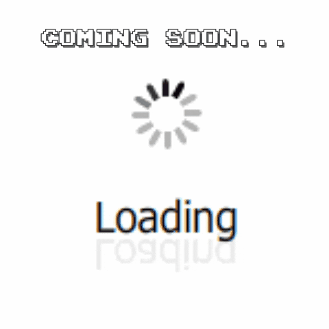
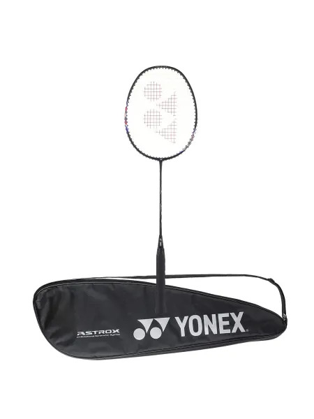
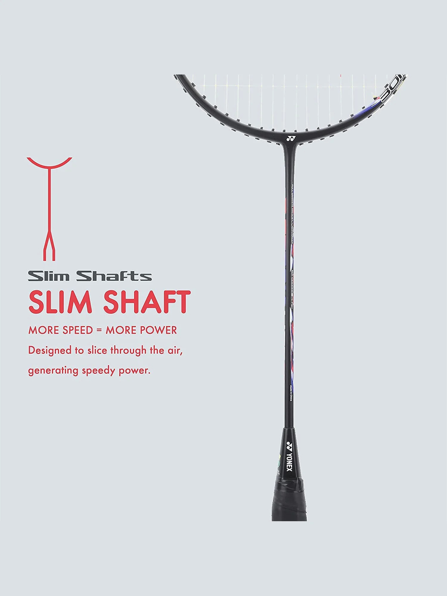

# 📂 Complete Code Base Export: `app/` Directory

This document contains the entire, un-truncated source code for all files and subdirectories inside the `app/` directory.

## 🌳 Directory File Index

- `app/app.php`
- `app/Config/Database.php`
- `app/Config/db.php`
- `app/Config/env.php`
- `app/Controllers/AuthController.php`
- `app/Controllers/HomeController.php`
- `app/Controllers/HostController.php`
- `app/Controllers/PlayerController.php`
- `app/Core/Controller.php`
- `app/Core/Model.php`
- `app/Core/Request.php`
- `app/Core/Response.php`
- `app/Core/Router.php`
- `app/Core/Token.php`
- `app/Database/Migration.php`
- `app/Database/MigrationRunner.php`
- `app/Database/Migrations/m2026_09_26_000001_init_database.php`
- `app/Helpers/audit.php`
- `app/Helpers/mail_helper.php`
- `app/Helpers/Mailer.php`
- `app/Helpers/player_hub_helper.php`
- `app/Helpers/Session.php`
- `app/Helpers/session_functions.php`
- `app/home.php`
- `app/Middleware/AuthGuard.php`
- `app/migrate.php`
- `app/Models/ClubModel.php`
- `app/Models/EventModel.php`
- `app/Models/ExpenseModel.php`
- `app/Models/GameJoinModel.php`
- `app/Models/HostPlayerCarryForwardModel.php`
- `app/Models/HostSubscriptionModel.php`
- `app/Models/PaymentModel.php`
- `app/Models/PlayerClubStatusModel.php`
- `app/Models/PlayerLogModel.php`
- `app/Models/PlayerRatingModel.php`
- `app/Models/ReviewModel.php`
- `app/Models/TournamentModel.php`
- `app/Models/TournamentPaymentModel.php`
- `app/Models/TournamentTeamModel.php`
- `app/Models/TournamentUserModel.php`
- `app/Models/UserModel.php`
- `app/Models/VenueModel.php`
- `app/routes/auth.php`
- `app/routes/host.php`
- `app/routes/index.php`
- `app/routes/pages.php`
- `app/routes/player.php`
- `app/routes/store.php`
- `app/routes/tournament.php`
- `app/routes/web.php`
- `app/script/auth.js`
- `app/script/common.js`
- `app/script/home.js`
- `app/script/host.js`
- `app/script/index.js`
- `app/script/inner-header.js`
- `app/script/player-hub.js`
- `app/script/player.js`
- `app/script/script.js`
- `app/script/tournament.js`
- `app/Views/auth/login.php`
- `app/Views/auth/resister.php`
- `app/Views/css/home.css`
- `app/Views/css/host/dashboard.css`
- `app/Views/css/player/player-hub.css`
- `app/Views/host/dashboard.php`
- `app/Views/host/host-audit-log.php`
- `app/Views/host/host-club-settings.php`
- `app/Views/host/host-complete-game.php`
- `app/Views/host/host-creat-game.php`
- `app/Views/host/host-dashboard.php`
- `app/Views/host/host-edit-tournament.php`
- `app/Views/host/host-monthly-subscription.php`
- `app/Views/host/host-payment-list.php`
- `app/Views/host/host-player-stats.php`
- `app/Views/host/host-rating.php`
- `app/Views/host/host-roster.php`
- `app/Views/host/host-scheduled-game.php`
- `app/Views/host/host-tournament-list.php`
- `app/Views/host/index.php`
- `app/Views/layouts/footer/footer-links.php`
- `app/Views/layouts/footer/footer.php`
- `app/Views/layouts/header/header-links.php`
- `app/Views/layouts/header/header.php`
- `app/Views/layouts/header/inner-header.php`
- `app/Views/layouts/header/store-header.php`
- `app/Views/pages/community/casa-clubs.php`
- `app/Views/pages/community/casa-trainers.php`
- `app/Views/pages/community/discover-games.php`
- `app/Views/pages/community/organiser.php`
- `app/Views/pages/community/players.php`
- `app/Views/pages/company/about-us.php`
- `app/Views/pages/contact/contact-handler.php`
- `app/Views/pages/contact/contact-us.php`
- `app/Views/pages/gallery/gallery-page.php`
- `app/Views/pages/gallery/gallery.php`
- `app/Views/pages/legal/CancellationPolicy.php`
- `app/Views/pages/legal/privacy-policy.php`
- `app/Views/pages/legal/termsCondition.php`
- `app/Views/pages/poster/poster.php`
- `app/Views/partials/player-hub-review.php`
- `app/Views/player/index.php`
- `app/Views/player/player-Complete-game.php`
- `app/Views/player/player-dashboard.php`
- `app/Views/player/player-hub.php`
- `app/Views/player/player-match.php`
- `app/Views/player/player-monthly-subscription.php`
- `app/Views/player/player-payment-list.php`
- `app/Views/player/player-profile.php`
- `app/Views/player/player-rating.php`
- `app/Views/player/player-Upcoming-game.php`
- `app/Views/store/accessories-shop.php`
- `app/Views/store/cart.php`
- `app/Views/store/checkout.php`
- `app/Views/store/orders.php`
- `app/Views/store/product-details.php`
- `app/Views/store/product-listing.php`

---

## File: `app/app.php`

```php
<?php

declare(strict_types=1);

// Session
if (session_status() === PHP_SESSION_NONE) {
    session_start();
}

// Composer autoloader
if (file_exists(__DIR__ . '/../vendor/autoload.php')) {
    require_once __DIR__ . '/../vendor/autoload.php';
}

// PSR-4 autoloader for App\ namespace
spl_autoload_register(function (string $class): void {
    $prefix = 'App\\';
    $baseDir = __DIR__ . '/';
    if (!str_starts_with($class, $prefix)) {
        return;
    }
    $file = $baseDir . str_replace('\\', '/', substr($class, strlen($prefix))) . '.php';
    if (file_exists($file)) {
        require_once $file;
    }
});

// Environment — loads .env.local and defines env() helper
require_once __DIR__ . '/Config/env.php';

// Database — explicitly load the singleton class before autoloader kicks in
require_once __DIR__ . '/Config/Database.php';
require_once __DIR__ . '/Config/db.php'; // Legacy db functions

use App\Config\Database;

// Helpers
require_once __DIR__ . '/Helpers/Session.php';
require_once __DIR__ . '/../helpers/helpers.php';
require_once __DIR__ . '/../helpers/validators.php';

// Error reporting & debug mode based on environment and APP_DEBUG setting
$appDebug = filter_var(env('APP_DEBUG', true), FILTER_VALIDATE_BOOLEAN);
$appEnv = strtolower((string) env('APP_ENV', 'local'));

if ($appDebug || in_array($appEnv, ['local', 'dev', 'development', 'staging', 'stage'], true)) {
    error_reporting(E_ALL);
    ini_set('display_errors', '1');
    ini_set('display_startup_errors', '1');

    set_exception_handler(function (\Throwable $e) {
        if (ob_get_length()) {
            @ob_clean();
        }
        if (!headers_sent()) {
            http_response_code(500);
        }
        echo '<div style="background:#1e1e2e; color:#f38ba8; padding:20px; font-family:Consolas, monospace; border-left:6px solid #f38ba8; margin:20px; border-radius:8px; box-shadow:0 4px 15px rgba(0,0,0,0.3); z-index:99999; position:relative;">';
        echo '<h2 style="color:#f38ba8; margin-top:0;">⚠️ [Debug Exception] ' . htmlspecialchars(get_class($e)) . '</h2>';
        echo '<p style="color:#cdd6f4; font-size:16px;"><strong>Message:</strong> ' . htmlspecialchars($e->getMessage()) . '</p>';
        echo '<p style="color:#a6adc8;"><strong>File:</strong> ' . htmlspecialchars($e->getFile()) . ' (Line <strong>' . $e->getLine() . '</strong>)</p>';
        echo '<h3 style="color:#89b4fa;">Stack Trace:</h3>';
        echo '<pre style="background:#11111b; color:#a6e3a1; padding:15px; border-radius:6px; overflow-x:auto; font-size:14px; white-space:pre-wrap;">' . htmlspecialchars($e->getTraceAsString()) . '</pre>';
        echo '</div>';
        exit;
    });
} else {
    error_reporting(0);
    ini_set('display_errors', '0');
    ini_set('display_startup_errors', '0');
}

// Boot Router
use App\Core\Request;
use App\Core\Response;
use App\Core\Router;

$request = new Request();
$response = new Response();
$router = new Router($request, $response);

// Load modular routes binder
require_once __DIR__ . '/routes/index.php';

// Dispatch
$router->resolve();

```

---

## File: `app/Config/Database.php`

```php
<?php

declare(strict_types=1);

namespace App\Config;

use mysqli;
use PDO;
use PDOException;
use RuntimeException;

class Database
{
    private static ?PDO $pdo = null;
    private static ?mysqli $mysqli = null;
    private static ?array $config = null;

    private static function config(): array
    {
        if (self::$config !== null) {return self::$config;}

        return self::$config = [
            'host' => (string) env('DB_HOST', '127.0.0.1'),
            'dbname' => (string) env('DB_NAME','casa_test'),
            'user' => (string) env('DB_USER','root'),
            'pass' => (string) env('DB_PASS',''),
            'port' => (int) env('DB_PORT','3306'),
            'charset' => (string) env('DB_CHARSET','utf8mb4'),
        ];
    }

    public static function getPdo(): PDO
    {
        if (self::$pdo instanceof PDO) {
            return self::$pdo;
        }

        $config = self::config();

        $dsn = "mysql:"
            . "host={$config['host']};"
            . "port={$config['port']};"
            . "dbname={$config['dbname']};"
            . "charset={$config['charset']}";

        try {
            self::$pdo = new PDO(
                $dsn,
                $config['user'],
                $config['pass'],
                [
                    PDO::ATTR_ERRMODE =>PDO::ERRMODE_EXCEPTION,
                    PDO::ATTR_DEFAULT_FETCH_MODE =>PDO::FETCH_ASSOC,
                    PDO::ATTR_EMULATE_PREPARES =>false,
                ]
            );
            return self::$pdo;
        } catch (PDOException $e) {
            throw new RuntimeException('Database connection failed.',0,$e);
        }
    }
    public static function getMysqli(): mysqli
    {
        if (self::$mysqli instanceof mysqli) {
            return self::$mysqli;
        }

        $config = self::config();

        mysqli_report(MYSQLI_REPORT_OFF);

        self::$mysqli = new mysqli(
            $config['host'],
            $config['user'],
            $config['pass'],
            $config['dbname'],
            $config['port']
        );

        if (self::$mysqli->connect_errno) {
            throw new RuntimeException('Database connection failed: '. self::$mysqli->connect_error);
        }

        if (!self::$mysqli->set_charset($config['charset'])) {
            throw new RuntimeException('Failed to set database charset.');
        }

        return self::$mysqli;
    }
}
```

---

## File: `app/Config/db.php`

```php
<?php
/**
 * Central Database Connection Helper
 * 
 * Provides global procedural functions (getPdoConnection, getDbConnection, $conn)
 * and loads the App\Config\Database singleton instance.
 */

require_once __DIR__ . '/env.php';
require_once __DIR__ . '/Database.php';
if (file_exists(__DIR__ . '/../Helpers/audit.php')) {
    require_once __DIR__ . '/../Helpers/audit.php';
}

if (!defined('DATABASE_NAME')) define('DATABASE_NAME', env('DB_NAME', 'casa_test'));
if (!defined('USERNAME'))      define('USERNAME', env('DB_USER', 'root'));
if (!defined('PASSWORD'))      define('PASSWORD', env('DB_PASS', ''));

// Legacy global $conn initialization
global $conn;
if (!isset($conn)) {
    $conn = \App\Config\Database::getMysqli();
}

if (!function_exists('getDbConnection')) {
    function getDbConnection(): mysqli {
        return \App\Config\Database::getMysqli();
    }
}

if (!function_exists('getPdoConnection')) {
    function getPdoConnection(): PDO {
        return \App\Config\Database::getPdo();
    }
}


```

---

## File: `app/Config/env.php`

```php
<?php

if (!function_exists('load_env_file')) {

    function load_env_file(string $path, bool $overwrite = true): void
    {
        if (!is_file($path) || !is_readable($path)) {
            return;
        }

        $lines = file($path, FILE_IGNORE_NEW_LINES | FILE_SKIP_EMPTY_LINES);

        if ($lines === false) {
            return;
        }

        foreach ($lines as $line) {
            $line = trim($line);

            if ($line === '' || str_starts_with($line, '#')) {
                continue;
            }

            if (!str_contains($line, '=')) {
                continue;
            }

            [$name, $value] = explode('=', $line, 2);

            $name = trim($name);
            $value = trim($value);

            if ($name === '') {
                continue;
            }

            if (strlen($value) >= 2 && (($value[0] === '"' && $value[-1] === '"') || ($value[0] === "'" && $value[-1] === "'"))) {
                $value = substr($value, 1, -1);
            }

            if (!$overwrite && (isset($_ENV[$name]) || isset($_SERVER[$name]) || getenv($name) !== false)) {
                continue;
            }

            $_ENV[$name] = $value;
            $_SERVER[$name] = $value;

            putenv("{$name}={$value}");
        }
    }
}


if (!function_exists('env')) {
    function env(string $key, mixed $default = null): mixed
    {
        $value = $_ENV[$key] ?? $_SERVER[$key] ?? getenv($key);
        return ($value === false || $value === null || $value === '')
            ? $default
            : $value;
    }
}

if (!function_exists('get_loaded_env_info')) {
    /**
     * Get details of currently active APP_ENV and loaded .env files.
     */
    function get_loaded_env_info(): array
    {
        return [
            'app_env'      => env('APP_ENV', 'local'),
            'app_debug'    => filter_var(env('APP_DEBUG', false), FILTER_VALIDATE_BOOLEAN),
            'loaded_files' => $_ENV['LOADED_ENV_FILES'] ?? [],
        ];
    }
}

$rootDir = dirname(__DIR__, 2);

$baseEnvFile = $rootDir . '/.env';

$loadedFiles = [];

if (is_file($baseEnvFile)) {
    load_env_file($baseEnvFile, true);
    $loadedFiles[] = basename($baseEnvFile);
}

$appEnv = strtolower(trim(env('APP_ENV', 'local')));

$envSpecificFile = $rootDir . '/.env.' . $appEnv;

if (is_file($envSpecificFile)) {
    $environmentFile = $envSpecificFile;
} else {
    $environmentFile = match ($appEnv) {
        'production', 'prod'          => $rootDir . '/.env.production',
        'development', 'dev'          => is_file($rootDir . '/.env.development') ? $rootDir . '/.env.development' : $rootDir . '/.env.local',
        'local'                       => $rootDir . '/.env.local',
        default                       => null,
    };
}

if ($environmentFile !== null && is_file($environmentFile)) {
    load_env_file($environmentFile, false);
    $loadedFiles[] = basename($environmentFile);
}

$_ENV['LOADED_ENV_FILES'] = $loadedFiles;
```

---

## File: `app/Controllers/AuthController.php`

```php
<?php

declare(strict_types=1);

namespace App\Controllers;

use App\Config\Database;
use App\Core\Controller;
use App\Core\Token;
use App\Models\UserModel;
use PDO;
use PDOException;

class AuthController extends Controller
{
    protected PDO $db;
    private UserModel $userModel;

    public function __construct()
    {
        parent::__construct();

        $this->db = Database::getPdo();
        $this->userModel = new UserModel($this->db);
    }

    public function login(): void
    {
        if (session_status() === PHP_SESSION_NONE) {
            session_start();
        }

        if ($_SERVER['REQUEST_METHOD'] !== 'POST') {
            header("Location: /");
            exit;
        }

        // 1. CSRF Protection using hash_equals
        $submittedCsrf = $_POST['csrf_token'] ?? '';
        $sessionCsrf   = $_SESSION['csrf_token'] ?? '';

        if (empty($submittedCsrf) || empty($sessionCsrf) || !hash_equals($sessionCsrf, $submittedCsrf)) {
            $_SESSION['login_error'] = 'Security validation failed. Please try again.';
            header("Location: /");
            exit;
        }

        // 2. Brute-force Protection (Rate Limiting based on IP & Session attempts)
        $ip = $_SERVER['REMOTE_ADDR'] ?? '0.0.0.0';
        $attemptKey = 'login_attempts_' . md5($ip);
        $lockoutKey = 'login_lockout_' . md5($ip);

        if (isset($_SESSION[$lockoutKey]) && time() < $_SESSION[$lockoutKey]) {
            $remainingSeconds = $_SESSION[$lockoutKey] - time();
            $_SESSION['login_error'] = "Too many failed login attempts. Please wait {$remainingSeconds} seconds.";
            header("Location: /");
            exit;
        }

        // 3. Inputs
        $identity = strtolower(trim((string) ($_POST['username'] ?? '')));
        $password = (string) ($_POST['password'] ?? ''); // Do NOT trim password!

        if (empty($identity) || empty($password)) {
            $_SESSION['login_error'] = 'Please enter both username/email and password.';
            header("Location: /");
            exit;
        }

        // 4. Fetch User via prepared statement in UserModel
        $user = $this->userModel->findByUsernameOrEmail($identity);

        if (!$user) {
            $this->handleFailedAttempt($attemptKey, $lockoutKey);
            header("Location: /");
            exit;
        }

        // 5. Password Authentication
        $passwordValid = false;
        $needsRehash   = false;

        if (!empty($user['PASSWORD_HASH'])) {
            if (password_verify($password, (string) $user['PASSWORD_HASH'])) {
                $passwordValid = true;
            }
        }

        // Fallback for legacy plain-text or legacy hash in PASSWORD column
        if (!$passwordValid) {
            $legacyPassword = (string) ($user['PASSWORD'] ?? '');
            if (!empty($legacyPassword)) {
                if ($password === trim($legacyPassword) || password_verify($password, $legacyPassword)) {
                    $passwordValid = true;
                    $needsRehash   = true;
                }
            }
        }

        if (!$passwordValid) {
            $this->handleFailedAttempt($attemptKey, $lockoutKey);
            header("Location: /");
            exit;
        }

        // 6. Automatically upgrade legacy password to bcrypt PASSWORD_HASH
        if ($needsRehash || (empty($user['PASSWORD_HASH']) && $passwordValid)) {
            $newBcryptHash = password_hash($password, PASSWORD_BCRYPT);
            $this->userModel->updatePasswordHash((int) $user['ID'], $newBcryptHash);
        }

        // 7. Successful Authentication - Clear failed attempts
        unset($_SESSION[$attemptKey], $_SESSION[$lockoutKey]);

        // 8. Session Fixation Protection
        session_regenerate_id(true);

        // 9. Set Session variables
        $_SESSION['user_id']      = $user['ID'];
        $_SESSION['name']         = $user['NAME'];
        $_SESSION['username']     = $identity;
        $_SESSION['usertype']     = $user['USERTYPE'];
        $_SESSION['gender']       = $user['GENDER'];
        $_SESSION['vlevel']       = $user['VERIFIED_LEVEL'];
        $_SESSION['level']        = $user['LEVEL'];
        $_SESSION['country']      = $user['COUNTRY'];
        $_SESSION['province']     = $user['PROVINCE'];
        $_SESSION['city']         = $user['CITY'];
        $_SESSION['games']        = $user['GAMES'];
        $_SESSION['profileImage'] = $user['PROFILE_IMAGE'] ?? '';

        // Refresh CSRF token for logged in session
        $_SESSION['csrf_token'] = bin2hex(random_bytes(32));

        // 10. Remember Me Cookie Management (No passwords in cookies!)
        $isSecure = (!empty($_SERVER['HTTPS']) && $_SERVER['HTTPS'] !== 'off') || ($_SERVER['SERVER_PORT'] ?? 80) == 443;
        
        // Remove legacy dangerous remember_password cookie if it exists
        if (isset($_COOKIE['remember_password'])) {
            setcookie('remember_password', '', [
                'expires'  => time() - 3600,
                'path'     => '/',
                'secure'   => $isSecure,
                'httponly' => true,
                'samesite' => 'Lax'
            ]);
        }

        if (!empty($_POST['rememberMe'])) {
            $rememberDays = (int) env('REMEMBER_ME_DAYS', '30');
            $cookieExpiry = time() + (86400 * $rememberDays);

            // Set remember_username cookie
            setcookie('remember_username', $identity, [
                'expires'  => $cookieExpiry,
                'path'     => '/',
                'secure'   => $isSecure,
                'httponly' => true,
                'samesite' => 'Lax'
            ]);

            // Generate signed token with session-relevant payload
            $signedToken = Token::generate([
                'id'       => (int) $user['ID'],
                'name'     => $user['NAME'],
                'usertype' => $user['USERTYPE'],
                'username' => $identity,
            ], 86400 * $rememberDays);

            setcookie('remember_token', $signedToken, [
                'expires'  => $cookieExpiry,
                'path'     => '/',
                'secure'   => $isSecure,
                'httponly' => true,
                'samesite' => 'Lax'
            ]);
        } else {
            setcookie('remember_username', '', [
                'expires'  => time() - 3600,
                'path'     => '/',
                'secure'   => $isSecure,
                'httponly' => true,
                'samesite' => 'Lax'
            ]);

            setcookie('remember_token', '', [
                'expires'  => time() - 3600,
                'path'     => '/',
                'secure'   => $isSecure,
                'httponly' => true,
                'samesite' => 'Lax'
            ]);

            $this->userModel->updateRememberToken((int) $user['ID'], null);
        }

        // 11. Activity Log
        $this->logActivity((int) $user['ID'], 'LOGIN', 'Successful login');

        // 12. Redirect based on USERTYPE
        if ($user['USERTYPE'] === 'Host' || $user['USERTYPE'] === 'Trainer') {
            header("Location: /host/host-dashboard.php");
        } elseif ($user['USERTYPE'] === 'Player') {
            $this->syncHomeClubs(
                (int) $user['ID'],
                (string) ($user['COUNTRY'] ?? ''),
                (string) ($user['PROVINCE'] ?? ''),
                (string) ($user['CITY'] ?? ''),
                (string) ($user['GAMES'] ?? '')
            );
            header("Location: /player/player-hub.php");
        } else {
            header("Location: /host/host-dashboard.php");
        }
        exit;
    }

    protected function handleFailedAttempt(string $attemptKey, string $lockoutKey): void
    {
        $attempts = ($_SESSION[$attemptKey] ?? 0) + 1;
        $_SESSION[$attemptKey] = $attempts;

        $maxAttempts = (int) env('LOGIN_MAX_ATTEMPTS', '5');
        $lockoutSeconds = (int) env('LOGIN_LOCKOUT_SECONDS', '900');

        if ($attempts >= $maxAttempts) {
            // Lock out after max failed attempts
            $_SESSION[$lockoutKey] = time() + $lockoutSeconds;
            $lockoutMinutes = (int) ceil($lockoutSeconds / 60);
            $_SESSION['login_error'] = "Too many failed login attempts. Account temporarily locked for {$lockoutMinutes} minutes.";
        } else {
            $_SESSION['login_error'] = 'Invalid username or password.';
        }
    }

    public function logout(): void
    {
        if (session_status() === PHP_SESSION_NONE) {
            session_start();
        }

        if (isset($_SESSION['user_id'])) {
            $this->userModel->updateRememberToken((int) $_SESSION['user_id'], null);
        }

        $_SESSION = [];

        if (ini_get("session.use_cookies")) {
            $params = session_get_cookie_params();
            setcookie(session_name(), '', time() - 42000,
                $params["path"], $params["domain"],
                $params["secure"], $params["httponly"]
            );
        }

        $isSecure = (!empty($_SERVER['HTTPS']) && $_SERVER['HTTPS'] !== 'off') || ($_SERVER['SERVER_PORT'] ?? 80) == 443;
        setcookie('remember_token', '', [
            'expires'  => time() - 3600,
            'path'     => '/',
            'secure'   => $isSecure,
            'httponly' => true,
            'samesite' => 'Lax'
        ]);
        setcookie('remember_password', '', [
            'expires'  => time() - 3600,
            'path'     => '/',
            'secure'   => $isSecure,
            'httponly' => true,
            'samesite' => 'Lax'
        ]);

        session_destroy();
        header('Location: /');
        exit;
    }

    private function logActivity(int $userId, string $activityType, string $description): void
    {
        try {
            $ip = $_SERVER['REMOTE_ADDR'] ?? null;
            if (!empty($_SERVER['HTTP_X_FORWARDED_FOR'])) {
                $ipParts = explode(',', $_SERVER['HTTP_X_FORWARDED_FOR']);
                $ip = trim($ipParts[0]);
            }

            $stmt = $this->db->prepare("INSERT INTO ca_player_logs (USER_ID, ACTIVITY_TYPE, DESCRIPTION, IP_ADDRESS) VALUES (:user_id, :activity_type, :description, :ip)");
            $stmt->execute([
                ':user_id' => $userId,
                ':activity_type' => $activityType,
                ':description' => $description,
                ':ip' => $ip
            ]);
        } catch (PDOException $e) {
            // Silently fail for logs if column missing or db error
        }
    }

    private function syncHomeClubs(int $playerId, string $country, string $province, string $city, string $games): void
    {
        if (empty($country) || empty($city)) {
            return;
        }

        try {
            $stmt = $this->db->prepare("
                SELECT id, host_id, game_type 
                FROM ca_clubs 
                WHERE join_type = 'H' 
                  AND status = 'Active' 
                  AND LOWER(TRIM(country)) = LOWER(TRIM(:country)) 
                  AND LOWER(TRIM(province)) = LOWER(TRIM(:province)) 
                  AND LOWER(TRIM(city)) = LOWER(TRIM(:city))
            ");

            $stmt->execute([
                ':country' => $country,
                ':province' => $province,
                ':city' => $city
            ]);

            $clubs = $stmt->fetchAll(PDO::FETCH_ASSOC);

            if (empty($clubs)) {
                return;
            }

            $insertStmt = $this->db->prepare("INSERT IGNORE INTO ca_player_club_status (club_id, host_id, player_id, status) VALUES (:club_id, :host_id, :player_id, 'accepted')");

            foreach ($clubs as $club) {
                $clubGame = trim((string) $club['game_type']);
                if (!empty($clubGame) && stripos($games, $clubGame) !== false) {
                    $insertStmt->execute([
                        ':club_id' => $club['id'],
                        ':host_id' => $club['host_id'],
                        ':player_id' => $playerId
                    ]);
                }
            }
        } catch (PDOException $e) {
            // Silently fail for background sync
        }
    }
}

```

---

## File: `app/Controllers/HomeController.php`

```php
<?php

declare(strict_types=1);

namespace App\Controllers;

use App\Config\Database;
use App\Core\Controller;
use PDO;
use PDOException;
use Throwable;

class HomeController extends Controller
{
    private const int PRODUCT_LIMIT = 12;
    private const int REVIEW_LIMIT = 20;

    // Asset directory paths and fallback images
    private const string TOURNAMENT_BANNER_DIR = 'admin/assets/images/tournaments_banner/';
    private const string DEFAULT_TOURNAMENT_IMG = 'assets/images/default-tournament.jpg';
    private const string PRODUCT_IMAGE_DIR      = 'admin/';
    private const string DEFAULT_PRODUCT_IMG    = 'assets/images/product/badminton1.jpg';

    private readonly PDO $db;

    public function __construct()
    {
        parent::__construct();
        $this->db = Database::getPdo();
    }

    //Landing page.

    public function index(): void
    {
        $this->redirectAuthenticatedUser();

        $banners = $this->getHeroBanners();
        $tournaments = $this->getUpcomingTournaments();
        $products = $this->getStoreProducts();
        $stats = $this->getPlaygroundStats();
        $reviews = $this->getCommunityReviews();
        $posters = $this->getPosters();

        require_once __DIR__ . '/../home.php';
    }

    //Redirect authenticated users to their respective dashboard.

    private function redirectAuthenticatedUser(): void
    {
        if (session_status() === PHP_SESSION_NONE) {
            session_start();
        }

        if (empty($_SESSION['user_id'])) {
            return;
        }

        $userType = strtolower(trim((string) ($_SESSION['usertype'] ?? '')));

        switch ($userType) {
            case 'host':
            case 'trainer':
                header('Location: /host/host-dashboard.php');
                exit;

            case 'player':
                header('Location: /player/player-hub.php');
                exit;

            default:
                // Invalid/corrupted authentication session.
                $_SESSION = [];

                if (ini_get('session.use_cookies')) {
                    $params = session_get_cookie_params();

                    setcookie(
                        session_name(),
                        '',
                        time() - 42000,
                        $params['path'],
                        $params['domain'],
                        $params['secure'],
                        $params['httponly']
                    );
                }

                session_destroy();
        }
    }
    private function getHeroBanners(): array
    {
        $sql = "
            SELECT *
            FROM ca_herobanners
            WHERE status = 1
            ORDER BY id DESC
        ";
        return $this->fetchAll($sql);
    }
    private function getUpcomingTournaments(): array
    {
        $sql = "
            SELECT
                e.ID,
                e.HOST_NAME,
                e.CUP_NAME,
                e.CUP_NAME AS TOURNAMENT_NAME,
                e.EVENT_DESCRIPTION,
                e.EVENT_DESCRIPTION AS TAGLINE,
                e.GENDER_CATEGORY,
                e.EVENT_TYPE,
                e.EVENT_CATEGORY,
                e.EVENT_DATE,
                e.EVENT_TIME,
                e.EVENT_TIME AS START_TIME,
                e.EVENT_VENUE,
                e.EVENT_COST,
                e.SHUTTLE_TYPE,
                e.CANCEL_DATE,
                e.CANCEL_DATE AS REGISTRATION_CLOSE_DATE,
                e.CANCEL_TIME,
                e.CANCEL_TIME AS REGISTRATION_CLOSE_TIME,
                b.IMGAE AS IMAGE,
                (
                    SELECT COUNT(*)
                    FROM to_teams t
                    WHERE t.TOURNAMENT_ID = e.ID
                ) AS joined_count
            FROM to_tournaments e
            LEFT JOIN to_tournamet_banners b ON b.EVENTS_ID = e.ID
            WHERE e.STATUS = 'Active'
            ORDER BY e.ID DESC
        ";

        $rows = $this->fetchAll($sql);

        $tz = new \DateTimeZone('America/New_York');
        $now = new \DateTime('now', $tz);
        $projectRoot = dirname(__DIR__, 2);

        $tournaments = [];
        foreach ($rows as $row) {
            $name = trim((string)($row['CUP_NAME'] ?? '')) ?: trim((string)($row['HOST_NAME'] ?? ''));
            $desc = trim(strip_tags((string)($row['EVENT_DESCRIPTION'] ?? '')));
            $words = preg_split('/\s+/', $desc, -1, PREG_SPLIT_NO_EMPTY);
            $tagline = implode(' ', array_slice($words ?: [], 0, 5)) . (count($words ?: []) > 5 ? '...' : '');

            $date = !empty($row['EVENT_DATE']) ? date('M d, Y', strtotime($row['EVENT_DATE'])) : '';
            $time = !empty($row['EVENT_TIME']) ? date('h:i A', strtotime($row['EVENT_TIME'])) : '';

            $image = trim((string)($row['IMAGE'] ?? $row['IMGAE'] ?? ''));
            $banner = $image ? self::TOURNAMENT_BANNER_DIR . basename($image) : '';
            $img = ($banner && is_file($projectRoot . '/' . $banner)) ? $banner : self::DEFAULT_TOURNAMENT_IMG;

            $open = true;
            if (!empty($row['CANCEL_DATE'])) {
                try {
                    $cancel = new \DateTime(
                        $row['CANCEL_DATE'] . ' ' . ($row['CANCEL_TIME'] ?? '10:00:00'),
                        $tz
                    );
                    $open = $now < $cancel;
                } catch (Throwable $e) {
                    $open = true;
                }
            }

            $row['display_name'] = $name;
            $row['display_tagline'] = $tagline;
            $row['formatted_date'] = $date;
            $row['formatted_time'] = $time;
            $row['image_path'] = $img;
            $row['is_open'] = $open;
            $row['gender_cat'] = (string)($row['GENDER_CATEGORY'] ?? '');
            $row['event_type'] = (string)($row['EVENT_TYPE'] ?? '');
            $row['event_cat'] = (string)($row['EVENT_CATEGORY'] ?? '');
            $row['venue'] = (string)($row['EVENT_VENUE'] ?? '');
            $row['shuttle'] = (string)($row['SHUTTLE_TYPE'] ?? 'Feather');
            $row['fee_formatted'] = number_format((float)($row['EVENT_COST'] ?? 0), 2);
            $row['teams_joined'] = (int)($row['joined_count'] ?? 0);

            $tournaments[] = $row;
        }

        return $tournaments;
    }

    // Fetch latest store products.
    private function getStoreProducts(): array
    {
        try {
            $sql = "
                SELECT
                    ID,
                    PRODUCT_NAME,
                    PRICE,
                    IMAGE,
                    TNAME
                FROM ca_products
                ORDER BY ID DESC
                LIMIT " . self::PRODUCT_LIMIT;

            $rows = $this->fetchAll($sql);
            $projectRoot = dirname(__DIR__, 2);

            $products = [];
            foreach ($rows as $product) {
                $name = (string)($product['PRODUCT_NAME'] ?? '');
                $desc = !empty($product['TNAME']) ? (string)$product['TNAME'] : 'Free Delivery';
                $price = number_format((float)($product['PRICE'] ?? 0), 2);

                $image = trim((string)($product['IMAGE'] ?? ''));
                $image = $image ? self::PRODUCT_IMAGE_DIR . ltrim($image, '/') : '';
                $imagePath = ($image && is_file($projectRoot . '/' . $image)) ? $image : self::DEFAULT_PRODUCT_IMG;

                $product['display_name'] = $name;
                $product['display_desc'] = $desc;
                $product['formatted_price'] = $price;
                $product['image_path'] = $imagePath;

                $products[] = $product;
            }

            return $products;
        } catch (Throwable $e) {
            error_log('Error fetching store products: ' . $e->getMessage());
            return [];
        }
    }

    // Fetch playground statistics.
    private function getPlaygroundStats(): array
    {
        $sql = "
        SELECT
            COALESCE(SUM(CASE WHEN USERTYPE = 'Player' AND LOG_STATUS = 'Y' THEN 1 ELSE 0 END), 0) AS total_players,
            COALESCE(SUM(CASE WHEN USERTYPE = 'Host' AND LOG_STATUS = 'Y' THEN 1 ELSE 0 END), 0) AS total_clubs,
            (SELECT COUNT(*) FROM ca_events WHERE STATUS = 'Completed') AS total_sessions
        FROM ca_users
    ";

        try {
            $row = $this->db->query($sql)->fetch(PDO::FETCH_ASSOC);

            $players = (int) ($row['total_players'] ?? 0);
            $clubs = (int) ($row['total_clubs'] ?? 0);
            $sessions = (int) ($row['total_sessions'] ?? 0);

            return [
                ['icon' => 'fa-users', 'count' => $players, 'label' => 'Total Players'],
                ['icon' => 'fa-building', 'count' => $clubs, 'label' => 'Total Clubs'],
                ['icon' => 'fa-play', 'count' => $sessions, 'label' => 'Total Sessions'],
                ['icon' => 'fa-fire', 'count' => $sessions * 12, 'label' => 'Total Matches'],
            ];
        } catch (PDOException $e) {
            $this->logDatabaseError(__METHOD__, $e);
            return $this->emptyStats();
        }
    }

 // Fetch active community reviews.
 
    private function getCommunityReviews(): array
    {
        $sql = "
            SELECT
                r.MESSAGE,
                r.PLAYER_ROLE,
                r.RATING,
                u.NAME,
                u.PROFILE_IMAGE
            FROM ca_reviews r
            INNER JOIN ca_users u
                ON u.ID = r.USER_ID
            WHERE r.STATUS = 'Active'
            ORDER BY r.DATE_CREATED DESC
            LIMIT " . self::REVIEW_LIMIT;

        return $this->fetchAll($sql);
    }

    private function getPosters(): array
    {
        try {
            $sql = "
                SELECT media_url
                FROM ca_landing_page_media
                WHERE media_type = 'poster'
                  AND is_active = 1
            ";

            $result = $this->fetchAll($sql);

            return $result;
        } catch (Throwable $e) {
            error_log('Error fetching posters: ' . $e->getMessage());
            return [];
        }
    }

    private function fetchAll(string $sql, array $params = []): array
    {
        try {
            $stmt = $this->db->prepare($sql);
            $stmt->execute($params);

            return $stmt->fetchAll(PDO::FETCH_ASSOC);
        } catch (PDOException $e) {
            $this->logDatabaseError(__METHOD__, $e);

            return [];
        }
    }

   // Execute SELECT query and return a single column.
    
    private function fetchColumn(string $sql, array $params = []): array
    {
        try {
            $stmt = $this->db->prepare($sql);
            $stmt->execute($params);

            return $stmt->fetchAll(PDO::FETCH_COLUMN);
        } catch (PDOException $e) {
            $this->logDatabaseError(__METHOD__, $e);

            return [];
        }
    }

    /**
     * Empty playground statistics.
     */
    private function emptyStats(): array
    {
        return [
            [
                'icon' => 'fa-users',
                'count' => 0,
                'label' => 'Total Players',
            ],
            [
                'icon' => 'fa-building',
                'count' => 0,
                'label' => 'Total Clubs',
            ],
            [
                'icon' => 'fa-play',
                'count' => 0,
                'label' => 'Total Sessions',
            ],
            [
                'icon' => 'fa-fire',
                'count' => 0,
                'label' => 'Total Matches',
            ],
        ];
    }

    /**
     * Log database exceptions without exposing
     * sensitive database information to users.
     */
    private function logDatabaseError(string $context, PDOException $exception): void
    {
        error_log(
            sprintf(
                '[%s] Database error: %s',
                $context,
                $exception->getMessage()
            )
        );
    }
}
```

---

## File: `app/Controllers/HostController.php`

```php
<?php

declare(strict_types=1);

namespace App\Controllers;

use App\Core\Controller;
use App\Models\UserModel;
use App\Models\EventModel;

class HostController extends Controller
{
    protected UserModel $userModel;
    protected EventModel $eventModel;

    public function __construct()
    {
        parent::__construct();
        $db = \App\Config\Database::getPdo();
        $this->userModel = new UserModel($db);
        $this->eventModel = new EventModel();
    }

    public function dashboard(): void
    {
        if (session_status() === PHP_SESSION_NONE) {
            session_start();
        }

        $usertype = trim($_SESSION['usertype'] ?? '');
        if (empty($_SESSION['user_id']) || (strcasecmp($usertype, 'Host') !== 0 && strcasecmp($usertype, 'Trainer') !== 0)) {
            $this->redirect('/');
            return;
        }

        $userId = (int) $_SESSION['user_id'];
        $hostUser = $this->userModel->findById($userId);
        $activeEvents = $this->eventModel->getActiveEvents($userId);

        $this->render('host/dashboard', [
            'host' => $hostUser,
            'active_events' => $activeEvents,
            'current_user_id' => $userId,
        ]);
    }
}

```

---

## File: `app/Controllers/PlayerController.php`

```php
<?php

declare(strict_types=1);

namespace App\Controllers;

use App\Config\Database;
use App\Core\Controller;
use App\Models\UserModel;
use App\Models\EventModel;
use App\Models\TournamentModel;
use App\Helpers\Session;
use PDO;
use PDOException;

class PlayerController extends Controller
{
    private const string DEFAULT_PROFILE_IMG = '/assets/images/profile.jpg';
    private const string DEFAULT_PRODUCT_IMG = '/assets/images/t-shirt.jpg';
    private const string ADMIN_ASSETS_DIR    = 'admin/assets/';
    private const string ADMIN_DIR           = 'admin/';
    private const string PRODUCT_IMAGES_DIR  = 'assets/images/product/';

    protected PDO $db;
    protected UserModel $userModel;
    protected EventModel $eventModel;
    protected TournamentModel $tournamentModel;

    public function __construct()
    {
        parent::__construct();
        $this->db              = Database::getPdo();
        $this->userModel       = new UserModel($this->db);
        $this->eventModel      = new EventModel();
        $this->tournamentModel = new TournamentModel();
    }

    public function hub(): void
    {
        Session::start();

        $userType = Session::normalizeRole(Session::getCurrentUserType());
        $userId   = Session::userId();

        if (!$userId || $userType !== 'player') {
            $this->redirect('/');
            return;
        }

        Session::getCsrfToken();

        $userEmail = Session::get('email', '');
        $pdo       = $this->db;
        $baseDir   = dirname(__DIR__, 2) . '/';

        // 1 & 2. Consolidated User Info Query
        $userInfo = (object) [
            'premium'  => 'N',
            'prefs'    => [],
            'game'     => 'Badminton',
            'country'  => '',
            'province' => '',
            'city'     => '',
        ];

        try {
            $user_stmt = $pdo->prepare(
                "SELECT PREMIUM, GAMES, COUNTRY, PROVINCE, CITY, PROFILE_IMAGE, GENDER, VERIFIED_LEVEL, LEVEL, NAME 
                 FROM ca_users WHERE ID = ? LIMIT 1"
            );
            $user_stmt->execute([$userId]);
            $prefs = $user_stmt->fetch() ?: [];

            $userInfo->prefs    = $prefs;
            $userInfo->premium  = $prefs['PREMIUM'] ?? 'N';
            $userInfo->game     = $prefs['GAMES'] ?? 'Badminton';
            $userInfo->country  = $prefs['COUNTRY'] ?? '';
            $userInfo->province = $prefs['PROVINCE'] ?? '';
            $userInfo->city     = $prefs['CITY'] ?? '';

            if (!empty($prefs['PROFILE_IMAGE'])) {
                Session::set('profileImage', $prefs['PROFILE_IMAGE']);
            }
        } catch (PDOException $e) {
            error_log("PlayerController hub user_info error: " . $e->getMessage());
        }

        // 3. Fetch active clubs matching player's preference & location
        $clubs = [];
        try {
            $baseClubSql = "SELECT c.id, c.club_name, c.club_info, c.cost_info, c.schedule, c.logo, c.game_type, c.country, c.province, c.city, c.created_at, c.host_id, u.NAME as host_name, u.PROFILE_IMAGE as host_img
                            FROM ca_clubs c
                            JOIN ca_users u ON c.host_id = u.ID
                            WHERE c.status = 'Active'";

            $clubs_sql = $baseClubSql . " AND c.game_type = :game_type";
            $params = ['game_type' => $userInfo->game];

            if (!empty($userInfo->country)) {
                $clubs_sql .= " AND c.country = :country";
                $params['country'] = $userInfo->country;
            }
            if (!empty($userInfo->province)) {
                $clubs_sql .= " AND c.province = :province";
                $params['province'] = $userInfo->province;
            }
            if (!empty($userInfo->city)) {
                $clubs_sql .= " AND c.city = :city";
                $params['city'] = $userInfo->city;
            }

            $clubs_sql .= " ORDER BY c.created_at DESC LIMIT 8";
            $clubs_stmt = $pdo->prepare($clubs_sql);
            $clubs_stmt->execute($params);
            $clubs = $clubs_stmt->fetchAll();

            // Fallback strategy using array of query configs
            $fallbacks = [
                ['sql' => $baseClubSql . " AND c.game_type = :game_type ORDER BY c.created_at DESC LIMIT 8", 'params' => ['game_type' => $userInfo->game]],
                ['sql' => $baseClubSql . " ORDER BY c.created_at DESC LIMIT 8", 'params' => []],
            ];

            foreach ($fallbacks as $fb) {
                if (!empty($clubs)) {
                    break;
                }
                $stmt = $pdo->prepare($fb['sql']);
                $stmt->execute($fb['params']);
                $clubs = $stmt->fetchAll() ?: [];
            }

            $status_stmt = $pdo->prepare("SELECT status FROM ca_player_club_status WHERE player_id = ? AND club_id = ? LIMIT 1");
            foreach ($clubs as &$club_row) {
                $status_stmt->execute([$userId, $club_row['id']]);
                $club_row['membership_status'] = $status_stmt->fetchColumn() ?: 'not_joined';
            }
            unset($club_row);
        } catch (PDOException $e) {
            error_log("PlayerController hub clubs error: " . $e->getMessage());
            $clubs = [];
        }

        // 4. Fetch upcoming tournaments
        $upcomingTournaments = [];
        try {
            $tournamentQuery = function (bool $filterFutureDate) use ($pdo, $userId): array {
                $dateCondition = $filterFutureDate ? "AND e.EVENT_DATE >= CURDATE()" : "";
                $sql = "SELECT e.*, b.IMGAE, 
                        (SELECT COUNT(*) FROM to_teams WHERE TOURNAMENT_ID = e.ID) as joined_count,
                        (SELECT COUNT(*) FROM to_users tu 
                         JOIN to_teams tt ON tu.TEAM_ID = tt.ID 
                         WHERE tt.TOURNAMENT_ID = e.ID AND tu.CA_ID = :uid1) as is_joined,
                        (SELECT tp.STATUS FROM to_payments tp 
                         JOIN to_users tu ON tp.USER_ID = tu.ID
                         JOIN to_teams tt ON tu.TEAM_ID = tt.ID
                         WHERE tt.TOURNAMENT_ID = e.ID AND tu.CA_ID = :uid2 LIMIT 1) as pay_status,
                        (SELECT tp.APPROVED_BY FROM to_payments tp 
                         JOIN to_users tu ON tp.USER_ID = tu.ID
                         JOIN to_teams tt ON tu.TEAM_ID = tt.ID
                         WHERE tt.TOURNAMENT_ID = e.ID AND tu.CA_ID = :uid3 LIMIT 1) as pay_approved
                        FROM to_tournaments e 
                        LEFT JOIN to_tournamet_banners b ON e.ID = b.EVENTS_ID 
                        WHERE e.STATUS = 'Active' {$dateCondition} 
                        ORDER BY e.ID DESC";

                $stmt = $pdo->prepare($sql);
                $stmt->execute(['uid1' => $userId, 'uid2' => $userId, 'uid3' => $userId]);
                return $stmt->fetchAll() ?: [];
            };

            $rawTournaments = $tournamentQuery(true) ?: $tournamentQuery(false);

            require_once __DIR__ . '/../Helpers/player_hub_helper.php';
            $tzEst      = new \DateTimeZone('America/New_York');
            $nowEst     = new \DateTimeImmutable('now', $tzEst);
            $pathPrefix = '/';

            foreach ($rawTournaments as $row) {
                $upcomingTournaments[] = prepareTournamentData($row, $pathPrefix, $baseDir, $tzEst, $nowEst);
            }
        } catch (PDOException $e) {
            error_log("PlayerController hub tournaments error: " . $e->getMessage());
            $upcomingTournaments = [];
        }

        // 5. Total Sessions count
        $totalSessions = 0;
        try {
            $stmtSession = $pdo->prepare("SELECT COUNT(*) AS total_session FROM ca_gamejoin WHERE USER_ID = ?");
            $stmtSession->execute([$userId]);
            $totalSessions = (int) ($stmtSession->fetchColumn() ?: 0);
        } catch (PDOException $e) {
            $totalSessions = 0;
        }

        // 6. Casa Store Products (Object-formatted Image Resolver)
        $products = [];
        try {
            $prodStmt = $pdo->prepare("SELECT ID, PRODUCT_NAME, PRICE, IMAGE, QUANTITY FROM ca_products WHERE QUANTITY IS NULL OR QUANTITY > 0 ORDER BY ID DESC LIMIT 10");
            $prodStmt->execute();
            $rawProducts = $prodStmt->fetchAll(PDO::FETCH_ASSOC);

            $resolveProductImage = function (string $image, string $cleanImg, string $baseDir): string {
                if (!empty($image) && (str_starts_with($image, 'http://') || str_starts_with($image, 'https://'))) {
                    return htmlspecialchars($image, ENT_QUOTES, 'UTF-8');
                }

                $searchDirs = [self::ADMIN_ASSETS_DIR, self::ADMIN_DIR, self::PRODUCT_IMAGES_DIR];
                foreach ($searchDirs as $dir) {
                    if (!empty($cleanImg) && file_exists($baseDir . $dir . $cleanImg)) {
                        return '/' . $dir . htmlspecialchars($cleanImg, ENT_QUOTES, 'UTF-8');
                    }
                }

                return self::DEFAULT_PRODUCT_IMG;
            };

            foreach ($rawProducts as $product) {
                $productName = !empty($product['PRODUCT_NAME']) ? htmlspecialchars($product['PRODUCT_NAME'], ENT_QUOTES, 'UTF-8') : 'N/A';
                $price       = !empty($product['PRICE']) ? htmlspecialchars(number_format((float)$product['PRICE'], 2), ENT_QUOTES, 'UTF-8') : '0.00';
                $image       = $product['IMAGE'] ?? '';
                $cleanImg    = basename(ltrim($image, '/\\'));

                $product['display_name']    = $productName;
                $product['formatted_price'] = $price;
                $product['image_path']      = $resolveProductImage($image, $cleanImg, $baseDir);

                $products[] = $product;
            }
        } catch (PDOException $e) {
            error_log("PlayerController hub products error: " . $e->getMessage());
            $products = [];
        }

        // 7. Latest Order Map per product
        $orderMap = [];
        if (!empty($products) && !empty($userEmail)) {
            try {
                $orderSql = "
                    SELECT oi.PRODUCT_ID, oi.QUANTITY, oi.PRICE, o.ORDER_DATE, oi.STATUS
                    FROM ca_orders o
                    INNER JOIN ca_orders_item oi ON o.ORDER_ID = oi.ORDER_ID
                    INNER JOIN (
                        SELECT oi2.PRODUCT_ID, MAX(o2.ORDER_ID) as max_order_id
                        FROM ca_orders o2
                        INNER JOIN ca_orders_item oi2 ON o2.ORDER_ID = oi2.ORDER_ID
                        WHERE o2.EMAIL = :email1
                        GROUP BY oi2.PRODUCT_ID
                    ) latest ON oi.PRODUCT_ID = latest.PRODUCT_ID AND o.ORDER_ID = latest.max_order_id
                    WHERE o.EMAIL = :email2";

                $orderStmt = $pdo->prepare($orderSql);
                $orderStmt->execute(['email1' => $userEmail, 'email2' => $userEmail]);
                $ordersList = $orderStmt->fetchAll(PDO::FETCH_ASSOC);
                foreach ($ordersList as $ord) {
                    $orderMap[$ord['PRODUCT_ID']] = $ord;
                }
            } catch (PDOException $e) {
                error_log("PlayerController hub orders error: " . $e->getMessage());
                $orderMap = [];
            }
        }

        // 8. Fetch Active Reviews
        $reviews = [];
        try {
            $revStmt = $pdo->prepare(
                "SELECT r.ID, r.USER_ID, r.MESSAGE, r.PLAYER_ROLE, r.RATING, r.DATE_CREATED, u.NAME, u.PROFILE_IMAGE
                 FROM ca_reviews r
                 LEFT JOIN ca_users u ON r.USER_ID = u.ID
                 WHERE r.STATUS = 'Active'
                 ORDER BY r.DATE_CREATED DESC LIMIT 20"
            );
            $revStmt->execute();
            $reviews = $revStmt->fetchAll(PDO::FETCH_ASSOC);
        } catch (PDOException $e) {
            error_log("PlayerController hub reviews error: " . $e->getMessage());
            $reviews = [];
        }

        // 9. Dossier display variables (Object-formatted Profile Image Resolver)
        $userProfileImg = !empty($userInfo->prefs['PROFILE_IMAGE']) ? $userInfo->prefs['PROFILE_IMAGE'] : Session::get('profileImage', '');
        
        $resolveProfileImg = function (string $rawImg, string $baseDir): string {
            $clean = basename(ltrim($rawImg, '/\\'));
            if (empty($clean)) {
                return self::DEFAULT_PROFILE_IMG;
            }
            foreach (['profile_img/', ''] as $subDir) {
                if (file_exists($baseDir . $subDir . $clean)) {
                    return '/' . $subDir . htmlspecialchars($clean, ENT_QUOTES, 'UTF-8');
                }
            }
            return self::DEFAULT_PROFILE_IMG;
        };

        $imagePath    = $resolveProfileImg((string)$userProfileImg, $baseDir);
        $playerName   = htmlspecialchars($userInfo->prefs['NAME'] ?? Session::get('name', 'N/A'), ENT_QUOTES, 'UTF-8');
        $playerGender = htmlspecialchars($userInfo->prefs['GENDER'] ?? Session::get('gender', 'N/A'), ENT_QUOTES, 'UTF-8');
        $playerLevel  = htmlspecialchars($userInfo->prefs['VERIFIED_LEVEL'] ?? Session::get('vlevel', $userInfo->prefs['LEVEL'] ?? 'N/A'), ENT_QUOTES, 'UTF-8');
        $playerArea   = htmlspecialchars($userInfo->city ?: 'N/A', ENT_QUOTES, 'UTF-8');

        $viewName = file_exists(__DIR__ . '/../Views/player/player-hub.php') ? 'player/player-hub' : 'player/hub';
        $this->render($viewName, [
            'current_user_id'     => $userId,
            'user_premium'        => $userInfo->premium,
            'player_prefs'        => $userInfo->prefs,
            'player_game'         => $userInfo->game,
            'player_country'      => $userInfo->country,
            'player_province'     => $userInfo->province,
            'player_city'         => $userInfo->city,
            'clubs'               => $clubs,
            'upcomingTournaments' => $upcomingTournaments,
            'total_sessions'      => $totalSessions,
            'products'            => $products,
            'orderMap'            => $orderMap,
            'reviews'             => $reviews,
            'isPlayer'            => true,
            'user_profile_img'    => $imagePath,
            'player_name'         => $playerName,
            'player_gender'       => $playerGender,
            'player_level'        => $playerLevel,
            'player_area'         => $playerArea,
        ]);
    }

    public function profile(): void
    {
        Session::requireLogin('/');
        $userId = Session::userId();
        $user   = $this->userModel->findById($userId);

        $this->render('player/profile', [
            'user' => $user,
        ]);
    }

    public function dashboard(): void
    {
        Session::start();
        $userType = Session::normalizeRole(Session::getCurrentUserType());
        $userId   = Session::userId();

        if (!$userId || $userType !== 'player') {
            $this->redirect('/');
            return;
        }

        $this->render('player/player-dashboard', [
            'current_user_id' => $userId,
        ]);
    }

    /**
     * AJAX Endpoint: Update User Profile (Object & DTO Formatted)
     */
    public function updateProfile(): void
    {
        if ($_SERVER['REQUEST_METHOD'] !== 'POST') {
            $this->json(['success' => false, 'message' => 'Method not allowed.'], 405);
            return;
        }

        Session::start();
        $userId = Session::userId();
        if (!$userId) {
            $this->json(['success' => false, 'message' => 'Unauthorized. Please login again.'], 401);
            return;
        }

        $csrfToken = $_POST['csrf_token'] ?? $_SERVER['HTTP_X_CSRF_TOKEN'] ?? '';
        if (!Session::verifyCsrfToken($csrfToken)) {
            $this->json(['success' => false, 'message' => 'Invalid or expired CSRF token. Please refresh the page.'], 403);
            return;
        }

        // Request Payload DTO Object
        $req = (object) [
            'name'           => trim($_POST['name'] ?? ''),
            'email'          => strtolower(trim($_POST['email'] ?? '')),
            'contact'        => trim($_POST['contact'] ?? $_POST['number'] ?? ''),
            'dob'            => trim($_POST['dob'] ?? $_POST['dateofbirth'] ?? ''),
            'gender'         => trim($_POST['gender'] ?? $_POST['GenderRadioOptions'] ?? ''),
            'level'          => trim($_POST['level'] ?? 'Intermediate'),
            'country'        => trim($_POST['country'] ?? 'Canada'),
            'province'       => trim($_POST['province'] ?? 'Ontario'),
            'city'           => trim($_POST['city'] ?? 'Toronto'),
            'area'           => trim($_POST['area'] ?? 'Downtown'),
            'callPermission' => strtolower(trim($_POST['callPermission'] ?? 'yes')) === 'no' ? 'no' : 'yes',
            'textPermission' => strtolower(trim($_POST['textPermission'] ?? 'yes')) === 'no' ? 'no' : 'yes',
            'chatPermission' => strtolower(trim($_POST['chatPermission'] ?? 'yes')) === 'no' ? 'no' : 'yes',
        ];

        if (empty($req->name)) {
            $this->json(['success' => false, 'message' => 'Name cannot be empty.']);
            return;
        }

        if (!empty($req->email) && filter_var($req->email, FILTER_VALIDATE_EMAIL)) {
            $existingUser = $this->userModel->findByEmail($req->email);
            if ($existingUser && (int)$existingUser['ID'] !== $userId) {
                $this->json(['success' => false, 'message' => 'This email address is already in use by another user.']);
                return;
            }
        }

        $updateData = [
            'NAME'            => $req->name,
            'EMAIL'           => $req->email,
            'CONTACT'         => $req->contact,
            'WHATSAPP_NUMBER' => $req->contact,
            'DOB'             => $req->dob,
            'GENDER'          => $req->gender,
            'LEVEL'           => $req->level,
            'COUNTRY'         => $req->country,
            'PROVINCE'        => $req->province,
            'CITY'            => $req->city,
            'AREA'            => $req->area,
            'CALL_PERMISSION' => $req->callPermission,
            'TEXT_PERMISSION' => $req->textPermission,
            'CHAT_PERMISSION' => $req->chatPermission,
        ];

        $updated = $this->userModel->update($userId, $updateData);

        if (!$updated) {
            $this->json(['success' => false, 'message' => 'Failed to update profile in database.'], 500);
            return;
        }

        Session::set('name', $req->name);
        Session::set('email', $req->email);
        Session::set('contact', $req->contact);

        $req->initials = Session::getUserInitials($req->name);

        $this->json([
            'success' => true,
            'message' => 'Profile updated successfully!',
            'user'    => $req
        ]);
    }
}

```

---

## File: `app/Core/Controller.php`

```php
<?php

declare(strict_types=1);

namespace App\Core;
use RuntimeException;

abstract class Controller
{
    protected Response $response;
    protected Request $request;

    public function __construct()
    {
        $this->request = new Request();
        $this->response = new Response();
    }

    public function render(string $viewPath, array $data = []): void
    {
        extract($data);
        $fullPath = __DIR__ . '/../Views/' . $viewPath . '.php';
        if (file_exists($fullPath)) {
            require $fullPath;
        } else {
            throw new RuntimeException("View file not found: {$viewPath}");
        }
    }

    public function json(mixed $data, int $statusCode = 200): void
    {
        $this->response->json($data, $statusCode);
    }

    public function redirect(string $url): void
    {
        $this->response->redirect($url);
    }
}

```

---

## File: `app/Core/Model.php`

```php
<?php

declare(strict_types=1);

namespace App\Core;

use PDO;

abstract class Model
{
    protected PDO $db;

    protected string $table = '';
    protected string $primaryKey = 'id';
    protected array $fillable = [];

    public function __construct(?PDO $pdo = null)
    {
        if ($pdo !== null) {
            $this->db = $pdo;
        } else {
            $this->db = \App\Config\Database::getPdo();
        }

        if (empty($this->table)) {
            $classParts = explode('\\', static::class);
            $className = end($classParts);
            $this->table = strtolower(str_replace('Model', '', $className)) . 's';
        }
    }

    public function find(int|string $id): ?array
    {
        $stmt = $this->db->prepare("SELECT * FROM {$this->table} WHERE {$this->primaryKey} = ? LIMIT 1");
        $stmt->execute([$id]);
        $result = $stmt->fetch();
        return $result ?: null;
    }

    public function create(array $data): int|string|false
    {
        $data = $this->filterFillable($data);
        if (empty($data)) {
            return false;
        }

        $columns = implode(', ', array_keys($data));
        $placeholders = implode(', ', array_fill(0, count($data), '?'));
        
        $sql = "INSERT INTO {$this->table} ({$columns}) VALUES ({$placeholders})";
        $stmt = $this->db->prepare($sql);
        
        if ($stmt->execute(array_values($data))) {
            return $this->db->lastInsertId();
        }
        
        return false;
    }

    public function update(int|string $id, array $data): bool
    {
        $data = $this->filterFillable($data);
        if (empty($data)) {
            return false;
        }

        $setClause = implode(' = ?, ', array_keys($data)) . ' = ?';
        
        $sql = "UPDATE {$this->table} SET {$setClause} WHERE {$this->primaryKey} = ?";
        $stmt = $this->db->prepare($sql);
        
        $values = array_values($data);
        $values[] = $id;
        
        return $stmt->execute($values);
    }

    public function delete(int|string $id): bool
    {
        $stmt = $this->db->prepare("DELETE FROM {$this->table} WHERE {$this->primaryKey} = ?");
        return $stmt->execute([$id]);
    }

    public function all(): array
    {
        $stmt = $this->db->query("SELECT * FROM {$this->table}");
        return $stmt->fetchAll();
    }

    public function where(string $column, mixed $value): array
    {
        $stmt = $this->db->prepare("SELECT * FROM {$this->table} WHERE {$column} = ?");
        $stmt->execute([$value]);
        return $stmt->fetchAll();
    }

    public function firstWhere(string $column, mixed $value): ?array
    {
        $stmt = $this->db->prepare("SELECT * FROM {$this->table} WHERE {$column} = ? LIMIT 1");
        $stmt->execute([$value]);
        $result = $stmt->fetch();
        return $result ?: null;
    }

    protected function filterFillable(array $data): array
    {
        if (empty($this->fillable)) {
            return $data;
        }
        return array_intersect_key($data, array_flip($this->fillable));
    }
}

```

---

## File: `app/Core/Request.php`

```php
<?php

declare(strict_types=1);

namespace App\Core;

class Request
{
    public function getUri(): string
    {
        $uri = parse_url($_SERVER['REQUEST_URI'] ?? '/', PHP_URL_PATH) ?? '/';
        return rtrim($uri, '/') ?: '/';
    }

    public function getMethod(): string
    {
        return strtoupper($_SERVER['REQUEST_METHOD'] ?? 'GET');
    }

    public function isPost(): bool { return $this->getMethod() === 'POST'; }
    public function isGet(): bool  { return $this->getMethod() === 'GET'; }

    public function query(string $key, mixed $default = null): mixed
    {
        return $_GET[$key] ?? $default;
    }

    public function post(string $key, mixed $default = null): mixed
    {
        return $_POST[$key] ?? $default;
    }

    public function get(string $key, mixed $default = null): mixed
    {
        return $_GET[$key] ?? $_POST[$key] ?? $default;
    }

    public function has(string $key): bool
    {
        return isset($_GET[$key]) || isset($_POST[$key]);
    }

    public function all(): array
    {
        return array_merge($_GET, $_POST);
    }

    public function ip(): string
    {
        if (!empty($_SERVER['HTTP_X_FORWARDED_FOR'])) {
            return trim(explode(',', $_SERVER['HTTP_X_FORWARDED_FOR'])[0]);
        }
        return $_SERVER['REMOTE_ADDR'] ?? '0.0.0.0';
    }

    public function bearerToken(): ?string
    {
        $header = $_SERVER['HTTP_AUTHORIZATION'] ?? '';
        if (str_starts_with($header, 'Bearer ')) {
            return substr($header, 7);
        }
        return null;
    }
}

```

---

## File: `app/Core/Response.php`

```php
<?php

declare(strict_types=1);

namespace App\Core;

class Response
{
    public function setStatusCode(int $code): void
    {
        http_response_code($code);
    }

    public function redirect(string $url): void
    {
        header('Location: ' . $url);
        exit;
    }

    public function json(mixed $data, int $statusCode = 200): void
    {
        $this->setStatusCode($statusCode);
        header('Content-Type: application/json; charset=utf-8');
        echo json_encode($data);
        exit;
    }
}

```

---

## File: `app/Core/Router.php`

```php
<?php

declare(strict_types=1);

namespace App\Core;

class Router
{
    protected array $routes = [];
    protected Request $request;
    protected Response $response;

    public function __construct(Request $request, Response $response)
    {
        $this->request = $request;
        $this->response = $response;
    }

    public function get(string $path, callable|array $callback, array|callable|string $middleware = []): void
    {
        $this->addRoute('GET', $path, $callback, $middleware);
    }

    public function post(string $path, callable|array $callback, array|callable|string $middleware = []): void
    {
        $this->addRoute('POST', $path, $callback, $middleware);
    }

    private function addRoute(string $method, string $path, callable|array $callback, array|callable|string $middleware): void
    {
        $this->routes[$method][$path] = [
            'callback'   => $callback,
            'middleware' => $middleware,
        ];
    }

    public function resolve(): mixed
    {
        $path   = $this->request->getUri();
        $method = $this->request->getMethod();

        // Check if path exists under any method (for 405 detection)
        $pathExists = false;
        foreach ($this->routes as $routeMethod => $routes) {
            if (isset($routes[$path])) {
                $pathExists = true;
                break;
            }
        }

        if (!isset($this->routes[$method][$path])) {
            $this->response->setStatusCode($pathExists ? 405 : 404);
            echo $pathExists ? "405 Method Not Allowed" : "404 Not Found";
            return null;
        }

        $route      = $this->routes[$method][$path];
        $callback   = $route['callback'];
        $middleware = $route['middleware'];

        $this->runMiddleware($middleware);

        if (is_array($callback)) {
            [$controllerClass, $action] = $callback;
            return call_user_func([new $controllerClass(), $action]);
        }

        return call_user_func($callback);
    }

    private function runMiddleware(array|callable|string $middleware): void
    {
        if (empty($middleware)) {
            return;
        }

        if (is_callable($middleware)) {
            call_user_func($middleware);
            return;
        }

        if (is_string($middleware) && class_exists($middleware) && method_exists($middleware, 'handle')) {
            call_user_func([$middleware, 'handle']);
            return;
        }

        if (is_array($middleware) && isset($middleware[0]) && is_string($middleware[0]) && class_exists($middleware[0])) {
            $args = $middleware[1] ?? [];
            call_user_func([$middleware[0], 'handle'], $args);
        }
    }
}

```

---

## File: `app/Core/Token.php`

```php
<?php

declare(strict_types=1);

namespace App\Core;

// HMAC-signed token. Format: base64(json_payload).hmac_sha256(payload, APP_SECRET)
class Token
{
    private static function secret(): string
    {
        return (string) env('APP_SECRET', 'fallback_secret_change_me');
    }

    // Generate signed token. Payload can hold any data (id, name, usertype, etc.)
    public static function generate(array $payload, int $ttlSeconds = 2592000): string
    {
        $payload['exp'] = time() + $ttlSeconds;
        $encoded        = base64_encode(json_encode($payload, JSON_UNESCAPED_UNICODE));
        $sig            = hash_hmac('sha256', $encoded, self::secret());

        return "{$encoded}.{$sig}";
    }

    // Verify token signature + expiry. Returns payload array or null if invalid.
    public static function verify(string $token): ?array
    {
        $parts = explode('.', $token, 2);
        if (count($parts) !== 2) {
            return null;
        }

        [$encoded, $sig] = $parts;

        // Timing-safe check
        if (!hash_equals(hash_hmac('sha256', $encoded, self::secret()), $sig)) {
            return null;
        }

        $json = base64_decode($encoded, strict: true);
        if ($json === false) {
            return null;
        }

        $payload = json_decode($json, associative: true);
        if (!is_array($payload)) {
            return null;
        }

        // Expired?
        if (!isset($payload['exp']) || time() > (int) $payload['exp']) {
            return null;
        }

        return $payload;
    }
}

```

---

## File: `app/Database/Migration.php`

```php
<?php

declare(strict_types=1);

namespace App\Database;

use PDO;

/**
 * Abstract Base Class for Database Migrations
 */
abstract class Migration
{
    /**
     * Run the migration (apply changes).
     */
    abstract public function up(PDO $pdo): void;

    /**
     * Reverse the migration (rollback changes).
     */
    abstract public function down(PDO $pdo): void;
}

```

---

## File: `app/Database/MigrationRunner.php`

```php
<?php

declare(strict_types=1);

namespace App\Database;

use App\Config\Database;
use PDO;
use Exception;

/**
 * MigrationRunner — Central Database Migration Engine
 */
class MigrationRunner
{
    protected PDO $pdo;
    protected string $migrationsPath;

    public function __construct(?PDO $pdo = null, ?string $migrationsPath = null)
    {
        $this->pdo = $pdo ?? Database::getPdo();
        $this->migrationsPath = $migrationsPath ?? __DIR__ . '/Migrations';

        if (!is_dir($this->migrationsPath)) {
            mkdir($this->migrationsPath, 0755, true);
        }

        $this->ensureMigrationsTableExists();
    }

    /**
     * Ensure schema_migrations table exists in database.
     */
    protected function ensureMigrationsTableExists(): void
    {
        $sql = "CREATE TABLE IF NOT EXISTS schema_migrations (
            id INT AUTO_INCREMENT PRIMARY KEY,
            migration VARCHAR(255) NOT NULL UNIQUE,
            batch INT NOT NULL,
            executed_at DATETIME DEFAULT CURRENT_TIMESTAMP
        ) ENGINE=InnoDB DEFAULT CHARSET=utf8mb4;";

        $this->pdo->exec($sql);
    }

    /**
     * Get list of already executed migrations with batch details.
     */
    public function getExecutedMigrations(): array
    {
        $stmt = $this->pdo->query("SELECT migration, batch, executed_at FROM schema_migrations ORDER BY id ASC");
        return $stmt->fetchAll(PDO::FETCH_ASSOC);
    }

    /**
     * Get current max batch number.
     */
    protected function getNextBatchNumber(): int
    {
        $stmt = $this->pdo->query("SELECT MAX(batch) AS max_batch FROM schema_migrations");
        $row = $stmt->fetch(PDO::FETCH_ASSOC);
        return ((int)($row['max_batch'] ?? 0)) + 1;
    }

    /**
     * Get all available migration file names.
     */
    public function getAllMigrationFiles(): array
    {
        $files = glob($this->migrationsPath . '/*.php');
        if ($files === false) {
            return [];
        }

        $migrations = [];
        foreach ($files as $file) {
            $filename = basename($file, '.php');
            $migrations[$filename] = $file;
        }

        ksort($migrations);
        return $migrations;
    }

    /**
     * Run all pending migrations.
     */
    public function migrate(): array
    {
        $executed = array_column($this->getExecutedMigrations(), 'migration');
        $allFiles = $this->getAllMigrationFiles();
        $pending = array_diff(array_keys($allFiles), $executed);

        if (empty($pending)) {
            return ['status' => 'info', 'message' => 'No pending migrations to run.'];
        }

        $batch = $this->getNextBatchNumber();
        $applied = [];

        foreach ($pending as $migrationName) {
            $filePath = $allFiles[$migrationName];
            require_once $filePath;

            $className = $this->getClassNameFromFileName($migrationName);
            if (!class_exists($className)) {
                throw new Exception("Migration class '$className' not found in file: $filePath");
            }

            $migrationInstance = new $className();
            if (!($migrationInstance instanceof Migration)) {
                throw new Exception("Class '$className' must extend App\\Database\\Migration");
            }

            $this->pdo->beginTransaction();
            try {
                $migrationInstance->up($this->pdo);

                $stmt = $this->pdo->prepare("INSERT INTO schema_migrations (migration, batch) VALUES (:migration, :batch)");
                $stmt->execute([
                    ':migration' => $migrationName,
                    ':batch'     => $batch
                ]);

                if ($this->pdo->inTransaction()) {
                    $this->pdo->commit();
                }
                $applied[] = $migrationName;
            } catch (Exception $e) {
                if ($this->pdo->inTransaction()) {
                    $this->pdo->rollBack();
                }
                throw new Exception("Migration failed [$migrationName]: " . $e->getMessage(), (int)$e->getCode(), $e);
            }
        }

        return [
            'status'  => 'success',
            'batch'   => $batch,
            'applied' => $applied,
            'message' => 'Successfully ran ' . count($applied) . ' migration(s).'
        ];
    }

    /**
     * Rollback the last batch of migrations.
     */
    public function rollback(): array
    {
        $stmt = $this->pdo->query("SELECT MAX(batch) AS max_batch FROM schema_migrations");
        $lastBatch = (int) ($stmt->fetch(PDO::FETCH_ASSOC)['max_batch'] ?? 0);

        if ($lastBatch === 0) {
            return ['status' => 'info', 'message' => 'Nothing to rollback.'];
        }

        $stmt = $this->pdo->prepare("SELECT migration FROM schema_migrations WHERE batch = :batch ORDER BY id DESC");
        $stmt->execute([':batch' => $lastBatch]);
        $migrationsToRollback = $stmt->fetchAll(PDO::FETCH_COLUMN);

        $allFiles = $this->getAllMigrationFiles();
        $rolledBack = [];

        foreach ($migrationsToRollback as $migrationName) {
            if (!isset($allFiles[$migrationName])) {
                throw new Exception("Migration file for '$migrationName' not found.");
            }

            $filePath = $allFiles[$migrationName];
            require_once $filePath;

            $className = $this->getClassNameFromFileName($migrationName);
            if (!class_exists($className)) {
                throw new Exception("Migration class '$className' not found.");
            }

            $migrationInstance = new $className();
            $this->pdo->beginTransaction();
            try {
                $migrationInstance->down($this->pdo);

                $delStmt = $this->pdo->prepare("DELETE FROM schema_migrations WHERE migration = :migration");
                $delStmt->execute([':migration' => $migrationName]);

                if ($this->pdo->inTransaction()) {
                    $this->pdo->commit();
                }
                $rolledBack[] = $migrationName;
            } catch (Exception $e) {
                if ($this->pdo->inTransaction()) {
                    $this->pdo->rollBack();
                }
                throw new Exception("Rollback failed [$migrationName]: " . $e->getMessage(), (int)$e->getCode(), $e);
            }
        }

        return [
            'status'     => 'success',
            'batch'      => $lastBatch,
            'rolledBack' => $rolledBack,
            'message'    => 'Successfully rolled back batch ' . $lastBatch . ' (' . count($rolledBack) . ' migration(s)).'
        ];
    }

    /**
     * Get detailed status of all migrations.
     */
    public function status(): array
    {
        $executedRows = $this->getExecutedMigrations();
        $executedMap = [];
        foreach ($executedRows as $row) {
            $executedMap[$row['migration']] = $row;
        }

        $allFiles = $this->getAllMigrationFiles();
        $statusList = [];

        foreach ($allFiles as $name => $filePath) {
            $isRan = isset($executedMap[$name]);
            $statusList[] = [
                'migration'   => $name,
                'status'      => $isRan ? 'Ran' : 'Pending',
                'batch'       => $isRan ? $executedMap[$name]['batch'] : '-',
                'executed_at' => $isRan ? $executedMap[$name]['executed_at'] : '-'
            ];
        }

        return $statusList;
    }

    /**
     * Create a new migration file stub.
     */
    public function createMigration(string $name): string
    {
        $cleanName = preg_replace('/[^a-zA-Z0-9_]/', '', strtolower(trim($name)));
        $timestamp = date('Y_m_d_His');
        $fileName = "m{$timestamp}_{$cleanName}.php";
        $filePath = $this->migrationsPath . '/' . $fileName;

        $className = $this->getClassNameFromFileName("m{$timestamp}_{$cleanName}");

        $stub = <<<PHP
<?php

declare(strict_types=1);

use App\Database\Migration;

class {$className} extends Migration
{
    public function up(PDO \$pdo): void
    {
        // \$sql = "CREATE TABLE example (id INT AUTO_INCREMENT PRIMARY KEY);";
        // \$pdo->exec(\$sql);
    }

    public function down(PDO \$pdo): void
    {
        // \$sql = "DROP TABLE IF EXISTS example;";
        // \$pdo->exec(\$sql);
    }
}
PHP;

        file_put_contents($filePath, $stub);
        return $filePath;
    }

    /**
     * Convert migration file name to CamelCase Class Name.
     * Example: m2026_09_26_120000_create_users_table -> M2026_09_26_120000_CreateUsersTable
     */
    protected function getClassNameFromFileName(string $filename): string
    {
        $parts = explode('_', $filename);
        $classNameParts = array_map('ucfirst', $parts);
        return implode('', $classNameParts);
    }
}

```

---

## File: `app/Database/Migrations/m2026_09_26_000001_init_database.php`

```php
<?php

declare(strict_types=1);

use App\Database\Migration;

class M20260926000001InitDatabase extends Migration
{
    public function up(PDO $pdo): void
    {
        // Example initial baseline table check/creation
        $sql = "CREATE TABLE IF NOT EXISTS ca_system_settings (
            id INT AUTO_INCREMENT PRIMARY KEY,
            setting_key VARCHAR(100) NOT NULL UNIQUE,
            setting_value TEXT NULL,
            updated_at TIMESTAMP DEFAULT CURRENT_TIMESTAMP ON UPDATE CURRENT_TIMESTAMP
        ) ENGINE=InnoDB DEFAULT CHARSET=utf8mb4;";

        $pdo->exec($sql);
    }

    public function down(PDO $pdo): void
    {
        $pdo->exec("DROP TABLE IF EXISTS ca_system_settings;");
    }
}

```

---

## File: `app/Helpers/audit.php`

```php
<?php

declare(strict_types=1);

/** Audit and Activity Logging Helpers - File: app/Helpers/audit.php */

if (!function_exists('auditResolveGameHost')) {
    /** Resolve owning HOST_ID for a specific game ID from ca_events (0 if unknown). */
    function auditResolveGameHost($conn, $game_id): int
    {
        if (!$conn || !is_numeric($game_id)) {
            return 0;
        }

        $gameIdInt = (int)$game_id;
        $result = @mysqli_query($conn, "SELECT HOST_ID FROM ca_events WHERE ID = $gameIdInt LIMIT 1");
        $row = $result ? mysqli_fetch_assoc($result) : null;

        return $row ? (int)($row['HOST_ID'] ?? 0) : 0;
    }
}

if (!function_exists('auditResolveHostId')) {
    /** Resolve HOST_ID for a given user, game, or request/session context. */
    function auditResolveHostId($conn, $user_id = null, $game_id = null, $provided_host_id = null): int
    {
        // 1. Direct explicit Host ID provided
        if ($provided_host_id !== null && is_numeric($provided_host_id) && (int)$provided_host_id > 0) {
            return (int)$provided_host_id;
        }

        // 2. Resolve Host ID from Game/Event association
        if ($game_id !== null && is_numeric($game_id) && (int)$game_id > 0 && function_exists('auditResolveGameHost')) {
            $gameHost = auditResolveGameHost($conn, $game_id);
            if ($gameHost > 0) {
                return $gameHost;
            }
        }

        // 3. Current logged-in Host or Trainer session check
        if (isset($_SESSION['usertype']) && (strcasecmp((string)$_SESSION['usertype'], 'Host') === 0 || strcasecmp((string)$_SESSION['usertype'], 'Trainer') === 0)) {
            $hostUser = isset($_SESSION['user_id']) ? (int)$_SESSION['user_id'] : ($user_id ? (int)$user_id : 0);
            if ($hostUser > 0) {
                return $hostUser;
            }
        }

        // 4. Request & Session fallback key search
        $sessionRequestKeys = [
            'host_id', 'HOST_ID', 'mapped_host_id', 'user_host_id', 'current_host_id', 'selected_host_id'
        ];
        foreach ($sessionRequestKeys as $k) {
            if (isset($_REQUEST[$k]) && is_numeric($_REQUEST[$k]) && (int)$_REQUEST[$k] > 0) {
                return (int)$_REQUEST[$k];
            }
            if (isset($_SESSION[$k]) && is_numeric($_SESSION[$k]) && (int)$_SESSION[$k] > 0) {
                return (int)$_SESSION[$k];
            }
        }

        // 5. Database lookup fallback via club membership or recent game joins
        if ($conn && $user_id !== null && is_numeric($user_id) && (int)$user_id > 0) {
            $uid = (int)$user_id;

            // Check accepted club status
            $r1 = @mysqli_query($conn, "SELECT host_id FROM ca_player_club_status WHERE player_id = $uid AND (status = 'accepted' OR status = 'Y') ORDER BY id DESC LIMIT 1");
            if ($r1 && ($row1 = mysqli_fetch_assoc($r1))) {
                if (!empty($row1['host_id']) && (int)$row1['host_id'] > 0) {
                    return (int)$row1['host_id'];
                }
            }

            // Check recent joined game event host
            $r2 = @mysqli_query($conn, "SELECT ce.HOST_ID FROM ca_gamejoin cg JOIN ca_events ce ON cg.GAME_ID = ce.ID WHERE cg.USER_ID = $uid AND ce.HOST_ID IS NOT NULL AND ce.HOST_ID > 0 ORDER BY cg.ID DESC LIMIT 1");
            if ($r2 && ($row2 = mysqli_fetch_assoc($r2))) {
                if (!empty($row2['HOST_ID']) && (int)$row2['HOST_ID'] > 0) {
                    return (int)$row2['HOST_ID'];
                }
            }
        }

        return 0;
    }
}

if (!function_exists('logPlayerActivity')) {
    /** Record a business activity in ca_player_logs (audit log source of truth). */
    function logPlayerActivity($conn, $user_id, string $activity_type, ?string $description = null, $host_id = null, $game_id = null, mixed $meta = null): void
    {
        if (!$conn || !is_numeric($user_id)) {
            return;
        }

        // Cache ca_player_logs column detection static variable per request
        static $hasExtended = null;
        if ($hasExtended === null) {
            $hasExtended = false;
            $probe = @mysqli_query($conn, "SHOW COLUMNS FROM ca_player_logs LIKE 'HOST_ID'");
            if ($probe && mysqli_num_rows($probe) > 0) {
                $hasExtended = true;
            }
        }

        $userIdInt = (int)$user_id;
        $type = "'" . mysqli_real_escape_string($conn, (string)$activity_type) . "'";
        $desc = ($description === null || $description === '')
            ? "NULL" : "'" . mysqli_real_escape_string($conn, (string)$description) . "'";

        if (!$hasExtended) {
            @mysqli_query($conn, "INSERT INTO ca_player_logs (USER_ID, ACTIVITY_TYPE, DESCRIPTION) VALUES ($userIdInt, $type, $desc)");
            return;
        }

        $resolvedHostId = auditResolveHostId($conn, $userIdInt, $game_id, $host_id);
        $hid = $resolvedHostId > 0 ? $resolvedHostId : 'NULL';
        $gid = is_numeric($game_id) && (int)$game_id > 0 ? (int)$game_id : 'NULL';

        if ($meta === null || $meta === '') {
            $metaSql = 'NULL';
        } else {
            $metaStr = is_string($meta) ? $meta : (json_encode($meta) ?: '');
            $metaSql = "'" . mysqli_real_escape_string($conn, $metaStr) . "'";
        }

        // Client IP extraction supporting proxies (X-Forwarded-For)
        $ip = $_SERVER['REMOTE_ADDR'] ?? '';
        if (!empty($_SERVER['HTTP_X_FORWARDED_FOR'])) {
            $ipParts = explode(',', $_SERVER['HTTP_X_FORWARDED_FOR']);
            $ip = trim($ipParts[0]);
        }
        $ipSql = $ip === '' ? 'NULL' : "'" . mysqli_real_escape_string($conn, substr($ip, 0, 45)) . "'";

        @mysqli_query(
            $conn,
            "INSERT INTO ca_player_logs (USER_ID, HOST_ID, GAME_ID, ACTIVITY_TYPE, DESCRIPTION, META, IP_ADDRESS)
             VALUES ($userIdInt, $hid, $gid, $type, $desc, $metaSql, $ipSql)"
        );
    }
}

```

---

## File: `app/Helpers/mail_helper.php`

```php
<?php

declare(strict_types=1);

use App\Helpers\Mailer;

if (!function_exists('sendEmail')) {
    /** Generic helper function to send emails globally across the application. */
    function sendEmail(string|array $to, string $subject, string $body, array $options = []): bool
    {
        return Mailer::send($to, $subject, $body, $options);
    }
}

```

---

## File: `app/Helpers/Mailer.php`

```php
<?php

declare(strict_types=1);

namespace App\Helpers;

use PHPMailer\PHPMailer\PHPMailer;
use PHPMailer\PHPMailer\Exception as PHPMailerException;

/** Generic Mailer Helper Class for sending transactional & notification emails. */
class Mailer
{
    /** Ensure PHPMailer classes are loaded defensively. */
    private static function ensureLoaded(): void
    {
        if (class_exists(PHPMailer::class)) {
            return;
        }

        $baseDir = dirname(__DIR__, 2) . '/PHPMailer/src';

        if (file_exists($baseDir . '/Exception.php')) {
            require_once $baseDir . '/Exception.php';
        }
        if (file_exists($baseDir . '/PHPMailer.php')) {
            require_once $baseDir . '/PHPMailer.php';
        }
        if (file_exists($baseDir . '/SMTP.php')) {
            require_once $baseDir . '/SMTP.php';
        }
    }

    /** Send an email using configured SMTP or mail settings. */
    public static function send(
        string|array $to,
        string $subject,
        string $body,
        array $options = []
    ): bool {
        self::ensureLoaded();

        if (!class_exists(PHPMailer::class)) {
            error_log('[Mailer Error] PHPMailer library files could not be found.');
            return false;
        }

        $mail = new PHPMailer(true);

        try {
            // Environment configuration with sensible defaults
            $host       = env('SMTP_HOST', 'localhost');
            $port       = (int) env('SMTP_PORT', 25);
            $user       = env('SMTP_USER', 'casainfo@casainfotech.com');
            $pass       = env('SMTP_PASS', 'C@sainfo24#');
            $secure     = strtolower((string) env('SMTP_SECURE', 'false'));
            $fromEmail  = $options['from'] ?? env('SMTP_FROM_EMAIL', $user);
            $fromName   = $options['fromName'] ?? env('SMTP_FROM_NAME', 'Casa Games');

            if (!empty($options['debug'])) {
                $mail->SMTPDebug = 2;
            }

            if (!empty($host) && $host !== 'false') {
                $mail->isSMTP();
                $mail->Host       = $host;
                $mail->Port       = $port;
                $mail->SMTPAuth   = !empty($user);
                if (!empty($user)) {
                    $mail->Username   = $user;
                    $mail->Password   = $pass;
                }

                if ($secure === 'tls' || $secure === 'ssl') {
                    $mail->SMTPSecure = $secure;
                } else {
                    $mail->SMTPSecure  = false;
                    $mail->SMTPAutoTLS = false;
                }
                $mail->Timeout = (int) env('SMTP_TIMEOUT', 15);
            }

            // Set Sender
            $mail->setFrom($fromEmail, $fromName);

            // Set Recipients
            if (is_array($to)) {
                foreach ($to as $address => $name) {
                    if (is_int($address)) {
                        $mail->addAddress($name);
                    } else {
                        $mail->addAddress($address, $name);
                    }
                }
            } else {
                $mail->addAddress($to);
            }

            // Reply-To
            if (!empty($options['replyTo'])) {
                $mail->addReplyTo($options['replyTo'], $options['replyToName'] ?? '');
            }

            // CC
            if (!empty($options['cc'])) {
                $ccs = is_array($options['cc']) ? $options['cc'] : [$options['cc']];
                foreach ($ccs as $ccEmail) {
                    if (!empty($ccEmail)) {
                        $mail->addCC($ccEmail);
                    }
                }
            }

            // BCC
            if (!empty($options['bcc'])) {
                $bccs = is_array($options['bcc']) ? $options['bcc'] : [$options['bcc']];
                foreach ($bccs as $bccEmail) {
                    if (!empty($bccEmail)) {
                        $mail->addBCC($bccEmail);
                    }
                }
            }

            // Attachments
            if (!empty($options['attachments']) && is_array($options['attachments'])) {
                foreach ($options['attachments'] as $attachment) {
                    if (is_array($attachment) && isset($attachment['path'])) {
                        $mail->addAttachment($attachment['path'], $attachment['name'] ?? '');
                    } elseif (is_string($attachment) && file_exists($attachment)) {
                        $mail->addAttachment($attachment);
                    }
                }
            }

            // Body & HTML Mode
            $isHtml = $options['isHtml'] ?? true;
            $mail->isHTML($isHtml);
            $mail->Subject = $subject;
            $mail->Body    = $body;

            if (!empty($options['altBody'])) {
                $mail->AltBody = $options['altBody'];
            }

            return $mail->send();
        } catch (PHPMailerException $e) {
            error_log('[Mailer Exception] Recipient: ' . (is_array($to) ? json_encode($to) : $to) . ' | Error: ' . $mail->ErrorInfo);
            return false;
        } catch (\Throwable $e) {
            error_log('[Mailer System Error] ' . $e->getMessage());
            return false;
        }
    }
}

```

---

## File: `app/Helpers/player_hub_helper.php`

```php
<?php

declare(strict_types=1);

if (!function_exists('e')) {
    /** Global HTML escaping helper. */
    function e(mixed $value): string {
        return htmlspecialchars((string) ($value ?? ''), ENT_QUOTES, 'UTF-8');
    }
}

if (!function_exists('get_club_logo_url')) {
    /** Resolve club logo URL or default fallback. */
    function get_club_logo_url($logo): string
    {
        $logo = trim((string) $logo);
        $prefix = '../';
        if ($logo === '') {
            return "{$prefix}assets/images/logo/Final-Logo.png";
        }

        $cleanLogo = basename(ltrim($logo, '/\\'));
        $baseDir   = __DIR__ . '/../../';

        $logoPathMap = [
            'uploads/clubs/'      => "{$baseDir}uploads/clubs/{$cleanLogo}",
            'assets/images/logo/' => "{$baseDir}assets/images/logo/{$cleanLogo}",
            ''                    => "{$baseDir}{$cleanLogo}",
        ];

        $escapedLogo = htmlspecialchars($cleanLogo, ENT_QUOTES, 'UTF-8');

        foreach ($logoPathMap as $urlPath => $fullFileSystemPath) {
            if (file_exists($fullFileSystemPath)) {
                return "{$prefix}{$urlPath}{$escapedLogo}";
            }
        }

        return "{$prefix}uploads/clubs/{$escapedLogo}";
    }
}

if (!function_exists('getPaymentState')) {
    /** Determine normalized payment state: 'unpaid', 'pending', 'paid', 'not_joined'. */
    function getPaymentState(array $row): string {
        $isJoined = (int) ($row['is_joined'] ?? 0);
        if ($isJoined <= 0) {
            return 'not_joined';
        }

        $payStatus = $row['pay_status'] ?? '';
        $payApproved = $row['pay_approved'] ?? '';

        if ($payStatus === 'Y') {
            return !empty($payApproved) ? 'paid' : 'pending';
        }

        return 'unpaid';
    }
}

if (!function_exists('resolveTournamentImage')) {
    /** Resolve image path with static caching to minimize file_exists checks. */
    function resolveTournamentImage(?string $image, string $prefix, string $baseDir): string {
        if (!empty($image) && (strpos($image, 'http://') === 0 || strpos($image, 'https://') === 0)) {
            return e($image);
        }

        $cleanBanner = !empty($image) ? basename(ltrim($image, '/\\')) : '';
        if ($cleanBanner !== '') {
            static $bannerCache = [];
            if (isset($bannerCache[$cleanBanner])) {
                return $prefix . $bannerCache[$cleanBanner];
            }

            $searchPaths = [
                'admin/assets/images/tournaments_banner/',
                'assets/images/tournaments_banner/',
                'uploads/tournaments/'
            ];

            foreach ($searchPaths as $path) {
                if (file_exists($baseDir . $path . $cleanBanner)) {
                    $relPath = $path . e($cleanBanner);
                    $bannerCache[$cleanBanner] = $relPath;
                    return $prefix . $relPath;
                }
            }
        }

        return $prefix . 'assets/images/default.jpg';
    }
}

if (!function_exists('formatEventQuote')) {
    /** Trim description into an 8-word quote snippet. */
    function formatEventQuote(?string $description): string {
        $words = explode(' ', strip_tags($description ?? ''));
        $slice = array_slice($words, 0, 8);
        return e(implode(' ', $slice) . (count($words) > 8 ? '...' : ''));
    }
}

if (!function_exists('prepareTournamentData')) {
    /** Centralized tournament data preparation. */
    function prepareTournamentData(array $row, string $prefix, string $baseDir, DateTimeZone $tzEst, DateTimeImmutable $nowEst): array {
        $eventDate = !empty($row['EVENT_DATE']) ? date("d M Y", strtotime($row['EVENT_DATE'])) : '';
        $eventTime = !empty($row['EVENT_TIME']) ? date("h:i A", strtotime($row['EVENT_TIME'])) : '';

        // Registration Open / Closed
        $isRegistrationOpen = true;
        if (!empty($row['CANCEL_DATE'])) {
            try {
                $cTime = !empty($row['CANCEL_TIME']) ? $row['CANCEL_TIME'] : '10:00:00';
                $cancelEst = new DateTimeImmutable($row['CANCEL_DATE'] . ' ' . $cTime, $tzEst);
                if ($nowEst >= $cancelEst) {
                    $isRegistrationOpen = false;
                }
            } catch (\Throwable) {
                $isRegistrationOpen = true;
            }
        }

        // Draw Live / Announcement Date
        $isDrawLive = true;
        $drawDisplayDate = '';
        if (!empty($row['DRAW_ANNOUNCEMENT'])) {
            try {
                $drawEst = new DateTimeImmutable($row['DRAW_ANNOUNCEMENT'] . ' 10:00:00', $tzEst);
                $drawDisplayDate = $drawEst->format('d M Y');
                if ($nowEst < $drawEst) {
                    $isDrawLive = false;
                }
            } catch (\Throwable) {
                $isDrawLive = true;
            }
        }

        $cupName = e($row['CUP_NAME'] ?: ($row['HOST_NAME'] ?? ''));
        $joinedCount = (int) ($row['joined_count'] ?? 0);
        $maxTeams = (isset($row['MAX_TEAMS']) && !empty($row['MAX_TEAMS'])) ? e((string) $row['MAX_TEAMS']) : '';

        return [
            'id'                 => (int) ($row['ID'] ?? 0),
            'cupName'            => $cupName,
            'eventCategory'      => e($row['EVENT_CATEGORY'] ?? ''),
            'genderCategory'     => e($row['GENDER_CATEGORY'] ?? ''),
            'eventType'          => e($row['EVENT_TYPE'] ?? ''),
            'eventVenue'         => e($row['EVENT_VENUE'] ?? ''),
            'joinedCount'        => $joinedCount,
            'maxTeams'           => $maxTeams,
            'eventCost'          => e((string) ($row['EVENT_COST'] ?? $row['TOTAL_PLAYER_COST'] ?? $row['AMOUNT'] ?? '40')),
            'shuttleType'        => e((string) ($row['SHUTTLE_TYPE'] ?? 'Feather')),
            'amount'             => e((string) ($row['AMOUNT'] ?? '40.00')),
            'quote'              => formatEventQuote($row['EVENT_DESCRIPTION'] ?? ''),
            'date'               => $eventDate,
            'time'               => $eventTime,
            'imgPath'            => resolveTournamentImage($row['IMGAE'] ?? '', $prefix, $baseDir),
            'paymentState'       => getPaymentState($row),
            'isRegistrationOpen' => $isRegistrationOpen,
            'isDrawLive'         => $isDrawLive,
            'drawDisplayDate'    => e($drawDisplayDate),
        ];
    }
}

if (!function_exists('render_scrollable_modal')) {
    /** Generic Scrollable Modal Component Helper. */
    function render_scrollable_modal(string $modalId, string $defaultTitle, string $dialogClass = ''): void {
        $labelId = $modalId . 'Label';
        $bodyId  = $modalId . 'Body';
        ?>
        <div class="modal fade" id="<?= $modalId ?>" data-bs-backdrop="static" data-bs-keyboard="false" tabindex="-1"
            aria-labelledby="<?= $labelId ?>" aria-hidden="true">
            <div class="modal-dialog modal-dialog-scrollable <?= $dialogClass ?>">
                <div class="modal-content">
                    <div class="modal-header">
                        <h5 class="modal-title" id="<?= $labelId ?>"><?= htmlspecialchars($defaultTitle, ENT_QUOTES, 'UTF-8') ?></h5>
                        <button type="button" class="btn-close" data-bs-dismiss="modal" aria-label="Close"></button>
                    </div>
                    <div class="modal-body" id="<?= $bodyId ?>">
                        <p class="text-muted text-center my-3">Loading...</p>
                    </div>
                    <div class="modal-footer">
                        <button type="button" class="btn btn-secondary" data-bs-dismiss="modal">Close</button>
                    </div>
                </div>
            </div>
        </div>
        <?php
    }
}

```

---

## File: `app/Helpers/Session.php`

```php
<?php

declare(strict_types=1);

namespace App\Helpers;

/** Modern Decoupled Session & Auth Helper - Class: App\Helpers\Session */
class Session
{
    /** Start session safely if not already started. */
    public static function start(): void
    {
        if (session_status() === PHP_SESSION_NONE) {
            session_start();
        }
    }

    /** Get a session value. */
    public static function get(string $key, mixed $default = null): mixed
    {
        self::start();
        return $_SESSION[$key] ?? $default;
    }

    /** Set a session value. */
    public static function set(string $key, mixed $value): void
    {
        self::start();
        $_SESSION[$key] = $value;
    }

    /** Check if a session key exists. */
    public static function has(string $key): bool
    {
        self::start();
        return isset($_SESSION[$key]);
    }

    /** Remove a session key. */
    public static function remove(string $key): void
    {
        self::start();
        unset($_SESSION[$key]);
    }

    /** Set a flash message for Controllers -> Views. */
    public static function setFlash(string $key, mixed $message): void
    {
        self::start();
        $_SESSION['_flash'][$key] = $message;
    }

    /** Get and clear a flash message. */
    public static function getFlash(string $key, mixed $default = null): mixed
    {
        self::start();
        if (isset($_SESSION['_flash'][$key])) {
            $message = $_SESSION['_flash'][$key];
            unset($_SESSION['_flash'][$key]);
            return $message;
        }
        return $default;
    }

    /** Get current logged-in user raw array with in-memory static request caching. */
    public static function getCurrentUser($conn = null): ?array
    {
        static $cachedUser = null;

        $id = self::getCurrentUserId();
        if (!$id) {
            $cachedUser = null;
            return null;
        }

        if ($cachedUser !== null && (int)($cachedUser['ID'] ?? 0) === $id) {
            return $cachedUser;
        }

        $conn = $conn ?? (class_exists('\App\Config\Database') ? \App\Config\Database::getMysqli() : null);
        if ($conn) {
            $stmt = mysqli_prepare($conn, "SELECT * FROM ca_users WHERE ID = ? AND DEL_STATUS = 'N' LIMIT 1");
            if ($stmt) {
                mysqli_stmt_bind_param($stmt, "i", $id);
                mysqli_stmt_execute($stmt);
                $result = mysqli_stmt_get_result($stmt);
                if ($result && mysqli_num_rows($result) > 0) {
                    $cachedUser = mysqli_fetch_assoc($result);
                }
                mysqli_stmt_close($stmt);
                return $cachedUser;
            }
        }

        return null;
    }

    /** Get normalized user object (Ideal for Controllers & Views). */
    public static function user($conn = null): ?object
    {
        $rawUser = self::getCurrentUser($conn);
        return $rawUser ? self::normalizeUserData($rawUser) : null;
    }

    /** Get current user ID. */
    public static function getCurrentUserId(): ?int
    {
        self::start();
        return isset($_SESSION['user_id']) ? (int)$_SESSION['user_id'] : null;
    }

    /** Alias for getCurrentUserId. */
    public static function userId(): ?int
    {
        return self::getCurrentUserId();
    }

    /** Get current user type. */
    public static function getCurrentUserType(): ?string
    {
        self::start();
        return isset($_SESSION['usertype']) ? (string)$_SESSION['usertype'] : null;
    }

    /** Require user to be logged in. */
    public static function requireLogin(string $redirect = 'index.php'): void
    {
        if (self::getCurrentUserId() === null) {
            header("Location: $redirect");
            exit;
        }
    }

    /** Require specific user type(s). */
    public static function requireUserType(array $allowedTypes, string $redirect = 'index.php'): void
    {
        self::requireLogin($redirect);
        if (!in_array($_SESSION['usertype'] ?? '', $allowedTypes, true)) {
            header("Location: $redirect");
            exit;
        }
    }

    /** Logout user and destroy session safely. */
    public static function logout(): void
    {
        self::start();
        $_SESSION = [];
        if (ini_get('session.use_cookies')) {
            $params = session_get_cookie_params();
            setcookie(
                session_name(),
                '',
                time() - 42000,
                $params['path'],
                $params['domain'],
                $params['secure'],
                $params['httponly']
            );
        }
        session_destroy();
    }

    /** Normalize role string to lowercase. */
    public static function normalizeRole(?string $rawRole): string
    {
        return strtolower(trim((string)($rawRole ?? 'player')));
    }

    /** Normalize user profile object from DB or Session. */
    public static function normalizeUserData(array $user): object
    {
        self::start();
        $role = $user['USERTYPE'] ?? $_SESSION['usertype'] ?? 'Player';

        return (object) [
            'id'             => (int)($user['ID'] ?? $_SESSION['user_id'] ?? 0),
            'name'           => $user['NAME'] ?? $_SESSION['name'] ?? 'User',
            'email'          => $user['EMAIL'] ?? $_SESSION['email'] ?? '',
            'contact'        => $user['CONTACT'] ?? $user['WHATSAPP_NUMBER'] ?? $_SESSION['contact'] ?? '',
            'dob'            => $user['DOB'] ?? '',
            'gender'         => $user['GENDER'] ?? '',
            'level'          => $user['LEVEL'] ?? 'Intermediate',
            'country'        => $user['COUNTRY'] ?? 'Canada',
            'province'       => $user['PROVINCE'] ?? 'Ontario',
            'city'           => $user['CITY'] ?? 'Toronto',
            'area'           => $user['AREA'] ?? 'Downtown',
            'rawRole'        => $role,
            'role'           => self::normalizeRole($role),
            'profileImage'   => $user['PROFILE_IMAGE'] ?? $_SESSION['profileImage'] ?? '',
            'callPermission' => strtolower((string)($user['CALL_PERMISSION'] ?? 'yes')),
            'textPermission' => strtolower((string)($user['TEXT_PERMISSION'] ?? 'yes')),
            'chatPermission' => strtolower((string)($user['CHAT_PERMISSION'] ?? 'yes')),
        ];
    }

    /** Generate initials from user name. */
    public static function getUserInitials(string $userName): string
    {
        $words = preg_split('/\s+/', trim($userName));
        if (count($words) >= 2) {
            return strtoupper(substr($words[0], 0, 1) . substr(end($words), 0, 1));
        }
        return !empty($words[0]) ? strtoupper(substr($words[0], 0, 2)) : 'U';
    }

    /** CSRF token generator. */
    public static function getCsrfToken(): string
    {
        self::start();
        if (empty($_SESSION['csrf_token'])) {
            try {
                $_SESSION['csrf_token'] = bin2hex(random_bytes(32));
            } catch (\Throwable) {
                $_SESSION['csrf_token'] = bin2hex(openssl_random_pseudo_bytes(32));
            }
        }
        return $_SESSION['csrf_token'];
    }

    /** CSRF token verification. */
    public static function verifyCsrfToken(?string $token): bool
    {
        self::start();
        $sessionToken = $_SESSION['csrf_token'] ?? '';
        return !empty($token) && !empty($sessionToken) && hash_equals($sessionToken, $token);
    }

    /** Check product listing permission. */
    public static function canViewProductListing(): bool
    {
        self::start();
        $userType = strtolower(trim((string)($_SESSION['usertype'] ?? '')));
        if (empty($_SESSION['user_id']) || $userType === 'player' || $userType === '') {
            return true;
        }

        if ($userType === 'host' || $userType === 'h') {
            $level = strtoupper(trim((string)($_SESSION['level'] ?? $_SESSION['vlevel'] ?? '')));
            $role  = strtoupper(trim((string)($_SESSION['role'] ?? '')));
            return !in_array($level, ['A', 'R'], true) && !in_array($role, ['A', 'R'], true);
        }

        return false;
    }
}

```

---

## File: `app/Helpers/session_functions.php`

```php
<?php

declare(strict_types=1);

use App\Helpers\Session;

if (!function_exists('startSession'))           { function startSession(): void { Session::start(); } }
if (!function_exists('getCurrentUser'))         { function getCurrentUser($conn = null): ?array { return Session::getCurrentUser($conn); } }
if (!function_exists('getCurrentUserId'))       { function getCurrentUserId(): ?int { return Session::getCurrentUserId(); } }
if (!function_exists('getCurrentUserType'))     { function getCurrentUserType(): ?string { return Session::getCurrentUserType(); } }
if (!function_exists('requireLogin'))           { function requireLogin(string $redirect = 'index.php'): void { Session::requireLogin($redirect); } }
if (!function_exists('requireUserType'))        { function requireUserType(array $allowedTypes, string $redirect = 'index.php'): void { Session::requireUserType($allowedTypes, $redirect); } }
if (!function_exists('logoutUser'))             { function logoutUser(): void { Session::logout(); } }
if (!function_exists('normalizeRole'))          { function normalizeRole(?string $rawRole): string { return Session::normalizeRole($rawRole); } }
if (!function_exists('normalizeUserData'))      { function normalizeUserData(array $user): object { return Session::normalizeUserData($user); } }
if (!function_exists('getUserInitials'))        { function getUserInitials(string $userName): string { return Session::getUserInitials($userName); } }
if (!function_exists('getCsrfToken'))           { function getCsrfToken(): string { return Session::getCsrfToken(); } }
if (!function_exists('verifyCsrfToken'))        { function verifyCsrfToken(?string $token): bool { return Session::verifyCsrfToken($token); } }
if (!function_exists('canViewProductListing')) { function canViewProductListing(): bool { return Session::canViewProductListing(); } }

```

---

## File: `app/home.php`

```php
<?php
ob_start();
if (session_status() === PHP_SESSION_NONE) {
    session_start();
}

$views = [
    'header' => __DIR__ . "/Views/layouts/header/header.php",
    'login' => __DIR__ . "/Views/auth/login.php",
    'gallery' => __DIR__ . "/Views/pages/gallery/gallery.php",
    'poster' => __DIR__ . "/Views/pages/poster/poster.php",
    'discover_games' => __DIR__ . "/Views/pages/community/discover-games.php",
    'contact_us' => __DIR__ . "/Views/pages/contact/contact-us.php",
    'footer' => __DIR__ . "/Views/layouts/footer/footer.php",
];

$esc = static fn($v) => htmlspecialchars((string)($v ?? ''), ENT_QUOTES, 'UTF-8');

$banners ??= [];
$tournaments ??= [];
$products ??= [];
$stats ??= [];
$reviews ??= [];
$posters ??= [];
?>

<!-- Header -->
<?php include $views['header']; ?>

<!-- Page Stylesheet -->
<link rel="stylesheet" href="/app/Views/css/home.css">

<!-- Hero banner -->
<?php if (!empty($banners)): ?>
    <section class="homebanner_sec bottomSide_gap">
        <div class="banner_image herobanner_slider">
            <?php foreach ($banners as $row): ?>
                <div class="item">
                    <div class="item_img">
                        " class="img-fluid" alt="banner-image">
                    </div>

                    <div class="cust_container">
                        <div class="row bothSide_gap">
                            <div class="col-lg-6 col-12">
                                <div class="banner_content">
                                    <div class="wrapper" data-aos="fade-left" data-aos-duration="2000">
                                        <h6 class="Homebanner sub_heading"><?= htmlspecialchars($row['sub_heading']) ?></h6>

                                        <h1 class="Homebanner heading">
                                            <?= htmlspecialchars($row['heading']) ?>
                                            <span><?= htmlspecialchars($row['highlight_text']) ?></span>
                                        </h1>

                                        <p class="bannerdesc desc mb-1"><?= htmlspecialchars($row['description1']) ?></p>

                                        <?php if (!empty($row['description2'])): ?>
                                            <p class="bannerdesc desc"><?= htmlspecialchars($row['description2']) ?></p>
                                        <?php endif; ?>
                                    </div>
                                </div>
                            </div>

                            <div class="col-lg-6 col-12 d-flex align-items-center justify-content-center right-side">
                                <?php include $views['login']; ?>
                            </div>
                        </div>
                    </div>
                </div>
            <?php endforeach; ?>
        </div>
    </section>
<?php endif; ?>


<!-- Upcoming tournaments -->
<section class="tournament_sec bottomSide_gap" id="casaTournament_sec">
    <div class="cust_container">
        <div class="text-center d-flex flex-column align-items-center">
            <h6 class="sub_heading">Tournament</h6>
            <h2 class="heading">Upcoming Tournaments</h2>
        </div>

        <div class="tournamentcard_slider">
            <?php if (!empty($tournaments)): ?>
                <?php foreach ($tournaments as $row): ?>
                    <?php
                    $id       = (int)($row['ID'] ?? 0);
                    $name     = $esc($row['display_name'] ?? '');
                    $tagline  = $esc($row['display_tagline'] ?? '');
                    $date     = $esc($row['formatted_date'] ?? '');
                    $time     = $esc($row['formatted_time'] ?? '');
                    $img      = $esc($row['image_path'] ?? 'assets/images/default-tournament.jpg');
                    $open     = !empty($row['is_open']);
                    $gender   = $esc($row['gender_cat'] ?? '');
                    $type     = $esc($row['event_type'] ?? '');
                    $category = $esc($row['event_cat'] ?? '');
                    $venue    = $esc($row['venue'] ?? '');
                    $shuttle  = $esc($row['shuttle'] ?? 'Feather');
                    $fee      = $esc($row['fee_formatted'] ?? '0.00');
                    $joined   = (int)($row['teams_joined'] ?? 0);
                    ?>

                    <?php if ($open): ?>
                        <a href="tournament-details.php?id=<?= $id; ?>" class="tournament_card">
                    <?php else: ?>
                        <div class="tournament_card tournament_card_closed">
                    <?php endif; ?>

                        <div class="image">
                            " class="img" alt="<?= $name; ?>">
                        </div>

                        <div class="content">
                            <h4 class="name"><?= $name; ?></h4>

                            <?php if ($tagline): ?>
                                <span class="tagline"><?= $tagline; ?></span>
                            <?php endif; ?>

                            <div class="card-info-list">
                                <!-- Category -->
                                <div class="info-row">
                                    <span class="info-icon"><i class="fa-solid fa-user-group"></i></span>
                                    <span class="info-text"><?= $gender; ?> – <?= $type; ?> – <?= $category; ?></span>
                                </div>

                                <!-- Date & Time -->
                                <div class="info-row d-flex align-items-center gap-4">
                                    <div class="d-flex align-items-center gap-2">
                                        <span class="info-icon"><i class="fa-solid fa-calendar-days"></i></span>
                                        <span class="info-text"><?= $date; ?></span>
                                    </div>
                                    <div class="d-flex align-items-center gap-2">
                                        <span class="info-icon"><i class="fa-solid fa-clock"></i></span>
                                        <span class="info-text"><?= $time; ?></span>
                                    </div>
                                </div>

                                <!-- Venue -->
                                <div class="info-row">
                                    <span class="info-icon"><i class="fa-solid fa-location-dot"></i></span>
                                    <span class="info-text"><?= $venue; ?></span>
                                </div>

                                <!-- Price -->
                                <div class="info-row">
                                    <span class="info-icon"><i class="fa-solid fa-comment-dollar"></i></span>
                                    <span class="info-text"><strong><?= $fee; ?></strong> per player</span>
                                </div>

                                <!-- Birdie -->
                                <div class="info-row">
                                    <span class="info-icon"><i class="fa-solid fa-feather-pointed"></i></span>
                                    <span class="info-text"><strong>Birdie:</strong> <?= $shuttle; ?></span>
                                </div>

                                <!-- Joined teams -->
                                <div class="info-row">
                                    <span class="info-icon"><i class="fa-solid fa-circle-check"></i></span>
                                    <span class="info-text"><?= $joined; ?> <?= $joined === 1 ? 'team' : 'teams'; ?> joined</span>
                                </div>
                            </div>

                            <?php if ($open): ?>
                                <div class="openBtn open-btn-active">
                                    <span>Registration open</span>
                                </div>
                            <?php else: ?>
                                <div class="openBtn open-btn-closed">
                                    <span>Registration Closed</span>
                                </div>
                            <?php endif; ?>
                        </div>

                    <?php if ($open): ?>
                        </a>
                    <?php else: ?>
                        </div>
                    <?php endif; ?>

                <?php endforeach; ?>
            <?php else: ?>
                <p class="text-center w-100">No active tournaments found at the moment.</p>
            <?php endif; ?>
        </div>
    </div>
</section>


<!-- Casa store -->
<section class="homeStore_sec bothSide_gap" id="homesotreid">
    <div class="cust_container">
        <div class="text-center d-flex flex-column align-items-center">
            <h6 class="sub_heading">Store</h6>
            <h2 class="heading white">Casa Store</h2>
        </div>

        <div class="sttoreproduct_slider">
            <?php if (!empty($products)): ?>
                <?php foreach ($products as $product): ?>
                    <?php
                    $name      = $esc($product['display_name'] ?? '');
                    $desc      = $esc($product['display_desc'] ?? '');
                    $price     = $esc($product['formatted_price'] ?? '0.00');
                    $imagePath = $esc($product['image_path'] ?? '');
                    ?>

                    <a href="product-listing.php" class="storeproduct_card">
                        <div class="image_wrap">
                            "
                                class="img"
                                alt="<?= $name; ?>"
                            >
                        </div>

                        <div class="content">
                            <h4 class="name"><?= $name; ?></h4>
                            <p class="desc"><?= $desc; ?></p>
                            <h6 class="amount">$<?= $price; ?></h6>
                        </div>
                    </a>
                <?php endforeach; ?>
            <?php else: ?>
                <p class="text-center w-100 text-white">No products found at the moment.</p>
            <?php endif; ?>
        </div>
    </div>
</section>


<!-- Gallery -->
<?php include $views['gallery']; ?>


<!-- About us -->
<?php if (!empty($stats)): ?>
    <section class="playground_sec bothSide_gap" id="aboutusId">
        <div class="cust_container">
            <div class="text-center d-flex flex-column align-items-center">
                <h6 class="sub_heading white">About Us</h6>
                <h2 class="heading white fw-bold">The Playground</h2>
            </div>
            <div class="d-flex flex-wrap justify-content-center gap-3">
                <?php foreach ($stats as $stat): ?>
                    <?php
                    $icon  = htmlspecialchars((string)($stat['icon'] ?? 'fa-chart-simple'), ENT_QUOTES, 'UTF-8');
                    $count = (int)($stat['count'] ?? 0);
                    $label = htmlspecialchars((string)($stat['label'] ?? ''), ENT_QUOTES, 'UTF-8');
                    ?>
                    <div class="feature-card p-4 text-center">
                        <div class="text-info mb-2"><i class="fa-solid <?= $icon ?>"></i></div>
                        <h3 class="fw-bold text-white count mb-0" data-target="<?= $count ?>"><?= number_format($count) ?></h3>
                        <p class="text-white opacity-75 small mb-0"><?= $label ?></p>
                    </div>
                <?php endforeach; ?>
            </div>
        </div>
    </section>
<?php endif; ?>


<!-- Read me -->
<section class="category_sec bothSide_gap">
    <div class="cust_container">
        <div class="text-center d-flex flex-column align-items-center">
            <h2 class="heading text-center">Read Me</h2>
        </div>
        <div class="categorycard_wrap">
            <?php
            $navs = [
                ['url' => 'about-us.php', 'icon' => 'fa-address-card', 'title' => 'Casa About Us'],
                ['url' => 'organiser.php', 'icon' => 'fa-briefcase', 'title' => 'Casa for Organiser'],
                ['url' => 'players.php', 'icon' => 'fa-users', 'title' => 'Casa for Players'],
                ['url' => 'casa-trainers.php', 'icon' => 'fa-user-tie', 'title' => 'Casa for Trainers'],
                ['url' => 'casa-clubs.php', 'icon' => 'fa-hotel', 'title' => 'Casa for Clubs'],
            ];
            foreach ($navs as $nav): ?>
                <a href="<?= $nav['url'] ?>" class="category_card">
                    <div class="icon">
                        <i class="fa-solid <?= $nav['icon'] ?>"></i>
                    </div>
                    <h4 class="name"><?= $nav['title'] ?></h4>
                    <div class="d-flex align-items-center justify-content-center">
                        <p class="readmore_btn btn">Learn More</p>
                    </div>
                </a>
            <?php endforeach; ?>
        </div>
    </div>
</section>


<!-- Event posters / cards -->
<div id="eventCard_post">
    <?php include $views['poster']; ?>
</div>


<!-- Popular sports -->
<section class="popularSports_sec bothSide_gap">
    <div class="cust_container">

        <div class="text-center d-flex flex-column align-items-center">
            <h2 class="heading">Select The Sports</h2>
        </div>

        <ul class="popularSports_wrap">
            <li class="clickme">
                <a href="javascript:void();" data-tag="BadmintonTab" class="activelink">
                    <div class="popularSports_card">
                        
                        <span class="game_name">Badminton</span>
                    </div>
                </a>
            </li>

            <li class="clickme">
                <a href="javascript:void();" data-tag="FootballTab" class="">
                    <div class="popularSports_card">
                        
                        <span class="game_name">Football</span>
                        <span class="coming_soon">[ Coming Soon ]</span>
                    </div>
                </a>
            </li>

            <li class="clickme">
                <a href="javascript:void();" data-tag="CricketTab" class="">
                    <div class="popularSports_card">
                        
                        <span class="game_name">Cricket</span>
                        <span class="coming_soon">[ Coming Soon ]</span>
                    </div>
                </a>
            </li>

            <li class="clickme">
                <a href="javascript:void();" data-tag="SwimmingTab" class="">
                    <div class="popularSports_card">
                        
                        <span class="game_name">Swimming</span>
                        <span class="coming_soon">[ Coming Soon ]</span>
                    </div>
                </a>
            </li>

            <li class="clickme">
                <a href="javascript:void();" data-tag="TennisTab" class="">
                    <div class="popularSports_card">
                        
                        <span class="game_name">Tennis</span>
                        <span class="coming_soon">[ Coming Soon ]</span>
                    </div>
                </a>
            </li>

            <li class="clickme">
                <a href="javascript:void();" data-tag="TableTennisTab" class="">
                    <div class="popularSports_card">
                        
                        <span class="game_name">Table Tennis</span>
                        <span class="coming_soon">[ Coming Soon ]</span>
                    </div>
                </a>
            </li>
        </ul>

        <div class="clear-both"></div>

        <div>
            <div class="list" id="BadmintonTab">
                <?php include $views['discover_games']; ?>
            </div>

            <div class="list hide" id="FootballTab">
                <div class="comingsoon_image">
                    
                </div>
            </div>

            <div class="list hide" id="CricketTab">
                <div class="comingsoon_image">
                    
                </div>
            </div>

            <div class="list hide" id="SwimmingTab">
                <div class="comingsoon_image">
                    
                </div>
            </div>

            <div class="list hide" id="TennisTab">
                <div class="comingsoon_image">
                    
                </div>
            </div>

            <div class="list hide" id="TableTennisTab">
                <div class="comingsoon_image">
                    
                </div>
            </div>
        </div>
    </div>
</section>


<!-- Community voices -->
<section class="testimonials_sec bothSide_gap">
    <div class="cust_container">
        <div class="text-center d-flex flex-column align-items-center">
            <h2 class="heading white fw-bold">What Our Players Say</h2>
        </div>

        <div class="netflix-slider-wrapper" id="netflixSlider">
            <div class="netflix-track d-flex gap-4">
                <?php
                if (!empty($reviews)):
                    foreach ($reviews as $row):
                        $profileFile = !empty($row['PROFILE_IMAGE']) ? "profile_img/" . $row['PROFILE_IMAGE'] : "";
                        $userImg = (!empty($profileFile) && file_exists(__DIR__ . '/../' . $profileFile))
                            ? $profileFile
                            : "assets/images/profile.jpg";
                        ?>
                        <div class="testimonial-card">
                            <div class="text-warning mb-2 small">
                                <?php
                                for ($i = 1; $i <= 5; $i++) {
                                    echo ($i <= $row['RATING']) ? '<i class="fa-solid fa-star"></i>' : '<i class="fa-regular fa-star"></i>';
                                }
                                ?>
                            </div>
                            <p class="text-white opacity-75 fst-italic mb-3">
                                "<?= htmlspecialchars($row['MESSAGE']) ?>"
                            </p>
                            <div class="d-flex align-items-center mt-auto">
                                <div class="rounded-circle me-3 avatar-placeholder"
                                    style="background-image: url('<?= htmlspecialchars($userImg) ?>');">
                                </div>
                                <div class="user-meta">
                                    <h6 class="text-white fw-bold mb-0 small text-truncate">
                                        <?= htmlspecialchars($row['NAME']) ?>
                                    </h6>
                                    <small class="text-info player-role"><?= htmlspecialchars($row['PLAYER_ROLE']) ?></small>
                                </div>
                            </div>
                        </div>
                        <?php
                    endforeach;
                else:
                    echo "<p class='text-white opacity-50 px-5'>No reviews found.</p>";
                endif;
                ?>
            </div>
        </div>
    </div>
</section>


<!-- Extracted Slider Interactivity Script -->
<script src="/app/script/home.js"></script>

<!-- Contact us -->
<?php
if (!defined('HOME_PAGE_INCLUDED')) {
    define('HOME_PAGE_INCLUDED', true);
}
include $views['contact_us'];
?>

<!-- Footer -->
<?php
include $views['footer'];
ob_end_flush();
?>
```

---

## File: `app/Middleware/AuthGuard.php`

```php
<?php

declare(strict_types=1);

namespace App\Middleware;

use App\Models\UserModel;
use App\Config\Database;
use App\Core\Token;
use Throwable;

class AuthGuard
{
    /**
     * Check if user is currently logged in or auto-logged in via remember cookie.
     */
    public static function check(): bool
    {
        if (session_status() === PHP_SESSION_NONE) {
            session_start();
        }

        if (!empty($_SESSION['user_id'])) {
            return true;
        }

        return self::attemptRememberLogin();
    }

    /**
     * Get logged-in user ID or null.
     */
    public static function id(): ?int
    {
        if (self::check()) {
            return (int) $_SESSION['user_id'];
        }
        return null;
    }

    /**
     * Get currently logged-in user details array from session.
     */
    public static function user(): ?array
    {
        if (!self::check()) {
            return null;
        }

        return [
            'id'           => $_SESSION['user_id'] ?? null,
            'name'         => $_SESSION['name'] ?? '',
            'username'     => $_SESSION['username'] ?? '',
            'usertype'     => $_SESSION['usertype'] ?? '',
            'gender'       => $_SESSION['gender'] ?? '',
            'vlevel'       => $_SESSION['vlevel'] ?? '',
            'level'        => $_SESSION['level'] ?? '',
            'country'      => $_SESSION['country'] ?? '',
            'province'     => $_SESSION['province'] ?? '',
            'city'         => $_SESSION['city'] ?? '',
            'games'        => $_SESSION['games'] ?? '',
            'profileImage' => $_SESSION['profileImage'] ?? '',
        ];
    }

    /**
     * Require authenticated session. Redirects or returns 401 if unauthenticated.
     */
    public static function authenticate(string $redirectUrl = '/'): array
    {
        if (!self::check()) {
            self::denyUnauthorized(401, $redirectUrl, 'Authentication required.');
        }

        return self::user() ?? [];
    }

    /**
     * Require authorized role(s). Redirects or returns 403 if role mismatch.
     */
    public static function authorize(string|array $allowedRoles, string $redirectUrl = '/'): array
    {
        $user = self::authenticate($redirectUrl);
        $userType = trim($user['usertype'] ?? '');

        $rolesArray = is_array($allowedRoles) ? $allowedRoles : [$allowedRoles];
        $normalizedRoles = array_map('strtolower', array_map('trim', $rolesArray));

        if (!in_array(strtolower($userType), $normalizedRoles, true)) {
            if (self::isJsonRequest()) {
                self::sendJsonResponse(403, 'Forbidden access. Insufficient permissions.');
            }
            self::redirectByRole($userType, 'Unauthorized access.');
        }

        return $user;
    }

    /**
     * Guest guard: Ensures user is NOT logged in.
     */
    public static function guest(string $redirectUrl = ''): void
    {
        if (self::check()) {
            $userType = trim($_SESSION['usertype'] ?? '');
            self::redirectByRole($userType);
        }
    }

    /**
     * Middleware handler entry point for routing.
     */
    public static function handle(string|array $roles = []): bool
    {
        if (empty($roles)) {
            self::authenticate();
        } else {
            self::authorize($roles);
        }
        return true;
    }

    /**
     * Clear invalid/expired remember token cookie.
     */
    public static function clearRememberCookie(): void
    {
        if (isset($_COOKIE['remember_token'])) {
            $isSecure = isset($_SERVER['HTTPS']) && $_SERVER['HTTPS'] !== 'off';
            setcookie('remember_token', '', [
                'expires'  => time() - 3600,
                'path'     => '/',
                'secure'   => $isSecure,
                'httponly' => true,
                'samesite' => 'Lax',
            ]);
            unset($_COOKIE['remember_token']);
        }
    }

    /**
     * Attempt automatic login using the signed remember_token cookie.
     * Database is the authoritative source for session population.
     */
    protected static function attemptRememberLogin(): bool
    {
        $rawToken = $_COOKIE['remember_token'] ?? '';
        if (empty($rawToken)) {
            return false;
        }

        try {
            $payload = Token::verify($rawToken);
            if ($payload === null) {
                self::clearRememberCookie();
                return false;
            }

            $userId = (int) ($payload['id'] ?? $payload['ID'] ?? 0);
            if ($userId === 0) {
                self::clearRememberCookie();
                return false;
            }

            // Fetch authoritative user record from DB
            $db        = Database::getPdo();
            $userModel = new UserModel($db);
            $user      = $userModel->findAuthUserById($userId);

            if ($user && !empty($user['ID']) && $user['LOG_STATUS'] === 'Y' && $user['DEL_STATUS'] === 'N') {
                session_regenerate_id(true);

                // Populate session strictly from DB (authoritative source)
                $_SESSION['user_id']      = (int) $user['ID'];
                $_SESSION['name']         = $user['NAME'] ?? '';
                $_SESSION['username']     = $user['EMAIL'] ?? '';
                $_SESSION['usertype']     = $user['USERTYPE'] ?? '';
                $_SESSION['gender']       = $user['GENDER'] ?? '';
                $_SESSION['vlevel']       = $user['VERIFIED_LEVEL'] ?? '';
                $_SESSION['level']        = $user['LEVEL'] ?? '';
                $_SESSION['country']      = $user['COUNTRY'] ?? '';
                $_SESSION['province']     = $user['PROVINCE'] ?? '';
                $_SESSION['city']         = $user['CITY'] ?? '';
                $_SESSION['games']        = $user['GAMES'] ?? '';
                $_SESSION['profileImage'] = $user['PROFILE_IMAGE'] ?? '';

                if (empty($_SESSION['csrf_token'])) {
                    $_SESSION['csrf_token'] = bin2hex(random_bytes(32));
                }

                return true;
            }

            self::clearRememberCookie();
        } catch (Throwable $e) {
            error_log("AuthGuard remember token error: " . $e->getMessage());
            self::clearRememberCookie();
        }

        return false;
    }

    /**
     * Redirect user according to their role.
     */
    protected static function redirectByRole(string $userType, string $message = ''): void
    {
        if (!empty($message)) {
            $_SESSION['auth_error'] = $message;
        }

        $type = strtolower(trim($userType));
        $routes = [
            'host'    => '/host/host-dashboard.php',
            'trainer' => '/host/host-dashboard.php',
            'player'  => '/player/player-hub.php'
        ];

        $location = $routes[$type] ?? '/index.php';
        header("Location: {$location}");
        exit;
    }

    /**
     * Handle unauthenticated response (401 or redirect).
     */
    protected static function denyUnauthorized(int $code, string $redirectUrl, string $message): void
    {
        if (self::isJsonRequest()) {
            self::sendJsonResponse($code, $message);
        }

        $_SESSION['login_error'] = $message;
        header("Location: {$redirectUrl}");
        exit;
    }

    /**
     * Check if current request expects JSON response.
     */
    protected static function isJsonRequest(): bool
    {
        $accept = $_SERVER['HTTP_ACCEPT'] ?? '';
        $uri    = $_SERVER['REQUEST_URI'] ?? '';
        return str_contains($accept, 'application/json') || str_contains($uri, '/api/');
    }

    /**
     * Send JSON error response and exit.
     */
    protected static function sendJsonResponse(int $code, string $message): void
    {
        http_response_code($code);
        header('Content-Type: application/json');
        echo json_encode(['error' => $message]);
        exit;
    }
}

```

---

## File: `app/migrate.php`

```php
<?php

declare(strict_types=1);

require_once __DIR__ . '/../init.php';

use App\Database\MigrationRunner;

try {
    $runner = new MigrationRunner();
    $action = strtolower($argv[1] ?? 'run');

    switch ($action) {
        case 'run':
        case 'migrate':
        case 'up':
            echo "Running pending migrations...\n";
            $result = $runner->migrate();
            echo "Status: " . strtoupper($result['status']) . "\n";
            echo $result['message'] . "\n";
            if (!empty($result['applied'])) {
                foreach ($result['applied'] as $mig) {
                    echo "  [+] Applied: $mig\n";
                }
            }
            break;

        case 'rollback':
        case 'down':
            echo "Rolling back last batch of migrations...\n";
            $result = $runner->rollback();
            echo "Status: " . strtoupper($result['status']) . "\n";
            echo $result['message'] . "\n";
            if (!empty($result['rolledBack'])) {
                foreach ($result['rolledBack'] as $mig) {
                    echo "  [-] Rolled Back: $mig\n";
                }
            }
            break;

        case 'status':
            echo "Migration Status:\n";
            echo str_pad("Migration", 50) . str_pad("Status", 12) . str_pad("Batch", 10) . "Executed At\n";
            echo str_repeat("-", 90) . "\n";
            $statusList = $runner->status();
            if (empty($statusList)) {
                echo "No migration files found.\n";
            } else {
                foreach ($statusList as $row) {
                    echo str_pad($row['migration'], 50) .
                        str_pad($row['status'], 12) .
                        str_pad((string)$row['batch'], 10) .
                        $row['executed_at'] . "\n";
                }
            }
            break;

        case 'make':
        case 'create':
            $name = $argv[2] ?? null;
            if (!$name) {
                echo "Error: Please specify migration name (e.g. php app/migrate.php make create_users_table)\n";
                exit(1);
            }
            $filePath = $runner->createMigration($name);
            echo "Created Migration File: " . $filePath . "\n";
            break;

        default:
            echo "Unknown command: $action\n";
            echo "Available commands: run | rollback | status | make <name>\n";
            exit(1);
    }
} catch (Exception $e) {
    echo "\n[ERROR] Migration execution failed:\n" . $e->getMessage() . "\n";
    exit(1);
}

```

---

## File: `app/Models/ClubModel.php`

```php
<?php

declare(strict_types=1);

namespace App\Models;

use App\Core\Model;
use PDO;

class ClubModel extends Model
{
    protected string $table = 'ca_clubs';
    protected string $primaryKey = 'id';

    protected array $fillable = [
        'host_id', 'club_name', 'game_type', 'category', 'country',
        'province', 'city', 'club_info', 'schedule', 'cost_info',
        'logo', 'join_type', 'status'
    ];

    public function __construct(?PDO $pdo = null)
    {
        parent::__construct($pdo);
    }

    public function findByHostId(int $hostId): ?array
    {
        $stmt = $this->db->prepare("SELECT * FROM ca_clubs WHERE host_id = ? LIMIT 1");
        $stmt->execute([$hostId]);
        $row = $stmt->fetch(PDO::FETCH_ASSOC);
        return $row ?: null;
    }
}

```

---

## File: `app/Models/EventModel.php`

```php
<?php

declare(strict_types=1);

namespace App\Models;

use App\Core\Model;
use PDO;

class EventModel extends Model
{
    protected string $table = 'ca_events';
    protected string $primaryKey = 'ID';

    protected array $fillable = [
        'HOST_ID', 'HOST_NAME', 'CUP_NAME', 'EVENT_COUNTRY', 'EVENT_PROVINCE',
        'EVENT_CITY', 'EVENT_CURRENCY', 'EVENT_VENUE', 'EVENT_CATEGORY',
        'GENDER_CATEGORY', 'GENDER_SKILL_LEVEL', 'EVENT_TYPE', 'EVENT_DATE',
        'EVENT_TIME', 'TO_TIME', 'CANCEL_DATE', 'CANCEL_TIME', 'EVENT_COST',
        'EVENT_DISCOUNT', 'EVENT_DESCRIPTION', 'EVENT_MESSAGE', 'FACILITY_COST',
        'ACCESSORIES_COST', 'SNACKS_COST', 'TOTAL_EVENT_COST', 'TOTAL_PLAYER_COST',
        'PROFIT_LOSS', 'CLUB_COST', 'BIRDIE_USED', 'BIRDIE_COST', 'BIRDIE_PRICE',
        'JOIN_MESSAGE', 'AUTOMATION', 'STATUS'
    ];

    public function __construct(?PDO $pdo = null)
    {
        parent::__construct($pdo);
    }

    public function getActiveEvents(int $hostId = 0): array
    {
        $sql = "SELECT e.*, u.NAME as host_name 
                FROM ca_events e 
                JOIN ca_users u ON e.HOST_ID = u.ID 
                WHERE e.STATUS = 'Active'";
        if ($hostId > 0) {
            $sql .= " AND e.HOST_ID = " . (int)$hostId;
        }
        $sql .= " ORDER BY e.EVENT_DATE DESC";
        $stmt = $this->db->query($sql);
        return $stmt->fetchAll(PDO::FETCH_ASSOC) ?: [];
    }

    public function getPlayerTotalSessions(int $userId): int
    {
        $stmt = $this->db->prepare("SELECT COUNT(*) AS total FROM ca_gamejoin gj JOIN ca_events e ON gj.GAME_ID = e.ID WHERE gj.USER_ID = ?");
        $stmt->execute([$userId]);
        $row = $stmt->fetch(PDO::FETCH_ASSOC);
        return (int) ($row['total'] ?? 0);
    }
}

```

---

## File: `app/Models/ExpenseModel.php`

```php
<?php

declare(strict_types=1);

namespace App\Models;

use App\Core\Model;
use PDO;

class ExpenseModel extends Model
{
    protected string $table = 'ca_expense';
    protected string $primaryKey = 'ID';

    protected array $fillable = [
        'USER_ID', 'HOST_ID', 'VENUE', 'TYPE', 'AMOUNT', 'CURRENCY', 'EXPENSE_DATE', 'EXPENSE_TIME', 'STATUS'
    ];

    public function __construct(?PDO $pdo = null)
    {
        parent::__construct($pdo);
    }

    public function getExpensesByHost(int $hostId): array
    {
        $stmt = $this->db->prepare("SELECT * FROM ca_expense WHERE HOST_ID = ? ORDER BY ID DESC");
        $stmt->execute([$hostId]);
        return $stmt->fetchAll(PDO::FETCH_ASSOC) ?: [];
    }
}

```

---

## File: `app/Models/GameJoinModel.php`

```php
<?php

declare(strict_types=1);

namespace App\Models;

use App\Core\Model;
use PDO;

class GameJoinModel extends Model
{
    protected string $table = 'ca_gamejoin';
    protected string $primaryKey = 'ID';

    protected array $fillable = [
        'USER_ID', 'GAME_ID', 'HOST_ID', 'PRICE', 'CURRENCY', 'TYPE', 'STATUS', 'CONFIRMED'
    ];

    public function __construct(?PDO $pdo = null)
    {
        parent::__construct($pdo);
    }

    public function findByGameAndUser(int $gameId, int $userId): ?array
    {
        $stmt = $this->db->prepare("SELECT * FROM ca_gamejoin WHERE GAME_ID = ? AND USER_ID = ? LIMIT 1");
        $stmt->execute([$gameId, $userId]);
        $row = $stmt->fetch(PDO::FETCH_ASSOC);
        return $row ?: null;
    }

    public function getJoinedPlayers(int $gameId): array
    {
        $sql = "SELECT gj.*, u.NAME, u.EMAIL, u.PROFILE_IMAGE 
                FROM ca_gamejoin gj 
                JOIN ca_users u ON gj.USER_ID = u.ID 
                WHERE gj.GAME_ID = ?";
        $stmt = $this->db->prepare($sql);
        $stmt->execute([$gameId]);
        return $stmt->fetchAll(PDO::FETCH_ASSOC) ?: [];
    }
}

```

---

## File: `app/Models/HostPlayerCarryForwardModel.php`

```php
<?php

declare(strict_types=1);

namespace App\Models;

use App\Core\Model;
use PDO;

class HostPlayerCarryForwardModel extends Model
{
    protected string $table = 'host_player_carry_forward';
    protected string $primaryKey = 'id';

    protected array $fillable = [
        'host_id', 'player_id', 'carry_month', 'carry_year', 'opening_balance',
        'balance_type', 'source_month', 'source_year', 'is_locked'
    ];

    public function __construct(?PDO $pdo = null)
    {
        parent::__construct($pdo);
    }
}

```

---

## File: `app/Models/HostSubscriptionModel.php`

```php
<?php

declare(strict_types=1);

namespace App\Models;

use App\Core\Model;
use PDO;

class HostSubscriptionModel extends Model
{
    protected string $table = 'ca_host_subscription';
    protected string $primaryKey = 'id';

    protected array $fillable = [
        'host_id', 'player_id', 'sub_year', 'sub_month', 'amount', 'currency',
        'games_count', 'expense_id', 'status', 'is_locked', 'is_carried',
        'applied_by', 'applied_at'
    ];

    public function __construct(?PDO $pdo = null)
    {
        parent::__construct($pdo);
    }
}

```

---

## File: `app/Models/PaymentModel.php`

```php
<?php

declare(strict_types=1);

namespace App\Models;

use App\Core\Model;
use PDO;

class PaymentModel extends Model
{
    protected string $table = 'ca_payment';
    protected string $primaryKey = 'ID';

    protected array $fillable = [
        'USER_ID', 'GAME_ID', 'AMOUNT', 'PAYMENT_DATE', 'PAYMENT_TIME',
        'PAYMENT_TYPE', 'DETAILS', 'MESSAGE', 'REJECTION_REASON',
        'REVIEWED_BY', 'REVIEWED_AT', 'STATUS', 'IS_REINITIATED', 'PREV_REJECTION_REASON'
    ];

    public function __construct(?PDO $pdo = null)
    {
        parent::__construct($pdo);
    }

    public function getPaymentsByGame(int $gameId): array
    {
        $stmt = $this->db->prepare("SELECT * FROM ca_payment WHERE GAME_ID = ? ORDER BY ID DESC");
        $stmt->execute([$gameId]);
        return $stmt->fetchAll(PDO::FETCH_ASSOC) ?: [];
    }

    public function getPaymentsByUser(int $userId): array
    {
        $stmt = $this->db->prepare("SELECT * FROM ca_payment WHERE USER_ID = ? ORDER BY ID DESC");
        $stmt->execute([$userId]);
        return $stmt->fetchAll(PDO::FETCH_ASSOC) ?: [];
    }
}

```

---

## File: `app/Models/PlayerClubStatusModel.php`

```php
<?php

declare(strict_types=1);

namespace App\Models;

use App\Core\Model;
use PDO;

class PlayerClubStatusModel extends Model
{
    protected string $table = 'ca_player_club_status';
    protected string $primaryKey = 'id';

    protected array $fillable = [
        'club_id', 'host_id', 'player_id', 'status'
    ];

    public function __construct(?PDO $pdo = null)
    {
        parent::__construct($pdo);
    }

    public function findMembership(int $hostId, int $playerId): ?array
    {
        $stmt = $this->db->prepare("SELECT * FROM ca_player_club_status WHERE host_id = ? AND player_id = ? LIMIT 1");
        $stmt->execute([$hostId, $playerId]);
        $row = $stmt->fetch(PDO::FETCH_ASSOC);
        return $row ?: null;
    }
}

```

---

## File: `app/Models/PlayerLogModel.php`

```php
<?php

declare(strict_types=1);

namespace App\Models;

use App\Core\Model;
use PDO;

class PlayerLogModel extends Model
{
    protected string $table = 'ca_player_logs';
    protected string $primaryKey = 'ID';

    protected array $fillable = [
        'USER_ID', 'HOST_ID', 'GAME_ID', 'ACTIVITY_TYPE', 'DESCRIPTION', 'META', 'IP_ADDRESS'
    ];

    public function __construct(?PDO $pdo = null)
    {
        parent::__construct($pdo);
    }

    public function logActivity(int $userId, string $activityType, string $description, ?int $hostId = null, ?int $gameId = null, ?string $meta = null): bool
    {
        $ip = $_SERVER['REMOTE_ADDR'] ?? '127.0.0.1';
        return (bool) $this->create([
            'USER_ID'       => $userId,
            'HOST_ID'       => $hostId,
            'GAME_ID'       => $gameId,
            'ACTIVITY_TYPE' => $activityType,
            'DESCRIPTION'   => $description,
            'META'          => $meta,
            'IP_ADDRESS'    => $ip
        ]);
    }
}

```

---

## File: `app/Models/PlayerRatingModel.php`

```php
<?php

declare(strict_types=1);

namespace App\Models;

use App\Core\Model;
use PDO;

class PlayerRatingModel extends Model
{
    protected string $table = 'ca_player_ratings';
    protected string $primaryKey = 'ID';

    protected array $fillable = [
        'RATER_ID', 'RATED_PLAYER_ID', 'SKILL_LEVEL', 'RANKING', 'RATING_DATE'
    ];

    public function __construct(?PDO $pdo = null)
    {
        parent::__construct($pdo);
    }

    public function getPlayerRatings(int $playerId): array
    {
        $stmt = $this->db->prepare("SELECT * FROM ca_player_ratings WHERE RATED_PLAYER_ID = ? ORDER BY ID DESC");
        $stmt->execute([$playerId]);
        return $stmt->fetchAll(PDO::FETCH_ASSOC) ?: [];
    }
}

```

---

## File: `app/Models/ReviewModel.php`

```php
<?php

declare(strict_types=1);

namespace App\Models;

use App\Core\Model;
use PDO;

class ReviewModel extends Model
{
    protected string $table = 'ca_reviews';
    protected string $primaryKey = 'ID';

    protected array $fillable = [
        'USER_ID', 'PLAYER_ROLE', 'MESSAGE', 'RATING', 'STATUS', 'DATE_CREATED'
    ];

    public function __construct(?PDO $pdo = null)
    {
        parent::__construct($pdo);
    }

    public function getActiveReviews(int $limit = 20): array
    {
        $stmt = $this->db->prepare(
            "SELECT r.MESSAGE, r.PLAYER_ROLE, r.RATING, u.NAME, u.PROFILE_IMAGE
             FROM ca_reviews r
             JOIN ca_users u ON r.USER_ID = u.ID
             WHERE r.STATUS = 'Active'
             ORDER BY r.DATE_CREATED DESC LIMIT ?"
        );
        $stmt->bindValue(1, $limit, PDO::PARAM_INT);
        $stmt->execute();
        return $stmt->fetchAll(PDO::FETCH_ASSOC) ?: [];
    }
}

```

---

## File: `app/Models/TournamentModel.php`

```php
<?php

declare(strict_types=1);

namespace App\Models;

use App\Core\Model;
use PDO;

class TournamentModel extends Model
{
    protected string $table = 'to_tournaments';
    protected string $primaryKey = 'ID';

    protected array $fillable = [
        'HOST_ID', 'HOST_NAME', 'CUP_NAME', 'EVENT_COUNTRY', 'EVENT_PROVINCE',
        'EVENT_CITY', 'EVENT_CURRENCY', 'EVENT_VENUE', 'EVENT_CATEGORY',
        'GENDER_CATEGORY', 'GENDER_SKILL_LEVEL', 'EVENT_TYPE', 'EVENT_DATE',
        'EVENT_TIME', 'TO_TIME', 'CANCEL_DATE', 'CANCEL_TIME', 'EVENT_COST',
        'EVENT_DISCOUNT', 'EVENT_DESCRIPTION', 'EVENT_MESSAGE', 'FACILITY_COST',
        'ACCESSORIES_COST', 'SNACKS_COST', 'TOTAL_EVENT_COST', 'TOTAL_PLAYER_COST',
        'PROFIT_LOSS', 'CLUB_COST', 'BIRDIE_USED', 'BIRDIE_COST', 'BIRDIE_PRICE',
        'JOIN_MESSAGE', 'AUTOMATION', 'STATUS', 'AMOUNT', 'PAYMENT_ID',
        'PAYMENT_DEADLINE', 'REPORTING_TIME', 'MATCH_START_TIME', 'DRAW_ANNOUNCEMENT',
        'SHUTTLE_TYPE', 'MATCH_FORMAT', 'POPUP_MESSAGE', 'PAYMENT_MAIL', 'GROUPS_REQUIRED'
    ];

    public function __construct(?PDO $pdo = null)
    {
        parent::__construct($pdo);
    }

    public function getUpcomingTournaments(int $userId): array
    {
        $sql = "SELECT e.*, b.IMGAE, 
                (SELECT COUNT(*) FROM to_teams WHERE TOURNAMENT_ID = e.ID) as joined_count,
                (SELECT COUNT(*) FROM to_users tu 
                 JOIN to_teams tt ON tu.TEAM_ID = tt.ID 
                 WHERE tt.TOURNAMENT_ID = e.ID AND tu.CA_ID = :uid1) as is_joined
                FROM to_tournaments e 
                LEFT JOIN to_tournamet_banners b ON e.ID = b.EVENTS_ID 
                WHERE e.STATUS = 'Active' AND e.EVENT_DATE >= CURDATE() 
                ORDER BY e.ID DESC";

        $stmt = $this->db->prepare($sql);
        $stmt->execute([':uid1' => $userId]);
        return $stmt->fetchAll(PDO::FETCH_ASSOC) ?: [];
    }
}

```

---

## File: `app/Models/TournamentPaymentModel.php`

```php
<?php

declare(strict_types=1);

namespace App\Models;

use App\Core\Model;
use PDO;

class TournamentPaymentModel extends Model
{
    protected string $table = 'to_payments';
    protected string $primaryKey = 'ID';

    protected array $fillable = [
        'USER_ID', 'GAME_ID', 'AMOUNT', 'PAYMENT_DATE', 'PAYMENT_TIME',
        'PAYMENT_TYPE', 'DETAILS', 'MESSAGE', 'STATUS', 'APPROVED_BY',
        'APPROVED_DATE', 'DECLINED_DATE'
    ];

    public function __construct(?PDO $pdo = null)
    {
        parent::__construct($pdo);
    }
}

```

---

## File: `app/Models/TournamentTeamModel.php`

```php
<?php

declare(strict_types=1);

namespace App\Models;

use App\Core\Model;
use PDO;

class TournamentTeamModel extends Model
{
    protected string $table = 'to_teams';
    protected string $primaryKey = 'ID';

    protected array $fillable = [
        'NAME', 'TOURNAMENT_ID', 'GROUP_NAME'
    ];

    public function __construct(?PDO $pdo = null)
    {
        parent::__construct($pdo);
    }
}

```

---

## File: `app/Models/TournamentUserModel.php`

```php
<?php

declare(strict_types=1);

namespace App\Models;

use App\Core\Model;
use PDO;

class TournamentUserModel extends Model
{
    protected string $table = 'to_users';
    protected string $primaryKey = 'ID';

    protected array $fillable = [
        'CA_ID', 'REFFERAL_SOURCE', 'NAME', 'EMAIL', 'PASSWORD', 'LEVEL', 'VERIFIED_LEVEL',
        'EMAIL_PERMISSION', 'WHATSAPP_NUMBER', 'CALL_PERMISSION', 'DOB', 'GENDER',
        'GAMES', 'ADDRESS', 'CITY', 'COUNTRY', 'PROVINCE', 'AREA', 'CURRENCY',
        'TIMEZONE_OFFSET', 'USERTYPE', 'PROFILE_IMAGE', 'LOG_STATUS', 'DEL_STATUS',
        'CURRENT_RANKING', 'REMEMBER_TOKEN', 'PREMIUM', 'TEAM_ID', 'EXISTING'
    ];

    public function __construct(?PDO $pdo = null)
    {
        parent::__construct($pdo);
    }
}

```

---

## File: `app/Models/UserModel.php`

```php
<?php

declare(strict_types=1);

namespace App\Models;

use App\Core\Model;
use PDO;

class UserModel extends Model
{
    protected string $table = 'ca_users';
    protected string $primaryKey = 'ID';
    
    protected array $fillable = [
        'NAME', 'EMAIL', 'PASSWORD', 'PASSWORD_HASH', 'LEVEL', 'VERIFIED_LEVEL',
        'EMAIL_PERMISSION', 'WHATSAPP_NUMBER', 'CALL_PERMISSION', 'DOB', 'GENDER',
        'GAMES', 'ADDRESS', 'CITY', 'COUNTRY', 'PROVINCE', 'AREA', 'REFERRAL',
        'CURRENCY', 'TIMEZONE_OFFSET', 'USERTYPE', 'PROFILE_IMAGE', 'LOG_STATUS',
        'DEL_STATUS', 'CURRENT_RANKING', 'REMEMBER_TOKEN', 'PREMIUM'
    ];

    public function __construct(?PDO $pdo = null)
    {
        parent::__construct($pdo);
    }

    public function findById(int $id): ?array
    {
        $stmt = $this->db->prepare(
            "SELECT ID, NAME, EMAIL, PASSWORD, PASSWORD_HASH, LEVEL, VERIFIED_LEVEL,
                    EMAIL_PERMISSION, WHATSAPP_NUMBER, CALL_PERMISSION, DOB, GENDER,
                    GAMES, ADDRESS, CITY, COUNTRY, PROVINCE, AREA, REFERRAL,
                    CURRENCY, TIMEZONE_OFFSET, USERTYPE, PROFILE_IMAGE, LOG_STATUS,
                    DEL_STATUS, CURRENT_RANKING, REMEMBER_TOKEN, PREMIUM
             FROM ca_users
             WHERE ID = ? AND DEL_STATUS = 'N'
             LIMIT 1"
        );
        $stmt->execute([$id]);
        $user = $stmt->fetch(PDO::FETCH_ASSOC);
        return $user ?: null;
    }

    public function findAuthUserById(int $id): ?array
    {
        $stmt = $this->db->prepare(
            "SELECT ID, NAME, EMAIL, USERTYPE, GENDER, VERIFIED_LEVEL, LEVEL,
                    COUNTRY, PROVINCE, CITY, GAMES, PROFILE_IMAGE, LOG_STATUS, DEL_STATUS, PREMIUM
             FROM ca_users
             WHERE ID = ? AND LOG_STATUS = 'Y' AND DEL_STATUS = 'N'
             LIMIT 1"
        );
        $stmt->execute([$id]);
        $user = $stmt->fetch(PDO::FETCH_ASSOC);
        return $user ?: null;
    }

    public function findByEmail(string $email): ?array
    {
        $stmt = $this->db->prepare(
            "SELECT ID, NAME, EMAIL, PASSWORD, PASSWORD_HASH, LEVEL, VERIFIED_LEVEL,
                    GENDER, GAMES, CITY, COUNTRY, PROVINCE, USERTYPE, PROFILE_IMAGE,
                    LOG_STATUS, DEL_STATUS, PREMIUM
             FROM ca_users
             WHERE EMAIL = ? AND DEL_STATUS = 'N'
             LIMIT 1"
        );
        $stmt->execute([$email]);
        $user = $stmt->fetch(PDO::FETCH_ASSOC);
        return $user ?: null;
    }

    public function findByUsernameOrEmail(string $identity): ?array
    {
        $stmt = $this->db->prepare(
            "SELECT ID, NAME, EMAIL, PASSWORD, PASSWORD_HASH, LEVEL, VERIFIED_LEVEL,
                    GENDER, GAMES, CITY, COUNTRY, PROVINCE, USERTYPE, PROFILE_IMAGE,
                    LOG_STATUS, DEL_STATUS, PREMIUM
             FROM ca_users
             WHERE (EMAIL = ? OR NAME = ?) AND LOG_STATUS = 'Y' AND DEL_STATUS = 'N'
             LIMIT 1"
        );
        $stmt->execute([$identity, $identity]);
        $user = $stmt->fetch(PDO::FETCH_ASSOC);
        return $user ?: null;
    }

    public function updateProfileImage(int $userId, string $imageName): bool
    {
        return $this->update($userId, ['PROFILE_IMAGE' => $imageName]);
    }

    public function updatePasswordHash(int $userId, string $passwordHash): bool
    {
        return $this->update($userId, ['PASSWORD_HASH' => $passwordHash]);
    }

    public function updateRememberToken(int $userId, ?string $token): bool
    {
        return $this->update($userId, ['REMEMBER_TOKEN' => $token]);
    }

    public function findByRememberToken(string $token): ?array
    {
        $stmt = $this->db->prepare(
            "SELECT ID, NAME, EMAIL, USERTYPE, GENDER, VERIFIED_LEVEL, LEVEL,
                    COUNTRY, PROVINCE, CITY, GAMES, PROFILE_IMAGE, LOG_STATUS, DEL_STATUS
             FROM ca_users
             WHERE REMEMBER_TOKEN = ? AND REMEMBER_TOKEN IS NOT NULL AND REMEMBER_TOKEN != '' AND LOG_STATUS = 'Y' AND DEL_STATUS = 'N'
             LIMIT 1"
        );
        $stmt->execute([$token]);
        $user = $stmt->fetch(PDO::FETCH_ASSOC);
        return $user ?: null;
    }
}

```

---

## File: `app/Models/VenueModel.php`

```php
<?php

declare(strict_types=1);

namespace App\Models;

use App\Core\Model;
use PDO;

class VenueModel extends Model
{
    protected string $table = 'ca_venue';
    protected string $primaryKey = 'ID';

    protected array $fillable = [
        'NAME', 'HOST_ID', 'COST'
    ];

    public function __construct(?PDO $pdo = null)
    {
        parent::__construct($pdo);
    }
}

```

---

## File: `app/routes/auth.php`

```php
<?php

declare(strict_types=1);

use App\Controllers\AuthController;

/** @var App\Core\Router $router */

// Auth routes
$router->get('/logout.php', [AuthController::class, 'logout']);
$router->get('/logout', [AuthController::class, 'logout']);

$router->post('/login.php', [AuthController::class, 'login']);
$router->post('/login', [AuthController::class, 'login']);

$router->get('/reset.php', function() {
    if (session_status() === PHP_SESSION_NONE) {
        session_start();
    }
    session_unset();
    session_destroy();
    echo "Session destroyed! Go back to <a href='/'>Home</a>";
});

```

---

## File: `app/routes/host.php`

```php
<?php

declare(strict_types=1);

use App\Controllers\HostController;
use App\Middleware\AuthGuard;

/** @var App\Core\Router $router */

$hostGuard = [AuthGuard::class, ['Host', 'Trainer']];

// Host routes protected by AuthGuard for Host & Trainer roles
$router->get('/host/host-dashboard.php', [HostController::class, 'dashboard'], $hostGuard);
$router->get('/host/dashboard', [HostController::class, 'dashboard'], $hostGuard);

$router->get('/host/host-audit-log.php', function() { require_once __DIR__ . '/../Views/host/host-audit-log.php'; }, $hostGuard);
$router->get('/host/host-audit-log', function() { require_once __DIR__ . '/../Views/host/host-audit-log.php'; }, $hostGuard);

$router->get('/host/host-club-settings.php', function() { require_once __DIR__ . '/../Views/host/host-club-settings.php'; }, $hostGuard);
$router->post('/host/host-club-settings.php', function() { require_once __DIR__ . '/../Views/host/host-club-settings.php'; }, $hostGuard);

$router->get('/host/host-complete-game.php', function() { require_once __DIR__ . '/../Views/host/host-complete-game.php'; }, $hostGuard);
$router->post('/host/host-complete-game.php', function() { require_once __DIR__ . '/../Views/host/host-complete-game.php'; }, $hostGuard);

$router->get('/host/host-creat-game.php', function() { require_once __DIR__ . '/../Views/host/host-creat-game.php'; }, $hostGuard);
$router->post('/host/host-creat-game.php', function() { require_once __DIR__ . '/../Views/host/host-creat-game.php'; }, $hostGuard);

$router->get('/host/host-edit-tournament.php', function() { require_once __DIR__ . '/../Views/host/host-edit-tournament.php'; }, $hostGuard);
$router->post('/host/host-edit-tournament.php', function() { require_once __DIR__ . '/../Views/host/host-edit-tournament.php'; }, $hostGuard);

$router->get('/host/host-monthly-subscription.php', function() { require_once __DIR__ . '/../Views/host/host-monthly-subscription.php'; }, $hostGuard);
$router->post('/host/host-monthly-subscription.php', function() { require_once __DIR__ . '/../Views/host/host-monthly-subscription.php'; }, $hostGuard);

$router->get('/host/host-payment-list.php', function() { require_once __DIR__ . '/../Views/host/host-payment-list.php'; }, $hostGuard);
$router->post('/host/host-payment-list.php', function() { require_once __DIR__ . '/../Views/host/host-payment-list.php'; }, $hostGuard);

$router->get('/host/host-player-stats.php', function() { require_once __DIR__ . '/../Views/host/host-player-stats.php'; }, $hostGuard);
$router->get('/host/host-rating.php', function() { require_once __DIR__ . '/../Views/host/host-rating.php'; }, $hostGuard);
$router->get('/host/host-roster.php', function() { require_once __DIR__ . '/../Views/host/host-roster.php'; }, $hostGuard);

$router->get('/host/host-scheduled-game.php', function() { require_once __DIR__ . '/../Views/host/host-scheduled-game.php'; }, $hostGuard);
$router->post('/host/host-scheduled-game.php', function() { require_once __DIR__ . '/../Views/host/host-scheduled-game.php'; }, $hostGuard);

$router->get('/host/host-tournament-list.php', function() { require_once __DIR__ . '/../Views/host/host-tournament-list.php'; }, $hostGuard);

```

---

## File: `app/routes/index.php`

```php
<?php

declare(strict_types=1);

/** @var App\Core\Router $router */

// Central Modular Routes Binder
require_once __DIR__ . '/web.php';
require_once __DIR__ . '/auth.php';
require_once __DIR__ . '/host.php';
require_once __DIR__ . '/player.php';
require_once __DIR__ . '/tournament.php';
require_once __DIR__ . '/pages.php';
require_once __DIR__ . '/store.php';

```

---

## File: `app/routes/pages.php`

```php
<?php

declare(strict_types=1);

/** @var App\Core\Router $router */

// Public pages routes
$router->get('/about-us.php', function() { require_once __DIR__ . '/../Views/pages/company/about-us.php'; });
$router->get('/about-us', function() { require_once __DIR__ . '/../Views/pages/company/about-us.php'; });
$router->get('/contact-us.php', function() { require_once __DIR__ . '/../Views/pages/contact/contact-us.php'; });
$router->get('/contact-us', function() { require_once __DIR__ . '/../Views/pages/contact/contact-us.php'; });
$router->get('/contact-handler.php', function() { require_once __DIR__ . '/../Views/pages/contact/contact-handler.php'; });
$router->post('/contact-handler.php', function() { require_once __DIR__ . '/../Views/pages/contact/contact-handler.php'; });
$router->get('/gallery-page.php', function() { require_once __DIR__ . '/../Views/pages/gallery/gallery-page.php'; });
$router->get('/gallery-page', function() { require_once __DIR__ . '/../Views/pages/gallery/gallery-page.php'; });
$router->get('/gallery.php', function() { require_once __DIR__ . '/../Views/pages/gallery/gallery.php'; });
$router->get('/casa-clubs.php', function() { require_once __DIR__ . '/../Views/pages/community/casa-clubs.php'; });
$router->get('/casa-clubs', function() { require_once __DIR__ . '/../Views/pages/community/casa-clubs.php'; });
$router->get('/casa-trainers.php', function() { require_once __DIR__ . '/../Views/pages/community/casa-trainers.php'; });
$router->get('/casa-trainers', function() { require_once __DIR__ . '/../Views/pages/community/casa-trainers.php'; });
$router->get('/organiser.php', function() { require_once __DIR__ . '/../Views/pages/community/organiser.php'; });
$router->get('/organiser', function() { require_once __DIR__ . '/../Views/pages/community/organiser.php'; });
$router->get('/players.php', function() { require_once __DIR__ . '/../Views/pages/community/players.php'; });
$router->get('/players', function() { require_once __DIR__ . '/../Views/pages/community/players.php'; });
$router->get('/discover-games.php', function() { require_once __DIR__ . '/../Views/pages/community/discover-games.php'; });

// Legal pages routes
$router->get('/privacy-policy.php', function() { require_once __DIR__ . '/../Views/pages/legal/privacy-policy.php'; });
$router->get('/privacy-policy', function() { require_once __DIR__ . '/../Views/pages/legal/privacy-policy.php'; });
$router->get('/termsCondition.php', function() { require_once __DIR__ . '/../Views/pages/legal/termsCondition.php'; });
$router->get('/terms-condition', function() { require_once __DIR__ . '/../Views/pages/legal/termsCondition.php'; });
$router->get('/CancellationPolicy.php', function() { require_once __DIR__ . '/../Views/pages/legal/CancellationPolicy.php'; });
$router->get('/cancellation-policy', function() { require_once __DIR__ . '/../Views/pages/legal/CancellationPolicy.php'; });

```

---

## File: `app/routes/player.php`

```php
<?php

declare(strict_types=1);

use App\Controllers\PlayerController;
use App\Middleware\AuthGuard;

/** @var App\Core\Router $router */

$playerGuard = [AuthGuard::class, 'Player'];

// Player routes protected by AuthGuard for Player role
$router->get('/player/player-hub.php', [PlayerController::class, 'hub'], $playerGuard);
$router->get('/player/hub', [PlayerController::class, 'hub'], $playerGuard);

$router->get('/player/player-dashboard.php', [PlayerController::class, 'dashboard'], $playerGuard);
$router->get('/player/player-dashboard', [PlayerController::class, 'dashboard'], $playerGuard);
$router->get('/player/dashboard', [PlayerController::class, 'dashboard'], $playerGuard);

$router->get('/player/player-profile.php', [PlayerController::class, 'profile'], $playerGuard);
$router->get('/player/profile', [PlayerController::class, 'profile'], $playerGuard);

// Profile Update API Routes
$router->post('/api/update_profile.php', [PlayerController::class, 'updateProfile']);
$router->post('/api/update-profile', [PlayerController::class, 'updateProfile']);

```

---

## File: `app/routes/store.php`

```php
<?php

declare(strict_types=1);

/** @var App\Core\Router $router */

// Store & Accessories routes
$router->get('/accessories-shop.php', function() { require_once __DIR__ . '/../Views/store/accessories-shop.php'; });
$router->get('/addToCart.php', function() { require_once __DIR__ . '/../Views/store/addToCart.php'; });
$router->post('/addToCart.php', function() { require_once __DIR__ . '/../Views/store/addToCart.php'; });
$router->get('/check-out.php', function() { require_once __DIR__ . '/../Views/store/checkout.php'; });
$router->post('/check-out.php', function() { require_once __DIR__ . '/../Views/store/checkout.php'; });
$router->get('/product-listing.php', function() { require_once __DIR__ . '/../Views/store/product-listing.php'; });
$router->get('/product-details-page.php', function() { require_once __DIR__ . '/../Views/store/product-details.php'; });
$router->get('/my-order.php', function() { require_once __DIR__ . '/../Views/store/orders.php'; });

```

---

## File: `app/routes/tournament.php`

```php
<?php

declare(strict_types=1);

/** @var App\Core\Router $router */

// Tournament & Court Dashboard routes
$router->get('/tournament', function() { require_once __DIR__ . '/../../tournament/index.php'; });
$router->post('/tournament', function() { require_once __DIR__ . '/../../tournament/index.php'; });
$router->get('/tournament/', function() { require_once __DIR__ . '/../../tournament/index.php'; });
$router->post('/tournament/', function() { require_once __DIR__ . '/../../tournament/index.php'; });

$router->get('/player/tournament', function() { require_once __DIR__ . '/../../tournament/index.php'; });
$router->post('/player/tournament', function() { require_once __DIR__ . '/../../tournament/index.php'; });
$router->get('/player/tournament/', function() { require_once __DIR__ . '/../../tournament/index.php'; });
$router->post('/player/tournament/', function() { require_once __DIR__ . '/../../tournament/index.php'; });

$router->get('/tournament/court-dashboard.php', function() { require_once __DIR__ . '/../../tournament/court-dashboard.php'; });
$router->post('/tournament/court-dashboard.php', function() { require_once __DIR__ . '/../../tournament/court-dashboard.php'; });
$router->get('/tournament/badminton-scorer.php', function() { require_once __DIR__ . '/../../tournament/badminton-scorer.php'; });
$router->post('/tournament/badminton-scorer.php', function() { require_once __DIR__ . '/../../tournament/badminton-scorer.php'; });
$router->get('/tournament/spin-wheel.php', function() { require_once __DIR__ . '/../../tournament/spin-wheel.php'; });
$router->post('/tournament/spin-wheel.php', function() { require_once __DIR__ . '/../../tournament/spin-wheel.php'; });
$router->get('/tournament/api-match-score.php', function() { require_once __DIR__ . '/../../tournament/api-match-score.php'; });
$router->post('/tournament/api-match-score.php', function() { require_once __DIR__ . '/../../tournament/api-match-score.php'; });

$router->get('/tournament-details.php', function() { require_once __DIR__ . '/../../tournament-details.php'; });
$router->get('/tournament-details', function() { require_once __DIR__ . '/../../tournament-details.php'; });
$router->get('/player/tournament-details.php', function() { require_once __DIR__ . '/../../tournament-details.php'; });
$router->get('/player/tournament-details', function() { require_once __DIR__ . '/../../tournament-details.php'; });

```

---

## File: `app/routes/web.php`

```php
<?php

declare(strict_types=1);

use App\Controllers\AuthController;
use App\Controllers\HomeController;

/** @var App\Core\Router $router */

// Home routes
$router->get('/', [HomeController::class, 'index']);
$router->get('/index.php', [HomeController::class, 'index']);

$router->post('/', [AuthController::class, 'login']);
$router->post('/index.php', [AuthController::class, 'login']);

```

---

## File: `app/script/auth.js`

```javascript
// Custom Register Modal
$(document).ready(function () {
    $('#resisterEvent').click(function () {
        $('#resisterEvent_add').addClass('open');
    });

    $('#resisterEvent_close').click(function () {
        $('#resisterEvent_add').removeClass('open');
    });
});

window.toggleCasaPassword = window.toggleCasaPassword || function(btn) {
    if (!btn) return;
    var container = btn.closest('.position-relative') || btn.parentElement;
    if (!container) return;
    var input = container.querySelector('input[name="password"], input[type="password"], input[type="text"]');
    var icon = btn.querySelector('.password-eye-icon') || btn.querySelector('i');
    if (!input) return;

    if (input.getAttribute('type') === 'password') {
        input.setAttribute('type', 'text');
        if (icon) {
            icon.classList.remove('fa-eye');
            icon.classList.add('fa-eye-slash');
        }
    } else {
        input.setAttribute('type', 'password');
        if (icon) {
            icon.classList.remove('fa-eye-slash');
            icon.classList.add('fa-eye');
        }
    }

    btn.classList.remove('is-toggling');
    void btn.offsetWidth;
    btn.classList.add('is-toggling');
};

```

---

## File: `app/script/common.js`

```javascript
/**
 * Casa Common UI & Navigation Scripts
 */

// Navbar, Tab Initialization, Sidebar & Submenu
jQuery(document).ready(function () {

    // Parse URL parameter to activate specific tab on load
    const urlParams = new URLSearchParams(window.location.search);
    const activeTab = urlParams.get('tab');
    if (activeTab) {
        let tabButton = jQuery('#' + activeTab);
        if (tabButton.length === 0) {
            tabButton = jQuery('button[data-bs-target="#' + activeTab + '"]');
        }
        if (tabButton.length > 0) {
            setTimeout(function () {
                tabButton.trigger('click');
            }, 100);
        }
    }

    // Main Menu Sidebar Toggle
    jQuery("#open_Sidebar").click(function () {
        jQuery(".menubar_box").toggleClass("open");
        jQuery(".responsivemenubar_btn").toggleClass("on");
    });

    // Sub Menu Accordion Toggle
    jQuery(".navber_wrap li .icon").click(function () {
        jQuery(this)
            .toggleClass("active")
            .next(".navber_wrap li ul")
            .slideToggle()
            .parent()
            .siblings()
            .find(".navber_wrap li ul")
            .slideUp()
            .prev()
            .removeClass("active");
    });

    // Close Sidebar When Any Menu Link Is Clicked
    jQuery(".menubar_box .navber_wrap li a").click(function () {
        jQuery(".menubar_box").removeClass("open");
        jQuery(".responsivemenubar_btn").removeClass("on");
    });
});

// Sticky Header & Scroll To Top Button
document.addEventListener("DOMContentLoaded", function () {
    var header = document.getElementById("main_Header");
    var sticky = header ? header.offsetTop : 0;

    var scrollTrigger = 150;
    var backToTop = document.querySelector('.return-to-top');

    function onScroll() {
        var scrollTop = window.pageYOffset || document.documentElement.scrollTop;

        // Sticky Header
        if (header) {
            if (scrollTop > sticky) {
                header.classList.add("sticky");
            } else {
                header.classList.remove("sticky");
            }
        }

        // Back To Top Button
        if (backToTop) {
            if (scrollTop > scrollTrigger) {
                backToTop.classList.add("show");
            } else {
                backToTop.classList.remove("show");
            }
        }
    }

    // Scroll event listener
    window.addEventListener("scroll", onScroll);
    onScroll();

    // Back to top click handler
    if (backToTop) {
        backToTop.addEventListener("click", function (e) {
            e.preventDefault();
            window.scrollTo({
                top: 0,
                behavior: "smooth"
            });
        });
    }
});

// Hero Banner Slider
jQuery('.herobanner_slider').slick({
    slidesToShow: 1,
    slidesToScroll: 1,
    fade: true,
    infinite: true,
    autoplay: true,
    autoplaySpeed: 3000,
    arrows: false,
    dots: true,
    pauseOnHover: true
});

jQuery('.herobanner_slider').on('mouseenter', function () {
    jQuery(this).slick('slickPause');
});

jQuery('.herobanner_slider').on('mouseleave', function () {
    jQuery(this).slick('slickPlay');
});

// Testimonials / Clients Slider
jQuery('.testimonials_slider').slick({
    infinite: true,
    speed: 300,
    slidesToShow: 3,
    slidesToScroll: 1,
    autoplay: true,
    autoplaySpeed: 2500,
    dots: false,
    arrows: true,
    responsive: [
        {
            breakpoint: 1400,
            settings: {
                slidesToShow: 3,
                slidesToScroll: 1,
                infinite: true
            }
        },
        {
            breakpoint: 1024,
            settings: {
                slidesToShow: 2,
                slidesToScroll: 1,
                infinite: true
            }
        },
        {
            breakpoint: 768,
            settings: {
                slidesToShow: 2,
                slidesToScroll: 1,
                autoplay: true
            }
        },
        {
            breakpoint: 600,
            settings: {
                slidesToShow: 1,
                slidesToScroll: 1,
                autoplay: true
            }
        },
        {
            breakpoint: 480,
            settings: {
                slidesToShow: 1,
                slidesToScroll: 1,
                autoplay: true
            }
        }
    ],
    prevArrow: '<button class="slide-arrow prev-arrow"></button>',
    nextArrow: '<button class="slide-arrow next-arrow"></button>'
});

// Casa Photos Slider
$('.casaphotos_slider').slick({
    speed: 300,
    infinite: true,
    slidesToShow: 6,
    slidesToScroll: 1,
    dots: false,
    autoplay: true,
    autoplaySpeed: 3000,
    arrows: true,
    responsive: [
        {
            breakpoint: 1400,
            settings: {
                slidesToShow: 5,
                slidesToScroll: 1
            }
        },
        {
            breakpoint: 1024,
            settings: {
                slidesToShow: 4,
                slidesToScroll: 1
            }
        },
        {
            breakpoint: 768,
            settings: {
                slidesToShow: 3,
                slidesToScroll: 1,
                autoplay: true
            }
        },
        {
            breakpoint: 576,
            settings: {
                slidesToShow: 2,
                slidesToScroll: 1,
                autoplay: true
            }
        }
    ],
    prevArrow: '<button class="slide-arrow prev-arrow"></button>',
    nextArrow: '<button class="slide-arrow next-arrow"></button>'
});

// Casa Video Slider
$('.casavideo_slider').slick({
    speed: 300,
    infinite: true,
    slidesToShow: 6,
    slidesToScroll: 1,
    dots: false,
    autoplay: true,
    autoplaySpeed: 3000,
    arrows: true,
    responsive: [
        {
            breakpoint: 1400,
            settings: {
                slidesToShow: 5,
                slidesToScroll: 1
            }
        },
        {
            breakpoint: 1024,
            settings: {
                slidesToShow: 4,
                slidesToScroll: 1
            }
        },
        {
            breakpoint: 768,
            settings: {
                slidesToShow: 3,
                slidesToScroll: 1,
                autoplay: true
            }
        },
        {
            breakpoint: 576,
            settings: {
                slidesToShow: 2,
                slidesToScroll: 1,
                autoplay: true
            }
        }
    ],
    prevArrow: '<button class="slide-arrow prev-arrow"></button>',
    nextArrow: '<button class="slide-arrow next-arrow"></button>'
});

// Tournament Card Slider
$('.tournamentcard_slider').slick({
    speed: 300,
    infinite: true,
    slidesToShow: 4,
    slidesToScroll: 1,
    dots: false,
    autoplay: true,
    autoplaySpeed: 3000,
    arrows: true,
    responsive: [
        {
            breakpoint: 1024,
            settings: {
                slidesToShow: 3,
                slidesToScroll: 1
            }
        },
        {
            breakpoint: 841,
            settings: {
                slidesToShow: 2,
                slidesToScroll: 1,
                autoplay: false
            }
        },
        {
            breakpoint: 576,
            settings: {
                slidesToShow: 1,
                slidesToScroll: 1,
                autoplay: false
            }
        },
        {
            breakpoint: 300,
            settings: {
                slidesToShow: 1,
                slidesToScroll: 1,
                autoplay: false
            }
        }
    ],
    prevArrow: '<button class="slide-arrow prev-arrow"></button>',
    nextArrow: '<button class="slide-arrow next-arrow"></button>'
});

// Additional Slick Sliders
$('.tourSlick').slick({
    infinite: false,
    slidesToShow: 1,
    slidesToScroll: 1,
    dots: false,
    arrows: true,
    prevArrow: '<button class="slide-arrow prev-arrow"></button>',
    nextArrow: '<button class="slide-arrow next-arrow"></button>'
});

$('.badgeSlick').slick({
    infinite: false,
    slidesToShow: 1,
    slidesToScroll: 1,
    dots: false,
    arrows: true,
    prevArrow: '<button class="slide-arrow prev-arrow"></button>',
    nextArrow: '<button class="slide-arrow next-arrow"></button>'
});

$('.reviewSlick').slick({
    infinite: false,
    slidesToShow: 1,
    slidesToScroll: 1,
    dots: false,
    arrows: true,
    prevArrow: '<button class="slide-arrow prev-arrow"></button>',
    nextArrow: '<button class="slide-arrow next-arrow"></button>'
});

// Book Venues Slider
$('.bookVenues_slider').slick({
    speed: 300,
    infinite: true,
    slidesToShow: 4,
    slidesToScroll: 1,
    dots: false,
    autoplay: true,
    autoplaySpeed: 2000,
    arrows: true,
    responsive: [
        {
            breakpoint: 1024,
            settings: {
                slidesToShow: 3,
                slidesToScroll: 1
            }
        },
        {
            breakpoint: 600,
            settings: {
                slidesToShow: 2,
                slidesToScroll: 1
            }
        },
        {
            breakpoint: 480,
            settings: {
                slidesToShow: 1,
                slidesToScroll: 1
            }
        }
    ],
    prevArrow: '<button class="slide-arrow prev-arrow"></button>',
    nextArrow: '<button class="slide-arrow next-arrow"></button>'
});

// Discover Games Slider
$('.discoverGames_slider').slick({
    speed: 300,
    infinite: true,
    slidesToShow: 4,
    slidesToScroll: 1,
    dots: false,
    autoplay: true,
    autoplaySpeed: 2000,
    arrows: true,
    responsive: [
        {
            breakpoint: 1024,
            settings: {
                slidesToShow: 3,
                slidesToScroll: 1
            }
        },
        {
            breakpoint: 600,
            settings: {
                slidesToShow: 2,
                slidesToScroll: 1
            }
        },
        {
            breakpoint: 480,
            settings: {
                slidesToShow: 1,
                slidesToScroll: 1
            }
        }
    ],
    prevArrow: '<button class="slide-arrow prev-arrow"></button>',
    nextArrow: '<button class="slide-arrow next-arrow"></button>'
});

// Advertisement Slider
$('.advertisement_slider').slick({
    speed: 300,
    infinite: true,
    slidesToShow: 4,
    slidesToScroll: 1,
    dots: false,
    autoplay: true,
    autoplaySpeed: 2000,
    arrows: true,
    responsive: [
        {
            breakpoint: 1400,
            settings: {
                slidesToShow: 3,
                slidesToScroll: 1
            }
        },
        {
            breakpoint: 992,
            settings: {
                slidesToShow: 2,
                slidesToScroll: 1
            }
        },
        {
            breakpoint: 576,
            settings: {
                slidesToShow: 1,
                slidesToScroll: 1
            }
        },
        {
            breakpoint: 480,
            settings: {
                slidesToShow: 1,
                slidesToScroll: 1
            }
        }
    ],
    prevArrow: '<button class="slide-arrow prev-arrow"></button>',
    nextArrow: '<button class="slide-arrow next-arrow"></button>'
});

// Inner Banner Slider
$('.innerbanner_slider').slick({
    speed: 300,
    infinite: true,
    slidesToShow: 1,
    slidesToScroll: 1,
    dots: false,
    autoplay: true,
    autoplaySpeed: 2500,
    arrows: false,
    prevArrow: '<button class="slide-arrow prev-arrow"></button>',
    nextArrow: '<button class="slide-arrow next-arrow"></button>'
});

// Store Product Slider
$('.sttoreproduct_slider').slick({
    speed: 300,
    infinite: true,
    slidesToShow: 4,
    slidesToScroll: 1,
    dots: false,
    autoplay: true,
    autoplaySpeed: 2000,
    arrows: true,
    responsive: [
        {
            breakpoint: 1400,
            settings: {
                slidesToShow: 3,
                slidesToScroll: 1
            }
        },
        {
            breakpoint: 992,
            settings: {
                slidesToShow: 2,
                slidesToScroll: 1
            }
        },
        {
            breakpoint: 576,
            settings: {
                slidesToShow: 1,
                slidesToScroll: 1
            }
        },
        {
            breakpoint: 480,
            settings: {
                slidesToShow: 1,
                slidesToScroll: 1
            }
        }
    ],
    prevArrow: '<button class="slide-arrow prev-arrow"></button>',
    nextArrow: '<button class="slide-arrow next-arrow"></button>'
});

// Popular Sports Tab Filter
$(document).ready(function () {
    $('.clickme a').click(function () {
        $('.clickme a').removeClass('activelink');
        $(this).addClass('activelink');
        var tagid = $(this).data('tag');
        $('.list').removeClass('active').addClass('hide');
        $('#' + tagid).addClass('active').removeClass('hide');
    });
});

// Playground Section Counter Animation
document.addEventListener("DOMContentLoaded", function () {
    const counters = document.querySelectorAll(".count");
    if (!counters.length) return;
    let started = false;

    function startCounting() {
        counters.forEach(counter => {
            const target = parseInt(counter.getAttribute("data-target") || "0", 10);
            if (!target) {
                counter.textContent = "0";
                return;
            }
            const speed = 30;
            let count = 0;
            const step = Math.max(1, Math.ceil(target / 40));

            const updateCount = () => {
                count += step;
                if (count < target) {
                    counter.textContent = count.toLocaleString();
                    setTimeout(updateCount, speed);
                } else {
                    counter.textContent = target.toLocaleString();
                }
            };
            updateCount();
        });
    }

    function checkVisibility() {
        const section = document.querySelector(".playground_sec");
        if (!section) return;
        const rect = section.getBoundingClientRect();
        if (!started && rect.top < window.innerHeight && rect.bottom >= 0) {
            started = true;
            startCounting();
            window.removeEventListener("scroll", checkVisibility);
        }
    }

    window.addEventListener("scroll", checkVisibility);
    checkVisibility();
});

// Event Card Layout Max-Width Adjuster
$(document).ready(function () {
    if ($('.event-card').length == 1) {
        $('.event-card').css('max-width', '100%');
    }
    if ($('.event-card').length == 2) {
        $('.event-card').css('max-width', '49%');
    }
});

// Bootstrap Tooltips Initializer
document.addEventListener('DOMContentLoaded', function () {
    var tooltipTriggerList = [].slice.call(document.querySelectorAll('[data-bs-toggle="tooltip"]'));
    tooltipTriggerList.map(function (tooltipTriggerEl) {
        return new bootstrap.Tooltip(tooltipTriggerEl);
    });
});

// Bootstrap Popovers Initializer
function initPopovers() {
    const popoverTriggerList = document.querySelectorAll('[data-bs-toggle="popover"]');

    popoverTriggerList.forEach(triggerEl => {
        if (bootstrap.Popover.getInstance(triggerEl)) {
            bootstrap.Popover.getInstance(triggerEl).dispose();
        }

        const popover = new bootstrap.Popover(triggerEl);

        triggerEl.addEventListener('click', function () {
            popoverTriggerList.forEach(otherEl => {
                if (otherEl !== triggerEl) {
                    bootstrap.Popover.getInstance(otherEl)?.hide();
                }
            });
        });
    });
}

// Utility function to set input value or inner text
function setText(id, value) {
    const el = document.getElementById(id);
    if (!el) return;

    if (el.tagName === 'INPUT' || el.tagName === 'SELECT') {
        el.value = value;
    } else {
        el.innerText = value;
    }
}

// Close Custom Modals on Outside Click
$(document).ready(function () {
    $(document).on('click', '.customModal_wrap', function (e) {
        if ($(e.target).hasClass('customModal_wrap')) {
            $(this).removeClass('open');
        }
    });
});

// Auto-refresh layout & slick slider position after page/module load
(function() {
    function refreshLayoutAndSlick() {
        if (window.jQuery && jQuery.fn.slick) {
            jQuery('.slick-slider, .herobanner_slider, .tournamentcard_slider, .sttoreproduct_slider, .casaphotos_slider, .casavideo_slider, .discoverGames_slider').each(function() {
                if (jQuery(this).hasClass('slick-initialized')) {
                    jQuery(this).slick('setPosition');
                }
            });
        }
        if (typeof AOS !== 'undefined') {
            AOS.refresh();
        }
    }

    jQuery(window).on('load resize orientationchange', refreshLayoutAndSlick);

    setTimeout(refreshLayoutAndSlick, 200);
    setTimeout(refreshLayoutAndSlick, 600);
    setTimeout(refreshLayoutAndSlick, 1200);
})();

```

---

## File: `app/script/home.js`

```javascript
document.addEventListener('DOMContentLoaded', function () {
    const slider = document.getElementById('netflixSlider');
    let isDown = false;
    let startX;
    let scrollLeft;

    if (!slider) {
        return;
    }

    // Mouse Events
    slider.addEventListener('mousedown', (e) => {
        isDown = true;
        slider.style.cursor = 'grabbing';
        startX = e.pageX - slider.offsetLeft;
        scrollLeft = slider.scrollLeft;
    });

    slider.addEventListener('mouseleave', () => {
        isDown = false;
        slider.style.cursor = 'grab';
    });

    slider.addEventListener('mouseup', () => {
        isDown = false;
        slider.style.cursor = 'grab';
    });

    slider.addEventListener('mousemove', (e) => {
        if (!isDown) return;
        e.preventDefault();
        const x = e.pageX - slider.offsetLeft;
        const walk = (x - startX) * 2.5;
        slider.scrollLeft = scrollLeft - walk;
    });

    // Touch Events (For Mobile)
    slider.addEventListener('touchstart', (e) => {
        isDown = true;
        startX = e.touches[0].pageX - slider.offsetLeft;
        scrollLeft = slider.scrollLeft;
    }, {
        passive: true
    });

    slider.addEventListener('touchend', () => {
        isDown = false;
    });

    slider.addEventListener('touchmove', (e) => {
        if (!isDown) return;
        const x = e.touches[0].pageX - slider.offsetLeft;
        const walk = (x - startX) * 2;
        slider.scrollLeft = scrollLeft - walk;
    }, {
        passive: true
    });
});

```

---

## File: `app/script/host.js`

```javascript
/**
 * Casa Host Dashboard, Roster, Game Management & Payment Verification Scripts
 */

$(document).ready(function () {
    'use strict';

    // ==========================================
    // 1. HOST GAME EDIT / COPY / DELETE / CREATE
    // ==========================================

    $(document).on('click', '.discoverGames_card .edit_btn', function () {
        const id = $(this).attr('data-id');
        const data = $('#data_' + id).val();
        if (!data) return;

        const parseData = JSON.parse(data);

        $('#EVENT_IDD').val(id);
        $('#host-namee').val(parseData.HOST_NAME);
        $('#eventCountryy').val(parseData.EVENT_COUNTRY);
        $('#eventProvincee').val(parseData.EVENT_PROVINCE);
        $('#eventCityy').val(parseData.EVENT_CITY);
        $('#eventCurrencyy').val(parseData.EVENT_CURRENCY);
        $('#eventVenuee').val(parseData.EVENT_VENUE);
        $('#eventCategoryy').val(parseData.EVENT_CATEGORY);
        $('#genderCategoryy').val(parseData.GENDER_CATEGORY);
        $('#genderSkillLevell').val(parseData.GENDER_SKILL_LEVEL);
        $('#eventTypee').val(parseData.EVENT_TYPE);
        $('#eventDatee').val(parseData.EVENT_DATE);

        setTimeout(function () {
            const fromTime = parseData.EVENT_TIME.slice(0, 5); // HH:mm
            const toTime = parseData.TO_TIME.slice(0, 5);      // HH:mm

            $('#eventTimee').val(fromTime).change();
            $('#toTimee').val(toTime).change();
            $('#freezeDatee').val(parseData.CANCEL_DATE);
            $('#freezeTimee').val(parseData.CANCEL_TIME.slice(0, 5)).change();

            const [fromH, fromM] = fromTime.split(':').map(Number);
            const [toH, toM] = toTime.split(':').map(Number);

            let diffMinutes = (toH * 60 + toM) - (fromH * 60 + fromM);
            if (diffMinutes < 0) diffMinutes += 1440;

            const decimalHours = (diffMinutes / 60).toFixed(2);
            $("#hours").val(decimalHours);
        }, 1000);

        $('#eventCostt').val(parseData.EVENT_COST);
        $('#eventDiscountt').val(parseData.EVENT_DISCOUNT);
        $('#eventDescriptionn').val(parseData.EVENT_DESCRIPTION);
        $('#eventMessagee').val(parseData.EVENT_MESSAGE);
        $('#statusevent').val(parseData.STATUS);
        $('#evnt_id').val(parseData.ID);
        $('#facilitycost').val(parseData.FACILITY_COST);
        $('#accessoriesCost').val(parseData.ACCESSORIES_COST);
        $('#snackscost').val(parseData.SNACKS_COST);
        $('#eventtotalCostt').val(parseData.TOTAL_EVENT_COST);
        $('#eventtotalplayerCostt').val(parseData.TOTAL_PLAYER_COST);
        $('#profitloss').val(parseData.PROFIT_LOSS);
        $('#birdieUsed').val(parseData.BIRDIE_USED);
        $('#clubClost').val(parseData.CLUB_COST);
        $('#nobirdieUsed').val(parseData.BIRDIE_PRICE);
        $('#courtconfirmed').val(parseData.COURTS_CONFIRMED);

        $('#autoConfirm').prop('checked', parseData.AUTOMATION === 'Y');
        $('.hostgameupdate_modal').addClass('open');

        $.ajax({
            url: BASE_URL + 'api/get_player_cost.php',
            method: 'POST',
            data: { event_id: id },
            dataType: 'json',
            success: function (response) {
                if (response.success) {
                    $('#eventtotalplayerCostt').val(response.total_player_cost);
                    $('#facilitycostperhour').val(response.court_cost);
                    $('#playersConfirmed').val(response.confirmed_players);
                    $('#playersJoined').val(response.joined_players);
                } else {
                    console.warn('Failed to load player cost:', response.message);
                }
            },
            error: function (xhr, status, error) {
                console.error('AJAX error:', error);
            }
        });
    });

    $('.hostgameupdate_modal .customModal_close').click(function () {
        $('.hostgameupdate_modal').removeClass('open');
    });

    $('.hostgameupdate_modal #save_btn').click(function () {
        const formData = {
            id: $('#evnt_id').val(),
            event_city: $('#eventCityy').val(),
            event_currency: $('#eventCurrencyy').val(),
            event_venue: $('#eventVenuee').val(),
            event_category: $('#eventCategoryy').val(),
            gender_category: $('#genderCategoryy').val(),
            gender_skill_level: $('#genderSkillLevell').val(),
            event_type: $('#eventTypee').val(),
            event_date: $('#eventDatee').val(),
            event_time: $('#eventTimee').val(),
            to_time: $('#toTimee').val(),
            freeze_date: $('#freezeDatee').val(),
            freeze_time: $('#freezeTimee').val(),
            event_cost: $('#eventCostt').val(),
            event_discount: $('#eventDiscountt').val(),
            event_description: $('#eventDescriptionn').val(),
            event_message: $('#eventMessagee').val(),
            status: $('#statusevent').val(),
            facilitycost: $('#facilitycost').val(),
            accessoriesCost: $('#accessoriesCost').val(),
            snackscost: $('#snackscost').val(),
            eventtotalCostt: $('#eventtotalCostt').val(),
            eventtotalplayerCostt: $('#eventtotalplayerCostt').val(),
            profitloss: $('#profitloss').val(),
            birdieUsed: $('#birdieUsed').val(),
            clubClost: $('#clubClost').val(),
            updatePlayerPrice: $('#updatePlayerPrice').is(':checked') ? 'Y' : 'N'
        };

        const errors = [];
        if (!formData.event_city) errors.push("Event city is required.");
        if (!formData.event_currency) errors.push("Event currency is required.");
        if (!formData.event_venue) errors.push("Event venue is required.");
        if (!formData.event_category) errors.push("Event category is required.");
        if (!formData.gender_category) errors.push("Gender category is required.");
        if (!formData.gender_skill_level) errors.push("Gender skill level is required.");
        if (!formData.event_type) errors.push("Event type is required.");
        if (!formData.event_date) errors.push("Event date is required.");
        if (!formData.event_time) errors.push("Event time is required.");
        if (!formData.to_time) errors.push("To time is required.");
        if (!formData.freeze_date) errors.push("Freeze date is required.");
        if (!formData.freeze_time) errors.push("Freeze time is required.");
        if (!formData.event_cost || isNaN(formData.event_cost)) errors.push("Event cost must be a valid number.");
        if (!formData.event_description) errors.push("Event description is required.");
        if (!formData.event_message) errors.push("Event message is required.");
        if (!formData.status) errors.push("Status is required.");

        if (errors.length > 0) {
            alert(errors.join('\n'));
            return;
        }

        $.ajax({
            url: BASE_URL + 'api/update_event.php',
            type: 'POST',
            data: formData,
            success: function (response) {
                response = JSON.parse(response);
                if (response.success) {
                    alert('Event updated successfully!');
                    $('.hostgameupdate_modal').removeClass('open');
                    const year = $("#year").val();
                    const month = $("#month").val();
                    $.ajax({
                        type: "POST",
                        url: BASE_URL + 'api/filter_schedule.php',
                        data: { year: year, month: month, type: 'filter' },
                        success: function (res) {
                            $(".hostWrapper").html(res);
                            if (typeof initPopovers === 'function') initPopovers();
                        }
                    });
                } else {
                    alert('Failed to update event. ' + response.error);
                }
            },
            error: function () {
                alert('An error occurred while updating the event.');
            }
        });
    });

    $('.hostgameupdate_modal #save_btn_subs').click(function () {
        const formData = {
            id: $('#event_sub_id').val(),
            host_name: $('#host-nameee').val(),
            event_country: $('#eventCountryyy').val(),
            event_province: $('#eventProvinceee').val(),
            event_city: $('#eventCityyy').val(),
            event_currency: $('#eventCurrencyyy').val(),
            event_venue: $('#eventVenueee').val(),
            event_category: $('#eventCategoryyy').val(),
            gender_category: $('#genderCategoryyy').val(),
            gender_skill_level: $('#genderSkillLevelll').val(),
            event_type: $('#eventTypeee').val(),
            event_date: $('#eventDateee').val(),
            event_time: $('#eventTimeee').val(),
            to_time: $('#toTimeee').val(),
            freeze_date: $('#freezeDateee').val(),
            freeze_time: $('#freezeTimeee').val(),
            event_cost: $('#eventCosttt').val(),
            event_discount: $('#eventDiscounttt').val(),
            event_description: $('#eventDescriptionnn').val(),
            event_message: $('#eventMessageee').val(),
            status: $('#statuseventt').val(),
            facilitycost: $('#facilitycostt').val(),
            accessoriesCost: $('#accessoriesCostt').val(),
            snackscost: $('#snackscostt').val(),
            eventtotalCostt: $('#eventtotalCosttt').val(),
            eventtotalplayerCostt: $('#eventtotalplayerCosttt').val(),
            profitloss: $('#profitlosss').val(),
        };

        $.ajax({
            url: BASE_URL + 'api/create_event_sub.php',
            type: 'POST',
            data: formData,
            success: function (response) {
                response = JSON.parse(response);
                if (response.success) {
                    alert('Event Created successfully!');
                    $('.hostgameupdate_modal').removeClass('open');
                    window.location.href = 'host-dashboard.php';
                } else {
                    alert('Failed to update event. ' + response.error);
                }
            },
            error: function () {
                alert('An error occurred while updating the event.');
            }
        });
    });

    $(document).on('click', '.discoverGames_card_sub #create_btn', function () {
        const id = $(this).attr('data-id');
        const data = $('#data_' + id).val();
        if (!data) return;

        const parseData = JSON.parse(data);

        const formData = {
            id: id,
            host_name: parseData.HOST_NAME,
            event_country: parseData.EVENT_COUNTRY,
            event_province: parseData.EVENT_PROVINCE,
            event_city: parseData.EVENT_CITY,
            event_currency: parseData.EVENT_CURRENCY,
            event_venue: parseData.EVENT_VENUE,
            event_category: parseData.EVENT_CATEGORY,
            gender_category: parseData.GENDER_CATEGORY,
            gender_skill_level: parseData.GENDER_SKILL_LEVEL,
            event_type: parseData.EVENT_TYPE,
            event_time: parseData.EVENT_TIME.slice(0, 5),
            to_time: parseData.TO_TIME.slice(0, 5),
            freeze_time: parseData.CANCEL_TIME.slice(0, 5),
            event_cost: parseData.EVENT_COST,
            event_discount: parseData.EVENT_DISCOUNT,
            event_description: parseData.EVENT_DESCRIPTION,
            event_message: parseData.EVENT_MESSAGE,
            status: parseData.STATUS,
            facilitycost: parseData.FACILITY_COST,
            accessoriesCost: parseData.ACCESSORIES_COST,
            snackscost: parseData.SNACKS_COST,
            eventtotalCostt: parseData.TOTAL_EVENT_COST,
            eventtotalplayerCostt: parseData.TOTAL_PLAYER_COST,
            profitloss: parseData.PROFIT_LOSS
        };

        function getNextDayOfWeek(dayIndex) {
            const date = new Date();
            const currentDay = date.getDay();
            let diff = (dayIndex + 7 - currentDay) % 7;
            if (diff === 0) diff = 7;
            date.setDate(date.getDate() + diff);
            return date;
        }

        const dayName = parseData.DAY ? parseData.DAY.toUpperCase().trim() : "";
        const dayIndexMap = {
            "SUNDAY": 0, "MONDAY": 1, "TUESDAY": 2, "WEDNESDAY": 3,
            "THURSDAY": 4, "FRIDAY": 5, "SATURDAY": 6
        };

        if (dayIndexMap.hasOwnProperty(dayName)) {
            const eventDateObj = getNextDayOfWeek(dayIndexMap[dayName]);
            const eventDate = eventDateObj.toISOString().split("T")[0];
            const freezeDateObj = new Date(eventDateObj);

            if (dayIndexMap[dayName] === 6) {
                freezeDateObj.setDate(freezeDateObj.getDate() - 1);
            }

            formData.event_date = eventDate;
            formData.freeze_date = freezeDateObj.toISOString().split("T")[0];
        }

        $.ajax({
            url: BASE_URL + 'api/create_event_sub.php',
            type: 'POST',
            data: formData,
            success: function (response) {
                response = JSON.parse(response);
                if (response.success) {
                    alert('Event Created successfully!');
                    window.location.href = 'host-dashboard.php?tab=Subscription';
                } else {
                    alert('Failed to create event: ' + response.error);
                }
            },
            error: function () {
                alert('An error occurred while creating the event.');
            }
        });
    });

    $('.hostgameupdate_modal #copy_btn').click(function () {
        const formData = {
            id: $('#evnt_id').val(),
            host_name: $('#host-namee').val(),
            event_country: $('#eventCountryy').val(),
            event_province: $('#eventProvincee').val(),
            event_city: $('#eventCityy').val(),
            event_currency: $('#eventCurrencyy').val(),
            event_venue: $('#eventVenuee').val(),
            event_category: $('#eventCategoryy').val(),
            gender_category: $('#genderCategoryy').val(),
            gender_skill_level: $('#genderSkillLevell').val(),
            event_type: $('#eventTypee').val(),
            event_date: $('#eventDatee').val(),
            event_time: $('#eventTimee').val(),
            to_time: $('#toTimee').val(),
            freeze_date: $('#freezeDatee').val(),
            freeze_time: $('#freezeTimee').val(),
            event_cost: $('#eventCostt').val(),
            event_discount: $('#eventDiscountt').val(),
            event_description: $('#eventDescriptionn').val(),
            event_message: $('#eventMessagee').val(),
            status: $('#statusevent').val(),
        };

        const errors = [];
        if (!formData.host_name) errors.push("Host name is required.");
        if (!formData.event_country) errors.push("Event country is required.");
        if (!formData.event_province) errors.push("Event province is required.");
        if (!formData.event_city) errors.push("Event city is required.");
        if (!formData.event_currency) errors.push("Event currency is required.");
        if (!formData.event_venue) errors.push("Event venue is required.");
        if (!formData.event_category) errors.push("Event category is required.");
        if (!formData.gender_category) errors.push("Gender category is required.");
        if (!formData.gender_skill_level) errors.push("Gender skill level is required.");
        if (!formData.event_type) errors.push("Event type is required.");
        if (!formData.event_date) errors.push("Event date is required.");
        if (!formData.event_time) errors.push("Event time is required.");
        if (!formData.to_time) errors.push("To time is required.");
        if (!formData.freeze_date) errors.push("Freeze date is required.");
        if (!formData.freeze_time) errors.push("Freeze time is required.");
        if (!formData.event_cost || isNaN(formData.event_cost)) errors.push("Event cost must be a valid number.");
        if (formData.event_discount && isNaN(formData.event_discount)) errors.push("Event discount must be a valid number.");
        if (!formData.event_description) errors.push("Event description is required.");
        if (!formData.event_message) errors.push("Event message is required.");
        if (!formData.status) errors.push("Status is required.");

        if (errors.length > 0) {
            alert(errors.join('\n'));
            return;
        }

        $.ajax({
            url: BASE_URL + 'api/copy_event.php',
            type: 'POST',
            data: formData,
            success: function (response) {
                response = JSON.parse(response);
                if (response.success) {
                    alert('Event Created successfully!');
                    $('.hostgameupdate_modal').removeClass('open');
                    const year = $("#year").val();
                    const month = $("#month").val();
                    $.ajax({
                        type: "POST",
                        url: BASE_URL + 'api/filter_schedule.php',
                        data: { year: year, month: month, type: 'filter' },
                        success: function (res) {
                            $(".hostWrapper").html(res);
                            if (typeof initPopovers === 'function') initPopovers();
                        }
                    });
                } else {
                    alert('Failed to update event. ' + response.error);
                }
            },
            error: function () {
                alert('An error occurred while updating the event.');
            }
        });
    });

    $(document).on('click', '.discoverGames_card .delete_btn', function () {
        if (confirm("Are you sure you want to delete this event?")) {
            const eventId = $(this).attr('data-id');

            $.ajax({
                url: BASE_URL + 'api/delete_event.php',
                type: 'POST',
                data: { id: eventId },
                success: function (response) {
                    response = JSON.parse(response);
                    if (response.success) {
                        alert('Event deleted successfully.');
                        if ($("#month").length > 0) {
                            $("#month").trigger("change");
                        } else {
                            location.reload();
                        }
                    } else {
                        alert('Failed to delete event. ' + response.error);
                    }
                },
                error: function () {
                    alert('An error occurred while deleting the event.');
                }
            });
        }
    });

    // ==========================================
    // 2. PLAYER EVENT JOIN / CANCEL ACTIONS
    // ==========================================

    $(document).on('click', '.plyerGame_wrapper .player_cards .actionJC', function () {
        if (confirm("Are you sure you want to join this event?")) {
            const id = $(this).attr('data-id');
            const data = $('#data_' + id).val();
            if (!data) return;

            const parseData = JSON.parse(data);
            const userId = $("#user_" + id).val();

            $.ajax({
                url: BASE_URL + 'api/join_event.php',
                type: 'POST',
                data: { ...parseData, USER_ID: userId },
                success: function () {
                    location.reload();
                },
                error: function () {
                    alert('An error occurred while joining the event.');
                }
            });
        }
    });

    $(document).on('click', '.discoverGames_card_sub .join_btn', function () {
        const $btn = $(this);
        const eventId = $btn.attr('data-id');
        const isJoined = $btn.attr('data-joined') === '1';

        const confirmMsg = isJoined
            ? "Are you sure you want to cancel your participation?"
            : "Are you sure you want to join this event?";

        if (!confirm(confirmMsg)) return;

        const data = $('#data_' + eventId).val();
        const parseData = JSON.parse(data);
        const userId = $("#user_" + eventId).val();
        const url = isJoined ? 'api/cancel_event_default.php' : 'api/join_event_default.php';

        $.ajax({
            url: BASE_URL + url,
            type: 'POST',
            data: { ...parseData, USER_ID: userId },
            success: function (response) {
                $(".outputHtml").html(response);
                if (isJoined) {
                    $btn.removeClass('btn-danger').addClass('btn-primary').text('Join').attr('data-joined', '0');
                } else {
                    $btn.removeClass('btn-primary').addClass('btn-danger').text('Cancel').attr('data-joined', '1');
                }
            },
            error: function () {
                alert('An error occurred while processing your request.');
            }
        });
    });

    $(document).on('click', '.plyerGame_wrapper .player_cards .actionC', function () {
        if (confirm("Are you sure you want to cancel this event?")) {
            const id = $(this).attr('data-id');
            const data = $('#data_' + id).val();
            if (!data) return;

            const parseData = JSON.parse(data);
            const userId = $("#user_" + id).val();

            $.ajax({
                url: BASE_URL + 'api/cancel_event.php',
                type: 'POST',
                data: { ...parseData, USER_ID: userId },
                success: function (response) {
                    response = JSON.parse(response);
                    alert(response.message);
                    location.reload();
                },
                error: function () {
                    alert('An error occurred while joining the event.');
                }
            });
        }
    });

    $(document).on('click', '.plyerGame_wrapper .player_cards .actionAC', function () {
        if (confirm("Are you sure you want to join this event?")) {
            const id = $(this).attr('data-id');
            const data = $('#data_' + id).val();
            if (!data) return;

            const parseData = JSON.parse(data);
            const userId = $("#user_" + id).val();

            $.ajax({
                url: BASE_URL + 'api/update_inviteJoin.php',
                type: 'POST',
                data: { ...parseData, USER_ID: userId },
                success: function (response) {
                    response = JSON.parse(response);
                    if (response.status === 'success') {
                        $(".plyerGame_wrapper").html(response.outputHTML);
                    } else {
                        alert('Failed to delete event. ' + response.error);
                    }
                },
                error: function () {
                    alert('An error occurred while deleting the event.');
                }
            });
        }
    });

    // ==========================================
    // 3. NEW GAME FORM & TIME DROPDOWNS
    // ==========================================

    $("#eventFormm").submit(function (e) {
        e.preventDefault();
        const formData = $(this).serialize();

        $.ajax({
            type: "POST",
            url: BASE_URL + "api/new-game-host.php",
            data: formData,
            dataType: "json",
            success: function (response) {
                if (response.success) {
                    alert("New Event Created Successfully.");
                    location.reload();
                } else {
                    alert("Error: " + response.message);
                }
            },
            error: function () {
                alert("Something went wrong! Please try again.");
            }
        });
    });

    function populateTimeDropdown(selectId) {
        const select = document.getElementById(selectId);
        if (!select) return;

        for (let h = 0; h < 24; h++) {
            for (let m = 0; m < 60; m += 30) {
                const hour = h < 10 ? "0" + h : h;
                const minute = m < 10 ? "0" + m : m;
                const timeValue = `${hour}:${minute}`;
                select.appendChild(new Option(timeValue, timeValue));
            }
        }
    }

    ["eventTime", "toTime", "freezeTime", "eventTimee", "toTimee", "freezeTimee"].forEach(populateTimeDropdown);

    // ==========================================
    // 4. HOST GAME VIEW, JOINED & ROSTER MODALS
    // ==========================================

    $(document).on('click', '.discoverGames_card .view_btn', function () {
        const id = $(this).attr('data-id');
        const data = $('#data_' + id).val();
        if (!data) return;

        const parseData = JSON.parse(data);
        $("#sgenderCategoryy").val(parseData?.GENDER_CATEGORY);
        $("#sgenderSkillLevell").val(parseData?.GENDER_SKILL_LEVEL);

        $.ajax({
            type: "POST",
            url: BASE_URL + 'api/view_joined_invited.php',
            data: parseData,
            success: function (response) {
                $("#playerList").html(response);
                $('.hostgameview_modal').addClass('open');
            }
        });
    });

    $(document).on('click', '.discoverGames_card .joined_btn', function () {
        const id = $(this).attr('data-id');
        const data = $('#data_' + id).val();
        if (!data) return;

        const parseData = JSON.parse(data);
        $("#sgenderCategoryy").val(parseData?.GENDER_CATEGORY);
        $("#sgenderSkillLevell").val(parseData?.GENDER_SKILL_LEVEL);

        $.ajax({
            type: "POST",
            url: BASE_URL + 'api/view_joined_all.php',
            data: parseData,
            success: function (response) {
                $(".hostgameviewjoined_modal #playerList_joined").html(response);
                $('.hostgameviewjoined_modal').addClass('open');
            }
        });
    });

    $(document).on('click', '.discoverGames_card_sub .joined_btn', function () {
        const id = $(this).attr('data-id');
        const data = $('#data_' + id).val();
        if (!data) return;

        const parseData = JSON.parse(data);
        $("#sgenderCategoryy").val(parseData?.GENDER_CATEGORY);
        $("#sgenderSkillLevell").val(parseData?.GENDER_SKILL_LEVEL);

        $.ajax({
            type: "POST",
            url: BASE_URL + 'api/view_joined_all_default.php',
            data: parseData,
            success: function (response) {
                $(".hostgameviewjoined_modal #playerList_joined").html(response);
                $('.hostgameviewjoined_modal').addClass('open');
            }
        });
    });

    $(document).on('click', '.hostgameviewjoined_modal .customModal_close', function () {
        $('.hostgameviewjoined_modal').removeClass('open');
    });

    $(document).on('click', '.customModal_wrap', function (e) {
        if ($(e.target).hasClass('customModal_wrap')) {
            $(this).removeClass('open');
        }
    });

    $(document).on('click', '.plyerGame_wrapper .view_btnn', function () {
        const id = $(this).attr('data-id');
        const data = $('#data_' + id).val();
        if (!data) return;

        const parseData = JSON.parse(data);

        $.ajax({
            type: "POST",
            url: BASE_URL + 'api/view_player.php',
            data: parseData,
            success: function (response) {
                $("#playerList_upcoming").html(response);
                $('.hostgameview_modal_upcoming').addClass('open');
            }
        });
    });

    $(document).on('click', '.action-btn-pay', function () {
        const user_id = $(this).attr('data-id');
        const game_id = $(this).attr('data-game-id');
        const amount = $(this).attr('data-pay-amount');

        $.ajax({
            type: "POST",
            url: BASE_URL + 'api/same_paymentByhost.php',
            data: { user_id: user_id, game_id: game_id, amount: amount },
            success: function (response) {
                alert('Payment successfull');
                $(".playergameview_modal #playerList").html(response);
            }
        });
    });

    $(document).on('click', '.customModal_close', function () {
        $(this).closest('.customModal_wrap').removeClass('open');
    });

    $(document).on('click', '[data-bs-toggle="tab"]', function () {
        $('.customModal_wrap').removeClass('open');
    });

    // ==========================================
    // 5. PLAYER INVITATION & SEARCH HANDLERS
    // ==========================================

    $(document).on('click', '.invite-checkbox', function (e) {
        e.stopPropagation();

        const userId = $(this).attr('data-user-id');
        const gameId = $(this).attr('data-game-id');
        const hostId = $(this).attr('data-host-id');
        const currency = $(this).attr('data-currency-id');
        const price = $(this).attr('data-price-id');
        const dtype = $(this).attr('data-type');

        if ($(this).is(':checked')) {
            $.ajax({
                url: BASE_URL + 'api/save_invitation.php',
                type: 'POST',
                data: {
                    type: 'checked',
                    user_id: userId,
                    game_id: gameId,
                    host_id: hostId,
                    currency: currency,
                    price: price,
                    dtype: dtype
                },
                success: function () {
                    $("#month").trigger("change");
                },
                error: function () {
                    alert('Error sending invitation. Please try again.');
                }
            });
        } else {
            const row = $(this).closest('tr');
            const confirmCheckbox = row.find('.invite-checkboxx');
            if (confirmCheckbox.is(':checked')) {
                confirmCheckbox.prop('checked', false);
                confirmCheckbox.next('i').removeClass('fa-check-double text-primary').addClass('fa-check text-secondary');
            }

            $.ajax({
                url: BASE_URL + 'api/save_invitation.php',
                type: 'POST',
                data: {
                    user_id: userId,
                    game_id: gameId,
                    host_id: hostId,
                    currency: currency,
                    price: price,
                    type: 'unchecked'
                },
                success: function () {
                    $("#month").trigger("change");
                },
                error: function () {
                    alert('Error sending invitation. Please try again.');
                }
            });
        }
    });

    $(document).on('click', '.invite-checkboxx', function () {
        const userId = $(this).attr('data-user-id');
        const gameId = $(this).attr('data-game-id');
        const hostId = $(this).attr('data-host-id');
        const currency = $(this).attr('data-currency-id');
        const price = $(this).attr('data-price-id');
        const dtype = $(this).attr('data-type');

        if ($(this).is(':checked')) {
            const row = $(this).closest('tr');
            const addCheckbox = row.find('.invite-checkbox');
            if (!addCheckbox.is(':checked')) {
                addCheckbox.prop('checked', true);
                addCheckbox.next('i').removeClass('fa-user-plus text-secondary').addClass('fa-user-check text-success');
            }

            $.ajax({
                url: BASE_URL + 'api/save_confirm.php',
                type: 'POST',
                data: {
                    type: 'checked',
                    user_id: userId,
                    game_id: gameId,
                    host_id: hostId,
                    currency: currency,
                    price: price,
                    dtype: dtype
                },
                success: function () {
                    $("#month").trigger("change");
                },
                error: function () {
                    alert('Error sending invitation. Please try again.');
                }
            });
        } else {
            $.ajax({
                url: BASE_URL + 'api/save_confirm.php',
                type: 'POST',
                data: {
                    user_id: userId,
                    game_id: gameId,
                    host_id: hostId,
                    currency: currency,
                    price: price,
                    type: 'unchecked'
                },
                success: function () {
                    $("#month").trigger("change");
                },
                error: function () {
                    alert('Error sending invitation. Please try again.');
                }
            });
        }
    });

    $(document).on("click", ".save-price", function () {
        const userId = $(this).data("user-id");
        const gameId = $(this).data("game-id");
        const price = $("#price_" + userId).val();

        $.ajax({
            url: BASE_URL + "api/update_price.php",
            type: "POST",
            data: { user_id: userId, game_id: gameId, price: price },
            success: function (response) {
                if (response.trim() === "success") {
                    alert("Price updated successfully!");
                } else {
                    alert("Failed to update price!");
                }
            },
            error: function () {
                alert("Error in AJAX request.");
            }
        });
    });

    function fetchPlayers() {
        const searchText = $('#search').val().trim();
        const gender = $('#sgenderCategoryy').val();
        const skillLevel = $('#sgenderSkillLevell').val();
        const firstCheckbox = $("#playerList .invite-checkbox").first();

        const gameId = firstCheckbox.data("game-id");
        const hostId = firstCheckbox.data("host-id");

        $("#playdt").attr('data-game-id', gameId).attr('data-host-id', hostId);

        $.ajax({
            type: "POST",
            url: BASE_URL + "api/search_result.php",
            data: {
                query: searchText,
                ID: gameId,
                HOST_ID: hostId,
                gender: gender,
                skill_level: skillLevel
            },
            success: function (response) {
                $("#playerList").html(response);
            }
        });
    }

    function fetchPlayersSubscription() {
        const searchText = $('#search_subscription').val().trim();
        const gender = $('#sgenderCategoryy_subscription').val();
        const skillLevel = $('#sgenderSkillLevell_subscription').val();
        const firstCheckbox = $("#playerList_subscription .invite-checkbox").first();

        const gameId = firstCheckbox.data("game-id");
        const hostId = firstCheckbox.data("host-id");

        $("#playdt_subscription").attr('data-game-id', gameId).attr('data-host-id', hostId);

        $.ajax({
            type: "POST",
            url: BASE_URL + "api/search_result.php",
            data: {
                query: searchText,
                ID: gameId,
                HOST_ID: hostId,
                gender: gender,
                skill_level: skillLevel
            },
            success: function (response) {
                $("#playerList_subscription").html(response);
            }
        });
    }

    $('#search').on('keyup', function () {
        if ($(this).val().length >= 2 || $(this).val().length === 0) {
            fetchPlayers();
        }
    });

    $('#search_subscription').on('keyup', function () {
        if ($(this).val().length >= 2 || $(this).val().length === 0) {
            fetchPlayersSubscription();
        }
    });

    $('#sgenderCategoryy, #sgenderSkillLevell').on('change', fetchPlayers);
    $('#sgenderCategoryy_subscription, #sgenderSkillLevell_subscription').on('change', fetchPlayersSubscription);

    // ==========================================
    // 6. PAYMENT LEDGER, ACTIONS & OVERRIDE
    // ==========================================

    $(".save_payment").click(function () {
        const userId = $("#user_id").val();
        const gameId = $(".game_dt").val() || $("select.form-control").val() || 0;
        const amount = $("#Amount").val();
        const paymentDate = $("#date").val();
        const paymentTime = $("#time").val();
        const paymentType = $("#paymentType").val();
        const details = $("#details").val();
        const message = $("#Message").val();
        const dueamt = $("#due_amt").val();
        const host = $("#payhost").val() || $("#hhost").val() || "";
        const year = $("#payyear").val() || $("#directLedgerYear").val() || "";
        const month = $("#paymonth").val() || $("#directLedgerMonth").val() || "";

        if (!amount || parseFloat(amount) <= 0 || !paymentDate || !paymentTime || !paymentType) {
            alert("Please fill all required fields.");
            return;
        }

        if (dueamt !== "" && dueamt !== null && !isNaN(dueamt) && Number(dueamt) > 0) {
            if (Number(amount) > Number(dueamt)) {
                alert("Amount Exceeds Due Amount");
                return;
            }
        }

        $.ajax({
            url: BASE_URL + "api/save_payment.php",
            type: "POST",
            data: {
                user_id: userId,
                game_id: gameId,
                amount: amount,
                payment_date: paymentDate,
                payment_time: paymentTime,
                payment_type: paymentType,
                details: details,
                message: message,
                year: year,
                month: month,
                host: host,
            },
            success: function (response) {
                $("#Amount, #date, #time, #paymentType, #details, #Message, #due_amt, select.form-control").val('');
                $("#tot_amnt strong, #due strong").text("$0");

                $('.PayAmountModal').removeClass('open');

                if (typeof response === 'string') {
                    try { response = JSON.parse(response); } catch (e) { }
                }

                if (response && response.html) {
                    updatePaymentModalContent(response.html);
                } else if (typeof changeDirectMonthlyLedger === 'function') {
                    changeDirectMonthlyLedger();
                }
            },
            error: function (xhr) {
                alert(xhr.responseText || "Error saving data.");
            }
        });
    });

    $(".game_dt").change(function () {
        const gameId = $(this).val();
        const userId = $("#user_id").val();

        if (gameId !== "") {
            $.ajax({
                url: BASE_URL + "api/fetch_payment.php",
                type: "POST",
                data: { game_id: gameId, user_id: userId },
                success: function (response) {
                    const data = JSON.parse(response);
                    if (data.success) {
                        $("#tot_amnt strong").text(data.currency + ' ' + data.total_amount);
                        $("#due strong").text(data.currency + ' ' + data.due);
                        $("#due_amt").val(data.due);
                    } else {
                        $("#tot_amnt strong, #due strong").text("$0");
                        $("#due_amt").val(0);
                    }
                },
                error: function () {
                    alert("Error fetching payment details.");
                }
            });
        } else {
            $("#tot_amnt strong, #due strong").text("$0");
        }
    });

    $(document).on('click', '.custom_card .patmentTb .paymentTab .view_btn', function () {
        const gameJoinId = $(this).attr('data-id');
        const userId = $(this).attr('data-user-id');

        $.ajax({
            type: "POST",
            url: BASE_URL + 'api/view_player_paymentHis.php',
            data: { user_id: userId, game_id: gameJoinId },
            success: function (response) {
                $(".hostgameview_modal_payment #playerList_payment").html(response);
                $('.hostgameview_modal_payment').addClass('open');
            }
        });
    });

    $(document).on('click', '.pay-reinitiated-badge, .pay-history-detail-btn', function (e) {
        e.preventDefault();
        const $elem = $(this).closest('.pay-reinitiated-badge, .pay-history-detail-btn');
        const paymentId = $elem.attr('data-payment-id') || $elem.data('payment-id');
        const userId = $elem.attr('data-user') || $elem.data('user') || $("#user_id").val() || '';

        if (!paymentId) return;

        $.ajax({
            type: "POST",
            url: (typeof BASE_URL !== 'undefined' ? BASE_URL : '') + 'api/view_player_paymentHis.php',
            data: { user_id: userId, payment_id: paymentId },
            success: function (response) {
                if ($("#modalContainer").length > 0) {
                    if ($("#modalTitle").length) $("#modalTitle").text("Payment & Approval History");
                    if ($("#modalBody").length) $("#modalBody").html(response);
                    $("#modalContainer").removeClass("hidden");
                } else if ($(".hostgameview_modal_payment").length > 0) {
                    $(".hostgameview_modal_payment #playerList_payment").html(response);
                    $('.hostgameview_modal_payment').addClass('open');
                } else {
                    $('#payHistoryModalShell').remove();
                    $('body').append('<div id="payHistoryModalShell" class="modal fade show" style="display:block; background:rgba(15,23,42,0.65); backdrop-filter:blur(4px); z-index:9999;"><div class="modal-dialog modal-xl modal-dialog-centered" style="max-width: 1150px; width: 95%;"><div class="modal-content border-0" style="border-radius:16px; overflow:hidden; box-shadow: 0 25px 50px -12px rgba(0,0,0,0.25);"><div class="modal-header d-flex justify-content-between align-items-center py-3 px-4" style="background:#f8fafc; border-bottom:1px solid #e2e8f0;"><h5 class="modal-title m-0 font-bold" style="color:#0f172a; font-size:1.15rem; display:flex; align-items:center; gap:8px;"><i class="fa-solid fa-clock-rotate-left text-teal-600"></i> Payment & Approval History</h5><button type="button" class="btn p-0 border-0 shadow-none bg-transparent" onclick="$(\'#payHistoryModalShell\').remove()" style="font-size:1.25rem; color:#64748b; line-height:1; opacity:0.8;"><i class="fa-solid fa-xmark"></i></button></div><div class="modal-body p-4" id="payHistoryModalShellBody"></div></div></div></div>');
                    $('#payHistoryModalShellBody').html(response);
                }
            }
        });
    });

    $(document).on('click', '#closeModalBtn, .closeModalBtn, #modalBackdrop, .btn-close, [data-bs-dismiss="modal"]', function (e) {
        e.preventDefault();
        if ($('#modalContainer').length) $('#modalContainer').addClass('hidden');
        $('#payHistoryModalShell, #rejectPaymentModalShell, #reinitiatePaymentModalShell').remove();
        if ($('.hostgameview_modal_payment').length) $('.hostgameview_modal_payment').removeClass('open');
        if (typeof closeModal === 'function') {
            try { closeModal(); } catch (err) { }
        }
    });

    $(document).on('click', '.matchviewmodal_open', function () {
        const id = $(this).attr('data-id');
        const user_id = $(this).attr('data-user-id');

        $.ajax({
            type: "POST",
            url: BASE_URL + 'api/view_player_paylist.php',
            data: { game_id: id, user_id: user_id },
            success: function (response) {
                $(".hostgamevieww_modal #playerList").html(response);
                $('.hostgamevieww_modal').addClass('open');
            }
        });
    });

    $(document).on('click', '.hostgamevieww_modal .customModal_close', function () {
        const year = $("#com_year").val();
        const month = $("#com_month").val();

        $.ajax({
            type: "POST",
            url: BASE_URL + 'api/com_filter_schedule.php',
            data: { year: year, month: month, type: 'filter' },
            success: function (response) {
                $("#comp_game").html(response);
                $('.hostgamevieww_modal').removeClass('open');
            }
        });
    });

    $(document).on('click', '.playerviewmodal_open', function () {
        const id = $(this).attr('data-id');
        const user_id = $(this).attr('data-user-id');

        $.ajax({
            type: "POST",
            url: BASE_URL + 'api/view_game_player.php',
            data: { game_id: id, user_id: user_id },
            success: function (response) {
                $(".playergameview_modal #playerList").html(response);
                $('.playergameview_modal').addClass('open');
            }
        });
    });

    $(document).on('click', '.rollback_btn', function () {
        const eventId = $(this).attr('data-id');
        const userId = $(this).attr('data-user-id');

        if (!eventId || !userId) {
            alert('Missing event or user ID');
            return;
        }

        if (confirm('Do you want to proceed?')) {
            $.ajax({
                type: 'POST',
                url: BASE_URL + 'api/rollback_event.php',
                data: { event_id: eventId, host_id: userId, action: 'rollback' },
                success: function () {
                    window.location.href = 'host-dashboard.php';
                },
                error: function (xhr, status, error) {
                    console.error('AJAX error:', error);
                    alert('An error occurred while processing your request.');
                }
            });
        }
    });

    $(document).on('click', '.action-btn', function () {
        const payid = $(this).attr('data-id');
        const status = $(this).attr('data-status');
        const game_id = $(this).attr('data-game-id');

        $.ajax({
            type: "POST",
            url: BASE_URL + 'api/update_paymentHis.php',
            data: { payid: payid, status: status, game_id: game_id },
            success: function (response) {
                alert(status === 'R' ? 'Payment Rejected' : 'Payment Approved');
                $(".hostgameview_modal #playerList").html(response);
                $('.hostgameview_modal').addClass('open');
            }
        });
    });

    function updatePaymentModalContent(html) {
        let $container = $(".patmentTb");
        if ($("#modalContainer").length > 0 && !$("#modalContainer").hasClass("hidden") && $("#modalBody").length > 0 && $("#modalBody").is(":visible")) {
            $container = $("#modalBody");
        }
        const $filter = $container.find('.pay-ledger-filter').detach();
        $container.html(html);
        if ($filter.length > 0) {
            $container.prepend($filter);
        }
    }

    $(document).on('click', '.approveBtnnn', function () {
        const isOverrideVal = $(this).closest('.pay-history-wrapper').find('.pay-action-override').attr('data-override') === 'on' || $(this).closest('.pay-history-wrapper').find('.pay-action-override').data('override') === 'on';

        if (!isOverrideVal) {
            if ($(this).closest('.pay-history-wrapper').attr('data-locked') === '1') {
                alert("This month has already been carried forward and is locked.");
                return;
            }
            if ($(this).closest('.pay-history-wrapper').attr('data-state') === 'pending') {
                alert("This month is pending carry forward. Only the Carry Forward action is allowed.");
                return;
            }
        }

        const game_id = $(this).data('id');
        const user_id = $(this).data('user');
        const payment_id = $(this).attr('data-payment-id') || $(this).data('payment-id') || 0;
        const year = $(this).attr('data-year') || $(this).closest('.patmentTb').find('.pay-ledger-year').val() || $("#hpyear").val();
        const month = $(this).attr('data-month') || $(this).closest('.patmentTb').find('.pay-ledger-month').val() || $("#hpmonth").val();

        $.post('api/payment_action.php', {
            action: 'approve',
            game_id: game_id,
            user_id: user_id,
            payment_id: payment_id,
            year: year,
            month: month,
            override: isOverrideVal ? 1 : 0
        }, function (res) {
            alert(res.message);
            updatePaymentModalContent(res.html);
        }, 'json');
    });

    $(document).on('click', '.rejectBtnnn', function () {
        const isOverrideVal = $(this).closest('.pay-history-wrapper').find('.pay-action-override').attr('data-override') === 'on' || $(this).closest('.pay-history-wrapper').find('.pay-action-override').data('override') === 'on';

        if (!isOverrideVal) {
            if ($(this).closest('.pay-history-wrapper').attr('data-locked') === '1') {
                alert("This month has already been carried forward and is locked.");
                return;
            }
            if ($(this).closest('.pay-history-wrapper').attr('data-state') === 'pending') {
                alert("This month is pending carry forward. Only the Carry Forward action is allowed.");
                return;
            }
        }

        const game_id = $(this).data('id');
        const user_id = $(this).data('user');
        const payment_id = $(this).attr('data-payment-id') || $(this).data('payment-id') || 0;
        const year = $(this).attr('data-year') || $(this).closest('.patmentTb').find('.pay-ledger-year').val() || $("#hpyear").val();
        const month = $(this).attr('data-month') || $(this).closest('.patmentTb').find('.pay-ledger-month').val() || $("#hpmonth").val();

        $('#rejectPaymentModalShell').remove();
        $('body').append(`
            <div id="rejectPaymentModalShell" class="modal fade show" style="display:block; background:rgba(15,23,42,0.65); backdrop-filter:blur(4px); z-index:9999;">
              <div class="modal-dialog modal-dialog-centered" style="max-width: 480px; width: 95%;">
                <div class="modal-content border-0" style="border-radius:16px; overflow:hidden; box-shadow:0 25px 50px -12px rgba(0,0,0,0.25);">
                  <div class="modal-header d-flex justify-content-between align-items-center py-3 px-4" style="background:#f8fafc; border-bottom:1px solid #e2e8f0;">
                    <h5 class="modal-title m-0 font-bold" style="color:#0f172a; font-size:1.1rem; display:flex; align-items:center; gap:8px;">
                        <i class="fa-solid fa-circle-xmark text-rose-600"></i> Reject Payment
                    </h5>
                    <button type="button" class="btn p-0 border-0 shadow-none bg-transparent closeModalBtn" style="font-size:1.25rem; color:#64748b; line-height:1; opacity:0.8;"><i class="fa-solid fa-xmark"></i></button>
                  </div>
                  <div class="modal-body p-4" style="background:#ffffff;">
                    <div class="form-group mb-0">
                      <textarea id="rejectReasonInput" class="form-control" rows="3" placeholder="Enter rejection reason..." style="border-radius:10px; border:1px solid #cbd5e1; padding:12px; font-size:0.9rem; outline:none; box-shadow:none;"></textarea>
                      <div id="rejectReasonError" class="text-danger mt-1.5 small" style="display:none; font-size:0.82rem; font-weight:500;"><i class="fa-solid fa-circle-exclamation me-1"></i>Please enter a rejection reason.</div>
                    </div>
                  </div>
                  <div class="modal-footer py-3 px-4 d-flex justify-content-end gap-2" style="background:#f8fafc; border-top:1px solid #e2e8f0;">
                    <button type="button" class="btn btn-secondary closeModalBtn" style="border-radius:8px; font-weight:600; font-size:0.88rem; padding:8px 18px; background:#64748b; border:none;">Cancel</button>
                    <button type="button" id="confirmRejectBtn" class="btn btn-danger" style="border-radius:8px; font-weight:600; font-size:0.88rem; padding:8px 20px; background:#e11d48; border-color:#e11d48;">Reject</button>
                  </div>
                </div>
              </div>
            </div>
        `);

        $('#confirmRejectBtn').off('click').on('click', function () {
            const reason = $('#rejectReasonInput').val().trim();
            if (!reason) {
                $('#rejectReasonError').show();
                return;
            }
            $('#rejectReasonError').hide();

            $.post('api/payment_action.php', {
                action: 'reject',
                game_id: game_id,
                user_id: user_id,
                payment_id: payment_id,
                reason: reason,
                year: year,
                month: month,
                override: isOverrideVal ? 1 : 0
            }, function (res) {
                $('#rejectPaymentModalShell').remove();
                alert(res.message);
                if (res.success) {
                    updatePaymentModalContent(res.html);
                }
            }, 'json');
        });
    });

    $(document).on('click', '.payBtnnn', function () {
        const isOverrideVal = $(this).closest('.pay-history-wrapper').find('.pay-action-override').attr('data-override') === 'on' || $(this).closest('.pay-history-wrapper').find('.pay-action-override').data('override') === 'on';

        if (!isOverrideVal) {
            if ($(this).closest('.pay-history-wrapper').attr('data-locked') === '1') {
                alert("This month has already been carried forward and is locked.");
                return;
            }
            if ($(this).closest('.pay-history-wrapper').attr('data-state') === 'pending') {
                alert("This month is pending carry forward. Only the Carry Forward action is allowed.");
                return;
            }
        }

        const game_id = $(this).data('id');
        const user_id = $(this).data('user');
        const amount = parseFloat($(this).data('due'));
        const payment_type = 'Interac';

        const year = $(this).attr('data-year') || $(this).closest('.patmentTb').find('.pay-ledger-year').val() || $("#hpyear").val();
        const month = $(this).attr('data-month') || $(this).closest('.patmentTb').find('.pay-ledger-month').val() || $("#hpmonth").val();
        const host_id = $("#payhost").val() || $("#hhost").val();

        if (amount > 0) {
            $.post('api/payment_action.php', {
                action: 'pay',
                game_id: game_id,
                user_id: user_id,
                amount: amount,
                payment_type: payment_type,
                host_id: host_id,
                year: year,
                month: month,
                override: isOverrideVal ? 1 : 0
            }, function (res) {
                alert(res.message);
                updatePaymentModalContent(res.html);
            }, 'json');
        } else {
            alert("No due to pay.");
        }
    });

    $(document).on('click', '.rollbackBtnnn', function () {
        const isOverrideVal = $(this).closest('.pay-history-wrapper').find('.pay-action-override').attr('data-override') === 'on' || $(this).closest('.pay-history-wrapper').find('.pay-action-override').data('override') === 'on';

        if (!isOverrideVal) {
            if ($(this).closest('.pay-history-wrapper').attr('data-locked') === '1') {
                alert("This month has already been carried forward and is locked.");
                return;
            }
            if ($(this).closest('.pay-history-wrapper').attr('data-state') === 'pending') {
                alert("This month is pending carry forward. Only the Carry Forward action is allowed.");
                return;
            }
        }

        const gameId = $(this).data('id');
        const userId = $(this).data('user');
        const amount = $(this).data('amount');
        const year = $(this).attr('data-year') || $(this).closest('.patmentTb').find('.pay-ledger-year').val() || $("#hpyear").val();
        const month = $(this).attr('data-month') || $(this).closest('.patmentTb').find('.pay-ledger-month').val() || $("#hpmonth").val();

        if (confirm(`Are you sure you want to rollback payment of ${amount}?`)) {
            $.post('api/rollback_payment.php', {
                game_id: gameId,
                user_id: userId,
                year: year,
                month: month,
                override: isOverrideVal ? 1 : 0
            }, function (response) {
                updatePaymentModalContent(response);
            });
        }
    });

    $(document).on('click', '.pay-action-carry', function () {
        const isOverride = $(this).siblings('.pay-action-override').data('override') === 'on';

        if (!isOverride) {
            if ($(this).closest('.pay-history-wrapper').attr('data-locked') === '1') {
                alert("This month has already been carried forward and is locked.");
                return;
            }
            if ($(this).prop('disabled')) {
                alert("The current month cannot be carried forward until it ends.");
                return;
            }
        }

        const userId = $(this).attr('data-user') || $(this).data('user');
        const year = $(this).attr('data-year') || $(this).data('year');
        const month = $(this).attr('data-month') || $(this).data('month');

        if (!userId) {
            alert("User ID not found on carry button.");
            return;
        }

        const url = (typeof BASE_URL !== 'undefined' ? BASE_URL : '') + 'api/carry_forward.php';

        $.post(url, {
            user_id: userId,
            year: year,
            month: month
        }, function (res) {
            alert(res.message);
            if (res.success) {
                updatePaymentModalContent(res.html);
            }
        }, 'json').fail(function (xhr, status, error) {
            console.error("AJAX error:", status, error);
            alert("Failed to carry forward: Server or network error.");
        });
    });

    $(document).on('click', '.pay-action-override', function () {
        const $btn = $(this);
        if ($btn.prop('disabled') || $btn.attr('disabled')) return;

        const $btns = $btn.closest('.pay-history-actionbar-btns');
        const isOff = $btn.attr('data-override') === 'off' || $btn.data('override') === 'off';
        const $chip = $btn.closest('.pay-history-actionbar').find('.pay-status-chip');

        const userId = $btn.attr('data-user') || $btn.data('user');
        const year = $btn.attr('data-year') || $btn.data('year');
        const month = $btn.attr('data-month') || $btn.data('month');

        $.post('api/toggle_override.php', {
            user_id: userId,
            year: year,
            month: month,
            state: isOff ? 'on' : 'off'
        });

        if (isOff) {
            $btn.attr('data-override', 'on').data('override', 'on')
                .attr('title', 'Override is Unlocked — click to restore the original state')
                .addClass('pay-override-on');
            $btn.find('i').removeClass('fa-lock').addClass('fa-lock-open');

            $btns.find('.pay-action-carry, .pay-action-expense, .pay-action-pay')
                .prop('disabled', false)
                .removeAttr('disabled');

            if ($chip.hasClass('pay-status-locked')) {
                $chip.html('🔓 UNLOCKED').removeClass('pay-status-locked').addClass('pay-status-active');
            } else if ($chip.hasClass('pay-status-pending')) {
                $chip.html('🔓 UNLOCKED').removeClass('pay-status-pending').addClass('pay-status-active');
            }
        } else {
            $btn.attr('data-override', 'off').data('override', 'off')
                .attr('title', 'Override is Locked — click to unlock all action buttons (testing only)')
                .removeClass('pay-override-on');
            $btn.find('i').removeClass('fa-lock-open').addClass('fa-lock');

            $btns.find('.pay-action-carry, .pay-action-expense, .pay-action-pay').each(function () {
                const orig = $(this).attr('data-orig-disabled');
                if (orig === 'disabled') {
                    $(this).prop('disabled', true).attr('disabled', 'disabled');
                } else {
                    $(this).prop('disabled', false).removeAttr('disabled');
                }
            });

            const isCarryDisabled = $btns.find('.pay-action-carry').attr('data-orig-disabled') === 'disabled';
            if ($chip.hasClass('pay-status-active') && $chip.text().trim() === '🔓 UNLOCKED') {
                if (isCarryDisabled) {
                    $chip.html('🔒 LOCKED').removeClass('pay-status-active').addClass('pay-status-locked');
                } else {
                    $chip.html('<i class="fa-solid fa-hourglass-half"></i> Pending Carry').removeClass('pay-status-active').addClass('pay-status-pending');
                }
            }
        }
    });

    $(document).on('click', '.pay-action-rollback-carry', function () {
        if (!confirm("Are you sure you want to roll back the carry forward opening balance for this month?")) {
            return;
        }

        const $btn = $(this);
        const user_id = $btn.attr('data-user') || $btn.data('user');
        const year = $btn.attr('data-year') || $btn.data('year');
        const month = $btn.attr('data-month') || $btn.data('month');

        if (!user_id) {
            alert("User ID not found for rollback action.");
            return;
        }

        $.post('api/rollback_carry_forward.php', {
            user_id: user_id,
            year: year,
            month: month
        }, function (res) {
            alert(res.message);
            if (res.success) {
                updatePaymentModalContent(res.html);
            }
        }, 'json').fail(function () {
            alert("Failed to roll back carry forward: Server or network error.");
        });
    });

    $(document).on('click', '.pay-action-expense', function () {
        const isOverride = $(this).siblings('.pay-action-override').attr('data-override') === 'on' || $(this).siblings('.pay-action-override').data('override') === 'on';

        if (!isOverride) {
            if ($(this).closest('.pay-history-wrapper').attr('data-locked') === '1') {
                alert("This month has already been carried forward and is locked.");
                return;
            }
            if ($(this).closest('.pay-history-wrapper').attr('data-state') === 'pending') {
                alert("This month is pending carry forward. Only the Carry Forward action is allowed.");
                return;
            }
        }

        $('#payPaymentFormWrap').slideUp(180);
        $('#payExpenseFormWrap').slideToggle(180);
    });

    $(document).on('click', '.pay-action-pay', function () {
        const isOverrideVal = $(this).siblings('.pay-action-override').attr('data-override') === 'on' || $(this).siblings('.pay-action-override').data('override') === 'on';

        if (!isOverrideVal) {
            if ($(this).closest('.pay-history-wrapper').attr('data-locked') === '1') {
                alert("This month has already been carried forward and is locked.");
                return;
            }
            if ($(this).closest('.pay-history-wrapper').attr('data-state') === 'pending') {
                alert("This month is pending carry forward. Only the Carry Forward action is allowed.");
                return;
            }
        }
        $('#payExpenseFormWrap').slideUp(180);
        $('#payPaymentFormWrap').slideToggle(180);
    });

    $(document).on('click', '.pay-expense-cancel', function () {
        $('#payExpenseFormWrap').slideUp(180);
    });

    $(document).on('click', '.pay-payment-cancel', function () {
        $('#payPaymentFormWrap').slideUp(180);
    });

    $(document).on('submit', '#payExpenseForm', function (e) {
        e.preventDefault();

        const isOverrideVal = $(this).closest('.pay-history-wrapper').find('.pay-action-override').attr('data-override') === 'on' || $(this).closest('.pay-history-wrapper').find('.pay-action-override').data('override') === 'on';

        if (!isOverrideVal) {
            if ($(this).closest('.pay-history-wrapper').attr('data-locked') === '1') {
                alert("This month has already been carried forward and is locked.");
                return;
            }
            if ($(this).closest('.pay-history-wrapper').attr('data-state') === 'pending') {
                alert("This month is pending carry forward. Only the Carry Forward action is allowed.");
                return;
            }
        }

        const user_id = $('input[name="user_id"]', this).val();
        const venue = $('select[name="venue"]', this).val();
        const type = $('input[name="type"]', this).val();
        const amount = $('input[name="amount"]', this).val();
        const expense_datetime = $('input[name="expense_datetime"]', this).val();
        const year = $('input[name="year"]', this).val() || $("#hpyear").val();
        const month = $('input[name="month"]', this).val() || $("#hpmonth").val();
        const host = $('input[name="host_id"]', this).val() || $("#payhost").val() || $("#hhost").val() || '';

        if (!venue || !amount || !expense_datetime) {
            alert("Please fill Venue, Amount and Date & Time.");
            return;
        }

        $.post('api/add_expense.php', {
            user_id: user_id,
            host_id: host,
            venue: venue,
            type: type,
            amount: amount,
            expense_datetime: expense_datetime,
            year: year,
            month: month,
            override: isOverrideVal ? 1 : 0
        }, function (res) {
            alert(res.message);
            if (res.success) {
                updatePaymentModalContent(res.html);
            }
        }, 'json');
    });

    $(document).on('submit', '#payPaymentForm', function (e) {
        e.preventDefault();

        const isOverrideVal = $(this).closest('.pay-history-wrapper').find('.pay-action-override').attr('data-override') === 'on' || $(this).closest('.pay-history-wrapper').find('.pay-action-override').data('override') === 'on';

        if (!isOverrideVal) {
            if ($(this).closest('.pay-history-wrapper').attr('data-locked') === '1') {
                alert("This month has already been carried forward and is locked.");
                return;
            }
            if ($(this).closest('.pay-history-wrapper').attr('data-state') === 'pending') {
                alert("This month is pending carry forward. Only the Carry Forward action is allowed.");
                return;
            }
        }

        const user_id = $('input[name="user_id"]', this).val();
        const venue = $('select[name="venue"]', this).val();
        const type = $('input[name="type"]', this).val();
        const amount = $('input[name="amount"]', this).val();
        const payment_datetime = $('input[name="payment_datetime"]', this).val();
        const year = $('input[name="year"]', this).val() || $("#hpyear").val();
        const month = $('input[name="month"]', this).val() || $("#hpmonth").val();
        const host = $('input[name="host_id"]', this).val() || $("#payhost").val() || $("#hhost").val() || '';

        if (!amount || !payment_datetime) {
            alert("Please fill Amount and Date & Time.");
            return;
        }

        const $submitBtn = $(this).find('button[type="submit"]');
        $submitBtn.prop('disabled', true).text('Saving...');

        $.post('api/payment_action.php', {
            action: 'pay',
            user_id: user_id,
            game_id: 0,
            details: venue,
            payment_type: type,
            amount: amount,
            payment_datetime: payment_datetime,
            host_id: host,
            year: year,
            month: month,
            override: isOverrideVal ? 1 : 0
        }, function (res) {
            $submitBtn.prop('disabled', false).text('Save');
            if (res.success) {
                $('#payPaymentFormWrap').slideUp(180);
                $('.PayAmountModal').removeClass('open');
                if ($('#payPaymentForm').length) {
                    $('#payPaymentForm')[0].reset();
                }
                if (res.html) {
                    updatePaymentModalContent(res.html);
                }
            } else {
                alert(res.message || 'Failed to save payment.');
            }
        }, 'json').fail(function () {
            $submitBtn.prop('disabled', false).text('Save');
            alert('Failed to save payment. Please try again.');
        });
    });

    $(document).on('click', '.reinitiateBtnnn', function () {
        const isOverrideVal = $(this).closest('.pay-history-wrapper').find('.pay-action-override').attr('data-override') === 'on' || $(this).closest('.pay-action-override').data('override') === 'on';

        if (!isOverrideVal) {
            if ($(this).closest('.pay-history-wrapper').attr('data-locked') === '1') {
                alert("This month has already been carried forward and is locked.");
                return;
            }
            if ($(this).closest('.pay-history-wrapper').attr('data-state') === 'pending') {
                alert("This month is pending carry forward. Only the Carry Forward action is allowed.");
                return;
            }
        }

        const payment_id = $(this).attr('data-payment-id') || $(this).data('payment-id') || 0;
        const user_id = $(this).data('user');
        const year = $(this).attr('data-year') || $(this).closest('.patmentTb').find('.pay-ledger-year').val() || $("#hpyear").val();
        const month = $(this).attr('data-month') || $(this).closest('.patmentTb').find('.pay-ledger-month').val() || $("#hpmonth").val();
        const host = $(this).attr('data-host') || $(this).data('host') || $("#payhost").val() || $("#hhost").val() || new URLSearchParams(window.location.search).get('host_id') || '';

        $('#reinitiatePaymentModalShell').remove();
        $('body').append(`
            <div id="reinitiatePaymentModalShell" class="modal fade show" style="display:flex; align-items:center; justify-content:center; position:fixed; top:0; left:0; width:100%; height:100%; background:rgba(15,23,42,0.6); backdrop-filter:blur(4px); z-index:9999;">
              <div style="background:#ffffff; width:90%; max-width:440px; border-radius:16px; padding:24px; box-shadow:0 25px 50px -12px rgba(0,0,0,0.25); position:relative; border:1px solid #e2e8f0;">
                
                <div style="display:flex; align-items:center; justify-content:space-between; margin-bottom:18px;">
                  <h5 style="font-size:1.1rem; font-weight:700; color:#0f172a; margin:0; letter-spacing:-0.01em;">Re-initiate Payment</h5>
                  <button type="button" class="closeModalBtn" style="background:#f1f5f9; border:none; color:#64748b; width:32px; height:32px; border-radius:50%; font-size:0.95rem; cursor:pointer; display:flex; align-items:center; justify-content:center; transition:all 0.2s;" onmouseover="this.style.background='#e2e8f0'; this.style.color='#0f172a'" onmouseout="this.style.background='#f1f5f9'; this.style.color='#64748b'">
                    <i class="fa-solid fa-xmark"></i>
                  </button>
                </div>

                <div style="margin-bottom:20px;">
                  <textarea id="reinitiateDetailsInput" style="width:100%; height:110px; padding:12px 14px; background:#f8fafc; border:1px solid #cbd5e1; border-radius:10px; font-size:0.875rem; color:#334155; outline:none; resize:none; transition:all 0.2s;" placeholder="Enter details or reason..." onfocus="this.style.borderColor='#0d6efd'; this.style.backgroundColor='#ffffff'; this.style.boxShadow='0 0 0 3px rgba(13,110,253,0.12)'" onblur="this.style.borderColor='#cbd5e1'; this.style.backgroundColor='#f8fafc'; this.style.boxShadow='none'"></textarea>
                </div>

                <div style="display:flex; justify-content:flex-end; gap:10px;">
                  <button type="button" class="closeModalBtn" style="padding:9px 20px; border-radius:8px; background:#f1f5f9; color:#64748b; border:none; font-weight:600; font-size:0.85rem; cursor:pointer; transition:all 0.2s;" onmouseover="this.style.background='#e2e8f0'" onmouseout="this.style.background='#f1f5f9'">Cancel</button>
                  <button type="button" id="confirmReinitiateBtn" style="padding:9px 22px; border-radius:8px; background:#0d6efd; color:#ffffff; border:none; font-weight:600; font-size:0.85rem; cursor:pointer; transition:all 0.2s; box-shadow:0 4px 12px rgba(13,110,253,0.25);" onmouseover="this.style.background='#0b5ed7'" onmouseout="this.style.background='#0d6efd'">Submit</button>
                </div>

              </div>
            </div>
        `);

        $('#confirmReinitiateBtn').off('click').on('click', function () {
            const details = $('#reinitiateDetailsInput').val().trim();
            $.post('api/payment_action.php', {
                action: 'reinitiate',
                payment_id: payment_id,
                user_id: user_id,
                host_id: host,
                details: details,
                year: year,
                month: month,
                override: isOverrideVal ? 1 : 0
            }, function (res) {
                $('#reinitiatePaymentModalShell').remove();
                alert(res.message);
                if (res.success) {
                    updatePaymentModalContent(res.html);
                }
            }, 'json');
        });
    });

    // ==========================================
    // 7. HOST DASHBOARD FILTERS & TABLE PAGINATION
    // ==========================================

    $("#year, #month").on("change", function () {
        const year = $("#year").val();
        const month = $("#month").val();

        $.ajax({
            type: "POST",
            url: BASE_URL + 'api/filter_schedule.php',
            data: { year: year, month: month, type: 'filter' },
            success: function (response) {
                $(".hostWrapper").html(response);
                if (typeof initPopovers === 'function') initPopovers();
            }
        });
    });

    function loadHostPaymentTable(page) {
        page = page || 1;
        const year = $("#hpyear").val() || '';
        const month = $("#hpmonth").val() || '';
        const host = $("#hhost").val() || '';
        const search = $("#hpsearch").val() || '';
        const sortBy = $("#hpsortby").val() || 'name';
        const sortDir = $("#hpsortdir").data("dir") || 'asc';
        const pageSize = $("#hp-pagesize").val() || 10;

        $(".host_payment").html(
            '<div class="text-center py-4">'
            + '<div class="spinner-border text-primary" role="status"><span class="visually-hidden">Loading...</span></div>'
            + '<p class="text-muted mt-2 mb-0" style="font-size:0.85rem;">Loading players...</p>'
            + '</div>'
        );

        $.ajax({
            type: "POST",
            url: BASE_URL + 'api/filter_host_payment.php',
            data: {
                year: year,
                month: month,
                player: host,
                search: search,
                sort_by: sortBy,
                sort_dir: sortDir,
                page: page,
                pageSize: pageSize,
                type: 'filter'
            },
            success: function (response) {
                $(".host_payment").html(response);
            }
        });
    }

    if ($(".host_payment").length) {
        loadHostPaymentTable(1);
    }

    $("#hpfilter").click(function () {
        loadHostPaymentTable(1);
    });

    $(document).on("change", "#hp-pagesize", function () {
        loadHostPaymentTable(1);
    });

    $(document).on("keydown", "#hpsearch", function (e) {
        if (e.key === "Enter") {
            e.preventDefault();
            loadHostPaymentTable(1);
        }
    });

    $(document).on("click", "#hpsortdir", function () {
        const current = $(this).data("dir");
        const next = current === "asc" ? "desc" : "asc";
        $(this).data("dir", next);
        $("#hpsortdir-icon").text(next === "asc" ? "▲" : "▼");
        $("#hpsortdir-label").text(next === "asc" ? "ASC" : "DESC");
    });

    $(document).on("click", ".hp-sort-col", function () {
        const col = $(this).data("sort-by");
        const currentSortBy = $("#hpsortby").val();
        const currentSortDir = $("#hpsortdir").data("dir") || "asc";

        if (col === currentSortBy) {
            const next = currentSortDir === "asc" ? "desc" : "asc";
            $("#hpsortdir").data("dir", next);
            $("#hpsortdir-icon").text(next === "asc" ? "▲" : "▼");
            $("#hpsortdir-label").text(next === "asc" ? "ASC" : "DESC");
        } else {
            $("#hpsortby").val(col);
            $("#hpsortdir").data("dir", "asc");
            $("#hpsortdir-icon").text("▲");
            $("#hpsortdir-label").text("ASC");
        }
        loadHostPaymentTable(1);
    });

    $(document).on("click", ".hp-pagination .page-link", function (e) {
        e.preventDefault();
        const pg = $(this).data("page");
        const sortBy = $(this).data("sort-by");
        const sortDir = $(this).data("sort-dir");

        if (pg && !$(this).closest(".page-item").hasClass("disabled")) {
            if (sortBy) $("#hpsortby").val(sortBy);
            if (sortDir) {
                $("#hpsortdir").data("dir", sortDir);
                $("#hpsortdir-icon").text(sortDir === "asc" ? "▲" : "▼");
                $("#hpsortdir-label").text(sortDir === "asc" ? "ASC" : "DESC");
            }
            loadHostPaymentTable(pg);
        }
    });

    $(document).on("click", ".hostpaymentlist_sec #refreshBtn", function () {
        $("#hpyear, #hpmonth, #hhost, #hpsearch").val('');
        $("#hpsortby").val('name');
        $("#hpsortdir").data("dir", "asc");
        $("#hpsortdir-icon").text("▲");
        $("#hpsortdir-label").text("ASC");
        loadHostPaymentTable(1);
    });

    // Helper for completed schedule filtering
    function filterCompletedSchedule() {
        const year = $("#com_year").val();
        const month = $("#com_month").val();
        $.ajax({
            type: "POST",
            url: BASE_URL + 'api/com_filter_schedule.php',
            data: { year: year, month: month, type: 'filter' },
            success: function (response) {
                $("#comp_game").html(response);
            }
        });
    }

    $(document).on("change", "#com_year, #com_month", filterCompletedSchedule);

    $(document).on("click", ".hostcomplete_game #refreshBtn, #com_filter", function (e) {
        e.preventDefault();
        filterCompletedSchedule();
    });

    $("#com_reset").click(function () {
        $.ajax({
            type: "POST",
            url: BASE_URL + 'api/com_filter_schedule.php',
            data: { type: 'reset' },
            success: function (response) {
                const now = new Date();
                $("#com_year").val(now.getFullYear());
                $("#com_month").val(now.getMonth() + 1);
                $("#comp_game").html(response);
            }
        });
    });
});

```

---

## File: `app/script/index.js`

```javascript
/** Main script launcher for application modules. */
(() => {
    'use strict';

    const getScriptPath = () => {
        const scripts = document.getElementsByTagName('script');
        for (let i = 0; i < scripts.length; i++) {
            const src = scripts[i]?.src || '';
            if (src.includes('app/script/index.js')) {
                return src.substring(0, src.indexOf('app/script/index.js'));
            }
            if (src.includes('app/script/script.js')) {
                return src.substring(0, src.indexOf('app/script/script.js'));
            }
            if (src.includes('app/script/')) {
                return src.substring(0, src.indexOf('app/script/'));
            }
        }
        return '';
    };

    const scriptPath = getScriptPath();
    const modules = [
        'app/script/common.js',
        'app/script/auth.js',
        'app/script/player.js',
        'app/script/host.js',
        'app/script/tournament.js'
    ];

    const version = `v=${Date.now()}`;

    modules.forEach((moduleUrl) => {
        const script = document.createElement('script');
        script.src = `${scriptPath}${moduleUrl}?${version}`;
        script.async = false;
        document.head.appendChild(script);
    });
})();

```

---

## File: `app/script/inner-header.js`

```javascript
/**
 * Inner Header & Profile Modal Interactivity
 * Location: app/script/inner-header.js
 */

document.addEventListener('DOMContentLoaded', function () {
    // 1. Profile Chip Dropdown Toggle
    const chip    = document.getElementById('navProfileChip');
    const trigger = document.getElementById('navChipTrigger');

    if (chip && trigger) {
        trigger.addEventListener('click', function (e) {
            e.stopPropagation();
            const isOpen = chip.classList.toggle('open');
            trigger.setAttribute('aria-expanded', String(isOpen));
        });

        document.addEventListener('click', function (e) {
            if (!chip.contains(e.target)) {
                chip.classList.remove('open');
                trigger.setAttribute('aria-expanded', 'false');
            }
        });
    }

    // 2. Navigation Back Button Handler
    const siteBackButton = document.querySelector('.site-back-btn');
    if (siteBackButton) {
        siteBackButton.addEventListener('click', function () {
            if (window.history.length > 1 && document.referrer && document.referrer.indexOf(window.location.host) !== -1) {
                window.history.back();
                return;
            }
            const fallbackUrl = siteBackButton.getAttribute('data-fallback-url') || '/';
            window.location.href = fallbackUrl;
        });
    }

    // 3. Profile Modal Event Delegation & Input Toggles
    const profileModal = document.getElementById('profileModal');
    const profileForm  = document.getElementById('profileForm');

    document.addEventListener('click', function (event) {
        // Open Modal Trigger
        const openTrigger = event.target.closest('[data-action="open-profile-modal"]');
        if (openTrigger) {
            event.preventDefault();
            if (profileModal) profileModal.classList.remove('d-none');
            return;
        }

        // Close Modal Trigger
        const cancelBtn = event.target.closest('[data-action="cancel-profile-modal"]');
        if (cancelBtn) {
            event.preventDefault();
            if (profileModal) profileModal.classList.add('d-none');
            return;
        }

        // Field Edit Toggle Buttons
        const editBtn = event.target.closest('[data-action="toggle-edit"]');
        if (editBtn) {
            event.preventDefault();
            const fieldId = editBtn.getAttribute('data-field');
            if (fieldId) {
                const input = document.getElementById(fieldId + 'Input');
                if (input) {
                    input.disabled = !input.disabled;
                    if (!input.disabled) input.focus();
                }
            }
            return;
        }
    });

    // 4. Secure AJAX Profile Form Submission
    if (profileForm) {
        profileForm.addEventListener('submit', function (event) {
            event.preventDefault();

            const submitBtn = profileForm.querySelector('button[type="submit"]');
            if (submitBtn) {
                submitBtn.disabled = true;
                submitBtn.textContent = 'Saving...';
            }

            const formData = new FormData(profileForm);

            fetch('/api/update-profile', {
                method: 'POST',
                body: formData,
                headers: { 'X-Requested-With': 'XMLHttpRequest' }
            })
            .then(res => res.json())
            .then(data => {
                const notify = function (msg, isSuccess) {
                    if (typeof window.toastr !== 'undefined') {
                        isSuccess ? toastr.success(msg) : toastr.error(msg);
                    } else if (typeof window.showAlert === 'function') {
                        showAlert(msg, isSuccess ? 'success' : 'error');
                    } else {
                        alert(msg);
                    }
                };

                if (data.success) {
                    notify(data.message || 'Profile updated successfully!', true);

                    if (data.user) {
                        const nameEl = document.querySelector('.nav-chip-name');
                        if (nameEl && data.user.name) nameEl.textContent = data.user.name;

                        const fallbackEl = document.querySelector('.nav-chip-avatar .avatar-fallback');
                        if (fallbackEl && data.user.initials) fallbackEl.textContent = data.user.initials;
                    }

                    if (profileModal) profileModal.classList.add('d-none');
                } else {
                    notify(data.message || 'Failed to update profile.', false);
                }
            })
            .catch(error => {
                console.error('Profile update error:', error);
                if (typeof window.toastr !== 'undefined') {
                    toastr.error('An error occurred while saving profile changes.');
                } else {
                    alert('An error occurred while saving profile changes.');
                }
            })
            .finally(() => {
                if (submitBtn) {
                    submitBtn.disabled = false;
                    submitBtn.textContent = 'Save Changes';
                }
            });
        });
    }
});

```

---

## File: `app/script/player-hub.js`

```javascript
/**
 * Player Hub JavaScript Interactivity
 * File: app/script/player-hub.js
 */

/** Helper for safe modal HTML rendering. */
function setSafeModalContent(container, html) {
    if (!container) return;
    if (!html || html.trim() === '') {
        container.innerHTML = '<p class="text-muted text-center my-3">There is no data available.</p>';
        return;
    }

    const cleaned = html
        .replace(/<!DOCTYPE[^>]*>/gi, '')
        .replace(/<\/?(?:html|head|meta|title|body)\b[^>]*>/gi, '')
        .replace(/<style\b[^>]*>([\s\S]*?)<\/style>/gi, (_, css) => {
            const safeCss = css
                .replace(/\b(body|html)\s*\{[^}]*\}/gi, '')
                .replace(/^\s*\*\s*\{[^}]*\}/gmi, '');
            return `<style>${safeCss}</style>`;
        });

    container.innerHTML = cleaned;
}

document.addEventListener('DOMContentLoaded', () => {
    /** Prevent Bootstrap modal scrollbar layout shift & padding-right jump. */
    document.addEventListener('show.bs.modal', () => { document.body.style.paddingRight = '0px'; });
    document.addEventListener('hidden.bs.modal', () => { document.body.style.paddingRight = '0px'; });

    /** 1. Direct event delegation for Club Modals (Info, Costing, Schedule). */
    document.addEventListener('click', (e) => {
        const infoBtn = e.target.closest('.club-info-btn');
        if (infoBtn) {
            const name = infoBtn.getAttribute('data-club-name') || 'Club Info';
            const info = infoBtn.getAttribute('data-club-info') || '';
            const titleEl = document.getElementById('InfomodalLabel');
            const bodyEl = document.getElementById('InfomodalBody');
            if (titleEl) titleEl.textContent = name;
            setSafeModalContent(bodyEl, info);
        }

        const costBtn = e.target.closest('.club-cost-btn');
        if (costBtn) {
            const name = costBtn.getAttribute('data-club-name') || 'Game Costing';
            const cost = costBtn.getAttribute('data-club-cost') || '';
            const titleEl = document.getElementById('CostingmodalLabel');
            const bodyEl = document.getElementById('CostingmodalBody');
            if (titleEl) titleEl.textContent = name;
            setSafeModalContent(bodyEl, cost);
        }

        const schedBtn = e.target.closest('.club-schedule-btn');
        if (schedBtn) {
            const name = schedBtn.getAttribute('data-club-name') || 'Game Schedule';
            const schedule = schedBtn.getAttribute('data-club-schedule') || '';
            const titleEl = document.getElementById('GameSchedulemodalLabel');
            const bodyEl = document.getElementById('GameSchedulemodalBody');
            if (titleEl) titleEl.textContent = name;
            setSafeModalContent(bodyEl, schedule);
        }
    });

    /** 2. Payment Modal Logic. */
    const paymentModalEl = document.getElementById('PaymentModal');
    const paymentModal = (paymentModalEl && typeof bootstrap !== 'undefined' && bootstrap.Modal)
        ? new bootstrap.Modal(paymentModalEl)
        : null;

    if (paymentModalEl) {
        paymentModalEl.addEventListener('show.bs.modal', (event) => {
            const button = event.relatedTarget || document.activeElement;
            if (button && button.getAttribute) {
                const modalId = document.getElementById('modalTournamentId');
                const modalName = document.getElementById('modalTournamentName');
                const modalAmt = document.getElementById('modalTournamentAmountDisplay');
                const errEl = document.getElementById('paymentError');

                if (modalId) modalId.value = button.getAttribute('data-id') || '';
                if (modalName) modalName.textContent = button.getAttribute('data-name') || '';
                if (modalAmt) modalAmt.textContent = `CAD ${button.getAttribute('data-amount') || '0.00'}`;
                if (errEl) errEl.classList.add('d-none');
            }
        });
    }

    const paymentForm = document.getElementById('paymentForm');
    if (paymentForm && typeof jQuery !== 'undefined') {
        jQuery(paymentForm).on('submit', function (e) {
            e.preventDefault();
            const btn = jQuery('#submitBtn');
            btn.prop('disabled', true).text('Processing...');

            jQuery.ajax({
                url: 'api/player_payment.php',
                type: 'POST',
                data: jQuery(this).serialize(),
                dataType: 'json',
                success: (response) => {
                    if (response.success) {
                        if (paymentModal) {
                            paymentModal.hide();
                        } else if (typeof bootstrap !== 'undefined' && bootstrap.Modal && paymentModalEl) {
                            const m = bootstrap.Modal.getInstance(paymentModalEl) || new bootstrap.Modal(paymentModalEl);
                            m.hide();
                        } else if (window.jQuery && jQuery('#PaymentModal').modal) {
                            jQuery('#PaymentModal').modal('hide');
                        }
                        jQuery('#dispAmt').text(response.paid_amount);
                        jQuery('#successOverlay').css('display', 'flex').hide().fadeIn();
                    } else {
                        jQuery('#paymentError').text(response.message || 'Payment submission failed.').removeClass('d-none');
                        btn.prop('disabled', false).text('Submit Payment');
                    }
                },
                error: () => {
                    jQuery('#paymentError').text('Server error. Please try again.').removeClass('d-none');
                    btn.prop('disabled', false).text('Submit Payment');
                }
            });
        });
    }

    /** Set default payment date and time inputs. */
    const dateInput = document.getElementById('payment_date');
    const timeInput = document.getElementById('payment_time');
    if (dateInput && timeInput) {
        const now = new Date();
        const year = now.getFullYear();
        const month = String(now.getMonth() + 1).padStart(2, '0');
        const day = String(now.getDate()).padStart(2, '0');
        dateInput.value = `${year}-${month}-${day}`;

        const hours = String(now.getHours()).padStart(2, '0');
        const minutes = String(now.getMinutes()).padStart(2, '0');
        timeInput.value = `${hours}:${minutes}`;
    }

    /** 3. Join Club AJAX Handler. */
    if (typeof jQuery !== 'undefined') {
        const defaultJoinHtml = '<svg viewBox="0 0 16 16" fill="currentColor" xmlns="http://www.w3.org/2000/svg"><path d="M12.5 16a3.5 3.5 0 1 0 0-7 3.5 3.5 0 0 0 0 7Zm.5-5v1h1a.5.5 0 0 1 0 1h-1v1a.5.5 0 0 1-1 0v-1h-1a.5.5 0 0 1 0-1h1v-1a.5.5 0 0 1 1 0Zm-2-6a3 3 0 1 1-6 0 3 3 0 0 1 6 0Z"/><path d="M2 13c0 1 1 1 1 1h5.256A4.493 4.493 0 0 1 8 12.5a4.49 4.49 0 0 1 1.544-3.393C9.077 9.038 8.564 9 8 9c-5 0-6 3-6 4Z"/></svg><span>Join</span>';

        jQuery(document).on('click', '.join-club-btn', function (e) {
            e.preventDefault();
            const btn = jQuery(this);
            const clubId = btn.data('club-id');

            if (btn.prop('disabled')) return;
            btn.prop('disabled', true).text('Joining...');

            jQuery.ajax({
                url: 'api/join_club.php',
                type: 'POST',
                data: {
                    club_id: clubId,
                    csrf_token: jQuery('input[name="csrf_token"]').val() || ''
                },
                dataType: 'json',
                success: (response) => {
                    if (response.status === 'success' || response.success) {
                        const msg = response.message || 'Joined club successfully!';
                        if (typeof showToast === 'function') {
                            showToast('success', msg);
                        } else if (typeof toastr !== 'undefined') {
                            toastr.success(msg);
                        }
                        setTimeout(() => { location.reload(); }, 1200);
                    } else {
                        const errMsg = response.message || 'Error occurred while joining.';
                        if (typeof showToast === 'function') {
                            showToast('error', errMsg);
                        } else if (typeof toastr !== 'undefined') {
                            toastr.error(errMsg);
                        } else {
                            alert(errMsg);
                        }
                        btn.prop('disabled', false).html(defaultJoinHtml);
                    }
                },
                error: () => {
                    if (typeof showToast === 'function') {
                        showToast('error', 'Server error while joining. Please try again.');
                    } else if (typeof toastr !== 'undefined') {
                        toastr.error('Server error while joining. Please try again.');
                    }
                    btn.prop('disabled', false).html(defaultJoinHtml);
                }
            });
        });
    }
});

```

---

## File: `app/script/player.js`

```javascript
/**
 * Casa Player Dashboard, Financial Ledger & Payment Scripts
 */

$(document).ready(function () {
    'use strict';

    // ==========================================
    // 1. PLAYER PAY AMOUNT MODAL
    // ==========================================

    $(document).on('click', '.PayAmountModal_open', function () {
        const gameId = $(this).attr('data-id');
        const userId = $(this).attr('data-user-id');

        $('.PayAmountModal').addClass('open');
        $('.game_dt').val(gameId);

        if (gameId !== "") {
            $.ajax({
                url: BASE_URL + "api/fetch_payment.php",
                type: "POST",
                data: { game_id: gameId, user_id: userId },
                success: function (response) {
                    const data = JSON.parse(response);
                    if (data.success) {
                        $("#tot_amnt strong").text(data.currency + ' ' + data.total_amount);
                        $("#due strong").text(data.currency + ' ' + data.due);
                        $("#due_amt").val(data.due);
                        $("#Amount").val(data.due);
                    } else {
                        $("#tot_amnt strong, #due strong").text("$0");
                        $("#due_amt, #Amount").val(0);
                    }
                },
                error: function () {
                    alert("Error fetching payment details.");
                }
            });
        } else {
            $("#tot_amnt strong, #due strong").text("$0");
        }
    });

    $(document).on('click', '.PayAmountModal_close', function () {
        $('.PayAmountModal').removeClass('open');
    });

    // ==========================================
    // 2. CUSTOM PLAYER PAYMENT MODAL
    // ==========================================

    $(document).on('click', '.playPaymentModal_open', function () {
        const player_id = $(this).attr('data-id');
        const year = $("#hpyear").val();
        const month = $("#hpmonth").val();

        $.ajax({
            url: BASE_URL + "api/view_player_ledger.php",
            type: "POST",
            data: { user_id: player_id, year: year, month: month },
            success: function (response) {
                $('.playPaymentModal').addClass('open');
                $(".patmentTb").html(response);
            },
            error: function () {
                alert("Error saving data.");
            }
        });
    });

    $(document).on('click', '.playPaymentModal_close', function () {
        $('.playPaymentModal').removeClass('open');
        const year = $("#hpyear").val();
        const month = $("#hpmonth").val();
        const host = $("#hhost").val();

        $.ajax({
            type: "POST",
            url: BASE_URL + 'api/filter_host_payment.php',
            data: { year: year, month: month, player: host, type: 'filter' },
            success: function (response) {
                $(".host_payment").html(response);
            }
        });
    });

    // ==========================================
    // 3. PLAYER FINANCIAL LEDGER & PAGINATION
    // ==========================================

    $(document).on('change', '.pay-ledger-year, .pay-ledger-month', function () {
        const $bar = $(this).closest('.pay-ledger-filter');
        const user_id = $bar.find('.pay-ledger-year').data('user');
        const year = $bar.find('.pay-ledger-year').val();
        const month = $bar.find('.pay-ledger-month').val();
        const pageSize = $('.pay-ledger-pagesize').val() || 20;

        if (user_id === undefined || user_id === '') return;

        $.ajax({
            url: BASE_URL + "api/view_player_ledger.php",
            type: "POST",
            data: { user_id: user_id, year: year, month: month, pageSize: pageSize, page: 1 },
            success: function (response) {
                $(".patmentTb").html(response);
            },
            error: function () {
                alert("Error saving data.");
            }
        });
    });

    $(document).on('click', '.pay-ledger-full', function () {
        const user_id = $(this).data('user');
        const pageSize = $('.pay-ledger-pagesize').val() || 20;

        if (user_id === undefined || user_id === '') return;

        $.ajax({
            url: BASE_URL + "api/view_player_ledger.php",
            type: "POST",
            data: { user_id: user_id, pageSize: pageSize, page: 1 },
            success: function (response) {
                $(".patmentTb").html(response);
            },
            error: function () {
                alert("Error saving data.");
            }
        });
    });

    $(document).on('change', '.pay-ledger-pagesize', function () {
        const user_id = $(this).data('user');
        const pageSize = $(this).val();
        const $bar = $(this).closest('.patmentTb').find('.pay-ledger-filter');
        const year = $bar.find('.pay-ledger-year').val() || '';
        const month = $bar.find('.pay-ledger-month').val() || '';

        if (user_id === undefined || user_id === '') return;

        $.ajax({
            url: BASE_URL + "api/view_player_ledger.php",
            type: "POST",
            data: { user_id: user_id, page: 1, pageSize: pageSize, year: year, month: month },
            success: function (response) {
                $(".patmentTb").html(response);
            },
            error: function () {
                alert("Error saving data.");
            }
        });
    });

    $(document).on('click', '.pay-ledger-page', function () {
        const user_id = $(this).data('user');
        const page = $(this).data('page');
        const pageSize = $('.pay-ledger-pagesize').val() || 20;
        const $bar = $(this).closest('.patmentTb').find('.pay-ledger-filter');
        const year = $bar.find('.pay-ledger-year').val() || '';
        const month = $bar.find('.pay-ledger-month').val() || '';

        if (user_id === undefined || user_id === '') return;

        $.ajax({
            url: BASE_URL + "api/view_player_ledger.php",
            type: "POST",
            data: { user_id: user_id, page: page, pageSize: pageSize, year: year, month: month },
            success: function (response) {
                $(".patmentTb").html(response);
            },
            error: function () {
                alert("Error saving data.");
            }
        });
    });

    // ==========================================
    // 4. MATCH VIEW, CART & THANK YOU MODALS
    // ==========================================

    $(document).on('click', '.matchviewmodal_close', function () {
        $('.matchviewmodal').removeClass('open');
    });

    $(document).on('click', '.minus', function () {
        const $input = $(this).parent().find('input');
        let count = parseInt($input.val()) - 1;
        count = count < 1 ? 1 : count;
        $input.val(count).change();
        return false;
    });

    $(document).on('click', '.plus', function () {
        const $input = $(this).parent().find('input');
        $input.val(parseInt($input.val()) + 1).change();
        return false;
    });

    $(document).on('click', '.thankyouModal_click', function () {
        $('.thankyouModal').addClass('open');
    });

    $(document).on('click', '.thankyouModal_close', function () {
        $('.thankyouModal').removeClass('open');
    });

    // Product Details Gallery Slider
    const imgs = document.querySelectorAll('.img-select a');
    let imgId = 1;

    imgs.forEach(function (imgItem) {
        imgItem.addEventListener('click', function (event) {
            event.preventDefault();
            imgId = imgItem.dataset.id;
            slideImage();
        });
    });

    function slideImage() {
        const showcaseImg = document.querySelector('.img-showcase img:first-child');
        const showcase = document.querySelector('.img-showcase');
        if (!showcaseImg || !showcase) return;
        const displayWidth = showcaseImg.clientWidth;
        const currentImgId = (typeof imgId !== 'undefined') ? imgId : 1;
        showcase.style.transform = `translateX(${- (currentImgId - 1) * displayWidth}px)`;
    }

    window.addEventListener('resize', slideImage);

    // ==========================================
    // 5. PLAYER DASHBOARD FILTERS
    // ==========================================

    $("#event_category, #year, #month").on("change", function () {
        const year = $("#year").val();
        const month = $("#month").val();
        const host = $("#host").val();
        const event_category = $("#event_category").val();

        $.ajax({
            type: "POST",
            url: BASE_URL + 'api/play_filter_schedule.php',
            data: {
                year: year,
                month: month,
                host: host,
                event_category: event_category,
                type: 'filter'
            },
            success: function (response) {
                $(".plyerGame_wrapper").html(response);
                if (typeof initPopovers === 'function') initPopovers();
            }
        });
    });

    $("#play_com_filter").click(function () {
        const year = $("#comyear").val();
        const month = $("#commonth").val();
        const host = $("#host").val();

        $.ajax({
            type: "POST",
            url: BASE_URL + 'api/player_filter_complete.php',
            data: { year: year, month: month, host: host, type: 'filter' },
            success: function (response) {
                $(".playCom").html(response);
            }
        });
    });

    $("#play_com_reset").click(function () {
        $.ajax({
            type: "POST",
            url: BASE_URL + 'api/player_filter_complete.php',
            data: { type: 'reset' },
            success: function (response) {
                $(".playCom").html(response);
                const now = new Date();
                $("#comyear").val(now.getFullYear());
                $("#commonth").val(now.getMonth() + 1);
                $("#host").val("");
            }
        });
    });

    $("#pay_comyear, #pay_commonth").change(function () {
        $("#pay_com_filter").click();
    });

    $("#pay_com_filter").click(function () {
        const host = $("#payhost").val();
        const year = $("#payyear").val();
        const month = $("#paymonth").val();

        $.ajax({
            type: "POST",
            url: BASE_URL + 'api/pay_filter_complete.php',
            data: { year: year, month: month, host: host, type: 'filter' },
            success: function (response) {
                $(".patmentTb").html(response);
            }
        });
    });

    $("#pay_com_reset").click(function () {
        $.ajax({
            type: "POST",
            url: BASE_URL + 'api/pay_filter_complete.php',
            data: { type: 'reset' },
            success: function (response) {
                $(".patmentTb").html(response);
                const now = new Date();
                $("#payyear").val(now.getFullYear());
                $("#paymonth").val(now.getMonth() + 1);
                $("#host").val("");
            }
        });
    });

    // ==========================================
    // 6. USER PROFILE NAVIGATION & CALENDAR
    // ==========================================

    const menuToggle = document.querySelector('.menu-toggle');
    const navigation = document.querySelector('.navigation');

    if (menuToggle && navigation) {
        menuToggle.onclick = function () {
            navigation.classList.toggle('active');
        };
    }

    const daysContainer = document.getElementById("daysContainer");
    const monthYear = document.getElementById("monthYear");
    const dateInput = document.getElementById("dateInput");
    const calendar = document.getElementById("calendar");

    if (daysContainer && monthYear) {
        let currentDate = new Date();
        let selectedDate = null;

        function handleDayClick(day) {
            selectedDate = new Date(currentDate.getFullYear(), currentDate.getMonth(), day);
            if (dateInput) dateInput.value = selectedDate.toLocaleDateString("en-US");
            if (calendar) calendar.style.display = "none";
            renderCalendar();
        }

        function createDayElement(day) {
            const date = new Date(currentDate.getFullYear(), currentDate.getMonth(), day);
            const dayElement = document.createElement("div");
            dayElement.classList.add("day");

            if (date.toDateString() === new Date().toDateString()) {
                dayElement.classList.add("current");
            }
            if (selectedDate && date.toDateString() === selectedDate.toDateString()) {
                dayElement.classList.add("selected");
            }

            dayElement.textContent = day;
            dayElement.addEventListener("click", function () {
                handleDayClick(day);
            });
            daysContainer.appendChild(dayElement);
        }

        function renderCalendar() {
            daysContainer.innerHTML = "";
            const lastDay = new Date(currentDate.getFullYear(), currentDate.getMonth() + 1, 0);

            monthYear.textContent = `${currentDate.toLocaleString("default", { month: "long" })} ${currentDate.getFullYear()}`;

            for (let day = 1; day <= lastDay.getDate(); day++) {
                createDayElement(day);
            }
        }
    }
});

```

---

## File: `app/script/script.js`

```javascript
/** Legacy script.js launcher forwarding to app/script/index.js */
(() => {
    'use strict';

    const getScriptPath = () => {
        const scripts = document.getElementsByTagName('script');
        for (let i = 0; i < scripts.length; i++) {
            const src = scripts[i]?.src || '';
            if (src.includes('app/script/script.js')) {
                return src.substring(0, src.indexOf('app/script/script.js'));
            }
            if (src.includes('assets/js/script.js')) {
                return src.substring(0, src.indexOf('assets/js/script.js'));
            }
        }
        return '';
    };

    const scriptPath = getScriptPath();
    const script = document.createElement('script');
    script.src = `${scriptPath}app/script/index.js?v=${Date.now()}`;
    script.async = false;
    document.head.appendChild(script);
})();

```

---

## File: `app/script/tournament.js`

```javascript
/**
 * Casa Financial Calculator, Tournament & Calendar Scripts
 */

function calculateTotal() {
    const facilityInput = document.getElementById('facilitycost');
    const accessoriesInput = document.getElementById('accessoriesCost');
    const snacksInput = document.getElementById('snackscost');
    const clubCostInput = document.getElementById('clubClost');

    const totalInput = document.getElementById('eventtotalCostt');
    const playersConfirmedInput = document.getElementById('playersConfirmed');
    const eventCostt = document.getElementById('eventCostt');
    const playerCostInput = document.getElementById('eventtotalplayerCostt');
    const profitLossInput = document.getElementById('profitloss');

    if (!totalInput) return;

    var facility = parseFloat(facilityInput?.value) || 0;
    var accessories = parseFloat(accessoriesInput?.value) || 0;
    var snacks = parseFloat(snacksInput?.value) || 0;
    var clubCost = parseFloat(clubCostInput?.value) || 0;

    // RAW TOTAL
    var rawTotal = facility + accessories + snacks + clubCost;

    // FINAL EVENT TOTAL (CEIL ONLY HERE)
    var total = Math.ceil(rawTotal);
    totalInput.value = total;

    // COST PER PLAYER (CEIL FINAL)
    var playersConfirmed = parseInt(playersConfirmedInput?.value) || 0;
    if (eventCostt) {
        if (playersConfirmed > 0) {
            eventCostt.value = Math.ceil(total / playersConfirmed);
        } else {
            eventCostt.value = Math.ceil(total / 4);
        }
    }

    // PROFIT / LOSS (CEIL FINAL)
    if (profitLossInput) {
        var playerTotal = parseFloat(playerCostInput?.value) || 0;
        var profitLoss = Math.ceil(playerTotal - total);
        profitLossInput.value = profitLoss;
        profitLossInput.style.color = profitLoss < 0 ? 'red' : 'green';
    }
}

function calculateHoursAndFacilityCost() {
    const fromTimeInput = document.getElementById('eventTimee');
    const toTimeInput = document.getElementById('toTimee');
    const hoursInput = document.getElementById('hours');
    const facilityPerHourInput = document.getElementById('facilitycostperhour');
    const courtsConfirmed = document.getElementById('courtconfirmed');
    const facilityInput = document.getElementById('facilitycost');

    if (!fromTimeInput?.value || !toTimeInput?.value) return;

    let [fh, fm] = fromTimeInput.value.split(':').map(Number);
    let [th, tm] = toTimeInput.value.split(':').map(Number);

    let diffMinutes = (th * 60 + tm) - (fh * 60 + fm);
    if (diffMinutes < 0) diffMinutes += 1440;

    // KEEP DECIMAL HOURS
    let hoursDecimal = diffMinutes / 60;
    if (hoursInput) hoursInput.value = hoursDecimal.toFixed(2);

    let costPerHour = parseFloat(facilityPerHourInput?.value) || 0;
    const courts = parseInt(courtsConfirmed?.value, 10) || 1;

    // FACILITY COST (NO CEIL HERE)
    if (facilityInput) {
        facilityInput.value = (hoursDecimal * costPerHour * courts).toFixed(2);
    }

    calculateTotal();
}

/* ==========================
   BIRDIE → ACCESSORIES COST
========================== */
function calculateAccessoriesCost() {
    const birdieUsedInput = document.getElementById('birdieUsed');
    const birdiePriceInput = document.getElementById('nobirdieUsed');
    const accessoriesInput = document.getElementById('accessoriesCost');

    let birdieUsed = parseFloat(birdieUsedInput?.value) || 0;
    let birdiePrice = parseFloat(birdiePriceInput?.value) || 0;

    // NO CEIL HERE
    if (accessoriesInput) {
        accessoriesInput.value = (birdieUsed * birdiePrice).toFixed(2);
    }
    calculateTotal();
}

/* ==========================
   EVENT LISTENERS & CALENDAR
========================== */
document.addEventListener('DOMContentLoaded', function () {
    const fromTimeInput = document.getElementById('eventTimee');
    const toTimeInput = document.getElementById('toTimee');
    const facilityPerHourInput = document.getElementById('facilitycostperhour');
    const birdieUsedInput = document.getElementById('birdieUsed');
    const birdiePriceInput = document.getElementById('nobirdieUsed');

    const facilityInput = document.getElementById('facilitycost');
    const accessoriesInput = document.getElementById('accessoriesCost');
    const snacksInput = document.getElementById('snackscost');
    const clubCostInput = document.getElementById('clubClost');
    const playerCostInput = document.getElementById('eventtotalplayerCostt');
    const playersConfirmedInput = document.getElementById('playersConfirmed');

    if (fromTimeInput) {
        ['change', 'input'].forEach(evt => fromTimeInput.addEventListener(evt, calculateHoursAndFacilityCost));
    }
    if (toTimeInput) {
        ['change', 'input'].forEach(evt => toTimeInput.addEventListener(evt, calculateHoursAndFacilityCost));
    }
    if (facilityPerHourInput) {
        facilityPerHourInput.addEventListener('input', calculateHoursAndFacilityCost);
    }

    if (birdieUsedInput) birdieUsedInput.addEventListener('input', calculateAccessoriesCost);
    if (birdiePriceInput) birdiePriceInput.addEventListener('input', calculateAccessoriesCost);

    if (facilityInput) facilityInput.addEventListener('input', calculateTotal);
    if (accessoriesInput) accessoriesInput.addEventListener('input', calculateTotal);
    if (snacksInput) snacksInput.addEventListener('input', calculateTotal);
    if (clubCostInput) clubCostInput.addEventListener('input', calculateTotal);
    if (playerCostInput) playerCostInput.addEventListener('input', calculateTotal);
    if (playersConfirmedInput) playersConfirmedInput.addEventListener('input', calculateTotal);

    // Initial calculation if inputs are present
    calculateTotal();

    // Calendar navigation
    const prevBtn = document.getElementById("prevBtn");
    const nextBtn = document.getElementById("nextBtn");
    const dateInput = document.getElementById("dateInput");
    const calendar = document.getElementById("calendar");

    if (prevBtn) {
        prevBtn.addEventListener("click", () => {
            if (typeof currentDate !== 'undefined' && typeof renderCalendar === 'function') {
                currentDate.setMonth(currentDate.getMonth() - 1);
                renderCalendar();
            }
        });
    }

    if (nextBtn) {
        nextBtn.addEventListener("click", () => {
            if (typeof currentDate !== 'undefined' && typeof renderCalendar === 'function') {
                currentDate.setMonth(currentDate.getMonth() + 1);
                renderCalendar();
            }
        });
    }

    if (dateInput && calendar) {
        dateInput.addEventListener("click", () => {
            calendar.style.display = "block";
            positionCalendar();
        });

        document.addEventListener("click", (event) => {
            if (!dateInput.contains(event.target) && !calendar.contains(event.target)) {
                calendar.style.display = "none";
            }
        });

        function positionCalendar() {
            const inputRect = dateInput.getBoundingClientRect();
            calendar.style.top = inputRect.bottom + "px";
            calendar.style.left = inputRect.left + "px";
        }

        window.addEventListener("resize", positionCalendar);
    }
});

```

---

## File: `app/Views/auth/login.php`

```php
<?php
if (session_status() === PHP_SESSION_NONE) {
    session_start();
}

// Ensure autoloader is initialized
if (!class_exists('App\Controllers\AuthController')) {
    if (file_exists(__DIR__ . '/../../../init.php')) {
        require_once __DIR__ . '/../../../init.php';
    } elseif (file_exists(__DIR__ . '/../../../vendor/autoload.php')) {
        require_once __DIR__ . '/../../../vendor/autoload.php';
    }
}

// Generate CSRF token safely if not set
if (empty($_SESSION['csrf_token'])) {
    $_SESSION['csrf_token'] = bin2hex(random_bytes(32));
}

// Handle Form Submission via AuthController
if ($_SERVER['REQUEST_METHOD'] === 'POST' && isset($_POST['login_submit'])) {
    $authController = new \App\Controllers\AuthController();
    $authController->login();
    exit;
}

$loginError = $_SESSION['login_error'] ?? null;
unset($_SESSION['login_error']);
?>

<!-- Login Form -->
<div class="form-2-wrapper">
    <h2 class="text-center mb-4">Sign Into Your Account</h2>

    <?php if (!empty($loginError)): ?>
        <div class="alert alert-danger text-center mb-3" role="alert" style="font-size: 0.9rem; padding: 10px 14px;">
            <i class="fa-solid fa-circle-exclamation me-1"></i> <?= htmlspecialchars($loginError, ENT_QUOTES, 'UTF-8') ?>
        </div>
    <?php endif; ?>

    <form method="POST" action="/login">
        <input type="hidden" name="csrf_token" value="<?php echo htmlspecialchars($_SESSION['csrf_token'], ENT_QUOTES, 'UTF-8'); ?>">
        <input type="hidden" name="login_submit" value="1">

        <div class="mb-3 form-box">
            <input type="text" class="form-control" id="username" name="username"
                placeholder="Enter User Name or Email"
                value="<?php echo isset($_COOKIE['remember_username']) ? htmlspecialchars($_COOKIE['remember_username'], ENT_QUOTES, 'UTF-8') : ''; ?>"
                required autocomplete="username">
        </div>
        <div class="mb-3 position-relative password-field">
            <input type="password" class="form-control" name="password"
                placeholder="Enter Password"
                value=""
                required autocomplete="current-password">
            <button type="button" class="btn p-0 border-0 toggle-password-btn" onclick="toggleCasaPassword(this); return false;" aria-label="Toggle password visibility">
                <i class="fa-solid fa-eye password-eye-icon"></i>
            </button>
        </div>
        <div class="mb-3">
            <div class="form-check">
                <input type="checkbox" class="form-check-input" id="rememberMe" name="rememberMe"
                    <?php if (isset($_COOKIE['remember_username'])) echo 'checked'; ?>>
                <label class="form-check-label" for="rememberMe">Remember me</label>
                <button type="button" class="btn float-end fw-bold p-0 m-0" style="color: #043a63; font-size: 90%; text-decoration: underline;" 
                data-bs-toggle="modal" data-bs-target="#forgotpwModal">Forgot Password?</button>
            </div>
        </div>

        <button type="submit" class="btn btn-outline-secondary login-btn w-100 mb-3">Login</button>
    </form>

    <p class="text-center register-test mt-3">
        Don't have an account? <a href="javascript:void(0)" class="text-decoration-none" data-bs-toggle="modal" data-bs-target="#registerRequestModal">Register here</a>
    </p>
</div>

<style>
.form-2-wrapper .password-field .form-control {
    padding-right: 46px;
}
.form-2-wrapper .toggle-password-btn {
    position: absolute;
    right: 6px;
    top: 50%;
    transform: translateY(-50%);
    width: 34px;
    height: 34px;
    display: inline-flex;
    align-items: center;
    justify-content: center;
    background: transparent;
    color: #94a3b8;
    z-index: 30;
    cursor: pointer;
    line-height: 1;
    border-radius: 50%;
    outline: none;
    box-shadow: none;
    transition: background-color .25s ease, color .25s ease, transform .15s ease;
}
.form-2-wrapper .toggle-password-btn:hover {
    background: rgba(4, 58, 99, 0.08);
    color: #043a63;
}
.form-2-wrapper .toggle-password-btn:active {
    transform: translateY(-50%) scale(0.88);
}
.form-2-wrapper .toggle-password-btn:focus-visible {
    outline: 2px solid #043a63;
    outline-offset: 2px;
}
.form-2-wrapper .toggle-password-btn .password-eye-icon {
    font-size: 15px;
    pointer-events: none;
    transition: color .25s ease;
}
.form-2-wrapper .toggle-password-btn .fa-eye-slash {
    color: #043a63;
}
.form-2-wrapper .toggle-password-btn.is-toggling .password-eye-icon {
    animation: casaEyePop .3s ease;
}
@keyframes casaEyePop {
    0% { transform: scale(0.6) rotate(-15deg); opacity: 0.4; }
    60% { transform: scale(1.15) rotate(5deg); opacity: 1; }
    100% { transform: scale(1) rotate(0deg); }
}
</style>

<script>
window.toggleCasaPassword = window.toggleCasaPassword || function(btn) {
    if (!btn) return;
    var container = btn.closest('.position-relative') || btn.parentElement;
    if (!container) return;
    var input = container.querySelector('input[name="password"], input[type="password"], input[type="text"]');
    var icon = btn.querySelector('.password-eye-icon') || btn.querySelector('i');
    if (!input) return;

    if (input.getAttribute('type') === 'password') {
        input.setAttribute('type', 'text');
        if (icon) {
            icon.classList.remove('fa-eye');
            icon.classList.add('fa-eye-slash');
        }
    } else {
        input.setAttribute('type', 'password');
        if (icon) {
            icon.classList.remove('fa-eye-slash');
            icon.classList.add('fa-eye');
        }
    }

    btn.classList.remove('is-toggling');
    void btn.offsetWidth; // restart animation
    btn.classList.add('is-toggling');
};
</script>

```

---

## File: `app/Views/auth/resister.php`

```php
<?php
if (session_status() === PHP_SESSION_NONE) {
    session_start();
}
if (empty($_SESSION['csrf_token'])) {
    $_SESSION['csrf_token'] = bin2hex(random_bytes(32));
}
$today = date('Y-m-d');
?>

<link
    href="https://fonts.googleapis.com/css2?family=Inter:wght@300;400;500;600;700&family=Poppins:wght@500;600;700&display=swap"
    rel="stylesheet">
<link rel="stylesheet" href="https://cdnjs.cloudflare.com/ajax/libs/font-awesome/6.4.0/css/all.min.css">

<style>
    /* Scoped styling to not break the rest of your site */
    .creative-modal-wrapper {
        font-family: 'Inter', sans-serif;
    }

    .creative-modal-wrapper .modal-content {
        border: none;
        border-radius: 20px;
        box-shadow: 0 25px 50px -12px rgba(0, 0, 0, 0.25);
        overflow: hidden;
    }

    .creative-modal-wrapper .modal-header {
        background: linear-gradient(135deg, #4f46e5 0%, #7c3aed 100%);
        color: white;
        border-bottom: none;
        padding: 1.5rem 2rem;
    }

    .creative-modal-wrapper .modal-title {
        font-family: 'Poppins', sans-serif;
        font-weight: 600;
        font-size: 1.25rem;
        letter-spacing: 0.5px;
        display: flex;
        align-items: center;
        gap: 10px;
    }

    .creative-modal-wrapper .btn-close {
        background-color: rgba(255, 255, 255, 0.2);
        border-radius: 50%;
        opacity: 1;
        transition: all 0.3s ease;
        filter: invert(1) grayscale(100%) brightness(200%);
    }

    .creative-modal-wrapper .btn-close:hover {
        background-color: rgba(255, 255, 255, 0.4);
        transform: rotate(90deg);
    }

    .creative-modal-wrapper .modal-body {
        padding: 2rem;
        background-color: #f8fafc;
    }

    /* Premium Form Inputs */
    .creative-modal-wrapper .form-label-custom {
        font-size: 0.85rem;
        font-weight: 600;
        color: #475569;
        text-transform: uppercase;
        letter-spacing: 0.5px;
    }

    .creative-modal-wrapper .form-control-custom,
    .creative-modal-wrapper .form-select-custom {
        border: 2px solid #e2e8f0;
        border-radius: 10px;
        padding: 0.6rem 1rem;
        font-size: 0.95rem;
        color: #1e293b;
        background-color: #ffffff;
        transition: all 0.3s ease;
        box-shadow: 0 1px 2px 0 rgba(0, 0, 0, 0.05);
    }

    .creative-modal-wrapper .form-control-custom:focus,
    .creative-modal-wrapper .form-select-custom:focus {
        border-color: #6366f1;
        box-shadow: 0 0 0 4px rgba(99, 102, 241, 0.15);
        outline: none;
    }

    /* WhatsApp Input Group */
    .creative-modal-wrapper .input-group-text-wa {
        background: #25D366;
        color: white;
        border: 2px solid #25D366;
        border-right: none;
        border-top-left-radius: 10px;
        border-bottom-left-radius: 10px;
        font-size: 1.1rem;
    }

    .creative-modal-wrapper .input-wa {
        border-top-left-radius: 0;
        border-bottom-left-radius: 0;
    }

    /* Custom Radio Buttons */
    .creative-modal-wrapper .custom-radio-group {
        display: flex;
        gap: 15px;
    }

    .creative-modal-wrapper .custom-radio {
        position: relative;
        display: flex;
        align-items: center;
        gap: 8px;
        cursor: pointer;
    }

    .creative-modal-wrapper .custom-radio input {
        appearance: none;
        width: 20px;
        height: 20px;
        border: 2px solid #cbd5e1;
        border-radius: 50%;
        margin: 0;
        transition: all 0.2s ease;
        cursor: pointer;
    }

    .creative-modal-wrapper .custom-radio input:checked {
        border-color: #6366f1;
        border-width: 6px;
    }

    .creative-modal-wrapper .custom-radio label {
        font-size: 0.95rem;
        color: #334155;
        font-weight: 500;
        cursor: pointer;
    }

    /* Info Box */
    .creative-modal-wrapper .info-box-premium {
        background: linear-gradient(to right, #eff6ff, #e0e7ff);
        border-left: 5px solid #4f46e5;
        border-radius: 12px;
        padding: 1.25rem;
        font-size: 0.85rem;
        color: #1e3a8a;
        margin-top: 1.5rem;
        box-shadow: 0 4px 6px -1px rgba(0, 0, 0, 0.05);
    }

    .creative-modal-wrapper .info-box-premium h6 {
        font-weight: 700;
        display: flex;
        align-items: center;
        gap: 8px;
        color: #3730a3;
        margin-bottom: 0.75rem;
    }

    .creative-modal-wrapper .info-box-premium p {
        margin-bottom: 0.5rem;
        line-height: 1.5;
    }

    /* Submit Button */
    .creative-modal-wrapper .btn-submit-premium {
        background: linear-gradient(135deg, #4f46e5 0%, #7c3aed 100%);
        color: white;
        border: none;
        border-radius: 12px;
        padding: 0.8rem 1.5rem;
        font-family: 'Poppins', sans-serif;
        font-weight: 600;
        font-size: 1rem;
        letter-spacing: 0.5px;
        transition: all 0.3s ease;
        box-shadow: 0 10px 15px -3px rgba(99, 102, 241, 0.3);
    }

    .creative-modal-wrapper .btn-submit-premium:hover:not(:disabled) {
        transform: translateY(-2px);
        box-shadow: 0 15px 20px -3px rgba(99, 102, 241, 0.4);
    }

    .creative-modal-wrapper .btn-submit-premium:disabled {
        opacity: 0.7;
        cursor: not-allowed;
        transform: none;
    }

    /* Row Spacing */
    .creative-modal-wrapper .form-row {
        margin-bottom: 1.2rem;
    }
</style>

<!------Register Request Modal------->
<div class="modal fade creative-modal-wrapper" id="registerRequestModal" tabindex="-1"
    aria-labelledby="registerRequestModalLabel" aria-hidden="true">
    <div class="modal-dialog modal-dialog-scrollable modal-dialog-centered">
        <div class="modal-content">
            <div class="modal-header">
                <h1 class="modal-title" id="registerRequestModalLabel">
                    <i class="fa-solid fa-user-plus"></i> Register Request Now
                </h1>
                <button type="button" class="btn-close" data-bs-dismiss="modal" aria-label="Close"></button>
            </div>

            <div class="modal-body">
                <form id="industrialRegisterForm">
                    <input type="hidden" name="csrf_token" value="<?php echo $_SESSION['csrf_token']; ?>">

                    <!-- Hidden DB Fields -->
                    <input type="hidden" name="EMAIL_PERMISSION" value="Yes">
                    <input type="hidden" name="CALL_PERMISSION" value="Yes">
                    <input type="hidden" name="GAMES" value="Badminton">
                    <input type="hidden" name="ADDRESS" value="N/A">
                    <input type="hidden" name="CURRENCY" value="CAD">
                    <input type="hidden" name="TIMEZONE_OFFSET" value="GMT -5:00 EST">
                    <input type="hidden" name="USERTYPE" value="Player">

                    <div class="row form-row align-items-center">
                        <label class="col-sm-4 form-label-custom">Full Name <span class="text-danger">*</span></label>
                        <div class="col-sm-8">
                            <input type="text" name="NAME" class="form-control form-control-custom w-100"
                                placeholder="e.g. John Doe" style="text-transform: capitalize;"
                                oninput="this.value = this.value.replace(/\b\w/g, l => l.toUpperCase())" required>
                        </div>
                    </div>

                    <div class="row form-row align-items-center">
                        <label class="col-sm-4 form-label-custom">Email <span class="text-danger">*</span></label>
                        <div class="col-sm-8">
                            <input type="email" name="EMAIL" class="form-control form-control-custom w-100"
                                placeholder="your@email.com" required>
                        </div>
                    </div>

                    <div class="row form-row align-items-center">
                        <label class="col-sm-4 form-label-custom">WhatsApp <span class="text-danger">*</span></label>
                        <div class="col-sm-8">
                            <div class="position-relative">
                                <i class="fab fa-whatsapp text-success position-absolute"
                                    style="left: 15px; top: 50%; transform: translateY(-50%); font-size: 1.25rem; z-index: 10;"></i>
                                <input type="tel" name="WHATSAPP_NUMBER" class="form-control form-control-custom w-100"
                                    style="padding-left: 2.8rem;" placeholder="+1 (555) 000-0000" required>
                            </div>
                        </div>
                    </div>

                    <div class="row form-row align-items-center">
                        <label class="col-sm-4 form-label-custom">DOB</label>
                        <div class="col-sm-8">
                            <input type="date" name="DOB" class="form-control form-control-custom w-100"
                                value="<?php echo $today; ?>">
                        </div>
                    </div>

                    <div class="row form-row align-items-center">
                        <label class="col-sm-4 form-label-custom">Gender <span class="text-danger">*</span></label>
                        <div class="col-sm-8">
                            <div class="custom-radio-group">
                                <label class="custom-radio">
                                    <input type="radio" name="GENDER" value="Male" checked>
                                    <span>Male</span>
                                </label>
                                <label class="custom-radio">
                                    <input type="radio" name="GENDER" value="Female">
                                    <span>Female</span>
                                </label>
                            </div>
                        </div>
                    </div>

                    <div class="row form-row align-items-center">
                        <label class="col-sm-4 form-label-custom">Level <span class="text-danger">*</span></label>
                        <div class="col-sm-8">
                            <select name="LEVEL" class="form-select form-select-custom w-100">
                                <option value="Beginner">Beginner</option>
                                <option value="Amateur">Amateur</option>
                                <option value="Intermediate">Intermediate</option>
                                <option value="Intermediate +" selected>Intermediate +</option>
                                <option value="Advance">Advance</option>
                            </select>
                        </div>
                    </div>

                    <div class="row form-row align-items-center">
                        <label class="col-sm-4 form-label-custom">Location <span class="text-danger">*</span></label>
                        <div class="col-sm-8">
                            <div class="d-flex gap-2">
                                <select name="COUNTRY" class="form-select form-select-custom flex-fill">
                                    <option value="Canada">Canada</option>
                                </select>
                                <select name="PROVINCE" class="form-select form-select-custom flex-fill">
                                    <option value="Ontario">Ontario</option>
                                </select>
                                <select name="CITY" class="form-select form-select-custom flex-fill">
                                    <option value="GTA">GTA</option>
                                </select>
                            </div>
                        </div>
                    </div>

                    <div class="row form-row align-items-center">
                        <label class="col-sm-4 form-label-custom">Area <span class="text-danger">*</span></label>
                        <div class="col-sm-8">
                            <select name="AREA" class="form-select form-select-custom w-100" required>
                                <option value="">-- Select Area --</option>
                                <optgroup label="Toronto Districts">
                                    <option>Downtown Toronto</option>
                                    <option>North York</option>
                                    <option>Scarborough</option>
                                    <option>Etobicoke</option>
                                    <option>East York</option>
                                    <option>York</option>
                                    <option>Midtown Toronto</option>
                                    <option>Beaches</option>
                                    <option>Liberty Village</option>
                                    <option>Leslieville</option>
                                </optgroup>
                                <optgroup label="Peel Region">
                                    <option>Mississauga</option>
                                    <option>Brampton</option>
                                    <option>Caledon</option>
                                </optgroup>
                                <optgroup label="York Region">
                                    <option>Markham</option>
                                    <option>Vaughan</option>
                                    <option>Richmond Hill</option>
                                    <option>Aurora</option>
                                    <option>Newmarket</option>
                                    <option>Whitchurch-Stouffville</option>
                                    <option>East Gwillimbury</option>
                                    <option>King City</option>
                                    <option>Georgina</option>
                                </optgroup>
                                <optgroup label="Durham Region">
                                    <option>Pickering</option>
                                    <option>Ajax</option>
                                    <option>Whitby</option>
                                    <option>Oshawa</option>
                                    <option>Clarington</option>
                                    <option>Uxbridge</option>
                                    <option>Scugog</option>
                                    <option>Brock</option>
                                </optgroup>
                                <optgroup label="Halton Region">
                                    <option>Burlington</option>
                                    <option>Oakville</option>
                                    <option>Milton</option>
                                    <option>Halton Hills</option>
                                </optgroup>
                            </select>
                        </div>
                    </div>

                    <div class="row form-row align-items-center">
                        <label class="col-sm-4 form-label-custom">Referral</label>
                        <div class="col-sm-8">
                            <input type="text" name="REFERRAL" class="form-control form-control-custom w-100"
                                placeholder="Existing player, online, or club name">
                        </div>
                    </div>

                    <div class="info-box-premium">
                        <h6><i class="fa-solid fa-circle-info"></i> Important Login Information</h6>
                        <hr style="border-color: #a5b4fc; margin: 0.5rem 0 0.75rem 0; opacity: 0.5;">
                        <p><strong>For Players:</strong> If your location does not appear in the dropdown menu, there is
                            currently no registered host for your city.</p>
                        <p>Please request your tournament organizer or club administrator to contact us for host access.
                            Once onboarded, players from that location can join.</p>
                        <p><em>Note: After logging in, you must go to <strong>Preferences Settings</strong> and select
                                your club to view and join events.</em></p>
                        <p class="mb-0 mt-2"><strong>For Hosts:</strong> <a href="#"
                                class="text-decoration-none fw-bold" style="color:#4f46e5;">Contact us</a> for access.
                        </p>
                    </div>

                    <!-- Message Area -->
                    <div id="responseMsg" class="mt-3 text-center py-2 px-3 rounded"
                        style="display:none; font-weight:600; font-size: 0.95rem;"></div>

                    <div class="mt-4">
                        <button type="submit" id="submitBtn" class="btn-submit-premium w-100">
                            <span id="btnText">Complete Registration <i class="fa-solid fa-arrow-right ms-2"></i></span>
                            <span id="btnSpinner" class="spinner-border spinner-border-sm" role="status"
                                aria-hidden="true" style="display: none;"></span>
                        </button>
                    </div>
                </form>
            </div>
        </div>
    </div>
</div>

<script src="https://code.jquery.com/jquery-3.6.0.min.js"></script>
<script>
    $(document).ready(function () {
        $('#industrialRegisterForm').on('submit', function (e) {
            e.preventDefault();
            const $btn = $('#submitBtn');
            const $btnText = $('#btnText');
            const $btnSpinner = $('#btnSpinner');
            const $msg = $('#responseMsg');

            // Change text to processing and disable
            $btn.prop('disabled', true);
            $btnText.text('Processing...');
            $btnSpinner.show();
            $msg.hide();

            $.ajax({
                url: typeof BASE_URL !== 'undefined' ? BASE_URL + 'api/add_user.php' : 'api/add_user.php',
                type: 'POST',
                data: $(this).serialize(),
                dataType: 'json',
                success: function (res) {
                    if (res.status === 'success') {
                        // 1. Show success message (styled nicely)
                        $msg.css({
                            'background': '#d1fae5',
                            'color': '#065f46',
                            'border': '1px solid #a7f3d0'
                        }).show().html('<i class="fa-solid fa-circle-check"></i> ' + res.message);

                        // 2. Clear the form
                        $('#industrialRegisterForm')[0].reset();

                        // 3. REMOVE the processing button and ADD "Go to Home" button
                        $btn.hide();
                        $btn.after('<a href="/index.php" class="btn-submit-premium w-100 d-block text-center text-decoration-none mt-2" style="background: linear-gradient(135deg, #10b981 0%, #059669 100%);">Go to Home <i class="fa-solid fa-house ms-2"></i></a>');

                    } else {
                        // Show error message and reset button
                        $msg.css({
                            'background': '#fee2e2',
                            'color': '#991b1b',
                            'border': '1px solid #fecaca'
                        }).show().html('<i class="fa-solid fa-triangle-exclamation"></i> ' + res.message);

                        $btn.prop('disabled', false);
                        $btnText.html('Complete Registration <i class="fa-solid fa-arrow-right ms-2"></i>');
                        $btnSpinner.hide();
                    }
                },
                error: function () {
                    $msg.css({
                        'background': '#fee2e2',
                        'color': '#991b1b',
                        'border': '1px solid #fecaca'
                    }).show().html('<i class="fa-solid fa-triangle-exclamation"></i> System Error: Connection failed.');

                    $btn.prop('disabled', false);
                    $btnText.html('Complete Registration <i class="fa-solid fa-arrow-right ms-2"></i>');
                    $btnSpinner.hide();
                }
            });
        });
    });
</script>
```

---

## File: `app/Views/css/home.css`

```css
/**
 * Home Page Stylesheet
 * Location: /app/Views/css/home.css
 */

/* Store Section Background */
#homesotreid,
.homeStore_sec {
    background: #0f172a !important;
}

/* About Us Playground Section Background & Cards */
#aboutusId,
.playground_sec {
    background: #000000 !important;
}

.playground_sec .feature-card {
    flex: 1 1 200px;
    max-width: 250px;
    background: rgba(255, 255, 255, 0.05);
    border: 1px solid rgba(255, 255, 255, 0.133);
    border-radius: 12px;
    backdrop-filter: blur(10px);
}

.playground_sec .feature-card .text-info {
    font-size: 2rem;
}

/* Tournament Card Disabled Cursor */
.tournament_card.closed,
.tournament_card_closed {
    cursor: default;
}

/* Popular Sports Section Clear Fix */
.clear-both {
    clear: both;
}

/* Testimonials / Community Voices Section */
.testimonials_sec {
    background: #0f172a !important;
}

.testimonials_sec .avatar-placeholder {
    width: 45px;
    height: 45px;
    border: 1px solid rgba(34, 211, 238, 0.5);
    flex-shrink: 0;
    background-position: center;
    background-size: cover;
    background-repeat: no-repeat;
}

.testimonials_sec .user-meta {
    overflow: hidden;
}

.testimonials_sec .player-role {
    font-size: 0.7rem;
}

```

---

## File: `app/Views/css/host/dashboard.css`

```css
/* Host Dashboard Styles */

/* Ultra-compact stacked pills */
.nav-stacked-pills .nav-link {
    display: flex;
    flex-direction: column;
    align-items: center;
    justify-content: center;
    padding: 6px 4px;
    font-size: 0.65rem;
    font-weight: 600;
    text-transform: uppercase;
    min-width: 68px;
    color: #6c757d;
    border: none;
    background: none;
}

.nav-stacked-pills .nav-link svg {
    margin-bottom: 3px;
}

.nav-stacked-pills .nav-link.active {
    background-color: #0d6efd !important;
    color: white !important;
}

.tab-scroll-container {
    display: flex;
    overflow-x: auto;
    white-space: nowrap;
    -webkit-overflow-scrolling: touch;
    scrollbar-width: none;
    padding: 5px 0;
    border-bottom: 1px solid #dee2e6;
}

.tab-scroll-container::-webkit-scrollbar {
    display: none;
}

```

---

## File: `app/Views/css/player/player-hub.css`

```css
/* Player Hub Page Styles */
@import url('https://fonts.googleapis.com/css2?family=Source+Serif+4:ital,opsz,wght@0,8..60,400;0,8..60,600;0,8..60,700;1,8..60,400;1,8..60,600&display=swap');

/* Payment Modal inputs */
#PaymentModal .form-control,
#PaymentModal .form-select {
    background: #0f172a !important;
    color: #ffffff !important;
    border: 1px solid #334155 !important;
}

#PaymentModal label {
    color: #94a3b8;
    margin-bottom: 5px;
    font-size: 0.9rem;
}

/* Success Overlay */
#successOverlay {
    position: fixed;
    top: 0;
    left: 0;
    width: 100%;
    height: 100%;
    background: rgba(15, 23, 42, 0.98);
    z-index: 9999;
    display: none;
    align-items: center;
    justify-content: center;
}

.success-card {
    background: #1f2937;
    padding: 50px;
    border-radius: 24px;
    text-align: center;
    border: 1px solid #334155;
    max-width: 500px;
    width: 90%;
}

/* Tournament Card Styling */
.tournamentCard {
    display: flex;
    background: #1f2937;
    border-radius: 12px;
    overflow: hidden;
    margin-bottom: 15px;
    border: 1px solid #334155;
    padding: 0;
    box-shadow: none;
}

.tournamentCard .banner {
    width: 132px;
    flex-shrink: 0;
    align-self: stretch;
}

.tournamentCard .banner img {
    width: 100%;
    height: 100%;
    object-fit: cover;
}

.tournamentCard .card-body {
    flex: 1;
    padding: 14px;
    min-width: 0;
}

.tournamentCard .content {
    align-items: flex-start;
    gap: 14px;
}

.tournamentCard .info-grid {
    flex: 1 1 auto;
    min-width: 0;
    row-gap: 7px;
    column-gap: 16px;
}

.tournamentCard .info {
    font-size: 12px;
    white-space: normal;
}

.tournamentCard .info-grid .info:nth-child(3) {
    flex-basis: 100%;
}

.tournamentCard .actions.deskView {
    flex-direction: column;
    align-items: stretch;
    flex-shrink: 0;
    width: 92px;
    gap: 6px;
}

.tournamentCard .actions.deskView .joinbtn,
.tournamentCard .actions .joinbtn {
    font-size: 11px;
    padding: 5px 6px;
    text-align: center;
    border-radius: 8px;
    display: block;
    text-decoration: none;
}

/* Main Grid Layout - Fixed Columns & Equal Height Cards */
.playerhub_sec .main-grid {
    display: grid !important;
    grid-template-columns: 280px minmax(0, 1fr) 280px !important;
    gap: 20px !important;
    margin-top: 20px !important;
    align-items: stretch !important;
}

.playerhub_sec .panel {
    width: 100% !important;
    min-width: 0 !important;
    box-sizing: border-box !important;
    height: 100% !important;
    display: flex !important;
    flex-direction: column !important;
}

.playerhub_sec .left-panel,
.playerhub_sec .right-panel,
.playerhub_sec .center-panel {
    width: 100% !important;
    min-width: 0 !important;
    box-sizing: border-box !important;
    height: 100% !important;
    display: flex !important;
    flex-direction: column !important;
}

.playerhub_sec .left-panel .dossierCard {
    display: flex;
    flex-direction: column;
    flex: 1 1 auto;
}

.playerhub_sec .right-panel .scrollbox {
    flex: 1 1 auto;
    max-height: unset !important;
    overflow-y: auto;
}

.playerhub_sec .right-panel .casastore_btn {
    margin-top: auto !important;
}

@media (max-width: 1480px) and (min-width: 1200px) {
    .playerhub_sec .main-grid {
        grid-template-columns: 260px minmax(0, 1fr) 260px !important;
        gap: 16px !important;
    }
}

@media (max-width: 1199px) {
    .playerhub_sec .main-grid {
        grid-template-columns: 100% !important;
        gap: 20px !important;
    }
}

/* Dossier Card Styling */
.dossierCard {
    display: flex;
    flex-direction: column;
    gap: 14px;
}

.dossierCard .stats,
.dossierCard .win,
.dossierCard .block {
    margin: 0;
}

.dossierCard .stats .statInnDiv {
    display: flex;
    flex-direction: column;
    align-items: center;
    justify-content: center;
    min-height: 58px;
    line-height: 1.25;
}

.dossierCard .stats .statInnDiv span {
    margin-bottom: 2px;
}

.dossierCard .win {
    padding-right: 26px;
}

.dossierCard .win .winParaDiv p {
    display: flex;
    flex-wrap: wrap;
    gap: 5px;
    margin-bottom: 6px;
    align-items: baseline;
    row-gap: 2px;
}

.dossierCard .win .winParaDiv small,
.dossierCard .win .winParaDiv .small {
    flex-basis: 100%;
    padding-left: 0;
}

.dossierCard .win>p {
    margin: 4px 0 0;
}

.dossierCard .upcmngBtn {
    opacity: 0.5;
    pointer-events: none;
}

.dossierCard .block {
    align-items: center;
    gap: 8px;
}

.dossierCard .block h4 {
    flex-shrink: 0;
    white-space: nowrap;
    display: flex;
    align-items: center;
    gap: 5px;
}

.dossierCard .block h4 img {
    opacity: 0.5;
    vertical-align: middle;
}

/* Tournaments / Skill Badges mini-sliders */
.dossierCard .tournamentBtm,
.dossierCard .badges {
    width: calc(100% - 92px);
    flex: 1 1 auto;
    min-width: 0;
}

.dossierCard .tourSlider,
.dossierCard .badgeSlider {
    position: relative;
    padding-left: 20px;
    padding-right: 20px;
}

.dossierCard .tourSlider.tourSlick:not(.slick-initialized),
.dossierCard .badgeSlider.badgeSlick:not(.slick-initialized) {
    display: flex;
    overflow: hidden;
    width: 100%;
}

.dossierCard .tourSlider.tourSlick:not(.slick-initialized) .tourSlide,
.dossierCard .badgeSlider.badgeSlick:not(.slick-initialized) .badgeSlide {
    display: none;
    width: 100%;
    flex-shrink: 0;
}

.dossierCard .tourSlider.tourSlick:not(.slick-initialized) .tourSlide:first-child,
.dossierCard .badgeSlider.badgeSlick:not(.slick-initialized) .badgeSlide:first-child {
    display: block;
}

.dossierCard .tourCard,
.dossierCard .badgeCard {
    padding: 5px 8px;
    border-radius: 10px;
    text-align: center;
}

.dossierCard .tourCard {
    background: #0f172a;
    border: 1px solid #334155;
}

.dossierCard .tourSpan {
    font-size: 10px;
    line-height: 1.35;
    color: #ffffff;
    font-weight: 600;
    display: block;
    text-align: center;
}

.dossierCard .badge {
    font-size: 10px;
    padding: 3px 10px;
    border-radius: 999px;
    display: inline-block;
    color: #ffffff;
    font-weight: 600;
}

.dossierCard .badge.smash {
    background: #ef4444;
}

.dossierCard .badge.net {
    background: #3b82f6;
}

.dossierCard .badge.def {
    background: #22c55e;
}

.dossierCard .tourSlider .slide-arrow,
.dossierCard .badgeSlider .slide-arrow,
.dossierCard .tourSlider .slick-arrow,
.dossierCard .badgeSlider .slick-arrow {
    width: 16px !important;
    height: 16px !important;
    border: none !important;
    background: transparent !important;
    box-shadow: none !important;
    padding: 0 !important;
    margin: 0 !important;
    border-radius: 0 !important;
    top: 50% !important;
    transform: translateY(-50%) !important;
    bottom: auto !important;
    position: absolute !important;
    z-index: 2 !important;
    cursor: pointer !important;
    display: flex !important;
    align-items: center !important;
    justify-content: center !important;
}

.dossierCard .tourSlider .slide-arrow.prev-arrow,
.dossierCard .badgeSlider .slide-arrow.prev-arrow {
    left: 0 !important;
    right: auto !important;
}

.dossierCard .tourSlider .slide-arrow.next-arrow,
.dossierCard .badgeSlider .slide-arrow.next-arrow {
    right: 0 !important;
    left: auto !important;
}

.dossierCard .tourSlider .slide-arrow::after,
.dossierCard .badgeSlider .slide-arrow::after {
    color: #ffffff !important;
    font-size: 11px !important;
    opacity: 0.75;
    transition: opacity 0.2s ease;
}

.dossierCard .tourSlider .slide-arrow:hover::after,
.dossierCard .badgeSlider .slide-arrow:hover::after {
    opacity: 1;
}

/* Club Cards & Unified Action Bar */
.playerhub_sec .panel .scrollbox .card {
    display: flex;
    flex-direction: row;
    justify-content: space-between;
    align-items: center;
    gap: 10px;
    background: #334155;
    border-radius: 12px;
    padding: 12px;
    box-shadow: 0 0 5px 0px rgba(68, 193, 239, 0.35);
    border: 1px solid #176c91;
    margin-bottom: 15px;
    font-family: 'Segoe UI', Roboto, -apple-system, BlinkMacSystemFont, sans-serif;
}

.playerhub_sec .panel h3 {
    font-weight: 700;
}

.playerhub_sec .panel .scrollbox .card h4,
.club-header-title {
    margin: 0 0 2px 0;
    font-size: 15px;
    font-weight: 700;
    color: #ffffff;
    letter-spacing: normal;
    line-height: 1.25;
    text-align: left;
    font-family: 'Segoe UI', Roboto, -apple-system, BlinkMacSystemFont, sans-serif;
}

.playerhub_sec .panel .scrollbox .card > .d-flex {
    flex: 1 1 auto;
    min-width: 0;
    margin-bottom: 0 !important;
}

.playerhub_sec .panel .scrollbox .card > .content {
    flex: 0 1 280px;
}

.playerhub_sec .panel .scrollbox .card > .d-flex h4,
.playerhub_sec .panel .scrollbox .card > .d-flex > div > div,
.club-host-subtext {
    overflow: hidden;
    text-overflow: ellipsis;
    white-space: nowrap;
}

.club-host-subtext {
    font-size: 0.75rem;
    color: #94a3b8;
}

.club-logo-container {
    width: 40px;
    height: 40px;
    border-radius: 6px;
    overflow: hidden;
    border: 1px solid #ced4da;
    flex-shrink: 0;
    background: #ffffff;
}

.club-logo-container img {
    width: 100%;
    height: 100%;
    object-fit: cover;
}

.order-capsule {
    display: inline-flex;
    align-items: center;
    gap: 6px;
    background: rgba(255, 255, 255, 0.08);
    border: 1px solid rgba(255, 255, 255, 0.15);
    border-radius: 50px;
    padding: 2px 8px;
    margin-bottom: 10px;
    font-size: 0.55rem;
    color: #cbd5e1;
}

.order-capsule b {
    color: #ffffff;
    font-weight: 700;
}

.order-capsule .divider {
    opacity: 0.3;
    color: #ffffff;
}

.action-bar-unified {
    display: flex;
    align-items: center;
    gap: 4px;
    width: 100%;
    margin-bottom: 0;
}

.action-bar-unified svg {
    flex-shrink: 0;
}

.btn-stacked-synced {
    display: flex;
    flex-direction: column;
    align-items: center;
    justify-content: center;
    flex: 1;
    padding: 6px 2px;
    font-size: 0.58rem;
    font-weight: 800;
    text-transform: uppercase;
    color: #333333;
    background-color: #f8f9fa;
    border: 1px solid #ced4da;
    border-radius: 8px;
    text-decoration: none;
    min-height: 45px;
}

.btn-stacked-synced svg,
.btn-stacked-synced i {
    width: 18px;
    height: 18px;
    margin-bottom: 3px;
    color: #0d6efd;
    stroke-width: 0.5px;
    stroke: #0d6efd;
    font-size: 16px;
    display: inline-flex;
    align-items: center;
    justify-content: center;
}

.btn-stacked-synced.status-member {
    border-color: #198754;
    color: #198754;
    background-color: #f0fff4;
}

.btn-stacked-synced.status-member svg,
.btn-stacked-synced.status-member i {
    color: #198754;
    stroke: #198754;
}

.btn-stacked-synced.status-pending-state {
    border-color: #ffc107 !important;
    color: #ffc107 !important;
    background-color: rgba(255, 193, 7, 0.08) !important;
}

.btn-stacked-synced.status-pending-state svg,
.btn-stacked-synced.status-pending-state i {
    color: #ffc107 !important;
    stroke: #ffc107 !important;
}

.btn-stacked-synced.action-view {
    background-color: #0d6efd;
    color: #ffffff;
    border-color: #0d6efd;
}

.btn-stacked-synced.action-view svg,
.btn-stacked-synced.action-view i {
    color: #ffffff;
    stroke: #ffffff;
}

.btn-stacked-synced.action-view.disabled {
    opacity: 0.5;
    pointer-events: none;
}

.btn-stacked-synced.join-club-btn {
    cursor: pointer;
    border: 1px solid #ced4da;
    background: #f8f9fa;
    color: #333333;
}

@media(max-width: 768px) {
    .tournamentCard {
        flex-direction: column;
    }

    .tournamentCard .banner {
        width: 100%;
        height: 140px;
    }
}

/* Fix Bootstrap Modal Scrollbar Layout Shift & Page Compression */
html {
    scrollbar-gutter: stable;
}

body.modal-open {
    padding-right: 0 !important;
}

.modal-open .navbar,
.modal-open .fixed-top,
.modal-open .fixed-bottom,
.modal-open .is-fixed,
.modal-open .sticky-top {
    padding-right: 0 !important;
}

/* Location Filter Selects Appearance */
.header_Box_Right select {
    -webkit-appearance: none;
    -moz-appearance: none;
    appearance: none;
}


/* Tournament Card Details */
.regBtn.reg-closed {
    background: #475569 !important;
    border-color: #334155 !important;
}

.regBtn.reg-closed p {
    color: #cbd5e1 !important;
}

.joinbtn.pay-now-trigger {
    background: #fb172e !important;
    border: none !important;
}

.joinbtn.status-pending {
    background: #ffc107 !important;
    color: #000000 !important;
    cursor: default !important;
}

.joinbtn.status-paid {
    background: #28a745 !important;
    cursor: default !important;
}

.joinbtn.status-disabled {
    background: #475569 !important;
    color: #94a3b8 !important;
    border-color: #334155 !important;
    cursor: not-allowed !important;
    opacity: 0.8 !important;
}

/* Payment Modal Custom Styles */
#PaymentModal .modal-content {
    background: #1f2937 !important;
    color: #ffffff !important;
}

#PaymentModal .modal-header {
    border-bottom: 1px solid #334155 !important;
}

#modalTournamentAmountDisplay {
    color: #22c55e !important;
}

#paymentError {
    font-size: 0.8rem !important;
}

#PaymentModal .modal-footer {
    border-top: 1px solid #334155 !important;
}

/* Success Overlay Details */
.success-icon {
    font-size: 70px;
    color: #22c55e;
}

.success-title {
    color: #ffffff;
    margin-top: 20px;
    font-weight: 800;
}

.success-desc {
    color: #94a3b8;
    font-size: 1.2rem;
}

.success-desc strong {
    color: #ffffff;
}

.success-note {
    color: #94a3b8;
}

.success-close-btn {
    background: #fb172e !important;
    border: none !important;
    padding: 12px 40px !important;
    font-weight: bold !important;
}

```

---

## File: `app/Views/host/dashboard.php`

```php
<?php
use App\Config\Database;
$pdo  = Database::getPdo();
$conn = Database::getMysqli();

include __DIR__ . '/../layouts/header/inner-header.php';

if (trim($_SESSION['usertype']) != 'Host' && trim($_SESSION['usertype']) != 'Trainer') {
    header('Location: /index.php');
    exit;
}
?>

<!-- Bootstrap 5 CSS -->
<link href="https://cdn.jsdelivr.net/npm/bootstrap@5.3.2/dist/css/bootstrap.min.css" rel="stylesheet">

<link rel="stylesheet" href="../app/Views/css/host/dashboard.css">

<!-- Bootstrap 5 JS Bundle -->
<script src="https://cdn.jsdelivr.net/npm/bootstrap@5.3.2/dist/js/bootstrap.bundle.min.js"></script>

<!----Dashboard------>
<section class="bothSide_gap">
    <div class="cust_container">
        <h2 class="heading"><?= trim($_SESSION['usertype']) == 'Host' ? 'Host Dashboard' : 'Trainer Dashboard' ?></h2>

        <div class="custom_card">
            <div class="tab-scroll-container mb-3">
                <ul class="nav nav-pills nav-stacked-pills flex-nowrap" id="myTab" role="tablist">
                    <li class="nav-item">
                        <button class="nav-link active" id="Scheduled-tab" data-bs-toggle="tab" data-bs-target="#Scheduled" type="button">
                            <svg xmlns="http://www.w3.org/2000/svg" width="18" height="18" fill="currentColor" viewBox="0 0 16 16">
                                <path d="M14 0H2a2 2 0 0 0-2 2v12a2 2 0 0 0 2 2h12a2 2 0 0 0 2-2V2a2 2 0 0 0-2-2zM1 3.857C1 3.384 1.448 3 2 3h12c.552 0 1 .384 1 .857v10.286c0 .473-.448.857-1 .857H2c-.552 0-1-.384-1-.857V3.857z" />
                                <path d="M6.5 7a1 1 0 1 0 0-2 1 1 0 0 0 0 2zm3 0a1 1 0 1 0 0-2 1 1 0 0 0 0 2zm3 0a1 1 0 1 0 0-2 1 1 0 0 0 0 2zm-9 3a1 1 0 1 0 0-2 1 1 0 0 0 0 2zm3 0a1 1 0 1 0 0-2 1 1 0 0 0 0 2zm3 0a1 1 0 1 0 0-2 1 1 0 0 0 0 2zm3 0a1 1 0 1 0 0-2 1 1 0 0 0 0 2zm-9 3a1 1 0 1 0 0-2 1 1 0 0 0 0 2zm3 0a1 1 0 1 0 0-2 1 1 0 0 0 0 2zm3 0a1 1 0 1 0 0-2 1 1 0 0 0 0 2z" />
                            </svg>
                            <span>Schedule</span>
                        </button>
                    </li>

                    <li class="nav-item">
                        <button class="nav-link" id="Completed-tab" data-bs-toggle="tab" data-bs-target="#Completed" type="button">
                            <svg xmlns="http://www.w3.org/2000/svg" width="18" height="18" fill="currentColor" viewBox="0 0 16 16">
                                <path d="M16 8A8 8 0 1 1 0 8a8 8 0 0 1 16 0zm-3.97-3.03a.75.75 0 0 0-1.08.022L7.477 9.417 5.384 7.323a.75.75 0 0 0-1.06 1.06L6.97 11.03a.75.75 0 0 0 1.079-.02l3.992-4.99a.75.75 0 0 0-.01-1.05z" />
                            </svg>
                            <span>Complete</span>
                        </button>
                    </li>

                    <li class="nav-item">
                        <button class="nav-link" id="hostgame-tab" data-bs-toggle="tab" data-bs-target="#hostgame" type="button">
                            <svg xmlns="http://www.w3.org/2000/svg" width="18" height="18" fill="currentColor" viewBox="0 0 16 16">
                                <path d="M14 1a1 1 0 0 1 1 1v12a1 1 0 0 1-1 1H2a1 1 0 0 1-1-1V2a1 1 0 0 1 1-1h12zM2 0a2 2 0 0 0-2 2v12a2 2 0 0 0 2 2h12a2 2 0 0 0 2-2V2a2 2 0 0 0-2-2H2z" />
                                <path d="M8 4a.5.5 0 0 1 .5.5v3h3a.5.5 0 0 1 0 1h-3v3a.5.5 0 0 1-1 0v-3h-3a.5.5 0 0 1 0-1h3v-3A.5.5 0 0 1 8 4z" />
                            </svg>
                            <span>New</span>
                        </button>
                    </li>

                    <li class="nav-item">
                        <button class="nav-link" id="Tournament-tab" data-bs-toggle="tab" data-bs-target="#Tournament" type="button">
                            <svg xmlns="http://www.w3.org/2000/svg" width="18" height="18" fill="currentColor" viewBox="0 0 16 16">
                                <path d="M2.5.5A.5.5 0 0 1 3 0h10a.5.5 0 0 1 .5.5c0 .538-.012 1.05-.034 1.536a3 3 0 1 1-1.133 5.89c-.79 1.865-1.878 2.777-2.833 3.011v2.173l1.425.356c.194.048.377.135.537.255L13.3 15.1a.5.5 0 0 1-.3.9H3a.5.5 0 0 1-.3-.9l1.838-1.379c.16-.12.343-.207.537-.255L6.5 13.11v-2.173c-.955-.234-2.043-1.146-2.833-3.012a3 3 0 1 1-1.133-5.89A33.076 33.076 0 0 1 2.5.5zm.099 2.54a2 2 0 0 0 .72 3.935c-.333-1.05-.588-2.346-.72-3.935zm10.083 3.935a2 2 0 0 0 .72-3.935c-.133 1.59-.388 2.885-.72 3.935z" />
                            </svg>
                            <span>Tournament</span>
                        </button>
                    </li>

                    <li class="nav-item">
                        <button class="nav-link" id="HostAccount-tab" data-bs-toggle="tab" data-bs-target="#Account" type="button">
                            <svg xmlns="http://www.w3.org/2000/svg" width="18" height="18" fill="currentColor" viewBox="0 0 16 16">
                                <path d="M2.5.5A.5.5 0 0 1 3 0h10a.5.5 0 0 1 .5.5c0 .538-.012 1.05-.034 1.536a3 3 0 1 1-1.133 5.89c-.79 1.865-1.878 2.777-2.833 3.011v2.173l1.425.356c.194.048.377.135.537.255L13.3 15.1a.5.5 0 0 1-.3.9H3a.5.5 0 0 1-.3-.9l1.838-1.379c.16-.12.343-.207.537-.255L6.5 13.11v-2.173c-.955-.234-2.043-1.146-2.833-3.012a3 3 0 1 1-1.133-5.89A33.076 33.076 0 0 1 2.5.5zm.099 2.54a2 2 0 0 0 .72 3.935c-.333-1.05-.588-2.346-.72-3.935zm10.083 3.935a2 2 0 0 0 .72-3.935c-.133 1.59-.388 2.885-.72 3.935z" />
                            </svg>
                            <span>Account</span>
                        </button>
                    </li>

                    <li class="nav-item">
                        <button class="nav-link" id="Payment-tab" data-bs-toggle="tab" data-bs-target="#Payment" type="button">
                            <svg xmlns="http://www.w3.org/2000/svg" width="18" height="18" fill="currentColor" viewBox="0 0 16 16">
                                <path d="M1 3a1 1 0 0 1 1-1h12a1 1 0 0 1 1 1H1zm7 8a2 2 0 1 0 0-4 2 2 0 0 0 0 4z" />
                                <path d="M0 5a1 1 0 0 1 1-1h14a1 1 0 0 1 1 1v8a1 1 0 0 1-1 1H1a1 1 0 0 1-1-1V5zm3 0a2 2 0 0 1-2 2v4a2 2 0 0 1 2 2h10a2 2 0 0 1 2-2V7a2 2 0 0 1-2-2H3z" />
                            </svg>
                            <span>Payment</span>
                        </button>
                    </li>

                    <li class="nav-item">
                        <button class="nav-link" id="MonthlySub-tab" data-bs-toggle="tab" data-bs-target="#MonthlySub" type="button">
                            <svg xmlns="http://www.w3.org/2000/svg" width="18" height="18" fill="currentColor" viewBox="0 0 16 16">
                                <path d="M4 10.781c.148 1.667 1.513 2.85 3.591 3.003V15h1.043v-1.216c2.27-.179 3.678-1.438 3.678-3.3 0-1.59-.947-2.51-2.956-3.028l-.722-.187V3.467c1.122.11 1.879.714 2.07 1.616h1.47c-.166-1.6-1.54-2.748-3.54-2.875V1H7.591v1.233c-1.939.23-3.27 1.472-3.27 3.156 0 1.454.966 2.483 2.661 2.917l.61.156v4.31c-1.153-.147-1.94-.75-2.12-1.997H4zm3.391-3.836c-1.043-.263-1.6-.825-1.6-1.616 0-.944.704-1.641 1.8-1.828v3.495l-.2-.05zm1.591 1.872c1.287.323 1.852.859 1.852 1.769 0 1.097-.826 1.828-2.2 1.939V8.73l.348.086z" />
                            </svg>
                            <span>Service</span>
                        </button>
                    </li>

                    <?php if (($_SESSION['username'] ?? '') == 'casaclubtoronto@gmail.com'): ?>
                    <li class="nav-item">
                        <button class="nav-link" id="Subscription-tab" data-bs-toggle="tab" data-bs-target="#Subscription" type="button">
                            <svg xmlns="http://www.w3.org/2000/svg" width="18" height="18" fill="currentColor" viewBox="0 0 16 16">
                                <path d="M14.5 3a.5.5 0 0 1 .5.5v9a.5.5 0 0 1-.5.5h-13a.5.5 0 0 1-.5-.5v-9a.5.5 0 0 1 .5-.5h13zm-13-1A1.5 1.5 0 0 0 0 3.5v9A1.5 1.5 0 0 0 1.5 14h13a1.5 1.5 0 0 0 1.5-1.5v-9A1.5 1.5 0 0 0 14.5 2h-13z" />
                                <path d="M3 5.5a.5.5 0 0 1 .5-.5h9a.5.5 0 0 1 0 1h-9a.5.5 0 0 1-.5-.5zM3 8a.5.5 0 0 1 .5-.5h9a.5.5 0 0 1 0 1h-9a.5.5 0 0 1-.5-.5zM3 10.5a.5.5 0 0 1 .5-.5h6a.5.5 0 0 1 0 1h-6a.5.5 0 0 1-.5-.5z" />
                            </svg>
                            <span>Subscribe</span>
                        </button>
                    </li>

                    <li class="nav-item">
                        <button class="nav-link" id="Rating-tab" data-bs-toggle="tab" data-bs-target="#Rating" type="button">
                            <svg xmlns="http://www.w3.org/2000/svg" width="18" height="18" fill="currentColor" viewBox="0 0 16 16">
                                <path d="M3.612 15.443c-.386.198-.824-.149-.746-.592l.83-4.73L.173 6.765c-.329-.314-.158-.888.283-.95l4.898-.696L7.538.792c.197-.39.73-.39.927 0l2.184 4.327 4.898.696c.441.062.612.636.282.95l-3.522 3.356.83 4.73c.078.443-.36.79-.746.592L8 13.187l-4.389 2.256z" />
                            </svg>
                            <span>Rating</span>
                        </button>
                    </li>

                    <li class="nav-item">
                        <button class="nav-link" id="playerstats-tab" data-bs-toggle="tab" data-bs-target="#playerstats" type="button">
                            <svg xmlns="http://www.w3.org/2000/svg" width="18" height="18" fill="currentColor" viewBox="0 0 16 16">
                                <path d="M0 0h1v15h15v1H0V0zm10 10h2v5h-2v-5zm-4-3h2v8H6V7zm-4 5h2v3H2v-3zm8-7h2v10h-2V5z" />
                            </svg>
                            <span>Players</span>
                        </button>
                    </li>
                    <?php endif; ?>
                </ul>
            </div>

            <div class="tab-content" id="myTabContent">
                <div class="tab-pane fade show active" id="Scheduled" role="tabpanel">
                    <?php include __DIR__ . "/host-scheduled-game.php"; ?>
                </div>
                <div class="tab-pane fade" id="Completed" role="tabpanel">
                    <?php include __DIR__ . "/host-complete-game.php"; ?>
                </div>
                <div class="tab-pane fade" id="hostgame" role="tabpanel">
                    <?php include __DIR__ . "/host-creat-game.php"; ?>
                </div>
                <div class="tab-pane fade" id="Tournament" role="tabpanel">
                    <?php include __DIR__ . "/host-tournament-list.php"; ?>
                </div>
                <div class="tab-pane fade" id="Account" role="tabpanel">
                    <?php include __DIR__ . "/host-club-settings.php"; ?>
                </div>
                <div class="tab-pane fade" id="Payment" role="tabpanel">
                    <?php include __DIR__ . "/host-payment-list.php"; ?>
                </div>
                <div class="tab-pane fade" id="MonthlySub" role="tabpanel">
                    <?php include __DIR__ . "/host-monthly-subscription.php"; ?>
                </div>
                <div class="tab-pane fade" id="Subscription" role="tabpanel">
                    <?php include __DIR__ . "/../../../subscription-list.php"; ?>
                </div>
                <div class="tab-pane fade" id="Rating" role="tabpanel">
                    <?php include __DIR__ . "/host-rating.php"; ?>
                </div>
                <div class="tab-pane fade" id="playerstats" role="tabpanel">
                    <?php include __DIR__ . '/host-player-stats.php'; ?>
                </div>
            </div>
        </div>
    </div>
</section>

<?php include __DIR__ . "/../layouts/footer/footer.php"; ?>

```

---

## File: `app/Views/host/host-audit-log.php`

```php
<?php
/**
 * host-audit-log.php — Host-only User Activity Analytics with full drill-down.
 *
 * Route-level authorization runs BEFORE any output so the redirect is real.
 * Every api/audit/* endpoint re-enforces Host-only + host-scoping server-side.
 */
if (session_status() === PHP_SESSION_NONE) {
    session_start();
}
if (!isset($_SESSION['user_id']) || strcasecmp(trim($_SESSION['usertype'] ?? ''), 'Host') !== 0) {
    header('Location: /');
    exit;
}

include __DIR__ . '/../layouts/header/inner-header.php';
$HOST_NAME = htmlspecialchars($_SESSION['name'] ?? 'Host');
?>
<script src="https://cdn.tailwindcss.com"></script>
<script src="https://cdn.jsdelivr.net/npm/apexcharts@3.54.1/dist/apexcharts.min.js"></script>
<style>
    #auditRoot, .audit-layer { font-family: 'Inter', 'DM Sans', system-ui, -apple-system, "Segoe UI", sans-serif; color: #0f172a; }
    #auditRoot *, #auditRoot *::before, #auditRoot *::after,
    .audit-layer *, .audit-layer *::before, .audit-layer *::after { box-sizing: border-box; }
    .apexcharts-tooltip { font-size: 12px; }
    #auditRoot table, .audit-layer table { border-collapse: separate; border-spacing: 0; }
    .audit-scrollbar::-webkit-scrollbar { width: 8px; height: 8px; }
    .audit-scrollbar::-webkit-scrollbar-thumb { background: #cbd5e1; border-radius: 8px; }
    .audit-slide { transition: transform .26s cubic-bezier(.4,0,.2,1); }
    .audit-clickable { cursor: pointer; }
    .apexcharts-bar-area, .apexcharts-pie-area { cursor: pointer; }
    @keyframes auditFade { from { opacity: 0; transform: translateY(6px); } to { opacity: 1; transform: none; } }
    .audit-fade { animation: auditFade .3s ease both; }
</style>

<section class="bothSide_gap">
    <div class="cust_container">
        <div id="auditRoot" class="max-w-[1400px] mx-auto">

            <!-- Header -->
            <div class="flex flex-col lg:flex-row lg:items-end lg:justify-between gap-3 mb-3">
                <div>
                    <div class="flex items-center gap-2 text-[11px] font-semibold uppercase tracking-wider text-teal-600 mb-1">
                        <span class="inline-flex h-5 w-5 items-center justify-center rounded-md bg-teal-50 text-teal-600">
                            <svg width="12" height="12" viewBox="0 0 24 24" fill="none" stroke="currentColor" stroke-width="2.5" stroke-linecap="round" stroke-linejoin="round"><path d="M3 3v18h18"/><path d="m19 9-5 5-4-4-3 3"/></svg>
                        </span>Host Analytics
                    </div>
                    <h1 class="text-2xl font-extrabold text-slate-900 m-0">Audit Log &amp; User Activity</h1>
                    <p class="text-[13px] text-slate-500 mt-1 mb-0">What players actually do with <span class="font-semibold text-slate-700"><?= $HOST_NAME ?></span>'s games — click any number, chart or user to investigate.</p>
                </div>
                <div class="flex items-center gap-2 flex-wrap">
                    <div id="rangeChips" class="inline-flex rounded-lg border border-slate-200 bg-white p-0.5 text-xs font-semibold shadow-sm">
                        <button data-range="today" class="px-2.5 py-1.5 rounded-md text-slate-500">Today</button>
                        <button data-range="7d"   class="px-2.5 py-1.5 rounded-md text-slate-500">7&nbsp;days</button>
                        <button data-range="30d"  class="px-2.5 py-1.5 rounded-md text-slate-500">30&nbsp;days</button>
                        <button data-range="90d"  class="px-2.5 py-1.5 rounded-md text-slate-500">90&nbsp;days</button>
                        <button data-range="all"  class="px-2.5 py-1.5 rounded-md bg-teal-600 text-white">All&nbsp;time</button>
                        <button data-range="custom" class="px-2.5 py-1.5 rounded-md text-slate-500">Custom</button>
                    </div>
                    <div id="customRange" class="hidden items-center gap-1.5 rounded-lg border border-slate-200 bg-white px-2 py-1 text-xs shadow-sm">
                        <input type="date" id="crFrom" class="h-[26px] bg-slate-50 border border-slate-200 rounded px-1.5 text-[11px] text-slate-700 outline-none">
                        <span class="text-slate-400">to</span>
                        <input type="date" id="crTo" class="h-[26px] bg-slate-50 border border-slate-200 rounded px-1.5 text-[11px] text-slate-700 outline-none">
                        <button id="crApply" class="h-[26px] px-2 rounded bg-teal-600 text-white text-[11px] font-semibold">Apply</button>
                    </div>
                    <button id="refreshBtn" title="Refresh" class="inline-flex items-center justify-center h-[34px] w-[34px] rounded-lg border border-slate-200 bg-white text-slate-500 hover:text-teal-600 hover:border-teal-300 shadow-sm">
                        <svg width="15" height="15" viewBox="0 0 24 24" fill="none" stroke="currentColor" stroke-width="2.2" stroke-linecap="round" stroke-linejoin="round"><path d="M3 12a9 9 0 0 1 9-9 9.75 9.75 0 0 1 6.74 2.74L21 8"/><path d="M21 3v5h-5"/><path d="M21 12a9 9 0 0 1-9 9 9.75 9.75 0 0 1-6.74-2.74L3 16"/><path d="M8 16H3v5"/></svg>
                    </button>
                </div>
            </div>

            <!-- Breadcrumb / context -->
            <div id="breadcrumb" class="hidden items-center flex-wrap gap-1.5 text-[12px] mb-3 rounded-lg bg-slate-100/70 border border-slate-200 px-3 py-2"></div>

            <!-- KPI cards -->
            <div id="kpiRow" class="grid grid-cols-2 md:grid-cols-3 xl:grid-cols-6 gap-3 mb-4">
                <div class="h-[96px] rounded-xl bg-white border border-slate-200 animate-pulse"></div>
                <div class="h-[96px] rounded-xl bg-white border border-slate-200 animate-pulse"></div>
                <div class="h-[96px] rounded-xl bg-white border border-slate-200 animate-pulse"></div>
                <div class="h-[96px] rounded-xl bg-white border border-slate-200 animate-pulse"></div>
                <div class="h-[96px] rounded-xl bg-white border border-slate-200 animate-pulse"></div>
                <div class="h-[96px] rounded-xl bg-white border border-slate-200 animate-pulse"></div>
            </div>

            <!-- Charts -->
            <div class="grid grid-cols-1 xl:grid-cols-3 gap-4 mb-4">
                <div class="xl:col-span-2 rounded-xl bg-white border border-slate-200 shadow-sm p-4">
                    <div class="flex items-center justify-between mb-1">
                        <h2 class="text-sm font-bold text-slate-800 m-0">User activity trend</h2>
                        <span class="text-[11px] text-slate-400" id="trendRangeLabel"></span>
                    </div>
                    <p class="text-[11px] text-slate-400 mt-0 mb-1">Click a point to see who was active that day</p>
                    <div id="chartTrend" class="min-h-[260px]"></div>
                </div>
                <div class="rounded-xl bg-white border border-slate-200 shadow-sm p-4">
                    <h2 class="text-sm font-bold text-slate-800 mb-1 mt-0">Behaviour distribution</h2>
                    <p class="text-[11px] text-slate-400 mt-0 mb-1">Click a slice to filter the table</p>
                    <div id="chartBehaviour" class="min-h-[260px]"></div>
                </div>
                <div class="rounded-xl bg-white border border-slate-200 shadow-sm p-4">
                    <h2 class="text-sm font-bold text-slate-800 mb-1 mt-0">Game engagement</h2>
                    <p class="text-[11px] text-slate-400 mt-0 mb-1"><span id="engRangeLabel"></span> · click a bar for the top games</p>
                    <div id="chartEngagement" class="min-h-[240px]"></div>
                </div>
                <div class="rounded-xl bg-white border border-slate-200 shadow-sm p-4">
                    <h2 class="text-sm font-bold text-slate-800 mb-1 mt-0">View → Join funnel</h2>
                    <p class="text-[11px] text-slate-400 mt-0 mb-1" id="funnelRangeLabel"></p>
                    <div id="funnel" class="pt-2"></div>
                </div>
                <div class="rounded-xl bg-white border border-slate-200 shadow-sm p-4">
                    <h2 class="text-sm font-bold text-slate-800 mb-1 mt-0">Activity by time of day</h2>
                    <p class="text-[11px] text-slate-400 mt-0 mb-1">America/Toronto</p>
                    <div id="chartTime" class="min-h-[240px]"></div>
                </div>
            </div>

            <!-- User table -->
            <div class="rounded-xl bg-white border border-slate-200 shadow-sm overflow-hidden" id="userTableCard">
                <div class="p-3 border-b border-slate-100 flex flex-col lg:flex-row lg:items-center lg:justify-between gap-3">
                    <div>
                        <h2 class="text-sm font-bold text-slate-900 m-0">User activity</h2>
                        <p class="text-[11px] text-slate-500 mt-0.5 mb-0" id="tableMeta">&nbsp;</p>
                    </div>
                    <div class="flex flex-wrap items-center gap-2">
                        <div class="relative">
                            <svg class="absolute left-2.5 top-1/2 -translate-y-1/2 text-slate-400" width="14" height="14" viewBox="0 0 24 24" fill="none" stroke="currentColor" stroke-width="2" stroke-linecap="round"><circle cx="11" cy="11" r="8"/><path d="m21 21-4.3-4.3"/></svg>
                            <input id="searchInput" type="text" placeholder="Search user / email / id"
                                   class="h-[34px] w-[200px] bg-slate-50 border border-slate-200 rounded-lg pl-8 pr-3 text-xs outline-none focus:ring-2 focus:ring-teal-500/20 focus:border-teal-500">
                        </div>
                        <select id="behaviourFilter" class="h-[34px] bg-slate-50 border border-slate-200 rounded-lg px-2.5 text-xs font-semibold text-slate-700 outline-none focus:border-teal-500 cursor-pointer">
                            <option value="all">All behaviours</option>
                            <option value="Highly Engaged">Highly Engaged</option>
                            <option value="Returning">Returning</option>
                            <option value="Browsing Only">Browsing Only</option>
                            <option value="High Abandonment">High Abandonment</option>
                            <option value="Low Activity">Low Activity</option>
                            <option value="Inactive">Inactive</option>
                        </select>
                        <select id="sortSelect" class="h-[34px] bg-slate-50 border border-slate-200 rounded-lg px-2.5 text-xs font-semibold text-slate-700 outline-none focus:border-teal-500 cursor-pointer">
                            <option value="last_active|desc">Recently active</option>
                            <option value="engagement|desc">Engagement ↓</option>
                            <option value="joins|desc">Joins ↓</option>
                            <option value="views|desc">Views ↓</option>
                            <option value="completed|desc">Completed ↓</option>
                            <option value="abandoned|desc">Abandoned ↓</option>
                            <option value="name|asc">Name A–Z</option>
                        </select>
                    </div>
                </div>
                <div class="overflow-x-auto audit-scrollbar">
                    <table class="w-full text-sm min-w-[900px]">
                        <thead>
                            <tr class="text-left text-[11px] uppercase tracking-wider text-slate-500 bg-slate-50/70 border-b border-slate-200">
                                <th class="px-4 py-2.5 font-bold">User</th>
                                <th class="px-3 py-2.5 font-bold">Behaviour</th>
                                <th class="px-3 py-2.5 font-bold">Last active</th>
                                <th class="px-3 py-2.5 font-bold text-center">Viewed</th>
                                <th class="px-3 py-2.5 font-bold text-center">Joined</th>
                                <th class="px-3 py-2.5 font-bold text-center">Completed</th>
                                <th class="px-3 py-2.5 font-bold text-center">Abandoned</th>
                                <th class="px-3 py-2.5 font-bold">Engagement</th>
                                <th class="px-3 py-2.5 font-bold text-right">Journey</th>
                            </tr>
                        </thead>
                        <tbody id="userRows" class="divide-y divide-slate-100"></tbody>
                    </table>
                </div>
                <div id="tablePager" class="flex items-center justify-between gap-2 p-3 border-t border-slate-100 text-xs text-slate-500"></div>
            </div>

            <p class="text-[11px] text-slate-400 mt-3">
                View &amp; browse counters started when this feature was enabled and grow as players use the platform. Joins, completions and drop-off are computed from your full game history.
            </p>
        </div>
    </div>
</section>

<!-- ============ LAYER 1 · big user modal ============ -->
<div id="umOverlay" class="audit-layer fixed inset-0 bg-slate-900/50 z-[1200] hidden"></div>
<div id="umModal" class="audit-layer audit-slide fixed inset-y-0 right-0 w-full max-w-[900px] bg-slate-50 z-[1201] shadow-2xl translate-x-full flex flex-col">
    <div id="umHeader" class="shrink-0 bg-white border-b border-slate-200 px-5 py-3.5"></div>
    <div id="umBody" class="flex-1 overflow-y-auto audit-scrollbar px-5 py-4 space-y-4"></div>
</div>

<!-- ============ LAYER 2 · list drill panel (game→users / day→users) ============ -->
<div id="dpOverlay" class="audit-layer fixed inset-0 bg-slate-900/50 z-[1300] hidden"></div>
<div id="dpPanel" class="audit-layer audit-slide fixed inset-y-0 right-0 w-full max-w-[520px] bg-white z-[1301] shadow-2xl translate-x-full flex flex-col">
    <div id="dpHeader" class="shrink-0 border-b border-slate-200 px-4 py-3"></div>
    <div id="dpBody" class="flex-1 overflow-y-auto audit-scrollbar px-4 py-3"></div>
    <div id="dpPager" class="shrink-0 border-t border-slate-100 px-4 py-2.5 text-xs text-slate-500 flex items-center justify-between"></div>
</div>

<!-- ============ LAYER 3 · mini card (event detail / user↔game) ============ -->
<div id="mpOverlay" class="audit-layer fixed inset-0 bg-slate-900/50 z-[1400] hidden grid place-items-center p-4">
    <div id="mpCard" class="bg-white rounded-2xl shadow-2xl w-full max-w-[440px] max-h-[85vh] overflow-y-auto audit-scrollbar audit-fade"></div>
</div>

<script>
(function () {
    "use strict";
    const API = '../api/audit/';
    const $  = (s, r = document) => r.querySelector(s);
    const $$ = (s, r = document) => Array.from(r.querySelectorAll(s));

    const RANGE_NAME = { today:'today', yesterday:'yesterday', '7d':'last 7 days', '30d':'last 30 days', '90d':'last 90 days', all:'all time', custom:'custom range' };
    const state = {
        range: 'all', cFrom: '', cTo: '',
        search: '', behaviour: 'all', sort: 'last_active', dir: 'desc',
        page: 1, perPage: 20,
        um: null,        // { userId, tlPage, tlActivity, tlGame, gamesPage }
        dp: null,        // { kind:'game'|'day', id/date, page, sort }
    };
    // params for any range-aware endpoint
    function rp(extra){
        const p = { range: state.range, ...(extra || {}) };
        if (state.range === 'custom') { p.from = state.cFrom; p.to = state.cTo; }
        return p;
    }
    function rangeLabel(){
        if (state.range === 'custom' && state.cFrom && state.cTo) return `${state.cFrom} → ${state.cTo}`;
        return RANGE_NAME[state.range] || state.range;
    }
    const charts = {};

    const TONE = {
        green:{chip:'bg-emerald-50 text-emerald-700 ring-emerald-600/20',dot:'#059669'},
        red:{chip:'bg-red-50 text-red-700 ring-red-600/20',dot:'#dc2626'},
        amber:{chip:'bg-amber-50 text-amber-700 ring-amber-600/20',dot:'#d97706'},
        blue:{chip:'bg-blue-50 text-blue-700 ring-blue-600/20',dot:'#2563eb'},
        neutral:{chip:'bg-slate-100 text-slate-600 ring-slate-500/20',dot:'#64748b'},
    };
    const BEHAVIOUR_TONE = { 'Highly Engaged':'green','Returning':'blue','Browsing Only':'amber','High Abandonment':'red','Low Activity':'neutral','Inactive':'neutral' };
    const PALETTE = ['#0d9488','#2563eb','#f59e0b','#dc2626','#94a3b8','#64748b'];

    /* ---------- helpers ---------- */
    const esc = s => String(s ?? '').replace(/[&<>"']/g, c => ({'&':'&amp;','<':'&lt;','>':'&gt;','"':'&quot;',"'":'&#39;'}[c]));
    const nfmt = n => (n == null ? '–' : Intl.NumberFormat().format(n));
    const pct  = n => (n == null ? '–' : n + '%');
    function parseDate(iso){ return iso ? new Date(String(iso).replace(' ','T')) : null; }
    function timeAgo(iso){
        const d = parseDate(iso); if (!d) return 'never';
        const s = (Date.now() - d.getTime())/1000;
        if (s < 60) return 'just now';
        if (s < 3600) return Math.floor(s/60)+'m ago';
        if (s < 86400) return Math.floor(s/3600)+'h ago';
        if (s < 2592000) return Math.floor(s/86400)+'d ago';
        return d.toLocaleDateString(undefined,{month:'short',day:'numeric',year:'numeric'});
    }
    const fmtDateTime = iso => { const d=parseDate(iso); return d ? d.toLocaleString(undefined,{month:'short',day:'numeric',year:'numeric',hour:'numeric',minute:'2-digit'}) : '–'; };
    const fmtDate = iso => { const d=parseDate(iso); return d ? d.toLocaleDateString(undefined,{month:'short',day:'numeric',year:'numeric'}) : '–'; };
    const fmtTime = iso => { const d=parseDate(iso); return d ? d.toLocaleTimeString(undefined,{hour:'numeric',minute:'2-digit'}) : ''; };
    function dayLabel(iso){
        const d = parseDate(iso), t = new Date(); const same = x => x.toDateString();
        if (same(d)===same(t)) return 'Today';
        t.setDate(t.getDate()-1);
        if (same(d)===same(t)) return 'Yesterday';
        return d.toLocaleDateString(undefined,{weekday:'short',month:'short',day:'numeric',year:'numeric'});
    }
    function mins(m){ if (m==null) return '–'; if (m<60) return m+'m'; const h=Math.floor(m/60); return h+'h '+(m%60)+'m'; }
    async function api(path, params){
        const qs = new URLSearchParams(Object.fromEntries(Object.entries(params||{}).filter(([,v])=>v!=null&&v!==''))).toString();
        const res = await fetch(API + path + (qs?'?'+qs:''), { credentials:'same-origin' });
        if (res.status === 401 || res.status === 403) {
            const j = await res.json().catch(()=>({}));
            throw Object.assign(new Error('forbidden'), { forbidden:true, message:j.message });
        }
        return res.json();
    }
    function behaviourChip(b){
        const t = TONE[BEHAVIOUR_TONE[b]||'neutral'];
        return `<span class="inline-flex items-center gap-1 px-2 py-0.5 rounded-full text-[11px] font-semibold ring-1 ring-inset ${t.chip}">
            <span class="h-1.5 w-1.5 rounded-full" style="background:${t.dot}"></span>${esc(b)}</span>`;
    }
    function avatar(u, size = 8){
        const initial = esc((u.name||'?').trim().charAt(0).toUpperCase());
        const cls = `h-${size} w-${size} rounded-full`;
        return u.avatar
            ? ``
            : `<div class="${cls} bg-teal-50 text-teal-700 grid place-items-center text-xs font-bold">${initial}</div>`;
    }
    function statusPill(s){
        if (!s) return '';
        const m = { Completed:'green', Active:'blue', Cancelled:'red', Inactive:'neutral' };
        const t = TONE[m[s]||'neutral'];
        return `<span class="px-1.5 py-0.5 rounded text-[10px] font-bold uppercase tracking-wide ring-1 ring-inset ${t.chip}">${esc(s)}</span>`;
    }
    function empty(msg){ return `<div class="py-10 text-center text-slate-400 text-sm">${esc(msg)}</div>`; }
    function pager(p, onGo){
        const { page, pages, total } = p;
        const btn = (lbl, to, on) => `<button data-to="${to}" ${on?'':'disabled'} class="pgb px-2 py-1 rounded-md border border-slate-200 font-semibold ${on?'text-slate-600 hover:bg-slate-50':'text-slate-300'}">${lbl}</button>`;
        const el = document.createElement('div');
        el.className = 'flex items-center justify-between gap-2 w-full';
        el.innerHTML = `<span>${nfmt(total)} total · page ${page}/${pages}</span>
            <span class="flex gap-1">${btn('« First',1,page>1)}${btn('‹ Prev',page-1,page>1)}${btn('Next ›',page+1,page<pages)}${btn('Last »',pages,page<pages)}</span>`;
        el.querySelectorAll('.pgb').forEach(b => b.onclick = () => { if (!b.disabled) onGo(+b.dataset.to); });
        return el;
    }

    /* ================= URL / breadcrumb ================= */
    function syncUrl(push){
        const p = new URLSearchParams();
        if (state.range !== 'all') p.set('range', state.range);
        if (state.range === 'custom' && state.cFrom && state.cTo) { p.set('from', state.cFrom); p.set('to', state.cTo); }
        if (state.behaviour !== 'all') p.set('behaviour', state.behaviour);
        if (state.um) p.set('user', state.um.userId);
        if (state.um && state.um.tlGame) p.set('game', state.um.tlGame);
        if (!state.um && state.dp && state.dp.kind === 'game') p.set('game', state.dp.id);
        if (!state.um && state.dp && state.dp.kind === 'day') p.set('day', state.dp.date);
        const url = location.pathname + (p.toString() ? '?' + p.toString() : '');
        try { if (push) history.pushState({}, '', url); else history.replaceState({}, '', url); } catch (e) { /* sandboxed / file:// */ }
        renderBreadcrumb();
    }
    function dpLabel(dp){
        if (!dp) return null;
        if (dp.kind === 'game')     return 'Game — ' + (dp.title || '#' + dp.id);
        if (dp.kind === 'day')      return 'Active — ' + dp.date;
        if (dp.kind === 'topgames') return 'Top games — ' + dp.metric;
        return null;
    }
    function renderBreadcrumb(){
        const bc = $('#breadcrumb');
        const parts = [];
        parts.push({ label: rangeLabel(), act: () => { closeAll(); } });
        if (state.behaviour !== 'all') parts.push({ label: state.behaviour, act: () => { closeAll(); } });
        if (!state.um && state.dp) {
            const l = dpLabel(state.dp);
            if (l) parts.push({ label: l, act: null });
        }
        if (state.um) {
            const l = dpLabel(state.dp);
            if (l) parts.push({ label: l, act: () => { closeUserModal(); } });
            parts.push({ label: state.um.name || ('User #' + state.um.userId), act: null });
        }
        if (parts.length <= 1) { bc.classList.add('hidden'); return; }
        bc.classList.remove('hidden'); bc.classList.add('flex');
        bc.innerHTML = parts.map((p, i) => {
            const sep = i ? `<svg class="text-slate-300" width="12" height="12" viewBox="0 0 24 24" fill="none" stroke="currentColor" stroke-width="2.5" stroke-linecap="round"><path d="m9 18 6-6-6-6"/></svg>` : '';
            const last = i === parts.length - 1;
            const inner = `<span class="${last ? 'font-bold text-slate-800' : 'font-semibold text-slate-500'} ${p.act ? 'audit-clickable hover:text-teal-600' : ''}">${esc(p.label)}</span>`;
            return sep + (p.act ? `<a class="bc-link" data-i="${i}">${inner}</a>` : inner);
        }).join('');
        bc.querySelectorAll('.bc-link').forEach(a => a.onclick = () => parts[+a.dataset.i].act && parts[+a.dataset.i].act());
    }

    /* ================= KPI ================= */
    const KPI_DEFS = [
        { key:'total_users',     label:'Total users',    sub:'players in your base', tone:'slate',   drill:() => { setBehaviour('all'); scrollTable(); } },
        { key:'active_users_7d', label:'Active · 7 days', sub:'seen this week',       tone:'teal',    drill:() => { state.sort='last_active'; state.dir='desc'; $('#sortSelect').value='last_active|desc'; setBehaviour('all'); scrollTable(); } },
        { key:'active_today',    label:'Active today',    sub:'so far today',         tone:'teal',    drill:() => openDayUsers(todayStr()) },
        { key:'games_joined',    label:'Games joined',    sub:'', tone:'emerald',     drill:() => openTopGames('joins') },
        { key:'games_completed', label:'Games completed', sub:'', tone:'emerald',     drill:() => openTopGames('completed') },
        { key:'view_join_rate',  label:'View → Join',     sub:'', tone:'amber',       drill:() => openTopGames('views') },
    ];
    function todayStr(){ const s = summaryCache; return (s && s.range && s.range.to) ? s.range.to : new Date().toISOString().slice(0,10); }
    let summaryCache = null;
    function renderKpis(k, rangeName){
        const ring = { slate:'ring-transparent', teal:'ring-teal-500/10', blue:'ring-blue-500/10', emerald:'ring-emerald-500/10', amber:'ring-amber-500/10' };
        const accent = { slate:'#64748b', teal:'#0d9488', blue:'#2563eb', emerald:'#059669', amber:'#d97706' };
        $('#kpiRow').innerHTML = KPI_DEFS.map((d, i) => {
            let val, sub = d.sub || rangeName;
            if (d.key === 'view_join_rate') { val = k.view_join_rate == null ? '–' : k.view_join_rate + '%'; sub = k.view_join_rate == null ? 'awaiting view data' : 'conversion · ' + rangeName; }
            else val = nfmt(k[d.key]);
            return `<button data-kpi="${i}" class="kpi-card text-left audit-fade rounded-xl bg-white border border-slate-200 shadow-sm p-3 ring-1 ring-inset ${ring[d.tone]} hover:border-teal-300 hover:shadow transition">
                <div class="flex items-center justify-between">
                    <div class="text-[11px] font-semibold uppercase tracking-wider text-slate-400">${esc(d.label)}</div>
                    <svg class="text-slate-300" width="13" height="13" viewBox="0 0 24 24" fill="none" stroke="currentColor" stroke-width="2.5" stroke-linecap="round" stroke-linejoin="round"><path d="M7 7h10v10"/><path d="M7 17 17 7"/></svg>
                </div>
                <div class="mt-1 text-[22px] font-extrabold tabular-nums" style="color:${accent[d.tone]}">${esc(val)}</div>
                <div class="text-[11px] text-slate-400 mt-0.5 truncate">${esc(sub)}</div>
            </button>`;
        }).join('');
        $$('.kpi-card').forEach(b => b.onclick = () => KPI_DEFS[+b.dataset.kpi].drill());
    }

    /* ================= charts ================= */
    function mkChart(el, opt){
        if (charts[el]) { charts[el].updateOptions(opt, true, true); return; }
        charts[el] = new ApexCharts($('#' + el), opt);
        charts[el].render();
    }
    let trendDays = [];
    function renderTrend(daily){
        trendDays = daily;
        mkChart('chartTrend', {
            chart: { type:'area', height:270, toolbar:{show:false}, fontFamily:'inherit', animations:{enabled:false},
                events: { markerClick: (e, ctx, { dataPointIndex }) => { const d = trendDays[dataPointIndex]; if (d) openDayUsers(d.date, d.label); } } },
            series: [
                { name:'Active users', data: daily.map(d => d.active_users) },
                { name:'Game views',  data: daily.map(d => d.views) },
                { name:'Joins',       data: daily.map(d => d.joins) },
            ],
            colors: ['#0d9488','#2563eb','#059669'],
            fill: { type:'gradient', gradient:{ shadeIntensity:1, opacityFrom:0.35, opacityTo:0.03, stops:[0,90] } },
            stroke: { width:2, curve:'smooth' },
            markers: { size:0, hover:{ size:5 } },
            dataLabels: { enabled:false },
            grid: { borderColor:'#f1f5f9', strokeDashArray:4 },
            xaxis: { categories: daily.map(d => d.label), tickAmount:8, labels:{ style:{ colors:'#94a3b8', fontSize:'11px' } }, axisBorder:{show:false}, axisTicks:{show:false} },
            yaxis: { labels:{ style:{ colors:'#94a3b8', fontSize:'11px' }, formatter:v => Math.round(v) } },
            legend: { position:'top', horizontalAlign:'left', fontSize:'12px', markers:{ radius:4 } },
        });
    }
    function renderBehaviour(dist){
        const nz = dist.filter(d => d.value > 0);
        const src = nz.length ? nz : dist;
        mkChart('chartBehaviour', {
            chart: { type:'donut', height:270, fontFamily:'inherit', animations:{enabled:false},
                events: { dataPointSelection: (e, ctx, { dataPointIndex }) => { const lbl = src[dataPointIndex] && src[dataPointIndex].label; if (lbl) setBehaviour(lbl, true); } } },
            series: src.map(d => d.value),
            labels: src.map(d => d.label),
            colors: src.map(d => PALETTE[dist.findIndex(x => x.label === d.label)] || '#94a3b8'),
            dataLabels: { enabled:false },
            stroke: { width:2, colors:['#fff'] },
            legend: { position:'bottom', fontSize:'11px', itemMargin:{ vertical:2 } },
            plotOptions: { pie:{ donut:{ size:'68%', labels:{ show:true, total:{ show:true, label:'Players', fontSize:'12px', color:'#64748b', formatter:w => w.globals.seriesTotals.reduce((a,b)=>a+b,0) } } } } },
        });
    }
    function renderEngagement(t){
        const metrics = ['views','joins','completed','abandoned'];
        mkChart('chartEngagement', {
            chart: { type:'bar', height:250, toolbar:{show:false}, fontFamily:'inherit', animations:{enabled:false},
                events: { dataPointSelection: (e, ctx, { dataPointIndex }) => openTopGames(metrics[dataPointIndex]) } },
            series: [{ name:'Games', data:[t.viewed, t.joined, t.completed, t.abandoned] }],
            colors: ['#2563eb','#0d9488','#059669','#dc2626'],
            plotOptions: { bar:{ distributed:true, borderRadius:6, columnWidth:'52%' } },
            dataLabels: { enabled:true, style:{ fontSize:'11px', colors:['#fff'] } },
            legend: { show:false },
            grid: { borderColor:'#f1f5f9', strokeDashArray:4 },
            xaxis: { categories:['Viewed','Joined','Completed','Abandoned'], labels:{ style:{ colors:'#94a3b8', fontSize:'11px' } }, axisBorder:{show:false}, axisTicks:{show:false} },
            yaxis: { labels:{ style:{ colors:'#94a3b8', fontSize:'11px' }, formatter:v => Math.round(v) } },
        });
    }
    function renderTime(tod){
        mkChart('chartTime', {
            chart: { type:'bar', height:250, toolbar:{show:false}, fontFamily:'inherit', animations:{enabled:false} },
            series: [{ name:'Events', data: tod.map(d => d.value) }],
            colors: ['#0d9488'],
            plotOptions: { bar:{ borderRadius:6, columnWidth:'45%' } },
            dataLabels: { enabled:false },
            grid: { borderColor:'#f1f5f9', strokeDashArray:4 },
            xaxis: { categories: tod.map(d => d.label), labels:{ style:{ colors:'#94a3b8', fontSize:'11px' } }, axisBorder:{show:false}, axisTicks:{show:false} },
            yaxis: { labels:{ style:{ colors:'#94a3b8', fontSize:'11px' }, formatter:v => Math.round(v) } },
        });
    }
    function renderFunnel(steps){
        const max = Math.max(1, ...steps.map(s => s.value));
        const cols = ['#2563eb','#0ea5e9','#0d9488','#059669'];
        $('#funnel').innerHTML = steps.map((s, i) => {
            const prev = i ? steps[i-1].value : s.value;
            // only show a % when the previous stage is a valid superset (avoids
            // nonsense while view tracking is still catching up with join history)
            const conv = (i && prev >= s.value && prev > 0) ? Math.round(s.value / prev * 100) : null;
            const drillMetric = i >= 2 ? (i === 2 ? 'joins' : 'completed') : (i === 1 ? 'views' : null);
            return `<div class="mb-2.5 ${drillMetric ? 'audit-clickable fn-step' : ''}" ${drillMetric ? `data-metric="${drillMetric}"` : ''}>
                <div class="flex items-center justify-between text-[11px] mb-1">
                    <span class="font-semibold text-slate-600">${esc(s.stage)}</span>
                    <span class="tabular-nums text-slate-500">${nfmt(s.value)}${conv !== null ? ` · <span class="font-semibold" style="color:${conv>=40?'#059669':conv>=15?'#d97706':'#dc2626'}">${conv}%</span>` : ''}</span>
                </div>
                <div class="h-3 rounded-md bg-slate-100 overflow-hidden"><div class="h-full rounded-md" style="width:${Math.max(3, s.value/max*100)}%;background:${cols[i]}"></div></div>
            </div>`;
        }).join('');
        $$('.fn-step').forEach(el => el.onclick = () => openTopGames(el.dataset.metric));
    }

    /* ================= main table ================= */
    function setBehaviour(b, scroll){
        state.behaviour = b; state.page = 1;
        $('#behaviourFilter').value = b;
        loadTable(); syncUrl(true);
        if (scroll) scrollTable();
    }
    function scrollTable(){ $('#userTableCard').scrollIntoView({ behavior:'smooth', block:'start' }); }
    function userRowHtml(u){
        const m = u.metrics;
        const abCls = m.abandoned > 0 ? 'text-red-600 font-bold' : 'text-slate-400';
        const eng = u.engagement;
        const col = eng >= 66 ? '#059669' : eng >= 33 ? '#f59e0b' : '#94a3b8';
        return `<tr class="hover:bg-slate-50/70 audit-clickable u-row" data-user="${u.id}">
            <td class="px-4 py-2.5"><div class="flex items-center gap-2.5">${avatar(u)}
                <div class="min-w-0">
                    <div class="font-semibold text-slate-800 text-[13px] truncate max-w-[190px]">${esc(u.name)}</div>
                    <div class="text-[11px] text-slate-400 truncate max-w-[190px]">${esc(u.email || ('#'+u.id))}</div>
                </div></div></td>
            <td class="px-3 py-2.5">${behaviourChip(u.behaviour)}</td>
            <td class="px-3 py-2.5 text-[12px] text-slate-500 whitespace-nowrap">${esc(timeAgo(u.last_active))}</td>
            <td class="px-3 py-2.5 text-center tabular-nums text-slate-600">${nfmt(m.views)}</td>
            <td class="px-3 py-2.5 text-center tabular-nums font-semibold text-slate-700">${nfmt(m.joins)}</td>
            <td class="px-3 py-2.5 text-center tabular-nums text-emerald-600 font-semibold">${nfmt(m.completed)}</td>
            <td class="px-3 py-2.5 text-center tabular-nums ${abCls}">${nfmt(m.abandoned)}</td>
            <td class="px-3 py-2.5"><div class="flex items-center gap-2 w-[110px]">
                <div class="flex-1 h-1.5 rounded-full bg-slate-100 overflow-hidden"><div class="h-full rounded-full" style="width:${eng}%;background:${col}"></div></div>
                <span class="text-[11px] font-bold text-slate-600 tabular-nums w-6 text-right">${eng}</span></div></td>
            <td class="px-3 py-2.5 text-right"><span class="inline-flex items-center gap-1 text-[12px] font-semibold text-teal-600">Investigate
                <svg width="13" height="13" viewBox="0 0 24 24" fill="none" stroke="currentColor" stroke-width="2.4" stroke-linecap="round" stroke-linejoin="round"><path d="m9 18 6-6-6-6"/></svg></span></td>
        </tr>`;
    }
    function renderTable(payload){
        const rows = payload.data || [];
        const p = payload.pagination;
        $('#tableMeta').textContent = `${nfmt(p.total)} user${p.total===1?'':'s'} · page ${p.page} of ${p.pages}` + (state.behaviour!=='all' ? ` · ${state.behaviour}` : '');
        $('#userRows').innerHTML = rows.length
            ? rows.map(userRowHtml).join('')
            : `<tr><td colspan="9" class="px-4 py-10 text-center text-slate-400 text-sm">No users match these filters.</td></tr>`;
        const canPrev = p.page > 1, canNext = p.page < p.pages;
        const pgb = (id, px, lbl, on) => `<button id="${id}" ${on?'':'disabled'} class="${px} py-1 rounded-md border border-slate-200 font-semibold ${on?'text-slate-600 hover:bg-slate-50':'text-slate-300'}">${lbl}</button>`;
        $('#tablePager').innerHTML = `<span>Showing ${rows.length ? (p.page-1)*p.per_page+1 : 0}–${(p.page-1)*p.per_page+rows.length} of ${nfmt(p.total)}</span>
            <div class="flex items-center gap-1.5">
                ${pgb('pgFirst','px-2','«',canPrev)}
                ${pgb('pgPrev','px-2.5','Prev',canPrev)}
                ${pgb('pgNext','px-2.5','Next',canNext)}
                ${pgb('pgLast','px-2','»',canNext)}
            </div>`;
        const go = pg => { state.page = pg; loadTable(); };
        const P = $('#tablePager');
        [['pgFirst', 1], ['pgPrev', Math.max(1, p.page-1)], ['pgNext', p.page+1], ['pgLast', p.pages]]
            .forEach(([id, to]) => { const b = P.querySelector('#' + id); if (b) b.onclick = () => go(to); });
        $$('.u-row').forEach(r => r.onclick = () => openUserModal(+r.dataset.user));
    }

    /* ================= LAYER 1 · user modal ================= */
    function openUserModal(userId, contextGameId){
        umDestroyCharts();
        state.um = { userId, tlPage: 1, tlActivity: '', tlGame: contextGameId ? +contextGameId : 0, gamesPage: 1, name: null };
        $('#umOverlay').classList.remove('hidden');
        $('#umModal').classList.remove('translate-x-full');
        document.body.style.overflow = 'hidden';
        $('#umBody').innerHTML = `<div class="py-16 text-center text-slate-400 text-sm">Loading user…</div>`;
        $('#umHeader').innerHTML = `<div class="h-10"></div>`;
        loadUserDetail();   // builds #umBody, then kicks off the timeline once its nodes exist
        syncUrl(true);
    }
    function closeUserModal(){
        umDestroyCharts();
        state.um = null;
        $('#umOverlay').classList.add('hidden');
        $('#umModal').classList.add('translate-x-full');
        if (!state.dp) document.body.style.overflow = '';
        syncUrl(true);
    }
    async function loadUserDetail(){
        umDestroyCharts();
        let d;
        try { d = await api('user_detail.php', rp({ user_id: state.um.userId })); }
        catch (e) { if (e.forbidden) { $('#umBody').innerHTML = empty(e.message || 'Not permitted.'); return; } throw e; }
        if (d.error) { $('#umBody').innerHTML = empty(d.message || 'Could not load user.'); return; }
        state.um.name = d.user.name;
        renderBreadcrumb();

        const u = d.user, k = u.kpis, br = u.behaviour_reasons || { label: u.behaviour, reasons: [] };
        $('#umHeader').innerHTML = `
            <div class="flex items-start gap-3">
                ${avatar(u, 12)}
                <div class="min-w-0 flex-1">
                    <div class="text-[10px] font-bold uppercase tracking-widest text-teal-600">User activity</div>
                    <div class="text-lg font-extrabold text-slate-900 truncate">${esc(u.name)} <span class="text-slate-300 font-semibold text-sm">#${u.id}</span></div>
                    <div class="text-[12px] text-slate-400 truncate">${esc(u.email || '')}</div>
                    <div class="flex items-center gap-2 mt-1.5 flex-wrap">
                        ${behaviourChip(br.label)}
                        <span class="text-[11px] ${u.account_active ? 'text-emerald-600' : 'text-slate-400'} font-semibold">${u.account_active ? '● Active account' : '○ Inactive account'}</span>
                        <span class="text-[11px] text-slate-400">Last active ${esc(timeAgo(k.last_active))}</span>
                    </div>
                </div>
                <button id="umClose" class="shrink-0 h-8 w-8 grid place-items-center rounded-lg text-slate-400 hover:bg-slate-100">
                    <svg width="16" height="16" viewBox="0 0 24 24" fill="none" stroke="currentColor" stroke-width="2.4" stroke-linecap="round"><path d="M18 6 6 18M6 6l12 12"/></svg>
                </button>
            </div>`;
        $('#umClose').onclick = closeUserModal;

        const kpiCards = [
            ['Sessions', nfmt(k.sessions)], ['Total time', mins(k.session_minutes)],
            ['Games viewed', nfmt(k.games_viewed)], ['Unique games', nfmt(k.unique_games_viewed)],
            ['Joined', nfmt(k.games_joined)], ['Completed', nfmt(k.games_completed)],
            ['Abandoned', nfmt(k.games_abandoned)], ['View → Join', k.view_join_rate == null ? '–' : k.view_join_rate + '%'],
            ['Active days', nfmt(k.active_days)], ['First seen', k.first_seen ? fmtDate(k.first_seen) : '–'],
        ];
        const reasons = br.reasons && br.reasons.length ? `<div class="text-[11px] text-slate-500 mt-1">Why: ${esc(br.reasons.join('; '))}</div>` : '';

        $('#umBody').innerHTML = `
            <div class="rounded-xl bg-white border border-slate-200 p-3">
                <div class="text-[11px] font-bold uppercase tracking-wider text-slate-400 mb-2">Summary · ${esc(RANGE_NAME[d.range.key] || d.range.key)} where dated</div>
                <div class="grid grid-cols-3 sm:grid-cols-5 gap-3">
                    ${kpiCards.map(([l,v]) => `<div><div class="text-[15px] font-extrabold tabular-nums text-slate-800">${v}</div><div class="text-[10px] uppercase tracking-wide text-slate-400">${l}</div></div>`).join('')}
                </div>
                ${reasons}
            </div>

            <div class="grid grid-cols-1 lg:grid-cols-2 gap-3">
                <div class="rounded-xl bg-white border border-slate-200 p-3">
                    <div class="text-[11px] font-bold uppercase tracking-wider text-slate-400 mb-1">Activity over time · by ${esc(d.range.granularity)}</div>
                    <div id="umTrend" class="min-h-[190px]"></div>
                </div>
                <div class="rounded-xl bg-white border border-slate-200 p-3">
                    <div class="text-[11px] font-bold uppercase tracking-wider text-slate-400 mb-1">Game engagement</div>
                    <div id="umEng" class="min-h-[190px]"></div>
                </div>
                <div class="rounded-xl bg-white border border-slate-200 p-3 lg:col-span-2">
                    <div class="text-[11px] font-bold uppercase tracking-wider text-slate-400 mb-1">Activity breakdown · ${esc(RANGE_NAME[d.range.key] || d.range.key)}</div>
                    <div id="umBreak" class="min-h-[150px]"></div>
                </div>
            </div>

            <div class="rounded-xl bg-white border border-slate-200 overflow-hidden">
                <div class="flex items-center justify-between px-3 py-2 border-b border-slate-100">
                    <div class="text-[11px] font-bold uppercase tracking-wider text-slate-400">Games interacted with</div>
                    <div class="text-[11px] text-slate-400">${nfmt(d.games.pagination.total)} games</div>
                </div>
                <div id="umGames" class="text-sm"></div>
                <div id="umGamesPager" class="px-3 py-2 border-t border-slate-100 text-[11px] text-slate-500"></div>
            </div>

            <div class="rounded-xl bg-white border border-slate-200 overflow-hidden">
                <div class="px-3 py-2 border-b border-slate-100 flex flex-col sm:flex-row sm:items-center sm:justify-between gap-2">
                    <div class="text-[11px] font-bold uppercase tracking-wider text-slate-400">Activity timeline</div>
                    <div class="flex items-center gap-1.5 flex-wrap">
                        <select id="tlRange" class="h-[28px] bg-slate-50 border border-slate-200 rounded-md px-2 text-[11px] font-semibold text-slate-600 outline-none cursor-pointer">
                            <option value="">All dates</option>
                            <option value="today">Today</option>
                            <option value="yesterday">Yesterday</option>
                            <option value="7d">Last 7 days</option>
                            <option value="30d">Last 30 days</option>
                        </select>
                        <select id="tlActivity" class="h-[28px] bg-slate-50 border border-slate-200 rounded-md px-2 text-[11px] font-semibold text-slate-600 outline-none cursor-pointer">
                            <option value="">All activity</option>
                            <option value="LOGIN">Login</option>
                            <option value="GAME_VIEWED">Game view</option>
                            <option value="GAME_LIST_VIEWED">Browsed list</option>
                            <option value="JOIN_GAME">Game join</option>
                            <option value="LEAVE_GAME">Game leave</option>
                        </select>
                        <select id="tlGame" class="h-[28px] bg-slate-50 border border-slate-200 rounded-md px-2 text-[11px] font-semibold text-slate-600 outline-none cursor-pointer max-w-[160px]">
                            <option value="0">All games</option>
                        </select>
                    </div>
                </div>
                <div id="umFeed" class="px-4 py-3 max-h-[420px] overflow-y-auto audit-scrollbar"></div>
                <div id="umFeedMore" class="px-3 py-2 border-t border-slate-100 hidden">
                    <button id="umFeedMoreBtn" class="w-full h-8 rounded-md border border-slate-200 text-[12px] font-semibold text-slate-600 hover:bg-slate-50">Load more</button>
                </div>
            </div>`;

        // charts — render on the next frame so the grid has settled (correct width/axis)
        requestAnimationFrame(() => {
            if (!state.um) return;
            umTrendChart(d.trend);
            umEngChart(d.engagement);
            umBreakChart(d.activity_breakdown);
        });
        // games table
        renderUmGames(d.games);
        // timeline filter options (games list)
        const gsel = $('#tlGame');
        gsel.innerHTML = `<option value="0">All games</option>` + d.games.data.map(g => `<option value="${g.id}">${esc((g.name||'').slice(0,28))}</option>`).join('');
        $('#tlRange').value = state.um.tlRange || '';
        $('#tlActivity').value = state.um.tlActivity || '';
        $('#tlGame').value = state.um.tlGame || '0';
        $('#tlRange').onchange   = e => { state.um.tlRange = e.target.value; state.um.tlPage = 1; loadUserTimeline(); };
        $('#tlActivity').onchange = e => { state.um.tlActivity = e.target.value; state.um.tlPage = 1; loadUserTimeline(); };
        $('#tlGame').onchange    = e => { state.um.tlGame = +e.target.value; state.um.tlPage = 1; loadUserTimeline(); syncUrl(true); };
        // nodes exist now — load the timeline
        state.um.tlPage = 1;
        loadUserTimeline();
    }
    // one managed instance per slot — destroy-before-recreate so re-opening the
    // modal / changing range never stacks zombie charts on top of each other
    const umCharts = {};
    function umDestroyCharts(){
        Object.keys(umCharts).forEach(k => { try { umCharts[k].destroy(); } catch (e) {} delete umCharts[k]; });
    }
    function umChart(key, sel, opt){
        try { if (umCharts[key]) umCharts[key].destroy(); } catch (e) {}
        const el = $(sel);
        if (!el) return;
        el.innerHTML = '';
        umCharts[key] = new ApexCharts(el, opt);
        umCharts[key].render();
    }
    function umTrendChart(trend){
        umChart('trend', '#umTrend', {
            chart: { type:'area', height:200, width:'100%', toolbar:{show:false}, animations:{enabled:false}, fontFamily:'inherit', parentHeightOffset:0 },
            series: [ { name:'Views', data: trend.map(t => t.views) }, { name:'Joins', data: trend.map(t => t.joins) }, { name:'Logins', data: trend.map(t => t.logins) } ],
            colors: ['#2563eb','#059669','#94a3b8'],
            fill: { type:'gradient', gradient:{ opacityFrom:0.3, opacityTo:0.02 } },
            stroke: { width:2, curve:'smooth' },
            dataLabels: { enabled:false },
            grid: { borderColor:'#f1f5f9', strokeDashArray:4, padding:{ left:4, right:8, top:0 } },
            xaxis: { type:'category', categories: trend.map(t => t.label), tickAmount: Math.min(4, Math.max(2, trend.length - 1)),
                labels:{ show:true, rotate:-25, rotateAlways:false, trim:false, hideOverlappingLabels:true, style:{ colors:'#94a3b8', fontSize:'10px' } },
                axisBorder:{show:false}, axisTicks:{show:false} },
            yaxis: { forceNiceScale:true, labels:{ style:{ colors:'#94a3b8', fontSize:'10px' }, formatter:v => Math.round(v) } },
            legend: { position:'top', horizontalAlign:'left', fontSize:'11px', markers:{ radius:3 }, itemMargin:{ horizontal:6 } },
        });
    }
    function umEngChart(e){
        const data = [e.viewed, e.joined, e.completed, e.abandoned];
        umChart('eng', '#umEng', {
            chart: { type:'bar', height:200, width:'100%', toolbar:{show:false}, animations:{enabled:false}, fontFamily:'inherit', parentHeightOffset:0 },
            series: [{ name:'Games', data }],
            colors: ['#2563eb','#0d9488','#059669','#dc2626'],
            plotOptions: { bar:{ distributed:true, horizontal:true, borderRadius:4, barHeight:'58%' } },
            dataLabels: { enabled:true, style:{ fontSize:'10px', colors:['#fff'] }, offsetX: 2,
                formatter:(v) => v > 0 ? v : '' },
            legend: { show:false },
            grid: { borderColor:'#f1f5f9', strokeDashArray:4, padding:{ left:4, right:12 } },
            xaxis: { categories:['Viewed','Joined','Completed','Abandoned'], labels:{ style:{ colors:'#94a3b8', fontSize:'10px' } }, axisBorder:{show:false}, axisTicks:{show:false} },
            yaxis: { labels:{ style:{ colors:'#64748b', fontSize:'11px' } } },
            tooltip: { y:{ formatter:v => v + ' game' + (v === 1 ? '' : 's') } },
        });
    }
    function umBreakChart(bd){
        if (!bd.length) { const el = $('#umBreak'); if (el) el.innerHTML = empty('No activity in this period.'); return; }
        umChart('break', '#umBreak', {
            chart: { type:'bar', height:Math.max(140, bd.length*36), width:'100%', toolbar:{show:false}, animations:{enabled:false}, fontFamily:'inherit', parentHeightOffset:0 },
            series: [{ name:'Count', data: bd.map(b => b.value) }],
            colors: bd.map(b => (TONE[b.tone] || TONE.neutral).dot),
            plotOptions: { bar:{ distributed:true, horizontal:true, borderRadius:4, barHeight:'55%' } },
            dataLabels: { enabled:true, style:{ fontSize:'10px', colors:['#fff'] }, offsetX:2, formatter:(v) => v > 0 ? v : '' },
            legend: { show:false },
            grid: { borderColor:'#f1f5f9', strokeDashArray:4, padding:{ left:4, right:12 } },
            xaxis: { categories: bd.map(b => b.label), labels:{ style:{ colors:'#94a3b8', fontSize:'10px' } } },
            yaxis: { labels:{ style:{ colors:'#64748b', fontSize:'11px' } } },
        });
    }
    function renderUmGames(g){
        const rows = g.data || [];
        $('#umGames').innerHTML = rows.length ? `
            <table class="w-full text-[12px]">
                <thead><tr class="text-left text-[10px] uppercase tracking-wider text-slate-400 bg-slate-50/70">
                    <th class="px-3 py-1.5">Game</th><th class="px-2 py-1.5 text-center">Views</th>
                    <th class="px-2 py-1.5 text-center">Joined</th><th class="px-2 py-1.5 text-center">Done</th>
                    <th class="px-2 py-1.5 text-center">Aband.</th><th class="px-2 py-1.5">Last</th><th class="px-2 py-1.5"></th>
                </tr></thead>
                <tbody class="divide-y divide-slate-100">
                ${rows.map(x => `<tr class="hover:bg-slate-50/70 audit-clickable ug-row" data-game="${x.id}">
                    <td class="px-3 py-1.5"><div class="font-semibold text-slate-700 truncate max-w-[200px]">${esc(x.name)}</div>
                        <div class="text-[10px] text-slate-400">${esc(x.category||'')} ${x.status?'· '+esc(x.status):''}</div></td>
                    <td class="px-2 py-1.5 text-center tabular-nums">${nfmt(x.views)}</td>
                    <td class="px-2 py-1.5 text-center">${x.joined ? '✓' : '—'}</td>
                    <td class="px-2 py-1.5 text-center text-emerald-600">${x.completed ? '✓' : '—'}</td>
                    <td class="px-2 py-1.5 text-center text-red-500">${x.abandoned ? '✓' : '—'}</td>
                    <td class="px-2 py-1.5 text-[11px] text-slate-400 whitespace-nowrap">${esc(timeAgo(x.last_activity))}</td>
                    <td class="px-2 py-1.5 text-right"><span class="text-teal-600 text-[11px] font-semibold">Detail ›</span></td>
                </tr>`).join('')}
                </tbody>
            </table>` : empty('No games interacted with yet.');
        const p = g.pagination;
        $('#umGamesPager').innerHTML = '';
        if (p.pages > 1) $('#umGamesPager').appendChild(pager(p, pg => { state.um.gamesPage = pg; loadUserGamesPage(pg); }));
        $$('.ug-row').forEach(r => r.onclick = () => openUserGame(state.um.userId, +r.dataset.game));
    }
    async function loadUserGamesPage(pg){
        const d = await api('user_detail.php', rp({ user_id: state.um.userId, game_page: pg }));
        if (!d.error) renderUmGames(d.games);
    }
    async function loadUserTimeline(append){
        if (!state.um) return;
        if (!append) $('#umFeed').innerHTML = `<div class="py-8 text-center text-slate-300 text-sm">Loading…</div>`;
        const params = { user_id: state.um.userId, page: state.um.tlPage, per_page: 40 };
        if (state.um.tlActivity) params.activity = state.um.tlActivity;
        if (state.um.tlGame) params.game_id = state.um.tlGame;
        if (state.um.tlRange) params.range = state.um.tlRange;
        let d;
        try { d = await api('user_timeline.php', params); } catch (e) { return; }
        if (d.error) { $('#umFeed').innerHTML = empty(d.message || 'Error'); return; }
        const feed = d.feed || [];
        let html = '';
        if (!feed.length && state.um.tlPage === 1) {
            html = empty('No activity for this filter.');
        } else {
            let lastDay = append ? ($('#umFeed').dataset.lastday || '') : '';
            feed.forEach(f => {
                const dl = dayLabel(f.at);
                if (dl !== lastDay) { html += `<div class="text-[11px] font-bold uppercase tracking-wider text-slate-400 mt-4 mb-2 first:mt-0">${esc(dl)}</div>`; lastDay = dl; }
                const t = TONE[f.tone] || TONE.neutral;
                html += `<div class="relative pl-6 pb-3 audit-clickable ev-row" data-ev="${f.id}" data-game="${f.game_id || 0}">
                    <span class="absolute left-[3px] top-1.5 h-2 w-2 rounded-full ring-4 ring-white" style="background:${t.dot}"></span>
                    <span class="absolute left-[7px] top-3 bottom-0 w-px bg-slate-100"></span>
                    <div class="flex items-baseline justify-between gap-2">
                        <span class="text-[13px] font-semibold text-slate-700">${esc(f.label)}${f.game_name ? ` · <span class="font-normal text-teal-600">${esc(f.game_name)}</span>` : ''}</span>
                        <span class="text-[11px] text-slate-400 shrink-0 tabular-nums">${esc(fmtTime(f.at))}</span>
                    </div>
                    ${f.game_category ? `<div class="text-[11px] text-slate-400">${esc(f.game_category)}</div>` : ''}
                </div>`;
            });
            $('#umFeed').dataset.lastday = lastDay;
        }
        if (append) $('#umFeed').insertAdjacentHTML('beforeend', html);
        else $('#umFeed').innerHTML = html;
        const pg = d.pagination || {};
        const more = pg.page < pg.pages;
        $('#umFeedMore').classList.toggle('hidden', !more);
        if (more) $('#umFeedMoreBtn').onclick = () => { state.um.tlPage++; loadUserTimeline(true); };
        $$('#umFeed .ev-row').forEach(r => r.onclick = () => {
            const gid = +r.dataset.game;
            if (gid) openUserGame(state.um.userId, gid); else openEvent(+r.dataset.ev);
        });
    }

    /* ================= LAYER 2 · list drill panel ================= */
    function openDrillShell(){
        $('#dpOverlay').classList.remove('hidden');
        $('#dpPanel').classList.remove('translate-x-full');
        document.body.style.overflow = 'hidden';
    }
    function closeDrill(){
        state.dp = null;
        $('#dpOverlay').classList.add('hidden');
        $('#dpPanel').classList.add('translate-x-full');
        if (!state.um) document.body.style.overflow = '';
        syncUrl(true);
    }
    async function openTopGames(metric){
        openDrillShell();
        state.dp = { kind: 'topgames', metric };
        $('#dpHeader').innerHTML = drillHead(`Top games — ${metric}`, rangeLabel());
        $('#dpBody').innerHTML = `<div class="py-8 text-center text-slate-300 text-sm">Loading…</div>`;
        $('#dpPager').innerHTML = '';
        wireDrillClose();
        renderBreadcrumb();
        let d;
        try { d = await api('top_games.php', rp({ metric, limit: 25 })); } catch (e) { $('#dpBody').innerHTML = empty(e.message || 'Error'); return; }
        const games = d.games || [];
        $('#dpBody').innerHTML = games.length ? games.map((g, i) => `
            <div class="flex items-center gap-3 py-2.5 border-b border-slate-100 audit-clickable tg-row" data-game="${g.id}" data-title="${esc(g.name)}">
                <span class="w-6 text-center text-[12px] font-bold text-slate-300">${i+1}</span>
                <div class="min-w-0 flex-1">
                    <div class="text-[13px] font-semibold text-slate-800 truncate">${esc(g.name)}</div>
                    <div class="text-[11px] text-slate-400">${esc(g.category||'')} ${g.status?'· '+esc(g.status):''} · ${g.unique_users} user${g.unique_users===1?'':'s'}</div>
                </div>
                <div class="text-right"><div class="text-[15px] font-extrabold tabular-nums text-slate-800">${nfmt(g.value)}</div>
                    <div class="text-[10px] uppercase tracking-wide text-slate-400">${esc(metric)}</div></div>
            </div>`).join('') : empty(metric === 'views' ? 'No game views recorded in this period yet.' : 'Nothing in this period.');
        $$('.tg-row').forEach(r => r.onclick = () => openGameUsers(+r.dataset.game, r.dataset.title));
    }
    async function openGameUsers(gameId, title, page){
        openDrillShell();
        state.dp = { kind: 'game', id: gameId, title, page: page || 1 };
        wireDrillClose();
        $('#dpBody').innerHTML = `<div class="py-8 text-center text-slate-300 text-sm">Loading…</div>`;
        let d;
        try { d = await api('game_users.php', rp({ game_id: gameId, page: state.dp.page, per_page: 15 })); }
        catch (e) { $('#dpBody').innerHTML = empty(e.message || 'Error'); return; }
        if (d.error) { $('#dpBody').innerHTML = empty(d.message); return; }
        state.dp.title = d.game.name;
        renderBreadcrumb();
        const s = d.summary;
        $('#dpHeader').innerHTML = drillHead(d.game.name, `${esc(d.game.category||'')} ${d.game.status?'· '+esc(d.game.status):''}`) + `
            <div class="grid grid-cols-4 gap-2 mt-2 text-center">
                ${[['Views',s.views],['Viewers',s.unique_viewers],['Joins',s.joins],['Completed',s.completed]].map(([l,v]) =>
                    `<div><div class="text-[15px] font-extrabold tabular-nums text-slate-800">${nfmt(v)}</div><div class="text-[10px] uppercase tracking-wide text-slate-400">${l}</div></div>`).join('')}
            </div>`;
        const rows = d.data || [];
        $('#dpBody').innerHTML = rows.length ? rows.map(u => `
            <div class="flex items-center gap-3 py-2.5 border-b border-slate-100 audit-clickable gu-row" data-user="${u.id}">
                ${avatar(u)}
                <div class="min-w-0 flex-1">
                    <div class="text-[13px] font-semibold text-slate-800 truncate">${esc(u.name)}</div>
                    <div class="text-[11px] text-slate-400 truncate">${u.views} view${u.views===1?'':'s'}${u.first_viewed?` · first ${esc(fmtDate(u.first_viewed))}`:''}</div>
                </div>
                <div class="flex items-center gap-1.5 text-[10px] font-bold">
                    ${u.joined ? '<span class="px-1.5 py-0.5 rounded bg-emerald-50 text-emerald-700">JOINED</span>' : ''}
                    ${u.completed ? '<span class="px-1.5 py-0.5 rounded bg-emerald-100 text-emerald-800">DONE</span>' : ''}
                    ${u.abandoned ? '<span class="px-1.5 py-0.5 rounded bg-red-50 text-red-700">LEFT</span>' : ''}
                </div>
            </div>`).join('') : empty('No users found.');
        $('#dpPager').innerHTML = '';
        if (d.pagination.pages > 1) $('#dpPager').appendChild(pager(d.pagination, pg => openGameUsers(gameId, title, pg)));
        $$('.gu-row').forEach(r => r.onclick = () => openUserModal(+r.dataset.user, gameId));
    }
    async function openDayUsers(date, label, page){
        openDrillShell();
        state.dp = { kind: 'day', date, page: page || 1 };
        wireDrillClose();
        $('#dpHeader').innerHTML = drillHead('Active users', label || date);
        $('#dpBody').innerHTML = `<div class="py-8 text-center text-slate-300 text-sm">Loading…</div>`;
        renderBreadcrumb();
        let d;
        try { d = await api('day_users.php', { date, page: state.dp.page, per_page: 15 }); }
        catch (e) { $('#dpBody').innerHTML = empty(e.message || 'Error'); return; }
        if (d.error) { $('#dpBody').innerHTML = empty(d.message); return; }
        $('#dpHeader').innerHTML = drillHead('Active users', `${esc(d.day)} · ${nfmt(d.total)} user${d.total===1?'':'s'}`);
        const rows = d.data || [];
        $('#dpBody').innerHTML = rows.length ? rows.map(u => `
            <div class="flex items-center gap-3 py-2.5 border-b border-slate-100 audit-clickable gu-row" data-user="${u.id}">
                ${avatar(u)}
                <div class="min-w-0 flex-1">
                    <div class="text-[13px] font-semibold text-slate-800 truncate">${esc(u.name)}</div>
                    <div class="text-[11px] text-slate-400 truncate">${u.events} event${u.events===1?'':'s'} · ${u.views} view${u.views===1?'':'s'} · ${u.joins} join${u.joins===1?'':'s'}</div>
                </div>
                <div class="text-[11px] text-slate-400 whitespace-nowrap">${esc(fmtTime(u.first_at))}–${esc(fmtTime(u.last_at))}</div>
            </div>`).join('') : empty('No active users that day.');
        $('#dpPager').innerHTML = '';
        if (d.pagination.pages > 1) $('#dpPager').appendChild(pager(d.pagination, pg => openDayUsers(date, label, pg)));
        $$('.gu-row').forEach(r => r.onclick = () => openUserModal(+r.dataset.user));
    }
    function drillHead(title, sub){
        return `<div class="flex items-start justify-between gap-2">
            <div class="min-w-0">
                <div class="text-[10px] font-bold uppercase tracking-widest text-teal-600">Drill-down</div>
                <div class="text-[15px] font-extrabold text-slate-900 truncate">${esc(title)}</div>
                ${sub ? `<div class="text-[11px] text-slate-400 truncate">${sub}</div>` : ''}
            </div>
            <button id="dpClose" class="shrink-0 h-8 w-8 grid place-items-center rounded-lg text-slate-400 hover:bg-slate-100">
                <svg width="15" height="15" viewBox="0 0 24 24" fill="none" stroke="currentColor" stroke-width="2.4" stroke-linecap="round"><path d="M18 6 6 18M6 6l12 12"/></svg>
            </button></div>`;
    }
    function wireDrillClose(){ const b = $('#dpClose'); if (b) b.onclick = closeDrill; }

    /* ================= LAYER 3 · mini cards ================= */
    function openMini(html){
        $('#mpCard').innerHTML = html;
        $('#mpOverlay').classList.remove('hidden');
        const c = $('#mpCard').querySelector('.mp-close');
        if (c) c.onclick = closeMini;
    }
    function closeMini(){ $('#mpOverlay').classList.add('hidden'); $('#mpCard').innerHTML = ''; }
    async function openEvent(id){
        openMini(`<div class="p-6 text-center text-slate-400 text-sm">Loading event…</div>`);
        let d;
        try { d = await api('event.php', { id }); } catch (e) { openMini(miniShell('Event', empty(e.message || 'Error'))); return; }
        if (d.error) { openMini(miniShell('Event', empty(d.message))); return; }
        const e = d.event, t = TONE[e.tone] || TONE.neutral;
        const kv = (k, v) => v ? `<div class="flex justify-between gap-3 py-1 text-[12px]"><span class="text-slate-400">${k}</span><span class="font-semibold text-slate-700 text-right">${v}</span></div>` : '';
        openMini(miniShell('Event detail', `
            <div class="flex items-center gap-2 mb-2">
                <span class="h-2.5 w-2.5 rounded-full" style="background:${t.dot}"></span>
                <span class="text-[15px] font-extrabold text-slate-900">${esc(e.label)}</span>
            </div>
            ${kv('When', esc(fmtDateTime(e.at)))}
            ${kv('User', esc(e.user.name) + ' <span class="text-slate-300">#'+e.user.id+'</span>')}
            ${e.game ? kv('Game', `<a class="text-teal-600 mp-game" data-user="${e.user.id}" data-game="${e.game.id}">${esc(e.game.name)} ›</a>`) : ''}
            ${e.game ? kv('Game status', statusPill(e.game.status)) : ''}
            ${kv('Detail', esc(e.description || ''))}
            ${kv('Previous action', d.previous ? esc(d.previous.label) + ' <span class="text-slate-400">'+esc(fmtTime(d.previous.at))+'</span>' : '<span class="text-slate-300">none</span>')}
            ${kv('Next action', d.next ? esc(d.next.label) + ' <span class="text-slate-400">'+esc(fmtTime(d.next.at))+'</span>' : '<span class="text-slate-300">none</span>')}
            ${e.ip ? kv('IP', esc(e.ip)) : ''}
            <div class="mt-3 flex gap-2">
                ${d.previous ? `<button class="mp-nav flex-1 h-8 rounded-md border border-slate-200 text-[12px] font-semibold text-slate-600 hover:bg-slate-50" data-id="${d.previous.id}">‹ Previous</button>` : ''}
                ${d.next ? `<button class="mp-nav flex-1 h-8 rounded-md border border-slate-200 text-[12px] font-semibold text-slate-600 hover:bg-slate-50" data-id="${d.next.id}">Next ›</button>` : ''}
            </div>`));
        $$('#mpCard .mp-nav').forEach(b => b.onclick = () => openEvent(+b.dataset.id));
        const g = $('#mpCard .mp-game');
        if (g) g.onclick = () => { closeMini(); openUserGame(+g.dataset.user, +g.dataset.game); };
    }
    async function openUserGame(userId, gameId){
        openMini(`<div class="p-6 text-center text-slate-400 text-sm">Loading…</div>`);
        let d;
        try { d = await api('user_game.php', { user_id: userId, game_id: gameId }); }
        catch (e) { openMini(miniShell('User × Game', empty(e.message || 'Error'))); return; }
        if (d.error) { openMini(miniShell('User × Game', empty(d.message))); return; }
        const g = d.game, r = d.relationship;
        const row = (k, v) => `<div class="flex justify-between gap-3 py-1 text-[12px]"><span class="text-slate-400">${k}</span><span class="font-semibold text-slate-700 text-right">${v}</span></div>`;
        const flag = (b, on, off) => b ? `<span class="text-emerald-600 font-bold">${on}</span>` : `<span class="text-slate-400">${off}</span>`;
        openMini(miniShell('What this user did with the game', `
            <div class="text-[15px] font-extrabold text-slate-900">${esc(g.name)}</div>
            <div class="text-[11px] text-slate-400 mb-2">${esc(g.category||'')} ${g.gender?'· '+esc(g.gender):''} ${g.date?'· '+esc(fmtDate(g.date)):''} · ${statusPill(g.status)}</div>
            <div class="grid grid-cols-3 gap-2 text-center my-2">
                <div><div class="text-[16px] font-extrabold text-slate-800 tabular-nums">${nfmt(r.view_count)}</div><div class="text-[10px] uppercase text-slate-400">Views</div></div>
                <div><div class="text-[16px] font-extrabold text-slate-800 tabular-nums">${nfmt(r.sessions)}</div><div class="text-[10px] uppercase text-slate-400">Sessions</div></div>
                <div><div class="text-[16px] font-extrabold text-slate-800 tabular-nums">${r.time_spent_min == null ? '–' : mins(r.time_spent_min)}</div><div class="text-[10px] uppercase text-slate-400">Time span</div></div>
            </div>
            ${row('First viewed', r.first_viewed ? esc(fmtDateTime(r.first_viewed)) : '<span class="text-slate-300">never</span>')}
            ${row('Last activity', r.last_activity ? esc(fmtDateTime(r.last_activity)) : '–')}
            ${row('Joined', flag(r.joined, 'Yes', 'No') + (r.joined_at ? ' <span class="text-slate-400">'+esc(fmtDate(r.joined_at))+'</span>' : ''))}
            ${row('Left', flag(r.left, 'Yes', 'No') + (r.left_at ? ' <span class="text-slate-400">'+esc(fmtDate(r.left_at))+'</span>' : ''))}
            ${row('Completed', flag(r.completed, 'Yes', 'No'))}
            ${row('Abandoned', r.abandoned ? '<span class="text-red-600 font-bold">Yes</span>' : '<span class="text-slate-400">No</span>')}
            ${d.events.length ? `<div class="mt-3 text-[10px] font-bold uppercase tracking-wider text-slate-400">Recent events</div>
                <div class="mt-1 space-y-1">${d.events.map(ev => `<div class="flex justify-between text-[11px]"><span class="text-slate-600">${esc(ev.label)}</span><span class="text-slate-400">${esc(fmtDateTime(ev.at))}</span></div>`).join('')}</div>` : ''}
            <button class="mp-openuser mt-3 w-full h-8 rounded-md bg-teal-600 text-white text-[12px] font-semibold" data-user="${userId}">Open full user activity</button>`));
        const ou = $('#mpCard .mp-openuser');
        if (ou) ou.onclick = () => { closeMini(); openUserModal(+ou.dataset.user, gameId); };
    }
    function miniShell(title, inner){
        return `<div class="flex items-center justify-between px-4 py-3 border-b border-slate-100 sticky top-0 bg-white">
            <div class="text-[11px] font-bold uppercase tracking-widest text-teal-600">${esc(title)}</div>
            <button class="mp-close h-7 w-7 grid place-items-center rounded-md text-slate-400 hover:bg-slate-100">
                <svg width="14" height="14" viewBox="0 0 24 24" fill="none" stroke="currentColor" stroke-width="2.5" stroke-linecap="round"><path d="M18 6 6 18M6 6l12 12"/></svg>
            </button></div><div class="p-4">${inner}</div>`;
    }

    function closeAll(){ closeMini(); closeDrill(); closeUserModal(); }

    /* ================= loaders ================= */
    let tableTimer;
    async function loadTable(){
        $('#userRows').innerHTML = `<tr><td colspan="9" class="px-4 py-8 text-center text-slate-300 text-sm">Loading…</td></tr>`;
        try {
            const d = await api('users.php', { page: state.page, per_page: state.perPage, search: state.search, behaviour: state.behaviour, sort: state.sort, dir: state.dir });
            if (d.error) { $('#userRows').innerHTML = `<tr><td colspan="9" class="px-4 py-8 text-center text-red-500 text-sm">${esc(d.message)}</td></tr>`; return; }
            renderTable(d);
        } catch (e) {
            $('#userRows').innerHTML = `<tr><td colspan="9" class="px-4 py-8 text-center text-red-500 text-sm">${esc(e.message || 'Failed to load')}</td></tr>`;
        }
    }
    async function loadAnalytics(){
        const rn = rangeLabel();
        $('#trendRangeLabel').textContent = rn;
        $('#engRangeLabel').textContent = rn;
        $('#funnelRangeLabel').textContent = rn;
        try {
            const [s, t] = await Promise.all([ api('summary.php', rp()), api('trend.php', rp()) ]);
            if (s.error || t.error) return;
            summaryCache = s;
            renderKpis(s.kpis, rn);
            renderBehaviour(s.behaviour_distribution);
            renderEngagement(s.engagement_totals);
            renderFunnel(s.funnel);
            renderTrend(t.daily);
            renderTime(t.time_of_day);
        } catch (e) {
            if (e.forbidden) document.body.innerHTML = '<div style="padding:60px;text-align:center;font-family:sans-serif;color:#334155">Audit Log is available to Host accounts only.</div>';
        }
    }
    function reloadAll(){ loadAnalytics(); state.page = 1; loadTable(); }

    /* ================= events ================= */
    function setRangeChip(range){
        state.range = range;
        $$('#rangeChips button').forEach(x => { const on = x.dataset.range === range; x.classList.toggle('bg-teal-600', on); x.classList.toggle('text-white', on); x.classList.toggle('text-slate-500', !on); });
        $('#customRange').classList.toggle('hidden', range !== 'custom');
        $('#customRange').classList.toggle('flex', range === 'custom');
    }
    function applyRange(){
        loadAnalytics();
        if (state.um) loadUserDetail();
        syncUrl(true);
    }
    $('#rangeChips').addEventListener('click', e => {
        const b = e.target.closest('button[data-range]'); if (!b) return;
        setRangeChip(b.dataset.range);
        if (b.dataset.range === 'custom') {
            const t = summaryCache && summaryCache.range ? summaryCache.range.to : new Date().toISOString().slice(0,10);
            if (!state.cTo) { state.cTo = t; $('#crTo').value = t; }
            if (!state.cFrom) { const d = new Date(t); d.setDate(d.getDate()-13); state.cFrom = d.toISOString().slice(0,10); $('#crFrom').value = state.cFrom; }
            return; // wait for Apply
        }
        applyRange();
    });
    $('#crApply').onclick = () => {
        const f = $('#crFrom').value, t = $('#crTo').value;
        if (!f || !t) return;
        state.cFrom = f > t ? t : f;
        state.cTo   = f > t ? f : t;
        $('#crFrom').value = state.cFrom; $('#crTo').value = state.cTo;
        state.range = 'custom';
        applyRange();
    };
    $('#refreshBtn').onclick = reloadAll;
    $('#searchInput').addEventListener('input', e => { state.search = e.target.value.trim(); state.page = 1; clearTimeout(tableTimer); tableTimer = setTimeout(loadTable, 300); });
    $('#behaviourFilter').addEventListener('change', e => setBehaviour(e.target.value));
    $('#sortSelect').addEventListener('change', e => { [state.sort, state.dir] = e.target.value.split('|'); state.page = 1; loadTable(); });
    $('#umOverlay').onclick = closeUserModal;
    $('#dpOverlay').onclick = closeDrill;
    $('#mpOverlay').addEventListener('click', e => { if (e.target.id === 'mpOverlay') closeMini(); });
    document.addEventListener('keydown', e => {
        if (e.key !== 'Escape') return;
        if (!$('#mpOverlay').classList.contains('hidden')) closeMini();
        else if (!$('#dpOverlay').classList.contains('hidden')) closeDrill();
        else if (!$('#umOverlay').classList.contains('hidden')) closeUserModal();
    });
    window.addEventListener('popstate', () => applyUrl(false));

    /* ================= URL bootstrap ================= */
    function applyUrl(initial){
        const q = new URLSearchParams(location.search);
        const range = q.get('range') || 'all';
        if (range === 'custom') {
            state.cFrom = q.get('from') || '';
            state.cTo   = q.get('to') || '';
            $('#crFrom').value = state.cFrom;
            $('#crTo').value = state.cTo;
        }
        setRangeChip(RANGE_NAME[range] ? range : 'all');
        state.behaviour = q.get('behaviour') || 'all';
        $('#behaviourFilter').value = state.behaviour;
        if (initial) reloadAll(); else { loadAnalytics(); state.page = 1; loadTable(); }
        // close everything then re-open per url
        state.um = null; state.dp = null;
        $('#umOverlay').classList.add('hidden'); $('#umModal').classList.add('translate-x-full');
        $('#dpOverlay').classList.add('hidden'); $('#dpPanel').classList.add('translate-x-full');
        closeMini();
        document.body.style.overflow = '';
        const user = +q.get('user'), game = +q.get('game'), day = q.get('day');
        if (user && game) openUserModal(user, game);
        else if (user) openUserModal(user);
        else if (game) openGameUsers(game);
        else if (day) openDayUsers(day);
        renderBreadcrumb();
    }

    applyUrl(true);
})();
</script>

<?php include __DIR__ . "/../layouts/footer/footer.php"; ?>

```

---

## File: `app/Views/host/host-club-settings.php`

```php
<?php
/**
     * Host Club Settings Tab
     * Included inside host-dashboard.php tab panel.
     * Allows host to create or edit their club info (one club per host).
     *
     * Available from parent: $conn (mysqli), $_SESSION['user_id'], $_SESSION['name']
     */

    // Fetch existing club for this host (if any)
    $club = null;
    $club_query = mysqli_query($conn, "SELECT * FROM ca_clubs WHERE host_id = '" . intval($_SESSION['user_id']) . "' LIMIT 1");
    if (!$club_query) {
        echo "<div class='alert alert-danger'>DB Error (ca_clubs): " . mysqli_error($conn) . "</div>";
    } elseif (mysqli_num_rows($club_query) > 0) {
        $club = mysqli_fetch_assoc($club_query);
    }

    // Fetch host's location from ca_users (for pre-fill)
    $host_location = ['COUNTRY' => '', 'PROVINCE' => '', 'CITY' => ''];
    $host_user = mysqli_query($conn, "SELECT COUNTRY, PROVINCE, CITY FROM ca_users WHERE ID = '" . intval($_SESSION['user_id']) . "'");
    if (!$host_user) {
        echo "<div class='alert alert-danger'>DB Error (ca_users): " . mysqli_error($conn) . "</div>";
    } else {
        $fetched = mysqli_fetch_assoc($host_user);
        if ($fetched) {
            $host_location = $fetched;
        }
    }
    ?>

    <div class="newgame_host">
        <div class="custom_card p-4 rounded-4 shadow-sm border-0 bg-white" style="border: 1px solid #e2e8f0 !important;">
            <div class="d-flex align-items-center justify-content-between pb-3 mb-4" style="border-bottom: 1px solid #f1f5f9;">
                <h5 class="fw-bold m-0 d-flex align-items-center gap-2" style="color: #0f172a; font-size: 1.2rem;">
                    <div class="d-flex align-items-center justify-content-center rounded-3 me-1" style="width: 36px; height: 36px; background: #e0f2fe; color: #0284c7;">
                        <i class="fa-solid fa-house-chimney-window"></i>
                    </div>
                    <?= $club ? 'Edit My Club' : 'Create My Club' ?>
                </h5>
            </div>

            <?php if (isset($_GET['club_saved'])): ?>
                <div class="alert alert-success alert-dismissible fade show rounded-3 border-0 shadow-xs mb-4" role="alert" style="background: #ecfdf5; color: #065f46; border: 1px solid #a7f3d0 !important;">
                    <i class="fa-solid fa-circle-check me-2 text-emerald-600"></i> Club settings saved successfully!
                    <button type="button" class="btn-close" data-bs-dismiss="alert" aria-label="Close"></button>
                </div>
            <?php endif; ?>
            <?php if (isset($_GET['club_error'])): ?>
                <div class="alert alert-danger alert-dismissible fade show rounded-3 border-0 shadow-xs mb-4" role="alert" style="background: #fff1f2; color: #9f1239; border: 1px solid #fecdd3 !important;">
                    <i class="fa-solid fa-triangle-exclamation me-2 text-rose-600"></i> Error: <?= htmlspecialchars($_GET['club_error']) ?>
                    <button type="button" class="btn-close" data-bs-dismiss="alert" aria-label="Close"></button>
                </div>
            <?php endif; ?>

            <form id="clubSettingsForm" method="POST" action="../api/save_club_settings.php" enctype="multipart/form-data">
                <input type="hidden" name="csrf_token" value="<?= $_SESSION['csrf_token'] ?? '' ?>">

                <div class="row g-3">
                    <!-- Club Name -->
                    <div class="col-xl-4 col-lg-4 col-md-6 col-12 mb-3">
                        <label for="club_name" class="form-label fw-semibold" style="color: #334155; font-size: 0.9rem;">Club Name <span class="text-rose-500">*</span></label>
                        <input type="text" class="form-control" id="club_name" name="club_name"
                               placeholder="e.g. Casa Badminton Club" required
                               style="border-radius: 8px; border: 1px solid #cbd5e1; padding: 10px 14px; font-size: 0.9rem; color: #0f172a;"
                               value="<?= htmlspecialchars($club['club_name'] ?? '') ?>">
                    </div>

                    <!-- Game Type -->
                    <div class="col-xl-4 col-lg-4 col-md-6 col-12 mb-3">
                        <label for="game_type" class="form-label fw-semibold" style="color: #334155; font-size: 0.9rem;">Game Type <span class="text-rose-500">*</span></label>
                        <select class="form-select form-control" id="game_type" name="game_type" required style="border-radius: 8px; border: 1px solid #cbd5e1; padding: 10px 14px; font-size: 0.9rem; color: #0f172a;">
                            <?php
                            $game_types = ['Badminton', 'Football', 'Cricket', 'Tennis', 'Basketball', 'Other'];
                            foreach ($game_types as $gt):
                                $selected = (($club['game_type'] ?? 'Badminton') === $gt) ? 'selected' : '';
                            ?>
                                <option value="<?= $gt ?>" <?= $selected ?>><?= $gt ?></option>
                            <?php endforeach; ?>
                        </select>
                    </div>

                    <!-- Category -->
                    <div class="col-xl-4 col-lg-4 col-md-6 col-12 mb-3">
                        <label for="category" class="form-label fw-semibold" style="color: #334155; font-size: 0.9rem;">Category</label>
                        <select class="form-select form-control" id="category" name="category" style="border-radius: 8px; border: 1px solid #cbd5e1; padding: 10px 14px; font-size: 0.9rem; color: #0f172a;">
                            <option value="">-- Select --</option>
                            <?php
                            $categories = ['Recreational', 'Competitive', 'Social', 'Training', 'Family'];
                            foreach ($categories as $cat):
                                $selected = (($club['category'] ?? '') === $cat) ? 'selected' : '';
                            ?>
                                <option value="<?= $cat ?>" <?= $selected ?>><?= $cat ?></option>
                            <?php endforeach; ?>
                        </select>
                    </div>
                </div>

                <div class="row">
                    <!-- Club Location (Inherited) -->
                    <div class="col-xl-12 col-12 mb-3">
                        <div class="p-3 rounded-3" style="background: #f8fafc; border: 1px solid #e2e8f0;">
                            <label class="form-label fw-semibold d-block mb-1" style="color: #64748b; font-size: 0.78rem; text-transform: uppercase; letter-spacing: 0.05em;">
                                <i class="fa-solid fa-location-dot text-rose-500 me-1"></i> Club Location (Inherited from Host Profile)
                            </label>
                            <p class="fw-bold m-0" style="font-size: 1.05rem; color: #0f172a;">
                                <?= htmlspecialchars($club['city'] ?? $host_location['CITY'] ?? 'N/A') ?>, 
                                <?= htmlspecialchars($club['province'] ?? $host_location['PROVINCE'] ?? 'N/A') ?>, 
                                <?= htmlspecialchars($club['country'] ?? $host_location['COUNTRY'] ?? 'N/A') ?>
                            </p>
                            <input type="hidden" id="country" name="country" value="<?= htmlspecialchars($club['country'] ?? $host_location['COUNTRY'] ?? '') ?>">
                            <input type="hidden" id="province" name="province" value="<?= htmlspecialchars($club['province'] ?? $host_location['PROVINCE'] ?? '') ?>">
                            <input type="hidden" id="city" name="city" value="<?= htmlspecialchars($club['city'] ?? $host_location['CITY'] ?? '') ?>">
                        </div>
                    </div>
                </div>

                <div class="row">
                    <!-- Club Info (rich text) -->
                    <div class="col-xl-12 col-lg-12 col-md-12 col-12 mb-3">
                        <label for="club_info" class="form-label fw-semibold" style="color: #334155; font-size: 0.9rem;">Club Info</label>
                        <p class="text-muted" style="font-size: 0.78rem; margin-bottom: 6px; color: #64748b;">
                            Displayed when a player clicks "Info" on your club card. You can use HTML for formatting.
                        </p>
                        <textarea class="form-control" id="club_info" name="club_info" rows="7"
                                  style="border-radius: 10px; border: 1px solid #cbd5e1; font-family: ui-monospace, SFMono-Regular, Consolas, monospace; font-size: 0.85rem; color: #0f172a; background: #f8fafc; padding: 12px; line-height: 1.4;"
                                  placeholder="Describe your club — what you offer, community spirit, etc."><?= htmlspecialchars($club['club_info'] ?? '') ?></textarea>
                    </div>
                </div>

                <div class="row g-3">
                    <!-- Schedule -->
                    <div class="col-xl-6 col-lg-6 col-md-6 col-12 mb-3">
                        <label for="schedule" class="form-label fw-semibold" style="color: #334155; font-size: 0.9rem;">Game Schedule</label>
                        <p class="text-muted" style="font-size: 0.78rem; margin-bottom: 6px; color: #64748b;">
                            Displayed in the "Schedule" popup. You can use HTML.
                        </p>
                        <textarea class="form-control" id="schedule" name="schedule" rows="7"
                                  style="border-radius: 10px; border: 1px solid #cbd5e1; font-family: ui-monospace, SFMono-Regular, Consolas, monospace; font-size: 0.85rem; color: #0f172a; background: #f8fafc; padding: 12px; line-height: 1.4;"
                                  placeholder="e.g. Monday 8pm-10pm at Epic Venue..."><?= htmlspecialchars($club['schedule'] ?? '') ?></textarea>
                    </div>

                    <!-- Cost Info -->
                    <div class="col-xl-6 col-lg-6 col-md-6 col-12 mb-3">
                        <label for="cost_info" class="form-label fw-semibold" style="color: #334155; font-size: 0.9rem;">Costing Info</label>
                        <p class="text-muted" style="font-size: 0.78rem; margin-bottom: 6px; color: #64748b;">
                            Displayed in the "Costing" popup. You can use HTML.
                        </p>
                        <textarea class="form-control" id="cost_info" name="cost_info" rows="7"
                                  style="border-radius: 10px; border: 1px solid #cbd5e1; font-family: ui-monospace, SFMono-Regular, Consolas, monospace; font-size: 0.85rem; color: #0f172a; background: #f8fafc; padding: 12px; line-height: 1.4;"
                                  placeholder="e.g. Men Double: 4 players $25 each..."><?= htmlspecialchars($club['cost_info'] ?? '') ?></textarea>
                    </div>
                </div>

                <div class="row g-3">
                    <!-- Join Type -->
                    <div class="col-xl-4 col-lg-4 col-md-6 col-12 mb-3">
                        <label for="join_type" class="form-label fw-semibold" style="color: #334155; font-size: 0.9rem;">Join Permission Type</label>
                        <select class="form-select form-control" id="join_type" name="join_type" style="border-radius: 8px; border: 1px solid #cbd5e1; padding: 10px 14px; font-size: 0.9rem; color: #0f172a;">
                            <option value="A" <?= (($club['join_type'] ?? 'A') === 'A') ? 'selected' : '' ?>>Auto-Join (All players instantly approved)</option>
                            <option value="R" <?= (($club['join_type'] ?? 'A') === 'R') ? 'selected' : '' ?>>Request-Join (Host moderation required)</option>
                            <option value="H" <?= (($club['join_type'] ?? 'A') === 'H') ? 'selected' : '' ?>>Home Location Auto-Join (Match location)</option>
                        </select>
                    </div>

                    <!-- Logo Upload -->
                    <div class="col-xl-4 col-lg-4 col-md-6 col-12 mb-3">
                        <label for="club_logo" class="form-label fw-semibold" style="color: #334155; font-size: 0.9rem;">Club Logo Image</label>
                        <div class="mb-2 text-center" id="logo-preview-container" style="background: #f8fafc; border: 2px dashed #cbd5e1; border-radius: 12px; padding: 12px; min-height: 120px; display: flex; align-items: center; justify-content: center;">
                            <?php
                            $club_logo_preview = '';
                            if (!empty($club['logo'])) {
                                $clean_logo = ltrim($club['logo'], '/\\');
                                if (file_exists(__DIR__ . '/../../../' . $clean_logo)) {
                                    $club_logo_preview = '/' . $clean_logo;
                                } elseif (file_exists(__DIR__ . '/../../../uploads/clubs/' . $clean_logo)) {
                                    $club_logo_preview = '/uploads/clubs/' . $clean_logo;
                                } elseif (file_exists(__DIR__ . '/../../../assets/images/logo/' . $clean_logo)) {
                                    $club_logo_preview = '/assets/images/logo/' . $clean_logo;
                                } elseif (strpos($clean_logo, 'assets/') === 0 || strpos($clean_logo, 'uploads/') === 0) {
                                    $club_logo_preview = '/' . $clean_logo;
                                } else {
                                    $club_logo_preview = '/uploads/clubs/' . $clean_logo;
                                }
                            }
                            ?>
                            <?php if (!empty($club_logo_preview)): ?>
                                " alt="Club Logo"
                                     onerror="this.onerror=null; this.src='../assets/images/logo/Final-Logo.png';"
                                     style="max-width: 100%; max-height: 110px; object-fit: contain; border-radius: 8px;" />
                            <?php else: ?>
                                <span id="logo-placeholder" style="color: #64748b; font-size: 0.85rem; font-weight: 500;">No logo uploaded</span>
                                
                            <?php endif; ?>
                        </div>
                        <input type="file" class="form-control" id="club_logo" name="club_logo" accept="image/*" onchange="previewLogo(this)" style="border-radius: 8px; border: 1px solid #cbd5e1; font-size: 0.85rem;">
                        <small class="text-muted d-block mt-1" style="font-size: 0.75rem; color: #64748b;">JPG, PNG, GIF, WebP. Max 2MB.</small>
                    </div>
                    <script>
                    function previewLogo(input) {
                        if (input.files && input.files[0]) {
                            var reader = new FileReader();
                            reader.onload = function(e) {
                                var preview = document.getElementById('logo-preview');
                                var placeholder = document.getElementById('logo-placeholder');
                                preview.src = e.target.result;
                                preview.style.display = 'block';
                                if (placeholder) placeholder.style.display = 'none';
                            };
                            reader.readAsDataURL(input.files[0]);
                        }
                    }
                    </script>

                    <!-- Status -->
                    <div class="col-xl-4 col-lg-4 col-md-6 col-12 mb-3">
                        <label for="status" class="form-label fw-semibold" style="color: #334155; font-size: 0.9rem;">Club Status</label>
                        <select class="form-select form-control" id="status" name="status" style="border-radius: 8px; border: 1px solid #cbd5e1; padding: 10px 14px; font-size: 0.9rem; color: #0f172a;">
                            <option value="Active" <?= (($club['status'] ?? 'Active') === 'Active') ? 'selected' : '' ?>>Active (visible to players)</option>
                            <option value="Inactive" <?= (($club['status'] ?? '') === 'Inactive') ? 'selected' : '' ?>>Inactive (hidden)</option>
                        </select>
                    </div>
                </div>

                <div class="row align-items-center mt-3 pt-2" style="border-top: 1px solid #f1f5f9;">
                    <div class="col-auto">
                        <button type="submit" class="btn btn-primary" id="clubSaveBtn" style="background: linear-gradient(135deg, #0d6efd 0%, #0284c7 100%); border: none; border-radius: 8px; padding: 10px 28px; font-weight: 600; font-size: 0.95rem; box-shadow: 0 4px 12px rgba(13, 110, 253, 0.25);">
                            <?= $club ? 'Update Club' : 'Create Club' ?>
                        </button>
                    </div>
                    <?php if ($club): ?>
                    <div class="col-auto">
                        <span class="text-muted" style="font-size: 0.82rem; color: #64748b;">
                            <i class="fa-regular fa-clock me-1"></i> Last updated: <?= date('M d, Y h:i A', strtotime($club['updated_at'])) ?>
                        </span>
                    </div>
                    <?php endif; ?>
                </div>
            </form>
        </div>
    </div>
</div>

```

---

## File: `app/Views/host/host-complete-game.php`

```php
<!-------host-complete-game----->
<div class="hostcomplete_game">
<?php
if (session_status() === PHP_SESSION_NONE) {
    session_start();
}
$conn = \App\Config\Database::getMysqli();

$host_id = intval($_SESSION['user_id'] ?? 0);
$currentYear = date('Y');
$currentMonth = date('n'); // 1-12 (no leading zero)

// Check if current month has completed events for this host; if not, default to the latest month with completed events
$defaultYear = $currentYear;
$defaultMonth = $currentMonth;

$checkCurrent = mysqli_query($conn, "SELECT ID FROM ca_events WHERE STATUS!='Active' AND HOST_ID='$host_id' AND YEAR(EVENT_DATE)='$currentYear' AND MONTH(EVENT_DATE)='$currentMonth' LIMIT 1");
if (!$checkCurrent || mysqli_num_rows($checkCurrent) == 0) {
    $latestEventCheck = mysqli_query($conn, "SELECT YEAR(EVENT_DATE) as yr, MONTH(EVENT_DATE) as mo FROM ca_events WHERE STATUS!='Active' AND HOST_ID='$host_id' ORDER BY EVENT_DATE DESC LIMIT 1");
    if ($latestEventCheck && mysqli_num_rows($latestEventCheck) > 0) {
        $latestRow = mysqli_fetch_assoc($latestEventCheck);
        $defaultYear = intval($latestRow['yr']);
        $defaultMonth = intval($latestRow['mo']);
    }
}
?>
    <div class="custom_card">
        <!--<h6 class="card_heading">The Completed Games</h6>-->
        <div class="d-flex align-items-center justify-content-between mb-2">
            <h6 class="mb-0 fw-bold text-primary">The Completed Games</h6>
            <button id="refreshBtn" class="btn btn-sm btn-outline-secondary py-0" title="Refresh">
                <i class="bi bi-arrow-clockwise"></i>
            </button>
        </div>  
        
        <div class="mb-3">
                <form>
                    <div class="row g-1 align-items-center">
                        <div class="col-auto">
                            <select class="form-select py-0 px-2" id="com_year" aria-label="Default select example" style="width: 75px; height: 31px; font-size: 0.95rem; background-position: right 0.2rem center; padding-right: 1.5rem !important;">
                                <option value="">Year</option>
                                <?php
                                $startYear = 2024;
                                $maxYear = max(intval(date('Y')) + 2, 2030);
                                for ($year = $startYear; $year <= $maxYear; $year++) {
                                    $selected = ($year == $defaultYear) ? 'selected' : '';
                                    echo "<option value=\"$year\" $selected>$year</option>";
                                }
                                ?>
                            </select>
                        </div>
                        <div class="col-auto">
                            <select class="form-select py-0 px-2" id="com_month" aria-label="Default select example" style="width: 70px; height: 31px; font-size: 0.95rem; background-position: right 0.2rem center; padding-right: 1.5rem !important;">
                                <option value="">Month</option>
                                <?php
                                $months = [
                                    1 => 'Jan', 2 => 'Feb', 3 => 'Mar', 4 => 'Apr',
                                    5 => 'May', 6 => 'Jun', 7 => 'Jul', 8 => 'Aug',
                                    9 => 'Sep', 10 => 'Oct', 11 => 'Nov', 12 => 'Dec'
                                ];
                                foreach ($months as $num => $name) {
                                    $selected = ($num == $defaultMonth) ? 'selected' : '';
                                    echo "<option value=\"$num\" $selected>$name</option>";
                                }
                                ?>
                            </select>
                        </div>

                        <div class="col-auto ms-auto gap-1 d-none">
                            <button type="button" class="btn btn-primary btn-sm d-flex align-items-center justify-content-center" id="com_filter" title="Submit" style="width: 32px; height: 31px;">
                                <svg xmlns="http://www.w3.org/2000/svg" width="16" height="16" fill="currentColor" viewBox="0 0 16 16">
                                    <path d="M12.736 3.97a.733.733 0 0 1 1.047 0c.286.289.29.756.01 1.05L7.88 12.01a.733.733 0 0 1-1.065.02L3.217 8.384a.757.757 0 0 1 0-1.06.733.733 0 0 1 1.047 0l2.552 2.55 5.92-5.903z"/>
                                </svg>
                            </button>
                        
                            <button type="button" class="btn btn-danger btn-sm d-flex align-items-center justify-content-center" id="com_reset" title="Reset" style="width: 32px; height: 31px;">
                                <svg xmlns="http://www.w3.org/2000/svg" width="16" height="16" fill="currentColor" viewBox="0 0 16 16">
                                    <path d="M11.534 7h3.932a.25.25 0 0 1 .192.41l-1.966 2.36a.25.25 0 0 1-.384 0l-1.966-2.36a.25.25 0 0 1 .192-.41zm-11 2h3.932a.25.25 0 0 0 .192-.41L2.692 6.23a.25.25 0 0 0-.384 0L.342 8.59A.25.25 0 0 0 .534 9z"/>
                                    <path fill-rule="evenodd" d="M8 3c-1.552 0-2.94.707-3.857 1.818a.5.5 0 1 1-.771-.636A6.002 6.002 0 0 1 13.917 7H12.9A5.002 5.002 0 0 0 8 3zM3.1 9a5.002 5.002 0 0 0 8.757 2.182.5.5 0 1 1 .771.636A6.002 6.002 0 0 1 2.083 9H3.1z"/>
                                </svg>
                            </button>
                        </div>
                    </div>
                </form>
        </div>

        <div class="table-responsive" id="comp_game" style="font-size: 0.72rem;">
            <table class="table table-success table-striped table-bordered table-sm text-nowrap align-middle">
                <thead class="table-dark text-center">
                    <tr>
                        <th scope="col">SN</th>
                        <th scope="col">Date</th>
                        <th scope="col">Venue</th>
                        <th scope="col">Type</th>
                        <!--<th scope="col">Skill</th>-->
                        <th scope="col">Facility$</th>
                        <th scope="col">Accessory$</th>
                        <th scope="col">Snack$</th>
                        <th scope="col">Event$</th>
                        <th scope="col">Player$</th>
                        <th scope="col">P&L</th>
                        <th scope="col">Joined</th>
                        <th scope="col">Confirmed</th>
                        <th scope="col">Players</th>
                        <th scope="col">Rollback</th>
                        <th scope="col">View</th>
                        <th scope="col">Status</th>
                    </tr>
                </thead>
                <tbody>
                    <?php
        $whereConditions = ["STATUS!='Active'", "HOST_ID='$host_id'"];
        if (!empty($defaultYear)) {
            $whereConditions[] = "YEAR(EVENT_DATE) = '$defaultYear'";
        }
        if (!empty($defaultMonth)) {
            $whereConditions[] = "MONTH(EVENT_DATE) = '$defaultMonth'";
        }
        $sql = "SELECT * FROM ca_events WHERE " . implode(" AND ", $whereConditions) . " ORDER BY EVENT_DATE DESC, EVENT_TIME DESC";
        $result = mysqli_query($conn, $sql);
        
        if ($result && mysqli_num_rows($result) > 0) {
            $i = 1;
            $totalFacilityCost = 0;
            $totalAccessoriesCost = 0;
            $totalSnacksCost = 0;
            $totalEventCost = 0;
            $totalPlayerCost = 0;
            $totalProfitLoss = 0;
            while ($event = mysqli_fetch_assoc($result)) {
        $event_id = $event['ID'];
        $host_id = $event['HOST_ID'];
        $host_name = $event['HOST_NAME'];
        $event_date = date('D, d M Y', strtotime($event['EVENT_DATE']));
        $event_venue = $event['EVENT_VENUE'];
        $event_cost = $event['EVENT_COST'];
        $event_currency = $event['EVENT_CURRENCY'];
        $event_category = $event['EVENT_CATEGORY'];
        $gender_category = $event['GENDER_CATEGORY'];
        $gender_skill_level = $event['GENDER_SKILL_LEVEL'];
        $event_description = $event['EVENT_DESCRIPTION'];
        $event_message = $event['EVENT_MESSAGE'];
        $event_type = $event['EVENT_TYPE'];
        $event_status = $event['STATUS'];
        $facility_cost = $event['FACILITY_COST'];
        $accessories_cost = $event['ACCESSORIES_COST'];
        $snacks_cost = $event['SNACKS_COST'];
        $total_event_cost = $event['TOTAL_EVENT_COST'];
        $total_player_cost = $event['TOTAL_PLAYER_COST'];
        $profit_loss = $event['PROFIT_LOSS'];
        
        $jsonStringy = json_encode($event);
        
        $profile_pic = "../assets/images/profile.jpg";
        $status_class = ($event_status == 'Completed') ? 'green' : 'red';
        
        $totalJoin = mysqli_query($conn,"select ID from ca_gamejoin where GAME_ID='".$event['ID']."'");
        $countTotalJoin = $totalJoin ? mysqli_num_rows($totalJoin) : 0;
        
        $totalConfirmed = mysqli_query($conn,"select ID from ca_gamejoin where GAME_ID='".$event['ID']."' and CONFIRMED='Y'");
        $countTotalConfirmed = $totalConfirmed ? mysqli_num_rows($totalConfirmed) : 0;
        
        $totalFacilityCost += floatval($facility_cost);
        $totalAccessoriesCost += floatval($accessories_cost);
        $totalSnacksCost += floatval($snacks_cost);
        $totalEventCost += floatval($total_event_cost);
        $totalPlayerCost += floatval($total_player_cost);
        $totalProfitLoss += floatval($profit_loss);

        echo '<tr>
                <th scope="row">'.$i.'</th>
                <td>' . htmlspecialchars($event_date) . '</td>
                <td>' . htmlspecialchars($event_venue) . '</td>
                <td>' . htmlspecialchars($event_category) . '</td>
                
                <td>' . htmlspecialchars($facility_cost) . '</td>
                <td>' . htmlspecialchars($accessories_cost) . '</td>
                <td>' . htmlspecialchars($snacks_cost) . '</td>
                <td>' . htmlspecialchars($total_event_cost) . '</td>
                <td>' . htmlspecialchars($total_player_cost) . '</td>
                <td>' . htmlspecialchars($profit_loss) . '</td>
                <td><span class="slots-count badge bg-warning text-dark rounded-pill">
                        '.$countTotalJoin.' 
                    </span></td>
                <td><span class="slots-count badge bg-success text-light rounded-pill">
                        '.$countTotalConfirmed.'
                    </span></td>
                <td><button type="button" class="btn played_btn playerviewmodal_open" data-id='.$event_id.' data-user-id='.$host_id.'><i class="fa-solid fa-eye"></i></button></td>
                <td><button type="button" class="btn btn-primary rollback_btn" data-id='.$event_id.' data-user-id='.$host_id.'>Rollback</button></td>
                <td><button type="button" class="btn eye_btn matchviewmodal_open" data-id='.$event_id.' data-user-id='.$host_id.'><i class="fa-solid fa-eye"></i></button></td>
                <td><span class="' . $status_class . '">' . htmlspecialchars($event_status) . '</span></td>
            </tr>';
        
            $i++;
            }
            echo '<tr style="font-weight:bold; background:#d4edda;">
        <td colspan="4" class="text-end">Total</td>
        <td>' . number_format($totalFacilityCost, 2) . '</td>
        <td>' . number_format($totalAccessoriesCost, 2) . '</td>
        <td>' . number_format($totalSnacksCost, 2) . '</td>
        <td>' . number_format($totalEventCost, 2) . '</td>
        <td>' . number_format($totalPlayerCost, 2) . '</td>
        <td>' . number_format($totalProfitLoss, 2) . '</td>
        <td colspan="6"></td>
      </tr>';
        } else {
            echo '<tr><td colspan="16" class="text-center text-muted py-3">No events found.</td></tr>';
        }
        ?>
                    
                </tbody>
            </table>
        </div>

    </div>
</div>

<!------View-Modal------>
<section class="customModal_wrap matchviewmodal">
    <div class="customModal_body">
        <h6 class="customModal_head">Match Details</h6>
        <button class="customModal_close btn matchviewmodal_close">
            <i class="fa-solid fa-xmark"></i>
        </button>

        <div class="customModal_content matchdetails_sec">
            <div class="custom_card">
                <div class="sectionheading_wrap mb-4">
                    <div>
                        <h2 class="heading">Badminton play</h2>
                        <h6 class="sub_text">Hosted by Anurag</h6>
                    </div>

                    <div class="hostProfile_big">
                        
                    </div>
                </div>

                <div class="dateandtime_wrap">
                    <i class="fa-regular fa-clock"></i>
                    <div class="">
                        <h4 class="date">Tuesday, 24 Dec 2024</h4>
                        <p class="time">08:00 PM to 09:00 PM</p>
                    </div>
                </div>

                <div class="dateandtime_wrap">
                    <i class="fa-solid fa-location-dot"></i>
                    <div class="">
                        <p class="time">Lorem ipsum dolor sit amet consectetur adipisicing elit</p>
                    </div>
                </div>

                <hr>

                <h4 class="sub_text" style="text-decoration: underline;">Game Instructions</h4>
                <p class="desc" style="display: flex; align-items: center; gap: 10px;">
                    <i class="fa-regular fa-hand-point-right"></i>
                    Beginner to Professional
                </p>

                <h4 class="heading">Player List</h4>
                <ul class="playerlist_wrap">
                    <li>
                        <div class="Profiletable_wrap">
                            <div class="hostProfile_small">
                                
                            </div>
                            <div class="plyardetails">
                                <h6 class="name">kartik gg</h6>
                            </div>
                        </div>
                    </li>
                    <li>
                        <div class="Profiletable_wrap">
                            <div class="hostProfile_small">
                                
                            </div>
                            <div class="plyardetails">
                                <h6 class="name">kartik gg</h6>
                            </div>
                        </div>
                    </li>
                    <li>
                        <div class="Profiletable_wrap">
                            <div class="hostProfile_small">
                                
                            </div>
                            <div class="plyardetails">
                                <h6 class="name">kartik gg</h6>
                            </div>
                        </div>
                    </li>
                    <li>
                        <div class="Profiletable_wrap">
                            <div class="hostProfile_small">
                                
                            </div>
                            <div class="plyardetails">
                                <h6 class="name">kartik gg</h6>
                            </div>
                        </div>
                    </li>
                </ul>

                <hr />

                <div class="d-flex align-items-center justify-content-center pt-3 gap-1">
                    <button type="submit" class="Cancelgame_btn btn">Cancel</button>
                    <button type="submit" class="joingame_btn btn">Completed</button>
                </div>

            </div>
        </div>
    </div>
</section>

<section class="customModal_wrap hostgamevieww_modal">
    <div class="customModal_body" id="hostplaypay">
        <h6 class="customModal_head">View History</h6>
        <button class="customModal_close btn">
            <i class="fa-solid fa-xmark"></i>
        </button>

        <div class="customModal_content">
            <hr />
            <div class="" id="playerList">
                

            </div>

        </div>
    </div>
</section>

<section class="customModal_wrap playergameview_modal">
    <div class="customModal_body" id="playerplaypay" style='max-width:70%'>
        <h6 class="customModal_head">View Player</h6>
        <button class="customModal_close btn">
            <i class="fa-solid fa-xmark"></i>
        </button>

        <div class="customModal_content">
            <hr />
            <div class="" id="playerList">
                

            </div>

        </div>
    </div>
</section>
```

---

## File: `app/Views/host/host-creat-game.php`

```php
<!-----new-game-host------>
<?php
if ($_SERVER['REQUEST_METHOD'] === 'POST') {
    
    date_default_timezone_set('America/Toronto');
    $conn = \App\Config\Database::getMysqli();

    // Sanitize input data
    $host_name = mysqli_real_escape_string($conn, $_POST['host_name']);
    $event_country = mysqli_real_escape_string($conn, $_POST['event_country']);
    $event_province = mysqli_real_escape_string($conn, $_POST['event_province']);
    $event_city = mysqli_real_escape_string($conn, $_POST['event_city']);
    $event_currency = mysqli_real_escape_string($conn, $_POST['event_currency']);
    $event_venue = mysqli_real_escape_string($conn, $_POST['event_venue']);
    $event_category = mysqli_real_escape_string($conn, $_POST['event_category']);
    $gender_category = mysqli_real_escape_string($conn, $_POST['gender_category']);
    $gender_skill_level = mysqli_real_escape_string($conn, $_POST['gender_skill_level']);
    $event_type = mysqli_real_escape_string($conn, $_POST['event_type']);
    $event_date = mysqli_real_escape_string($conn, $_POST['event_date']);
    $event_time = mysqli_real_escape_string($conn, $_POST['event_time']);
    $to_time = mysqli_real_escape_string($conn, $_POST['to_Time']);
    $freeze_date = mysqli_real_escape_string($conn, $_POST['freeze_date']);
    $freeze_time = mysqli_real_escape_string($conn, $_POST['freeze_time']);
    $event_cost = mysqli_real_escape_string($conn, $_POST['event_cost']);
    $event_discount = mysqli_real_escape_string($conn, $_POST['event_discount']);
    $event_description = mysqli_real_escape_string($conn, $_POST['event_description']);
    $event_message = mysqli_real_escape_string($conn, $_POST['event_message']);

    // SQL Query to insert data into the database
    echo $sql = "INSERT INTO ca_events (HOST_ID,HOST_NAME, EVENT_COUNTRY, EVENT_PROVINCE, EVENT_CITY, EVENT_CURRENCY, EVENT_VENUE, EVENT_CATEGORY, GENDER_CATEGORY, GENDER_SKILL_LEVEL, EVENT_TYPE, EVENT_DATE, EVENT_TIME,TO_TIME,CANCEL_DATE,CANCEL_TIME, EVENT_COST, EVENT_DISCOUNT, EVENT_DESCRIPTION, EVENT_MESSAGE)
        VALUES ('".$_SESSION['user_id']."','$host_name', '$event_country', '$event_province', '$event_city', '$event_currency', '$event_venue', '$event_category', '$gender_category', '$gender_skill_level', '$event_type', '$event_date', '$event_time','$to_time','$freeze_date','$freeze_time', '$event_cost', '$event_discount', '$event_description', '$event_message')";
exit;

    if ($conn->query($sql) === TRUE) {
            echo "<script>alert('New Event Created Successfully.');</script>";
    } else {
        // echo "Error: " . $sql . "<br>" . $conn->error;
    }

    // $conn->close(); // Do NOT close — other tabs still need $conn
}
$result = mysqli_query($conn, "SELECT DESCRIPTION FROM ca_description WHERE 1");
    if ($result && mysqli_num_rows($result) > 0) {
        $row = mysqli_fetch_assoc($result);
        $desc = $row['DESCRIPTION'];
    }
?>

<div class="newgame_host">
    <div class="custom_card">
        <h6 class="card_heading">New Event</h6>
        <form id="eventFormm" method="post">
        <div class="row">
            <!-- Host Name -->
            <div class="col-xl-3 col-lg-4 col-md-6 col-12 mb-3">
                <label for="host-name" class="form-label">Host Name<span>*</span></label>
                <input type="text" class="form-control" id="host-name" name="host_name" placeholder="Enter Full Name" required value="<?=$_SESSION['name']?>">
            </div>

            <!-- Event Country -->
            <div class="col-xl-3 col-lg-4 col-md-6 col-12 mb-3">
                <label for="eventCountry" class="form-label">Event Country<span>*</span></label>
                <input type="text" class="form-control" id="eventCountry" name="event_country" placeholder="Event Country" required>
            </div>

            <!-- Event Province -->
            <div class="col-xl-3 col-lg-4 col-md-6 col-12 mb-3">
                <label for="eventProvince" class="form-label">Event Province<span>*</span></label>
                <input type="text" class="form-control" id="eventProvince" name="event_province" placeholder="Event Province" required>
            </div>

            <!-- Event City -->
            <div class="col-xl-3 col-lg-4 col-md-6 col-12 mb-3">
                <label for="eventCity" class="form-label">Event City<span>*</span></label>
                <input type="text" class="form-control" id="eventCity" name="event_city" placeholder="Event City" required>
            </div>

            <!-- Event Currency -->
            <div class="col-xl-3 col-lg-4 col-md-6 col-12 mb-3">
                <label for="eventCurrency" class="form-label">Event Currency<span>*</span></label>
                <select class="form-select form-control" id="eventCurrency" name="event_currency" required>
                    <!--<option value="USD">USD</option>-->
                    <option value="INR">INR</option>
                    <!--<option value="EUR">EUR</option>-->
                    <!--<option value="GBP">GBP</option>-->
                    <option value="CAD">CAD</option>
                    <!-- Add more currencies as needed -->
                </select>
            </div>

            <!-- Event Venue -->
            <div class="col-xl-3 col-lg-4 col-md-6 col-12 mb-3">
                <label for="eventVenue" class="form-label">Event Venue<span>*</span></label>
                <!--<input type="text" class="form-control" id="eventVenue" name="event_venue" placeholder="Event Venue" required>-->
                <select class="form-select form-control" id="eventVenue" name="event_venue" required>
                    <!--<option value="Epic Badminton">Epic Badminton</option>-->
                    <!--<option value="Hymus Sports">Hymus Sports</option>-->
                    <!--<option value="KeralaNook">Kerala Nook</option>-->
                    <!--<option value="WillieStout">Willie Stout</option>-->
                    <!--<option value="CornerBank">Corner Bank</option>-->
                    <option value="">-- Select Venue --</option>
                    <?php
                    $sqlVenue = "SELECT NAME FROM ca_venue ORDER BY NAME ASC";
                    $resVenue = mysqli_query($conn, $sqlVenue);
            
                    if ($resVenue && mysqli_num_rows($resVenue) > 0) {
                        while ($row = mysqli_fetch_assoc($resVenue)) {
                            $venueName = htmlspecialchars($row['NAME'], ENT_QUOTES, 'UTF-8');
            
                            // If you want to pre-select based on edit mode:
                            $selected = ($venueName == $event_venue) ? "selected" : "";
            
                            echo "<option value=\"$venueName\" $selected>$venueName</option>";
                        }
                    }
                    ?>

                   
                </select>
            </div>

            <!-- Event Category -->
            <div class="col-xl-3 col-lg-4 col-md-6 col-12 mb-3">
                <label for="eventCategory" class="form-label">Event Category<span>*</span></label>
                <select class="form-select form-control" id="eventCategory" name="event_category" required>
                    <!--<option value="Badminton">Badminton Game</option>-->
                    <!--<option value="Tennis">Tennis Game</option>-->
                    <!--<option value="Cricket">Cricket Game</option>-->
                    <!--<option value="Football">Football Game</option>-->
                     <?php if ($_SESSION['usertype'] === 'Host'): ?>
                    <!--<option value="Badminton Game">Badminton Game</option>-->
                    <!--<option value="Tennis Game">Tennis Game</option>-->
                    <!--<option value="Cricket Game">Cricket Game</option>-->
                    <!--<option value="Football Game">Football Game</option>-->
                    <!--<option value="Snacks at Kerala Knook">Snacks at Kerala Knook</option>-->
                    <!--<option value="Outing">Outing</option>-->
                    <!--<option value="Service">Service</option>-->
                    <?php
                    $sqlVenue = "SELECT NAME FROM ca_event_category ORDER BY NAME ASC";
                    $resVenue = mysqli_query($conn, $sqlVenue);
            
                    if ($resVenue && mysqli_num_rows($resVenue) > 0) {
                        while ($row = mysqli_fetch_assoc($resVenue)) {
                            $venueName = htmlspecialchars($row['NAME'], ENT_QUOTES, 'UTF-8');
            
                            // If you want to pre-select based on edit mode:
                            $selected = ($venueName == $event_venue) ? "selected" : "";
            
                            echo "<option value=\"$venueName\" $selected>$venueName</option>";
                        }
                    }
                    ?>
                <?php elseif ($_SESSION['usertype'] === 'Trainer'): ?>
                    <option value="Badminton Training">Badminton Training</option>
                    <option value="Tennis Training">Tennis Training</option>
                    <option value="Cricket Training">Cricket Training</option>
                    <option value="Football Training">Football Training</option>
                    <option value="Badminton Game and Training">Badminton Game + Training</option>
                <?php else: ?>
                    <option disabled selected>Please select a valid user type</option>
                <?php endif; ?>
                </select>
            </div>

            <!-- Gender Category -->
            <div class="col-xl-3 col-lg-4 col-md-6 col-12 mb-3">
                <label for="genderCategory" class="form-label">Gender Category<span>*</span></label>
                <select class="form-select form-control" id="genderCategory" name="gender_category" required>
                    <option value="Male">Male</option>
                    <option value="Female">Female</option>
                    <option value="Mix">Mix</option>
                    <option value="Kid">Kids</option>
                    <!--<option value="Training">Training</option>-->
                    <!--<option value="Kids + Training">Kids + Training</option>-->
                </select>
            </div>

            <!-- Gender Skill Level -->
            <div class="col-xl-3 col-lg-4 col-md-6 col-12 mb-3">
                <label for="genderSkillLevel" class="form-label">Gender Skill Level<span>*</span></label>
                <select class="form-select form-control" id="genderSkillLevel" name="gender_skill_level" required>
                    <option value="Beginner">Beginner</option>
                    <option value="Amateur">Amateur</option>
                    <option value="Intermediate">Intermediate</option>
                    <option value="Intermediate +">Intermediate+</option>
                    <option value="Advanced">Advanced</option>
                    <option value="Mix">Mix</option>
                </select>
            </div>

            <!-- Event Type -->
            <div class="col-xl-3 col-lg-4 col-md-6 col-12 mb-3">
                <label for="eventType" class="form-label">Event Type<span>*</span></label>
                <select class="form-select form-control" id="eventType" name="event_type" required>
                    <option value="Public">Public</option>
                    <option value="Invite">Invite Only</option>
                </select>
            </div>

            <!-- Event Date -->
            <div class="col-xl-3 col-lg-4 col-md-6 col-12 mb-3">
                <label for="eventDate" class="form-label">Event Date<span>*</span></label>
                <input type="date" class="form-control" id="eventDate" name="event_date" required>
            </div>

            <!-- Event Time -->
            <div class="col-xl-3 col-lg-4 col-md-6 col-12 mb-3">
                <label for="eventTime" class="form-label">From Time<span>*</span></label>
                <!--<input type="time" class="form-control" id="eventTime" name="event_time" required step="00:15">-->
        <select class="form-control" id="eventTime" name="event_time" required></select>
            </div>
            <div class="col-xl-3 col-lg-4 col-md-6 col-12 mb-3">
                <label for="eventTime" class="form-label">To Time<span>*</span></label>
                <!--<input type="time" class="form-control" id="toTime" name="to_time" required step="1800">-->
                <select class="form-control" id="toTime" name="to_Time" required></select>

            </div>
            <div class="col-xl-3 col-lg-4 col-md-6 col-12 mb-3">
                <label for="eventDate" class="form-label">Freeze Date<span>*</span></label>
                <input type="date" class="form-control" id="freezeDate" name="freeze_date" required>
            </div>
            <div class="col-xl-3 col-lg-4 col-md-6 col-12 mb-3">
                <label for="eventTime" class="form-label">Freeze Time<span>*</span></label>
                <!--<input type="time" class="form-control" id="freezeTime" name="freeze_time" required step="1800">-->
                                <select class="form-control" id="freezeTime" name="freeze_time" required></select>

            </div>

            <!-- Event Cost -->
            <div class="col-xl-3 col-lg-4 col-md-6 col-12 mb-3">
                <label for="eventCost" class="form-label">Event Cost ($)<span>*</span></label>
                <input type="number" class="form-control" id="eventCost" name="event_cost" step="0.01" required>
            </div>

            <!-- Event Discount -->
            <div class="col-xl-3 col-lg-4 col-md-6 col-12 mb-3">
                <label for="eventDiscount" class="form-label">Event Court<span>*</span></label>
                <input type="text" class="form-control" id="eventDiscount" name="event_discount" required>
            </div>
        </div>

        <div class="row">
            <!-- Event Description -->
            <div class="col-xl-6 col-lg-6 col-md-6 col-12 mb-3">
                <label for="eventDescription" class="form-label">Event Description<span>*</span></label>
                <textarea class="form-control" id="eventDescription" name="event_description" rows="10" placeholder="Event description" required><?=$desc?></textarea>
            </div>

            <!-- Event Message -->
            <div class="col-xl-6 col-lg-6 col-md-6 col-12 mb-3">
                <label for="eventMessage" class="form-label">Event Message<span>*</span></label>
                <textarea class="form-control" id="eventMessage" name="event_message" rows="10" placeholder="Message for participants" required>Feather birdie included. Pay at casaclubpayment1@gmail.com</textarea>
            </div>

            <div class="col-auto">
                <button type="submit" class="btn btn-primary">Submit</button>
            </div>
        </div>
    </form>
    </div>
</div>


```

---

## File: `app/Views/host/host-dashboard.php`

```php
<?php
declare(strict_types=1);

require_once __DIR__ . '/../../../init.php';

use App\Controllers\HostController;

$controller = new HostController();
$controller->dashboard();
```

---

## File: `app/Views/host/host-edit-tournament.php`

```php
<?php
if (session_status() === PHP_SESSION_NONE) {
    session_start();
}
if (!in_array(trim((string)($_SESSION['usertype'] ?? '')), ['Host', 'Trainer'], true)) {
    header('Location: /index.php');
    exit;
}

$pdo = \App\Config\Database::getPdo();
$tournamentId = (int)($_GET['id'] ?? 0);
$tournament = null;
if ($tournamentId > 0) {
    $stmt = $pdo->prepare('SELECT t.*, b.IMGAE AS banner_image FROM to_tournaments t LEFT JOIN to_tournamet_banners b ON b.EVENTS_ID = t.ID WHERE t.ID = ? AND t.HOST_ID = ? LIMIT 1');
    $stmt->execute([$tournamentId, (int)($_SESSION['user_id'] ?? 0)]);
    $tournament = $stmt->fetch(PDO::FETCH_ASSOC);
}
if (!$tournament) {
    http_response_code(404);
    exit('Tournament not found or you do not have permission to edit it.');
}

function tournamentValue($key) { global $tournament; return htmlspecialchars((string)($tournament[$key] ?? ''), ENT_QUOTES, 'UTF-8'); }
function tournamentOptions($name, array $options, $selected) {
    echo '<select name="' . htmlspecialchars($name) . '" class="form-select">';
    foreach ($options as $value => $label) {
        echo '<option value="' . htmlspecialchars($value) . '"' . ((string)$selected === (string)$value ? ' selected' : '') . '>' . htmlspecialchars($label) . '</option>';
    }
    echo '</select>';
}
include __DIR__ . '/../layouts/header/inner-header.php';
?>
<link href="https://cdn.jsdelivr.net/npm/bootstrap@5.3.2/dist/css/bootstrap.min.css" rel="stylesheet">
<section class="py-5">
    <div class="container" style="max-width: 1050px;">
        <div class="d-flex justify-content-between align-items-center mb-4">
            <h2 class="mb-0">Edit Tournament</h2>
            <a href="host-dashboard.php#Tournament" class="btn btn-outline-secondary">Back to tournaments</a>
        </div>
        <div id="formAlert" class="alert d-none" role="alert"></div>
        <form id="tournamentForm" enctype="multipart/form-data" class="card shadow-sm">
            <div class="card-body p-4">
                <input type="hidden" name="event_id" value="<?php echo (int)$tournament['ID']; ?>">
                <h5 class="mb-3">Tournament details</h5>
                <div class="row g-3">
                    <div class="col-md-6"><label class="form-label">Host name</label><input class="form-control" name="host_name" value="<?php echo tournamentValue('HOST_NAME'); ?>"></div>
                    <div class="col-md-6"><label class="form-label">Cup name</label><input class="form-control" name="cup_name" required value="<?php echo tournamentValue('CUP_NAME'); ?>"></div>
                    <div class="col-md-4"><label class="form-label">Country</label><input class="form-control" name="event_country" value="<?php echo tournamentValue('EVENT_COUNTRY'); ?>"></div>
                    <div class="col-md-4"><label class="form-label">Province</label><input class="form-control" name="event_province" value="<?php echo tournamentValue('EVENT_PROVINCE'); ?>"></div>
                    <div class="col-md-4"><label class="form-label">City</label><input class="form-control" name="event_city" value="<?php echo tournamentValue('EVENT_CITY'); ?>"></div>
                    <div class="col-md-8"><label class="form-label">Venue</label><input class="form-control" name="event_venue" value="<?php echo tournamentValue('EVENT_VENUE'); ?>"></div>
                    <div class="col-md-4"><label class="form-label">Currency</label><?php tournamentOptions('event_currency', ['CAD'=>'CAD', 'USD'=>'USD'], $tournament['EVENT_CURRENCY']); ?></div>
                    <div class="col-md-3"><label class="form-label">Category</label><?php tournamentOptions('event_category', ['Open'=>'Open', '30+'=>'30+', '40+'=>'40+'], $tournament['EVENT_CATEGORY']); ?></div>
                    <div class="col-md-3"><label class="form-label">Gender</label><?php tournamentOptions('gender_category', ['Male'=>'Male', 'Female'=>'Female', 'Mixed'=>'Mixed'], $tournament['GENDER_CATEGORY']); ?></div>
                    <div class="col-md-3"><label class="form-label">Format</label><?php tournamentOptions('event_type', ['Single'=>'Single', 'Doubles'=>'Doubles'], $tournament['EVENT_TYPE']); ?></div>
                    <div class="col-md-3"><label class="form-label">Skill level</label><?php tournamentOptions('skill_level', ['All'=>'All', 'Adv'=>'Advance', 'Int+'=>'Intermediate+', 'Int'=>'Intermediate'], $tournament['GENDER_SKILL_LEVEL'] === 'Advance' ? 'Adv' : ($tournament['GENDER_SKILL_LEVEL'] === 'Intermediate+' ? 'Int+' : ($tournament['GENDER_SKILL_LEVEL'] === 'All' ? 'All' : 'Int'))); ?></div>
                </div>

                <h5 class="mt-4 mb-3">Schedule and match details</h5>
                <div class="row g-3">
                    <div class="col-md-4"><label class="form-label">Event date</label><input type="date" class="form-control" name="event_date" value="<?php echo tournamentValue('EVENT_DATE'); ?>"></div>
                    <div class="col-md-4"><label class="form-label">Start time</label><input type="time" class="form-control" name="from_time" value="<?php echo tournamentValue('EVENT_TIME'); ?>"></div>
                    <div class="col-md-4"><label class="form-label">End time</label><input type="time" class="form-control" name="to_time" value="<?php echo tournamentValue('TO_TIME'); ?>"></div>
                    <div class="col-md-3"><label class="form-label">Registration freeze date</label><input type="date" class="form-control" name="freeze_date" value="<?php echo tournamentValue('CANCEL_DATE'); ?>"></div>
                    <div class="col-md-3"><label class="form-label">Registration freeze time</label><input type="time" class="form-control" name="freeze_time" value="<?php echo tournamentValue('CANCEL_TIME'); ?>"></div>
                    <div class="col-md-3"><label class="form-label">Reporting time</label><input type="time" class="form-control" name="reporting_time" value="<?php echo tournamentValue('REPORTING_TIME'); ?>"></div>
                    <div class="col-md-3"><label class="form-label">Match start time</label><input type="time" class="form-control" name="match_start_time" value="<?php echo tournamentValue('MATCH_START_TIME'); ?>"></div>
                    <div class="col-md-4"><label class="form-label">Draw announcement</label><input type="date" class="form-control" name="draw_announcement" value="<?php echo tournamentValue('DRAW_ANNOUNCEMENT'); ?>"></div>
                    <div class="col-md-4"><label class="form-label">Shuttle type</label><?php tournamentOptions('shuttle_type', ['Feather'=>'Feather', 'Nylon'=>'Nylon'], $tournament['SHUTTLE_TYPE']); ?></div>
                    <div class="col-md-4"><label class="form-label">Match format</label><input class="form-control" name="match_format" value="<?php echo tournamentValue('MATCH_FORMAT'); ?>"></div>
                </div>

                <h5 class="mt-4 mb-3">Payment, content and banner</h5>
                <div class="row g-3">
                    <div class="col-md-3"><label class="form-label">System cost</label><input class="form-control" name="event_cost" value="<?php echo tournamentValue('EVENT_COST'); ?>"></div>
                    <div class="col-md-3"><label class="form-label">Display amount</label><input type="number" step="0.01" class="form-control" name="amount" value="<?php echo tournamentValue('AMOUNT'); ?>"></div>
                    <div class="col-md-3"><label class="form-label">Payment email</label><input type="email" class="form-control" name="payment_id" value="<?php echo tournamentValue('PAYMENT_ID'); ?>"></div>
                    <div class="col-md-3"><label class="form-label">Payment deadline</label><input type="date" class="form-control" name="payment_deadline" value="<?php echo tournamentValue('PAYMENT_DEADLINE'); ?>"></div>
                    <div class="col-12"><label class="form-label">Description</label><textarea class="form-control" name="event_description" rows="4"><?php echo tournamentValue('EVENT_DESCRIPTION'); ?></textarea></div>
<div class="container py-4">
    <div class="d-flex justify-content-between align-items-center mb-3">
        <h2 class="mb-0">Edit Tournament (#<?php echo (int)$tournament['ID']; ?>)</h2>
        <a href="host-dashboard.php#Tournament" class="btn btn-outline-secondary">Back to tournaments</a>
    </div>

    <form id="editTournamentForm" class="row g-3">
        <input type="hidden" name="action" value="update_tournament">
        <input type="hidden" name="id" value="<?php echo (int)$tournament['ID']; ?>">
        <div class="col-md-6"><label class="form-label">Tournament title</label><input class="form-control" name="title" required value="<?php echo tournamentValue('TITLE'); ?>"></div>
        <div class="col-md-6"><label class="form-label">Cup name</label><input class="form-control" name="cup_name" required value="<?php echo tournamentValue('CUP_NAME'); ?>"></div>
        <div class="col-md-4"><label class="form-label">Category</label><?php tournamentOptions('category', ['Badminton', 'Tennis', 'Squash', 'Table Tennis', 'Pickleball'], tournamentValue('CATEGORY')); ?></div>
        <div class="col-md-4"><label class="form-label">Gender category</label><?php tournamentOptions('gender_category', ['Men', 'Women', 'Co-Ed', 'Mixed'], tournamentValue('GENDER_CATEGORY')); ?></div>
        <div class="col-md-4"><label class="form-label">Game type</label><?php tournamentOptions('game_type', ['Singles', 'Doubles', 'Team'], tournamentValue('GAME_TYPE')); ?></div>
        <div class="col-md-4"><label class="form-label">Skill level</label><?php tournamentOptions('gender_skill_level', ['Beginner', 'Intermediate', 'Advanced', 'Open'], tournamentValue('GENDER_SKILL_LEVEL')); ?></div>
        <div class="col-md-4"><label class="form-label">Start date</label><input type="date" class="form-control" name="start_date" required value="<?php echo tournamentValue('START_DATE'); ?>"></div>
        <div class="col-md-4"><label class="form-label">End date</label><input type="date" class="form-control" name="end_date" required value="<?php echo tournamentValue('END_DATE'); ?>"></div>
        <div class="col-md-4"><label class="form-label">Venue</label><input class="form-control" name="venue" required value="<?php echo tournamentValue('VENUE'); ?>"></div>
        <div class="col-md-4"><label class="form-label">City</label><input class="form-control" name="city" required value="<?php echo tournamentValue('CITY'); ?>"></div>
        <div class="col-md-4"><label class="form-label">Province</label><input class="form-control" name="province" required value="<?php echo tournamentValue('PROVINCE'); ?>"></div>
        <div class="col-md-4"><label class="form-label">Country</label><input class="form-control" name="country" required value="<?php echo tournamentValue('COUNTRY'); ?>"></div>
        <div class="col-md-4"><label class="form-label">Entry fee</label><input type="number" step="0.01" class="form-control" name="entry_fee" required value="<?php echo tournamentValue('ENTRY_FEE'); ?>"></div>
        <div class="col-md-4"><label class="form-label">Currency</label><?php tournamentOptions('currency', ['CAD', 'USD', 'EUR', 'INR'], tournamentValue('CURRENCY')); ?></div>
        <div class="col-md-4"><label class="form-label">Max teams/players</label><input type="number" class="form-control" name="max_players" required value="<?php echo tournamentValue('MAX_PLAYERS'); ?>"></div>
        <div class="col-md-6"><label class="form-label">Scorer code</label><input class="form-control" name="scorer_code" value="<?php echo tournamentValue('SCORER_CODE'); ?>"></div>
        <div class="col-md-6"><label class="form-label">Scorer password</label><input class="form-control" name="scorer_password" value="<?php echo tournamentValue('SCORER_PASSWORD'); ?>"></div>
        <div class="col-12"><label class="form-label">Rules / format</label><textarea class="form-control" name="rules" rows="3"><?php echo tournamentValue('RULES'); ?></textarea></div>
        <div class="col-12"><label class="form-label">Description</label><textarea class="form-control" name="description" rows="3"><?php echo tournamentValue('DESCRIPTION'); ?></textarea></div>
        <div class="col-md-6"><label class="form-label">Status</label><?php tournamentOptions('status', ['Upcoming', 'Ongoing', 'Completed', 'Cancelled'], tournamentValue('STATUS')); ?></div>
        <div class="col-md-6"><label class="form-label">Banner Image (optional)</label><input type="file" class="form-control" name="banner_image" accept="image/*"></div>
        <div class="col-12 text-end">
            <button type="submit" class="btn btn-primary px-4">Save tournament</button>
        </div>
    </form>
    <div id="tournamentEditMsg" class="mt-3"></div>
</div>

<script>
document.getElementById('editTournamentForm')?.addEventListener('submit', async function(e) {
    e.preventDefault();
    const msg = document.getElementById('tournamentEditMsg');
    msg.className = 'mt-3 alert alert-info';
    msg.textContent = 'Saving...';
    try {
        const response = await fetch('../api/host_manage_tournament.php', { method: 'POST', body: new FormData(this) });
        const result = await response.json();
        msg.className = `mt-3 alert alert-${result.status === 'success' ? 'success' : 'danger'}`;
        msg.textContent = result.message || 'Updated';
        if (result.status === 'success') setTimeout(() => window.location.href = '/host/host-dashboard.php#Tournament', 1000);
    } catch (err) {
        msg.className = 'mt-3 alert alert-danger';
        msg.textContent = 'Save failed: ' + err.message;
    }
});
</script>
<?php include __DIR__ . '/../layouts/footer/footer.php'; ?>

```

---

## File: `app/Views/host/host-monthly-subscription.php`

```php
<?php
/**
 * host-monthly-subscription.php
 * Tab content for the host "Subscription" (monthly) tool.
 * Renders the shell; the player list is loaded via api/host_subscription.php.
 */
if (session_status() === PHP_SESSION_NONE) {
    session_start();
}
date_default_timezone_set('America/Toronto');
$msCurYear  = (int) date('Y');
$msCurMonth = (int) date('n');
$msMonths = [1 => 'Jan', 2 => 'Feb', 3 => 'Mar', 4 => 'Apr', 5 => 'May', 6 => 'Jun', 7 => 'Jul', 8 => 'Aug', 9 => 'Sep', 10 => 'Oct', 11 => 'Nov', 12 => 'Dec'];
?>

<style>
    /* ── self-contained: the host dashboard's global form CSS must not leak in ── */
    .msWrap, .msWrap * { box-sizing: border-box; }
    .msWrap {
        font-family: 'Inter', 'Segoe UI', system-ui, -apple-system, sans-serif;
        color: #1e293b;
        --ms-line: #e6e8ef;
        --ms-accent: #0067b7;       /* the project's own --bs-primary (btn-primary bg) */
        --ms-accent-h: #00568f;
        --ms-ok: #198754;
        --ms-bad: #dc3545;
        --ms-warnbg: #fff3cd;
        --ms-warn: #997404;
    }
    /* hard reset — beat the host page's global input/select/button rules */
    .msWrap input, .msWrap select, .msWrap button, .msWrap textarea {
        margin: 0 !important; box-shadow: none; font-family: inherit;
        line-height: normal; letter-spacing: normal; float: none;
    }
    .msWrap input[type="number"] { -moz-appearance: textfield; appearance: textfield; }
    .msWrap input[type="number"]::-webkit-outer-spin-button,
    .msWrap input[type="number"]::-webkit-inner-spin-button { -webkit-appearance: none; margin: 0; }
    .msWrap .ms-card {
        background: #fff;
        border: 1px solid var(--ms-line);
        border-radius: 16px;
        box-shadow: 0 1px 2px rgba(16, 24, 40, .04), 0 8px 24px -12px rgba(16, 24, 40, .12);
        overflow: hidden;
    }

    /* header */
    .msWrap .ms-head {
        display: flex; align-items: flex-start; justify-content: space-between;
        gap: 14px; flex-wrap: wrap;
        padding: 16px 18px;
        background: linear-gradient(180deg, #fbfbfe, #fff);
        border-bottom: 1px solid var(--ms-line);
    }
    .msWrap .ms-title {
        display: flex; align-items: center; gap: 10px;
        font-size: 15px; font-weight: 800; color: #0f172a; margin: 0;
    }
    .msWrap .ms-title .ms-ic {
        width: 30px; height: 30px; border-radius: 9px; display: grid; place-items: center;
        background: #e7f1ff; color: var(--ms-accent); flex-shrink: 0;
    }
    .msWrap .ms-sub { font-size: 12px; color: #64748b; margin: 5px 0 0 40px; }
    .msWrap .ms-sub b { color: #334155; }
    .msWrap .ms-btn {
        border: 1px solid var(--ms-line); background: #fff; color: #475569;
        border-radius: 9px; height: 34px; padding: 0 12px; font-size: 12.5px; font-weight: 600;
        display: inline-flex; align-items: center; gap: 6px; cursor: pointer; transition: .15s;
        white-space: nowrap;
    }
    .msWrap .ms-btn:hover { border-color: #c7cbd6; color: #1e293b; background: #f8fafc; }
    .msWrap .ms-btn:disabled { opacity: .65; cursor: not-allowed; }
    .msWrap .ms-btn.primary { background: var(--ms-accent); border-color: var(--ms-accent); color: #fff; }
    .msWrap .ms-btn.primary:hover { background: var(--ms-accent-h); border-color: var(--ms-accent-h); }
    .msWrap .ms-btn.primary:disabled { background: var(--ms-accent); border-color: var(--ms-accent); }
    .msWrap .ms-btn.danger { border-color: #f1aeb5; color: var(--ms-bad); background: #fff; }
    .msWrap .ms-btn.danger:hover { background: #fdf2f3; border-color: #ea868f; }
    .msWrap .ms-btn.sm { height: 28px; padding: 0 10px; font-size: 11.5px; border-radius: 7px; }

    /* toolbar */
    .msWrap .ms-toolbar {
        display: flex; align-items: center; gap: 10px; flex-wrap: wrap;
        padding: 12px 18px; border-bottom: 1px solid var(--ms-line); background: #fcfcfd;
    }
    .msWrap .ms-select {
        height: 34px; border: 1px solid #d7dbe3; border-radius: 9px;
        padding: 0 30px 0 11px; font-size: 13px; font-weight: 600; color: #334155;
        background: #fff url("data:image/svg+xml,%3Csvg xmlns='http://www.w3.org/2000/svg' width='12' height='12' viewBox='0 0 24 24' fill='none' stroke='%2394a3b8' stroke-width='3' stroke-linecap='round' stroke-linejoin='round'%3E%3Cpath d='m6 9 6 6 6-6'/%3E%3C/svg%3E") no-repeat right 10px center;
        -webkit-appearance: none; -moz-appearance: none; appearance: none; cursor: pointer;
    }
    .msWrap .ms-select:focus { outline: none; border-color: var(--ms-accent); box-shadow: 0 0 0 3px rgba(0, 103, 183, .18); }
    .msWrap .ms-pill {
        display: inline-flex; align-items: center; gap: 5px;
        background: #f1f5f9; color: #475569;
        border-radius: 999px; padding: 4px 11px; font-size: 11.5px; font-weight: 700;
        white-space: nowrap;
    }
    .msWrap .ms-pill.green { background: #d1e7dd; color: var(--ms-ok); }
    .msWrap .ms-pill.amber { background: var(--ms-warnbg); color: var(--ms-warn); }
    .msWrap .ms-pill .dot { width: 6px; height: 6px; border-radius: 999px; background: currentColor; }
    .msWrap .ms-stats { margin-left: auto; display: flex; align-items: center; gap: 7px; flex-wrap: wrap; }
    .msWrap .ms-stat {
        display: inline-flex; align-items: baseline; gap: 5px;
        border: 1px solid var(--ms-line); border-radius: 10px; padding: 5px 11px; background: #fff;
        font-size: 11px; color: #64748b; font-weight: 600;
    }
    .msWrap .ms-stat b { font-size: 14px; color: #0f172a; font-weight: 800; }
    .msWrap .ms-stat.green b { color: var(--ms-ok); }
    .msWrap .ms-stat.accent b { color: var(--ms-accent); }

    /* bulk bar */
    .msWrap .ms-bulk {
        display: flex; align-items: center; gap: 12px; flex-wrap: wrap;
        padding: 12px 18px; background: #f8fafc; border-bottom: 1px solid var(--ms-line);
    }
    .msWrap .ms-check { display: inline-flex; align-items: center; gap: 7px; font-size: 12.5px; font-weight: 600; color: #334155; cursor: pointer; user-select: none; }
    .msWrap .ms-check input { width: 15px !important; height: 15px !important; accent-color: var(--ms-accent); cursor: pointer; }
    /* amount field: ONE hard-styled <input> + an absolute "$" overlay.
       No inner flex row to be broken by the host page's global input CSS. */
    .msWrap .ms-money { position: relative; display: inline-block; vertical-align: middle; width: 150px; }
    .msWrap .ms-money.wide { width: 190px; }
    .msWrap .ms-money.row  { width: 128px; }
    .msWrap .ms-money > .cur {
        position: absolute; left: 1px; top: 1px; bottom: 1px; width: 26px;
        display: flex; align-items: center; justify-content: center;
        background: #f1f5f9; color: #64748b; font-weight: 800; font-size: 12px;
        border-right: 1px solid #e2e8f0; border-radius: 8px 0 0 8px;
        pointer-events: none;
    }
    .msWrap .ms-money > input {
        display: block !important; box-sizing: border-box !important;
        width: 100% !important; height: 34px !important; line-height: 34px !important;
        margin: 0 !important; padding: 0 10px 0 34px !important;
        border: 1px solid #d7dbe3 !important; border-radius: 8px !important;
        background: #fff !important; box-shadow: none !important; outline: none !important;
        font-size: 13px !important; font-weight: 600 !important; color: #0f172a !important;
        -webkit-appearance: none !important; -moz-appearance: textfield !important; appearance: none !important;
        min-width: 0 !important; float: none !important; position: static !important;
    }
    .msWrap .ms-money > input:focus {
        border-color: var(--ms-accent) !important; box-shadow: 0 0 0 3px rgba(0, 103, 183, .18) !important;
    }
    .msWrap .ms-selcount { font-size: 12px; color: #94a3b8; font-weight: 600; }

    /* table */
    .msWrap .ms-body { padding: 4px 2px; }
    .msWrap .ms-tablewrap { overflow-x: auto; }
    .msWrap table.ms-table { width: 100%; border-collapse: separate; border-spacing: 0; font-size: 13px; }
    .msWrap .ms-table thead th {
        text-align: left; font-size: 10.5px; letter-spacing: .04em; text-transform: uppercase;
        font-weight: 800; color: #94a3b8; padding: 10px 14px; background: #fff;
        border-bottom: 1px solid var(--ms-line); position: sticky; top: 0; white-space: nowrap;
    }
    .msWrap .ms-table tbody td { padding: 11px 14px; border-bottom: 1px solid #f1f2f6; vertical-align: middle; }
    .msWrap .ms-table tbody tr:last-child td { border-bottom: 0; }
    .msWrap .ms-table tbody tr:hover td { background: #f9fafe; }
    .msWrap .ms-table tr.applied td { background: #f2fdf6; }
    .msWrap .ms-table tr.applied:hover td { background: #ecfbf1; }
    .msWrap .ms-c { text-align: center; }
    .msWrap .ms-r { text-align: right; }
    .msWrap .ms-player-name { font-weight: 700; color: #1e293b; }
    .msWrap .ms-player-meta { font-size: 11px; color: #94a3b8; margin-top: 1px; }
    .msWrap .ms-games {
        display: inline-flex; align-items: center; justify-content: center; min-width: 30px;
        height: 22px; padding: 0 8px; border-radius: 999px;
        background: #cfe2ff; color: #084298; font-weight: 800; font-size: 12px;
    }
    .msWrap .ms-amt-applied { font-weight: 800; color: var(--ms-ok); font-size: 13.5px; }
    .msWrap .ms-tag {
        display: inline-flex; align-items: center; gap: 4px; font-size: 9.5px; font-weight: 900;
        letter-spacing: .04em; padding: 2px 7px; border-radius: 6px; margin-left: 6px; vertical-align: middle;
    }
    .msWrap .ms-tag.lock { background: var(--ms-warnbg); color: var(--ms-warn); }
    .msWrap .ms-tag.unlock { background: #e2e8f0; color: #475569; }
    .msWrap .ms-actions { display: inline-flex; gap: 6px; justify-content: flex-end; align-items: center; }

    .msWrap .ms-loading, .msWrap .ms-empty { text-align: center; padding: 44px 20px; color: #94a3b8; }
    .msWrap .ms-empty .ms-empty-ic {
        width: 52px; height: 52px; border-radius: 14px; margin: 0 auto 10px; display: grid; place-items: center;
        background: #e7f1ff; color: var(--ms-accent);
    }
    .msWrap .ms-cb { width: 15px !important; height: 15px !important; accent-color: var(--ms-accent); cursor: pointer; vertical-align: middle; }
    .msWrap .ms-empty h4 { font-size: 14px; font-weight: 800; color: #334155; margin: 0 0 3px; }
    .msWrap .ms-empty p { font-size: 12.5px; margin: 0; }
    .msWrap .ms-spin {
        width: 26px; height: 26px; border: 3px solid #e2e8f0; border-top-color: var(--ms-accent);
        border-radius: 999px; margin: 0 auto 10px; animation: msspin .7s linear infinite;
    }
    @keyframes msspin { to { transform: rotate(360deg); } }
    .msWrap .ms-note { display: none; margin: 6px 14px 12px; font-size: 11.5px; color: #64748b; }
    .msWrap .ms-note.show { display: block; }
</style>

<div class="msWrap">
    <div class="ms-card">

        <div class="ms-head">
            <div>
                <h6 class="ms-title">
                    <span class="ms-ic">
                        <svg width="16" height="16" viewBox="0 0 24 24" fill="none" stroke="currentColor" stroke-width="2" stroke-linecap="round" stroke-linejoin="round"><rect width="18" height="18" x="3" y="4" rx="2"/><path d="M3 10h18M8 2v4M16 2v4"/><path d="m9 16 2 2 4-4"/></svg>
                    </span>
                    Monthly Subscription
                </h6>
                <div class="ms-sub">Players who played <b>2 or more</b> completed games in the selected month.</div>
            </div>
            <button id="msRefresh" class="ms-btn" type="button" title="Refresh">
                <svg width="14" height="14" viewBox="0 0 24 24" fill="none" stroke="currentColor" stroke-width="2.3" stroke-linecap="round" stroke-linejoin="round"><path d="M3 12a9 9 0 0 1 9-9 9.75 9.75 0 0 1 6.74 2.74L21 8"/><path d="M21 3v5h-5"/><path d="M21 12a9 9 0 0 1-9 9 9.75 9.75 0 0 1-6.74-2.74L3 16"/><path d="M8 16H3v5"/></svg>
                Refresh
            </button>
        </div>

        <div class="ms-toolbar">
            <select id="msYear" class="ms-select">
                <?php for ($y = 2025; $y <= $msCurYear + 1; $y++): ?>
                    <option value="<?= $y ?>" <?= $y === $msCurYear ? 'selected' : '' ?>><?= $y ?></option>
                <?php endfor; ?>
            </select>
            <select id="msMonth" class="ms-select">
                <?php foreach ($msMonths as $n => $nm): ?>
                    <option value="<?= $n ?>" <?= $n === $msCurMonth ? 'selected' : '' ?>><?= $nm ?></option>
                <?php endforeach; ?>
            </select>
            <span id="msPeriodBadge" class="ms-pill"><span class="dot"></span>current month</span>
            <div class="ms-stats" id="msSummary"></div>
        </div>

        <div class="ms-bulk">
            <label class="ms-check"><input type="checkbox" id="msSelectAll"> Select all eligible</label>
            <div class="ms-money wide">
                <span class="cur">$</span>
                <input type="number" min="0" step="0.01" id="msBulkAmount" placeholder="Amount for selected">
            </div>
            <button id="msApplySelected" class="ms-btn primary" type="button" disabled>Apply to selected</button>
            <span class="ms-selcount" id="msSelCount">0 selected</span>
        </div>

        <div class="ms-note" id="msNote"></div>

        <div class="ms-body" id="msTableWrap">
            <div class="ms-loading"><div class="ms-spin"></div>Loading players…</div>
        </div>
    </div>
</div>

<script>
(function () {
    "use strict";
    var API = '../api/host_subscription.php';
    var wrap = document.querySelector('.msWrap');
    if (!wrap || wrap.dataset.wired) return;
    wrap.dataset.wired = '1';

    var $ = function (s) { return wrap.querySelector(s); };
    var elYear = $('#msYear'), elMonth = $('#msMonth'), elTable = $('#msTableWrap'),
        elSummary = $('#msSummary'), elBadge = $('#msPeriodBadge'), elNote = $('#msNote'),
        elSelAll = $('#msSelectAll'), elBulk = $('#msBulkAmount'),
        elApplySel = $('#msApplySelected'), elSelCount = $('#msSelCount');

    var busy = false;
    function esc(s) { return String(s == null ? '' : s).replace(/[&<>"']/g, function (c) { return ({ '&': '&amp;', '<': '&lt;', '>': '&gt;', '"': '&quot;', "'": '&#39;' }[c]); }); }
    function money(n) { return '$' + Number(n || 0).toFixed(2); }

    async function apiCall(action, opts) {
        opts = opts || {};
        var url = API + '?action=' + action;
        var init = { credentials: 'same-origin' };
        if (opts.body) { init.method = 'POST'; init.headers = { 'Content-Type': 'application/json' }; init.body = JSON.stringify(opts.body); }
        else if (opts.form) { init.method = 'POST'; init.headers = { 'Content-Type': 'application/x-www-form-urlencoded' }; init.body = new URLSearchParams(opts.form).toString(); }
        var res = await fetch(url, init);
        var j = await res.json().catch(function () { return { error: 'bad', message: 'Bad response' }; });
        if (res.status === 401 || res.status === 403) { elTable.innerHTML = noteBox(j.message || 'Not permitted.'); throw new Error('forbidden'); }
        j.__status = res.status;
        return j;
    }
    function noteBox(msg) { return '<div class="ms-empty"><h4>Heads up</h4><p>' + esc(msg) + '</p></div>'; }

    function periodBadge(p) {
        elBadge.className = 'ms-pill' + (p === 'past' ? ' green' : p === 'future' ? ' amber' : '');
        elBadge.innerHTML = '<span class="dot"></span>' + (p === 'current' ? 'current month' : p === 'future' ? 'future month' : 'past month');
    }
    function renderSummary(s) {
        elSummary.innerHTML =
            '<span class="ms-stat"><b>' + s.eligible + '</b> eligible</span>' +
            '<span class="ms-stat green"><b>' + s.applied + '</b> applied</span>' +
            '<span class="ms-stat accent"><b>' + money(s.applied_total) + '</b> billed</span>';
    }

    function rowHtml(p) {
        var sub = p.subscription;
        var applied = sub && sub.status === 'APPLIED';
        var locked = applied && sub.is_locked;
        var cb = applied
            ? '<span style="color:#cbd5e1;font-weight:700;">✓</span>'
            : '<input type="checkbox" class="ms-cb" data-pid="' + p.player_id + '">';
        var amtCell, actionCell;
        if (applied) {
            amtCell = '<span class="ms-amt-applied">' + money(sub.amount) + '</span>'
                + (locked ? '<span class="ms-tag lock">LOCKED</span>' : '<span class="ms-tag unlock">UNLOCKED</span>');
            actionCell = locked
                ? '<button class="ms-btn sm ms-act" data-act="unlock" data-id="' + sub.id + '" type="button">Unlock</button>'
                : '<button class="ms-btn sm danger ms-act" data-act="rollback" data-id="' + sub.id + '" type="button">Rollback</button>'
                  + '<button class="ms-btn sm ms-act" data-act="lock" data-id="' + sub.id + '" type="button">Re-lock</button>';
        } else {
            amtCell = '<div class="ms-money row"><span class="cur">$</span>'
                + '<input type="number" min="0" step="0.01" class="ms-row-amt" data-pid="' + p.player_id + '" placeholder="0.00"></div>';
            actionCell = '<button class="ms-btn sm primary ms-apply-one" data-pid="' + p.player_id + '" type="button">Apply</button>';
        }
        return '<tr class="' + (applied ? 'applied' : '') + '">'
            + '<td class="ms-c">' + cb + '</td>'
            + '<td><div class="ms-player-name">' + esc(p.name) + '</div>'
            + '<div class="ms-player-meta">' + esc(p.email || ('#' + p.player_id)) + (p.phone ? ' · ' + esc(p.phone) : '') + '</div></td>'
            + '<td class="ms-c"><span class="ms-games">' + p.games + '</span></td>'
            + '<td class="ms-c" style="color:#64748b;">' + money(p.games_amount) + '</td>'
            + '<td>' + amtCell + '</td>'
            + '<td class="ms-r"><div class="ms-actions">' + actionCell + '</div></td>'
            + '</tr>';
    }

    function render(d) {
        periodBadge(d.period);
        renderSummary(d.summary);
        elNote.className = 'ms-note' + (d.period === 'current' ? ' show' : '');
        if (d.period === 'current') elNote.textContent = 'This month is still running — game counts will keep changing until it ends.';
        if (!d.players.length) {
            elTable.innerHTML = '<div class="ms-empty">'
                + '<div class="ms-empty-ic"><svg width="24" height="24" viewBox="0 0 24 24" fill="none" stroke="currentColor" stroke-width="2" stroke-linecap="round" stroke-linejoin="round"><rect width="18" height="18" x="3" y="4" rx="2"/><path d="M3 10h18M8 2v4M16 2v4"/></svg></div>'
                + '<h4>No eligible players</h4>'
                + '<p>No one played 2+ completed games in ' + esc(elMonth.selectedOptions[0].text) + ' ' + esc(elYear.value) + '. Try another month.</p></div>';
            syncSelCount();
            return;
        }
        elTable.innerHTML =
            '<div class="ms-tablewrap"><table class="ms-table"><thead><tr>'
            + '<th class="ms-c" style="width:44px;"></th><th>Player</th>'
            + '<th class="ms-c">Games</th><th class="ms-c">Games value</th>'
            + '<th style="width:210px;">Subscription</th><th class="ms-r" style="width:180px;">Action</th>'
            + '</tr></thead><tbody>' + d.players.map(rowHtml).join('') + '</tbody></table></div>';
        wireRows();
        syncSelCount();
    }

    function currentPeriod() { return { year: +elYear.value, month: +elMonth.value }; }

    async function load() {
        elSelAll.checked = false;
        elTable.innerHTML = '<div class="ms-loading"><div class="ms-spin"></div>Loading…</div>';
        try {
            var p = currentPeriod();
            var d = await apiCall('list', { form: { year: p.year, month: p.month } });
            if (d.error) { elTable.innerHTML = noteBox(d.message || 'Could not load.'); return; }
            render(d);
        } catch (e) { /* forbidden already shown */ }
    }

    function selectedPids() {
        return Array.prototype.map.call(wrap.querySelectorAll('.ms-cb:checked'), function (c) { return +c.dataset.pid; });
    }
    function syncSelCount() {
        var n = selectedPids().length;
        elSelCount.textContent = n + ' selected';
        elApplySel.disabled = n === 0 || busy;
    }
    function rowAmount(pid) {
        var i = wrap.querySelector('.ms-row-amt[data-pid="' + pid + '"]');
        return i ? parseFloat(i.value) : NaN;
    }

    async function doApply(items) {
        items = items.filter(function (it) { return it.player_id && it.amount > 0; });
        if (!items.length) { alert('Enter an amount (greater than 0) for the selected players.'); return; }
        if (busy) return;
        busy = true; syncSelCount();
        var p = currentPeriod();
        try {
            var d = await apiCall('apply', { body: { year: p.year, month: p.month, items: items } });
            if (d.error) { alert(d.message || 'Apply failed'); }
            else {
                var fails = Object.keys(d.results || {}).filter(function (k) { return !d.results[k].ok; })
                    .map(function (k) { return d.results[k].message; });
                if (fails.length) alert(d.message + '\n\nNot applied:\n• ' + fails.join('\n• '));
            }
        } catch (e) {} finally { busy = false; elBulk.value = ''; await load(); }
    }

    async function doRowAction(act, id) {
        if (busy) return;
        if (act === 'rollback' && !confirm('Roll back this subscription? It will be removed from that month\'s ledger.')) return;
        busy = true;
        try {
            var d = await apiCall(act, { form: { id: id } });
            if (d.error || d.__status >= 400) alert(d.message || 'Action failed');
        } catch (e) {} finally { busy = false; await load(); }
    }

    function wireRows() {
        Array.prototype.forEach.call(wrap.querySelectorAll('.ms-cb'), function (c) {
            c.addEventListener('change', syncSelCount);
        });
        Array.prototype.forEach.call(wrap.querySelectorAll('.ms-apply-one'), function (b) {
            b.addEventListener('click', function () {
                var pid = +b.dataset.pid;
                doApply([{ player_id: pid, amount: rowAmount(pid) }]);
            });
        });
        Array.prototype.forEach.call(wrap.querySelectorAll('.ms-act'), function (b) {
            b.addEventListener('click', function () { doRowAction(b.dataset.act, +b.dataset.id); });
        });
    }

    elSelAll.addEventListener('change', function () {
        Array.prototype.forEach.call(wrap.querySelectorAll('.ms-cb'), function (c) { c.checked = elSelAll.checked; });
        syncSelCount();
    });
    // typing the bulk amount fills every row's field — host can then tweak individuals
    elBulk.addEventListener('input', function () {
        var v = elBulk.value;
        Array.prototype.forEach.call(wrap.querySelectorAll('.ms-row-amt'), function (i) { i.value = v; });
    });
    elApplySel.addEventListener('click', function () {
        var items = selectedPids().map(function (pid) {
            return { player_id: pid, amount: rowAmount(pid) };
        });
        doApply(items);
    });
    elYear.addEventListener('change', load);
    elMonth.addEventListener('change', load);
    $('#msRefresh').addEventListener('click', load);

    // load when the tab is first shown (and once now in case it's already active)
    var tabBtn = document.querySelector('[data-bs-target="#MonthlySub"]');
    if (tabBtn) tabBtn.addEventListener('shown.bs.tab', function () { if (!elTable.dataset.loaded) { elTable.dataset.loaded = '1'; load(); } });
    if (document.getElementById('MonthlySub') && document.getElementById('MonthlySub').classList.contains('active')) load();
    else if (tabBtn && tabBtn.classList.contains('active')) load();
})();
</script>

```

---

## File: `app/Views/host/host-payment-list.php`

```php
<?php
if (session_status() === PHP_SESSION_NONE) {
    session_start();
}

date_default_timezone_set('America/Toronto');
$conn = \App\Config\Database::getMysqli();

$currentYear = date('Y');
$currentMonth = date('n');
?>

<div class="playarPayment_game">
    <div class="custom_card">
        <!--<h6 class="card_heading">The Payment List</h6>-->
        <div class="d-flex align-items-center justify-content-between mb-2">
            <h6 class="mb-0 fw-bold text-primary">The Payment List</h6>
            <button id="refreshBtn" class="btn btn-sm btn-outline-secondary py-0" title="Refresh">
                <i class="bi bi-arrow-clockwise"></i>
            </button>
        </div>

        <div class="mb-3">
            <form>
                <div class="row g-1 align-items-center flex-wrap">
                    <!-- Player filter -->
                    <div class="col-auto">
                        <select class="form-select form-select-sm py-0" id="hhost"
                            style="width: auto; min-width: 120px; height: 31px;">
                            <option value="">Player</option>
                            <?php
                            $query = "SELECT ID, NAME FROM ca_users WHERE DEL_STATUS = 'N' AND LOG_STATUS='Y' ORDER BY NAME";
                            $result = mysqli_query($conn, $query);
                            while ($row = mysqli_fetch_assoc($result)) {
                                $nameParts = explode(' ', trim($row['NAME']));
                                $shortName = $nameParts[0];
                                if (count($nameParts) > 1) {
                                    $shortName .= ' ' . strtoupper(substr(end($nameParts), 0, 1)) . '.';
                                }
                                echo "<option value=\"{$row['ID']}\">" . htmlspecialchars($shortName) . "</option>";
                            }
                            ?>
                        </select>
                    </div>
                    <!-- Year filter -->
                    <div class="col-auto">
                        <select class="form-select form-select-sm py-0" id="hpyear" style="width: auto; height: 31px;">
                            <option value="" selected>Year</option>
                            <?php
                            for ($year = 2025; $year <= $currentYear; $year++) {
                                echo "<option value=\"$year\">$year</option>";
                            }
                            ?>
                        </select>
                    </div>
                    <!-- Month filter -->
                    <div class="col-auto">
                        <select class="form-select form-select-sm py-0" id="hpmonth" style="width: auto; height: 31px;">
                            <option value="" selected>Month</option>
                            <?php
                            $months = [
                                1 => 'Jan',
                                2 => 'Feb',
                                3 => 'Mar',
                                4 => 'Apr',
                                5 => 'May',
                                6 => 'Jun',
                                7 => 'Jul',
                                8 => 'Aug',
                                9 => 'Sep',
                                10 => 'Oct',
                                11 => 'Nov',
                                12 => 'Dec'
                            ];
                            foreach ($months as $num => $name) {
                                echo "<option value=\"$num\">$name</option>";
                            }
                            ?>
                        </select>
                    </div>
                    <!-- Search box -->
                    <div class="col-auto">
                        <input type="text" class="form-control form-control-sm py-0" id="hpsearch"
                            placeholder="Search name / email / phone…" style="height: 31px; min-width: 200px;"
                            autocomplete="off">
                    </div>
                    <!-- Sort by -->
                    <div class="col-auto d-none">
                        <select class="form-select form-select-sm py-0" id="hpsortby"
                            style="width: auto; min-width: 120px; height: 31px;" title="Sort by">
                            <option value="name">Name</option>
                            <option value="games">Games</option>
                            <option value="amount">Amount</option>
                            <option value="paid">Payment</option>
                            <option value="due">Due</option>
                        </select>
                    </div>
                    <!-- Sort direction toggle -->
                    <div class="col-auto d-none">
                        <button type="button" id="hpsortdir"
                            class="btn btn-outline-secondary btn-sm d-flex align-items-center gap-1"
                            style="height: 31px;" data-dir="asc" title="Toggle sort direction">
                            <span id="hpsortdir-icon">▲</span>
                            <span id="hpsortdir-label" style="font-size:0.7rem;">ASC</span>
                        </button>
                    </div>
                    <!-- Search / Filter button -->
                    <div class="col-auto">
                        <button type="button"
                            class="btn btn-primary btn-sm d-flex align-items-center justify-content-center"
                            id="hpfilter" style="height: 31px; width: 40px;" title="Search">
                            <svg xmlns="http://www.w3.org/2000/svg" width="16" height="16" fill="currentColor"
                                viewBox="0 0 16 16">
                                <path
                                    d="M11.742 10.344a6.5 6.5 0 1 0-1.397 1.398h-.001c.03.04.062.078.098.115l3.85 3.85a1 1 0 0 0 1.415-1.414l-3.85-3.85a1.007 1.007 0 0 0-.115-.1zM12 6.5a5.5 5.5 0 1 1-11 0 5.5 5.5 0 0 1 11 0z" />
                            </svg>
                        </button>
                    </div>
                </div>
            </form>
        </div>

        <!-- Player list table — populated via AJAX on page load -->
        <div id="hostPaymentTableContainer" class="host_payment">
            <div class="text-center py-4">
                <div class="spinner-border text-primary" role="status">
                    <span class="visually-hidden">Loading...</span>
                </div>
                <p class="text-muted mt-2 mb-0" style="font-size:0.85rem;">Loading players...</p>
            </div>
        </div>

        <!-- Player Modal -->
        <section class="customModal_wrap playPaymentModal">
            <div class="customModal_body">
                <h6 class="customModal_head">View History</h6>
                <button class="customModal_close btn playPaymentModal_close">
                    <i class="fa-solid fa-xmark"></i>
                </button>
                <div class="customModal_content">
                    <div class="table-responsive patmentTb">
                        <table class="table table-striped table-bordered">
                            <thead>
                                <tr class="table-info">
                                    <th scope="col">SN</th>
                                    <th scope="col">Date</th>
                                    <th scope="col">Amount</th>
                                    <th scope="col">Payment</th>
                                    <th scope="col">Due</th>
                                    <th scope="col">Verify</th>
                                </tr>
                            </thead>
                            <tbody>
                                <!-- Dynamic content will be loaded via AJAX -->
                            </tbody>
                        </table>
                    </div>
                </div>
            </div>
        </section>

    </div>
</div>
<script>
    (function () {
        // This function will handle the toggle logic
        function handlePremiumChange(checkbox) {
            const userId = checkbox.getAttribute('data-user-id');
            const isPremium = checkbox.checked ? 'Y' : 'N';

            const formCheck = checkbox.closest('.form-check');
            const label = formCheck ? formCheck.querySelector('.form-check-label') : null;

            const originalChecked = !checkbox.checked; // for revert if error
            const originalText = label ? label.textContent : '';

            // Optimistic UI update
            if (label) {
                label.textContent = checkbox.checked ? 'Premium' : 'Non Premium';
            }

            const xhr = new XMLHttpRequest();
            xhr.open('POST', '../api/update_player_premium.php', true);
            xhr.setRequestHeader('Content-Type', 'application/x-www-form-urlencoded');

            xhr.onreadystatechange = function () {
                if (xhr.readyState === 4) {
                    if (xhr.status !== 200 || xhr.responseText.trim() !== 'OK') {
                        alert('Failed to update premium status. Please try again.');

                        // Revert checkbox & label
                        checkbox.checked = originalChecked;
                        if (label) {
                            label.textContent = originalText || (checkbox.checked ? 'Premium' : 'Non Premium');
                        }
                    }
                }
            };

            const params =
                'user_id=' + encodeURIComponent(userId) +
                '&is_premium=' + encodeURIComponent(isPremium);

            xhr.send(params);
        }

        // EVENT DELEGATION: works for current and future .premium-switch elements
        document.addEventListener('change', function (e) {
            const target = e.target;
            if (target && target.classList && target.classList.contains('premium-switch')) {
                handlePremiumChange(target);
            }
        });
    })();
</script>
```

---

## File: `app/Views/host/host-player-stats.php`

```php

<?php
if (session_status() === PHP_SESSION_NONE) {
    session_start();
}
$conn = \App\Config\Database::getMysqli();

$sql = "SELECT * FROM ca_users LIMIT 5";
$result = $conn->query($sql);
if($result->num_rows > 0){
    echo "<table class='table'><tr><th>Name</th><th>Email</th></tr>";
    while($row = $result->fetch_assoc()){
        echo "<tr><td>".$row['NAME']."</td><td>".$row['EMAIL']."</td></tr>";
    }
    echo "</table>";
} else {
    echo "<p>No players found.</p>";
}
?>
```

---

## File: `app/Views/host/host-rating.php`

```php
<?php
if (session_status() === PHP_SESSION_NONE) {
    session_start();
}
$conn = \App\Config\Database::getMysqli();
date_default_timezone_set('Asia/Kolkata');

$currentUserId = $_SESSION['user_id'] ?? 0;

// Level Hierarchy
$levelOrder = ["All", "Beginner", "Amateur", "Intermediate", "Intermediate +", "Advanced"];
?>
<div class="card shadow-sm border-0 mb-4">
    <div class="card-body p-2">
        <!--<h2 class="mb-4">Player Rating Management</h2>-->
        <div class="d-flex align-items-center justify-content-between mb-2">
            <h6 class="mb-0 fw-bold text-primary">The Player Rating Management</h6>
            <button id="refreshBtn" class="btn btn-sm btn-outline-secondary py-0" title="Refresh">
                <i class="bi bi-arrow-clockwise"></i>
            </button>
        </div>        

        <style>
            /* Single row wrapper holds the two forms inline on wide screens */
            .single-row-wrap {
                display: flex;
                gap: 0.5rem;
                align-items: flex-end;        /* align labels/inputs nicely */
                flex-wrap: nowrap;            /* keep everything on one line when possible */
                overflow-x: auto;             /* allow horizontal scroll on small screens */
                padding-bottom: 0.5rem;
            }

            /* Each field block uses this compact style */
            .sr-field {
                display: flex;
                flex-direction: column;
                flex: 0 0 auto;               /* don't grow; keep natural width */
                min-width: 140px;             /* tweak to fit content — adjust to taste */
                margin-right: 0.5rem;
            }

            /* Make the submit button a similar size as inputs */
            .sr-submit {
                display: flex;
                align-items: flex-end;
                min-width: 90px;
            }

            /* Tighten label spacing */
            .sr-field .form-label {
                margin-bottom: 0.25rem;
                font-size: 0.85rem;
            }

            /* reduce default margin on forms that used bootstrap row */
            #filterForm, #ratingForm {
                margin: 0;
            }

            /* Optional: reduce gap inside selects/inputs on very narrow screens */
            @media (max-width: 768px) {
                .sr-field { min-width: 120px; }
            }
        </style>

        <div class="overflow-auto">
            <div class="d-flex align-items-end gap-1 text-nowrap pb-2">
                
                <div class="d-flex gap-1 p-1 bg-light rounded border align-items-end">
                    
                    <div style="min-width: 110px; flex-shrink: 0;">
                        <label class="form-label mb-0 small fw-bold text-muted" style="font-size: 0.7rem;">Skill</label>
                        <select id="filter_level" class="form-select form-select-sm" style="height: 31px; font-size: 0.75rem; padding-top: 2px; padding-bottom: 2px;">
                            <option value="">Level</option>
                            <?php foreach ($levelOrder as $level){
                                $selected = ($level == 'Intermediate +') ? 'selected' : '';
                                echo "<option value='".htmlspecialchars($level)."' $selected>".htmlspecialchars($level)."</option>"; 
                            } ?>
                        </select>
                    </div>
        
                    <div style="min-width: 90px; flex-shrink: 0;">
                        <label class="form-label mb-0 small fw-bold text-muted" style="font-size: 0.7rem;">Gender</label>
                        <select id="filter_gender" class="form-select form-select-sm" style="height: 31px; font-size: 0.75rem; padding-top: 2px; padding-bottom: 2px;">
                            <option value="">All</option>
                            <option value="Male" selected>Male</option> <option value="Female">Female</option>
                        </select>
                    </div>
        
                </div>
            </div>    
        </div>
                
        <div class="single-row-wrap overflow-auto"> 
            <form id="ratingForm" class="d-flex align-items-end gap-1 p-1 border rounded bg-light text-nowrap">
        
                <div class="sr-field" style="width:130px; flex-shrink: 0;">
                    <label class="form-label mb-0 small fw-bold text-success" style="font-size: 0.7rem;">Player</label>
                    <select name="rated_player_id" id="rated_player_id" class="form-select form-select-sm" style="height: 31px; font-size: 0.75rem; padding-top: 2px; padding-bottom: 2px;"></select>
                </div>
        
                <div class="sr-field" style="width:85px; flex-shrink: 0;">
                    <label class="form-label mb-0 small fw-bold text-success" style="font-size: 0.7rem;">Level</label>
                    <input type="text" id="current_level" class="form-control form-control-sm bg-light text-center" readonly style="height: 31px; font-size: 0.75rem;">
                </div>
        
                <div class="sr-field" style="width:75px; flex-shrink: 0;">
                    <label class="form-label mb-0 small fw-bold text-success" style="font-size: 0.7rem;">Rank</label>
                    <input type="text" id="current_ranking" class="form-control form-control-sm bg-light text-center" readonly style="height: 31px; font-size: 0.75rem;">
                </div>
        
                <div class="sr-field" style="width:115px; flex-shrink: 0;">
                    <label class="form-label mb-0 small fw-bold text-primary" style="font-size: 0.7rem;">New Level</label>
                    <select name="skill_level" id="skill_level" class="form-select form-select-sm border-primary" style="height: 31px; font-size: 0.75rem; padding-top: 2px; padding-bottom: 2px;">
                        <option value="">Select</option>
                        <?php foreach ($levelOrder as $level) {
                            $selected = ($level == 'Intermediate+') ? 'selected' : '';
                            echo "<option value='".htmlspecialchars($level)."' $selected>".htmlspecialchars($level)."</option>"; 
                        } ?>
                    </select>
                </div>
        
                <div class="sr-field" style="width:95px; flex-shrink: 0;">
                    <label class="form-label mb-0 small fw-bold text-primary" style="font-size: 0.7rem;">New Rank</label>
                    <select name="ranking" id="ranking" class="form-select form-select-sm border-primary" style="height: 31px; font-size: 0.75rem; padding-top: 2px; padding-bottom: 2px;"></select>
                </div>
        
                <div class="sr-field" style="flex-shrink: 0;">
                    <button type="submit" class="btn btn-success btn-sm d-flex align-items-center justify-content-center" id="rating_submit" title="Submit" style="height: 31px; width: 40px; padding: 0; margin-bottom: 0;">
                        <svg xmlns="http://www.w3.org/2000/svg" width="18" height="18" fill="currentColor" viewBox="0 0 16 16">
                            <path d="M12.736 3.97a.733.733 0 0 1 1.047 0c.286.289.29.756.01 1.05L7.88 12.01a.733.733 0 0 1-1.065.02L3.217 8.384a.757.757 0 0 1 0-1.06.733.733 0 0 1 1.047 0l2.552 2.55 5.92-5.903z"/>
                        </svg>
                    </button>
                </div>
        
            </form>
        </div>


        <div id="player_rating_table" class="mb-4"></div>

        <div class="custom_card">
            <div class="d-flex align-items-center justify-content-between">
                <h6 class="card_heading">The Rank List</h6>
                <div>
                    <button id="refreshBtn" class="btn btn-sm btn-secondary">Refresh</button>
                </div>
            </div>
            <div id="ranking_table" class="mt-3"></div>
        </div>
    </div>
</div>


<!-- JQuery -->
<script src="https://code.jquery.com/jquery-3.6.0.min.js"></script>

<script>
// Populate player dropdown based on selected filters
function loadPlayers() {
    const level = $('#filter_level').val();
    const gender = $('#filter_gender').val();

    $.post('/api/get_filtered_players.php', { level, gender }, function(res) {
        const $playerSelect = $('#rated_player_id');
        $playerSelect.html('<option value="">-- Select Player --</option>');

        if (res.players && res.players.length) {
            res.players.forEach(p => {
                $playerSelect.append(`<option value="${p.ID}">${p.NAME}</option>`);
            });
        }
    }, 'json').fail(function() {
        alert('Unable to load players.');
    });
}

// Load the single ranking table based on filters (level + gender).
function loadRankingTable() {
    const level = $('#filter_level').val();
    const gender = $('#filter_gender').val();

    // Request a flat list of players matching filters
    $.getJSON('/api/get_rating_table.php', { level, gender, t: Date.now() }, function(data) {
        let html = '';

        if (!data.players || data.players.length === 0) {
            html = '<p>No players found for selected filters.</p>';
            $('#ranking_table').html(html);
            return;
        }

        // Single table for filtered results
        html += `<table class="table table-bordered table-striped">
                    <thead class="table-secondary">
                        <tr>
                            <th style="width:40%;">Name</th>
                            <th style="width:15%;">Ranking</th>
                            <th style="width:20%;">Level</th>
                            <th style="width:15%;">Gender</th>
                            <th style="width:10%;">Actions</th>
                        </tr>
                    </thead>
                    <tbody>`;

        data.players.forEach(p => {
            const ranking = p.ranking !== null ? p.ranking : '-';
            html += `<tr>
                        <td>${p.name}</td>
                        <td>${ranking}</td>
                        <td>${p.level}</td>
                        <td>${p.gender}</td>
                        <td>
                            <button class="btn btn-sm btn-primary view-ratings" data-id="${p.ID}">View</button>
                        </td>
                    </tr>`;
        });

        html += '</tbody></table>';
        $('#ranking_table').html(html);
    }).fail(function() {
        $('#ranking_table').html('<p>Error loading ranking table.</p>');
    });
}

// Load single player's rating/details for host panel
function loadPlayerRatings(playerId) {
    $.post('/api/get_player_info_host.php', { rated_player_id: playerId }, function (data) {
        $('#current_level').val(data.user?.VERIFIED_LEVEL || '');
        $('#current_ranking').val(data.user?.CURRENT_RANKING || '');

        if (data.rating) {
            $('#skill_level').val(data.rating.SKILL_LEVEL);
            $('#ranking').val(data.rating.RANKING);
        } else {
            $('#skill_level').val('');
            $('#ranking').val('');
        }

        // if (data.ratings?.length) {
        //     let list = "<table class='table table-bordered table-sm'><thead><tr><th>Rater</th><th>Level</th><th>Ranking</th></tr></thead><tbody>";
        //     data.ratings.forEach(r => {
        //         list += `<tr><td>${r.rater}</td><td>${r.level}</td><td>${r.ranking}</td></tr>`;
        //     });
        //     list += "</tbody></table>";
        //     $('#player_rating_table').html(list);
        // } else {
        //     $('#player_rating_table').html('');
        // }
        
if (data.ratings?.length) {
    let list = `
        <div class="mt-3" style="max-width: 450px;"> <div class="card border shadow-sm">
                <div class="card-header bg-light border-bottom py-2 d-flex justify-content-between align-items-center">
                    <span class="small text-muted" style="letter-spacing: 0.5px;">The Rating History</span>
                    <span class="badge bg-secondary rounded-pill" style="font-size: 0.6rem;">${data.ratings.length} Entries</span>
                </div>
                
                <div class="table-responsive" style="max-height: 250px; overflow-y: auto;">
                    <table class="table table-sm align-middle mb-0" style="font-size: 0.75rem;">
                        <thead class="bg-light sticky-top"> <tr>
                                <th class="ps-3 border-0">Rated By</th>
                                <th class="text-center border-0">Level</th>
                                <th class="text-center border-0">Rank</th>
                            </tr>
                        </thead>
                        <tbody>`;
    
    data.ratings.forEach(r => {
        list += `
            <tr class="border-bottom-0">
                <td class="ps-3 py-2">
                    <div class="fw-bold text-dark">${r.rater}</div>
                </td>
                <td class="text-center">
                    <span class="badge bg-light text-dark border" style="font-size: 0.65rem;">${r.level}</span>
                </td>
                <td class="text-center fw-bold text-primary">${r.ranking}</td>
            </tr>`;
    });

    list += `</tbody></table></div></div></div>`;
    $('#player_rating_table').html(list);
} else {
    $('#player_rating_table').html(`
        <div class="mx-auto mt-2 text-center p-2 border rounded bg-light" style="max-width: 450px;">
            <small class="text-muted">No rating history.</small>
        </div>
    `);
}

    }, 'json').fail(function() {
        alert('Unable to fetch player info.');
    });
}

// On filters change, reload players and the single ranking table
$('#filter_level, #filter_gender').on('change', function() {
    loadPlayers();
    loadRankingTable();
});

// When "View" button in table clicked, load that player's ratings in the left form area
$(document).on('click', '.view-ratings', function() {
    const id = $(this).data('id');
    $('#rated_player_id').val(id).trigger('change');
    loadPlayerRatings(id);
    // Scroll to form
    window.scrollTo({ top: 0, behavior: 'smooth' });
});

// Update ranking dropdown options when skill_level changes
$('#skill_level').on('change', function () {
    const level = $(this).val();
    if (!level) return;
    $.get('/api/get_ranking_range.php', { level }, function(res) {
        let opt = '<option value="">-- Select Ranking --</option>';
        for (let i = 1; i <= res.total; i++) opt += `<option value="${i}">${i}</option>`;
        $('#ranking').html(opt);
    }, 'json').fail(function() {
        alert('Unable to fetch ranking range.');
    });
});

// When player selected in select box, load details
$('#rated_player_id').on('change', function () {
    const playerId = $(this).val();
    if (!playerId) {
        $('#current_level').val('');
        $('#current_ranking').val('');
        $('#skill_level').val('');
        $('#ranking').html('<option value="">-- Select Ranking --</option>');
        $('#player_rating_table').html('');
        return;
    }
    loadPlayerRatings(playerId);
});

// Save rating
$('#ratingForm').on('submit', function(e) {
    e.preventDefault();
    $.post('/api/save_rating_by_host.php', $(this).serialize(), function(res) {
        alert(res.message);
        if (res.success) {
            // reset only the update fields, keep filters and player selection
            $('#skill_level').val('');
            $('#ranking').html('<option value="">-- Select Ranking --</option>');
            loadRankingTable();
        }
    }, 'json').fail(function() {
        alert('Error saving rating.');
    });
});

$('#refreshBtn').on('click', function() {
    loadPlayers();
    loadRankingTable();
});

// Initialize
$(document).ready(function() {
    loadPlayers();
    loadRankingTable();
    // Run when either filter changes
$('#filter_level, #filter_gender').on('change', function() {
    // Clear dependent fields immediately
    $('#rated_player_id').val('');                  // clear player select
    $('#current_level').val('');                    // clear current level
    $('#current_ranking').val('');                  // clear current ranking
    $('#skill_level').val('');                      // clear update level
    $('#ranking').html('<option value="">-- Select Ranking --</option>'); // reset ranking dropdown
    $('#player_rating_table').html('');             // clear any player rating panel

    // Now reload players and ranking table based on new filters
    loadPlayers();
    loadRankingTable();
});
$('#rated_player_id').on('change', function () {
    const playerId = $(this).val();
    if (!playerId) {
        // cleared by user or by filter change — reset dependent fields
        $('#current_level').val('');
        $('#current_ranking').val('');
        $('#skill_level').val('');
        $('#ranking').html('<option value="">-- Select Ranking --</option>');
        $('#player_rating_table').html('');
        return;
    }
    // existing behavior when a player selected
    loadPlayerRatings(playerId);
});

});
</script>

```

---

## File: `app/Views/host/host-roster.php`

```php
<?php
// host-roster.php
// Roster management UI for Hosts to manage club requests and accepted roster.

if (session_status() === PHP_SESSION_NONE) {
    session_start();
}

// Ensure the host is logged in
if (!isset($_SESSION['user_id']) || !in_array($_SESSION['usertype'], ['Host', 'Trainer'])) {
    echo "<p class='text-danger'>Unauthorized access.</p>";
    exit;
}

$host_id = intval($_SESSION['user_id']);

try {
    $roster_pdo = \App\Config\Database::getPdo();

    // Fetch Pending Requests
    $pending_stmt = $roster_pdo->prepare("
        SELECT pcs.id as request_id, pcs.created_at,
               c.club_name, c.game_type,
               u.ID as player_id, u.NAME as player_name, u.EMAIL as player_email, u.PROFILE_IMAGE as player_img,
               u.COUNTRY as player_country, u.PROVINCE as player_province, u.CITY as player_city,
               u.VERIFIED_LEVEL as player_vlevel, u.LEVEL as player_level
        FROM ca_player_club_status pcs
        JOIN ca_clubs c ON pcs.club_id = c.id
        JOIN ca_users u ON pcs.player_id = u.ID
        WHERE pcs.host_id = ? AND pcs.status = 'pending'
        ORDER BY pcs.created_at DESC
    ");
    $pending_stmt->execute([$host_id]);
    $pending_requests = $pending_stmt->fetchAll();

    // Fetch Accepted Members
    $accepted_stmt = $roster_pdo->prepare("
        SELECT pcs.id as membership_id, pcs.created_at,
               c.club_name, c.game_type,
               u.ID as player_id, u.NAME as player_name, u.EMAIL as player_email, u.PROFILE_IMAGE as player_img,
               u.COUNTRY as player_country, u.PROVINCE as player_province, u.CITY as player_city,
               u.VERIFIED_LEVEL as player_vlevel, u.LEVEL as player_level
        FROM ca_player_club_status pcs
        JOIN ca_clubs c ON pcs.club_id = c.id
        JOIN ca_users u ON pcs.player_id = u.ID
        WHERE pcs.host_id = ? AND pcs.status = 'accepted'
        ORDER BY c.club_name ASC, u.NAME ASC
    ");
    $accepted_stmt->execute([$host_id]);
    $accepted_roster = $accepted_stmt->fetchAll();

} catch (PDOException $e) {
    echo "<p class='text-danger'>Database connection failed: " . htmlspecialchars($e->getMessage()) . "</p>";
    $pending_requests = [];
    $accepted_roster = [];
}
?>

<div class="container-fluid py-3">
    <!-- Section 1: Pending Join Requests -->
    <div class="card mb-4 shadow-sm">
        <div class="card-header bg-warning text-dark d-flex align-items-center justify-content-between">
            <h5 class="mb-0 fw-bold">
                <svg xmlns="http://www.w3.org/2000/svg" width="20" height="20" fill="currentColor" class="bi bi-person-fill-exclamation me-2" viewBox="0 0 16 16">
                    <path d="M11 5a3 3 0 1 1-6 0 3 3 0 0 1 6 0Zm-9 8c0 1 1 1 1 1h5.256A4.493 4.493 0 0 1 8 12.5a4.49 4.49 0 0 1 1.544-3.393C9.077 9.038 8.564 9 8 9c-5 0-6 3-6 4Zm10 .5a.5.5 0 0 1 .5-.5h2a.5.5 0 0 1 0 1h-2a.5.5 0 0 1-.5-.5Zm0-2a.5.5 0 0 1 .5-.5h2a.5.5 0 0 1 0 1h-2a.5.5 0 0 1-.5-.5Zm.5-3a.5.5 0 0 0 0 1h1.5a.5.5 0 0 0 0-1h-1.5Z"/>
                </svg>
                Pending Join Requests (<?= count($pending_requests) ?>)
            </h5>
        </div>
        <div class="card-body p-0">
            <?php if (count($pending_requests) === 0): ?>
                <div class="p-4 text-center text-muted">
                    <p class="mb-0 fs-5">No pending join requests.</p>
                </div>
            <?php else: ?>
                <div class="table-responsive">
                    <table class="table table-hover align-middle mb-0">
                        <thead class="table-light">
                            <tr>
                                <th>Player</th>
                                <th>Contact & Location</th>
                                <th>Club / Sport</th>
                                <th>Level</th>
                                <th>Requested On</th>
                                <th class="text-end">Actions</th>
                            </tr>
                        </thead>
                        <tbody>
                            <?php foreach ($pending_requests as $req): 
                                $profile_img = !empty($req['player_img']) ? '../profile_img/' . $req['player_img'] : '../assets/images/profile.jpg';
                                $location = array_filter([$req['player_city'], $req['player_province'], $req['player_country']]);
                                $location_str = !empty($location) ? implode(', ', $location) : 'N/A';
                                $skill = !empty($req['player_vlevel']) ? $req['player_vlevel'] : ($req['player_level'] ?: 'N/A');
                            ?>
                                <tr id="req-row-<?= $req['request_id'] ?>">
                                    <td>
                                        <div class="d-flex align-items-center">
                                            " alt="Profile" class="rounded-circle me-3" style="width: 45px; height: 45px; object-fit: cover; border: 2px solid #ffc107;">
                                            <div>
                                                <h6 class="mb-0 fw-bold"><?= htmlspecialchars($req['player_name']) ?></h6>
                                                <small class="text-muted">ID: <?= $req['player_id'] ?></small>
                                            </div>
                                        </div>
                                    </td>
                                    <td>
                                        <div><?= htmlspecialchars($req['player_email']) ?></div>
                                        <small class="text-muted"><i class="fa-solid fa-location-dot me-1"></i><?= htmlspecialchars($location_str) ?></small>
                                    </td>
                                    <td>
                                        <div class="fw-semibold text-primary"><?= htmlspecialchars($req['club_name']) ?></div>
                                        <small class="badge bg-secondary"><?= htmlspecialchars($req['game_type']) ?></small>
                                    </td>
                                    <td>
                                        <span class="badge bg-info text-dark"><?= htmlspecialchars($skill) ?></span>
                                    </td>
                                    <td><?= date('M d, Y h:i A', strtotime($req['created_at'])) ?></td>
                                    <td class="text-end">
                                        <button class="btn btn-success btn-sm me-1 btn-approve-member" data-req-id="<?= $req['request_id'] ?>">
                                            <i class="fa-solid fa-check me-1"></i> Approve
                                        </button>
                                        <button class="btn btn-danger btn-sm btn-reject-member" data-req-id="<?= $req['request_id'] ?>">
                                            <i class="fa-solid fa-xmark me-1"></i> Reject
                                        </button>
                                    </td>
                                </tr>
                            <?php endforeach; ?>
                        </tbody>
                    </table>
                </div>
            <?php endif; ?>
        </div>
    </div>

    <!-- Section 2: Approved Club Roster -->
    <div class="card shadow-sm">
        <div class="card-header bg-success text-white d-flex align-items-center justify-content-between">
            <h5 class="mb-0 fw-bold">
                <svg xmlns="http://www.w3.org/2000/svg" width="20" height="20" fill="currentColor" class="bi bi-people-fill me-2" viewBox="0 0 16 16">
                    <path d="M7 14s-1 0-1-1 1-4 5-4 5 3 5 4-1 1-1 1H7Zm4-6a3 3 0 1 0 0-6 3 3 0 0 0 0 6Zm-5.784 6A2.238 2.238 0 0 1 5 13c0-1.355.68-2.75 1.936-3.72A6.325 6.325 0 0 0 5 9c-4 0-5 3-5 4s1 1 1 1h4.216ZM4.5 8a2.5 2.5 0 1 0 0-5 2.5 2.5 0 0 0 0 5Z"/>
                </svg>
                Approved Members Roster (<?= count($accepted_roster) ?>)
            </h5>
        </div>
        <div class="card-body p-0">
            <?php if (count($accepted_roster) === 0): ?>
                <div class="p-4 text-center text-muted">
                    <p class="mb-0 fs-5">No accepted club members found.</p>
                </div>
            <?php else: ?>
                <div class="table-responsive">
                    <table class="table table-hover align-middle mb-0">
                        <thead class="table-light">
                            <tr>
                                <th>Player</th>
                                <th>Contact & Location</th>
                                <th>Club / Sport</th>
                                <th>Level</th>
                                <th>Joined On</th>
                                <th class="text-end">Actions</th>
                            </tr>
                        </thead>
                        <tbody>
                            <?php foreach ($accepted_roster as $member): 
                                $profile_img = !empty($member['player_img']) ? '../profile_img/' . $member['player_img'] : '../assets/images/profile.jpg';
                                $location = array_filter([$member['player_city'], $member['player_province'], $member['player_country']]);
                                $location_str = !empty($location) ? implode(', ', $location) : 'N/A';
                                $skill = !empty($member['player_vlevel']) ? $member['player_vlevel'] : ($member['player_level'] ?: 'N/A');
                            ?>
                                <tr id="member-row-<?= $member['membership_id'] ?>">
                                    <td>
                                        <div class="d-flex align-items-center">
                                            " alt="Profile" class="rounded-circle me-3" style="width: 45px; height: 45px; object-fit: cover; border: 2px solid #198754;">
                                            <div>
                                                <h6 class="mb-0 fw-bold"><?= htmlspecialchars($member['player_name']) ?></h6>
                                                <small class="text-muted">ID: <?= $member['player_id'] ?></small>
                                            </div>
                                        </div>
                                    </td>
                                    <td>
                                        <div><?= htmlspecialchars($member['player_email']) ?></div>
                                        <small class="text-muted"><i class="fa-solid fa-location-dot me-1"></i><?= htmlspecialchars($location_str) ?></small>
                                    </td>
                                    <td>
                                        <div class="fw-semibold text-primary"><?= htmlspecialchars($member['club_name']) ?></div>
                                        <small class="badge bg-secondary"><?= htmlspecialchars($member['game_type']) ?></small>
                                    </td>
                                    <td>
                                        <span class="badge bg-info text-dark"><?= htmlspecialchars($skill) ?></span>
                                    </td>
                                    <td><?= date('M d, Y', strtotime($member['created_at'])) ?></td>
                                    <td class="text-end">
                                        <button class="btn btn-outline-danger btn-sm btn-remove-member" data-membership-id="<?= $member['membership_id'] ?>">
                                            <i class="fa-solid fa-trash-can me-1"></i> Remove
                                        </button>
                                    </td>
                                </tr>
                            <?php endforeach; ?>
                        </tbody>
                    </table>
                </div>
            <?php endif; ?>
        </div>
    </div>
</div>

<!-- AJAX Event Handler Scripts for Roster Operations -->
<script src="https://code.jquery.com/jquery-3.6.0.min.js"></script>
<script>
$(document).ready(function() {
    // Approve Member Request
    $('.btn-approve-member').click(function(e) {
        e.preventDefault();
        var btn = $(this);
        var reqId = btn.data('req-id');
        
        if (confirm("Are you sure you want to approve this player's request to join the club?")) {
            btn.prop('disabled', true).text('Approving...');
            $.ajax({
                url: '../api/approve_member.php',
                type: 'POST',
                data: { request_id: reqId },
                dataType: 'json',
                success: function(res) {
                    if (res.status === 'success') {
                        alert(res.message);
                        location.reload();
                    } else {
                        alert(res.message || 'Error approving request.');
                        btn.prop('disabled', false).html('<i class="fa-solid fa-check me-1"></i> Approve');
                    }
                },
                error: function() {
                    alert('Server error while approving request.');
                    btn.prop('disabled', false).html('<i class="fa-solid fa-check me-1"></i> Approve');
                }
            });
        }
    });

    // Reject Member Request
    $('.btn-reject-member').click(function(e) {
        e.preventDefault();
        var btn = $(this);
        var reqId = btn.data('req-id');
        
        if (confirm("Are you sure you want to reject this player's join request?")) {
            btn.prop('disabled', true).text('Rejecting...');
            $.ajax({
                url: '../api/remove_member.php',
                type: 'POST',
                data: { id: reqId, action: 'reject' },
                dataType: 'json',
                success: function(res) {
                    if (res.status === 'success') {
                        alert(res.message);
                        location.reload();
                    } else {
                        alert(res.message || 'Error rejecting request.');
                        btn.prop('disabled', false).html('<i class="fa-solid fa-xmark me-1"></i> Reject');
                    }
                },
                error: function() {
                    alert('Server error while rejecting request.');
                    btn.prop('disabled', false).html('<i class="fa-solid fa-xmark me-1"></i> Reject');
                }
            });
        }
    });

    // Remove Member from Roster
    $('.btn-remove-member').click(function(e) {
        e.preventDefault();
        var btn = $(this);
        var memId = btn.data('membership-id');
        
        if (confirm("Are you sure you want to remove this player from your club roster? They will lose dashboard access to this club.")) {
            btn.prop('disabled', true).text('Removing...');
            $.ajax({
                url: '../api/remove_member.php',
                type: 'POST',
                data: { id: memId, action: 'remove' },
                dataType: 'json',
                success: function(res) {
                    if (res.status === 'success') {
                        alert(res.message);
                        location.reload();
                    } else {
                        alert(res.message || 'Error removing member.');
                        btn.prop('disabled', false).html('<i class="fa-solid fa-trash-can me-1"></i> Remove');
                    }
                },
                error: function() {
                    alert('Server error while removing member.');
                    btn.prop('disabled', false).html('<i class="fa-solid fa-trash-can me-1"></i> Remove');
                }
            });
        }
    });
});
</script>

```

---

## File: `app/Views/host/host-scheduled-game.php`

```php
<!----Scheduled-game---->
<section class="">
    <?php
$currentYear = date('Y');
$currentMonth = date('n'); // 1-12 (no leading zero)
?>
    <div class="custom_card">
        <h6 class="card_heading">Upcoming Game</h6>
        <div class="mb-4">
                <form>
                    <div class="row g-1">
                        <div class="col-auto">
                            <select class="form-select py-0 px-2" id="year" aria-label="Default select example" style="width: 75px; height: 31px; font-size: 0.95rem; background-position: right 0.2rem center; padding-right: 1.5rem !important;">

                                <?php
                                $prevYear = $currentYear - 1;
                                for ($year = $prevYear; $year <= $currentYear; $year++) {
                                    $selected = ($year == $currentYear) ? 'selected' : '';
                                    echo "<option value=\"$year\" $selected>$year</option>";
                                }
                                ?>
                            </select>
                        </div>
                        <div class="col-auto">
                            <select class="form-select py-0 px-2" id="month" aria-label="Default select example" style="width: 70px; height: 31px; font-size: 0.95rem; background-position: right 0.2rem center; padding-right: 1.5rem !important;">
                                <?php
                                $months = [
                                    1 => 'Jan', 2 => 'Feb', 3 => 'Mar', 4 => 'Apr',
                                    5 => 'May', 6 => 'Jun', 7 => 'Jul', 8 => 'Aug',
                                    9 => 'Sep', 10 => 'Oct', 11 => 'Nov', 12 => 'Dec'
                                ];
                                foreach ($months as $num => $name) {
                                    $selected = ($num == $currentMonth) ? 'selected' : '';
                                    echo "<option value=\"$num\" $selected>$name</option>";
                                }
                                ?>
                            </select>
                        </div>

                        <div class="col-auto ms-auto gap-1 d-none">
                            <button type="button" class="btn btn-primary btn-sm d-flex align-items-center justify-content-center" id="filter" title="Submit" style="width: 32px; height: 31px;">
                                <svg xmlns="http://www.w3.org/2000/svg" width="16" height="16" fill="currentColor" viewBox="0 0 16 16">
                                    <path d="M12.736 3.97a.733.733 0 0 1 1.047 0c.286.289.29.756.01 1.05L7.88 12.01a.733.733 0 0 1-1.065.02L3.217 8.384a.757.757 0 0 1 0-1.06.733.733 0 0 1 1.047 0l2.552 2.55 5.92-5.903z"/>
                                </svg>
                            </button>
                        
                            <button type="button" class="btn btn-danger btn-sm d-flex align-items-center justify-content-center" id="reset" title="Reset" style="width: 32px; height: 31px;">
                                <svg xmlns="http://www.w3.org/2000/svg" width="16" height="16" fill="currentColor" viewBox="0 0 16 16">
                                    <path d="M11.534 7h3.932a.25.25 0 0 1 .192.41l-1.966 2.36a.25.25 0 0 1-.384 0l-1.966-2.36a.25.25 0 0 1 .192-.41zm-11 2h3.932a.25.25 0 0 0 .192-.41L2.692 6.23a.25.25 0 0 0-.384 0L.342 8.59A.25.25 0 0 0 .534 9z"/>
                                    <path fill-rule="evenodd" d="M8 3c-1.552 0-2.94.707-3.857 1.818a.5.5 0 1 1-.771-.636A6.002 6.002 0 0 1 13.917 7H12.9A5.002 5.002 0 0 0 8 3zM3.1 9a5.002 5.002 0 0 0 8.757 2.182.5.5 0 1 1 .771.636A6.002 6.002 0 0 1 2.083 9H3.1z"/>
                                </svg>
                            </button>
                        </div>
                    </div>
                </form>
            </div>


        <div class="discoverGames_wraper hostWrapper">


        <?php
        if (session_status() === PHP_SESSION_NONE) {
            session_start();
        }
        $conn = \App\Config\Database::getMysqli();
        
        $sql = "SELECT * FROM ca_events WHERE HOST_ID='" . intval($_SESSION['user_id']) . "' and STATUS='Active' AND YEAR(EVENT_DATE) = '$currentYear' AND MONTH(EVENT_DATE) = '$currentMonth' ORDER BY EVENT_DATE DESC, EVENT_TIME DESC"; // Adjust the query based on your conditions
        $result = mysqli_query($conn, $sql);
        
        if (mysqli_num_rows($result) > 0) {
            while ($event = mysqli_fetch_assoc($result)) {
        $event_id = $event['ID'];
        $host_name = $event['HOST_NAME'];
        $event_date = date('D, d M Y, h:i A', strtotime($event['EVENT_DATE'] . ' ' . $event['EVENT_TIME']));
        $event_venue = $event['EVENT_VENUE'];
        $event_cost = $event['EVENT_COST'];
        $event_court = $event['EVENT_DISCOUNT'];
        $event_currency = $event['EVENT_CURRENCY'];
        $event_category = $event['EVENT_CATEGORY'];
        $gender_category = $event['GENDER_CATEGORY'];
        $gender_skill_level = $event['GENDER_SKILL_LEVEL'];
        $event_description = html_entity_decode($event['EVENT_DESCRIPTION'], ENT_QUOTES, 'UTF-8');
        $event_message = html_entity_decode($event['EVENT_MESSAGE'], ENT_QUOTES, 'UTF-8');
        $event_type = $event['EVENT_TYPE'];
        $event_canceldate = $event['CANCEL_DATE']!='' ? date('D, d M Y', strtotime($event['CANCEL_DATE'])) : '';
        $event_cancelTime = date('h:i A', strtotime($event['CANCEL_TIME']));
        
        $jsonStringy = htmlspecialchars(json_encode($event, JSON_UNESCAPED_UNICODE | JSON_UNESCAPED_SLASHES));
        
        $words = explode(" ", $event_message); // Split message into words
        $wrapped_message = implode(" ", array_slice($words, 0, 7)); // Get first 5 words
        
        if (count($words) > 7) {
            $wrapped_message .= " ..."; // Append "..." if more words exist
        }
        
        $totalJoin = mysqli_query($conn,"select * from ca_gamejoin where GAME_ID='".$event['ID']."'");
        $countTotalJoin = mysqli_num_rows($totalJoin);
        
        $totalConfirmed = mysqli_query($conn,"select * from ca_gamejoin where GAME_ID='".$event['ID']."' and CONFIRMED='Y'");
        $countTotalConfirmed = mysqli_num_rows($totalConfirmed);

        
        // You can also fetch the image and other dynamic content here.
        $profile_pic = "../assets/images/profile.jpg"; // Example for profile image, use dynamic based on host data
        
        $event_datetime = strtotime($event['EVENT_DATE']);
        $today = strtotime(date('Y-m-d'));
        
        $is_today = ($event_datetime === $today);
        
        $words_desc = explode(" ", $event_description); // Split message into words
        $wrapped_message_desc = implode(" ", array_slice($words_desc, 0, 7)); // Get first 5 words
        
        if (count($words_desc) > 7) {
            $wrapped_message_desc .= " ..."; // Append "..." if more words exist
        }

        $event_description_html = nl2br(htmlspecialchars($event_description, ENT_QUOTES, 'UTF-8'));
        
        // $eventData = "Event: $event_category - $gender_category\n" .
        //      "Host: $host_name\n" .
        //      "Date & Time: $event_date to " . date('h:i A', strtotime($event['TO_TIME'])) . "\n" .
        //      "Venue: $event_venue\n" .
        //      "Freeze Date & Time: $event_canceldate $event_cancelTime\n" .
        //      "Total Joined: $countTotalJoin\n" .
        //      "Confirmed: $countTotalConfirmed\n" .
        //      "Skill Level: $gender_skill_level\n" .
        //      "Court: " . ($event_court == 0 ? 'NA' : $event_court) . "\n" .
        //      "Cost: $event_currency $event_cost\n" .
        //      "Event Type: $event_type\n" .
        //      "Message: $event_message\n" .
        //      "Description: $event_description";
        // Format date parts for display
$dayName = date('l', strtotime($event['EVENT_DATE']));         // Monday
$dateFormatted = date('d|m|Y', strtotime($event['EVENT_DATE'])); 
$timeFormatted = date('h:i A', strtotime($event['EVENT_TIME'])) . 
                 " to " . 
                 date('h:i A', strtotime($event['TO_TIME']));

// Build player list with numbering
$playerList = "";
$sl = 1;

$playersQuery = mysqli_query($conn, "SELECT ca_users.NAME, ca_gamejoin.CONFIRMED 
                                     FROM ca_gamejoin 
                                     INNER JOIN ca_users ON ca_gamejoin.USER_ID = ca_users.ID
                                     WHERE ca_gamejoin.GAME_ID = '" . $event['ID'] . "' 
                                     ORDER BY ca_users.NAME ASC");

                                    while ($p = mysqli_fetch_assoc($playersQuery)) {
                                        $status = ($p['CONFIRMED'] == 'Y') ? "Confirmed" : "Joined";
                                        $playerList .= sprintf("%02d) %s (%s)\n", $sl, $p['NAME'], $status);
                                        $sl++;
                                    }
                                    
                                    $JOIN_MESSAGE = $event['JOIN_MESSAGE'];
                                    
                                    // Final formatted message
                                    $eventData = <<<EOT
                                    🏸*Casa Badminton Club*

                                    Host:                $host_name
                                    Game:                $event_category
                                    Category:            $gender_category
                                    Level:               $gender_skill_level
                                    Day:                 $dayName
                                    Date:                $dateFormatted
                                    Time:                $timeFormatted
                                    Venue:               $event_venue
                                    ___________
                                    $JOIN_MESSAGE
                                    __________________________________
                                    Please join the game using the portal.
                                    __________________________________
                                    DM admin for manual-join/queries/suggestions.
                                    __________________________________
                                    📞+1 437 981 0512
                                    🌐https://casainfotech.com/staging
                                    EOT;


        echo "
        <div class='discoverGames_card'>
            <div class='d-flex flex-wrap align-items-center justify-content-between gap-2' style='margin-bottom: 8px; background-color: #0d6efda1; padding: 8px 10px; border-radius: 8px 8px 0px 0px;'>
                <p class='text-white desc fw-bold m-0' style='font-size: 85%;'>$event_category - $gender_category</p>
                <div class='accessories_wrap d-flex gap-1'>
                    <span class='view_btn badge btn-success d-flex align-items-center justify-content-center' style='width: 28px; height: 28px; padding: 0;' title='Join Now' data-id='$event_id'><i class='fa fa-user-plus'></i></span>
                    <a href='javascript:void(0)' class='badge btn-info copy_event d-flex align-items-center justify-content-center text-white' style='width: 28px; height: 28px; padding: 0;' title='Copy' data-id='$event_id'>
                        <i class='fa-regular fa-copy'></i>
                    </a>
                    <a href='javascript:void(0)' class='edit_btn badge btn-secondary d-flex align-items-center justify-content-center' style='width: 28px; height: 28px; padding: 0;' title='Edit' data-id='$event_id'>
                        <i class='fa-regular fa-pen-to-square'></i>
                    </a>
                    <a href='javascript:void(0)' data-id='$event_id' class='delete_btn badge btn-danger d-flex align-items-center justify-content-center' style='width: 28px; height: 28px; padding: 0;' title='Delete'>
                        <i class='fa-regular fa-trash-can'></i>
                    </a>
                    <input type='hidden' id='data_$event_id' value='$jsonStringy'/>
                    <input type='hidden' id='event_data_$event_id' value='" . htmlspecialchars($eventData, ENT_QUOTES) . "'>
                </div>
            </div>
            <div class='row px-2 mb-2 g-2 align-items-stretch'>
                <!-- Left Column: Date, Time, Location -->
                <div class='col-7 d-flex align-items-center'>
                    <div class='d-flex align-items-start gap-2 w-100'>
                        <!-- Calendar Box -->
                        <div class='p-1 rounded text-center flex-shrink-0' style='min-width: 40px; background-color: #fff1f0; border: 1px solid #ffccc7;'>
                            <div class='fw-bold' style='font-size: 0.95rem; line-height: 1; color: #cf1322;'>" . date('d', strtotime($event['EVENT_DATE'])) . "</div>
                            <div class='fw-semibold' style='font-size: 0.65rem; text-transform: uppercase; color: #cf1322;'>" . date('M', strtotime($event['EVENT_DATE'])) . "</div>
                        </div>
                        <!-- Details -->
                        <div class='d-flex flex-column justify-content-center w-100'>
                            <h6 class='mb-1 fw-bold text-dark' style='font-size: 0.75rem; line-height: 1.2;'>" . date('g:i A', strtotime($event['EVENT_TIME'])) . " - " . date('g:i A', strtotime($event['TO_TIME'])) . "</h6>
                            <p class='mb-0 text-truncate' style='font-size: 0.75rem; color: #555;'>
                                <i class='fa-solid fa-location-dot text-secondary me-1' style='font-size:0.7rem'></i>$event_venue
                            </p>
                            <p class='mb-0 text-muted' style='font-size: 0.65rem; line-height: 1.2; margin-top: 2px;'>
                                <i class='fa-solid fa-snowflake me-1' style='font-size:0.6rem'></i>Freeze: " . date('M d, g:i A', strtotime($event['CANCEL_DATE'] . ' ' . $event['CANCEL_TIME'])) . "
                            </p>
                        </div>
                    </div>
                </div>
                
                <!-- Right Column: Stats (Joined, Confirmed, Players) -->
                <div class='col-5 d-flex flex-column justify-content-between gap-1'>
                    <div class='d-flex gap-1 w-100'>
                         <div class='border rounded p-1 text-center flex-grow-1' style='background-color: #f8f9fa;'>
                             <div style='font-size: 0.6rem; letter-spacing: 0.3px;' class='text-muted text-uppercase fw-semibold'>Joined</div>
                             <div class='fw-bold text-dark' style='font-size: 0.9rem; line-height: 1;'>$countTotalJoin</div>
                         </div>
                         <div class='border rounded p-1 text-center flex-grow-1' style='background-color: #f8f9fa;'>
                             <div style='font-size: 0.6rem; letter-spacing: 0.3px;' class='text-muted text-uppercase fw-semibold'>Confirm</div>
                             <div class='fw-bold text-dark' style='font-size: 0.9rem; line-height: 1;'>$countTotalConfirmed</div>
                         </div>
                    </div>
                    <button class='btn btn-dark btn-sm w-100 joined_btn d-flex align-items-center justify-content-center gap-2 p-1 border-0 shadow-sm' style='font-size: 0.75rem; border-radius: 4px;' data-id='$event_id'>
                         Players <i class='fa-regular fa-eye'></i>
                    </button>
                </div>
            </div>
             <div class='px-2 mb-2'>
                <p class='gamesms_text m-0' style='font-size: 0.75rem; color: #6c757d; font-style: italic;'><i class='fa-solid fa-circle-info me-1' style='font-size: 0.7rem;'></i>$wrapped_message</p>
            </div>
            <div class='d-flex flex-wrap align-items-center justify-content-start gap-1 px-2 pb-2'>
                <span class='badge bg-secondary rounded-pill fw-normal'>$gender_skill_level</span>
                <span class='badge bg-light text-dark border rounded-pill fw-normal'>Court: ". ($event_court == 0 ?'NA':$event_court)."</span>
                <span class='badge bg-light text-dark border rounded-pill fw-normal'>$event_currency $event_cost</span>
                <span class='badge rounded-pill fw-normal text-white " . ($event_type == 'Public' ? 'bg-primary' : 'bg-success') . "'>$event_type</span>
            </div>
            " . (
    !empty($event['JOIN_MESSAGE'])
    ? "<div class='d-flex align-items-center justify-content-start mt-1'
        style='background:#d1e7dd; text-align:center; padding:2px; border-radius:6px;'>
        <span style='color:#0f5132; font-size:10px; font-weight:600'>"
        . htmlspecialchars($event['JOIN_MESSAGE']) .
        "</span>
      </div>"
    : ""
) . "
        </div>";
            }
        } else {
            echo "<div class='empty-schedule-card text-center w-100 py-4 px-3 my-2' style='max-width: 440px; margin: 15px auto !important; background: linear-gradient(145deg, #ffffff 0%, #f8fafc 100%); border: 1.5px dashed #cbd5e1; border-radius: 14px; box-shadow: 0 4px 15px rgba(0,0,0,0.03);'>
                <div class='empty-icon-wrap mx-auto mb-2 d-flex align-items-center justify-content-center' style='width: 48px; height: 48px; border-radius: 50%; background: linear-gradient(135deg, #e0f2fe 0%, #dbeafe 100%); color: #0284c7; box-shadow: 0 2px 8px rgba(2,132,199,0.15);'>
                    <svg xmlns='http://www.w3.org/2000/svg' width='22' height='22' fill='currentColor' viewBox='0 0 16 16'>
                        <path d='M3.5 0a.5.5 0 0 1 .5.5V1h8V.5a.5.5 0 0 1 1 0V1h1a2 2 0 0 1 2 2v11a2 2 0 0 1-2 2H2a2 2 0 0 1-2-2V3a2 2 0 0 1 2-2h1V.5a.5.5 0 0 1 .5-.5zM1 4v10a1 1 0 0 0 1 1h12a1 1 0 0 0 1-1V4H1z'/>
                        <path d='M11 6.5a.5.5 0 0 1 .5-.5h1a.5.5 0 0 1 .5.5v1a.5.5 0 0 1-.5.5h-1a.5.5 0 0 1-.5-.5v-1zm-3 0a.5.5 0 0 1 .5-.5h1a.5.5 0 0 1 .5.5v1a.5.5 0 0 1-.5.5h-1a.5.5 0 0 1-.5-.5v-1zm-3 0a.5.5 0 0 1 .5-.5h1a.5.5 0 0 1 .5.5v1a.5.5 0 0 1-.5.5h-1a.5.5 0 0 1-.5-.5v-1z'/>
                    </svg>
                </div>
                <h6 class='fw-bold mb-1' style='color: #1e293b; font-size: 0.95rem; letter-spacing: -0.2px;'>No Events Found</h6>
                <p class='text-muted mb-2' style='font-size: 0.82rem; line-height: 1.45; max-width: 320px; margin: 0 auto;'>No games scheduled for this selection. Try changing the month or year.</p>
                <div class='d-inline-flex align-items-center gap-1 px-2.5 py-1 rounded-pill' style='background: #f1f5f9; color: #64748b; font-size: 0.72rem; font-weight: 500; border: 1px solid #e2e8f0;'>
                    <span>📅 Check back soon for new games</span>
                </div>
            </div>";
        }
        ?>

        </div>
    </div>
</section>


<!-----View-modal------->
<section class="customModal_wrap hostgameview_modal">
    <div class="customModal_body">
        <h6 class="customModal_head">Add Players</h6>
        <button type="submit" class="customModal_close btn">
            <i class="fa-solid fa-xmark"></i>
        </button>
        <div class="row align-items-end g-2">
            <div class="col-12 col-md-4">
                <label for="search" class="form-label" style="visibility:hidden">Search</label>
                <input type="text" name="search" id="search" placeholder="Enter text to search" class="form-control" />
                <input type="hidden" id="playdt" data-game-id="" data-host-id="" />
            </div>
        
            <div class="col-6 col-md-4">
                <label for="sgenderCategoryy" class="form-label">Gender<span>*</span></label>
                <select class="form-select form-control" id="sgenderCategoryy">
                    <option selected value="Male">Male</option>
                    <option value="Female">Female</option>
                    <option value="Mix">Mix</option>
                    <option value="Kid">Kids</option>
                </select>
            </div>
        
            <div class="col-6 col-md-4">
                <label for="sgenderSkillLevell" class="form-label">Level<span>*</span></label>
                <select class="form-select form-control" id="sgenderSkillLevell">
                    <option selected value="Beginner">Beginner</option>
                    <option value="Amateur">Amateur</option>
                    <option value="Intermediate">Intermediate</option>
                    <option value="Intermediate +">Intermediate+</option>
                    <option value="Advance">Advance</option>
                    <option value="Mix">Mix</option>
                </select>
            </div>
        </div>

        <div class="customModal_content">
            <hr />

            <!--<div class="sectionheading_wrap mb-4">-->
            <!--    <div>-->
            <!--        <h2 class="heading">Badminton play</h2>-->
            <!--        <h6 class="sub_text">Hosted by Anurag</h6>-->
            <!--    </div>-->

            <!--    <div class="hostProfile_big">-->
            <!--        -->
            <!--    </div>-->
            <!--</div>-->

            <!--<div class="dateandtime_wrap">-->
            <!--    <i class="fa-regular fa-clock"></i>-->
            <!--    <div class="">-->
            <!--        <h4 class="date">Tuesday, 24 Dec 2024</h4>-->
            <!--        <p class="time">08:00 PM to 09:00 PM</p>-->
            <!--    </div>-->
            <!--</div>-->

            <!--<div class="dateandtime_wrap">-->
            <!--    <i class="fa-solid fa-location-dot"></i>-->
            <!--    <div class="">-->
            <!--        <p class="time">Lorem ipsum dolor sit amet consectetur adipisicing elit</p>-->
            <!--    </div>-->
            <!--</div>-->

            <!--<h4 class="sub_text mt-2" style="text-decoration: underline;">Game Instructions</h4>-->
            <!--<p class="desc" style="display: flex; align-items: center; gap: 10px;">-->
            <!--    <i class="fa-regular fa-hand-point-right"></i>-->
            <!--    Beginner to Professional-->
            <!--</p>-->

            <!--<hr />-->

            <div class="" id="playerList">
                <!--<h4 class="sub_text" style="text-decoration: underline;">Invite Player List</h4>-->

                <!--<div id="search-wrapper">-->
                <!--    <i class="search-icon fas fa-search"></i>-->
                <!--    <input type="text" id="search" placeholder="Search........">-->
                <!--    <button id="search-button">Search</button>-->
                <!--</div>-->

                <!--
                <div class="Profiletable_wrap">
                    <div class="hostProfile_small">
                        
                    </div>
                    <div class="plyardetails">
                        <h6 class="name">kartik gg</h6>
                        <div class="invite_btn">
                            <span>Invite</span>
                            <input type="checkbox" />
                        </div>
                    </div>
                </div>
                -->

                <!--<div class="Profiletable_wrap">-->
                <!--    <div class="hostProfile_small">-->
                <!--        -->
                <!--    </div>-->
                <!--    <div class="plyardetails">-->
                <!--        <h6 class="name">Nirmal</h6>-->
                <!--        <div class="invite_btn">-->
                <!--            <span>Invite</span>-->
                <!--            <input type="checkbox" />-->
                <!--        </div>-->
                <!--    </div>-->
                <!--</div>-->

                <!--<div class="Profiletable_wrap">-->
                <!--    <div class="hostProfile_small">-->
                <!--        -->
                <!--    </div>-->
                <!--    <div class="plyardetails">-->
                <!--        <h6 class="name">shyam Roy</h6>-->
                <!--        <div class="invite_btn">-->
                <!--            <span>Invite</span>-->
                <!--            <input type="checkbox" />-->
                <!--        </div>-->
                <!--    </div>-->
                <!--</div>-->

                <!--<div class="Profiletable_wrap">-->
                <!--    <div class="hostProfile_small">-->
                <!--        -->
                <!--    </div>-->
                <!--    <div class="plyardetails">-->
                <!--        <h6 class="name">Susavon</h6>-->
                <!--        <div class="invite_btn">-->
                <!--            <span>Invite</span>-->
                <!--            <input type="checkbox" />-->
                <!--        </div>-->
                <!--    </div>-->
                <!--</div>-->

                <!--<div class="Profiletable_wrap">-->
                <!--    <div class="hostProfile_small">-->
                <!--        -->
                <!--    </div>-->
                <!--    <div class="plyardetails">-->
                <!--        <h6 class="name">Tanmay thakur</h6>-->
                <!--        <div class="invite_btn">-->
                <!--            <span>Invite</span>-->
                <!--            <input type="checkbox" />-->
                <!--        </div>-->
                <!--    </div>-->
                <!--</div>-->

                <!--<hr />-->

                <!--<div class="d-flex align-items-center justify-content-center pt-3">-->
                <!--    <button type="submit" class="joingame_btn btn">Update Now</button>-->
                <!--</div>-->

            </div>

        </div>
    </div>
</section>

<!---view joined --->
<section class="customModal_wrap hostgameviewjoined_modal">
    <div class="customModal_body">
        <h6 class="customModal_head">Joined Players</h6>
        <button type="submit" class="customModal_close btn">
            <i class="fa-solid fa-xmark"></i>
        </button>
        <div class="customModal_content">
            <hr />

           

            <div class="" id="playerList_joined">
                <!--<h4 class="sub_text" style="text-decoration: underline;">Invite Player List</h4>-->

                <!--<div id="search-wrapper">-->
                <!--    <i class="search-icon fas fa-search"></i>-->
                <!--    <input type="text" id="search" placeholder="Search........">-->
                <!--    <button id="search-button">Search</button>-->
                <!--</div>-->

                <!--
                <div class="Profiletable_wrap">
                    <div class="hostProfile_small">
                        
                    </div>
                    <div class="plyardetails">
                        <h6 class="name">kartik gg</h6>
                        <div class="invite_btn">
                            <span>Invite</span>
                            <input type="checkbox" />
                        </div>
                    </div>
                </div>
                -->


            </div>

        </div>
    </div>
</section>

<!-----Edit-modal--------->
<section class="customModal_wrap hostgameupdate_modal">
    <div class="customModal_body">
        <h6 class="customModal_head">Update Game</h6>
        <button class="customModal_close btn">
            <i class="fa-solid fa-xmark"></i>
        </button>

        <div class="customModal_content">
            <form>
                <div class="row g-2">
                    <input type="hidden" id="evnt_id" value=""/>

                    <div class="col-6 col-md-4">
                        <label for="eventCityy" class="form-label">Event City<span>*</span></label>
                        <input type="text" class="form-control" id="eventCityy" placeholder="City">
                    </div>

                    <div class="col-6 col-md-4">
                        <label for="eventCurrencyy" class="form-label">Currency<span>*</span></label>
                        <select class="form-select form-control" id="eventCurrencyy" name="event_currency" required>
                            <option value="INR">INR</option>
                            <option value="CAD">CAD</option>
                        </select>
                    </div>

                    <div class="col-12 col-md-4">
                        <label for="eventVenuee" class="form-label">Event Venue<span>*</span></label>
                        <select class="form-select form-control" id="eventVenuee" name="eventVenue" required>
                        <?php
                    $sqlVenue = "SELECT NAME FROM ca_venue ORDER BY NAME ASC";
                    $resVenue = mysqli_query($conn, $sqlVenue);
            
                    if ($resVenue && mysqli_num_rows($resVenue) > 0) {
                        while ($row = mysqli_fetch_assoc($resVenue)) {
                            $venueName = htmlspecialchars($row['NAME'], ENT_QUOTES, 'UTF-8');
                            $selected = ($venueName == $event_venue) ? "selected" : "";
                            echo "<option value=\"$venueName\" $selected>$venueName</option>";
                        }
                    }
                    ?>
                        </select>
                    </div>

                    <div class="col-12 col-md-4">
                        <label for="eventCategoryy" class="form-label">Event Category<span>*</span></label>
                        <select class="form-select form-control" id="eventCategoryy" aria-label="">
                            <?php if ($_SESSION['usertype'] === 'Host'): ?>
                            <?php
                    $sqlVenue = "SELECT NAME FROM ca_event_category ORDER BY NAME ASC";
                    $resVenue = mysqli_query($conn, $sqlVenue);
            
                    if ($resVenue && mysqli_num_rows($resVenue) > 0) {
                        while ($row = mysqli_fetch_assoc($resVenue)) {
                            $venueName = htmlspecialchars($row['NAME'], ENT_QUOTES, 'UTF-8');
                            $selected = ($venueName == $event_venue) ? "selected" : "";
                            echo "<option value=\"$venueName\" $selected>$venueName</option>";
                        }
                    }
                    ?>
                        <?php elseif ($_SESSION['usertype'] === 'Trainer'): ?>
                            <option value="Badminton Training">Badminton Training</option>
                            <option value="Tennis Training">Tennis Training</option>
                            <option value="Cricket Training">Cricket Training</option>
                            <option value="Football Training">Football Training</option>
                            <option value="Badminton Game and Training">Badminton Game + Training</option>
                        <?php else: ?>
                            <option disabled selected>Please select a valid user type</option>
                        <?php endif; ?>
                        </select>
                    </div>

                    <div class="col-6 col-md-4">
                        <label for="genderCategoryy" class="form-label">Gender<span>*</span></label>
                        <select class="form-select form-control" id="genderCategoryy" aria-label="">
                            <option selected value="Male">Male</option>
                            <option value="Female">Female</option>
                            <option value="Mix">Mix</option>
                            <option value="Kid">Kids</option>
                        </select>
                    </div>

                    <div class="col-6 col-md-4">
                        <label for="genderSkillLevell" class="form-label">Skill Level<span>*</span></label>
                        <select class="form-select form-control" id="genderSkillLevell" aria-label="">
                            <option selected value="Beginner">Beginner</option>
                            <option value="Amateur">Amateur</option>
                            <option value="Intermediate">Intermediate</option>
                            <option value="Intermediate +">Intermediate+</option>
                            <option value="Advance">Advance</option>
                            <option value="Mix">Mix</option>
                        </select>
                    </div>

                    <div class="col-6 col-md-4">
                        <label for="eventTypee" class="form-label">Event Type<span>*</span></label>
                        <select class="form-select form-control" id="eventTypee" aria-label="">
                            <option selected value="Public">Public</option>
                            <option value="Invite">Invite Only</option>
                        </select>
                    </div>

                    <div class="col-6 col-md-4">
                        <label for="statusevent" class="form-label">Status<span>*</span></label>
                        <select class="form-select form-control" id="statusevent" aria-label="">
                            <option value="Active">Active</option>
                            <option value="Inactive">Inactive</option>
                            <option value="Completed">Completed</option>
                            <option value="Cancelled">Cancelled</option>
                        </select>
                    </div>

                    <div class="col-6 col-md-4">
                        <label for="eventDatee" class="form-label">Event Date<span>*</span></label>
                        <input type="date" class="form-control" id="eventDatee" placeholder="Event Date">
                    </div>
                    
                    <div class="col-6 col-md-4">
                        <label for="freezeDatee" class="form-label">Freeze Date<span>*</span></label>
                        <input type="date" class="form-control" id="freezeDatee" placeholder="Freeze Date">
                    </div>

                    <div class="col-6 col-md-4">
                        <label for="freezeTimee" class="form-label">Freeze Time<span>*</span></label>
                        <select class="form-select form-control" id="freezeTimee" name="freeze_time" required></select>
                    </div>

                    <div class="col-6 col-md-4">
                        <label for="eventDiscountt" class="form-label">Event Court<span>*</span></label>
                        <input type="text" class="form-control" id="eventDiscountt" placeholder="Event Court">
                    </div>
                    
                    <div class="col-12 col-md-6">
                        <label for="eventDescriptionn" class="form-label">Event Description<span>*</span></label>
                        <textarea class="form-control" id="eventDescriptionn" rows="3" placeholder="Bring own bat, shoe, guards....."></textarea>
                    </div>
                    <div class="col-12 col-md-6">
                        <label for="eventMessagee" class="form-label">Event Message<span>*</span></label>
                        <textarea class="form-control" id="eventMessagee" rows="3" placeholder="For Participants to put note....."></textarea>
                    </div>

                    <!-- Time & Facility Block -->
                    <div class="col-12 mt-3">
                        <div class="row mx-0 p-2 rounded mb-2 g-2" style="background-color:#eacc7f;">
                             <div class="col-6 col-sm-4 col-md-2">
                                <label for="eventTimee" class="form-label text-dark">From Time<span>*</span></label>
                                <select class="form-select form-control" id="eventTimee" name="event_time" required></select>
                            </div>
                             <div class="col-6 col-sm-4 col-md-2">
                                <label for="toTimee" class="form-label text-dark">To Time<span>*</span></label>
                                <select class="form-select form-control" id="toTimee" name="to_Time" required ></select>
                            </div>
                            <div class="col-6 col-sm-4 col-md-2">
                                <label for="hours" class="form-label text-dark">Hours<span></span></label>
                                <input type="text" class="form-control" id="hours" name="hours" readonly>
                            </div>
                            <div class="col-6 col-sm-4 col-md-2">
                                <label for="facilitycostperhour" class="form-label text-dark">Cost Per Hour</label>
                                <input type="text" class="form-control" id="facilitycostperhour" placeholder="Cost Per Hour">
                            </div>
                            <div class="col-6 col-sm-4 col-md-2">
                                <label for="courtconfirmed" class="form-label text-dark">Court Confirmed</label>
                                <input type="text" class="form-control" id="courtconfirmed" placeholder="Court Confirmed">
                            </div>
                            <div class="col-6 col-sm-4 col-md-2">
                                <label for="facilitycost" class="form-label text-dark">Facility Cost ($)</label>
                                <input type="text" class="form-control" id="facilitycost" placeholder="Facility Cost">
                            </div>
                        </div>
                    </div>

                    <!-- Birdie & Accessories Block -->
                    <div class="col-12">
                        <div class="row mx-0 p-2 rounded mb-2 g-2" style="background-color:#0000001f;">
                            <div class="col-12 col-sm-4">
                                <label for="birdieUsed" class="form-label text-dark">Birdie Used<span>*</span></label>
                                <input type="number" class="form-control" id="birdieUsed" placeholder="Birdie Used">
                            </div>
                            <div class="col-12 col-sm-4">
                                <label for="nobirdieUsed" class="form-label text-dark">Birdie Price<span>*</span></label>
                                <input type="number" class="form-control" id="nobirdieUsed" placeholder="Birdie Price">
                            </div>
                            <div class="col-12 col-sm-4">
                                <label for="accessoriesCost" class="form-label text-dark">Accessories Cost</label>
                                <input type="text" class="form-control" id="accessoriesCost" placeholder="Accessories Cost">
                            </div>
                        </div>
                    </div>

                    <!-- Snacks & Event Cost Block -->
                    <div class="col-12">
                        <div class="row mx-0 p-2 rounded mb-2 g-2" style="background-color:#d5eaae;">
                            <div class="col-12 col-sm-4">
                                <label for="clubClost" class="form-label text-dark">Club Cost<span>*</span></label>
                                <input type="number" class="form-control" id="clubClost" placeholder="Club Cost">
                            </div>
                            <div class="col-12 col-sm-4">
                                <label for="snackscost" class="form-label text-dark">Snacks Cost</label>
                                <input type="text" class="form-control" id="snackscost" placeholder="Snacks Cost">
                            </div>
                            <div class="col-12 col-sm-4">
                                <label for="eventtotalCostt" class="form-label text-dark">Total Event Cost ($)</label>
                                <input type="text" class="form-control" id="eventtotalCostt" placeholder="Total Cost">
                            </div>
                        </div>
                    </div>

                    <!-- Player Info Block -->
                    <div class="col-12">
                        <div class="row mx-0 p-2 rounded mb-2 g-2" style="background-color:#78e1f7;">
                            <div class="col-6 col-sm-3">
                                <label for="playersJoined" class="form-label text-dark">Players Joined</label>
                                <input type="text" class="form-control" id="playersJoined" placeholder="Players Joined" readonly>
                            </div>
                            <div class="col-6 col-sm-3">
                                <label for="playersConfirmed" class="form-label text-dark">Players Confirmed</label>
                                <input type="text" class="form-control" id="playersConfirmed" placeholder="Confirmed" readonly>
                            </div>
                            <div class="col-6 col-sm-3">
                                <label for="eventCostt" class="form-label text-dark">Player Cost ($)<span>*</span></label>
                                <input type="text" class="form-control" id="eventCostt" placeholder="Event Cost">
                            </div>
                            <div class="col-6 col-sm-3">
                                <label for="eventtotalplayerCostt" class="form-label text-dark">Total Player Cost ($)</label>
                                <input type="text" class="form-control" id="eventtotalplayerCostt" placeholder="Total Player Cost">
                            </div>
                        </div>
                    </div>

                    <!-- Automation & Profit Block -->
                    <div class="col-12">
                        <div class="row mx-0 p-2 rounded mb-2 g-2 align-items-end" style="background-color:#bfd6f7;">
                            <!-- Automation -->
                            <div class="col-12 col-sm-4">
                                <div class="form-check d-flex align-items-center gap-2 mb-2">
                                    <input class="form-check-input" type="checkbox" id="autoConfirm">
                                    <label class="form-check-label mb-0 text-dark" for="autoConfirm">
                                        Automation On
                                    </label>
                                </div>
                            </div>
                            <div class="col-12 col-sm-4">
                                <div class="form-check d-flex align-items-center gap-2 mb-2">
                                    <input class="form-check-input" type="checkbox" id="updatePlayerPrice">
                                    <label class="form-check-label mb-0 text-dark" for="updatePlayerPrice">
                                        Update Player Price
                                    </label>
                                </div>
                            </div>

                            <!-- Profit Loss -->
                            <div class="col-12 col-sm-4">
                                <label for="profitloss" class="form-label mb-1 text-dark">Profit / Loss</label>
                                <input type="text" class="form-control" id="profitloss" placeholder="Profit Loss">
                            </div>
                        </div>
                    </div>
            
                    <input type="hidden" id="EVENT_IDD">
                    
                    <div class="col-12 d-flex flex-wrap justify-content-center gap-2 mt-3 mb-2">
                        <button type="button" class="btn btn-primary px-4" id="save_btn">Submit</button>
                        <button type="button" class="btn btn-primary px-4" id="copy_btn">Copy Game</button>
                    </div>
                </div>
            </form>
        </div>
    </div>
</section>
<script type="text/javascript">
   document.addEventListener('click', function(event) {
    // Check if the click is inside a .hostgameview_modal
    const modal = event.target.closest('.hostgameview_modal');

    if (modal) {
        // Check if the clicked element is the .customModal_close button or inside it
        const closeBtn = event.target.closest('.customModal_close');
        
        if (closeBtn) {
            event.preventDefault();
            console.log("Modal close button clicked");

            // Close only this modal
            modal.classList.remove('open');

            // Optional redirect
            // window.location.href = '/host-dashboard.php';
            
            // Get filter values
            const year = document.getElementById("year")?.value || "";
            const month = document.getElementById("month")?.value || "";
    
            // AJAX (vanilla fetch)
            fetch('../api/filter_schedule.php', {
                method: 'POST',
                headers: { 'Content-Type': 'application/x-www-form-urlencoded' },
                body: `year=${encodeURIComponent(year)}&month=${encodeURIComponent(month)}&type=filter`
            })
            .then(response => response.text())
            .then(data => {
                const wrapper = document.querySelector(".hostWrapper");
                if (wrapper) wrapper.innerHTML = data;
            })
            .catch(error => console.error("Fetch error:", error));
        }
    }
});

document.addEventListener('DOMContentLoaded', function () {
    // Close any already open popovers when opening a new one
    const popoverTriggerList = document.querySelectorAll('[data-bs-toggle="popover"]');

    popoverTriggerList.forEach(triggerEl => {
      const popover = new bootstrap.Popover(triggerEl);

      triggerEl.addEventListener('click', function () {
        // Hide other popovers
        popoverTriggerList.forEach(otherEl => {
          if (otherEl !== triggerEl) {
            bootstrap.Popover.getInstance(otherEl)?.hide();
          }
        });
      });
    });
});
document.addEventListener('click', function(e) {
    const copyBtn = e.target.closest('.copy_event');
    if (!copyBtn) return;

    const eventId = copyBtn.getAttribute('data-id');
    const dataInput = document.getElementById('event_data_' + eventId);

    if (dataInput) {
        const data = dataInput.value;

        if (navigator.clipboard && window.isSecureContext) {
            // Modern clipboard API
            navigator.clipboard.writeText(data).then(() => {
                console.log('Event details copied!');
            }).catch(err => console.error('Clipboard error:', err));
        } else {
            // Fallback for older browsers
            const temp = document.createElement('textarea');
            temp.value = data;
            document.body.appendChild(temp);
            temp.select();
            document.execCommand('copy');
            document.body.removeChild(temp);
            console.log('Event details copied (fallback)!');
        }
    } else {
        console.error('Event data not found for ID:', eventId);
    }
});

document.addEventListener('DOMContentLoaded', function () {
    // Initialize all popovers manually
    var popoverWrappers = document.querySelectorAll('.game-info-wrapper');

    popoverWrappers.forEach(function(wrapper) {
        var popover = new bootstrap.Popover(wrapper, {
            trigger: 'manual',
            html: true,
            placement: 'top'
        });

        wrapper.addEventListener('click', function(e) {
            // Close all other popovers
            popoverWrappers.forEach(function(otherWrapper) {
                if (otherWrapper !== wrapper) {
                    bootstrap.Popover.getInstance(otherWrapper)?.hide();
                }
            });

            // Toggle current popover
            popover.toggle();
        });
    });

    // Close popovers when clicking outside
    document.addEventListener('click', function(e) {
        popoverWrappers.forEach(function(wrapper) {
            if (!wrapper.contains(e.target)) {
                bootstrap.Popover.getInstance(wrapper)?.hide();
            }
        });
    });
});

document.getElementById('autoConfirm').addEventListener('change', function () {
    const automationValue = this.checked ? 'Y' : 'N';
    const eventID = document.getElementById("EVENT_IDD").value;
    console.log("eventID",eventID)

    hitAutomationAPI(automationValue,eventID);
});

function hitAutomationAPI(value,eventID) {
    fetch('../api/update-automation.php', {
        method: 'POST',
        headers: {
            'Content-Type': 'application/json'
        },
        body: JSON.stringify({
            AUTOMATION: value,
            eventID:eventID
        })
    })
    .then(response => response.json())
    .then(data => {
        location.reload()
        console.log('Automation updated:', data);
    })
    .catch(error => {
        location.reload()
    });
}

</script>


```

---

## File: `app/Views/host/host-tournament-list.php`

```php
<!----Host Tournament list---->
<section class="">
    <div class="custom_card">
        <h6 class="card_heading">My Tournaments</h6>

        <div class="discoverGames_wraper hostWrapper">
            <?php
            if (session_status() === PHP_SESSION_NONE) {
                session_start();
            }

            $hostTournaments = [];
            $hostTournamentError = '';

            try {
                $pdo = \App\Config\Database::getPdo();

                $hostTournamentStmt = $pdo->prepare("
                    SELECT
                        e.*,
                        (SELECT COUNT(*) FROM to_teams WHERE TOURNAMENT_ID = e.ID) AS joined_count
                    FROM to_tournaments e
                    WHERE e.HOST_ID = :host_id
                    ORDER BY e.ID DESC
                ");
                $hostTournamentStmt->execute([':host_id' => (int)($_SESSION['user_id'] ?? 0)]);
                $hostTournaments = $hostTournamentStmt->fetchAll(PDO::FETCH_ASSOC);
            } catch (Exception $e) {
                $hostTournamentError = $e->getMessage();
            }

            if ($hostTournamentError !== '') {
                echo "<p class='label'>Unable to load tournaments right now.</p>";
            } elseif (empty($hostTournaments)) {
                echo "<p class='label'>You have not organized any tournaments yet.</p>";
            } else {
                foreach ($hostTournaments as $tournament) {
                    $tName = trim((string)($tournament['CUP_NAME'] ?? ''));
                    if ($tName === '') {
                        $tName = trim((string)($tournament['HOST_NAME'] ?? ''));
                    }
                    if ($tName === '') {
                        $tName = 'Tournament';
                    }

                    $tCategory = trim((string)($tournament['EVENT_CATEGORY'] ?? ''));
                    $tGender = trim((string)($tournament['GENDER_CATEGORY'] ?? ''));
                    $tType = trim((string)($tournament['EVENT_TYPE'] ?? ''));
                    $tVenue = trim((string)($tournament['EVENT_VENUE'] ?? ''));
                    $tDate = !empty($tournament['EVENT_DATE']) && $tournament['EVENT_DATE'] !== '0000-00-00'
                        ? date('D, d M Y', strtotime($tournament['EVENT_DATE']))
                        : 'TBD';
                    $tTime = !empty($tournament['EVENT_TIME'])
                        ? date('h:i A', strtotime($tournament['EVENT_TIME']))
                        : 'TBD';
                    $tStatus = trim((string)($tournament['STATUS'] ?? ''));
                    $joinedCount = (int)($tournament['joined_count'] ?? 0);
                    $tId = (int)$tournament['ID'];

                    $headline = trim(implode(' - ', array_filter([$tCategory, $tGender, $tType])));
                    if ($headline === '') {
                        $headline = 'Tournament';
                    }
                    ?>
                    <div class='discoverGames_card'>
                        <div class='d-flex flex-wrap align-items-center justify-content-between gap-2' style='margin-bottom: 8px; background-color: #0d6efda1; padding: 8px 10px; border-radius: 8px 8px 0px 0px;'>
                            <p class='text-white desc fw-bold m-0' style='font-size: 85%;'><?php echo htmlspecialchars($headline); ?></p>
                            <?php if ($tStatus !== ''): ?>
                                <span class='badge btn-success'><?php echo htmlspecialchars($tStatus); ?></span>
                            <?php endif; ?>
                        </div>

                        <div style="padding: 4px 10px 12px;">
                            <p class="desc fw-bold m-0" style="font-size: 95%;"><?php echo htmlspecialchars($tName); ?></p>
                            <p class="desc m-0" style="font-size: 82%;"><i class="fa fa-calendar-alt"></i> <?php echo htmlspecialchars($tDate); ?> &nbsp; <i class="fa fa-clock"></i> <?php echo htmlspecialchars($tTime); ?></p>
                            <?php if ($tVenue !== ''): ?>
                                <p class="desc m-0" style="font-size: 82%;"><i class="fa fa-map-marker-alt"></i> <?php echo htmlspecialchars($tVenue); ?></p>
                            <?php endif; ?>
                            <p class="desc m-0" style="font-size: 82%;"><i class="fa fa-check-circle"></i> <?php echo $joinedCount; ?> teams joined</p>

                            <div class="d-flex align-items-center gap-2 mt-2">
                                <a href="tournament/?id=<?php echo $tId; ?>" class="btn btn-primary btn-sm">
                                    <i class="fa-solid fa-tower-broadcast"></i> Manage Live
                                </a>
                                <a href="host-edit-tournament.php?id=<?php echo $tId; ?>" class="btn btn-outline-primary btn-sm">
                                    <i class="fa-solid fa-pen-to-square"></i> Edit
                                </a>
                            </div>
                        </div>
                    </div>
                    <?php
                }
            }
            ?>
        </div>
    </div>
</section>

```

---

## File: `app/Views/host/index.php`

```php
<?php
require_once __DIR__ . '/host-dashboard.php';

```

---

## File: `app/Views/layouts/footer/footer-links.php`

```php
<!-- Core Vendor Scripts -->
<script src="https://code.jquery.com/jquery-3.6.0.min.js"></script>
<script src="https://cdn.jsdelivr.net/npm/bootstrap@5.0.2/dist/js/bootstrap.bundle.min.js" integrity="sha384-MrcW6ZMFYlzcLA8Nl+NtUVF0sA7MsXsP1UyJoMp4YLEuNSfAP+JcXn/tWtIaxVXM" crossorigin="anonymous"></script>
<script src="https://cdnjs.cloudflare.com/ajax/libs/slick-carousel/1.9.0/slick.min.js" integrity="sha512-HGOnQO9+SP1V92SrtZfjqxxtLmVzqZpjFFekvzZVWoiASSQgSr4cw9Kqd2+l8Llp4Gm0G8GIFJ4ddwZilcdb8A==" crossorigin="anonymous" referrerpolicy="no-referrer"></script>
<script src="https://cdn.jsdelivr.net/gh/mcstudios/glightbox/dist/js/glightbox.min.js"></script>
<script src="https://unpkg.com/aos@2.3.1/dist/aos.js"></script>
<script src="https://cdnjs.cloudflare.com/ajax/libs/toastr.js/latest/toastr.min.js"></script>

<?php
if (!isset($assetPrefix)) {
    $inSubfolder = in_array(basename(dirname($_SERVER['SCRIPT_FILENAME'] ?? '')), ['host', 'player'], true);
    $assetPrefix = $inSubfolder ? '../' : '';
}

// Smart Cache-Busting: Uses file modification timestamp instead of time() to enable browser caching while ensuring instant updates on file changes
$scriptFile = __DIR__ . '/../../../../app/script/index.js';
$trackerFile = __DIR__ . '/../../../../assets/js/activity-tracker.js';

$scriptVer = file_exists($scriptFile) ? filemtime($scriptFile) : '1.0';
$trackerVer = file_exists($trackerFile) ? filemtime($trackerFile) : '1.0';
?>

<!-- Application Custom Scripts -->
<script src="<?php echo $assetPrefix; ?>app/script/index.js?v=<?php echo $scriptVer; ?>"></script>
<script src="<?php echo $assetPrefix; ?>assets/js/activity-tracker.js?v=<?php echo $trackerVer; ?>"></script>

<script>
  // Global Toast Notification Helper
  function showToast(type, message, title) {
    if (typeof toastr !== 'undefined') {
      toastr.options = {
        "closeButton": true,
        "progressBar": true,
        "positionClass": "toast-top-right",
        "timeOut": "4000",
        "showDuration": "300",
        "hideDuration": "300"
      };
      if (typeof toastr[type] === 'function') {
        toastr[type](message, title);
      } else {
        toastr.info(message, title);
      }
    }
  }

  // Smart override: converts all native browser alert() calls site-wide into Toastr notifications
  window.alert = function (message) {
    if (typeof toastr !== 'undefined') {
      var msgStr = String(message || '');
      var lower = msgStr.toLowerCase();
      if (lower.indexOf('error') !== -1 || lower.indexOf('fail') !== -1 || lower.indexOf('invalid') !== -1 || lower.indexOf('unable') !== -1) {
        toastr.error(msgStr);
      } else if (lower.indexOf('success') !== -1 || lower.indexOf('joined') !== -1 || lower.indexOf('saved') !== -1 || lower.indexOf('done') !== -1) {
        toastr.success(msgStr);
      } else if (lower.indexOf('warning') !== -1 || lower.indexOf('please') !== -1 || lower.indexOf('select') !== -1) {
        toastr.warning(msgStr);
      } else {
        toastr.info(msgStr);
      }
    } else {
      console.log(message);
    }
  };


  document.addEventListener("DOMContentLoaded", function () {
    // 1. Toastr Global Default Configuration
    if (typeof toastr !== 'undefined') {
      toastr.options = {
        "closeButton": true,
        "progressBar": true,
        "positionClass": "toast-top-right",
        "timeOut": "4000"
      };
    }

    // 2. Bootstrap 5 Tooltips & Popovers Auto-Initialization
    if (typeof bootstrap !== 'undefined') {
      var tooltipTriggerList = [].slice.call(document.querySelectorAll('[data-bs-toggle="tooltip"]'));
      tooltipTriggerList.forEach(function (el) { new bootstrap.Tooltip(el); });

      var popoverTriggerList = [].slice.call(document.querySelectorAll('[data-bs-toggle="popover"]'));
      popoverTriggerList.forEach(function (el) { new bootstrap.Popover(el); });
    }

    // 3. GLightbox Initialization (Defensive check for elements)
    if (typeof GLightbox !== 'undefined' && document.querySelector('.glightbox-image, .glightbox-video')) {
      GLightbox({
        selector: ".glightbox-image",
        touchNavigation: true,
        loop: true,
        width: "90vw",
        height: "90vh"
      });

      GLightbox({
        selector: ".glightbox-video",
        touchNavigation: true,
        loop: true,
        width: "90vw",
        height: "90vh"
      });
    }

    // 4. AOS Initialization
    if (typeof AOS !== 'undefined') {
      AOS.init();
    }

    // 5. Global Automatic Image Lazy Loading (Exclude slider images to prevent layout jump on refresh)
    document.querySelectorAll('img:not([loading])').forEach(function (img) {
      if (!img.closest('.Logo_area') && !img.closest('.site-header-left') && !img.closest('.slick-slider') && !img.closest('.herobanner_slider') && !img.closest('.tournamentcard_slider') && !img.closest('.sttoreproduct_slider') && !img.classList.contains('no-lazy')) {
        img.setAttribute('loading', 'lazy');
      }
    });
  });

  window.addEventListener('load', function () {
    if (window.jQuery && jQuery.fn.slick) {
      jQuery('.slick-slider, .herobanner_slider, .tournamentcard_slider, .sttoreproduct_slider, .casaphotos_slider, .casavideo_slider, .discoverGames_slider').each(function () {
        if (jQuery(this).hasClass('slick-initialized')) {
          jQuery(this).slick('setPosition');
        }
      });
    }
    if (typeof AOS !== 'undefined') {
      AOS.refresh();
    }
    window.dispatchEvent(new Event('resize'));
  });

  // 5. Global Image Error Fallback (Prevents broken image icons site-wide)
  document.addEventListener('error', function (e) {
    if (e.target && e.target.tagName === 'IMG' && !e.target.getAttribute('data-fallback-handled')) {

      e.target.setAttribute('data-fallback-handled', 'true');
      var fallbackImg = '<?php echo $assetPrefix; ?>assets/images/default.jpg';
      if (e.target.src !== fallbackImg) {
        e.target.src = fallbackImg;
      }
    }
  }, true);
</script>


```

---

## File: `app/Views/layouts/footer/footer.php`

```php
<?php
if (!isset($assetPrefix)) {
    $inSubfolder = in_array(basename(dirname($_SERVER['SCRIPT_FILENAME'] ?? '')), ['host', 'player'], true);
    $assetPrefix = $inSubfolder ? '../' : '';
}
?>
<!-----Footer--->
<section class="footer_sec bothSide_gap" id="main_footer">
    <div class="cust_container">
        <div class="row">
            <div class="col-lg-5 col-md-6 col-12 mb-2">
                <div class="">
                    <a href="/index.php">
                        <div class="footer_logo">
                            assets/images/logo/Final-Logo.png" class="img-fluid" alt="logo">
                        </div>
                    </a>
                    <p class="desc" style="color: #cecece;">CASA is your all-in-one platform for sports enthusiasts — connect with playmates, discover venues, improve your skills, and manage activities effortlessly.</p>


                    <div class="d-flex align-items-center">
                        <p class="desc m-0" style="color: #fff; white-space: nowrap; padding-right: 15px;">Social Link:</p>
                        <ul class="footersocialicons_all">
                            <li><a href="https://facebook.com/" class="link_" target="_blank"><i class="fa-brands fa-facebook-f"></i></a></li>
                            <!--<li><a href="https://linkedin.com/" class="link_" target="_blank"><i class="fa-brands fa-linkedin-in"></i></a></li>-->
                            <li><a href="https://instagram.com/" class="link_" target="_blank"><i class="fa-brands fa-instagram"></i></a></li>
                            <!--<li><a href="https://twitter.com/" class="link_" target="_blank"><i class="fa-brands fa-x-twitter"></i></a></li>-->
                            <li><a href="https://www.youtube.com/" class="link_" target="_blank"><i class="fa-brands fa-youtube"></i></a></li>
                        </ul>
                    </div>

                </div>
            </div>

            <div class="col-lg-4 col-md-6 col-12 mb-2">
                <div class="para_wrap">
                    <h4 class="footerpara_head">Quick Links</h4>
                    <ul class="footermenu_list">
                        <li><a href="/index.php" class="link_">Home</a></li>
                        <li><a href="#casaTournament_sec" class="link_">Tournament</a></li>
                        <li><a href="#homesotreid" class="link_">Store</a></li>
                        <li><a href="#gallerysecId" class="link_">Gallery</a></li>
                        <li><a href="#aboutusId" class="link_">About Us</a></li>
                        <!-- <li><a href="#eventCard_post" class="link_"></a>Event</li> -->
                        <!-- <li><a href="#casaStadium_sec" class="link_">Stadium</a></li> -->
                        <!-- <li><a href="#contactUsId" class="link_">Contact Us</a></li> -->
                        <li><a href="/termsCondition.php" class="link_">Terms & Condition</a></li>
                        <li><a href="/privacy-policy.php" class="link_">Privacy Policy</a></li>
                        <li><a href="/CancellationPolicy.php" class="link_">Cancellation Policy</a></li>
                    </ul>
                </div>
            </div>

            <div class="col-lg-3 col-md-6 col-12 mb-2">
                <div class="para_wrap">
                    <h4 class="footerpara_head">Contact</h4>

                    <ul class="footer_details">
                        <!-- <li>
                            <span class="icon"><i class="fa-solid fa-phone-volume"></i></span>
                            <span class="text">+1 (437) 981-0512</span>
                        </li> -->
                        <li>
                            <span class="icon"><i class="fa-solid fa-envelope-open-text"></i></span>
                            <span class="text">info.casagames@gmail.com</span>
                        </li>
                        <!--<li>-->
                        <!--    <span class="icon"><i class="fa-solid fa-location-dot"></i></span>-->
                        <!--    <span class="text">Lorem ipsum dolor sit amet, consectetur adipiscing elit.</span>-->
                        <!--</li>-->
                    </ul>

                </div>
            </div>
        </div>
    </div>
</section>

<!-------Botom Footer----->
<section class="bottom_footer">
    <div class="cust_container">
        <p class="text">© 2025 All rights reserved by Casa </p>
    </div>
</section>


<!-----Scroll to Top Button----->
<a href="#" class="return-to-top btn" title="Back to top">
    <i class="fa-solid fa-angles-up blink"></i>
</a>


<!---- Add To Cart Modal ENd ---->
<?php include __DIR__ . "/footer-links.php"; ?>


<script>
    jQuery(document).ready(function() {
        let ads = document.querySelectorAll(".ad-item");
        let index = 0;
        let adInterval = null;

        function showAd(i) {
            ads.forEach((ad, adIndex) => {
                ad.classList.toggle("active", adIndex === i);
            });
        }

        function startAdRotation() {
            if (ads.length <= 1) {
                return;
            }

            adInterval = setInterval(() => {
                index = (index + 1) % ads.length;
                showAd(index);
            }, 10000);
        }

        if (ads.length > 0) {
            showAd(index);
            startAdRotation();
        }
    });
</script>

</body>

</html>
```

---

## File: `app/Views/layouts/header/header-links.php`

```php
<meta charset="UTF-8">
<meta name="description" content="Casa Games & Tournaments Platform">
<meta name="viewport" content="width=device-width, initial-scale=1.0">
<meta http-equiv="X-UA-Compatible" content="IE=edge">
<meta name="theme-color" content="#081b3c">
<meta property="og:title" content="Casa | Play">
<meta property="og:description" content="Casa Games & Tournaments Platform">
<meta property="og:type" content="website">
<title>Casa | Play</title>

<?php
// Asset prefix for static files. Using an absolute root path `/` for the router.
$assetPrefix = '/';

// Smart Cache-Busting for Local CSS Files
$tournCssFile = __DIR__ . '/../../../../assets/css/tournament.css';
$styleCssFile = __DIR__ . '/../../../../assets/css/style.css';

$tournCssVer = file_exists($tournCssFile) ? filemtime($tournCssFile) : '1.0';
$styleCssVer = file_exists($styleCssFile) ? filemtime($styleCssFile) : '1.0';

// Absolute URL Calculation
$docRootNormalized = strtolower(str_replace('\\', '/', $_SERVER['DOCUMENT_ROOT'] ?? ''));
$projectRootRaw = realpath(__DIR__ . '/../../../..');
$projectRootNormalized = strtolower(str_replace('\\', '/', $projectRootRaw ?: ''));

$base_dir = '';
if (!empty($docRootNormalized) && !empty($projectRootNormalized) && strpos($projectRootNormalized, $docRootNormalized) === 0) {
    $base_dir = substr(str_replace('\\', '/', $projectRootRaw), strlen($docRootNormalized));
}
$base_dir = rtrim($base_dir, '/') . '/';
if ($base_dir !== '/') {
    $base_dir = '/' . ltrim($base_dir, '/');
}

$protocol = (isset($_SERVER['HTTPS']) && $_SERVER['HTTPS'] === 'on') ? "https" : "http";
$host = $_SERVER['HTTP_HOST'] ?? 'localhost';
$base_url = $protocol . "://" . $host . $base_dir;
?>

<!-- Favicon Links -->
<link rel="apple-touch-icon" sizes="180x180" href="<?php echo $assetPrefix; ?>assets/favicon_io/apple-touch-icon.png">
<link rel="icon" type="image/png" sizes="32x32" href="<?php echo $assetPrefix; ?>assets/favicon_io/favicon-32x32.png">
<link rel="icon" type="image/png" sizes="16x16" href="<?php echo $assetPrefix; ?>assets/favicon_io/favicon-16x16.png">
<link rel="manifest" href="<?php echo $assetPrefix; ?>assets/favicon_io/site.webmanifest">

<!-- Google Fonts Preconnect & Stylesheet -->
<link rel="preconnect" href="https://fonts.googleapis.com">
<link rel="preconnect" href="https://fonts.gstatic.com" crossorigin>
<link href="https://fonts.googleapis.com/css2?family=DM+Sans:ital,opsz,wght@0,9..40,100..1000;1,9..40,100..1000&family=Figtree:ital,wght@0,300..900;1,300..900&display=swap" rel="stylesheet">

<!-- Vendor CSS Stylesheets -->
<link rel="stylesheet" href="https://cdnjs.cloudflare.com/ajax/libs/font-awesome/6.6.0/css/all.min.css" integrity="sha512-Kc323vGBEqzTmouAECnVceyQqyqdsSiqLQISBL29aUW4U/M7pSPA/gEUZQqv1cwx4OnYxTxve5UMg5GT6L4JJg==" crossorigin="anonymous" referrerpolicy="no-referrer" />
<link rel="stylesheet" href="https://cdn.jsdelivr.net/npm/glightbox/dist/css/glightbox.min.css" />
<link rel="stylesheet" href="https://unpkg.com/aos@2.3.1/dist/aos.css">
<link rel="stylesheet" href="https://cdnjs.cloudflare.com/ajax/libs/slick-carousel/1.9.0/slick.min.css" integrity="sha512-yHknP1/AwR+yx26cB1y0cjvQUMvEa2PFzt1c9LlS4pRQ5NOTZFWbhBig+X9G9eYW/8m0/4OXNx8pxJ6z57x0dw==" crossorigin="anonymous" referrerpolicy="no-referrer" />
<link rel="stylesheet" href="https://cdn.jsdelivr.net/npm/bootstrap@5.0.2/dist/css/bootstrap.min.css" integrity="sha384-EVSTQN3/azprG1Anm3QDgpJLIm9Nao0Yz1ztcQTwFspd3yD65VohhpuuCOmLASjC" crossorigin="anonymous">

<!-- Toastr CSS & Custom Royal Blue Theme -->
<link rel="stylesheet" href="https://cdnjs.cloudflare.com/ajax/libs/toastr.js/latest/toastr.min.css" />
<style>
  #toast-container > div {
    opacity: 0.98 !important;
    background-color: #081b3cff !important;
    color: #ffffff !important;
    border: 1px solid rgba(255, 255, 255, 0.25) !important;
    border-radius: 12px !important;
    padding: 14px 20px 14px 44px !important;
    width: auto !important;
    min-width: 280px !important;
    max-width: 450px !important;
    box-shadow: 0 10px 30px rgba(0, 0, 0, 0.55) !important;
    font-family: 'Figtree', 'DM Sans', -apple-system, BlinkMacSystemFont, 'Segoe UI', Roboto, sans-serif !important;
    font-size: 0.92rem !important;
    font-weight: 600 !important;
    letter-spacing: 0.01em !important;
  }

  #toast-container > .toast-success {
    background-image: url("data:image/svg+xml,%3Csvg xmlns='http://www.w3.org/2000/svg' viewBox='0 0 24 24' fill='none' stroke='%2322c55e' stroke-width='2.5' stroke-linecap='round' stroke-linejoin='round'%3E%3Cpolyline points='20 6 9 17 4 12'%3E%3C/polyline%3E%3C/svg%3E") !important;
    background-size: 18px 18px !important;
    background-position: 16px center !important;
    background-repeat: no-repeat !important;
  }

  #toast-container > .toast-error {
    background-image: url("data:image/svg+xml,%3Csvg xmlns='http://www.w3.org/2000/svg' viewBox='0 0 24 24' fill='none' stroke='%23ef4444' stroke-width='2.5' stroke-linecap='round' stroke-linejoin='round'%3E%3Cline x1='18' y1='6' x2='6' y2='18'%3E%3C/line%3E%3Cline x1='6' y1='6' x2='18' y2='18'%3E%3C/line%3E%3C/svg%3E") !important;
    background-size: 18px 18px !important;
    background-position: 16px center !important;
    background-repeat: no-repeat !important;
  }

  #toast-container > .toast-warning {
    background-image: url("data:image/svg+xml,%3Csvg xmlns='http://www.w3.org/2000/svg' viewBox='0 0 24 24' fill='none' stroke='%23eab308' stroke-width='2.5' stroke-linecap='round' stroke-linejoin='round'%3E%3Ccircle cx='12' cy='12' r='10'%3E%3C/circle%3E%3Cline x1='12' y1='8' x2='12' y2='12'%3E%3C/line%3E%3Cline x1='12' y1='16' x2='12.01' y2='16'%3E%3C/line%3E%3C/svg%3E") !important;
    background-size: 18px 18px !important;
    background-position: 16px center !important;
    background-repeat: no-repeat !important;
  }

  #toast-container > .toast-info {
    background-image: url("data:image/svg+xml,%3Csvg xmlns='http://www.w3.org/2000/svg' viewBox='0 0 24 24' fill='none' stroke='%233b82f6' stroke-width='2.5' stroke-linecap='round' stroke-linejoin='round'%3E%3Ccircle cx='12' cy='12' r='10'%3E%3C/circle%3E%3Cline x1='12' y1='16' x2='12' y2='12'%3E%3C/line%3E%3Cline x1='12' y1='8' x2='12.01' y2='8'%3E%3C/line%3E%3C/svg%3E") !important;
    background-size: 18px 18px !important;
    background-position: 16px center !important;
    background-repeat: no-repeat !important;
  }

  #toast-container > div:hover {
    box-shadow: 0 12px 35px rgba(0, 0, 0, 0.7) !important;
    opacity: 1 !important;
  }

  #toast-container .toast-message {
    color: #ffffff !important;
  }

  #toast-container .toast-title {
    color: #ffffff !important;
    font-weight: 700 !important;
    margin-bottom: 3px !important;
  }

  #toast-container .toast-close-button {
    color: #94a3b8 !important;
    text-shadow: none !important;
    opacity: 0.7 !important;
  }

  #toast-container .toast-close-button:hover {
    color: #ffffff !important;
    opacity: 1 !important;
  }

  #toast-container .toast-progress {
    height: 3px !important;
    background-color: rgba(255, 255, 255, 0.25) !important;
    opacity: 0.8 !important;
  }

  /* Global Font Swap Display Performance Optimization */
  @font-face {
    font-display: swap;
  }
</style>

<!-- Local Application CSS Stylesheets -->
<link rel="stylesheet" href="<?php echo $assetPrefix; ?>assets/css/tournament.css?v=<?php echo $tournCssVer; ?>" type="text/css">
<link rel="stylesheet" href="<?php echo $assetPrefix; ?>assets/css/style.css?v=<?php echo $styleCssVer; ?>" type="text/css">

<script>
    var BASE_URL = '<?php echo $assetPrefix; ?>';
    var ABSOLUTE_BASE_URL = '<?php echo $base_url; ?>';
</script>

```

---

## File: `app/Views/layouts/header/header.php`

```php
<?php
if (!class_exists('App\Config\Database')) {
    require_once __DIR__ . '/../../../Config/env.php';
    require_once __DIR__ . '/../../../Config/Database.php';
}
if (session_status() === PHP_SESSION_NONE) {
    session_start();
}
use App\Config\Database;
$conn = Database::getMysqli();

$advertisements = [];
$today = date('Y-m-d');
$advertisementQuery = "
    SELECT id, short_text, main_image, redirect_url, start_date, end_date, status, priority
    FROM ca_advertisements
    WHERE (status IS NULL OR status = '' OR LOWER(status) = 'active')
      AND (start_date IS NULL OR start_date = '' OR start_date <= ?)
      AND (end_date IS NULL OR end_date = '' OR end_date >= ?)
    ORDER BY priority DESC, id DESC
";
$advertisementStmt = $conn->prepare($advertisementQuery);

if ($advertisementStmt) {
    $advertisementStmt->bind_param('ss', $today, $today);
    $advertisementStmt->execute();
    $advertisementResult = $advertisementStmt->get_result();

    while ($advertisementRow = $advertisementResult->fetch_assoc()) {
        $advertisements[] = $advertisementRow;
    }

    $advertisementStmt->close();
}

$count_ads = count($advertisements);

// Safe user query check for logged-in sessions (prevents SQL error for guest users)
$user = null;
if (!empty($_SESSION['user_id'])) {
    $userId = (int) $_SESSION['user_id'];
    $userStmt = $conn->prepare("SELECT * FROM ca_users WHERE ID = ? LIMIT 1");
    if ($userStmt) {
        $userStmt->bind_param('i', $userId);
        $userStmt->execute();
        $user = $userStmt->get_result()->fetch_assoc();
        $userStmt->close();
    }
}
?>

<!DOCTYPE html>
<html lang="en">

<head>
    <?php include __DIR__ . "/header-links.php"; ?>

    <style>
        .marquee-container {
            height: 70px;
            overflow: hidden;
            position: relative;
            gap: 50px;
        }

        .ad-item {
            display: flex;
            position: absolute;
            inset: 0;
            align-items: center;
            justify-content: center;
            gap: 10px;
            opacity: 0;
            transform: translateY(18px) scale(0.98);
            transition: opacity 0.7s ease, transform 0.7s ease;
            width: 100%;
            pointer-events: none;
        }

        .ad-item.active {
            display: flex;
            opacity: 1;
            transform: translateY(0) scale(1);
            pointer-events: auto;
        }
    </style>
</head>

<body>
    <?php if ($count_ads > 0): ?>
        <!-- Advertisement Section -->
        <section class="advertisement_sec">
            <div class="marquee-container">
                <?php foreach ($advertisements as $fetch_ads):
                    $redirectUrl = !empty($fetch_ads['redirect_url']) ? $fetch_ads['redirect_url'] : '#';
                    $mainImage = !empty($fetch_ads['main_image']) ? $fetch_ads['main_image'] : 'assets/images/advertise-image2.png';
                    $prefix = $assetPrefix ?? ($pathPrefix ?? '');
                    if (strpos($mainImage, '/staging/') === 0) {
                        $mainImage = substr($mainImage, strlen('/staging/'));
                    }
                    if (strpos($mainImage, 'http://') !== 0 && strpos($mainImage, 'https://') !== 0) {
                        $cleanImg = ltrim($mainImage, '/');
                        if (file_exists(__DIR__ . '/../../../../' . $cleanImg)) {
                            $mainImage = $prefix . $cleanImg;
                        } elseif (file_exists(__DIR__ . '/../../../../admin/' . $cleanImg)) {
                            $mainImage = $prefix . 'admin/' . $cleanImg;
                        } else {
                            $mainImage = $prefix . $cleanImg;
                        }
                    }
                    $fallbackImage = $prefix . 'assets/images/advertise-image2.png';
                    ?>
                    <div class="ad-item">
                        " class="marquee_img" alt="advertisement" loading="lazy"
                            onerror="this.onerror=null; this.src='<?= $fallbackImage ?>';" />
                        <span class="marquee_text"><?= htmlspecialchars($fetch_ads['short_text']) ?>
                            <?php if (!empty($fetch_ads['redirect_url'])): ?>
                                <a href="<?= htmlspecialchars($redirectUrl) ?>" target="_blank" class="btn advertiselink_btn">Visit
                                    Now</a>
                            <?php endif; ?>
                        </span>
                    </div>
                <?php endforeach; ?>
            </div>
        </section>
    <?php endif; ?>

    <!-- Main Header Section -->
    <section class="main_header" id="main_Header">
        <div class="cust_container">
            <div class="wraper">

                <a href="/index.php">
                    <figure class="Logo_area m-0">
                        
                    </figure>
                </a>

                <div class="menubar_box">

                    <div class="top_area">
                        <a href="/index.php" class="Logo_area btn">
                            
                        </a>
                    </div>

                    <ul class="navber_wrap">
                        <li><a href="/index.php" class="nav_link btn">Home</a></li>
                        <li><a href="#casaTournament_sec" class="nav_link btn">Tournament</a></li>
                        <li><a href="#homesotreid" class="nav_link btn">Store</a></li>
                        <li><a href="#gallerysecId" class="nav_link btn">Gallery</a></li>
                        <li><a href="#aboutusId" class="nav_link btn">About Us</a></li>
                        <li><a href="#contactUsId" class="nav_link btn">Contact</a></li>
                    </ul>

                    <ul class="socialIcon_all">
                        <li><a href="https://facebook.com/" class="link_" target="_blank" aria-label="Facebook"><i
                                    class="fa-brands fa-facebook-f"></i></a></li>
                        <li><a href="https://linkedin.com/" class="link_" target="_blank" aria-label="LinkedIn"><i
                                    class="fa-brands fa-linkedin-in"></i></a></li>
                        <li><a href="https://instagram.com/" class="link_" target="_blank" aria-label="Instagram"><i
                                    class="fa-brands fa-instagram"></i></a></li>
                        <li><a href="https://twitter.com/" class="link_" target="_blank" aria-label="Twitter"><i
                                    class="fa-brands fa-x-twitter"></i></a></li>
                    </ul>
                </div>

                <button class="responsivemenubar_btn btn" id="open_Sidebar" aria-label="Toggle Navigation Menu">
                    <span class="menuBar_line"></span>
                </button>

            </div>
        </div>
    </section>

    <!-- Register Modal -->
    <?php include __DIR__ . "/../../auth/resister.php"; ?>

    <!-- Forgot Password Modal -->
    <div class="modal fade" id="forgotpwModal" tabindex="-1" aria-labelledby="forgotpwModalLabel" aria-hidden="true">
        <div class="modal-dialog modal-dialog-scrollable modal-dialog-centered">
            <div class="modal-content">
                <div class="modal-header">
                    <h1 class="modal-title fs-5" id="forgotpwModalLabel">Forgot Password</h1>
                    <button type="button" class="btn-close" data-bs-dismiss="modal" aria-label="Close"></button>
                </div>
                <div class="modal-body">
                    <p>Oops! Forgot your password? <br />
                        Please contact the admin team and they will help you reset it quickly.<br />
                        <a href="mailto:info.casagames@gmail.com">📧 info.casagames@gmail.com</a>
                    </p>
                </div>
                <div class="modal-footer">
                    <button type="button" class="btn btn-secondary" data-bs-dismiss="modal">Close</button>
                </div>
            </div>
        </div>
    </div>
```

---

## File: `app/Views/layouts/header/inner-header.php`

```php
<?php
/**
 * Inner Page Header & User Profile Navigation
 * Layout View: app/Views/layouts/header/inner-header.php
 */

require_once __DIR__ . '/../../../../init.php';

// 1. Session check BEFORE DB connection & queries
requireLogin('index.php');

// 2. Fetch Cached User Data & Normalize User Profile
$conn        = \App\Config\Database::getMysqli();
$userRaw     = getCurrentUser($conn) ?? [];
$userProfile = normalizeUserData($userRaw);

// 3. Centralized User Role Logic
$isPlayer        = ($userProfile->role === 'player');
$isHost          = ($userProfile->role === 'host');
$isTrainer       = ($userProfile->role === 'trainer');
$displayUserType = ucfirst($userProfile->role);

// 4. Centralized Routes Mapping
$currentInnerPage = getCurrentPage();
$pathPrefix       = '/';

$routes = [
    'home'           => "{$pathPrefix}index.php",
    'playerHub'      => "{$pathPrefix}player/player-hub.php",
    'hostDashboard'  => "{$pathPrefix}host/host-dashboard.php",
    'hostAuditLog'   => "{$pathPrefix}host/host-audit-log.php",
    'productListing' => "{$pathPrefix}product-listing.php",
    'playerProfile'  => "{$pathPrefix}player/player-profile.php",
    'myOrder'        => "{$pathPrefix}my-order.php",
    'logout'         => "{$pathPrefix}logout.php"
];

$hideSiteBackButton = ($currentInnerPage === 'player-hub.php' || $currentInnerPage === 'host-dashboard.php');
$defaultBackUrl     = ($isHost || $isTrainer) ? $routes['hostDashboard'] : $routes['playerHub'];

// 5. Standardized Profile Image Path Handling
$cleanProfileImg = !empty($userProfile->profileImage) ? basename(ltrim($userProfile->profileImage, '/\\')) : '';
$rootDir         = defined('ROOT_PATH') ? ROOT_PATH : dirname(__DIR__, 4);

$profileImgUrl = '';
if (!empty($cleanProfileImg) && file_exists($rootDir . '/profile_img/' . $cleanProfileImg)) {
    $profileImgUrl = "{$pathPrefix}profile_img/" . $cleanProfileImg;
}

$userInitials  = getUserInitials($userProfile->name);
$chipRoleClass = $isHost ? 'host' : ($isTrainer ? 'trainer' : '');

// 6. Master Location Data (Ready for config/DB master tables)
$masterLocations = [
    'countries' => ['Canada', 'United States', 'United Kingdom', 'Australia'],
    'provinces' => ['Ontario', 'British Columbia', 'Alberta', 'Quebec'],
    'cities'    => ['Toronto', 'Vancouver', 'Calgary', 'Montreal'],
    'areas'     => ['Downtown', 'Midtown', 'Uptown', 'Suburbs']
];
?>

<!DOCTYPE html>
<html lang="en">
<head>
    <?php include "header-links.php"; ?>
    <link rel="stylesheet" href="<?= e($pathPrefix) ?>assets/css/inner-header.css">
    <script src="<?= e($pathPrefix) ?>app/script/inner-header.js" defer></script>
</head>

<body>
    <!-- Main Header Section -->
    <section class="main_header innerpageHeader" id="main_Header">
        <div class="cust_container">
            <div class="wraper">

                <!-- LEFT: Logo & Navigation Back Button -->
                <div class="site-header-left">
                    <button type="button" class="site-back-btn" data-fallback-url="<?= e($defaultBackUrl) ?>" <?php echo $hideSiteBackButton ? 'hidden' : ''; ?> aria-label="Go back to previous page" title="Go back">
                        <i class="fa-solid fa-arrow-left" aria-hidden="true"></i>
                    </button>
                    <a href="<?= e($routes['home']) ?>">
                        <figure class="Logo_area m-0">
                            assets/images/logo/Final-Logo.png" class="img-fluid" alt="logo" />
                        </figure>
                    </a>
                </div>

                <!-- CENTER: Navigation Links -->
                <ul class="innerpagemenu_wrap">
                    <?php if ($isPlayer): ?>
                        <li><a href="<?= e($routes['playerHub']) ?>" class="nav_link <?php echo $currentInnerPage === 'player-hub.php' ? 'active' : ''; ?>">
                            <span>The Player Hub</span></a></li>
                    <?php endif; ?>
                    <?php if ($isHost || $isTrainer): ?>
                        <li><a href="<?= e($routes['hostDashboard']) ?>" class="nav_link <?php echo $currentInnerPage === 'host-dashboard.php' ? 'active' : ''; ?>">
                            <span>Dashboard</span></a></li>
                    <?php endif; ?>
                    <?php if ($isHost): ?>
                        <li><a href="<?= e($routes['hostAuditLog']) ?>" class="nav_link <?php echo $currentInnerPage === 'host-audit-log.php' ? 'active' : ''; ?>">
                            <span>Audit Log</span></a></li>
                    <?php endif; ?>
                    <?php if (canViewProductListing()): ?>
                    <li><a href="<?= e($routes['productListing']) ?>" class="nav_link <?php echo $currentInnerPage === 'product-listing.php' ? 'active' : ''; ?>">
                        <span>Casa Store</span></a></li>
                    <?php endif; ?>
                </ul>

                <!-- RIGHT: Profile Chip Button -->
                <div class="nav-profile-chip" id="navProfileChip">
                    <button type="button" class="nav-chip-trigger" id="navChipTrigger" aria-expanded="false" aria-haspopup="menu" aria-label="User menu">
                        <div class="nav-chip-avatar">
                            <?php if ($profileImgUrl): ?>
                                " alt="Profile" onerror="this.style.display='none'; if(this.nextElementSibling) this.nextElementSibling.style.display='flex';">
                                <span class="avatar-fallback" style="display:none;"><?= e($userInitials) ?></span>
                            <?php else: ?>
                                <span class="avatar-fallback"><?= e($userInitials) ?></span>
                            <?php endif; ?>
                        </div>
                        <div class="nav-chip-text">
                            <span class="nav-chip-name"><?= e($userProfile->name) ?></span>
                            <span class="nav-chip-role <?= e($chipRoleClass) ?>"><?= e($displayUserType) ?></span>
                        </div>
                        <i class="fa-solid fa-chevron-down nav-chip-arrow" aria-hidden="true"></i>
                    </button>

                    <div class="nav-chip-dropdown" id="navChipDropdown" role="menu">
                        <div class="ncd-links">
                            <button type="button" class="ncd-item-btn" data-action="open-profile-modal" role="menuitem">
                                <i class="fa-regular fa-user" aria-hidden="true"></i> Edit Quick Profile
                            </button>
                            <a href="<?= e($routes['playerProfile']) ?>" role="menuitem">
                                <i class="fa-solid fa-id-card" aria-hidden="true"></i> Full Profile
                            </a>
                            <a href="<?= e($routes['myOrder']) ?>" role="menuitem">
                                <i class="fa-solid fa-bag-shopping" aria-hidden="true"></i> My Orders
                            </a>
                            <?php if ($isPlayer): ?>
                            <a href="<?= e($routes['playerHub']) ?>" role="menuitem">
                                <i class="fa-solid fa-house" aria-hidden="true"></i> Player Hub
                            </a>
                            <?php elseif ($isHost || $isTrainer): ?>
                            <a href="<?= e($routes['hostDashboard']) ?>" role="menuitem">
                                <i class="fa-solid fa-gauge" aria-hidden="true"></i> Host Dashboard
                            </a>
                            <?php endif; ?>
                            <?php if ($isHost): ?>
                            <a href="<?= e($routes['hostAuditLog']) ?>" role="menuitem">
                                <i class="fa-solid fa-chart-line" aria-hidden="true"></i> Audit Log
                            </a>
                            <?php endif; ?>
                            <div class="ncd-divider"></div>
                            <a href="<?= e($routes['logout']) ?>" class="ncd-logout" role="menuitem">
                                <i class="fa-solid fa-arrow-right-from-bracket" aria-hidden="true"></i> Logout
                            </a>
                        </div>
                    </div>
                </div>

            </div>
        </div>
    </section>

    <!-- Profile Modal (Populated Dynamically from $user Profile Object) -->
    <div id="profileModal" class="editProfileModal d-none" aria-hidden="true">
        <div class="modal-overlay">
            <div class="modal-content">
                <div class="modal-body">
                    <!-- Profile Picture -->
                    <div class="profile-pic-section">
                        <div class="profile-pic-container">
                            <div class="profile-pic">
                                <?php if ($profileImgUrl): ?>
                                    " alt="Profile Picture" style="width:100%;height:100%;object-fit:cover;border-radius:50%;">
                                <?php else: ?>
                                    <span class="avatar-fallback" style="display:flex;width:100%;height:100%;align-items:center;justify-content:center;font-weight:700;font-size:1.5rem;color:#fff;background:#334155;border-radius:50%;"><?= e($userInitials) ?></span>
                                <?php endif; ?>
                            </div>
                        </div>
                        <div class="pic-actions">
                            <a href="<?= e($routes['playerProfile']) ?>" class="pic-btn" title="Edit Picture in Profile Settings">
                                <i class="fas fa-pencil"></i>
                            </a>
                        </div>
                    </div>

                    <!-- Form Fields -->
                    <form id="profileForm" method="POST" action="/api/update-profile">
                        <!-- CSRF Token Protection -->
                        <input type="hidden" name="csrf_token" value="<?= e(getCsrfToken()) ?>">

                        <!-- Name (Editable) -->
                        <div class="form-group">
                            <label class="form-label" for="nameInput">Name</label>
                            <div class="editable-field">
                                <input type="text" name="name" id="nameInput" class="field-input" value="<?= e($userProfile->name) ?>" disabled required>
                                <button type="button" class="edit-btn" data-action="toggle-edit" data-field="name" title="Edit Name">
                                    <i class="fas fa-pencil"></i>
                                </button>
                            </div>
                        </div>

                        <!-- Email (Editable) -->
                        <div class="form-group">
                            <label class="form-label" for="emailInput">Email</label>
                            <div class="editable-field">
                                <input type="email" name="email" id="emailInput" class="field-input" value="<?= e($userProfile->email) ?>" disabled required>
                                <button type="button" class="edit-btn" data-action="toggle-edit" data-field="email" title="Edit Email">
                                    <i class="fas fa-pencil"></i>
                                </button>
                            </div>
                        </div>

                        <!-- Contact (Editable) + Permissions from DB -->
                        <div class="form-group">
                            <label class="form-label" for="contactInput">Contact</label>
                            <div class="editable-field mb-12">
                                <input type="text" name="contact" id="contactInput" class="field-input" value="<?= e($userProfile->contact) ?>" disabled>
                                <button type="button" class="edit-btn" data-action="toggle-edit" data-field="contact" title="Edit Contact">
                                    <i class="fas fa-pencil"></i>
                                </button>
                            </div>

                            <div class="permission-group-wrap">
                                <div class="permission-group">
                                    <div class="radio-wrapper">
                                        <input type="radio" id="callYes" name="callPermission" value="yes" <?= $userProfile->callPermission === 'yes' ? 'checked' : '' ?>>
                                        <label for="callYes">Call</label>
                                    </div>
                                    <div class="radio-wrapper">
                                        <input type="radio" id="callNo" name="callPermission" value="no" <?= $userProfile->callPermission === 'no' ? 'checked' : '' ?>>
                                        <label for="callNo">No Call</label>
                                    </div>
                                </div>

                                <div class="permission-group">
                                    <div class="radio-wrapper">
                                        <input type="radio" id="textYes" name="textPermission" value="yes" <?= $userProfile->textPermission === 'yes' ? 'checked' : '' ?>>
                                        <label for="textYes">Text</label>
                                    </div>
                                    <div class="radio-wrapper">
                                        <input type="radio" id="textNo" name="textPermission" value="no" <?= $userProfile->textPermission === 'no' ? 'checked' : '' ?>>
                                        <label for="textNo">No Text</label>
                                    </div>
                                </div>

                                <div class="permission-group">
                                    <div class="radio-wrapper">
                                        <input type="radio" id="chatYes" name="chatPermission" value="yes" <?= $userProfile->chatPermission === 'yes' ? 'checked' : '' ?>>
                                        <label for="chatYes">Chat</label>
                                    </div>
                                    <div class="radio-wrapper">
                                        <input type="radio" id="chatNo" name="chatPermission" value="no" <?= $userProfile->chatPermission === 'no' ? 'checked' : '' ?>>
                                        <label for="chatNo">No Chat</label>
                                    </div>
                                </div>
                            </div>
                        </div>

                        <!-- DOB (Editable) -->
                        <div class="form-group">
                            <label class="form-label" for="dobInput">Date of Birth</label>
                            <div class="editable-field">
                                <input type="date" name="dob" id="dobInput" class="field-input" value="<?= e($userProfile->dob) ?>" disabled>
                                <button type="button" class="edit-btn" data-action="toggle-edit" data-field="dob" title="Edit Date of Birth">
                                    <i class="fas fa-pencil"></i>
                                </button>
                            </div>
                        </div>

                        <!-- Gender (Non-editable) -->
                        <div class="form-group">
                            <label class="form-label">Gender</label>
                            <input type="text" class="field-input-readonly" value="<?= e($userProfile->gender) ?>" readonly>
                        </div>

                        <!-- Level (Editable) -->
                        <div class="form-group">
                            <label class="form-label" for="levelInput">Level</label>
                            <div class="editable-field">
                                <select name="level" id="levelInput" class="field-select" disabled>
                                    <option value="">Select Level</option>
                                    <?php
                                    $levels = ['Beginner', 'Intermediate', 'Advanced', 'Expert'];
                                    foreach ($levels as $lvl):
                                        $selected = (strcasecmp($userProfile->level, $lvl) === 0) ? 'selected' : '';
                                    ?>
                                        <option value="<?= e($lvl) ?>" <?= $selected ?>><?= e($lvl) ?></option>
                                    <?php endforeach; ?>
                                </select>
                                <button type="button" class="edit-btn" data-action="toggle-edit" data-field="level" title="Edit Level">
                                    <i class="fas fa-pencil"></i>
                                </button>
                            </div>
                        </div>

                        <!-- Location (Editable) -->
                        <div class="form-group">
                            <label class="form-label">Location</label>
                            <div class="select-group">
                                <div class="editable-field">
                                    <select name="country" id="countryInput" class="field-select" disabled>
                                        <option value="">Country</option>
                                        <?php
                                        $countries = $masterLocations['countries'];
                                        if ($userProfile->country && !in_array($userProfile->country, $countries, true)) {
                                            $countries[] = $userProfile->country;
                                        }
                                        foreach ($countries as $c):
                                            $selected = (strcasecmp($userProfile->country, $c) === 0) ? 'selected' : '';
                                        ?>
                                            <option value="<?= e($c) ?>" <?= $selected ?>><?= e($c) ?></option>
                                        <?php endforeach; ?>
                                    </select>
                                    <button type="button" class="edit-btn" data-action="toggle-edit" data-field="country" title="Edit Country">
                                        <i class="fas fa-pencil"></i>
                                    </button>
                                </div>

                                <div class="editable-field">
                                    <select name="province" id="provinceInput" class="field-select" disabled>
                                        <option value="">Province</option>
                                        <?php
                                        $provinces = $masterLocations['provinces'];
                                        if ($userProfile->province && !in_array($userProfile->province, $provinces, true)) {
                                            $provinces[] = $userProfile->province;
                                        }
                                        foreach ($provinces as $p):
                                            $selected = (strcasecmp($userProfile->province, $p) === 0) ? 'selected' : '';
                                        ?>
                                            <option value="<?= e($p) ?>" <?= $selected ?>><?= e($p) ?></option>
                                        <?php endforeach; ?>
                                    </select>
                                    <button type="button" class="edit-btn" data-action="toggle-edit" data-field="province" title="Edit Province">
                                        <i class="fas fa-pencil"></i>
                                    </button>
                                </div>

                                <div class="editable-field">
                                    <select name="city" id="cityInput" class="field-select" disabled>
                                        <option value="">City</option>
                                        <?php
                                        $cities = $masterLocations['cities'];
                                        if ($userProfile->city && !in_array($userProfile->city, $cities, true)) {
                                            $cities[] = $userProfile->city;
                                        }
                                        foreach ($cities as $ct):
                                            $selected = (strcasecmp($userProfile->city, $ct) === 0) ? 'selected' : '';
                                        ?>
                                            <option value="<?= e($ct) ?>" <?= $selected ?>><?= e($ct) ?></option>
                                        <?php endforeach; ?>
                                    </select>
                                    <button type="button" class="edit-btn" data-action="toggle-edit" data-field="city" title="Edit City">
                                        <i class="fas fa-pencil"></i>
                                    </button>
                                </div>

                                <div class="editable-field">
                                    <select name="area" id="areaInput" class="field-select" disabled>
                                        <option value="">Area</option>
                                        <?php
                                        $areas = $masterLocations['areas'];
                                        if ($userProfile->area && !in_array($userProfile->area, $areas, true)) {
                                            $areas[] = $userProfile->area;
                                        }
                                        foreach ($areas as $a):
                                            $selected = (strcasecmp($userProfile->area, $a) === 0) ? 'selected' : '';
                                        ?>
                                            <option value="<?= e($a) ?>" <?= $selected ?>><?= e($a) ?></option>
                                        <?php endforeach; ?>
                                    </select>
                                    <button type="button" class="edit-btn" data-action="toggle-edit" data-field="area" title="Edit Area">
                                        <i class="fas fa-pencil"></i>
                                    </button>
                                </div>
                            </div>
                        </div>
                    </form>
                </div>

                <!-- Footer -->
                <div class="modal-footer">
                    <button type="button" class="btn btn-secondary" data-action="cancel-profile-modal">Cancel</button>
                    <button type="submit" form="profileForm" class="btn btn-primary">Save Changes</button>
                </div>
            </div>
        </div>
    </div>

```

---

## File: `app/Views/layouts/header/store-header.php`

```php
<?php
require_once __DIR__ . '/../../../../init.php';
use App\Config\Database;
$conn = Database::getMysqli();

$cartCount = isset($_SESSION['cart'])
    ? array_sum(array_column($_SESSION['cart'], 'quantity'))
    : 0;

$user = null;
if (isset($_SESSION['user_id'])) {
    $res = mysqli_query($conn, "SELECT * FROM ca_users WHERE ID='{$_SESSION['user_id']}'");
    $user = mysqli_fetch_assoc($res);
}
?>
<?php include "header-links.php"; ?>
</head>

<body>
    <!------Main Header------->
    <section class="main_header innerpageHeader" id="main_Header">
        <div class="cust_container">
            <div class="wraper">

                <div class="site-header-left">
                    <button type="button" class="site-back-btn" aria-label="Go back to previous page" title="Go back">
                        <i class="fa-solid fa-arrow-left" aria-hidden="true"></i>
                    </button>

                    <a href="/index.php">
                        <figure class="Logo_area m-0">
                            
                        </figure>
                    </a>
                </div>

                <ul class="innerpagemenu_wrap">
                    <li><a href="/index.php" class="nav_link btn active">
                            <span class="">Home</span>
                        </a>
                    </li>

                    <?php if (canViewProductListing()): ?>
                    <li><a href="product-listing.php" class="nav_link btn"><span class="">Store</span></a></li>
                    <?php endif; ?>
                    <li><a href="<?= isset($_SESSION['usertype']) && $_SESSION['usertype'] == 'Host' ? 'host-dashboard.php' : 'player-dashboard.php' ?>"
                            class="nav_link btn"><span class="">Play</span></a></li>
                </ul>

                <!---Account------>

                <!-----Account----->
                <div class="d-flex align-items-center gap-1 justify-content-end">
                    <div class="d-flex align-items-center gap-1"
                        style="<?= isset($_SESSION['user_id']) ? 'display:block' : 'visibility:hidden' ?>">
                        <a href="addToCart.php" class="btn headeraddtocart_btn">
                            <i class="fa-solid fa-cart-shopping"></i>
                            <span class="count">
                                <?= $cartCount ?>
                            </span>
                        </a>
                    </div>
                    <div class="d-flex align-items-center gap-1"
                        style="<?= isset($_SESSION['user_id']) ? 'display:block' : 'visibility:hidden' ?>">
                        <!--<a href="addToCart.php" class="btn headeraddtocart_btn">-->
                        <!--    <i class="fa-solid fa-cart-shopping"></i>-->
                        <!--    <span class="count">12</span>-->
                        <!--</a>-->
                        <div style="position: relative;">
                            <div class="user-profile-dropdown">
                                <div class="avatar-trigger" id="profileDropdownTrigger">
                                    "
                                        alt="avatar">
                                </div>
                                <div class="dropdown-menu-container" id="profileDropdownMenu">
                                    <div class="dropdown-user-info">
                                        <span class="user-name"><?= htmlspecialchars($_SESSION['name'] ?? '') ?></span>
                                    </div>
                                    <ul class="dropdown-menu-list">
                                        <li><a href="player-profile.php"><i class="fa-regular fa-user"></i>My
                                                Profile</a></li>
                                        <li><a href="my-order.php"><i class="fa-regular fa-user"></i>My Order</a></li>
                                        <li><a href="/logout"><i
                                                    class="fa-solid fa-arrow-right-from-bracket"></i>Logout</a></li>
                                    </ul>
                                </div>
                            </div>
                        </div>
                    </div>
                </div>
            </div>
        </div>
    </section>

    <script>
        document.addEventListener('DOMContentLoaded', function () {
            // Profile Dropdown Toggle
            var trigger = document.getElementById('profileDropdownTrigger');
            var menu = document.getElementById('profileDropdownMenu');
            if (trigger && menu) {
                trigger.addEventListener('click', function (e) {
                    e.stopPropagation();
                    menu.classList.toggle('show');
                });

                document.addEventListener('click', function (e) {
                    if (!trigger.contains(e.target) && !menu.contains(e.target)) {
                        menu.classList.remove('show');
                    }
                });
            }

            var siteBackButton = document.querySelector('.site-back-btn');
            if (!siteBackButton) {
                return;
            }

            siteBackButton.addEventListener('click', function () {
                if (window.history.length > 1) {
                    window.history.back();
                    return;
                }

                window.location.href = '/player/player-hub.php';
            });
        });
    </script>

```

---

## File: `app/Views/pages/community/casa-clubs.php`

```php
<!-----Header------>
<?php include __DIR__ . "/../../layouts/header/header.php"; ?>

<!-----casa-club------->
<!--<section class="casatrainers_sec bothSide_gap">-->
<!--    <div class="cust_container">-->
<!--        <h4 class="sub_heading">Casa for club</h4>-->
<!--        <h2 class="heading">Casa badminton club</h2>-->
<!--        <p class="desc">We believe badminton is more than just a sport—it’s a community, a passion, and a lifestyle.</p>-->
<!--        <p>Our club brings players of all ages and skill levels together in a welcoming and supportive environment.</p>-->
<!--        <p>Whether you’re a beginner learning your first strokes, a recreational player looking for fun games, or a competitive athlete aiming to sharpen your skills, Casa Badminton Club provides the right space and programs for you.</p>-->

<!--        <div class="integrated_sec">-->
<!--            <div class="card-grid">-->
<!--                <div class="card fullCard">-->
<!--                    <div class="d-flex align-items-center justify-content-between gap-2">-->
<!--                        <div class="icon"><i class="fa-solid fa-house"></i></div>-->
<!--                        <span class="tag">Clubs</span>-->
<!--                    </div>-->
<!--                    <h3 class="mb-2">What We Offer:</h3>-->
<!--                    <ul>-->
<!--                        <li><b>Family & Couples Games</b> – We encourage husbands and wives, parents and kids,-->
<!--                            and even entire families to enjoy the sport together. Our family sessions create-->
<!--                            the perfect opportunity to bond, have fun, and stay active.</li>-->
<!--                        <li><b>Skill-Level Based Matches</b> – Players are grouped into beginner, intermediate, and advanced-->
<!--                            levels so everyone enjoys fair, balanced, and competitive games.</li>-->
<!--                        <li><b>Mixed-Gender & Mixed-Level Games</b> – We regularly host fun matches where men,-->
<!--                            women, and players of different levels can team up, learn from each other, and enjoy-->
<!--                            the social side of badminton.</li>-->
<!--                        <li><b>Friendly Matches & Social Play</b> – Connect with fellow badminton enthusiasts in a fun, inclusive-->
<!--                            setting.</li>-->
<!--                        <li><b>Tournaments & Events</b> – Regular competitions to challenge your skills and celebrate progress.</li>-->
<!--                        <li><b>Community Spirit</b> – A place where sportsmanship, teamwork, and enjoyment come first.</li>-->
<!--                    </ul>-->
<!--                    <p class="desc">At Casa Badminton Club, our mission is simple: to grow the love of badminton and create a community where everyone feels at home—whether you play for fitness, family bonding, training, or competition.</p>-->
<!--                    <p class="desc">Come join us, pick up your racket, and be part of the Casa family!</p>-->
<!--                </div>-->
<!--            </div>-->
<!--        </div>-->
<!--    </div>-->
<!--</section>-->

<section id="casaClub_sec" class="casatrainers_sec bothSide_gap py-5" 
         style="background: linear-gradient(rgba(0,0,0,0.7), rgba(0,0,0,0.7)), url('./assets/images/club-bg.jpeg'); 
                background-size: cover; 
                background-position: top center; 
                background-repeat: no-repeat;
                min-height: 60vh;">
    
    <div class="cust_container px-4">
        <div class="text-center mb-5 d-flex flex-column align-items-center">
            <h6 class="sub_heading white mb-2">Casa for Club</h6>
            <h2 class="heading white fw-bold mb-4 text-center w-100">Casa Badminton Club</h2>
            
            <div style="max-width: 850px;">
                <p class="desc text-white fw-bold mb-3 text-center" style="font-size: 1.2rem;">
                    Badminton is more than just a sport—it’s a community, a passion, and a lifestyle.
                </p>
                <p class="text-white opacity-100 text-center mb-0" style="line-height: 1.6;">
                    Whether you’re a beginner learning your first strokes or a competitive athlete aiming for the top, 
                    Casa Badminton Club provides the perfect space. Join a supportive environment designed for players 
                    of all ages and skill levels.
                </p>
            </div>

            <div class="d-flex align-items-center justify-content-center w-100 pt-5 mb-4">
                <span class="px-4 py-2 rounded-pill fw-bold text-uppercase tracking-wider" 
                      style="background-color: rgba(255, 255, 255, 0.2); 
                             border: 2px solid #fff; 
                             color: #fff; 
                             letter-spacing: 1px;
                             font-size: 0.9rem;
                             backdrop-filter: blur(10px);">
                    What We Offer
                </span>
            </div>
        </div>

        <div class="d-flex flex-wrap justify-content-center gap-3">
            
            <div class="feature-card p-4 text-center" style="flex: 1 1 300px; max-width: 380px; background: rgba(255, 255, 255, 0.25); border: 2px solid #ffffff; border-radius: 12px; backdrop-filter: blur(5px);">
                <div class="badge rounded-circle mb-3 d-inline-flex align-items-center justify-content-center" style="width: 50px; height: 50px; background: #fff; color: #000; font-size: 1.2rem;">
                    <i class="fa-solid fa-house-chimney-user"></i>
                </div>
                <h5 class="fw-bold text-white mb-2">Family & Couples</h5>
                <p class="text-white small mb-0">Bond and stay active with dedicated sessions for husbands, wives, parents, and kids to play together.</p>
            </div>

            <div class="feature-card p-4 text-center" style="flex: 1 1 300px; max-width: 380px; background: rgba(255, 255, 255, 0.25); border: 2px solid #ffffff; border-radius: 12px; backdrop-filter: blur(5px);">
                <div class="badge rounded-circle mb-3 d-inline-flex align-items-center justify-content-center" style="width: 50px; height: 50px; background: #fff; color: #000; font-size: 1.2rem;">
                    <i class="fa-solid fa-layer-group"></i>
                </div>
                <h5 class="fw-bold text-white mb-2">Balanced Matches</h5>
                <p class="text-white small mb-0">Enjoy fair and competitive games with players grouped strictly by skill level: Beginner to Pro.</p>
            </div>

            <div class="feature-card p-4 text-center" style="flex: 1 1 300px; max-width: 380px; background: rgba(255, 255, 255, 0.25); border: 2px solid #ffffff; border-radius: 12px; backdrop-filter: blur(5px);">
                <div class="badge rounded-circle mb-3 d-inline-flex align-items-center justify-content-center" style="width: 50px; height: 50px; background: #fff; color: #000; font-size: 1.2rem;">
                    <i class="fa-solid fa-people-group"></i>
                </div>
                <h5 class="fw-bold text-white mb-2">Social & Mixed Play</h5>
                <p class="text-white small mb-0">Regularly hosted fun matches where different genders and levels team up to learn and socialize.</p>
            </div>

            <div class="feature-card p-4 text-center" style="flex: 1 1 300px; max-width: 380px; background: rgba(255, 255, 255, 0.25); border: 2px solid #ffffff; border-radius: 12px; backdrop-filter: blur(5px);">
                <div class="badge rounded-circle mb-3 d-inline-flex align-items-center justify-content-center" style="width: 50px; height: 50px; background: #fff; color: #000; font-size: 1.2rem;">
                    <i class="fa-solid fa-trophy"></i>
                </div>
                <h5 class="fw-bold text-white mb-2">Events & Tournaments</h5>
                <p class="text-white small mb-0">Challenge your skills and track your progress through our regular club competitions and events.</p>
            </div>

            <div class="feature-card p-4 text-center" style="flex: 1 1 300px; max-width: 380px; background: rgba(255, 255, 255, 0.25); border: 2px solid #ffffff; border-radius: 12px; backdrop-filter: blur(5px);">
                <div class="badge rounded-circle mb-3 d-inline-flex align-items-center justify-content-center" style="width: 50px; height: 50px; background: #fff; color: #000; font-size: 1.2rem;">
                    <i class="fa-solid fa-heart"></i>
                </div>
                <h5 class="fw-bold text-white mb-2">Community Spirit</h5>
                <p class="text-white small mb-0">A welcoming place where sportsmanship, teamwork, and the joy of the game always come first.</p>
            </div>

        </div>
        <div class="mt-5 text-center p-4 rounded" style="background: rgba(255,255,255,0.1); border: 2px solid #fff;">
            <p class="fst-italic mb-0 fw-bold text-white">Come join us, pick up your racket, and be part of the Casa family!</p>
        </div>
    </div>
</section>


<!------footer------>
<?php include __DIR__ . "/../../layouts/footer/footer.php"; ?>
```

---

## File: `app/Views/pages/community/casa-trainers.php`

```php
<!-----Header------>
<?php include __DIR__ . "/../../layouts/header/header.php"; ?>

<style>
    body {
        background-color: #17191e;
        color: white;
    }

    .card {
        color: #504f4f !important;
    }

    .court-box {
        background: #0f172a;
        border-radius: 24px;
        border: 1px solid rgba(13, 202, 240, 0.2);
        transition: all 0.3s ease;
    }

    /* 4-Quadrant Court Grid */
    .court-grid {
        background: #1e40af;
        border: 4px solid #fff;
        height: 320px;
        display: grid;
        grid-template-columns: 1fr 1fr;
        grid-template-rows: 1fr 1fr;
        gap: 2px;
        position: relative;
    }

    .court-quadrant {
        cursor: pointer;
        transition: 0.2s;
        position: relative;
    }

    .court-quadrant:hover {
        background: rgba(255, 255, 255, 0.1);
    }

    .player-circle {
        width: 45px;
        height: 45px;
        display: flex;
        align-items: center;
        justify-content: center;
        border-radius: 50%;
        font-weight: bold;
        font-size: 0.9rem;
    }

    .birdie-dot {
        width: 12px;
        height: 12px;
        background: #ffc107;
        border-radius: 50%;
        box-shadow: 0 0 10px #ffc107;
        animation: pulse 1.5s infinite;
    }

    @keyframes pulse {
        0% {
            transform: scale(0.8);
            opacity: 0.6;
        }

        50% {
            transform: scale(1.2);
            opacity: 1;
        }

        100% {
            transform: scale(0.8);
            opacity: 0.6;
        }
    }

    .net-line {
        position: absolute;
        left: 50%;
        top: 0;
        bottom: 0;
        border-left: 3px solid white;
        z-index: 10;
        transform: translateX(-50%);
    }

    .hidden {
        display: none !important;
    }

    .animate-pulse {
        animation: pulse 1.5s infinite;
    }

    @keyframes pulse {
        0% {
            transform: scale(0.9);
            opacity: 0.7;
        }

        50% {
            transform: scale(1.2);
            opacity: 1;
            text-shadow: 0 0 10px #ffc107;
        }

        100% {
            transform: scale(0.9);
            opacity: 0.7;
        }
    }

    .icon-circle {
        width: 40px;
        height: 40px;
        border-radius: 50%;
        margin: 0 auto 15px;
        display: flex;
        align-items: center;
        justify-content: center;
    }
</style>

<!-----casa-trainers------->
<!--<section class="casatrainers_sec bothSide_gap">-->
<!--    <div class="cust_container">-->
<!--        <h4 class="sub_heading">Casa for trainers</h4>-->
<!--        <h2 class="heading">Casa Badminton Club For Host/Trainer</h2>-->
        <!-- <p class="desc">At The Batminton Club, we don’t just play badminton — we elevate it.</p> -->

<!--        <div class="integrated_sec">-->
<!--            <div class="card-grid">-->
<!--                <div class="card fullCard">-->
<!--                    <div class="d-flex align-items-center justify-content-between gap-2">-->
<!--                        <div class="icon"><i class="fa-solid fa-user-tie"></i></div>-->
<!--                        <span class="tag">Trainers</span>-->
<!--                    </div>-->
<!--                    <h3 class="mb-2">Trainer - Azhar</h3>-->
<!--                    <p>We’re excited to offer professional badminton training for men, women, and kids, with flexible session options to fit your schedule.</p>-->
<!--                    <div class="row">-->
<!--                        <div class="col-md-6 col-12 mb-2">-->
<!--                            <p>⏰ Training Schedule:</p>-->
<!--                            <ul>-->
<!--                                <li>Weekday - Monday to Friday: Available on call </li>-->
<!--                                <li>Weekend - Saturday & Sunday : Full-day availability</li>-->
<!--                            </ul>-->
<!--                        </div>-->
<!--                        <div class="col-md-6 col-12 mb-2">-->
<!--                            <p>💲 Session Cost Details:</p>-->
<!--                            <ul>-->
<!--                                <li>Private: $60 player, per 1hr session</li>-->
<!--                                <li>Semi private: $30 player, per 2hr session (2-3 player)</li>-->
<!--                                <li>Interac ID will be shared by Casa Club</li>-->
<!--                                <li>We handle the court reservations and trainer coordination</li>-->
<!--                            </ul>-->
<!--                        </div>-->
<!--                        <div class="col-md-6 col-12 mb-2">-->
<!--                            <p>📅 Booking:</p>-->
<!--                            <ul>-->
<!--                                <li>To book a session, reach out to us! Scheduling will be based on trainer, court, and player availability.</li>-->
<!--                            </ul>-->
<!--                            <p>Kids’ Training Sessions</p>-->
<!--                            <ul>-->
<!--                                <li>Specially designed programs for children that focus on skill-building, discipline, teamwork, and confidence while keeping learning fun.</li>-->
<!--                            </ul>-->
<!--                            <p>Adults’ Training Sessions</p>-->
<!--                            <ul>-->
<!--                                <li>Structured coaching for beginners and advanced players, helping adults improve techniques, fitness, and strategy at their own pace.</li>-->
<!--                            </ul>-->
<!--                        </div>-->
<!--                        <div class="col-md-6 col-12 mb-2">-->
<!--                            <p>Warm regards,</p>-->
<!--                            <ul>-->
<!--                                <li>🏸 Casa Badminton Club</li>-->
<!--                                <li>📞 +1 437 981 0512 </li>-->
<!--                                <li><a href="https://casainfotech.com/staging">🌐 https://casainfotech.com/staging</a></li>-->
<!--                                <li>💪 Stay fit and active!</li>-->
<!--                            </ul>-->
<!--                        </div>-->
<!--                    </div>-->
<!--                </div>-->

<!--            </div>-->
<!--        </div>-->

<!--    </div>-->
<!--</section>-->

<!----trainer_sec------->
<section id="trainer_sec" class="py-5">

    <div class="container px-4">
        <div class="text-center mb-5 d-flex flex-column align-items-center">
            <h6 class="text-info mb-2 text-uppercase fw-bold" style="letter-spacing: 2px;">Casa for Trainers</h6>
            <h2 class="display-5 text-white fw-bold mb-4">Professional Coaching</h2>

            <div style="max-width: 800px;">
                <p class="lead text-white fw-bold mb-3">
                    Elevate your game with professional training for men, women, and kids.
                </p>
            </div>

            <div class="d-flex align-items-center justify-content-center w-100 pt-5 mb-4">
                <span class="px-4 py-2 rounded-pill fw-bold text-uppercase"
                    style="background-color: rgba(255, 255, 255, 0.1); 
                             border: 1px solid rgba(255,255,255,0.4); 
                             color: #fff; 
                             font-size: 0.8rem;
                             backdrop-filter: blur(10px);">
                    Training Programs
                </span>
            </div>
        </div>

        <div class="row g-4 justify-content-center">

            <div class="col-lg-4 col-md-6">
                <div class="h-100 p-4 text-center glass-card"
                    role="button" data-bs-toggle="modal" data-bs-target="#pricingModal"
                    style="cursor: pointer;">
                    <div class="icon-circle mb-3 bg-info text-dark">
                        <i class="fa-solid fa-tags"></i>
                    </div>
                    <h5 class="fw-bold text-white mb-2">Pricing & Timing</h5>
                    <p class="text-white small mb-0 opacity-75">Private and semi-private sessions available weekdays and weekends. Click for rates.</p>
                </div>
            </div>

            <div class="col-lg-4 col-md-6">
                <div class="h-100 p-4 text-center glass-card">
                    <div class="icon-circle mb-3 bg-white text-dark">
                        <i class="fa-solid fa-child-reaching"></i>
                    </div>
                    <h5 class="fw-bold text-white mb-2">Kids’ Sessions</h5>
                    <p class="text-white small mb-0 opacity-75">Focusing on skill-building, discipline, and confidence through fun, active learning.</p>
                </div>
            </div>

            <div class="col-lg-4 col-md-6">
                <div class="h-100 p-4 text-center glass-card">
                    <div class="icon-circle mb-3 bg-white text-dark">
                        <i class="fa-solid fa-user-ninja"></i>
                    </div>
                    <h5 class="fw-bold text-white mb-2">Adults’ Sessions</h5>
                    <p class="text-white small mb-0 opacity-75">Structured coaching for all levels to improve technique, fitness, and match strategy.</p>
                </div>
            </div>

        </div>

        <div class="mt-5 text-center">
            <p class="text-white mb-3 opacity-75">Ready to start your first session?</p>
            <button type="button"
                class="btn btn-info rounded-pill px-5 fw-bold py-2 shadow-lg"
                data-bs-toggle="modal"
                data-bs-target="#contactTrainerModal">
                Book a Trainer
            </button>
        </div>

    </div>
</section>

<!-----Prising Modal----->
<div class="modal fade" id="pricingModal" tabindex="-1" aria-hidden="true">
    <div class="modal-dialog modal-dialog-centered">
        <div class="modal-content border-0 shadow-lg" style="background: #0f172a; border-radius: 20px; overflow: hidden; border: 1px solid rgba(13, 202, 240, 0.3) !important;">

            <div class="modal-header border-0 p-4" style="background: linear-gradient(135deg, #1e293b, #0f172a);">
                <h5 class="modal-title text-white fw-bold">
                    <i class="fa-solid fa-calendar-days text-info me-2"></i> Schedule & Rates
                </h5>
                <button type="button" class="btn-close btn-close-white" data-bs-dismiss="modal"></button>
            </div>

            <div class="modal-body p-4 text-white">
                <h6 class="text-info fw-bold small text-uppercase mb-3">⏰ Training Schedule</h6>
                <div class="bg-dark p-3 rounded-3 mb-4">
                    <div class="d-flex justify-content-between small mb-2">
                        <span>Weekdays (Mon-Fri)</span>
                        <span class="text-info">Available on Call</span>
                    </div>
                    <div class="d-flex justify-content-between small">
                        <span>Weekends (Sat-Sun)</span>
                        <span class="text-info">Full Day</span>
                    </div>
                </div>

                <h6 class="text-info fw-bold small text-uppercase mb-3">💲 Session Cost</h6>
                <div class="row g-2 mb-4">
                    <div class="col-6">
                        <div class="p-3 text-center rounded-3" style="background: rgba(255,255,255,0.05);">
                            <h4 class="fw-bold mb-0">$80</h4>
                            <p class="small opacity-50 mb-0">Private (1hr)</p>
                        </div>
                    </div>
                    <div class="col-6">
                        <div class="p-3 text-center rounded-3" style="background: rgba(255,255,255,0.05);">
                            <h4 class="fw-bold mb-0">$40</h4>
                            <p class="small opacity-50 mb-0">Semi-Private (1hr)</p>
                        </div>
                    </div>
                </div>

                <div class="small opacity-75 p-3 rounded-3" style="background: rgba(13, 202, 240, 0.05);">
                    <p class="mb-2"><i class="fa-solid fa-check text-info me-2"></i> Interac ID will be shared by Casa</p>
                    <p class="mb-0"><i class="fa-solid fa-check text-info me-2"></i> We handle court reservations & coordination</p>
                </div>
            </div>

            <div class="modal-footer border-0 p-3 bg-dark">
                <button type="button" class="btn btn-outline-info w-100 fw-bold py-2 rounded-pill" data-bs-dismiss="modal">Close</button>
            </div>
        </div>
    </div>
</div>

<!-----Contact Trainer Modal----->
<div class="modal fade" id="contactTrainerModal" tabindex="-1" aria-hidden="true">
    <div class="modal-dialog modal-dialog-centered">
        <div class="modal-content border-0 shadow-lg" style="background: #0f172a; border-radius: 20px; overflow: hidden; border: 1px solid rgba(13, 202, 240, 0.3) !important;">

            <div class="modal-header border-0 p-4" style="background: linear-gradient(135deg, #0ea5e9, #2563eb);">
                <h5 class="modal-title text-white fw-bold">
                    <i class="fa-solid fa-paper-plane me-2"></i> Get in Touch
                </h5>
                <button type="button" class="btn-close btn-close-white" data-bs-dismiss="modal"></button>
            </div>

            <div class="modal-body p-4 text-white text-center">
                <div class="mb-4">
                    <div class="icon-circle bg-white text-dark mb-3 mx-auto" style="width: 70px; height: 70px; font-size: 1.8rem;">
                        <i class="fa-solid fa-comment-dots"></i>
                    </div>
                    <h5 class="fw-bold">Contact for Booking</h5>
                    <p class="small opacity-75">To schedule your session with Azhar, please reach out via our official channels.</p>
                </div>

                <div class="d-grid gap-3">
                    <a href="mailto:info.casagames@gmail.com" class="btn btn-outline-light d-flex align-items-center justify-content-center py-3 rounded-4">
                        <i class="fa-solid fa-envelope text-info me-3"></i>
                        <span>info.casagames@gmail.com</span>
                    </a>

                    <a href="https://casa-games.com" target="_blank" class="btn btn-outline-light d-flex align-items-center justify-content-center py-3 rounded-4">
                        <i class="fa-solid fa-globe text-info me-3"></i>
                        <span>Visit Official Portal</span>
                    </a>
                </div>

                <div class="mt-4 p-3 rounded-3" style="background: rgba(255,255,255,0.05);">
                    <p class="small mb-0 italic">Scheduling is based on trainer, court, and player availability.</p>
                </div>
            </div>

            <div class="modal-footer border-0 p-3 bg-dark">
                <p class="w-100 text-center small text-info mb-0 fw-bold">💪 Stay fit and active!</p>
            </div>
        </div>
    </div>
</div>


<!--------#####################--------->
<div class="">
      <div class="container">
        <div id="app-container"></div>
    </div>
    <audio id="pointSound" src="https://assets.mixkit.co/active_storage/sfx/2571/2571-preview.mp3"></audio>
</div>


<!------footer------>
<?php include __DIR__ . "/../../layouts/footer/footer.php"; ?>

<!-----this page JS----------->
<script>
        const CourtApp = {
            state: {
                view: 'setup', // setup, active, summary
                matchSettings: {
                    type: 'doubles',
                    deuce: 'deuce'
                },
                teams: {
                    t1: {
                        name: '',
                        p1: '',
                        p2: '',
                        setsWon: 0
                    },
                    t2: {
                        name: '',
                        p1: '',
                        p2: '',
                        setsWon: 0
                    }
                },
                currentSet: 1,
                scores: {
                    t1: 0,
                    t2: 0
                },
                setHistory: [],
                undoStack: [],
                birdiePos: 1 // 1=T1-L, 2=T2-R, 3=T1-R, 4=T2-L
            },

            init() {
                this.render();
            },

            // --- TEMPLATES ---

            tplSetup() {
                return `
        <div class="court-box mx-auto p-4 shadow-lg" style="max-width: 450px;">
            <h5 class="text-info fw-bold mb-4"><i class="fa-solid fa-sliders me-2"></i> Initial Setup</h5>
            <div class="mb-3 p-3 bg-dark rounded-3">
                <input type="text" id="t1n" class="form-control bg-transparent text-white border-0 border-bottom mb-2" placeholder="Team 1 Name">
                <div class="row g-2">
                    <div class="col-6"><input type="text" id="t1p1" class="form-control bg-black text-white-50 border-0" placeholder="P1 Name"></div>
                    <div class="col-6"><input type="text" id="t1p2" class="form-control bg-black text-white-50 border-0" placeholder="P2 Name"></div>
                </div>
            </div>
            <div class="mb-3 p-3 bg-dark rounded-3">
                <input type="text" id="t2n" class="form-control bg-transparent text-white border-0 border-bottom mb-2" placeholder="Team 2 Name">
                <div class="row g-2">
                    <div class="col-6"><input type="text" id="t2p1" class="form-control bg-black text-white-50 border-0" placeholder="P1 Name"></div>
                    <div class="col-6"><input type="text" id="t2p2" class="form-control bg-black text-white-50 border-0" placeholder="P2 Name"></div>
                </div>
            </div>
            <div class="row g-2 mb-4">
                <div class="col-6">
                    <select id="m_type" class="form-select bg-dark text-white border-secondary">
                        <option value="doubles">Doubles</option>
                        <option value="singles">Singles</option>
                    </select>
                </div>
                <div class="col-6">
                    <select id="d_type" class="form-select bg-dark text-white border-secondary">
                        <option value="deuce">Deuce On</option>
                        <option value="no-deuce">No Deuce</option>
                    </select>
                </div>
            </div>
            <button onclick="CourtApp.startMatch()" class="btn btn-info w-100 fw-bold py-2 rounded-pill">START MATCH</button>
        </div>`;
            },

            tplActive() {
                return `
        <div class="court-box mx-auto p-3 shadow-lg" style="max-width: 500px; border: 2px solid #0ea5e9;">
            <div class="d-flex justify-content-between align-items-center mb-3">
                <button onclick="CourtApp.undo()" class="btn btn-sm btn-outline-warning">UNDO</button>
                <div class="text-center">
                    <div class="fw-bold small">SET ${this.state.currentSet}</div>
                    <div class="text-info h5 mb-0">${this.state.scores.t1} - ${this.state.scores.t2}</div>
                </div>
                <button onclick="CourtApp.finishSet()" class="btn btn-sm btn-outline-danger">FINISH SET</button>
            </div>

            <div class="court-grid rounded-3 mb-4">
                <div class="net-line"></div>
                ${[1, 2, 3, 4].map(i => `
                    <div class="court-quadrant d-flex flex-column align-items-center justify-content-center" onclick="CourtApp.setBirdie(${i})">
                        <div class="player-circle ${this.state.birdiePos === i ? 'bg-white text-dark' : 'border border-white text-white opacity-50'}">
                            ${this.getPlayerInitials(i)}
                        </div>
                        ${this.state.birdiePos === i ? '<div class="birdie-dot mt-2"></div>' : ''}
                    </div>
                `).join('')}
            </div>

            <div class="row g-2">
                <div class="col-6">
                    <button onclick="CourtApp.addPoint('t1')" class="btn btn-info w-100 py-3 rounded-4 shadow">
                        <span class="small d-block opacity-75">${this.state.teams.t1.name}</span>
                        <i class="fa-solid fa-plus"></i> 1
                    </button>
                </div>
                <div class="col-6">
                    <button onclick="CourtApp.addPoint('t2')" class="btn btn-outline-info w-100 py-3 rounded-4">
                        <span class="small d-block opacity-75">${this.state.teams.t2.name}</span>
                        <i class="fa-solid fa-plus"></i> 1
                    </button>
                </div>
            </div>
        </div>`;
            },

            tplSummary() {
                const winner = this.state.teams.t1.setsWon > this.state.teams.t2.setsWon ? this.state.teams.t1 : this.state.teams.t2;
                return `
        <div class="court-box mx-auto p-4 shadow-lg text-center" style="max-width: 450px;">
            <h6 class="text-warning text-uppercase small mb-4">Match Summary</h6>
            <div class="bg-black p-4 rounded-4 border border-warning mb-4">
                <i class="fa-solid fa-trophy text-warning fa-3x mb-3"></i>
                <h3 class="text-success fw-bold">${winner.name}</h3>
                <p class="mb-1">${winner.p1} ${winner.p2 ? '& ' + winner.p2 : ''}</p>
                <div class="h2 text-info mt-3">${this.state.teams.t1.setsWon} - ${this.state.teams.t2.setsWon}</div>
            </div>
            <button onclick="location.reload()" class="btn btn-info w-100 rounded-pill py-2 fw-bold">NEW MATCH</button>
        </div>`;
            },

            // --- LOGIC ---

            startMatch() {
                // 1. Get references to the input elements
                const t1n = document.getElementById('t1n');
                const t2n = document.getElementById('t2n');
                const mType = document.getElementById('m_type');
                const dType = document.getElementById('d_type');

                // 2. Check if the elements actually exist in the DOM
                if (!t1n || !t2n) {
                    console.error("Input fields not found! Check your IDs.");
                    return;
                }

                // 3. Assign values to state
                this.state.teams.t1.name = t1n.value || 'Team 1';
                this.state.teams.t1.p1 = document.getElementById('t1p1')?.value || 'P1';
                this.state.teams.t1.p2 = document.getElementById('t1p2')?.value || '';

                this.state.teams.t2.name = t2n.value || 'Team 2';
                this.state.teams.t2.p1 = document.getElementById('t2p1')?.value || 'P1';
                this.state.teams.t2.p2 = document.getElementById('t2p2')?.value || '';

                this.state.matchSettings.type = mType.value;
                this.state.matchSettings.deuce = dType.value;

                // 4. Change view and re-render
                this.state.view = 'active';
                this.render();
            }

            addPoint(team) {
                this.state.undoStack.push(JSON.parse(JSON.stringify(this.state.scores)));
                this.state.scores[team]++;
                document.getElementById('pointSound').play();
                this.render();
            },

            undo() {
                if (this.state.undoStack.length > 0) {
                    this.state.scores = this.state.undoStack.pop();
                    this.render();
                }
            },

            setBirdie(pos) {
                this.state.birdiePos = pos;
                this.render();
            },

            finishSet() {
                this.state.setHistory.push({
                    ...this.state.scores
                });
                if (this.state.scores.t1 > this.state.scores.t2) this.state.teams.t1.setsWon++;
                else this.state.teams.t2.setsWon++;

                if (this.state.teams.t1.setsWon >= 2 || this.state.teams.t2.setsWon >= 2) {
                    this.state.view = 'summary';
                } else {
                    this.state.currentSet++;
                    this.state.scores = {
                        t1: 0,
                        t2: 0
                    };
                    this.state.undoStack = [];
                }
                this.render();
            },

            getPlayerInitials(pos) {
                if (pos === 1) return (this.state.teams.t1.p1[0] || 'T1').toUpperCase();
                if (pos === 2) return (this.state.teams.t2.p1[0] || 'T2').toUpperCase();
                if (pos === 3) return (this.state.teams.t1.p2[0] || 'T1').toUpperCase();
                if (pos === 4) return (this.state.teams.t2.p2[0] || 'T2').toUpperCase();
            },

            render() {
                const root = document.getElementById('app-container');
                if (this.state.view === 'setup') root.innerHTML = this.tplSetup();
                else if (this.state.view === 'active') root.innerHTML = this.tplActive();
                else if (this.state.view === 'summary') root.innerHTML = this.tplSummary();
            }
        };

        // Start the app
        CourtApp.init();
    </script>
```

---

## File: `app/Views/pages/community/discover-games.php`

```php
<div class="discoverGames_sec bottomSide_gap">
    <div class="discoverGames_slider" data-aos="fade-up" data-aos-duration="2000">
        <?php
        $conn = \App\Config\Database::getMysqli();
        $select_games = mysqli_query($conn, "select * from ca_events where EVENT_DATE > NOW() AND STATUS='Active' order by ID DESC");
        $count_games = mysqli_num_rows($select_games);
        if ($count_games > 0) {
            while ($fetch_games = mysqli_fetch_assoc($select_games)) {
                $event_id = $fetch_games['ID'];
                $host_name = $fetch_games['HOST_NAME'];
                $event_date = date('D, d M Y, h:i A', strtotime($fetch_games['EVENT_DATE'] . ' ' . $fetch_games['EVENT_TIME']));
                $event_venue = $fetch_games['EVENT_VENUE'];
                $event_cost = $fetch_games['EVENT_COST'];
                $event_currency = $fetch_games['EVENT_CURRENCY'];
                $event_category = $fetch_games['EVENT_CATEGORY'];
                $gender_category = $fetch_games['GENDER_CATEGORY'];
                $gender_skill_level = $fetch_games['GENDER_SKILL_LEVEL'];
                $event_description = html_entity_decode($fetch_games['EVENT_DESCRIPTION'], ENT_QUOTES, 'UTF-8');
                $event_message = html_entity_decode($fetch_games['EVENT_MESSAGE'], ENT_QUOTES, 'UTF-8');
                $event_type = $fetch_games['EVENT_TYPE'];

                $jsonStringy = json_encode($fetch_games, JSON_HEX_APOS | JSON_HEX_QUOT);

                $words = explode(" ", $event_message); // Split message into words
                $wrapped_message = implode(" ", array_slice($words, 0, 7)); // Get first 5 words
        
                if (count($words) > 7) {
                    $wrapped_message .= " ..."; // Append "..." if more words exist
                }


                // You can also fetch the image and other dynamic content here.
                $profile_pic = "assets/images/profile.jpg"; // Example for profile image, use dynamic based on host data
                ?>

                <div class="discoverGames_card">
                    <div class='d-flex align-items-center justify-content-between'>
                        <p class='desc'><?= $event_category . ' - ' . $gender_category ?></p>
                    </div>

                    <h4 class='date_time'>
                        <?= $event_date . (!empty($fetch_games['TO_TIME']) ? ' - ' . date('h:i A', strtotime($fetch_games['TO_TIME'])) : '') ?>
                    </h4>

                    <p class='location'>
                        <i class='fa-solid fa-location-dot'></i>
                        <?= $event_venue ?>
                    </p>

                    <div class='d-flex align-items-center' style='gap: 15px; margin-bottom: 10px;'>
                        <div class='d-flex align-items-center'>
                            <p><?= $wrapped_message ?></p>
                        </div>
                        <div class='Slots_book' style='visibility:hidden'>Only 2 Slots</div>
                    </div>

                    <div class='d-flex align-items-center justify-content-between'>
                        <div class='play_status'>
                            
                            <span><?= $gender_skill_level ?></span>
                        </div>

                        <div class='d-flex align-items-center justify-content-between' style='gap: 10px;'>
                            <span class='badge <?= ($event_type == 'Public' ? 'bg-primary' : 'bg-success') ?>'>
                                <?= $event_type ?>
                            </span>

                            <span class='amount'>
                                <i class='fa-solid fa-dollar-sign mr-1'></i>
                                <?= $event_currency . ' ' . $event_cost ?>
                            </span>
                        </div>
                    </div>
                </div>
                <?php
            }
        } else {
            ?>
            <div class="comingsoon_image">
                
            </div>
            <?php

        }
        ?>
        <!--<div class="discoverGames_card">-->
        <!--    <a href="#">-->
        <!--        <div class="d-flex align-items-center justify-content-between">-->
        <!--            <p class="desc">tournament</p>-->
        <!--            <span class="amount"><i class="fa-solid fa-dollar-sign mr-1"></i>INR 90</span>-->
        <!--        </div>-->
        <!--        <div class="d-flex align-items-center" style="gap: 15px; margin-bottom: 10px;">-->
        <!--            <div class="d-flex align-items-center">-->
        <!--                <div class="profile_pic"></div>-->
        <!--                <div class="profile_pic2"></div>-->
        <!--            </div>-->
        <!--            <div class="Slots_book"><b>2</b>/5 Going</div>-->
        <!--        </div>-->
        <!-- <p class="desc">Yash | 3283 Karma</p> -->
        <!--        <h4 class="date_time">Sun, 22 Dec 2024, 11:00 AM - 10:00 PM</h4>-->
        <!--        <p class="location">-->
        <!--            <i class="fa-solid fa-location-dot"></i>-->
        <!--            Casa Badminton Club-->
        <!--        </p>-->
        <!--        <div class="play_status">-->
        <!--            -->
        <!--            <span>Beginner - Professional</span>-->
        <!--        </div>-->
        <!--    </a>-->
        <!--</div>-->
        <!--<div class="discoverGames_card">-->
        <!--    <a href="#">-->
        <!--        <div class="d-flex align-items-center justify-content-between">-->
        <!--            <p class="desc">Singles regular</p>-->
        <!--            <span class="amount"><i class="fa-solid fa-dollar-sign mr-1"></i>INR 90</span>-->
        <!--        </div>-->
        <!--        <div class="d-flex align-items-center" style="gap: 15px; margin-bottom: 10px;">-->
        <!--            <div class="d-flex align-items-center">-->
        <!--                <div class="profile_pic"></div>-->
        <!--                <div class="profile_pic2"></div>-->
        <!--            </div>-->
        <!--            <div class="Slots_book"><b>2</b>/4 Going</div>-->
        <!--        </div>-->
        <!-- <p class="desc">Yash | 3283 Karma</p> -->
        <!--        <h4 class="date_time">Sun, 22 Dec 2024, 11:00 AM - 10:00 PM</h4>-->
        <!--        <p class="location">-->
        <!--            <i class="fa-solid fa-location-dot"></i>-->
        <!--            Casa Badminton Club-->
        <!--        </p>-->
        <!--        <div class="play_status">-->
        <!--            -->
        <!--            <span>Beginner - Professional</span>-->
        <!--        </div>-->
        <!--    </a>-->
        <!--</div>-->
        <!--<div class="discoverGames_card">-->
        <!--    <a href="#">-->
        <!--        <div class="d-flex align-items-center justify-content-between">-->
        <!--            <p class="desc">Singles regular</p>-->
        <!--            <span class="amount"><i class="fa-solid fa-dollar-sign mr-1"></i>INR 90</span>-->
        <!--        </div>-->
        <!--        <div class="d-flex align-items-center" style="gap: 15px; margin-bottom: 10px;">-->
        <!--            <div class="d-flex align-items-center">-->
        <!--                <div class="profile_pic"></div>-->
        <!--                <div class="profile_pic2"></div>-->
        <!--            </div>-->
        <!--            <div class="Slots_book"><b>12</b>/16 Going</div>-->
        <!--        </div>-->
        <!-- <p class="desc">Yash | 3283 Karma</p> -->
        <!--        <h4 class="date_time">Sun, 22 Dec 2024, 11:00 AM - 10:00 PM</h4>-->
        <!--        <p class="location">-->
        <!--            <i class="fa-solid fa-location-dot"></i>-->
        <!--            Casa Badminton Club-->
        <!--        </p>-->
        <!--        <div class="play_status">-->
        <!--            -->
        <!--            <span>Beginner - Professional</span>-->
        <!--        </div>-->
        <!--    </a>-->
        <!--</div>-->
        <!--<div class="discoverGames_card">-->
        <!--    <a href="#">-->
        <!--        <div class="d-flex align-items-center justify-content-between">-->
        <!--            <p class="desc">tournament</p>-->
        <!--            <span class="amount"><i class="fa-solid fa-dollar-sign"></i>INR 90</span>-->
        <!--        </div>-->
        <!--        <div class="d-flex align-items-center" style="gap: 15px; margin-bottom: 10px;">-->
        <!--            <div class="d-flex align-items-center">-->
        <!--                <div class="profile_pic"></div>-->
        <!--                <div class="profile_pic2"></div>-->
        <!--            </div>-->
        <!--            <div class="Slots_book">Only 2 Slots</div>-->
        <!--        </div>-->
        <!-- <p class="desc">Yash | 3283 Karma</p> -->
        <!--        <h4 class="date_time">Sun, 22 Dec 2024, 11:00 AM - 10:00 PM</h4>-->
        <!--        <p class="location">-->
        <!--            <i class="fa-solid fa-location-dot"></i>-->
        <!--            Casa Badminton Club-->
        <!--        </p>-->
        <!--        <div class="play_status">-->
        <!--            -->
        <!--            <span>Beginner - Professional</span>-->
        <!--        </div>-->
        <!--    </a>-->
        <!--</div>-->
    </div>
</div>
```

---

## File: `app/Views/pages/community/organiser.php`

```php
<!-----Header------>
<?php include __DIR__ . "/../../layouts/header/header.php"; ?>

<!----organising-------->
<!-- <section class="organising_sec bothSide_gap" id="WhyChooseUs">
    <div class="cust_container">
        <h6 class="sub_heading">Organising </h6>
        <div class="row mb-5">
            <div class="col-xl-8 col-lg-7 col-md-12 col-12">
                <h2 class="heading">Features for Organising Clubs:</h2>
                <ul class="list_wrap">
                    <li>Schedule games and mark events as active or cancelled</li>
                    <li>Define event details: venue, date, and time</li>
                    <li>Define event category(Badminton, Tennis, Cricket)</li>
                    <li>Define event sub-category (Men, Women, Mixed, Singles, Kids)</li>
                    <li>Define event skill level (Beginner, Amateur, Intermediate, Advanced, Professional)</li>
                    <li>Define event type (Public, Invite Only)</li>
                    <li>Define event cost (court fees, birdie costs, player fees)</li>
                    <li>Define freeze time (default: six hours before event; cancellations not allowed after freeze time)</li>
                    <li>Track daily/monthly payments and mark them as verified</li>
                    <li>Send payment reminders to players regularly (daily/monthly)</li>
                    <li>Generate monthly settlement statements for accounting</li>
                </ul>
            </div>

            <div class="col-xl-4 col-lg-5 col-md-12 col-12">
                <div class="image_wrap" data-aos="fade-left" data-aos-duration="2000">
                    
                </div>
            </div>
        </div>
    </div>
</section> -->

<!-----integrated_sec----->
<!--<section class="organising_sec bothSide_gap">-->
<!--    <div class="cust_container">-->
<!--        <h4 class="sub_heading">Organising</h4>-->
<!--        <h2 class="heading">An integrated suite of features for organising clubs, sessions, and drop-ins</h2>-->
<!--        <p class="desc">Organise sessions, automate admin, and grow your community — all on Casa, not your chat app.</p>-->

<!--        <div class="integrated_sec">-->
<!--            <div class="card-grid">-->
<!--                <div class="card midCard">-->
<!--                    <div class="d-flex align-items-center justify-content-between gap-2">-->
<!--                        <div class="icon"><i class="fa-solid fa-list-check"></i></div>-->
<!--                        <span class="tag">Organiser</span>-->
<!--                    </div>-->
<!--                    <h3>Effortless Session Management</h3>-->
<!--                    <p>Create and manage sessions in just a few taps:</p>-->
<!--                    <ul>-->
<!--                        <li>Set capacity, pricing, and open RSVPs instantly</li>-->
<!--                        <li>Schedule games, mark events as active or cancelled</li>-->
<!--                        <li>Add all key details: venue, date, and time</li>-->
<!--                        <li>Choose your sport: <b>Badminton, Tennis, Cricket</b></li>-->
<!--                        <li>Set categories: <b>Men, Women, Mixed, Singles, Kids</b></li>-->
<!--                        <li>Define skill level: <b>Beginner, Amateur, Intermediate, Advanced, Pro</b></li>-->
<!--                        <li>Choose event type: <b>Public or Invite-Only</b></li>-->
<!--                        <li>Add cost breakdowns: <b>Court fees, birdies, player fees</b></li>-->
<!--                        <li>Set a <b>freeze time</b> (default: 6 hours before start) to lock in RSVPs</li>-->
<!--                    </ul>-->
<!--                </div>-->
<!--                <div class="card midCard">-->
<!--                    <div class="d-flex align-items-center justify-content-between gap-2">-->
<!--                        <div class="icon"><i class="fa-solid fa-comments"></i></div>-->
<!--                        <span class="tag">Organiser</span>-->
<!--                    </div>-->
<!--                    <h3>Let Chats Be Chats</h3>-->
<!--                    <p>Messaging apps are for real conversations — not spreadsheets and scheduling headaches.</p>-->
<!--                    <ul>-->
<!--                        <li><b>Let Casa handle the admin</b>, so your group chats can go back to sharing tips, coordinating lifts, and debating over the best backhand.</li>-->
<!--                        <li><b>Say Goodbye to Copy-Paste Chaos:</b> No more digging through chats for the latest player list.-->
<!--                            With Casa, your roster stays updated and accessible — always.</li>-->
<!--                        <li><b>Keep Payments Private:</b> Group chats aren’t the place to call out who’s paid and who hasn’t.-->
<!--                            Casa keeps things clear — and discreet</li>-->
<!--                        <li><b>Make the Switch, Your Way:</b> Players can RSVP themselves, organisers can add them — or mix and match as needed.</li>-->
<!--                        <li><b>Flexible by Design:</b> Try features like RSVP + Waitlist for seamless organising.</li>-->
<!--                    </ul>-->
<!--                </div>-->
<!--                <div class="card">-->
<!--                    <div class="d-flex align-items-center justify-content-between gap-2">-->
<!--                        <div class="icon"><i class="fa-solid fa-clock-rotate-left"></i></div>-->
<!--                        <span class="tag">Organiser</span>-->
<!--                    </div>-->
<!--                    <h3>Stay Full with Smart Waitlists</h3>-->
<!--                    <p>Sessions full? No problem. Casa promotes players from the waitlist automatically when spots open.</p>-->
<!--                </div>-->
<!--                <div class="card">-->
<!--                    <div class="d-flex align-items-center justify-content-between gap-2">-->
<!--                        <div class="icon"><i class="fa-solid fa-clipboard-check"></i></div>-->
<!--                        <span class="tag">Organiser</span>-->
<!--                    </div>-->
<!--                    <h3>Attendance Made Easy</h3>-->
<!--                    <p>Use check-in lists to track who showed up</p>-->
<!--                    <p>Record no-shows</p>-->
<!--                    <p>Export attendance reports in one click</p>-->
<!--                </div>-->
<!--                <div class="card">-->
<!--                    <div class="d-flex align-items-center justify-content-between gap-2">-->
<!--                        <div class="icon"><i class="fa-solid fa-chart-simple"></i></div>-->
<!--                        <span class="tag">Organiser</span>-->
<!--                    </div>-->
<!--                    <h3>Simple Budget Tracking</h3>-->
<!--                    <p>Keep an eye on your finances: Track session costs, revenue, and profit margins with ease.</p>-->
<!--                </div>-->
<!--                <div class="card">-->
<!--                    <div class="d-flex align-items-center justify-content-between gap-2">-->
<!--                        <div class="icon"><i class="fa-solid fa-file-invoice-dollar"></i></div>-->
<!--                        <span class="tag">Organiser</span>-->
<!--                    </div>-->
<!--                    <h3>Seamless Payments</h3>-->
<!--                    <p>Accept Interac payments with no chasing or spreadsheets</p>-->
<!--                    <p>Card payments and automatic reconcile (coming soon)</p>-->
<!--                </div>-->
                
<!--            </div>-->
<!--        </div>-->

<!--    </div>-->
<!--</section>-->

<section id="organising_sec" class="organising_sec bothSide_gap py-5" 
         style="background: linear-gradient(rgba(0,0,0,0.7), rgba(0,0,0,0.7)), url('./assets/images/Host_1.jpg'); 
                background-size: cover; 
                background-position: top center; 
                background-repeat: no-repeat;
                min-height: 60vh;">
    
    <div class="cust_container px-4">
        <div class="text-center mb-5 d-flex flex-column align-items-center">
            <h6 class="sub_heading white mb-2">Organising</h6>
            
            <h2 class="heading white fw-bold mb-4 text-center w-100" style="display: block;">
                Integrated Suite for Clubs & Sessions
            </h2>
            
            <div style="max-width: 800px;">
                <p class="desc text-white fw-bold mb-3 text-center" style="font-size: 1.2rem;">
                    Organise sessions and grow your community — on Casa, not your chat app.
                </p>
                <p class="text-white opacity-100 text-center mb-0" style="line-height: 1.6;">
                    Move away from the chaos of messaging apps. Automate your admin, track your sessions, 
                    and keep your roster updated and accessible — always.
                </p>
            </div>

            <div class="d-flex align-items-center justify-content-center w-100 pt-5 mb-4">
                <span class="px-4 py-2 rounded-pill fw-bold text-uppercase tracking-wider" 
                      style="background-color: rgba(255, 255, 255, 0.2); 
                             border: 2px solid #fff; 
                             color: #fff; 
                             letter-spacing: 1px;
                             font-size: 0.9rem;
                             backdrop-filter: blur(10px);">
                    Organiser Features
                </span>
            </div>
        </div>

        <div class="d-flex flex-wrap justify-content-center gap-3">
            
            <div class="feature-card p-4 text-center" style="flex: 1 1 300px; max-width: 380px; background: rgba(255, 255, 255, 0.25); border: 2px solid #ffffff; border-radius: 12px; backdrop-filter: blur(5px);">
                <div class="badge rounded-circle mb-3 d-inline-flex align-items-center justify-content-center" style="width: 50px; height: 50px; background: #fff; color: #000; font-size: 1.2rem;">
                    <i class="fa-solid fa-list-check"></i>
                </div>
                <h5 class="fw-bold text-white mb-2">Session Management</h5>
                <p class="text-white small mb-0">Set capacity, pricing, skill levels, and RSVPs instantly. Manage your events with a few simple taps.</p>
            </div>

            <div class="feature-card p-4 text-center" style="flex: 1 1 300px; max-width: 380px; background: rgba(255, 255, 255, 0.25); border: 2px solid #ffffff; border-radius: 12px; backdrop-filter: blur(5px);">
                <div class="badge rounded-circle mb-3 d-inline-flex align-items-center justify-content-center" style="width: 50px; height: 50px; background: #fff; color: #000; font-size: 1.2rem;">
                    <i class="fa-solid fa-comments"></i>
                </div>
                <h5 class="fw-bold text-white mb-2">No More Chat Chaos</h5>
                <p class="text-white small mb-0">Stop digging through group chats for player lists. Let Casa handle the rosters and discrete admin tasks.</p>
            </div>

            <div class="feature-card p-4 text-center" style="flex: 1 1 300px; max-width: 380px; background: rgba(255, 255, 255, 0.25); border: 2px solid #ffffff; border-radius: 12px; backdrop-filter: blur(5px);">
                <div class="badge rounded-circle mb-3 d-inline-flex align-items-center justify-content-center" style="width: 50px; height: 50px; background: #fff; color: #000; font-size: 1.2rem;">
                    <i class="fa-solid fa-clock-rotate-left"></i>
                </div>
                <h5 class="fw-bold text-white mb-2">Smart Waitlists</h5>
                <p class="text-white small mb-0">Stay full effortlessly. Our system automatically promotes players when a spot opens up.</p>
            </div>

            <div class="feature-card p-4 text-center" style="flex: 1 1 300px; max-width: 380px; background: rgba(255, 255, 255, 0.25); border: 2px solid #ffffff; border-radius: 12px; backdrop-filter: blur(5px);">
                <div class="badge rounded-circle mb-3 d-inline-flex align-items-center justify-content-center" style="width: 50px; height: 50px; background: #fff; color: #000; font-size: 1.2rem;">
                    <i class="fa-solid fa-clipboard-check"></i>
                </div>
                <h5 class="fw-bold text-white mb-2">Attendance Tracking</h5>
                <p class="text-white small mb-0">Track check-ins, record no-shows, and export attendance reports with just one click.</p>
            </div>

            <div class="feature-card p-4 text-center" style="flex: 1 1 300px; max-width: 380px; background: rgba(255, 255, 255, 0.25); border: 2px solid #ffffff; border-radius: 12px; backdrop-filter: blur(5px);">
                <div class="badge rounded-circle mb-3 d-inline-flex align-items-center justify-content-center" style="width: 50px; height: 50px; background: #fff; color: #000; font-size: 1.2rem;">
                    <i class="fa-solid fa-chart-simple"></i>
                </div>
                <h5 class="fw-bold text-white mb-2">Budget Tracking</h5>
                <p class="text-white small mb-0">Keep an eye on your finances. Track session costs, total revenue, and profit margins easily.</p>
            </div>

            <div class="feature-card p-4 text-center" style="flex: 1 1 300px; max-width: 380px; background: rgba(255, 255, 255, 0.15); border: 2px dashed #ffffff; border-radius: 12px; backdrop-filter: blur(8px);">
                <div class="badge rounded-circle mb-3 d-inline-flex align-items-center justify-content-center" style="width: 50px; height: 50px; background: #0dcaf0; color: #fff; font-size: 1.2rem;">
                    <i class="fa-solid fa-hourglass-half"></i>
                </div>
                <h5 class="fw-bold text-white mb-2">Seamless Payments</h5>
                <div class="mt-2">
                    <span class="badge bg-info text-dark text-uppercase px-3 py-2">Upcoming</span>
                </div>
                <p class="text-white small mt-3 mb-0">Automated Interac and card payments are coming soon to simplify your club's financial reconciliation.</p>
            </div>

        </div>
        <div class="mt-5 text-center p-4 rounded" style="background: rgba(255,255,255,0.1); border: 2px solid #fff;">
            <p class="fst-italic mb-0 fw-bold text-white">Your game, your club, your rules — professionally managed.</p>
        </div>        
        </div>
</section>

<!------footer------>
<?php include __DIR__ . "/../../layouts/footer/footer.php"; ?>
```

---

## File: `app/Views/pages/community/players.php`

```php
<!-----Header------>
<?php include __DIR__ . "/../../layouts/header/header.php"; ?>

<!----Players-------->
<!-- <section class="players_sec bothSide_gap">
    <div class="cust_container">
        <h6 class="sub_heading">Players </h6>
        <div class="row">
            <div class="col-xl-8 col-lg-7 col-md-12 col-12">
                <h2 class="heading">As a Player: </h2>
                <ul class="list_wrap">
                    <li>Request login by filling out the registration form on the website</li>
                    <li>Admin will send login credentials via email or WhatsApp</li>
                    <li>Default skill level is set to Beginner</li>
                    <li>Note: Skill levels can be challenged based on peer and host reviews</li>
                    <li>Log into your account</li>
                    <li>Choose dates and times that fit your schedule, level, and join events</li>
                    <li>Cancel games before freeze time if you're unable to attend</li>
                    <li>Pay event costs directly to the host (daily/monthly, as per your agreement) and mark payment details</li>
                    <li>Download monthly statements (paid/dues)</li>
                </ul>
            </div>
            <div class="col-xl-4 col-lg-5 col-md-12 col-12">
                <div class="image_wrap" data-aos="fade-right" data-aos-duration="2000">
                    
                </div>
            </div>
        </div>
    </div>
</section> -->


<!-----integrated_sec----->
<!--<section class="players_sec bothSide_gap">-->
<!--    <div class="cust_container">-->
<!--        <h4 class="sub_heading">Players</h4>-->
<!--        <h2 class="heading">As a Player:</h2>-->
<!--        <p class="desc">Go further with eSports-style features: record matches, verify results, and rank up.</p>-->

<!--        <div class="integrated_sec">-->
<!--            <div class="card-grid">-->
<!--                <div class="card midCard">-->
<!--                    <div class="d-flex align-items-center justify-content-between gap-2">-->
<!--                        <div class="icon"><i class="fa-solid fa-list-check"></i></div>-->
<!--                        <span class="tag">Players</span>-->
<!--                    </div>-->
<!--                    <h3>Play and capture</h3>-->
<!--                    <p>Find sessions and RSVP.</p>-->
<!--                    <p>Go further with eSports-style features: Play matches/tournaments, Shop items, and rank up.</p>-->
<!--                    <ul>-->
<!--                        <li><b>Find clubs:</b> Discover nearby sessions and communities to join.</li>-->
<!--                        <li><b>RSVP to sessions:</b> Join upcoming sessions in a tap and get updates instantly.</li>-->
<!--                        <li><b>Global ranking:</b> See where you stand with a unified Elo-style ladder.</li>-->
<!--                        <li><b>Player analytics:</b> Trends, head-to-heads, and insights that help you improve.</li>-->
<!--                        <li><b>Rate fellow players:</b> Provide your opinion on the other players.</li>-->
<!--                        <li><b>Statements:</b> Access and download monthly statements showing both paid and outstanding dues.</li>-->
<!--                        <li><b>Admin Support:</b> Comment, discuss calls, and resolve disputes transparently.</li>-->
<!--                    </ul>-->
<!--                </div>-->
<!--                <div class="card midCard">-->
<!--                    <div class="d-flex align-items-center justify-content-between gap-2">-->
<!--                        <div class="icon"><i class="fa-solid fa-comments"></i></div>-->
<!--                        <span class="tag">Players</span>-->
<!--                    </div>-->
<!--                    <h3>Onboard New Players</h3>-->
                    <!--<p><b>New Players:</b></p>-->
<!--                    <ul>-->
<!--                        <li>Take a moment to fill in your details using “Register Here”</li>-->
<!--                        <li>Once registered, DM the club admin to receive your login credentials</li>-->
<!--                        <li>Change your password after logging in for the first time (for security reasons)</li>-->
                    <!--</ul>-->
                    <!--<p><b>Existing Players:</b></p>-->
                    <!--<ul>-->
<!--                        <li>Check the Game Card for available games by category & level</li>-->
<!--                        <li>Click Join based on your availability</li>-->
<!--                        <li>More details and game schedule are available on the portal</li>-->
<!--                    </ul>-->
                <!--    <p>Refer friends whod like to join (mention their skill level for quick onboarding)</p>-->
                <!--    <p>Please rate and comment on Google reviews for more reachability and network</p>-->
                <!--    <p><a href="https://share.google/ThJbCIA3pRR92yWKX" target="_blank">https://share.google/ThJbCIA3pRR92yWKX</a></p>-->
                
<!--                <p>info.casagames@gmail.com</p>-->
<!--                <p>https://casa-games.com</p>-->
<!--                <p>Stay fit and active!</p>-->
<!--                </div>-->
<!--                <div class="card midCard">-->
<!--                    <div class="d-flex align-items-center justify-content-between gap-2">-->
<!--                        <div class="icon"><i class="fa-solid fa-chart-simple"></i></div>-->
<!--                        <span class="tag">Players</span>-->
<!--                    </div>-->
<!--                    <h3>Game Card Information</h3>-->
<!--                    <p>Join the game as per your convenience and availability</p>-->
<!--                    <p><b>Track your game status via card updates:</b></p>-->
<!--                    <ul>-->
<!--                        <li><b>Initial:</b> Not joined yet</li>-->
<!--                        <li><b>When Joined:</b> Your spot is not confirmed yet (awaiting host confirmation)</li>-->
<!--                        <li><b>When host confirms:</b> Your spot is confirmed (host confirms based on FIFO system)</li>-->
<!--                        <li><b>FIFO note:</b> First 6 players in each batch get confirmed</li>-->
<!--                    </ul>-->
<!--                    <p>Dont worry if you dont see same-level players on the banner — we sometimes mix levels to keep the game going!</p>-->
<!--                    <p>If sign-ups are low or any unforeseen issues pop up, well update you on cancellations.</p>-->
<!--                    <p>Agenda: Minimum chat for smooth coordination.</p>-->
<!--                </div>-->
<!--                 <div class="card midCard">-->
<!--                    <div class="d-flex align-items-center justify-content-between gap-2">-->
<!--                        <div class="icon"><i class="fa-solid fa-list-check"></i></div>-->
<!--                        <span class="tag">Players</span>-->
<!--                    </div>-->
<!--                    <h3>Game day guidelines</h3>-->
                    <!--<p>WHAT TO BRING</p>-->
<!--                    <ul>-->
<!--                        <li>Bring Non-marking badminton shoes & Your own racket and water bottle</li>-->
                    <!--</ul>-->
                    <!--<p>BEFORE THE GAME</p>-->
                    <!--<ul>-->
<!--                        <li>Arrive early for warm-up</li>-->
                    <!--</ul>-->
                    <!--<p>DURING THE GAME</p>-->
                    <!--<ul>-->
<!--                        <li>For the first match, the losers team steps out. Rotation Rule: Play two games and rest one game. Keep used & new birdies near the pole where tubes are kept</li>-->
                        <!--<li>Rotation Rule: Play two games and rest one game</li>-->
                        <!--<li>Keep used & new birdies near the pole (where tubes are kept)</li>-->
                    <!--</ul>-->
                    <!--<p>AFTER THE GAME</p>-->
                    <!--<ul>-->
<!--                        <li>After the game, do cool down & stretching exercises. Collect all personal belongings before you leave</li>-->
<!--                    </ul>-->
<!--                </div>-->
<!--                 <div class="card">-->
<!--                    <div class="d-flex align-items-center justify-content-between gap-2">-->
<!--                        <div class="icon"><i class="fa-solid fa-clock-rotate-left"></i></div>-->
<!--                        <span class="tag">Players</span>-->
<!--                    </div>-->
<!--                    <h3>Cancellation and NoShow policy</h3>-->
<!--                    <ul>-->
<!--                        <li>If you cant attend, click Cancel before freeze time.</li>-->
<!--                        <li>Cancellations after freeze time will incur charges.</li>-->
<!--                        <li>We are strictly against NoShow.</li>-->
                        <!--<li>In case of a No Show, game cost + $5 will be applied, DM the admin in the spirit of sportsmanship</li>-->
<!--                        <li>In case of a NoShow, DM the admin in the spirit of sportsmanship</li>-->
<!--                    </ul>-->
<!--                </div>-->
<!--                <div class="card midCard">-->
<!--                    <div class="d-flex align-items-center justify-content-between gap-2">-->
<!--                        <div class="icon"><i class="fa-solid fa-clipboard-check"></i></div>-->
<!--                        <span class="tag">Players</span>-->
<!--                    </div>-->
<!--                    <h3>Premium Account</h3>-->
                    <!--<p>Premium players pay event fees directly to the host. Interac monthly based on reminders. The completed games and payment tabs are readily available to track. ($5 monthly)</p>-->
                    <!--<p>Non premium players pay event fees directly to the host daily after the game. The completed games and payment tabs are disabled.</p>-->
                    <!--<p>The "Completed Games" and "Payment" tabs are readily available to track your history and game statistics.</p>-->
<!--                    <ul>-->
<!--                    <li>The "Completed Games" and "Payment" tabs are readily available to track your history and game statistics.</li>-->
<!--                    </ul>-->
<!--                </div>-->
                
<!--                <div class="card">-->
<!--                    <div class="d-flex align-items-center justify-content-between gap-2">-->
<!--                        <div class="icon"><i class="fa-solid fa-file-invoice-dollar"></i></div>-->
<!--                        <span class="tag">Players</span>-->
<!--                    </div>-->
<!--                    <h3>Monthly Subscription</h3>-->
                    <!--<p>Join the games that you want to commit monthly. Your name will be automatically added once the game is created.</p>-->
<!--                    <ul>-->
<!--                    <li>Join the games that you want to commit monthly. Your name will be automatically added once the game is created.</li>-->
<!--                    </ul>-->
<!--                </div>-->
               
<!--            </div>-->
<!--        </div>-->

<!--    </div>-->
<!--</section>-->

<section id="players_guide_sec" class="py-5" 
         style="background: linear-gradient(rgba(0,0,0,0.8), rgba(0,0,0,0.8)), url('./assets/images/casa_player_1.jpg'); 
                background-size: cover; 
                background-position: top center; 
                background-attachment: fixed;
                min-height: 80vh;">
    
    <div class="container px-4">
        <div class="text-center mb-5 d-flex flex-column align-items-center">
            <h6 class="text-info mb-2 text-uppercase fw-bold" style="letter-spacing: 2px;">Player Experience</h6>
            <h2 class="display-5 text-white fw-bold mb-4">As a Casa Player</h2>
            
            <div style="max-width: 850px;">
                <p class="lead text-white fw-bold mb-3">
                    Go further with eSports-style features: record matches, verify results, and rank up.
                </p>
                <p class="text-white-50">
                    Our platform is built to make your game days seamless, competitive, and social. 
                    From global rankings to automated RSVPs, everything you need is at your fingertips.
                </p>
            </div>
            
            <div class="d-flex align-items-center justify-content-center w-100 pt-5 mb-4">
                <span class="px-4 py-2 rounded-pill fw-bold text-uppercase" 
                      style="background-color: rgba(255, 255, 255, 0.1); 
                             border: 1px solid rgba(255,255,255,0.4); 
                             color: #fff; 
                             font-size: 0.8rem;
                             backdrop-filter: blur(10px);">
                    Player Guidelines & Perks
                </span>
            </div>
        </div>

        <div class="row g-3 justify-content-center">
            
            <div class="col-lg-4 col-md-6">
                <div class="h-100 p-4 text-center glass-card" 
                     role="button" 
                     data-bs-toggle="modal" 
                     data-bs-target="#playCaptureModal"
                     style="cursor: pointer;">
                    <div class="icon-circle mb-3 bg-light text-dark">
                        <i class="fa-solid fa-rocket"></i>
                    </div>
                    <h5 class="fw-bold text-white mb-2">The Player Hub</h5>
                    <p class="text-white small mb-2 opacity-75">From finding clubs to tracking Elo rankings—everything you need in one place.</p>
                    <span class="badge rounded-pill bg-info text-dark px-3 shadow-sm">View All Features</span>
                </div>
            </div>            

            <div class="col-lg-4 col-md-6">
                <div class="h-100 p-4 text-center glass-card" 
                     role="button" 
                     data-bs-toggle="modal" 
                     data-bs-target="#onboardingModal"
                     style="cursor: pointer;">
                    <div class="icon-circle mb-3 bg-white text-dark">
                        <i class="fa-solid fa-user-plus"></i>
                    </div>
                    <h5 class="fw-bold text-white mb-2">New Player?</h5>
                    <p class="text-white small mb-2 opacity-75">Ready to join the court? Follow these 3 simple steps to get started.</p>
                    <span class="badge rounded-pill bg-info text-dark px-3 shadow-sm">Start Onboarding</span>
                </div>
            </div>

            <div class="col-lg-4 col-md-6">
                <div class="h-100 p-4 text-center glass-card" 
                     role="button" 
                     data-bs-toggle="modal" 
                     data-bs-target="#gameDayModal"
                     style="cursor: pointer;">
                    <div class="icon-circle mb-3 bg-white text-dark">
                        <i class="fa-solid fa-shuttlecock"></i>
                    </div>
                    <h5 class="fw-bold text-white mb-2">Game Day Rules</h5>
                    <p class="text-white small mb-2 opacity-75">Essential guidelines for gear, rotation, and sportsmanship.</p>
                    <span class="badge rounded-pill bg-info text-dark px-3">Read Guidelines</span>
                </div>
            </div>            

            <div class="col-lg-4 col-md-6">
                <div class="h-100 p-4 text-center glass-card" 
                     role="button" 
                     data-bs-toggle="modal" 
                     data-bs-target="#statusTrackingModal"
                     style="cursor: pointer;">
                    <div class="icon-circle mb-3 bg-light text-dark">
                        <i class="fa-solid fa-circle-info"></i>
                    </div>
                    <h5 class="fw-bold text-white mb-2">Status Tracking</h5>
                    <p class="text-white small mb-2 opacity-75">Track your spot via the Game Card: Initial, Joined, and Confirmed (FIFO system).</p>
                    <span class="badge rounded-pill bg-info text-dark px-3">View Details</span>
                </div>
            </div>

            <div class="col-lg-4 col-md-6">
                <div class="h-100 p-4 text-center glass-card border-warning">
                    <div class="icon-circle mb-3 bg-warning text-dark">
                        <i class="fa-solid fa-clock-rotate-left"></i>
                    </div>
                    <h5 class="fw-bold text-white mb-2">Fair Play Policy</h5>
                    <p class="text-white small mb-0 opacity-75">Cancel before Freeze Time to avoid charges. We maintain a zero-tolerance policy for No-Shows.</p>
                </div>
            </div>

            <div class="col-lg-4 col-md-6">
                <div class="h-100 p-4 text-center glass-card">
                    <div class="icon-circle mb-3">
                        <i class="fa-solid fa-calendar-check"></i>
                    </div>
                    <h5 class="fw-bold text-white mb-2">Auto-Join Subscribe</h5>
                    <p class="text-white small mb-0 opacity-75">Subscribe monthly to your favorite slots. Your name is added automatically when a game is created.</p>
                </div>
            </div>

            <div class="col-lg-4 col-md-6">
                <div class="h-100 p-4 text-center glass-card" style="background: rgba(13, 202, 240, 0.15);">
                    <div class="icon-circle mb-3 bg-info text-dark">
                        <i class="fa-solid fa-crown"></i>
                    </div>
                    <h5 class="fw-bold text-white mb-2">Premium Perks</h5>
                    <p class="text-white small mb-0 opacity-75">Access dedicated "Completed Games" and "Payment History" tabs to track every dollar and every win.</p>
                </div>
            </div>

        </div>

        <div class="mt-5 text-center p-3 rounded shadow-lg" style="background: rgba(0,0,0,0.4); border: 1px solid rgba(255,255,255,0.2); backdrop-filter: blur(15px);">
            <p class="mb-0 text-white">
                <i class="fa-solid fa-envelope me-2 text-info"></i> info.casagames@gmail.com | 
                <i class="fa-solid fa-globe ms-3 me-2 text-info"></i> casa-games.com
            </p>
        </div>
    </div>
</section>

<style>
    /* Custom Styling for the Glass Effect */
    .glass-card {
        background: rgba(255, 255, 255, 0.1); 
        border: 1px solid rgba(255, 255, 255, 0.2); 
        border-radius: 16px; 
        backdrop-filter: blur(8px);
        transition: all 0.3s ease;
    }
    
    .glass-card:hover {
        background: rgba(255, 255, 255, 0.2);
        transform: translateY(-5px);
        border-color: rgba(255, 255, 255, 0.5);
    }

    .icon-circle {
        width: 55px; 
        height: 55px; 
        background: #fff; 
        color: #000; 
        border-radius: 50%; 
        display: inline-flex; 
        align-items: center; 
        justify-content: center; 
        font-size: 1.4rem;
    }

    .text-white-50 { color: rgba(255,255,255,0.6) !important; }
</style>

<div class="modal fade" id="playCaptureModal" tabindex="-1" aria-labelledby="playCaptureModalLabel" aria-hidden="true">
    <div class="modal-dialog modal-dialog-centered modal-lg">
        <div class="modal-content border-0 shadow-lg" style="background: #0f172a; border-radius: 20px; overflow: hidden; border: 1px solid rgba(13, 202, 240, 0.3) !important;">
            
            <div class="modal-header border-0 p-4" style="background: linear-gradient(135deg, #1e293b, #0f172a);">
                <h5 class="modal-title text-white fw-bold" id="playCaptureModalLabel">
                    <i class="fa-solid fa-table-columns text-info me-2"></i> Player Ecosystem
                </h5>
                <button type="button" class="btn-close btn-close-white" data-bs-dismiss="modal" aria-label="Close"></button>
            </div>

            <div class="modal-body p-4 text-white">
                <div class="row g-4">
                    
                    <div class="col-md-4">
                        <div class="p-3 rounded-4 h-100 shadow-sm" style="background: rgba(255,255,255,0.03); border: 1px solid rgba(255,255,255,0.1);">
                            <h6 class="text-info fw-bold mb-3 small text-uppercase"><i class="fa-solid fa-magnifying-glass me-2"></i>Discovery</h6>
                            <ul class="list-unstyled small mb-0">
                                <li class="mb-3"><strong>Find Clubs:</strong> Discover nearby sessions and vibrant communities to join.</li>
                                <li class="mb-3"><strong>Find Tournaments:</strong> Stay updated on local competitions and sign up.</li>
                                <li class="mb-3"><strong>RSVP in a Tap:</strong> Join upcoming sessions instantly and get live updates.</li>
                                <li><strong>Exclusive Store:</strong> Access club-only gear and premium equipment.</li>
                            </ul>
                        </div>
                    </div>

                    <div class="col-md-4">
                        <div class="p-3 rounded-4 h-100 shadow-sm" style="background: rgba(255,255,255,0.03); border: 1px solid rgba(255,255,255,0.1);">
                            <h6 class="text-warning fw-bold mb-3 small text-uppercase"><i class="fa-solid fa-chart-line me-2"></i>Performance</h6>
                            <ul class="list-unstyled small mb-0">
                                <li class="mb-3"><strong>Global Ranking:</strong> Compete for the top spot on our unified <b>Elo ladder</b>.</li>
                                <li class="mb-3"><strong>Player Analytics:</strong> Deep dive into trends and head-to-head match insights.</li>
                                <li><strong>Rate Players:</strong> Help maintain quality by providing feedback on your peers.</li>
                            </ul>
                        </div>
                    </div>

                    <div class="col-md-4">
                        <div class="p-3 rounded-4 h-100 shadow-sm" style="background: rgba(255,255,255,0.03); border: 1px solid rgba(255,255,255,0.1);">
                            <h6 class="text-success fw-bold mb-3 small text-uppercase"><i class="fa-solid fa-user-shield me-2"></i>Account</h6>
                            <ul class="list-unstyled small mb-0">
                                <li class="mb-3"><strong>Statements:</strong> Track paid and outstanding dues with monthly downloads.</li>
                                <li><strong>Admin Support:</strong> Resolve disputes, discuss calls, and comment transparently.</li>
                            </ul>
                        </div>
                    </div>

                </div>

                <div class="mt-4 p-3 rounded-3 text-center" style="background: rgba(13, 202, 240, 0.1); border: 1px dashed rgba(13, 202, 240, 0.3);">
                    <p class="small mb-0 text-white">
                        <i class="fa-solid fa-star text-warning me-2"></i>
                        Experience badminton like an eSport. Join, Play, and Rank Up!
                    </p>
                </div>
            </div>

            <div class="modal-footer border-0 p-3 bg-dark">
                <button type="button" class="btn btn-info w-100 fw-bold py-2 rounded-pill shadow" data-bs-dismiss="modal">Got it!</button>
            </div>
        </div>
    </div>
</div>

<div class="modal fade" id="onboardingModal" tabindex="-1" aria-labelledby="onboardingModalLabel" aria-hidden="true">
    <div class="modal-dialog modal-dialog-centered">
        <div class="modal-content border-0 shadow-lg" style="background: #0f172a; border-radius: 20px; overflow: hidden; border: 1px solid rgba(13, 202, 240, 0.2) !important;">
            
            <div class="modal-header border-0 p-4" style="background: linear-gradient(135deg, #0ea5e9, #2563eb);">
                <h5 class="modal-title text-white fw-bold" id="onboardingModalLabel">
                    <i class="fa-solid fa-rocket me-2"></i> Join the Casa Family
                </h5>
                <button type="button" class="btn-close btn-close-white" data-bs-dismiss="modal" aria-label="Close"></button>
            </div>

            <div class="modal-body p-4 text-white">
                
                <div class="d-flex mb-4">
                    <div class="step-num me-3">1</div>
                    <div>
                        <h6 class="fw-bold text-info mb-1">Register Online</h6>
                        <p class="small opacity-75 mb-0">Fill in your basic details using the <span class="text-white fw-bold">“Register Here”</span> button on the portal.</p>
                    </div>
                </div>

                <div class="d-flex mb-4">
                    <div class="step-num me-3">2</div>
                    <div>
                        <h6 class="fw-bold text-info mb-1">Get Credentials</h6>
                        <p class="small opacity-75 mb-0">Once registered, DM the club admin. They will verify your level and provide your login credentials.</p>
                    </div>
                </div>

                <div class="d-flex mb-4">
                    <div class="step-num me-3">3</div>
                    <div>
                        <h6 class="fw-bold text-info mb-1">Secure Your Account</h6>
                        <p class="small opacity-75 mb-0">Log in and change your password immediately. Check the <span class="text-white fw-bold">Game Card</span> for sessions matching your level.</p>
                    </div>
                </div>

                <div class="p-3 rounded-3 text-center mt-2" style="background: rgba(255,255,255,0.05); border: 1px dashed rgba(255,255,255,0.2);">
                    <p class="small mb-1 opacity-75">Questions? Reach out at:</p>
                    <p class="fw-bold text-info mb-0">info.casagames@gmail.com</p>
                </div>
            </div>

            <div class="modal-footer border-0 p-3">
                <button type="button" class="btn btn-info w-100 fw-bold py-2 rounded-pill" data-bs-dismiss="modal">Let's Play!</button>
            </div>
        </div>
    </div>
</div>

<style>
    /* Styling for the Step Numbers */
    .step-num {
        width: 32px;
        height: 32px;
        background: #0ea5e9;
        color: #fff;
        border-radius: 50%;
        display: flex;
        align-items: center;
        justify-content: center;
        font-weight: bold;
        flex-shrink: 0;
        box-shadow: 0 0 10px rgba(14, 165, 233, 0.4);
    }
</style>

<div class="modal fade" id="gameDayModal" tabindex="-1" aria-labelledby="gameDayModalLabel" aria-hidden="true">
    <div class="modal-dialog modal-dialog-centered modal-md">
        <div class="modal-content border-0 shadow-lg" style="background: #0f172a; border-radius: 20px; overflow: hidden; border: 1px solid rgba(255,255,255,0.1) !important;">
            
            <div class="modal-header border-0 p-4" style="background: linear-gradient(45deg, #1e293b, #0f172a);">
                <h5 class="modal-title text-white fw-bold" id="gameDayModalLabel">
                    <i class="fa-solid fa-clipboard-check text-info me-2"></i> Game Day Guidelines
                </h5>
                <button type="button" class="btn-close btn-close-white" data-bs-dismiss="modal" aria-label="Close"></button>
            </div>

            <div class="modal-body p-4 text-white">
                
                <div class="mb-4">
                    <h6 class="text-info text-uppercase small fw-bold mb-3"><i class="fa-solid fa-bag-shopping me-2"></i>What to Bring</h6>
                    <ul class="list-unstyled ps-3">
                        <li class="mb-2 small"><i class="fa-solid fa-circle-check text-success me-2"></i>Non-marking badminton shoes</li>
                        <li class="mb-2 small"><i class="fa-solid fa-circle-check text-success me-2"></i>Personal racket & water bottle</li>
                    </ul>
                </div>

                <div class="mb-4">
                    <h6 class="text-info text-uppercase small fw-bold mb-3"><i class="fa-solid fa-sync me-2"></i>Rotation & Play</h6>
                    <div class="bg-dark p-3 rounded-3 border border-secondary">
                        <p class="small mb-2"><strong>Rotation Rule:</strong> Play two games, then rest for one game.</p>
                        <p class="small mb-2"><strong>First Match:</strong> The losing team steps out to allow others in.</p>
                        <p class="small mb-0"><strong>Birdies:</strong> Keep used & new birdies near the pole/tubes.</p>
                    </div>
                </div>

                <div class="mb-0">
                    <h6 class="text-info text-uppercase small fw-bold mb-3"><i class="fa-solid fa-clock me-2"></i>Arrival & Exit</h6>
                    <ul class="list-unstyled ps-3">
                        <li class="mb-2 small"><i class="fa-solid fa-chevron-right text-info me-2"></i>Arrive early for warm-ups and stretching.</li>
                        <li class="small"><i class="fa-solid fa-chevron-right text-info me-2"></i>Collect all belongings before leaving the court.</li>
                    </ul>
                </div>

            </div>

            <div class="modal-footer border-0 p-3 bg-dark">
                <button type="button" class="btn btn-outline-info w-100 fw-bold py-2 rounded-pill" data-bs-dismiss="modal">I Understand</button>
            </div>
        </div>
    </div>
</div>

<div class="modal fade" id="statusTrackingModal" tabindex="-1" aria-labelledby="statusTrackingModalLabel" aria-hidden="true">
    <div class="modal-dialog modal-dialog-centered">
        <div class="modal-content border-0 shadow-lg" style="background: #1e293b; border-radius: 20px; overflow: hidden;">
            
            <div class="modal-header border-0 p-4" style="background: rgba(13, 202, 240, 0.1);">
                <h5 class="modal-title text-white fw-bold" id="statusTrackingModalLabel">
                    <i class="fa-solid fa-chart-line text-info me-2"></i> Game Card Information
                </h5>
                <button type="button" class="btn-close btn-close-white" data-bs-dismiss="modal" aria-label="Close"></button>
            </div>

            <div class="modal-body p-4 text-white">
                <p class="mb-4 opacity-75">Join the game as per your convenience and availability. Track your game status via card updates:</p>
                
                <div class="status-list">
                    <div class="d-flex align-items-start mb-3">
                        <span class="badge bg-secondary me-3 mt-1" style="width: 80px;">Initial</span>
                        <p class="mb-0 small">You have not joined the session yet.</p>
                    </div>
                    
                    <div class="d-flex align-items-start mb-3">
                        <span class="badge bg-warning text-dark me-3 mt-1" style="width: 80px;">Joined</span>
                        <p class="mb-0 small">Your spot is <b>not confirmed</b> yet. You are currently awaiting host confirmation.</p>
                    </div>
                    
                    <div class="d-flex align-items-start mb-4">
                        <span class="badge bg-success me-3 mt-1" style="width: 80px;">Confirmed</span>
                        <p class="mb-0 small">Your spot is locked in! Host confirms based on the <b>FIFO system</b>.</p>
                    </div>
                </div>

                <hr style="border-color: rgba(255,255,255,0.1);">

                <div class="bg-dark p-3 rounded-3 mt-3">
                    <h6 class="text-info fw-bold small text-uppercase mb-2">FIFO Note:</h6>
                    <p class="small mb-0 opacity-75">First In, First Out. Generally, the first 6 players in each batch get confirmed first.</p>
                </div>

                <div class="mt-4 small opacity-50">
                    <p class="mb-1">* Don't worry if you don't see same-level players—we sometimes mix levels to keep the game going!</p>
                    <p>* Cancellations or low sign-ups will be updated promptly.</p>
                </div>
            </div>

            <div class="modal-footer border-0 p-3">
                <button type="button" class="btn btn-info w-100 fw-bold py-2 rounded-pill" data-bs-dismiss="modal">Got it!</button>
            </div>
        </div>
    </div>
</div>

<!------footer------>
<?php include __DIR__ . "/../../layouts/footer/footer.php"; ?>
```

---

## File: `app/Views/pages/company/about-us.php`

```php
<!-----Header------>
<?php include __DIR__ . "/../../layouts/header/header.php"; ?>

<!-----About-Us------->
<!-- <section class="aboutus_sec bothSide_gap">---->
<!--<div class="cust_container">-->
<!--        <div class="row">-->
<!--            <div class="col-lg-7 col-md-12 col-12">-->
<!--                <h4 class="sub_heading">About Us</h4>-->
<!--                <h2 class="heading">Welcome to the Casa Club</h2>-->
<!--                <p class="desc">At The Batminton Club, we don’t just play badminton — we elevate it.</p>-->
<!--                <p class="desc">From our world-class courts to our elite training programs, we provide everything-->
<!--                    serious players need to reach their highest potential. Our mission is to blend performance,-->
<!--                    professionalism, and passion into an unmatched badminton experience.</p>-->
<!--                <h6 class="miniheading">Our Vision</h6>-->
<!--                <p class="desc">To be the premier destination for badminton in [City / Region], setting the standard for excellence in facilities, coaching, and member experience.</p>-->

<!--                <h6 class="miniheading">What We Offer</h6>-->

<!--                <ul>-->
<!--                    <li>Cutting-edge facilities maintained to international standards</li>-->
<!--                    <li>Expert coaches with proven track records and personalized coaching</li>-->
<!--                    <li>Structured lessons, fitness training, strategy workshops, mental coaching</li>-->
<!--                    <li>Competitive tournaments and matches across all levels</li>-->
<!--                    <li>Member amenities that go beyond the court: relaxing lounges, gear shop, community events</li>-->
<!--                </ul>-->
<!--            </div>-->
<!--            <div class="col-lg-5 col-md-12 col-12">-->
<!--                <div class="aboutimg_wrap">-->
<!--                    -->
<!--                </div>-->
<!--            </div>-->
<!--        </div>-->
<!--    </div>-->
<!--</section> -->

<!-----About-Us------->
<!--<section class="aboutus_sec bothSide_gap">-->
<!--    <div class="cust_container">-->
<!--        <h4 class="sub_heading">About Us</h4>-->
<!--        <h2 class="heading">Welcome to the casa-games.com</h2>-->
<!--        <p class="desc">At Casa, we don’t just play badminton — we elevate it.</p>-->
<!--        <p class="desc">From our world-class games & tournaments to our elite training programs, we provide everything-->
<!--            serious players need to reach their highest potential. Our mission is to blend performance,-->
<!--            professionalism, and passion into an unmatched badminton experience.</p>-->

<!--        <div class="integrated_sec">-->
<!--            <div class="card-grid">-->
<!--                <div class="card bigCard">-->
<!--                    <div class="d-flex align-items-center justify-content-between gap-2">-->
<!--                        <div class="icon"><i class="fa-solid fa-tachograph-digital"></i></div>-->
<!--                        <span class="tag">About Us</span>-->
<!--                    </div>-->
<!--                    <h3>The Digital Home of Badminton</h3>-->
<!--                    <p>Play. Organise. Climb the ranks — all in one place.-->
<!--                        At Casa, we’re not just here to play — we’re here to elevate the game.-->
<!--                        From elite-level matches to professional training programs, we offer</p>-->
<!--                    <ul>-->
<!--                        <li><b>Everything</b> serious players need to unlock their full potential.</li>-->
<!--                        <li><b>Competitive tournament</b> at every level, from beginner to elite</li>-->
<!--                        <li><b>Beyond the court:</b> snacks, gossips, gear shop, and vibrant community events</li>-->
<!--                    </ul>-->
<!--                </div>-->
<!--                <div class="card">-->
<!--                    <div class="d-flex align-items-center justify-content-between gap-2">-->
<!--                        <div class="icon"><i class="fa-solid fa-paper-plane"></i></div>-->
<!--                        <span class="tag">About Us</span>-->
<!--                    </div>-->
<!--                    <h3>Mission and Vision</h3>-->
<!--                    <ul>-->
<!--                    <li><b>Our mission:</b> To fuse performance, professionalism, and passion into an unrivalled badminton-->
<!--                        experience.</li>-->
<!--                    <li><b>Our Vision:</b> To become the city’s go-to hub for badminton — setting the gold-->
<!--                        standard in coaching, facilities, and player experience.</li>-->
<!--                    </ul>    -->
<!--                </div>-->
<!--                <div class="card">-->
<!--                    <div class="d-flex align-items-center justify-content-between gap-2">-->
<!--                        <div class="icon"><i class="fa-solid fa-clipboard-check"></i></div>-->
<!--                        <span class="tag">About Us</span>-->
<!--                    </div>-->
<!--                    <h3>Training</h3>-->
<!--                    <ul>-->
<!--                    <li><b>Top-tier coaching</b> with proven results and personalised programs</li>-->
<!--                    <li><b>Structured training:</b> lessons, fitness, tactics, and mental prep</li>-->
<!--                    </ul>-->
<!--                </div>-->
<!--<div class="card">-->
<!--    <div class="d-flex align-items-center justify-content-between gap-2">-->
<!--        <div class="icon"><i class="fa-solid fa-credit-card"></i></div>-->
<!--        <span class="tag">About Us</span>-->
<!--    </div>-->
<!--    <h3>Sport Shop</h3>-->
<!--    <p>We offer a thoughtfully selected range of shuttlecocks and accessories from the most trusted and renowned brands in the sport at best rate</p>-->
<!--</div>-->
<!--<div class="card">-->
<!--    <div class="d-flex align-items-center justify-content-between gap-2">-->
<!--        <div class="icon"><i class="fa-solid fa-gamepad"></i></div>-->
<!--        <span class="tag">About Us</span>-->
<!--    </div>-->
<!--    <h3>Tournament (Upcoming)</h3>-->
<!--    <p>Live tournament dashboard with automatic/manual player selection, team selection, and best scoring system</p>-->
<!--</div>-->
<!--<div class="card">-->
<!--    <div class="d-flex align-items-center justify-content-between gap-2">-->
<!--        <div class="icon"><i class="fa-solid fa-map-location-dot"></i></div>-->
<!--        <span class="tag">About Us</span>-->
<!--    </div>-->
<!--    <h3>Casa For Stadium (Upcoming)</h3>-->
<!--    <p>Experience seamless and efficient court management with our all-in-one software solution, designed to simplify operations and enhance member satisfaction.</p>-->
<!--</div>-->
<!--            </div>-->
<!--        </div>-->

<!--    </div>-->
<!--</section>-->

<!--<section id="aboutUs_sec" class="aboutus_sec bothSide_gap py-5" -->
<!--            style="background: linear-gradient(rgba(0,0,0,0.65), rgba(0,0,0,0.65)), url('./assets/images/about-bg.jpeg'); background-size: cover; background-position: center;">-->
<!--<section id="aboutUs_sec" class="aboutus_sec bothSide_gap py-5"-->
<!--      style="background-image: url('./assets/images/About_us_1.jpg');">-->

<section id="casa_full_image_sec" class="bothSide_gap py-5"
    style="
            background-image: linear-gradient(rgba(0, 0, 0, 0.65), rgba(0, 0, 0, 0.65)), url('./assets/images/About_us_1.jpg');
            background-size: cover;      /* This makes the image fit the whole area */
            background-position: top center; /* This ensures the middle of the image is always visible */
            background-repeat: no-repeat;
            background-attachment: fixed; /* Use 'scroll' 'fixed' for a parallax scrolling effect */
            width: 100%;
            min-height: 60vh;            /* Ensures the image has enough vertical space to show up */
            display: flex;
            align-items: center;
         ">
    <div class="cust_container px-4">

        <div class="text-center mb-5">
            <h6 class="sub_heading white mb-2">About Us</h6>

            <h2 class="heading white fw-bold mb-4 w-100 text-center">Welcome to Casa Games</h2>

            <div class="d-flex flex-column align-items-center">
                <div style="max-width: 800px;">
                    <p class="desc text-white fw-bold mb-3 text-center" style="font-size: 1.2rem; line-height: 1.4;">
                        At Casa, we don’t just play badminton — we elevate it.
                    </p>
                    <p class="text-white opacity-100 text-center mb-0" style="line-height: 1.8; font-size: 1.05rem;">
                        From our world-class games & tournaments to our elite training programs, we provide everything
                        serious players need to reach their highest potential. Our mission is to blend performance,
                        professionalism, and passion into an unmatched badminton experience.
                    </p>
                </div>
            </div>

            <div class="d-flex align-items-center justify-content-center w-100 pt-5 mb-2">
                <span class="px-4 py-2 rounded-pill fw-bold text-uppercase tracking-wider"
                    style="background-color: rgba(255, 255, 255, 0.2); 
                             border: 2px solid #fff; 
                             color: #fff; 
                             letter-spacing: 1px;
                             font-size: 0.9rem;
                             backdrop-filter: blur(10px);">
                    Our Philosophy
                </span>
            </div>
        </div>

        <div class="d-flex flex-wrap justify-content-center gap-3">

            <div class="feature-card p-4 text-center" style="flex: 1 1 300px; max-width: 380px; background: rgba(255, 255, 255, 0.25); border: 2px solid #ffffff; border-radius: 12px; backdrop-filter: blur(5px);">
                <div class="badge rounded-circle mb-3 d-inline-flex align-items-center justify-content-center" style="width: 50px; height: 50px; background: #fff; color: #000; font-size: 1.2rem;">
                    <i class="fa-solid fa-tachograph-digital"></i>
                </div>
                <h5 class="fw-bold text-white mb-2">The Digital Home</h5>
                <p class="text-white small mb-0">Play, organize, and climb the ranks. We offer everything serious players need to unlock potential.</p>
            </div>

            <div class="feature-card p-4 text-center" style="flex: 1 1 300px; max-width: 380px; background: rgba(255, 255, 255, 0.25); border: 2px solid #ffffff; border-radius: 12px; backdrop-filter: blur(5px);">
                <div class="badge rounded-circle mb-3 d-inline-flex align-items-center justify-content-center" style="width: 50px; height: 50px; background: #fff; color: #000; font-size: 1.2rem;">
                    <i class="fa-solid fa-paper-plane"></i>
                </div>
                <h5 class="fw-bold text-white mb-2">Our Mission</h5>
                <p class="text-white small mb-0">To fuse performance and passion into an unrivaled experience, setting the gold standard.</p>
            </div>

            <div class="feature-card p-4 text-center" style="flex: 1 1 300px; max-width: 380px; background: rgba(255, 255, 255, 0.25); border: 2px solid #ffffff; border-radius: 12px; backdrop-filter: blur(5px);">
                <div class="badge rounded-circle mb-3 d-inline-flex align-items-center justify-content-center" style="width: 50px; height: 50px; background: #fff; color: #000; font-size: 1.2rem;">
                    <i class="fa-solid fa-clipboard-check"></i>
                </div>
                <h5 class="fw-bold text-white mb-2">Elite Training</h5>
                <p class="text-white small mb-0">Top-tier coaching with personalized programs covering fitness, tactics, and mental prep.</p>
            </div>

            <div class="feature-card p-4 text-center" style="flex: 1 1 300px; max-width: 380px; background: rgba(255, 255, 255, 0.25); border: 2px solid #ffffff; border-radius: 12px; backdrop-filter: blur(5px);">
                <div class="badge rounded-circle mb-3 d-inline-flex align-items-center justify-content-center" style="width: 50px; height: 50px; background: #fff; color: #000; font-size: 1.2rem;">
                    <i class="fa-solid fa-users"></i>
                </div>
                <h5 class="fw-bold text-white mb-2">Beyond the Court</h5>
                <p class="text-white small mb-0">A vibrant community hub featuring social sessions, a gear shop, and exclusive member events.</p>
            </div>

        </div>
        <div class="mt-5 text-center p-4 rounded" style="background: rgba(255,255,255,0.1); border: 2px solid #fff;">
            <p class="fst-italic mb-0 fw-bold text-white">Performance. Professionalism. Passion. This is Casa Badminton.</p>
        </div>
    </div>
</section>

<!-----casa for Tournament------->

<section id="casaTournament_sec" class="Storebanner_sec bothSide_gap py-5"
    style="background-image: url(./assets/images/Tournament-bg.jpeg); background-size: cover; background-position: center;">

    <div class="cust_container px-4">
        <div class="wraper text-center mb-5">
            <h6 class="sub_heading white mb-2">Casa for Tournament</h6>
            <h2 class="heading white fw-bold">The All-in-One Tournament Management Hub</h2>
            <p class="desc white">Effortless coordination for organizers. Seamless competition for players.</p>

            <div class="d-flex align-items-center justify-content-center w-100 pt-4 mb-4">
                <span class="px-4 py-2 rounded-pill fw-bold text-uppercase"
                    style="background-color: rgba(255, 255, 255, 0.2); border: 2px solid #fff; color: #fff; backdrop-filter: blur(10px);">
                    Key Features
                </span>
            </div>
        </div>

        <div class="d-flex flex-wrap justify-content-center gap-3">

            <div class="feature-card p-3" style="flex: 1 1 300px; max-width: 350px; background: rgba(255, 255, 255, 0.25); border: 2px solid #ffffff; border-radius: 12px; backdrop-filter: blur(5px);">
                <div class="d-flex align-items-center">
                    <div class="badge rounded-circle me-3 d-flex align-items-center justify-content-center" style="width: 30px; height: 30px; background: #fff; color: #000; font-weight: bold;">1</div>
                    <div>
                        <span class="fw-bold d-block text-white">Game-Day Dashboard</span>
                        <span class="text-white small" style="font-size: 0.85rem;">Real-time match & schedule overview.</span>
                    </div>
                </div>
            </div>

            <div class="feature-card p-3" style="flex: 1 1 300px; max-width: 350px; background: rgba(255, 255, 255, 0.25); border: 2px solid #ffffff; border-radius: 12px; backdrop-filter: blur(5px);">
                <div class="d-flex align-items-center">
                    <div class="badge rounded-circle me-3 d-flex align-items-center justify-content-center" style="width: 30px; height: 30px; background: #fff; color: #000; font-weight: bold;">2</div>
                    <div>
                        <span class="fw-bold d-block text-white">Online Registration</span>
                        <span class="text-white small" style="font-size: 0.85rem;">Join games or tournaments online.</span>
                    </div>
                </div>
            </div>

            <div class="feature-card p-3" style="flex: 1 1 300px; max-width: 350px; background: rgba(255, 255, 255, 0.25); border: 2px solid #ffffff; border-radius: 12px; backdrop-filter: blur(5px);">
                <div class="d-flex align-items-center">
                    <div class="badge rounded-circle me-3 d-flex align-items-center justify-content-center" style="width: 30px; height: 30px; background: #fff; color: #000; font-weight: bold;">3</div>
                    <div>
                        <span class="fw-bold d-block text-white">Team Grouping</span>
                        <span class="text-white small" style="font-size: 0.85rem;">Automated player & team management.</span>
                    </div>
                </div>
            </div>

            <div class="feature-card p-3" style="flex: 1 1 300px; max-width: 350px; background: rgba(255, 255, 255, 0.25); border: 2px solid #ffffff; border-radius: 12px; backdrop-filter: blur(5px);">
                <div class="d-flex align-items-center">
                    <div class="badge rounded-circle me-3 d-flex align-items-center justify-content-center" style="width: 30px; height: 30px; background: #fff; color: #000; font-weight: bold;">4</div>
                    <div>
                        <span class="fw-bold d-block text-white">Double Elimination</span>
                        <span class="text-white small" style="font-size: 0.85rem;">Fair competitive bracket systems.</span>
                    </div>
                </div>
            </div>

            <div class="feature-card p-3" style="flex: 1 1 300px; max-width: 350px; background: rgba(255, 255, 255, 0.35); border: 2px solid #ffffff; border-radius: 12px; backdrop-filter: blur(8px);">
                <div class="d-flex align-items-center">
                    <div class="badge rounded-circle me-3 d-flex align-items-center justify-content-center" style="width: 30px; height: 30px; background: #fff; color: #198754; font-weight: bold;">5</div>
                    <div>
                        <span class="fw-bold d-block text-white">City Tournament Format</span>
                        <span class="text-white small" style="font-size: 0.85rem;">League to Final & Bronze Final.</span>
                    </div>
                </div>
            </div>

            <div class="feature-card p-3" style="flex: 1 1 300px; max-width: 350px; background: rgba(255, 255, 255, 0.25); border: 2px solid #ffffff; border-radius: 12px; backdrop-filter: blur(5px);">
                <div class="d-flex align-items-center">
                    <div class="badge rounded-circle me-3 d-flex align-items-center justify-content-center" style="width: 30px; height: 30px; background: #fff; color: #000; font-weight: bold;">6</div>
                    <div>
                        <span class="fw-bold d-block text-white">Live Score Tracking</span>
                        <span class="text-white small" style="font-size: 0.85rem;">Real-time scores & match history.</span>
                    </div>
                </div>
            </div>

            <div class="feature-card p-3" style="flex: 1 1 300px; max-width: 350px; background: rgba(255, 255, 255, 0.25); border: 2px solid #ffffff; border-radius: 12px; backdrop-filter: blur(5px);">
                <div class="d-flex align-items-center">
                    <div class="badge rounded-circle me-3 d-flex align-items-center justify-content-center" style="width: 30px; height: 30px; background: #fff; color: #000; font-weight: bold;">7</div>
                    <div>
                        <span class="fw-bold d-block text-white">Dynamic Leaderboards</span>
                        <span class="text-white small" style="font-size: 0.85rem;">Live rankings & progress updates.</span>
                    </div>
                </div>
            </div>

        </div>
        <div class="mt-5 text-center p-4 rounded shadow-sm" style="background: rgba(255,255,255,0.1); border: 2px solid #fff;">
            <p class="fst-italic mb-0 fw-bold text-white">From League Play to the Final Smash—manage your city tournament with precision.</p>
        </div>
    </div>
</section>

<!-----casa for Stadium------->

<section id="casaStadium_sec" class="Storebanner_sec bothSide_gap py-5"
    style="background-image: url(./assets/images/Casa_Stadium.jpg); background-size: cover; background-position: center;">

    <div class="cust_container px-4">
        <div class="wraper text-center mb-5">
            <h6 class="sub_heading white mb-2">Casa for Stadium</h6>
            <h2 class="heading white fw-bold">Court Booking Management Software</h2>
            <p class="desc white">Simplify operations and enhance member satisfaction with our all-in-one stadium solution.</p>

            <div class="d-flex align-items-center justify-content-center w-100 pt-4 mb-4">
                <span class="px-4 py-2 rounded-pill fw-bold text-uppercase"
                    style="background-color: rgba(255, 255, 255, 0.2); border: 2px solid #fff; color: #fff; backdrop-filter: blur(10px);">
                    Key Features
                </span>
            </div>
        </div>

        <div class="d-flex flex-wrap justify-content-center gap-3">

            <div class="feature-card p-3" style="flex: 1 1 300px; max-width: 350px; background: rgba(255, 255, 255, 0.25); border: 2px solid #ffffff; border-radius: 12px; backdrop-filter: blur(5px);">
                <div class="d-flex align-items-center">
                    <div class="badge rounded-circle me-3 d-flex align-items-center justify-content-center" style="width: 30px; height: 30px; background: #fff; color: #000; font-weight: bold;">1</div>
                    <div>
                        <span class="fw-bold d-block text-white">Membership Management</span>
                        <span class="text-white small" style="font-size: 0.85rem;">Registrations & Renewals.</span>
                    </div>
                </div>
            </div>

            <div class="feature-card p-3" style="flex: 1 1 300px; max-width: 350px; background: rgba(255, 255, 255, 0.25); border: 2px solid #ffffff; border-radius: 12px; backdrop-filter: blur(5px);">
                <div class="d-flex align-items-center">
                    <div class="badge rounded-circle me-3 d-flex align-items-center justify-content-center" style="width: 30px; height: 30px; background: #fff; color: #000; font-weight: bold;">2</div>
                    <div>
                        <span class="fw-bold d-block text-white">Daily & Advance Bookings</span>
                        <span class="text-white small" style="font-size: 0.85rem;">Live calendar reservations.</span>
                    </div>
                </div>
            </div>

            <div class="feature-card p-3" style="flex: 1 1 300px; max-width: 350px; background: rgba(255, 255, 255, 0.25); border: 2px solid #ffffff; border-radius: 12px; backdrop-filter: blur(5px);">
                <div class="d-flex align-items-center">
                    <div class="badge rounded-circle me-3 d-flex align-items-center justify-content-center" style="width: 30px; height: 30px; background: #fff; color: #000; font-weight: bold;">3</div>
                    <div>
                        <span class="fw-bold d-block text-white">Inventory Management</span>
                        <span class="text-white small" style="font-size: 0.85rem;">Equipment & Resource tracking.</span>
                    </div>
                </div>
            </div>

            <div class="feature-card p-3" style="flex: 1 1 300px; max-width: 350px; background: rgba(255, 255, 255, 0.25); border: 2px solid #ffffff; border-radius: 12px; backdrop-filter: blur(5px);">
                <div class="d-flex align-items-center">
                    <div class="badge rounded-circle me-3 d-flex align-items-center justify-content-center" style="width: 30px; height: 30px; background: #fff; color: #000; font-weight: bold;">4</div>
                    <div>
                        <span class="fw-bold d-block text-white">Stringing Services</span>
                        <span class="text-white small" style="font-size: 0.85rem;">Monitor racquet requests.</span>
                    </div>
                </div>
            </div>

            <div class="feature-card p-3" style="flex: 1 1 300px; max-width: 350px; background: rgba(255, 255, 255, 0.25); border: 2px solid #ffffff; border-radius: 12px; backdrop-filter: blur(5px);">
                <div class="d-flex align-items-center">
                    <div class="badge rounded-circle me-3 d-flex align-items-center justify-content-center" style="width: 30px; height: 30px; background: #fff; color: #000; font-weight: bold;">5</div>
                    <div>
                        <span class="fw-bold d-block text-white">Online Player Booking</span>
                        <span class="text-white small" style="font-size: 0.85rem;">24/7 mobile-friendly portal.</span>
                    </div>
                </div>
            </div>

            <div class="feature-card p-3" style="flex: 1 1 300px; max-width: 350px; background: rgba(255, 255, 255, 0.25); border: 2px solid #ffffff; border-radius: 12px; backdrop-filter: blur(5px);">
                <div class="d-flex align-items-center">
                    <div class="badge rounded-circle me-3 d-flex align-items-center justify-content-center" style="width: 30px; height: 30px; background: #fff; color: #000; font-weight: bold;">6</div>
                    <div>
                        <span class="fw-bold d-block text-white">Billing & Payments</span>
                        <span class="text-white small" style="font-size: 0.85rem;">Digital transaction records.</span>
                    </div>
                </div>
            </div>

        </div>
        <div class="mt-5 text-center p-4 rounded shadow-sm" style="background: rgba(255,255,255,0.1); border: 2px solid #fff;">
            <p class="fst-italic mb-0 fw-bold text-white">Streamline operations and elevate the player experience.</p>
        </div>
    </div>
</section>


<!----Store-------->

<section id="casaStore_sec" class="Storebanner_sec bothSide_gap py-5"
    style="background-image: url(./assets/images/bags-rack-store.jpeg); background-size: cover; background-position: center;">

    <div class="cust_container px-4">
        <div class="wraper text-center mb-5">
            <h6 class="sub_heading white mb-2">Store</h6>
            <h2 class="heading white fw-bold">Visit Our Store</h2>

            <div class="d-flex justify-content-center mb-3">
                <span class="px-3 py-1 rounded-pill fw-bold text-uppercase"
                    style="background-color: #ffc107; color: #000; font-size: 0.75rem; letter-spacing: 1px;">
                    Exclusive for Club Members
                </span>
            </div>

            <p class="desc white opacity-75">Explore a range of premium badminton gear and exclusive club merchandise.</p>

            <div class="d-flex align-items-center justify-content-center w-100 pt-4 mb-4">
                <span class="px-4 py-2 rounded-pill fw-bold text-uppercase tracking-wider"
                    style="background-color: rgba(255, 255, 255, 0.2); 
                             border: 2px solid #fff; 
                             color: #fff; 
                             letter-spacing: 1px;
                             font-size: 0.9rem;
                             backdrop-filter: blur(10px);">
                    Store Offerings
                </span>
            </div>
        </div>

        <div class="d-flex flex-wrap justify-content-center gap-3">

            <div class="feature-card p-3" style="flex: 1 1 300px; max-width: 350px; background: rgba(255, 255, 255, 0.25); border: 2px solid #ffffff; border-radius: 12px; backdrop-filter: blur(5px);">
                <div class="d-flex align-items-center">
                    <div class="badge rounded-circle me-3 d-flex align-items-center justify-content-center" style="width: 30px; height: 30px; background: #fff; color: #000; font-weight: bold;">1</div>
                    <div>
                        <span class="fw-bold d-block text-white">Trusted Brands</span>
                        <span class="text-white small" style="font-size: 0.85rem;">Shuttlecocks & accessories from renowned brands.</span>
                    </div>
                </div>
            </div>

            <div class="feature-card p-3" style="flex: 1 1 300px; max-width: 350px; background: rgba(255, 255, 255, 0.25); border: 2px solid #ffffff; border-radius: 12px; backdrop-filter: blur(5px);">
                <div class="d-flex align-items-center">
                    <div class="badge rounded-circle me-3 d-flex align-items-center justify-content-center" style="width: 30px; height: 30px; background: #fff; color: #000; font-weight: bold;">2</div>
                    <div>
                        <span class="fw-bold d-block text-white">Customized Apparel</span>
                        <span class="text-white small" style="font-size: 0.85rem;">Casa printed T-shirts with your name and number.</span>
                    </div>
                </div>
            </div>

            <div class="feature-card p-3" style="flex: 1 1 300px; max-width: 350px; background: rgba(255, 255, 255, 0.35); border: 2px dashed #ffffff; border-radius: 12px; backdrop-filter: blur(8px);">
                <div class="d-flex align-items-center">
                    <div class="badge rounded-circle me-3 d-flex align-items-center justify-content-center" style="width: 30px; height: 30px; background: #0dcaf0; color: #fff; font-weight: bold;">!</div>
                    <div>
                        <span class="fw-bold d-block text-white">Coming Soon</span>
                        <span class="text-white small" style="font-size: 0.85rem;">Official Casa Printed T-Shirts launching soon!</span>
                    </div>
                </div>
            </div>

            <div class="feature-card p-3" style="flex: 1 1 300px; max-width: 350px; background: rgba(255, 255, 255, 0.25); border: 2px solid #ffffff; border-radius: 12px; backdrop-filter: blur(5px);">
                <div class="d-flex align-items-center">
                    <div class="badge rounded-circle me-3 d-flex align-items-center justify-content-center" style="width: 30px; height: 30px; background: #fff; color: #000; font-weight: bold;">3</div>
                    <div>
                        <span class="fw-bold d-block text-white">Authenticity Guaranteed</span>
                        <span class="text-white small" style="font-size: 0.85rem;">100% authentic, high-quality sports products.</span>
                    </div>
                </div>
            </div>

            <div class="feature-card p-3" style="flex: 1 1 300px; max-width: 350px; background: rgba(255, 255, 255, 0.25); border: 2px solid #ffffff; border-radius: 12px; backdrop-filter: blur(5px);">
                <div class="d-flex align-items-center">
                    <div class="badge rounded-circle me-3 d-flex align-items-center justify-content-center" style="width: 30px; height: 30px; background: #fff; color: #000; font-weight: bold;">4</div>
                    <div>
                        <span class="fw-bold d-block text-white">Competitive Pricing</span>
                        <span class="text-white small" style="font-size: 0.85rem;">Premium gear at exclusive member rates.</span>
                    </div>
                </div>
            </div>

        </div>
        <div class="mt-5 text-center p-4 rounded" style="background: rgba(255,255,255,0.1); border: 2px solid #fff;">
            <p class="fst-italic mb-0 fw-bold text-white">Visit our club store to pre-order your custom jersey and explore our full range.</p>
        </div>
    </div>
</section>

<!------footer------>
<?php include __DIR__ . "/../../layouts/footer/footer.php"; ?>
```

---

## File: `app/Views/pages/contact/contact-handler.php`

```php
require_once __DIR__ . '/../../../../init.php';

$conn = \App\Config\Database::getMysqli();

$response = ['success' => false, 'message' => ''];

if (isset($_POST['name'], $_POST['email'], $_POST['phone'], $_POST['message'])) {
    $name    = mysqli_real_escape_string($conn, $_POST['name']);
    $email   = mysqli_real_escape_string($conn, $_POST['email']);
    $phone   = mysqli_real_escape_string($conn, $_POST['phone']);
    $message = mysqli_real_escape_string($conn, $_POST['message']);

    // Store in DB
    $insert = "INSERT INTO ca_contact_messages (name, email, phone, message) 
               VALUES ('$name', '$email', '$phone', '$message')";
    mysqli_query($conn, $insert);

    $subject = 'New Contact Inquiry | CASA Games';
    $htmlBody = '
    <div style="font-family: Arial, sans-serif; background-color:#f4f6f8; padding:20px;">
        <div style="max-width:600px; margin:auto; background:#ffffff; border-radius:8px; overflow:hidden; box-shadow:0 2px 8px rgba(0,0,0,0.05);">
            <div style="background:#0f172a; color:#ffffff; padding:15px 20px;">
                <h2 style="margin:0; font-size:20px;">📩 New Contact Inquiry</h2>
                <p style="margin:5px 0 0; font-size:13px; opacity:0.8;">Casa Games Admin Notification</p>
            </div>
            <div style="padding:20px;">
                <table style="width:100%; font-size:15px; color:#333;">
                    <tr>
                        <td style="padding:8px 0; font-weight:bold; width:120px;">Name</td>
                        <td>' . htmlspecialchars($name) . '</td>
                    </tr>
                    <tr>
                        <td style="padding:8px 0; font-weight:bold;">Email</td>
                        <td>' . htmlspecialchars($email) . '</td>
                    </tr>
                    <tr>
                        <td style="padding:8px 0; font-weight:bold;">Phone</td>
                        <td>' . htmlspecialchars($phone) . '</td>
                    </tr>
                </table>
                <div style="margin-top:20px; padding:15px; background:#f9fafb; border-left:4px solid #2563eb; border-radius:4px;">
                    <p style="margin:0; font-weight:bold; color:#111;">Message</p>
                    <p style="margin:8px 0 0; white-space:pre-line; color:#444;">' . nl2br(htmlspecialchars($message)) . '</p>
                </div>
                <div style="text-align:center; margin-top:25px;">
                    <a href="https://www.casa-games.com/admin/manage_contact.php" style="background:#2563eb; color:#fff; padding:10px 20px; text-decoration:none; border-radius:5px; font-size:14px;">View in Admin Panel</a>
                </div>
            </div>
            <div style="background:#f1f5f9; padding:15px; text-align:center; font-size:12px; color:#666;">
                <p style="margin:0;">This message was sent from Casa Games Contact Form</p>
                <p style="margin:5px 0 0;">© ' . date("Y") . ' Casa Games</p>
            </div>
        </div>
    </div>';

    $sent = sendEmail('info.casagames@gmail.com', $subject, $htmlBody, [
        'replyTo' => $email,
        'replyToName' => $name,
    ]);

    if ($sent) {
        $response['success'] = true;
        $response['message'] = 'Your message has been sent successfully.';
    } else {
        $response['success'] = false;
        $response['message'] = 'Message saved, but email notification failed to send.';
    }
}

echo json_encode($response);

```

---

## File: `app/Views/pages/contact/contact-us.php`

```php
<?php
$isEmbedded = defined('HOME_PAGE_INCLUDED');
if (!$isEmbedded) {
    include __DIR__ . "/../../layouts/header/header.php";
}
?>
<!-- SweetAlert CDN -->
<script src="https://cdn.jsdelivr.net/npm/sweetalert2@11"></script>

<style>
@keyframes contactZoomIn {
    0% {
        opacity: 0;
        transform: scale(0.96);
    }
    100% {
        opacity: 1;
        transform: scale(1);
    }
}
.contactUs_sec {
    animation: contactZoomIn 0.6s ease-out forwards;
    opacity: 1 !important;
    visibility: visible !important;
}
.contactUs_sec .left_wrap, 
.contactUs_sec .right_wrap {
    opacity: 1 !important;
    visibility: visible !important;
}
</style>

<section class="contactUs_sec bothSide_gap" id="contactUsId">
    <div class="cust_container">
        <div class="row mainwrap">
            <div class="col-md-6 col-12">
                <div class="left_wrap" style="background-image: url('assets/images/contact-bg.png');">
                    <div class="contact_details">
                        <div>
                            <h2 class="heading white">Contact <span>Us</span></h2>
                            <p class="desc white">Thank you for your interest in casa-games.com &minus; We're excited to hear from you and discuss...</p>
                        </div>
                        <ul class="box_wrap">
                            <li><a href="mailto:info.casagames@gmail.com"><i class="fa-solid fa-envelope"></i><span>info.casagames@gmail.com</span></a></li>
                        </ul>
                    </div>
                </div>
            </div>
            <div class="col-md-6 col-12">
                <div class="right_wrap">
                    <h2 class="heading white">Send us a <span>Message</span></h2>
                    <form id="contactForm">
                        <div class="form-group">
                            <label for="yourName" class="text-white">Your Name :</label>
                            <input type="text" class="form-control" id="yourName" name="name" placeholder="Enter your name" required>
                        </div>
                        <div class="form-group">
                            <label for="emailAddress" class="text-white">Email address :</label>
                            <input type="email" class="form-control" id="emailAddress" name="email" placeholder="Enter your email" required>
                        </div>
                        <div class="form-group">
                            <label for="phoneNumber" class="text-white">Phone Number :</label>
                            <input type="text" class="form-control" id="phoneNumber" name="phone" placeholder="Enter phone number" required>
                        </div>
                        <div class="form-group">
                            <label for="Entermessage" class="text-white">Message :</label>
                            <textarea class="form-control" id="Entermessage" name="message" rows="3" placeholder="Message....." required></textarea>
                        </div>
                        <button type="submit" class="btn btn-success">Submit Message</button>
                    </form>
                </div>
            </div>
        </div>
    </div>
</section>

<script>
document.addEventListener("DOMContentLoaded", function() {
    const contactForm = document.getElementById("contactForm");
    if (contactForm) {
        contactForm.addEventListener("submit", function(e) {
            e.preventDefault();

            const formData = new FormData(this);

            fetch("contact-handler.php", {
                method: "POST",
                body: formData
            })
            .then(res => res.json())
            .then(data => {
                if (data.success) {
                    Swal.fire({
                        icon: 'success',
                        title: 'Message Sent!',
                        text: data.message,
                    });
                    contactForm.reset();
                } else {
                    Swal.fire({
                        icon: 'warning',
                        title: 'Saved but Email Failed!',
                        text: data.message,
                    });
                }
            })
            .catch(error => {
                console.error("Error:", error);
                Swal.fire({
                    icon: 'error',
                    title: 'Error',
                    text: 'Something went wrong. Please try again later.',
                });
            });
        });
    }
});
</script>

<?php
if (!$isEmbedded) {
    include __DIR__ . "/../../layouts/footer/footer.php";
}
?>

```

---

## File: `app/Views/pages/gallery/gallery-page.php`

```php
<?php include __DIR__ . "/../../layouts/header/header.php"; ?>


<!-----gallery component--->
<?php include __DIR__ . "/gallery.php"; ?>


<?php include __DIR__ . "/../../layouts/footer/footer.php"; ?>
```

---

## File: `app/Views/pages/gallery/gallery.php`

```php
<?php
$conn = \App\Config\Database::getMysqli();

function h($value)
{
    return htmlspecialchars((string) $value, ENT_QUOTES, 'UTF-8');
}

function normalize_media_path($path)
{
    $path = trim((string) $path);

    if ($path === '') {
        return '';
    }

    if (strpos($path, 'http://') === 0 || strpos($path, 'https://') === 0 || strpos($path, '//') === 0) {
        return $path;
    }

    $clean = ltrim($path, '/');
    if (file_exists($clean)) {
        return $clean;
    }
    if (file_exists('assets/images/' . $clean)) {
        return 'assets/images/' . $clean;
    }
    if (file_exists('assets/images/gallery/' . $clean)) {
        return 'assets/images/gallery/' . $clean;
    }
    if (file_exists('admin/' . $clean)) {
        return 'admin/' . $clean;
    }

    return $clean;
}

function get_video_thumb($url, $thumb = '') {
    $thumb = trim((string)$thumb);
    if (!empty($thumb)) {
        return normalize_media_path($thumb);
    }
    if (preg_match('/(?:youtube\.com\/(?:[^\/]+\/.+\/|(?:v|e(?:mbed)?)\/|.*[?&]v=)|youtu\.be\/)([^"&?\/\s]{11})/', $url, $matches)) {
        return 'https://img.youtube.com/vi/' . $matches[1] . '/hqdefault.jpg';
    }
    return 'assets/images/badminton-banner1.jpg';
}

$galleryImages = [];
$galleryVideos = [];

$query = "
    SELECT *
    FROM ca_landing_page_media
    WHERE LOWER(media_type) IN ('image', 'video')
      AND (CAST(is_active AS CHAR) = '1' OR LOWER(CAST(is_active AS CHAR)) = 'active')
    ORDER BY id DESC
";

try {
    $result = $conn->query($query);
} catch (mysqli_sql_exception $e) {
    $result = false;
} catch (Exception $e) {
    $result = false;
}

if ($result) {
    while ($row = $result->fetch_assoc()) {
        $row['title'] = $row['title'] ?? 'Casa Gallery';
        $row['thumbnail_url'] = get_video_thumb($row['media_url'] ?? '', $row['thumbnail_url'] ?? '');
        $row['media_url'] = normalize_media_path($row['media_url'] ?? '');

        if (strtolower((string) $row['media_type']) === 'video') {
            $galleryVideos[] = $row;
        } else {
            $galleryImages[] = $row;
        }
    }
}

// Fallback to ca_gallery if no landing page media found
if (empty($galleryImages) && empty($galleryVideos)) {
    try {
        $gal_res = $conn->query("SELECT * FROM ca_gallery ORDER BY MAIN DESC, ID ASC");
        if ($gal_res) {
            while ($g_row = $gal_res->fetch_assoc()) {
                $g_path = normalize_media_path($g_row['IMAGE'] ?? '');
                if (!empty($g_path)) {
                    $galleryImages[] = [
                        'id' => $g_row['ID'],
                        'media_type' => 'image',
                        'title' => 'Casa Gallery',
                        'media_url' => $g_path,
                        'thumbnail_url' => $g_path,
                        'description' => '',
                        'sort_order' => $g_row['MAIN'] ? 0 : 10,
                        'is_active' => 1
                    ];
                }
            }
        }
    } catch (Exception $e) {
    }
}

$hasImages = !empty($galleryImages);
$hasVideos = !empty($galleryVideos);
$defaultTab = $hasImages ? 'images' : 'videos';
?>

<!--home-gallery--->
<section class="gallerypage_sec bothSide_gap" id="gallerysecId">
    <div class="cust_container">

        <div class="text-center d-flex flex-column align-items-center">
            <h6 class="sub_heading">Gallery</h6>
            <h2 class="heading">Casa Gallery</h2>
        </div>

        <?php if ($hasImages || $hasVideos) { ?>
            <ul class="tabs">
                <?php if ($hasImages) { ?>
                    <li class="tab <?php echo $defaultTab === 'images' ? 'active' : ''; ?>" data-tab="images">Images</li>
                <?php } ?>
                <?php if ($hasVideos) { ?>
                    <li class="tab <?php echo $defaultTab === 'videos' ? 'active' : ''; ?>" data-tab="videos">Videos</li>
                <?php } ?>
            </ul>

            <?php if ($hasImages) { ?>
                <div id="images" class="tab-content <?php echo $defaultTab === 'images' ? 'active' : ''; ?>">
                    <div id="gallery" class="casaphotos_slider gallery">
                        <?php foreach ($galleryImages as $image) { ?>
                            <div class="img-box">
                                <a href="<?php echo h($image['media_url']); ?>" class="glightbox-image" data-gallery="gallery-images" data-glightbox="type: image">
                                    " alt="<?php echo h($image['title'] ?: 'Gallery image'); ?>" onerror="this.onerror=null; this.src='assets/images/badminton-banner1.jpg';">
                                </a>
                            </div>
                        <?php } ?>
                    </div>
                </div>
            <?php } ?>

            <?php if ($hasVideos) { ?>
                <div id="videos" class="tab-content <?php echo $defaultTab === 'videos' ? 'active' : ''; ?>">
                    <div class="casavideo_slider gallery">
                        <?php foreach ($galleryVideos as $video) { ?>
                            <div class="casavideo-box">
                                <a href="<?php echo h($video['media_url']); ?>" class="glightbox-video" data-gallery="gallery-videos" data-glightbox="type: video">
                                    " alt="<?php echo h($video['title'] ?: 'Gallery video'); ?>" onerror="this.onerror=null; this.src='assets/images/badminton-banner1.jpg';">
                                    <div class="transparent-box">
                                        <div class="caption">▶</div>
                                    </div>
                                </a>
                            </div>
                        <?php } ?>
                    </div>
                </div>
            <?php } ?>
        <?php } else { ?>
            <div class="text-center" style="padding: 30px 0;">
                <p class="desc mb-0">No active gallery media found.</p>
            </div>
        <?php } ?>

    </div>
</section>

<!-----tab js------>
<script>
    document.querySelectorAll(".tab").forEach(function(tab) {
        tab.addEventListener("click", function() {
            var tabName = this.dataset.tab;
            if (!tabName) return;

            document.querySelectorAll(".tab").forEach(function(item) {
                item.classList.remove("active");
            });

            document.querySelectorAll(".tab-content").forEach(function(content) {
                content.classList.remove("active");
            });

            this.classList.add("active");

            var target = document.getElementById(tabName);
            if (target) {
                target.classList.add("active");
                if (window.jQuery && jQuery.fn.slick) {
                    var $slider = jQuery(target).find('.casaphotos_slider, .casavideo_slider');
                    if ($slider.length) {
                        $slider.slick('setPosition');
                    }
                    requestAnimationFrame(function() {
                        jQuery('.casaphotos_slider, .casavideo_slider').slick('setPosition');
                    });
                }
            }
        });
    });
</script>

```

---

## File: `app/Views/pages/legal/CancellationPolicy.php`

```php
<!-----Header------>
<?php include __DIR__ . "/../../layouts/header/header.php"; ?>

<!-----Cancellation Policy------>
<section class="privacyPolicy_sec bothSide_gap">
    <div class="cust_container">
        <h2 class="heading text-center">Cancellation <span>Policy</span></h2>
        <p class="desc"><b>Effective Date:</b> 22/03/2025</p>

        <p>At Casainfotech IT Services, we aim to deliver quality services and customer satisfaction. This Cancellation Policy outlines the terms and conditions for canceling services or appointments.</p>

        <h4>1. Service Cancellation</h4>
        <p>Clients may cancel a service by providing written notice via email or our contact form. To avoid cancellation charges, we recommend notifying us at least <b>48 hours</b> in advance.</p>

        <h4>2. Cancellation Charges</h4>
        <ul>
            <li><b>More than 48 hours’ notice:</b> Full refund or no charges applied.</li>
            <li><b>Less than 48 hours’ notice:</b> A cancellation fee of up to <b>50%</b> of the total service fee may apply.</li>
            <li><b>Same-day cancellations or no-shows:</b> No refund will be issued and full charges may apply.</li>
        </ul>

        <h4>3. Subscription-Based Services</h4>
        <p>For recurring or subscription-based services, cancellation must be made <b>at least 7 days</b> prior to the next billing cycle to avoid charges for the upcoming period.</p>

        <h4>4. Refund Process</h4>
        <p>If eligible for a refund, it will be processed within <b>7–10 business days</b> to the original payment method. Confirmation of the refund will be sent via email.</p>

        <h4>5. Exceptions</h4>
        <p>Custom or specially arranged services may have different cancellation terms, which will be communicated during service confirmation.</p>

        <h4>6. Contact Us</h4>
        <p>For any questions regarding this Cancellation Policy, please reach out to us at:</p>
        <p>📧 <b>Email</b>: casaclubtoronto@gmail.com</p>
        <p>📞 <b>Phone</b>: +1 (437) 981-0512</p>
        <p>🌐 <b>Website</b>: casainfotech.com</p>
    </div>
</section>

<!------footer------>
<?php include __DIR__ . "/../../layouts/footer/footer.php"; ?>

```

---

## File: `app/Views/pages/legal/privacy-policy.php`

```php
<!-----Header------>
<?php include __DIR__ . "/../../layouts/header/header.php"; ?>

<!-----Privacy Policy------>
<section class="privacyPolicy_sec bothSide_gap">
    <div class="cust_container">
        <h2 class="heading text-center">Privacy <span>Policy</span></h2>
        <p class="desc"><b>Effective Date:</b> 22/03/2025</p>
        <p>At Casainfotech IT Services, we value your privacy and are committed to protecting your
            personal information. This Privacy Policy explains how we collect, use, and safeguard your data when
            you visit our website or use our services.</p>

        <h4>1. Information We Collect</h4>
        <p>We may collect the following types of information:</p>
        <ul>
            <li><b>Personal Information:</b> Name, email address, phone number, and other details you provide when
                contacting us or using our services.</li>
            <li><b>Non-Personal Information:</b> IP address, browser type, and usage data to improve our website’s
                performance and user experience.</li>
            <li><b>Cookies & Tracking Technologies:</b> To analyze website traffic and enhance functionality.</li>
        </ul>
        <h4>2. How We Use Your Information</h4>
        <p>We use your information to:</p>
        <ul>
            <li>Provide and improve our services.</li>
            <li>Respond to your inquiries and support requests.</li>
            <li>Send updates, promotional materials, and service-related communications.</li>
            <li>Analyze website traffic and optimize user experience.</li>
            <li>Ensure security and prevent fraudulent activities.</li>
        </ul>
        <h4>3. Data Protection & Security</h4>
        <p>We implement industry-standard security measures to protect your personal data from unauthorized
            access, alteration, or disclosure. However, no online transmission is 100% secure, and we encourage
            users to take precautions when sharing personal information.</p>

        <h4>4. Sharing Your Information</h4>
        <p>We do not sell, rent, or trade your personal information. We may share data with trusted third-party
            service providers who assist in operating our website and business, under strict confidentiality
            agreements.</p>

        <h4>5. Your Rights & Choices</h4>
        <p>You have the right to:</p>
        <ul>
            <li>Access, update, or delete your personal information.</li>
            <li>Opt-out of marketing communications.</li>
            <li>Disable cookies through your browser settings.</li>
        </ul>

        <h4>6. Third-Party Links</h4>
        <p>Our website may contain links to third-party sites. We are not responsible for their privacy policies or practices. We recommend reviewing their policies before providing personal information.</p>


        <h4>7. Updates to This Policy</h4>
        <p>We may update this Privacy Policy from time to time. Any changes will be posted on this page with an updated effective date.</p>

        <h4>8. Contact Us</h4>
        <p>If you have any questions about this Privacy Policy, please contact us at:
        <p>📧 <b>Email</b>: casaclubtoronto@gmail.com</p>
        <p>📞 <b>Phone</b>: +1 (437) 981-0512</p>
        <p>🌐 <b>Website</b>: casainfotech.com</p>

    </div>
</section>

<!------footer------>
<?php include __DIR__ . "/../../layouts/footer/footer.php"; ?>
```

---

## File: `app/Views/pages/legal/termsCondition.php`

```php
<!-----Header------>
<?php include __DIR__ . "/../../layouts/header/header.php"; ?>

<!--------Terms & Condition------->
<section class="termsCondition_sec bothSide_gap">
    <div class="cust_container">
        <h2 class="heading text-center">Terms & <span>Condition</span></h2>
        <p class="desc"><b>Effective Date:</b> 22/03/2025</p>
        <p>Welcome to <b>Casainfotech IT Services</b>. By accessing and using our website and services, you agree to comply with the following terms and conditions. Please read them carefully before using our platform.</p>

        <h4>1. Acceptance of Terms</h4>
        <p>By using our website and services, you acknowledge that you have read, understood, and agree to be bound by these Terms & Conditions. If you do not agree, please do not use our services.</p>

        <h4>2. Use of Services</h4>
        <ul>
            <li>You must be at least 18 years old or have parental consent to use our services.</li>
            <li>You agree to use our website and services only for lawful purposes.</li>
            <li>Unauthorized use, modification, or reproduction of any content from our website is strictly prohibited.</li>
        </ul>

        <h4>3. Intellectual Property</h4>
        <ul>
            <li>All content, logos, trademarks, and materials on this website are the property of <b>Casainfotech IT Services</b> and protected under copyright laws.</li>
            <li>You may not copy, distribute, or modify any material without our prior written consent.</li>
        </ul>

        <h4>4. User Responsibilities</h4>
        <ul>
            <li>You agree not to engage in any activity that could harm, disrupt, or interfere with our website or services.</li>
            <li>You are responsible for maintaining the confidentiality of any account credentials or passwords associated with our services.</li>
        </ul>

        <h4>5. Limitation of Liability</h4>
        <ul>
            <li><b>Casainfotech IT Services</b> is not liable for any direct, indirect, incidental, or consequential damages arising from the use of our website or services.</li>
            <li>We do not guarantee that our website will always be available, error-free, or secure.</li>
        </ul>

        <h4>6. Third-Party Links</h4>
        <p>Our website may contain links to third-party websites. We are not responsible for the content, privacy policies, or practices of these external sites.</p>

        <h4>7. Termination of Services</h4>
        <p>We reserve the right to suspend or terminate your access to our services at any time if you violate these terms or engage in prohibited activities.</p>


        <h4>8. Changes to Terms</h4>
        <p>We may update these Terms & Conditions from time to time. Any changes will be posted on this page with an updated effective date. Your continued use of our services constitutes acceptance of the revised terms.</p>

        <h4>9. Governing Law</h4>
        <p>These Terms & Conditions are governed by the laws of UK, and any disputes shall be resolved in accordance with local legal procedures.</p>

        <h4>10. Contact Us</h4>
        <p>If you have any questions regarding these Terms & Conditions, please contact us:
        <p>📧 <b>Email</b>: casaclubtoronto@gmail.com</p>
        <p>📞 <b>Phone</b>: +1 (437) 981-0512</p>
        <p>🌐 <b>Website</b>: casainfotech.com</p>

    </div>
</section>


<!------footer------>
<?php include __DIR__ . "/../../layouts/footer/footer.php"; ?>
```

---

## File: `app/Views/pages/poster/poster.php`

```php
<?php
$posters ??= [];
error_log('Poster View Received Data: ' . print_r($posters, true));

if (!empty($posters)):
?>
<style>
    /* CASA POSTER SECTION */
    .Casapostbanner_sec {
        background: #0f172a;
    }

    .sub_heading {
        color: #22d3ee !important;
    }
</style>

<section class="Casapostbanner_sec bothSide_gap">
    <div class="cust_container">
        <div class="text-center d-flex flex-column align-items-center">
            <h2 class="heading text-white">Posters and Cards</h2>
        </div>

        <div class="advertisement_slider gallery">
            <?php foreach ($posters as $item): ?>
                <?php
                $src = is_array($item) ? ($item['media_url'] ?? $item['image'] ?? '') : (string)$item;
                $src = trim((string)$src);
                if (empty($src)) continue;
                $encodedSrc = implode('/', array_map('rawurlencode', explode('/', $src)));
                $url = htmlspecialchars($encodedSrc, ENT_QUOTES, 'UTF-8');
                ?>
                <div class="item_banner">
                    <a href="<?php echo $url; ?>" class="glightbox" data-glightbox="type:image">
                        " alt="Casa Poster">
                    </a>
                </div>
            <?php endforeach; ?>
        </div>
    </div>
</section>
<?php endif; ?>

```

---

## File: `app/Views/partials/player-hub-review.php`

```php
<?php
$reviewUserName = !empty($player_prefs['NAME']) ? $player_prefs['NAME'] : ($_SESSION['name'] ?? 'Mr. Lorem Ipsum');
$reviewWords    = preg_split('/\s+/', trim($reviewUserName));
$reviewInitials = '';
if (count($reviewWords) >= 2) {
    $reviewInitials = strtoupper(substr($reviewWords[0], 0, 1) . substr($reviewWords[count($reviewWords)-1], 0, 1));
} elseif (!empty($reviewWords[0])) {
    $reviewInitials = strtoupper(substr($reviewWords[0], 0, 2));
} else {
    $reviewInitials = 'ML';
}
$reviewCurrentDate = date('d.m.y');

$_rawProfileImg = !empty($player_prefs['PROFILE_IMAGE']) ? $player_prefs['PROFILE_IMAGE'] : ($_SESSION['profileImage'] ?? '');
$profileFile    = !empty($_rawProfileImg) ? "profile_img/" . ltrim(basename($_rawProfileImg), '/\\') : "";
$reviewUserImg  = (!empty($profileFile) && file_exists(__DIR__ . '/../../../' . $profileFile))
    ? '/' . $profileFile
    : ($user_profile_img ?? '/assets/images/profile.jpg');

// Reviews passed from PlayerController
$hub_reviews = $reviews ?? [];

?>

<style>
    @import url('https://fonts.googleapis.com/css2?family=Source+Serif+4:ital,opsz,wght@0,8..60,400;0,8..60,600;0,8..60,700;1,8..60,400;1,8..60,600&display=swap');

    /* Review Modal Theming & Controls */
    #reviewmodal {
        z-index: 1065 !important;
        --color-bg: #f3f2f2;
        --color-surface: #eae9e9;
        --color-text: #201e1d;
        --color-accent: #0088b0;
        --color-accent-600: #1186ac;
        --color-accent-700: #006786;
        --color-accent-100: #e9f8ff;
        --color-accent-2-600: #d82071;
        --color-divider: rgba(32, 30, 29, 0.16);
        --color-neutral-100: #f8f4f4;
        --color-neutral-300: #d7d3d3;
        --font-heading: "Source Serif 4", Georgia, serif;
        --font-heading-weight: 600;
        --font-body: "Source Serif 4", Georgia, serif;
        --space-1: 5px;
        --space-2: 10px;
        --space-3: 15px;
        --space-4: 20px;
        --radius-sm: 1px;
        --radius-md: 2px;
        --radius-lg: 4px;
        --shadow-lg: 0 12px 32px rgba(45, 43, 43, 0.22);
    }
    #reviewmodal .modal-dialog.review-bs-dialog {
        max-width: 360px !important;
        width: 360px !important;
        margin: 1.75rem auto;
    }
    #reviewmodal .modal-content.review-bs-content {
        background: var(--color-surface) !important;
        color: var(--color-text) !important;
        font-family: var(--font-body) !important;
        border: none !important;
        border-radius: var(--radius-lg) !important;
        box-shadow: var(--shadow-lg) !important;
        padding: var(--space-4) !important;
        display: flex !important;
        flex-direction: column !important;
        gap: var(--space-3) !important;
    }
    #reviewmodal .review-bs-avatar {
        width: 40px;
        height: 40px;
        border-radius: 50%;
        background: var(--color-accent-100);
        color: var(--color-accent-700);
        display: flex;
        align-items: center;
        justify-content: center;
        font-family: var(--font-heading);
        font-weight: 600;
        font-size: 14px;
        flex-shrink: 0;
    }
    #reviewmodal .review-bs-name {
        font-family: var(--font-heading);
        font-weight: 600;
        font-size: 16px;
        line-height: 1.2;
        color: var(--color-text);
    }
    #reviewmodal .review-bs-date {
        display: flex;
        align-items: center;
        gap: var(--space-1);
        margin-top: 2px;
        font-size: 12px;
        opacity: 0.6;
        color: var(--color-text);
        font-family: var(--font-body);
    }
    #reviewmodal .review-bs-close {
        width: 28px !important;
        height: 28px !important;
        min-height: 28px !important;
        color: var(--color-accent) !important;
        background: transparent !important;
        border: none !important;
        padding: 0 !important;
        cursor: pointer;
        border-radius: var(--radius-md);
    }
    #reviewmodal .review-bs-rating-heading {
        font-family: var(--font-heading);
        font-weight: 600;
        font-size: 13px;
        color: var(--color-text);
    }
    #reviewmodal .review-bs-status-text {
        font-size: 12px;
        opacity: 0.6;
        min-width: 64px;
        text-align: right;
        color: var(--color-text);
        font-family: var(--font-body);
    }
    #reviewmodal .review-star-btn {
        background: none !important;
        border: none !important;
        padding: 2px !important;
        cursor: pointer;
        color: var(--color-neutral-300);
        line-height: 0 !important;
        transition: color 0.15s ease, transform 0.1s ease;
        display: inline-flex;
        align-items: center;
        justify-content: center;
    }
    #reviewmodal .review-star-btn svg { display: block; }
    #reviewmodal .review-star-btn.is-active,
    #reviewmodal .review-star-btn.is-hover { color: #E8A339 !important; }

    #reviewmodal .review-bs-toolbar {
        display: flex;
        gap: 3px;
        flex-wrap: wrap;
        align-items: center;
        padding: 6px var(--space-2);
        background: var(--color-surface);
        border-radius: var(--radius-md);
        border: 1px solid rgba(32, 30, 29, 0.08);
    }
    #reviewmodal .btn {
        display: inline-flex;
        align-items: center;
        justify-content: center;
        gap: 6px;
        cursor: pointer;
        text-decoration: none;
        font-family: var(--font-heading);
        font-weight: var(--font-heading-weight);
        font-size: 14px;
        line-height: 1.2;
        color: var(--color-text);
        background: transparent;
        border: 1px solid transparent;
        padding: var(--space-2) calc(var(--space-3) * 1.2);
        border-radius: var(--radius-md);
        transition: all 0.15s ease;
    }
    #reviewmodal .btn-icon {
        width: 22px;
        height: 22px;
        padding: 0;
        flex-shrink: 0;
    }
    #reviewmodal .btn-primary {
        background: var(--color-accent) !important;
        color: var(--color-bg) !important;
        border: 1px solid transparent !important;
    }
    #reviewmodal .btn-primary:hover  { background: var(--color-accent-600) !important; color: var(--color-bg) !important; }
    #reviewmodal .btn-primary:active { background: var(--color-accent-700) !important; }
    #reviewmodal .btn-secondary {
        border: 1px solid var(--color-divider) !important;
        background: transparent !important;
        color: var(--color-text) !important;
    }
    #reviewmodal .btn-secondary:hover  { background: rgba(32, 30, 29, 0.07) !important; }
    #reviewmodal .btn-secondary:active { background: rgba(32, 30, 29, 0.14) !important; }
    #reviewmodal .btn-ghost {
        color: var(--color-accent) !important;
        padding-inline: var(--space-1);
    }
    #reviewmodal .btn-ghost:hover  { background: rgba(0, 136, 176, 0.10) !important; }
    #reviewmodal .btn-ghost:active { background: rgba(0, 136, 176, 0.18) !important; }
    #reviewmodal .input {
        width: 100%;
        min-height: 36px;
        padding: 6px 10px;
        font: inherit;
        font-size: 14px;
        color: var(--color-text);
        caret-color: var(--color-accent);
        background: var(--color-surface);
        border: 1px solid var(--color-divider);
        border-radius: var(--radius-md);
        box-sizing: border-box;
    }
    #reviewmodal .input:hover          { border-color: rgba(32, 30, 29, 0.45); }
    #reviewmodal .input:focus-visible,
    #reviewmodal .input:focus          { border-color: var(--color-accent); outline: none; }
    #reviewmodal .review-bs-editor:empty:before {
        content: attr(data-placeholder);
        color: rgba(32, 30, 29, 0.65);
        font-family: var(--font-body);
        pointer-events: none;
        display: block;
    }

    #reviewSuccessToast {
        position: fixed;
        top: 24px;
        right: 24px;
        background: #0f172a;
        color: #f8fafc;
        border: 1px solid rgba(255, 255, 255, 0.15);
        padding: 12px 20px;
        border-radius: 8px;
        box-shadow: 0 12px 32px rgba(0, 0, 0, 0.35);
        display: flex;
        align-items: center;
        gap: 10px;
        font-family: -apple-system, BlinkMacSystemFont, "Segoe UI", Roboto, sans-serif;
        font-size: 14px;
        font-weight: 500;
        z-index: 999999;
        opacity: 0;
        transform: translateY(-15px);
        transition: opacity 0.3s cubic-bezier(0.16, 1, 0.3, 1), transform 0.3s cubic-bezier(0.16, 1, 0.3, 1);
        pointer-events: none;
    }
    #reviewSuccessToast.show {
        opacity: 1;
        transform: translateY(0);
    }
</style>

<!-- ═══════════════════════════════════════════════════════════════════════
     REVIEW SECTION  —  Slider + Write-Review button
═══════════════════════════════════════════════════════════════════════ -->
<div class="review">
    <h2>✨ WE VALUE YOUR VOICE ✨</h2>
    <div class="reviewSlider reviewSlick">
        <?php if (!empty($hub_reviews)): ?>
            <?php foreach ($hub_reviews as $rRow):
                $rName   = !empty($rRow['NAME'])        ? $rRow['NAME']        : 'Player';
                $rRole   = !empty($rRow['PLAYER_ROLE']) ? $rRow['PLAYER_ROLE'] : 'Member';
                $rRating = intval($rRow['RATING'] ?? 5);
                $rDate   = !empty($rRow['DATE_CREATED']) ? date('d.m.Y', strtotime($rRow['DATE_CREATED'])) : '';

                $profileFile = !empty($rRow['PROFILE_IMAGE']) ? "profile_img/" . ltrim(basename($rRow['PROFILE_IMAGE']), '/\\') : "";
                $rUserImg    = (!empty($profileFile) && file_exists(__DIR__ . '/../../../' . $profileFile))
                    ? '/' . $profileFile
                    : "/assets/images/profile.jpg";

                $rWords    = preg_split('/\s+/', trim($rName));
                $rInitials = '';
                if (count($rWords) >= 2)   $rInitials = strtoupper(substr($rWords[0],0,1) . substr($rWords[count($rWords)-1],0,1));
                elseif (!empty($rWords[0])) $rInitials = strtoupper(substr($rWords[0],0,2));
                else                        $rInitials = 'P';
            ?>
            <div class="reviewSlide" data-review-id="<?= $rRow['ID'] ?>">
                <div class="reviewCard">
                    <div style="display:flex;align-items:center;justify-content:space-between;margin-bottom:12px;gap:10px;">
                        <div style="display:flex;align-items:center;gap:10px;overflow:hidden;">
                            <?php if (!empty($rUserImg)): ?>
                                " alt="<?= htmlspecialchars($rName) ?>"
                                     style="width:38px;height:38px;border-radius:50%;object-fit:cover;flex-shrink:0;border:1.5px solid #0088b0;"
                                     onerror="this.style.display='none'; this.nextElementSibling.style.display='flex';">
                                <div style="display:none;width:38px;height:38px;border-radius:50%;background:#e9f8ff;color:#006786;font-weight:700;font-size:13px;align-items:center;justify-content:center;flex-shrink:0;">
                                    <?= htmlspecialchars($rInitials) ?>
                                </div>
                            <?php else: ?>
                                <div style="width:38px;height:38px;border-radius:50%;background:#e9f8ff;color:#006786;font-weight:700;font-size:13px;display:flex;align-items:center;justify-content:center;flex-shrink:0;">
                                    <?= htmlspecialchars($rInitials) ?>
                                </div>
                            <?php endif; ?>
                            <div style="text-align:left;overflow:hidden;">
                                <h6 style="margin:0;font-weight:700;font-size:14px;color:#0f172a;line-height:1.2;white-space:nowrap;text-overflow:ellipsis;overflow:hidden;">
                                    <?= htmlspecialchars($rName) ?>
                                </h6>
                                <small style="color:#64748b;font-size:11px;display:block;">
                                    <?= htmlspecialchars($rRole) ?><?= $rDate ? ' • ' . $rDate : '' ?>
                                </small>
                            </div>
                        </div>
                        <?php $isMyReview = (!empty($current_user_id) && (int)($rRow['USER_ID'] ?? 0) === (int)$current_user_id); ?>
                        <div style="display:flex;align-items:center;gap:8px;flex-shrink:0;">
                            <div class="reviewCardStars" style="color:#E8A339;font-size:14px;letter-spacing:1px;display:flex;align-items:center;">
                                <?php for ($s = 1; $s <= 5; $s++): ?>
                                    <?= ($s <= $rRating) ? '★' : '<span style="color:#cbd5e1;">★</span>' ?>
                                <?php endfor; ?>
                            </div>
                            <?php if ($isMyReview): ?>
                                <button type="button" class="btn-edit-review"
                                        data-bs-toggle="modal"
                                        data-bs-target="#reviewmodal"
                                        data-id="<?= $rRow['ID'] ?>"
                                        data-rating="<?= $rRating ?>"
                                        title="Edit Review">
                                    <svg width="12" height="12" viewBox="0 0 24 24" fill="none" stroke="currentColor" stroke-width="2.5" stroke-linecap="round" stroke-linejoin="round">
                                        <path d="M11 4H4a2 2 0 0 0-2 2v14a2 2 0 0 0 2 2h14a2 2 0 0 0 2-2v-7"></path>
                                        <path d="M18.5 2.5a2.121 2.121 0 0 1 3 3L12 15l-4 1 1-4 9.5-9.5z"></path>
                                    </svg>
                                    <span>Edit</span>
                                </button>
                            <?php endif; ?>
                        </div>
                    </div>
                    <div class="reviewTextDiv" style="text-align:left;color:#334155;font-size:14px;line-height:1.5;">
                        <?= $rRow['MESSAGE'] ?>
                    </div>
                </div>
            </div>
            <?php endforeach; ?>
        <?php else: ?>
            <div class="reviewSlide">
                <div class="reviewCard">
                    <div class="reviewTextDiv">
                        <p>You haven't submitted any reviews yet. Share your experience with Casa!</p>
                    </div>
                </div>
            </div>
        <?php endif; ?>
    </div>
    <button type="button" class="writeReviewBtn" data-bs-toggle="modal" data-bs-target="#reviewmodal">Please Write a Review</button>
</div>

<!-- ═══════════════════════════════════════════════════════════════════════
     REVIEW MODAL
═══════════════════════════════════════════════════════════════════════ -->
<div class="modal fade" id="reviewmodal" data-bs-backdrop="static" data-bs-keyboard="false" tabindex="-1" aria-labelledby="reviewmodalLabel" aria-hidden="true">
    <div class="modal-dialog modal-dialog-centered review-bs-dialog">
        <div class="modal-content review-bs-content">

            <!-- User Header Row -->
            <div style="display:flex;align-items:flex-start;justify-content:space-between;gap:var(--space-3)">
                <div style="display:flex;align-items:center;gap:var(--space-3)">
                    <div class="review-bs-avatar">
                        <?php if (!empty($reviewUserImg)): ?>
                            " alt="<?= htmlspecialchars($reviewUserName) ?>"
                                 style="width:100%;height:100%;border-radius:50%;object-fit:cover;display:block;"
                                 onerror="this.style.display='none'; this.nextElementSibling.style.display='flex';">
                            <span style="display:none;width:100%;height:100%;align-items:center;justify-content:center;">
                                <?= htmlspecialchars($reviewInitials) ?>
                            </span>
                        <?php else: ?>
                            <?= htmlspecialchars($reviewInitials) ?>
                        <?php endif; ?>
                    </div>
                    <div>
                        <div class="review-bs-name"><?= htmlspecialchars($reviewUserName) ?></div>
                        <div class="review-bs-date">
                            <svg width="12" height="12" viewBox="0 0 256 256" fill="currentColor" style="flex-shrink:0">
                                <path d="M208,32H184V24a8,8,0,0,0-16,0v8H88V24a8,8,0,0,0-16,0v8H48A16,16,0,0,0,32,48V208a16,16,0,0,0,16,16H208a16,16,0,0,0,16-16V48A16,16,0,0,0,208,32ZM72,48v8a8,8,0,0,0,16,0V48h80v8a8,8,0,0,0,16,0V48h24V80H48V48Zm136,160H48V96H208V208Z"></path>
                            </svg>
                            <?= $reviewCurrentDate ?>
                        </div>
                    </div>
                </div>
                <button type="button" class="btn btn-ghost btn-icon review-bs-close" data-bs-dismiss="modal" aria-label="Close">
                    <svg width="14" height="14" viewBox="0 0 256 256" fill="currentColor">
                        <path d="M205.66,194.34a8,8,0,0,1-11.32,11.32L128,139.31,61.66,205.66a8,8,0,0,1-11.32-11.32L116.69,128,50.34,61.66A8,8,0,0,1,61.66,50.34L128,116.69l66.34-66.35a8,8,0,0,1,11.32,11.32L139.31,128Z"></path>
                    </svg>
                </button>
            </div>

            <!-- Rating Row -->
            <div style="display:flex;align-items:center;justify-content:space-between;gap:var(--space-2)">
                <span class="review-bs-rating-heading">Your Rating</span>
                <div style="display:flex;align-items:center;gap:var(--space-3)">
                    <div style="display:flex;gap:4px" id="reviewStars">
                        <?php for ($sv = 1; $sv <= 5; $sv++): ?>
                        <button type="button" aria-label="Rate <?= $sv ?>" class="review-star-btn is-active" data-value="<?= $sv ?>">
                            <svg width="19" height="19" viewBox="0 0 24 24" fill="currentColor">
                                <path d="M12 2.5 L14.6 8.9 L21.5 9.5 L16.2 14.1 L17.8 20.8 L12 17.3 L6.2 20.8 L7.8 14.1 L2.5 9.5 L9.4 8.9 Z"></path>
                            </svg>
                        </button>
                        <?php endfor; ?>
                    </div>
                    <span id="reviewRatingText" class="review-bs-status-text">Excellent</span>
                    <input type="hidden" name="rating"    id="reviewRatingInput" value="5">
                    <input type="hidden" name="review_id" id="reviewIdInput"     value="">
                </div>
            </div>

            <!-- Toolbar Grid -->
            <div class="review-bs-toolbar">
                <button type="button" class="btn btn-secondary btn-icon tb-btn-act" data-command="bold"          style="width:22px;height:22px;font-family:var(--font-heading);font-weight:700;font-size:11px"              title="Bold">B</button>
                <button type="button" class="btn btn-secondary btn-icon tb-btn-act" data-command="italic"        style="width:22px;height:22px;font-family:var(--font-heading);font-style:italic;font-size:11px"          title="Italic">I</button>
                <button type="button" class="btn btn-secondary btn-icon tb-btn-act" data-command="underline"     style="width:22px;height:22px;font-family:var(--font-heading);text-decoration:underline;font-size:11px"  title="Underline">U</button>
                <button type="button" class="btn btn-secondary btn-icon tb-btn-act" data-command="strikeThrough" style="width:22px;height:22px;font-family:var(--font-heading);text-decoration:line-through;font-size:11px" title="Strikethrough">S</button>
                <span style="width:1px;height:14px;background:var(--color-divider)"></span>
                <button type="button" class="btn btn-secondary btn-icon tb-btn-act" data-command="justifyLeft"   aria-label="Align left"   title="Align left"   style="width:22px;height:22px;display:flex;flex-direction:column;gap:2px;padding:6px"><span style="height:1.5px;background:currentColor;width:100%"></span><span style="height:1.5px;background:currentColor;width:65%"></span><span style="height:1.5px;background:currentColor;width:85%"></span></button>
                <button type="button" class="btn btn-secondary btn-icon tb-btn-act" data-command="justifyCenter" aria-label="Align center" title="Align center" style="width:22px;height:22px;display:flex;flex-direction:column;align-items:center;gap:2px;padding:6px"><span style="height:1.5px;background:currentColor;width:100%"></span><span style="height:1.5px;background:currentColor;width:65%"></span><span style="height:1.5px;background:currentColor;width:85%"></span></button>
                <button type="button" class="btn btn-secondary btn-icon tb-btn-act" data-command="justifyRight"  aria-label="Align right"  title="Align right"  style="width:22px;height:22px;display:flex;flex-direction:column;align-items:flex-end;gap:2px;padding:6px"><span style="height:1.5px;background:currentColor;width:100%"></span><span style="height:1.5px;background:currentColor;width:65%"></span><span style="height:1.5px;background:currentColor;width:85%"></span></button>
                <button type="button" class="btn btn-secondary btn-icon tb-btn-act" data-command="justifyFull"   aria-label="Justify"      title="Justify"      style="width:22px;height:22px;display:flex;flex-direction:column;gap:2px;padding:6px"><span style="height:1.5px;background:currentColor;width:100%"></span><span style="height:1.5px;background:currentColor;width:100%"></span><span style="height:1.5px;background:currentColor;width:100%"></span></button>
                <span style="width:1px;height:14px;background:var(--color-divider)"></span>
                <button type="button" class="btn btn-secondary btn-icon tb-btn-act" data-command="insertUnorderedList" aria-label="Bulleted list"  title="Bulleted list"  style="width:22px;height:22px;display:flex;flex-direction:column;gap:2px;padding:6px"><span style="height:1.5px;background:currentColor;width:100%;border-radius:2px"></span><span style="height:1.5px;background:currentColor;width:100%;border-radius:2px"></span></button>
                <button type="button" class="btn btn-secondary btn-icon tb-btn-act" data-command="insertOrderedList"   aria-label="Numbered list" title="Numbered list" style="width:22px;height:22px;font-family:var(--font-body);font-size:9px;line-height:1">1.</button>
                <span style="width:1px;height:14px;background:var(--color-divider)"></span>
                <button type="button" class="btn btn-secondary btn-icon tb-btn-act" data-command="formatBlock" data-value="h1" style="width:22px;height:22px;font-family:var(--font-heading);font-weight:600;font-size:9px" title="Heading 1">H1</button>
                <button type="button" class="btn btn-secondary btn-icon tb-btn-act" data-command="formatBlock" data-value="h2" style="width:22px;height:22px;font-family:var(--font-heading);font-weight:600;font-size:9px" title="Heading 2">H2</button>
                <button type="button" class="btn btn-secondary btn-icon tb-btn-act" data-command="formatBlock" data-value="p"  style="width:22px;height:22px;font-family:var(--font-body);font-size:10px"                 title="Paragraph">P</button>
                <span style="width:1px;height:14px;background:var(--color-divider)"></span>
                <button type="button" class="btn btn-secondary btn-icon tb-btn-act" data-command="createLink" aria-label="Link"        title="Link"        style="width:22px;height:22px">
                    <svg width="11" height="11" viewBox="0 0 256 256" fill="currentColor"><path d="M228.6,152.71,201,180.28a48,48,0,0,1-67.9-67.89l27.71-27.71a8,8,0,0,1,11.31,11.31L144.42,123.7a32,32,0,0,0,45.24,45.25l27.6-27.61a32,32,0,0,0-45.25-45.24,8,8,0,0,1-11.31-11.32,48,48,0,0,1,67.9,67.9ZM115.31,144.42a8,8,0,0,0,0-11.31,32,32,0,0,1,0-45.25l27.6-27.6a32,32,0,0,1,45.25,45.24,8,8,0,0,0,11.31,11.32,48,48,0,0,0-67.9-67.9L104,76.32a48,48,0,0,0,0,67.9,8,8,0,0,0,11.32.2Z"></path></svg>
                </button>
                <button type="button" class="btn btn-secondary btn-icon tb-btn-act" data-command="unlink"     aria-label="Remove link" title="Remove link" style="width:22px;height:22px;position:relative">
                    <svg width="11" height="11" viewBox="0 0 256 256" fill="currentColor"><path d="M228.6,152.71,201,180.28a48,48,0,0,1-67.9-67.89l27.71-27.71a8,8,0,0,1,11.31,11.31L144.42,123.7a32,32,0,0,0,45.24,45.25l27.6-27.61a32,32,0,0,0-45.25-45.24,8,8,0,0,1-11.31-11.32,48,48,0,0,1,67.9,67.9ZM115.31,144.42a8,8,0,0,0,0-11.31,32,32,0,0,1,0-45.25l27.6-27.6a32,32,0,0,1,45.25,45.24,8,8,0,0,0,11.31,11.32,48,48,0,0,0-67.9-67.9L104,76.32a48,48,0,0,0,0,67.9,8,8,0,0,0,11.32.2Z"></path></svg>
                    <span style="position:absolute;top:3px;left:3px;width:16px;height:1.5px;background:var(--color-accent-2-600);transform:rotate(-40deg)"></span>
                </button>
            </div>

            <!-- Editor -->
            <div class="input review-bs-editor" id="reviewMessageEditor" contenteditable="true"
                 data-placeholder="Write your review here…"
                 style="min-height:90px;max-height:220px;overflow-y:auto;resize:vertical;font-family:var(--font-body);font-size:14px;line-height:1.5;outline:none;"></div>

            <!-- Footer -->
            <div style="display:flex;justify-content:flex-end;gap:var(--space-2)">
                <button type="button" class="btn btn-secondary" data-bs-dismiss="modal">Cancel</button>
                <button type="button" class="btn btn-primary"   id="reviewSubmitBtn">Submit Review</button>
            </div>
        </div>
    </div>
</div>

<!-- ═══════════════════════════════════════════════════════════════════════
     REVIEW  —  JavaScript  (self-contained DOMContentLoaded)
═══════════════════════════════════════════════════════════════════════ -->
<script>
document.addEventListener('DOMContentLoaded', function () {
    var $ = window.jQuery;
    'use strict';

    // Move modal element directly under <body> to prevent parent stacking contexts from placing .modal-backdrop over it
    var reviewModalEl = document.getElementById('reviewmodal');
    if (reviewModalEl && reviewModalEl.parentNode !== document.body) {
        document.body.appendChild(reviewModalEl);
    }

    // PHP data injected into JS
    var currentUserData = {
        name:     <?= json_encode($reviewUserName) ?>,
        role:     <?= json_encode(!empty($player_prefs['LEVEL']) ? $player_prefs['LEVEL'] : 'Player') ?>,
        img:      <?= json_encode($reviewUserImg) ?>,
        initials: <?= json_encode($reviewInitials) ?>
    };

    // DOM refs
    var stars         = document.querySelectorAll('#reviewStars .review-star-btn');
    var ratingInput   = document.getElementById('reviewRatingInput');
    var reviewIdInput = document.getElementById('reviewIdInput');
    var ratingText    = document.getElementById('reviewRatingText');
    var editor        = document.getElementById('reviewMessageEditor');
    var submitBtn     = document.getElementById('reviewSubmitBtn');
    var labels        = ['', 'Poor', 'Fair', 'Good', 'Very good', 'Excellent'];
    var currentRating = 5;

    // Star helpers
    function paintStars(val) {
        stars.forEach(function (star) {
            var starVal = parseInt(star.getAttribute('data-value'), 10);
            if (val > 0) star.classList.toggle('is-hover', starVal <= val);
            else         star.classList.remove('is-hover');
        });
    }

    function setModalRating(val) {
        currentRating = Math.min(5, Math.max(1, parseInt(val, 10) || 5));
        if (ratingInput) ratingInput.value = currentRating;
        if (ratingText)  ratingText.textContent = labels[currentRating] || 'Select a rating';
        stars.forEach(function (s) {
            var sVal = parseInt(s.getAttribute('data-value'), 10);
            s.classList.toggle('is-active', sVal <= currentRating);
            s.classList.remove('is-hover');
        });
    }

    stars.forEach(function (star) {
        var val = parseInt(star.getAttribute('data-value'), 10);
        star.addEventListener('mouseenter', function () {
            paintStars(val);
            if (ratingText) ratingText.textContent = labels[val] || 'Select a rating';
        });
        star.addEventListener('click', function () { setModalRating(val); });
    });

    var starsWrap = document.getElementById('reviewStars');
    if (starsWrap) {
        starsWrap.addEventListener('mouseleave', function () {
            paintStars(0);
            if (ratingText) ratingText.textContent = currentRating ? labels[currentRating] : 'Select a rating';
        });
    }

    // Toolbar
    document.querySelectorAll('#reviewmodal .tb-btn-act').forEach(function (btn) {
        btn.addEventListener('mousedown', function (e) {
            e.preventDefault();
            var command = btn.getAttribute('data-command');
            var value   = btn.getAttribute('data-value') || null;
            if (command === 'createLink') {
                var url = prompt('Enter the link URL:', 'https://');
                if (url) document.execCommand(command, false, url);
            } else if (command === 'formatBlock') {
                document.execCommand(command, false, '<' + value + '>');
            } else if (command) {
                document.execCommand(command, false, value);
            }
            if (editor) editor.focus();
        });
    });

    // Helpers
    function escapeHtml(text) {
        if (!text) return '';
        var map = { '&': '&amp;', '<': '&lt;', '>': '&gt;', '"': '&quot;', "'": '&#039;' };
        return String(text).replace(/[&<>"']/g, function(m) { return map[m]; });
    }

    function showReviewToast(msg) {
        var toast = document.getElementById('reviewSuccessToast');
        if (!toast) {
            toast = document.createElement('div');
            toast.id = 'reviewSuccessToast';
            document.body.appendChild(toast);
        }
        toast.innerHTML = '<svg width="18" height="18" viewBox="0 0 24 24" fill="none" stroke="#22c55e" stroke-width="2.5" stroke-linecap="round" stroke-linejoin="round" style="flex-shrink:0;"><path d="M20 6 9 17l-5-5"/></svg> <span>' + (msg || 'Review submitted successfully!') + '</span>';
        toast.classList.add('show');
        setTimeout(function () { toast.classList.remove('show'); }, 3500);
    }

    function resetModalForNew() {
        if (reviewIdInput) reviewIdInput.value = '';
        setModalRating(5);
        if (editor)    editor.innerHTML = '';
        if (submitBtn) { submitBtn.disabled = false; submitBtn.textContent = 'Submit Review'; }
    }

    // Bootstrap modal events
    var reviewModalElement = document.getElementById('reviewmodal');
    if (reviewModalElement) {
        reviewModalElement.addEventListener('show.bs.modal', function (event) {
            var trigger = event.relatedTarget;
            var editBtn = trigger ? (trigger.closest ? trigger.closest('.btn-edit-review') : (trigger.classList && trigger.classList.contains('btn-edit-review') ? trigger : null)) : null;
            if (editBtn) {
                var id = editBtn.getAttribute('data-id');
                var rating = editBtn.getAttribute('data-rating') || 5;
                var slide = editBtn.closest ? editBtn.closest('.reviewSlide') : null;
                var msgHtml = slide ? (slide.querySelector('.reviewTextDiv') ? slide.querySelector('.reviewTextDiv').innerHTML.trim() : '') : '';
                if (reviewIdInput) reviewIdInput.value = id;
                setModalRating(rating);
                if (editor) editor.innerHTML = msgHtml;
                if (submitBtn) { submitBtn.disabled = false; submitBtn.textContent = 'Update Review'; }
            } else {
                resetModalForNew();
            }
        });

        reviewModalElement.addEventListener('hidden.bs.modal', function () {
            document.querySelectorAll('.modal-backdrop').forEach(function (el) { el.remove(); });
            document.body.classList.remove('modal-open');
            document.body.style.removeProperty('overflow');
            document.body.style.removeProperty('padding-right');
        });
    }

    if ($) {
        $(document).on('click', '[data-bs-target="#reviewmodal"]:not(.btn-edit-review), .writeReviewBtn', function () {
            resetModalForNew();
        });
    } else {
        var writeBtn = document.querySelector('.writeReviewBtn');
        if (writeBtn) writeBtn.addEventListener('click', resetModalForNew);
    }

    // DOM update helpers
    function updateReviewSlideDirectly(reviewId, rating, cleanMessage) {
        var rVal     = parseInt(rating, 10) || 5;
        var starHtml = '';
        for (var s = 1; s <= 5; s++) {
            starHtml += (s <= rVal) ? '★' : '<span style="color:#cbd5e1;">★</span>';
        }
        var slide = $ ? $('.reviewSlide[data-review-id="' + reviewId + '"]') : null;
        if (slide && slide.length) {
            slide.find('.reviewCardStars').html(starHtml);
            slide.find('.reviewTextDiv').html(cleanMessage);
            slide.find('.btn-edit-review').attr('data-rating', rVal).data('rating', rVal);
        }
    }

    function addReviewSlideDirectly(rating, cleanMessage, reviewId) {
        var rVal           = parseInt(rating, 10) || 5;
        var starHtml       = '';
        for (var s = 1; s <= 5; s++) {
            starHtml += (s <= rVal) ? '★' : '<span style="color:#cbd5e1;">★</span>';
        }
        var currentDateStr = new Date().toLocaleDateString('en-GB', {day:'2-digit',month:'2-digit',year:'numeric'}).replace(/\//g, '.');

        var authorImgHtml = currentUserData.img
            ? '' +
              '<div style="display:none;width:38px;height:38px;border-radius:50%;background:#e9f8ff;color:#006786;font-weight:700;font-size:13px;align-items:center;justify-content:center;flex-shrink:0;">' + escapeHtml(currentUserData.initials) + '</div>'
            : '<div style="width:38px;height:38px;border-radius:50%;background:#e9f8ff;color:#006786;font-weight:700;font-size:13px;display:flex;align-items:center;justify-content:center;flex-shrink:0;">' + escapeHtml(currentUserData.initials) + '</div>';

        var editBtnHtml = '<button type="button" class="btn-edit-review" data-bs-toggle="modal" data-bs-target="#reviewmodal" data-id="' + (reviewId || '') + '" data-rating="' + rVal + '" onclick="if(window.openEditReviewModal){ window.openEditReviewModal(' + (reviewId || 0) + ', ' + rVal + ', this); }" title="Edit Review"><svg width="12" height="12" viewBox="0 0 24 24" fill="none" stroke="currentColor" stroke-width="2.5" stroke-linecap="round" stroke-linejoin="round"><path d="M11 4H4a2 2 0 0 0-2 2v14a2 2 0 0 0 2 2h14a2 2 0 0 0 2-2v-7"></path><path d="M18.5 2.5a2.121 2.121 0 0 1 3 3L12 15l-4 1 1-4 9.5-9.5z"></path></svg><span>Edit</span></button>';

        var slideHtml = '<div class="reviewSlide" data-review-id="' + (reviewId || '') + '"><div class="reviewCard"><div style="display:flex;align-items:center;justify-content:space-between;margin-bottom:12px;gap:10px;"><div style="display:flex;align-items:center;gap:10px;overflow:hidden;">' + authorImgHtml + '<div style="text-align:left;overflow:hidden;"><h6 style="margin:0;font-weight:700;font-size:14px;color:#0f172a;line-height:1.2;white-space:nowrap;text-overflow:ellipsis;overflow:hidden;">' + escapeHtml(currentUserData.name) + '</h6><small style="color:#64748b;font-size:11px;display:block;">' + escapeHtml(currentUserData.role) + ' • ' + currentDateStr + '</small></div></div><div style="display:flex;align-items:center;gap:8px;flex-shrink:0;"><div class="reviewCardStars" style="color:#E8A339;font-size:14px;letter-spacing:1px;display:flex;align-items:center;">' + starHtml + '</div>' + editBtnHtml + '</div></div><div class="reviewTextDiv" style="text-align:left;color:#334155;font-size:14px;line-height:1.5;">' + cleanMessage + '</div></div></div>';

        if ($) {
            var $slider = $('.reviewSlick');
            if ($slider.length) {
                if ($slider.hasClass('slick-initialized')) $slider.slick('unslick');
                $slider.find('.reviewSlide').each(function () {
                    if ($(this).text().indexOf("haven't submitted any reviews") !== -1) $(this).remove();
                });
                $slider.prepend(slideHtml);
                $slider.slick({
                    infinite: false, slidesToShow: 1, slidesToScroll: 1,
                    dots: false, arrows: true,
                    prevArrow: '<button class="slide-arrow prev-arrow"></button>',
                    nextArrow: '<button class="slide-arrow next-arrow"></button>'
                });
                $slider.slick('slickGoTo', 0, true);
                $slider.slick('setPosition');
            }
        }
    }

    // Submit Review AJAX
    if (submitBtn) {
        submitBtn.addEventListener('click', function (e) {
            e.preventDefault();
            var rating      = ratingInput ? ratingInput.value : 5;
            var message     = editor ? editor.innerHTML.trim() : '';
            var textContent = editor ? editor.innerText.trim() : '';

            if (!textContent && (!message || message === '<br>' || message === '<div><br></div>')) {
                showReviewToast('Please write your review before submitting.');
                return;
            }

            var revId = reviewIdInput ? reviewIdInput.value : '';
            submitBtn.disabled    = true;
            submitBtn.textContent = revId ? 'Updating...' : 'Submitting...';

            var formData = new FormData();
            if (revId) formData.append('review_id', revId);
            formData.append('rating',  rating);
            formData.append('message', message);

            var saveApiUrl = <?= json_encode(($pathPrefix ?? '../') . 'api/save_review.php') ?>;
            fetch(saveApiUrl, { method: 'POST', body: formData })
                .then(function (res) { return res.json(); })
                .then(function (data) {
                    submitBtn.disabled    = false;
                    submitBtn.textContent = revId ? 'Update Review' : 'Submit Review';
                    if (data.status === 'success') {
                        var reviewModalEl = document.getElementById('reviewmodal');
                        if (window.bootstrap && bootstrap.Modal) {
                            var modalInst = (typeof bootstrap.Modal.getOrCreateInstance === 'function')
                                ? bootstrap.Modal.getOrCreateInstance(reviewModalEl)
                                : (bootstrap.Modal.getInstance(reviewModalEl) || new bootstrap.Modal(reviewModalEl));
                            if (modalInst) modalInst.hide();
                        } else if ($ && typeof $(reviewModalEl).modal === 'function') {
                            $(reviewModalEl).modal('hide');
                        }
                        revId ? updateReviewSlideDirectly(revId, rating, message)
                              : addReviewSlideDirectly(rating, message, data.review_id);
                        resetModalForNew();
                        setTimeout(function () {
                            document.querySelectorAll('.modal-backdrop').forEach(function (el) { el.remove(); });
                            document.body.classList.remove('modal-open');
                            document.body.style.removeProperty('overflow');
                            document.body.style.removeProperty('padding-right');
                        }, 300);
                        showReviewToast(data.message || 'Saved successfully!');
                    } else {
                        showReviewToast(data.message || 'Failed to submit review.');
                    }
                })
                .catch(function (err) {
                    console.error('Save review error:', err);
                    submitBtn.disabled    = false;
                    submitBtn.textContent = revId ? 'Update Review' : 'Submit Review';
                    showReviewToast('Something went wrong. Please try again.');
                });
        });
    }
});
</script>

```

---

## File: `app/Views/player/index.php`

```php
<?php
require_once __DIR__ . '/player-hub.php';

```

---

## File: `app/Views/player/player-Complete-game.php`

```php
    <?php
// DB connection ($conn) is already provided by inner-header.php
        $currentYear = date('Y');
$currentMonth = date('n'); // 1-12 (no leading zero)
        $check_player = mysqli_query($conn,"select * from ca_users where ID='".$_SESSION['user_id']."'");
        $fetch_player = mysqli_fetch_assoc($check_player);
        $premiumStatus = $fetch_player['PREMIUM'];
        $host_id = isset($host_id) ? $host_id : (isset($_GET['host_id']) ? intval($_GET['host_id']) : ($_SESSION['mapped_host_id'] ?? 0));
?>
<!----player-Complete-game-------->
<?php if ($premiumStatus != 'Y') { ?>
            <p style="color:red; font-weight:bold;text-align:center">Contact admin to enable the premium account</p>
        <?php } ?>
<div style="<?php echo ($premiumStatus != 'Y') ? 'opacity:0; pointer-events:none;' : ''; ?>">
    <div class="mb-4" >
        
                    <form>
                        <div class="row g-1">
                                <input type="hidden" id="host" value="<?= htmlspecialchars($host_id) ?>" />
                            <!--<div class="col-auto">-->
                            <!--    <select class="form-select" id="comyear" aria-label="Default select example">-->
                            <!--        <option value="">Select the Year</option>-->
                            <!--        <option value="2024">2024</option>-->
                            <!--        <option value="2025">2025</option>-->
                            <!--        <option value="2026">2026</option>-->
                            <!--        <option value="2027">2027</option>-->
                            <!--        <option value="2028">2028</option>-->
                            <!--        <option value="2029">2029</option>-->
                            <!--        <option value="2030">2030</option>-->
                            <!--    </select>-->
                            <!--</div>-->
                            <!--<div class="col-auto">-->
                            <!--    <select class="form-select" id="commonth" aria-label="Default select example">-->
                            <!--        <option value="">Select the Month</option>-->
                            <!--        <option value="1">January</option>-->
                            <!--        <option value="2">February</option>-->
                            <!--        <option value="3">March</option>-->
                            <!--        <option value="4">April</option>-->
                            <!--        <option value="5">May</option>-->
                            <!--        <option value="6">June</option>-->
                            <!--        <option value="7">July</option>-->
                            <!--        <option value="8">August</option>-->
                            <!--        <option value="9">September</option>-->
                            <!--        <option value="10">October</option>-->
                            <!--        <option value="11">November</option>-->
                            <!--        <option value="12">December</option>-->
                            <!--    </select>-->
                            <!--</div>-->
                            <div class="col-auto">
                                <select class="form-select form-select-sm" id="comyear" aria-label="Default select example" style="width: 85px; font-size: 0.95rem; background-position: right 0.2rem center; padding-right: 1.5rem !important;">
                                    <option value="">Year</option>
                                    <?php
                                    for ($year = 2024; $year <= 2030; $year++) {
                                        $selected = ($year == $currentYear) ? 'selected' : '';
                                        echo "<option value=\"$year\" $selected>$year</option>";
                                    }
                                    ?>
                                </select>
                            </div>
                            <div class="col-auto">
                                <select class="form-select form-select-sm" id="commonth" aria-label="Default select example" style="width: 80px; font-size: 0.95rem; background-position: right 0.2rem center; padding-right: 1.5rem !important;">
                                    <option value="">Month</option>
                                    <?php
                                    $months = [
                                        1 => 'Jan', 2 => 'Feb', 3 => 'Mar', 4 => 'Apr',
                                        5 => 'May', 6 => 'Jun', 7 => 'Jul', 8 => 'Aug',
                                        9 => 'Sep', 10 => 'Oct', 11 => 'Nov', 12 => 'Dec'
                                    ];
                                    foreach ($months as $num => $name) {
                                        $selected = ($num == $currentMonth) ? 'selected' : '';
                                        echo "<option value=\"$num\" $selected>$name</option>";
                                    }
                                    ?>
                                </select>
                            </div>
    
                            <div class="col-auto ms-auto gap-1 d-none">
                                <button type="button" class="btn btn-primary btn-sm d-flex align-items-center justify-content-center" id="play_com_filter" title="Submit" style="width: 32px; height: 31px;">
                                    <svg xmlns="http://www.w3.org/2000/svg" width="16" height="16" fill="currentColor" viewBox="0 0 16 16">
                                        <path d="M12.736 3.97a.733.733 0 0 1 1.047 0c.286.289.29.756.01 1.05L7.88 12.01a.733.733 0 0 1-1.065.02L3.217 8.384a.757.757 0 0 1 0-1.06.733.733 0 0 1 1.047 0l2.552 2.55 5.92-5.903z"/>
                                    </svg>
                                </button>
                            
                                <button type="button" class="btn btn-danger btn-sm d-flex align-items-center justify-content-center" id="play_com_reset" title="Reset" style="width: 32px; height: 31px;">
                                    <svg xmlns="http://www.w3.org/2000/svg" width="16" height="16" fill="currentColor" viewBox="0 0 16 16">
                                        <path d="M11.534 7h3.932a.25.25 0 0 1 .192.41l-1.966 2.36a.25.25 0 0 1-.384 0l-1.966-2.36a.25.25 0 0 1 .192-.41zm-11 2h3.932a.25.25 0 0 0 .192-.41L2.692 6.23a.25.25 0 0 0-.384 0L.342 8.59A.25.25 0 0 0 .534 9z"/>
                                        <path fill-rule="evenodd" d="M8 3c-1.552 0-2.94.707-3.857 1.818a.5.5 0 1 1-.771-.636A6.002 6.002 0 0 1 13.917 7H12.9A5.002 5.002 0 0 0 8 3zM3.1 9a5.002 5.002 0 0 0 8.757 2.182.5.5 0 1 1 .771.636A6.002 6.002 0 0 1 2.083 9H3.1z"/>
                                    </svg>
                                </button>
                            </div>
                        </div>
                    </form>
            </div>
    <div class="discoverGames_wraper playCom plyerGame_wrapper">
        <!--<div class="discoverGames_card">-->
        <!--    <a href="player-match.php">-->
        <!--        <div class="d-flex align-items-center justify-content-between">-->
        <!--            <p class="desc">Singles regular</p>-->
        <!--            <span class="amount"><i class="fa-solid fa-dollar-sign mr-1"></i>INR 90</span>-->
        <!--        </div>-->
    
        <!--        <div class="d-flex align-items-center" style="gap: 15px; margin-bottom: 10px;">-->
        <!--            <div class="d-flex align-items-center">-->
        <!--                <div class="profile_pic"></div>-->
        <!--                <div class="profile_pic2"></div>-->
        <!--            </div>-->
        <!--            <div class="Slots_book">Only 1 Slots</div>-->
        <!--        </div>-->
        <!--        <h4 class="date_time">Sun, 22 Dec 2024, 11:00 AM - 10:00 PM</h4>-->
        <!--        <p class="location">-->
        <!--            <i class="fa-solid fa-location-dot"></i>-->
        <!--            Casa Badminton Club-->
        <!--        </p>-->
        <!--        <div class="d-flex align-items-center justify-content-between gap-1 w-100">-->
        <!--            <div class="play_status">-->
        <!--                -->
        <!--                <span>Beginner - Professional</span>-->
        <!--            </div>-->
        <!--            <div class="play_status">-->
        <!--                <span style="background-color: green; color: #fff;">Completed</span>-->
        <!--            </div>-->
        <!--        </div>-->
        <!--    </a>-->
        <!--</div>-->
        <!--<div class="discoverGames_card">-->
        <!--    <a href="player-match.php">-->
        <!--        <div class="d-flex align-items-center justify-content-between">-->
        <!--            <p class="desc">tournament</p>-->
        <!--            <span class="amount"><i class="fa-solid fa-dollar-sign mr-1"></i>INR 90</span>-->
        <!--        </div>-->
        <!--        <div class="d-flex align-items-center" style="gap: 15px; margin-bottom: 10px;">-->
        <!--            <div class="d-flex align-items-center">-->
        <!--                <div class="profile_pic"></div>-->
        <!--                <div class="profile_pic2"></div>-->
        <!--            </div>-->
        <!--            <div class="Slots_book"><b>2</b>/5 Going</div>-->
        <!--        </div>-->
        <!--        <h4 class="date_time">Sun, 22 Dec 2024, 11:00 AM - 10:00 PM</h4>-->
        <!--        <p class="location">-->
        <!--            <i class="fa-solid fa-location-dot"></i>-->
        <!--            Casa Badminton Club-->
        <!--        </p>-->
        <!--        <div class="d-flex align-items-center justify-content-between gap-1 w-100">-->
        <!--            <div class="play_status">-->
        <!--                -->
        <!--                <span>Beginner - Professional</span>-->
        <!--            </div>-->
        <!--            <div class="play_status">-->
        <!--                <span style="background-color: green; color: #fff;">Completed</span>-->
        <!--            </div>-->
        <!--        </div>-->
        <!--    </a>-->
        <!--</div>-->
        <!--<div class="discoverGames_card">-->
        <!--    <a href="player-match.php">-->
        <!--        <div class="d-flex align-items-center justify-content-between">-->
        <!--            <p class="desc">Singles regular</p>-->
        <!--            <span class="amount"><i class="fa-solid fa-dollar-sign mr-1"></i>INR 90</span>-->
        <!--        </div>-->
        <!--        <div class="d-flex align-items-center" style="gap: 15px; margin-bottom: 10px;">-->
        <!--            <div class="d-flex align-items-center">-->
        <!--                <div class="profile_pic"></div>-->
        <!--                <div class="profile_pic2"></div>-->
        <!--            </div>-->
        <!--            <div class="Slots_book"><b>2</b>/4 Going</div>-->
        <!--        </div>-->
        <!--        <h4 class="date_time">Sun, 22 Dec 2024, 11:00 AM - 10:00 PM</h4>-->
        <!--        <p class="location">-->
        <!--            <i class="fa-solid fa-location-dot"></i>-->
        <!--            Casa Badminton Club-->
        <!--        </p>-->
        <!--        <div class="d-flex align-items-center justify-content-between gap-1 w-100">-->
        <!--            <div class="play_status">-->
        <!--                -->
        <!--                <span>Beginner - Professional</span>-->
        <!--            </div>-->
        <!--            <div class="play_status">-->
        <!--                <span style="background-color: green; color: #fff;">Completed</span>-->
        <!--            </div>-->
        <!--        </div>-->
        <!--    </a>-->
        <!--</div>-->
        <!--<div class="discoverGames_card">-->
        <!--    <a href="player-match.php">-->
        <!--        <div class="d-flex align-items-center justify-content-between">-->
        <!--            <p class="desc">Singles regular</p>-->
        <!--            <span class="amount"><i class="fa-solid fa-dollar-sign mr-1"></i>INR 90</span>-->
        <!--        </div>-->
        <!--        <div class="d-flex align-items-center" style="gap: 15px; margin-bottom: 10px;">-->
        <!--            <div class="d-flex align-items-center">-->
        <!--                <div class="profile_pic"></div>-->
        <!--                <div class="profile_pic2"></div>-->
        <!--            </div>-->
        <!--            <div class="Slots_book"><b>12</b>/16 Going</div>-->
        <!--        </div>-->
        <!--        <h4 class="date_time">Sun, 22 Dec 2024, 11:00 AM - 10:00 PM</h4>-->
        <!--        <p class="location">-->
        <!--            <i class="fa-solid fa-location-dot"></i>-->
        <!--            Casa Badminton Club-->
        <!--        </p>-->
        <!--        <div class="d-flex align-items-center justify-content-between gap-1 w-100">-->
        <!--            <div class="play_status">-->
        <!--                -->
        <!--                <span>Beginner - Professional</span>-->
        <!--            </div>-->
        <!--            <div class="play_status">-->
        <!--                <span style="background-color: green; color: #fff;">Completed</span>-->
        <!--            </div>-->
        <!--        </div>-->
        <!--    </a>-->
        <!--</div>-->
        <!--<div class="discoverGames_card">-->
        <!--    <a href="player-match.php">-->
        <!--        <div class="d-flex align-items-center justify-content-between">-->
        <!--            <p class="desc">tournament</p>-->
        <!--            <span class="amount"><i class="fa-solid fa-dollar-sign"></i>INR 90</span>-->
        <!--        </div>-->
        <!--        <div class="d-flex align-items-center" style="gap: 15px; margin-bottom: 10px;">-->
        <!--            <div class="d-flex align-items-center">-->
        <!--                <div class="profile_pic"></div>-->
        <!--                <div class="profile_pic2"></div>-->
        <!--            </div>-->
        <!--            <div class="Slots_book">Only 2 Slots</div>-->
        <!--        </div>-->
        <!--        <h4 class="date_time">Sun, 22 Dec 2024, 11:00 AM - 10:00 PM</h4>-->
        <!--        <p class="location">-->
        <!--            <i class="fa-solid fa-location-dot"></i>-->
        <!--            Casa Badminton Club-->
        <!--        </p>-->
        <!--        <div class="d-flex align-items-center justify-content-between gap-1 w-100">-->
        <!--            <div class="play_status">-->
        <!--                -->
        <!--                <span>Beginner - Professional</span>-->
        <!--            </div>-->
        <!--            <div class="play_status">-->
        <!--                <span style="background-color: green; color: #fff;">Completed</span>-->
        <!--            </div>-->
        <!--        </div>-->
        <!--    </a>-->
        <!--</div>-->
         <?php
            // Assuming you have a connection to the database ($conn)
            $sql = "SELECT * FROM ca_events WHERE STATUS='Completed' AND HOST_ID = '$host_id' AND YEAR(EVENT_DATE) = '$currentYear' AND MONTH(EVENT_DATE) = '$currentMonth'  ORDER BY EVENT_DATE DESC, EVENT_TIME DESC"; // Adjust the query based on your conditions
            $result = mysqli_query($conn, $sql);
            
            if (mysqli_num_rows($result) > 0) {
                while ($event = mysqli_fetch_assoc($result)) {
            $event_id = $event['ID'];
            $host_name = $event['HOST_NAME'];
            $event_date = date('D, d M Y, h:i A', strtotime($event['EVENT_DATE'] . ' ' . $event['EVENT_TIME']));
            $event_venue = $event['EVENT_VENUE'];
            $event_cost = $event['EVENT_COST'];
            $event_currency = $event['EVENT_CURRENCY'];
            $event_category = $event['EVENT_CATEGORY'];
            $gender_category = $event['GENDER_CATEGORY'];
            $gender_skill_level = $event['GENDER_SKILL_LEVEL'];
            $event_description = $event['EVENT_DESCRIPTION'];
            $event_message = $event['EVENT_MESSAGE'];
            $event_type = $event['EVENT_TYPE'];
            $event_canceldate = $event['CANCEL_DATE']!='' ? date('D, d M Y', strtotime($event['CANCEL_DATE'])) : '';
            $event_cancelTime = date('h:i A', strtotime($event['CANCEL_TIME']));
            $event_toTime = $event['TO_TIME'];
    
            
            $jsonStringy = json_encode($event);
            $words = explode(" ", $event_message); // Split message into words
            $wrapped_message = implode(" ", array_slice($words, 0, 7)); // Get first 5 words
            
            if (count($words) > 7) {
                $wrapped_message .= " ..."; // Append "..." if more words exist
            }
            
            // You can also fetch the image and other dynamic content here.
            $profile_pic = "assets/images/profile.jpg"; // Example for profile image, use dynamic based on host data
            // echo "select * from ca_gamejoin where USER_ID='".$_SESSION['user_id']."' and GAME_ID='".$event['ID']."'";
            // echo "select * from ca_gamejoin where USER_ID='".$_SESSION['user_id']."' and GAME_ID='".$event['ID']."'";
            $selectJoin = mysqli_query($conn,"select * from ca_gamejoin where USER_ID='".$_SESSION['user_id']."' and GAME_ID='".$event['ID']."'");
            $countRows = mysqli_num_rows($selectJoin);
            $fetchRows = mysqli_fetch_assoc($selectJoin);
            if($countRows > 0 )
            {
                $bgClass = ''; // default
                if ($countRows > 0) {
                    if ($fetchRows['CONFIRMED'] == 'Y') {
                        $bgClass = '#1987543b'; // Joined & Confirmed = green
                    } else {
                        $bgClass = '#ffc10738'; // Joined but not Confirmed = orange
                    }
                }
                
                $totalJoin = mysqli_query($conn,"select * from ca_gamejoin where GAME_ID='".$event['ID']."'");
                $countTotalJoin = mysqli_num_rows($totalJoin);
                
                $totalConfirmed = mysqli_query($conn,"select * from ca_gamejoin where GAME_ID='".$event['ID']."' and CONFIRMED='Y'");
                $countTotalConfirmed = mysqli_num_rows($totalConfirmed);
            echo "
            <div class='discoverGames_card player_cards' style='background-color:$bgClass'>
                <div class='d-flex flex-wrap align-items-center justify-content-between gap-2' style='margin-bottom: 8px; background-color: #0d6efda1; padding: 8px 10px; border-radius: 8px 8px 0px 0px;'>
                    <p class='text-white desc fw-bold m-0' style='font-size: 85%;'>$event_category - $gender_category</p>
                    <div class='accessories_wrap'>
                    
                        <span style='padding: 2px 6px;' class='btn text-white " . ($event_type == 'Public' ? 'bg-info' : 'bg-success') . "'>
                            $event_type
                        </span>
                        
                            <input type='hidden' id='data_$event_id' value='$jsonStringy'/>
                            <input type='hidden' id='user_$event_id' value='" . $_SESSION['user_id'] . "'/>
                    </div>
                </div>
                <div class='d-flex align-items-center justify-content-between gap-1 mb-2'>
                    <div>
                        <!--<div class='d-flex align-items-center'>
                            <div class='profile_pic'></div>
                            <div class='profile_pic2'></div>
                        </div>-->
                        <p style='color:black'><strong>Host: $host_name</strong></p>
                        
                        <div class='d-flex align-items-start gap-1 mb-1 p-1' style='border: 1px solid red; border-radius: 6px;'>
                            <i class='fa-solid fa-clock' style='font-size: 80%; color: red; margin-top: 3px;'></i>
                            <h4 class='date_time m-0' style='color: red;'><span>$event_date</span><span> to </span><span>" . date('h:i A', strtotime($event_toTime)) . "</span></h4>
                        </div>
                        <p class='location mb-1'>
                            <i class='fa-solid fa-location-dot'></i>
                            $event_venue
                        </p>
                        <p style='font-size:60%; margin-bottom: 5px;'>Freeze Date & Time: $event_canceldate $event_cancelTime</p>
                    </div>
                    <div class='access_datebox'>
                        <div class='d-flex align-items-center justify-content-between gap-1 mb-1'>
                            <span>Total Joined:</span>
                            <span class='slots-count badge bg-secondary m-0'
                                  tabindex='0'
                                  data-bs-toggle='popover'
                                  data-bs-trigger='click'
                                  data-bs-placement='top'
                                  data-bs-content='Total Joined: $countTotalJoin'>
                                $countTotalJoin
                            </span>
                        </div>
                        
                        <div class='d-flex align-items-center justify-content-between gap-1 mb-1'>
                            <span>Confirmed:</span>
                            <span class='slots-count badge bg-secondary m-0'
                                  tabindex='0'
                                  data-bs-toggle='popover'
                                  data-bs-trigger='click'
                                  data-bs-placement='top'
                                  data-bs-content='Total Confirmed: $countTotalConfirmed'>
                                $countTotalConfirmed
                            </span>
                        </div>
                         
                        <div class='d-flex align-items-center justify-content-between gap-1 mb-1'>
                            <span>Game Info:</span>
                            <span class='badge bg-info m-0' style='cursor: pointer;'
                                  tabindex='0'
                                  data-bs-toggle='popover'
                                  data-bs-trigger='click'
                                  data-bs-placement='top'
                                  data-bs-html='true'
                                  data-bs-content='$event_description_html'>
                                <i class='fa-solid fa-info'></i>
                            </span>
                        </div>
                        
                    </div>
                </div>
                
                
                <div class='d-flex align-items-center' style='gap: 15px; margin-bottom: 10px;'>
                    <div class='d-flex align-items-center'>
                        <p class='gamesms_text'>$wrapped_message</p>
                    </div>
                    <!--<div class='Slots_book' style='visibility:hidden'>Only 2 Slots</div>-->
                </div>
    
                <div class='d-flex align-items-center justify-content-start gap-1'>
                    <div class='play_status'>
                        
                        <span>$gender_skill_level</span>
                    </div>
                    <div class='play_status d-flex flex-wrap align-items-start gap-1'>
                    <span>
                        Court: " . ($event_court == 0 ? 'NA' : $event_court) . "
                        </span>
            
                        <span>
                            $event_currency $event_cost
                        </span>
                    
                    </div>
                </div>
            </div>";
                }
                
                }
            } else {
                echo "<div class='empty-schedule-card text-center w-100 py-4 px-3 my-2' style='max-width: 440px; margin: 15px auto !important; background: linear-gradient(145deg, #ffffff 0%, #f8fafc 100%); border: 1.5px dashed #cbd5e1; border-radius: 14px; box-shadow: 0 4px 15px rgba(0,0,0,0.03);'>
                    <div class='empty-icon-wrap mx-auto mb-2 d-flex align-items-center justify-content-center' style='width: 48px; height: 48px; border-radius: 50%; background: linear-gradient(135deg, #e0f2fe 0%, #dbeafe 100%); color: #0284c7; box-shadow: 0 2px 8px rgba(2,132,199,0.15);'>
                        <svg xmlns='http://www.w3.org/2000/svg' width='22' height='22' fill='currentColor' viewBox='0 0 16 16'>
                            <path d='M3.5 0a.5.5 0 0 1 .5.5V1h8V.5a.5.5 0 0 1 1 0V1h1a2 2 0 0 1 2 2v11a2 2 0 0 1-2 2H2a2 2 0 0 1-2-2V3a2 2 0 0 1 2-2h1V.5a.5.5 0 0 1 .5-.5zM1 4v10a1 1 0 0 0 1 1h12a1 1 0 0 0 1-1V4H1z'/>
                            <path d='M10.854 7.146a.5.5 0 0 1 0 .708l-3 3a.5.5 0 0 1-.708 0l-1.5-1.5a.5.5 0 1 1 .708-.708L7.5 9.793l2.646-2.647a.5.5 0 0 1 .708 0z'/>
                        </svg>
                    </div>
                    <h6 class='fw-bold mb-1' style='color: #1e293b; font-size: 0.95rem; letter-spacing: -0.2px;'>No Completed Events</h6>
                    <p class='text-muted mb-2' style='font-size: 0.82rem; line-height: 1.45; max-width: 320px; margin: 0 auto;'>No completed games found for this selection.</p>
                </div>";
            }
            ?>
    </div>
</div>
<section class="customModal_wrap hostgameview_modal hostgameview_modal_complete">
    <div class="customModal_body">
        <h6 class="customModal_head">View Players</h6>
        <button class="customModal_close btn">
            <i class="fa-solid fa-xmark"></i>
        </button>
<hr />
        <div class="customModal_content">
            <div class="playerList-container" id="playerList_complete">
                <div class="Profiletable_wrap">
                    <div class="hostProfile_small">
                        
                    </div>
                    <div class="plyardetails">
                        <h6 class="name">kartik gg</h6>
                        <div class="invite_btn">
                            <span>Invite</span>
                            <input type="checkbox" />
                        </div>
                    </div>
                </div>


            </div>

        </div>
    </div>
</section>
```

---

## File: `app/Views/player/player-dashboard.php`

```php
<?php
if (session_status() === PHP_SESSION_NONE) {
    session_start();
}
error_reporting(E_ALL & ~E_NOTICE);
use App\Config\Database;

$host_id = isset($_GET['host_id']) ? intval($_GET['host_id']) : ($_SESSION['mapped_host_id'] ?? 0);
if ($host_id === 0) {
    header("Location: /player/player-hub.php");
    exit();
}

// --- START QUERY LOGIC ---
try {
    $pdo = Database::getPdo();

    // We fetch everything here so the sub-pages can just use the variable
    $sql = "SELECT e.*, b.IMGAE, 
            (SELECT COUNT(*) FROM to_tournaments WHERE EVENTS_ID = e.ID) as joined_count 
            FROM to_tournaments e 
            LEFT JOIN to_tournamet_banners b ON e.ID = b.EVENTS_ID 
            WHERE e.STATUS = 'Active' AND e.EVENT_DATE >= CURDATE() 
          ORDER BY e.ID DESC";

    $stmt = $pdo->query($sql);
    $upcomingTournaments = $stmt->fetchAll(); // All data stored in this variable
} catch (Exception $e) {
    $upcomingTournaments = [];
}
// --- END QUERY LOGIC ---

include __DIR__ . "/../layouts/header/inner-header.php";

if (!isset($_SESSION['usertype']) || $_SESSION['usertype'] !== 'Player') {
    echo "<script>window.location.href='/index.php';</script>";
    exit();
}
?>

<style>
    /* Compact stacked pills - Synced with Host styles */
    .nav-stacked-pills .nav-link {
        display: flex;
        flex-direction: column;
        align-items: center;
        justify-content: center;
        padding: 6px 4px;
        font-size: 0.65rem;
        font-weight: 600;
        text-transform: uppercase;
        min-width: 75px;
        /* Slightly wider for longer words like "Upcoming" */
        color: #6c757d;
        border: none;
        background: none;
        transition: all 0.2s ease;
    }

    /* SVG sizing to match previous icons */
    .nav-stacked-pills .nav-link svg {
        margin-bottom: 3px;
    }

    /* Active state - Blue theme */
    .nav-stacked-pills .nav-link.active {
        background-color: #0d6efd !important;
        color: white !important;
        border-radius: 8px;
    }

    /* Horizontal scroll for mobile */
    .tab-scroll-container {
        display: flex;
        overflow-x: auto;
        white-space: nowrap;
        -webkit-overflow-scrolling: touch;
        scrollbar-width: none;
        padding: 5px 0;
        border-bottom: 1px solid #dee2e6;
    }

    .tab-scroll-container::-webkit-scrollbar {
        display: none;
    }

    /* Compact creative empty state & card container */
    .custom_card {
        background: #ffffff;
        border-radius: 14px;
        box-shadow: 0 4px 20px rgba(0, 0, 0, 0.05);
        border: 1px solid #e9ecef;
        padding: 20px;
        margin-bottom: 12px;
    }
    section.bothSide_gap.player-dash-section {
        padding-top: 30px;
        padding-bottom: 15px;
    }

    .discoverGames_wraper.plyerGame_wrapper {
        min-height: auto;
    }

    .empty-schedule-card {
        max-width: 440px;
        margin: 18px auto !important;
        background: linear-gradient(145deg, #ffffff 0%, #f8fafc 100%);
        border: 1.5px dashed #cbd5e1;
        border-radius: 14px;
        box-shadow: 0 4px 15px rgba(0, 0, 0, 0.03);
        padding: 24px 18px;
        transition: transform 0.2s ease, box-shadow 0.2s ease;
    }

    .empty-schedule-card:hover {
        transform: translateY(-2px);
        box-shadow: 0 6px 20px rgba(0, 0, 0, 0.05);
    }

    .empty-icon-wrap {
        width: 48px;
        height: 48px;
        border-radius: 50%;
        background: linear-gradient(135deg, #e0f2fe 0%, #dbeafe 100%);
        color: #0284c7;
        box-shadow: 0 2px 8px rgba(2, 132, 199, 0.15);
        display: flex;
        align-items: center;
        justify-content: center;
        margin: 0 auto 10px;
    }
</style>


<!----User-game----->
<section class="bothSide_gap player-dash-section">
    <div class="cust_container">
        <!-- <h6 class="sub_heading">Lorem ipsum</h6> -->
        <h2 class="heading">The Player Dashboard</h2>

        <div class="custom_card">
            
            <?php
            $active_tab = isset($_GET['tab']) ? $_GET['tab'] : 'Upcoming';
            ?>
            <div class="tab-scroll-container mb-3">
                <ul class="nav nav-pills nav-stacked-pills flex-nowrap" id="myTab" role="tablist">

                    <li class="nav-item" role="presentation">
                        <button class="nav-link <?= $active_tab === 'Upcoming' ? 'active' : '' ?>" id="Scheduled-tab"
                            data-bs-toggle="tab" data-bs-target="#Upcoming" type="button" role="tab"
                            aria-controls="Upcoming"
                            aria-selected="<?= $active_tab === 'Upcoming' ? 'true' : 'false' ?>">
                            <svg xmlns="http://www.w3.org/2000/svg" width="18" height="18" fill="currentColor"
                                viewBox="0 0 16 16">
                                <path
                                    d="M14 0H2a2 2 0 0 0-2 2v12a2 2 0 0 0 2 2h12a2 2 0 0 0 2-2V2a2 2 0 0 0-2-2zM1 3.857C1 3.384 1.448 3 2 3h12c.552 0 1 .384 1 .857v10.286c0 .473-.448.857-1 .857H2c-.552 0-1-.384-1-.857V3.857z" />
                                <path
                                    d="M6.5 7a1 1 0 1 0 0-2 1 1 0 0 0 0 2zm3 0a1 1 0 1 0 0-2 1 1 0 0 0 0 2zm3 0a1 1 0 1 0 0-2 1 1 0 0 0 0 2zm-9 3a1 1 0 1 0 0-2 1 1 0 0 0 0 2zm3 0a1 1 0 1 0 0-2 1 1 0 0 0 0 2zm3 0a1 1 0 1 0 0-2 1 1 0 0 0 0 2zm3 0a1 1 0 1 0 0-2 1 1 0 0 0 0 2zm-9 3a1 1 0 1 0 0-2 1 1 0 0 0 0 2zm3 0a1 1 0 1 0 0-2 1 1 0 0 0 0 2zm3 0a1 1 0 1 0 0-2 1 1 0 0 0 0 2z" />
                            </svg>
                            <span>Schedule</span>
                        </button>
                    </li>

                    <li class="nav-item" role="presentation">
                        <button class="nav-link <?= $active_tab === 'Play-Payment' ? 'active' : '' ?>"
                            id="Play-Payment-tab" data-bs-toggle="tab" data-bs-target="#Play-Payment" type="button"
                            role="tab" aria-controls="Play-Payment"
                            aria-selected="<?= $active_tab === 'Play-Payment' ? 'true' : 'false' ?>">
                            <svg xmlns="http://www.w3.org/2000/svg" width="18" height="18" fill="currentColor"
                                viewBox="0 0 16 16">
                                <path
                                    d="M0 4a1 1 0 0 1 1-1h14a1 1 0 0 1 1 1v8a1 1 0 0 1-1 1H1a1 1 0 0 1-1-1V4zm3 0a2 2 0 0 1-2 2v4a2 2 0 0 1 2 2h10a2 2 0 0 1 2-2V7a2 2 0 0 1-2-2H3z" />
                                <path d="M8 10a2 2 0 1 0 0-4 2 2 0 0 0 0 4z" />
                            </svg>
                            <span>Payment</span>
                        </button>
                    </li>

                    <li class="nav-item" role="presentation">
                        <button class="nav-link <?= $active_tab === 'Monthly-Subscription' ? 'active' : '' ?>"
                            id="Play-Monthly-Subscription" data-bs-toggle="tab" data-bs-target="#Monthly-Subscription"
                            type="button" role="tab" aria-controls="Monthly-Subscription"
                            aria-selected="<?= $active_tab === 'Monthly-Subscription' ? 'true' : 'false' ?>">
                            <svg xmlns="http://www.w3.org/2000/svg" width="18" height="18" fill="currentColor"
                                viewBox="0 0 16 16">
                                <path
                                    d="M0 2a2 2 0 0 1 2-2h12a2 2 0 0 1 2 2v12a2 2 0 0 1-2 2H2a2 2 0 0 1-2-2V2zm15 2h-4v3h4V4zm0 4h-4v3h4V8zm0 4h-4v3h4v-3zM5 4h5V3H5v1zm5 4H5v1h5V8zm-5 4h5v1H5v-1zM4 3H3v1h1V3zm0 5H3v1h1V8zm0 4H3v1h1v-1z" />
                            </svg>
                            <span>Subscribe</span>
                        </button>
                    </li>

                </ul>
            </div>

            <div class="tab-content" id="myTabContent">
                <div class="tab-pane fade <?= $active_tab === 'Upcoming' ? 'show active' : '' ?>" id="Upcoming"
                    role="tabpanel" aria-labelledby="Scheduled-tab">
                    <?php include "player-Upcoming-game.php"; ?>
                </div>
                <div class="tab-pane fade" id="Play-Completed" role="tabpanel" aria-labelledby="Play-Completed-tab">
                    <?php include "player-Complete-game.php"; ?>
                </div>
                <div class="tab-pane fade <?= $active_tab === 'Play-Payment' ? 'show active' : '' ?>" id="Play-Payment"
                    role="tabpanel" aria-labelledby="Play-Payment-tab">
                    <?php include "player-payment-list.php"; ?>
                </div>
                <div class="tab-pane fade <?= $active_tab === 'Monthly-Subscription' ? 'show active' : '' ?>"
                    id="Monthly-Subscription" role="tabpanel" aria-labelledby="Play-Monthly-Subscription">
                    <?php include "player-monthly-subscription.php"; ?>
                </div>
                <!-- <div class="tab-pane fade" id="player-hub" role="tabpanel" aria-labelledby="play-player-hub">
                  <? //php include "player-hub.php"; ?>
                </div> -->
            </div>
            <!----All-Event-tab-End------->

        </div>
    </div>
</section>


<script>
    document.addEventListener('DOMContentLoaded', () => {
        const tabButtons = document.querySelectorAll('[data-bs-toggle="tab"]');
        tabButtons.forEach(btn => {
            btn.addEventListener('shown.bs.tab', (e) => {
                const targetId = e.target.getAttribute('data-bs-target').replace('#', '');
                const url = new URL(window.location.href);
                url.searchParams.set('tab', targetId);
                if (targetId === 'Play-Payment') {
                    url.searchParams.delete('month');
                    url.searchParams.delete('year');
                    if (typeof window.resetPaymentTabToCurrentMonth === 'function') {
                        window.resetPaymentTabToCurrentMonth();
                    }
                }
                window.history.replaceState({}, '', url.toString());
            });
        });
    });
</script>

<!------footer------>
<?php include __DIR__ . "/../layouts/footer/footer.php"; ?>
```

---

## File: `app/Views/player/player-hub.php`

```php
<?php
/**
 * Player Hub View Template Orchestrator
 */

ob_start();
if (session_status() === PHP_SESSION_NONE && !headers_sent()) {
    session_start();
}

if (empty($_SESSION['csrf_token'])) {
    $_SESSION['csrf_token'] = bin2hex(random_bytes(32));
}

// Load Centralized Helper Functions
require_once __DIR__ . '/../../Helpers/player_hub_helper.php';

$views = [
    'header'       => __DIR__ . '/../layouts/header/inner-header.php',
    'review'       => __DIR__ . '/../partials/player-hub-review.php',
    'footer_links' => __DIR__ . '/../layouts/footer/footer-links.php',
    'footer'       => __DIR__ . '/../layouts/footer/footer.php',
];

$esc = static fn($v) => htmlspecialchars((string)($v ?? ''), ENT_QUOTES, 'UTF-8');

// Authenticated user ID passed from controller
$current_user_id     ??= $_SESSION['user_id'] ?? null;
$player_prefs        ??= [];
$player_game         ??= $player_prefs['GAMES'] ?? 'Badminton';
$player_country      ??= $player_prefs['COUNTRY'] ?? '';
$player_province     ??= $player_prefs['PROVINCE'] ?? '';
$player_city         ??= $player_prefs['CITY'] ?? '';
$clubs               ??= [];
$upcomingTournaments ??= [];
$totalSessions       ??= $total_sessions ?? 0;
$user_premium        ??= 'N';
$products            ??= [];
$orderMap            ??= [];
$reviews             ??= [];
$pathPrefix          ??= '/';

// Pre-calculated view display parameters
$prefix        = $pathPrefix ?? '../';
$imagePath     = $user_profile_img ?? ($prefix . 'assets/images/profile.jpg');
$playerName    = $player_name ?? 'N/A';
$playerGender  = $player_gender ?? 'N/A';
$playerLevel   = $player_level ?? 'N/A';
$playerArea    = $player_area ?? 'N/A';
$sessionsCount = (int) ($totalSessions ?? 0);

include $views['header'];
?>

<!-- Extracted Page Stylesheet -->
<link rel="stylesheet" href="/app/Views/css/player/player-hub.css">

<section class="playerhub_sec bothSide_gap">
    <div class="cust_container">
        <div class="wraper">
            <!-- Header Welcome & Location Filters -->
            <div class="header_box">
                <div class="header_Box_left">
                    <span><i class="fa-solid fa-house-chimney-user"></i></span>
                    <span>PLAYER HUB Welcome back, Player !</span>
                </div>
                <div class="header_Box_Right">
                    <!-- Country -->
                    <select name="country" disabled>
                        <option value="">--Country--</option>
                        <?php if (!empty($player_country)): ?>
                            <option value="<?= $esc($player_country) ?>" selected>
                                <?= $esc($player_country) ?></option>
                        <?php endif; ?>
                    </select>

                    <!-- Province -->
                    <select name="province" disabled>
                        <option value="">--Province--</option>
                        <?php if (!empty($player_province)): ?>
                            <option value="<?= $esc($player_province) ?>" selected>
                                <?= $esc($player_province) ?></option>
                        <?php endif; ?>
                    </select>

                    <!-- City -->
                    <select name="area" disabled>
                        <option value="">--City--</option>
                        <?php if (!empty($player_city)): ?>
                            <option value="<?= $esc($player_city) ?>" selected>
                                <?= $esc($player_city) ?></option>
                        <?php endif; ?>
                    </select>
                </div>
            </div>

            <!-- Main Grid Component Layout -->
            <div class="main-grid">
                <!-- LEFT PANEL: Dossier Stats -->
                <div class="panel left-panel">
                    <h3 class="text-center">The Casa Dossier</h3>
                    <div class="dossierCard">
                        <div class="profileDetails">
                            <div class="profile">
                                " alt="Profile Image" loading="eager" class="no-lazy"
                                    onerror="this.onerror=null; this.src='<?= $prefix ?>assets/images/profile.jpg';">
                            </div>
                            <div class="info">
                                <p><b>Name:</b> <?= $playerName ?></p>
                                <p><b>Gender:</b> <?= $playerGender ?></p>
                                <p><b>Level:</b> <?= $playerLevel ?></p>
                                <p><b>Area:</b> <?= $playerArea ?></p>
                            </div>
                        </div>

                        <!-- Stats -->
                        <div class="stats">
                            <div class="statInnDiv"><span><?= $sessionsCount ?></span>Total Sessions</div>
                            <div class="statInnDiv"><span><?= $sessionsCount * 12 ?></span>Total Games</div>
                            <div class="statInnDiv">
                                <div class="upcmngBtn">assets/images/upcoming.png" alt="upcoming icon"></div>
                                <span>5</span>No-Show
                            </div>
                            <div class="statInnDiv">
                                <div class="upcmngBtn">assets/images/upcoming.png" alt="upcoming icon"></div>
                                <span>210</span>Recorded
                            </div>
                        </div>

                        <!-- Win Ratio -->
                        <div class="win">
                            <div class="upcmngBtn">assets/images/upcoming.png" alt="upcoming icon"></div>
                            <div class="winParaDiv">
                                <p>
                                    <span>Win Ratio</span>
                                    <b>62%</b>
                                    <span class="up">▲</span>
                                    <small>(Based on recorded games)</small>
                                </p>
                            </div>
                            <p><b>Top Partner:</b> Alex</p>
                            <p><b>Rating:</b> ⭐ 4.5</p>
                        </div>

                        <!-- Tournaments Mini Slider -->
                        <div class="block">
                            <h4>Tournaments assets/images/upcoming.png" alt="upcoming icon"></h4>
                            <div class="tournamentBtm">
                                <div class="tourSlider tourSlick">
                                    <div class="tourSlide">
                                        <div class="tourCard"><span class="tourSpan">Casa Open • Summer Smash</span></div>
                                    </div>
                                    <div class="tourSlide">
                                        <div class="tourCard"><span class="tourSpan">Casa Open • Summer Smash</span></div>
                                    </div>
                                    <div class="tourSlide">
                                        <div class="tourCard"><span class="tourSpan">Casa Open • Summer Smash</span></div>
                                    </div>
                                </div>
                            </div>
                        </div>

                        <!-- Skill Badges -->
                        <div class="block">
                            <h4>Skill Badges assets/images/upcoming.png" alt="upcoming icon"></h4>
                            <div class="badges">
                                <div class="badgeSlider badgeSlick">
                                    <div class="badgeSlide">
                                        <div class="badgeCard"><span class="badge smash">Smash Master</span></div>
                                    </div>
                                    <div class="badgeSlide">
                                        <div class="badgeCard"><span class="badge net">Net Ninja</span></div>
                                    </div>
                                    <div class="badgeSlide">
                                        <div class="badgeCard"><span class="badge def">Iron Defense</span></div>
                                    </div>
                                </div>
                            </div>
                        </div>

                        <!-- Refer Button -->
                        <button class="refer" type="button" data-bs-toggle="modal" data-bs-target="#ReferModal">
                            Refer Good Player
                        </button>
                    </div>
                </div>

                <!-- CENTER PANEL: Clubs & Tournaments -->
                <div class="panel center-panel">
                    <!-- ALL CLUBS SECTION -->
                    <h3 class="text-center">All Clubs</h3>
                    <div class="scrollbox">
                        <?php if (!empty($clubs)): ?>
                            <?php foreach ($clubs as $club_data): ?>
                                <?php
                                if (empty($club_data) || !is_array($club_data)) continue;

                                $clubName = $esc($club_data['club_name'] ?? 'Unnamed Club');
                                $hostName = $esc($club_data['host_name'] ?? 'Unknown Host');
                                $hostId   = (int) ($club_data['host_id'] ?? 0);
                                $clubId   = (int) ($club_data['id'] ?? 0);

                                $clubInfoVal      = trim((string) ($club_data['club_info'] ?? ''));
                                $clubInfoSafe     = $esc($clubInfoVal !== '' ? $clubInfoVal : 'There is no data available.');
                                $clubCostVal      = trim((string) ($club_data['cost_info'] ?? ''));
                                $clubCostSafe     = $esc($clubCostVal !== '' ? $clubCostVal : 'There is no data available.');
                                $clubScheduleVal  = trim((string) ($club_data['schedule'] ?? ''));
                                $clubScheduleSafe = $esc($clubScheduleVal !== '' ? $clubScheduleVal : 'There is no data available.');

                                $clubLogoSrc      = get_club_logo_url($club_data['logo'] ?? '');
                                $membershipStatus = $club_data['membership_status'] ?? 'not_joined';
                                ?>
                                <div class="card">
                                    <div class="d-flex align-items-center gap-2 mb-0">
                                        <div class="club-logo-container">
                                            " alt="<?= $clubName ?>" loading="eager" class="no-lazy"
                                                onerror="this.onerror=null; this.src='assets/images/logo/Final-Logo.png';" />
                                        </div>
                                        <div>
                                            <h4 class="club-header-title"><?= $clubName ?></h4>
                                            <div class="club-host-subtext">By <?= $hostName ?></div>
                                        </div>
                                    </div>
                                    <div class="content">
                                        <div class="action-bar-unified">
                                            <!-- Modal Triggers -->
                                            <button type="button" class="btn-stacked-synced club-info-btn" data-bs-toggle="modal"
                                                data-bs-target="#Infomodal" data-club-name="<?= $clubName ?>" data-club-info="<?= $clubInfoSafe ?>">
                                                <svg width="18" height="18" viewBox="0 0 100 100" xmlns="http://www.w3.org/2000/svg">
                                                    <circle cx="50" cy="50" r="50" fill="#3b72c4"/>
                                                    <path d="M57 32.5c0 3.6-2.9 6.5-6.5 6.5s-6.5-2.9-6.5-6.5 2.9-6.5 6.5-6.5 6.5 2.9 6.5 6.5zm-1.8 48.3c-7.8 2.5-12.8 3.5-16.7 3.5-5.9 0-8.3-2.9-8.3-7.5 0-3.3.7-7.3 2.1-11.9l4.5-14.7c.9-2.9 1.4-5.4 1.4-7.1 0-2.3-1.2-3.4-4.5-3.4-1.8 0-4.1.4-6.8 1.2l.9-3.9c7.6-2.5 12.9-3.7 16.9-3.7 5.8 0 8.1 3 8.1 7.6 0 2.4-.6 6.1-2 10.9l-4.7 15.5c-1 3.2-1.5 5.7-1.5 7.3 0 2.4 1.3 3.6 4.6 3.6 1.8 0 4.2-.5 7.2-1.6l-1.2 4.2z" fill="#ffffff"/>
                                                </svg>
                                                <span>Info</span>
                                            </button>

                                            <button type="button" class="btn-stacked-synced club-cost-btn" data-bs-toggle="modal"
                                                data-bs-target="#Costingmodal" data-club-name="<?= $clubName ?>" data-club-cost="<?= $clubCostSafe ?>">
                                                <svg width="18" height="18" viewBox="0 0 512 512" xmlns="http://www.w3.org/2000/svg">
                                                    <defs>
                                                        <linearGradient id="costingGrad_<?= $clubId ?>" x1="0%" y1="0%" x2="100%" y2="100%">
                                                            <stop offset="0%" stop-color="#2b7beb"/>
                                                            <stop offset="100%" stop-color="#4aa4f7"/>
                                                        </linearGradient>
                                                    </defs>
                                                    <rect width="512" height="512" rx="140" fill="url(#costingGrad_<?= $clubId ?>)"/>
                                                    <path d="M256 95v322M200 165c0-24 25-42 56-42s56 18 56 42-25 38-56 48-56 24-56 48 25 42 56 42 56-18 56-42" stroke="#ffffff" stroke-width="46" stroke-linecap="round" stroke-linejoin="round" fill="none"/>
                                                </svg>
                                                <span>Costing</span>
                                            </button>

                                            <button type="button" class="btn-stacked-synced club-schedule-btn" data-bs-toggle="modal"
                                                data-bs-target="#GameSchedulemodal" data-club-name="<?= $clubName ?>" data-club-schedule="<?= $clubScheduleSafe ?>">
                                                <i class="fa-solid fa-calendar-check"></i>
                                                <span>Schedule</span>
                                            </button>

                                            <?php if ($membershipStatus === 'accepted'): ?>
                                                <div class="btn-stacked-synced status-member">
                                                    <i class="fa-solid fa-user-shield"></i>
                                                    <span>Member</span>
                                                </div>
                                                <a href="/player/player-dashboard.php?host_id=<?= $hostId ?>" class="btn-stacked-synced action-view">
                                                    <i class="fa-solid fa-gamepad"></i>
                                                    <span>Games</span>
                                                </a>
                                            <?php elseif ($membershipStatus === 'pending'): ?>
                                                <div class="btn-stacked-synced status-pending-state">
                                                    <i class="fa-solid fa-hourglass-half"></i>
                                                    <span>Pending</span>
                                                </div>
                                                <a href="#" class="btn-stacked-synced action-view disabled" title="Awaiting host approval">
                                                    <i class="fa-solid fa-gamepad"></i>
                                                    <span>Games</span>
                                                </a>
                                            <?php else: ?>
                                                <button type="button" class="btn-stacked-synced join-club-btn" data-club-id="<?= $clubId ?>">
                                                    <i class="fa-solid fa-right-to-bracket"></i>
                                                    <span>Join</span>
                                                </button>
                                                <a href="#" class="btn-stacked-synced action-view disabled" title="Must join club first">
                                                    <i class="fa-solid fa-gamepad"></i>
                                                    <span>Games</span>
                                                </a>
                                            <?php endif; ?>
                                        </div>
                                    </div>
                                </div>
                            <?php endforeach; ?>
                        <?php else: ?>
                            <p class="label text-center text-secondary my-3">No clubs found matching your preferred game.</p>
                        <?php endif; ?>
                    </div>

                    <!-- TOURNAMENTS SECTION -->
                    <h3 class="text-center">Tournaments</h3>
                    <div class="scrollbox">
                        <?php if (!empty($upcomingTournaments)): ?>
                            <?php foreach ($upcomingTournaments as $t): ?>
                                <div class="tournamentCard">
                                    <div class="banner">
                                        " alt="<?= $t['cupName'] ?>" loading="eager" class="no-lazy"
                                            onerror="this.onerror=null; this.src='<?= $esc($pathPrefix) ?>assets/images/default.jpg';">
                                    </div>
                                    <div class="card-body">
                                        <div class="card-header">
                                            <div class="headwrap">
                                                <div class="title"><?= $t['cupName'] ?></div>
                                            </div>
                                            <div class="subtitle">
                                                <p><?= $t['eventCategory'] ?> - <?= $t['genderCategory'] ?> - <?= $t['eventType'] ?></p>
                                            </div>
                                        </div>

                                        <div class="quoteDiv">
                                            <div class="quote">"<?= $t['quote'] ?>"</div>
                                            <?php if ($t['isRegistrationOpen']): ?>
                                                <div class="regBtn"><p>Registration Open</p></div>
                                            <?php else: ?>
                                                <div class="regBtn reg-closed">
                                                    <p>Registration Closed</p>
                                                </div>
                                            <?php endif; ?>
                                        </div>

                                        <div class="content">
                                            <div class="info-grid">
                                                <div class="info"><i class="fa fa-calendar-alt"></i><span>Date:</span> <?= $t['date'] ?></div>
                                                <div class="info"><i class="fa fa-clock"></i><span>Time:</span> <?= $t['time'] ?></div>
                                                <div class="info"><i class="fa fa-map-marker-alt"></i><span>Venue:</span> <?= $t['eventVenue'] ?></div>
                                                <div class="info"><i class="fa-solid fa-comment-dollar"></i><span><?= $t['eventCost'] ?> <strong>per player</strong></span></div>
                                                <div class="info"><i class="fa-solid fa-feather-pointed"></i><span>Birdie: <strong><?= $t['shuttleType'] ?></strong></span></div>
                                                <div class="info">
                                                    <i class="fa fa-check-circle"></i>
                                                    <span><?= $t['joinedCount'] ?><?= $t['maxTeams'] !== '' ? ' / ' . $t['maxTeams'] : '' ?> <strong>teams joined</strong></span>
                                                </div>
                                            </div>

                                            <div class="actions">
                                                <?php switch ($t['paymentState']):
                                                    case 'unpaid': ?>
                                                        <button type="button" class="joinbtn pay-now-trigger"
                                                            data-bs-toggle="modal" data-bs-target="#PaymentModal"
                                                            data-id="<?= $t['id'] ?>" data-name="<?= $t['cupName'] ?>" data-amount="<?= $t['amount'] ?>">
                                                            Mark Paid
                                                        </button>
                                                        <?php break; ?>

                                                    <?php case 'pending': ?>
                                                        <span class="joinbtn status-pending">Pending</span>
                                                        <?php break; ?>

                                                    <?php case 'paid': ?>
                                                        <span class="joinbtn status-paid">Payment Success</span>
                                                        <?php break; ?>

                                                    <?php case 'not_joined':
                                                    default: ?>
                                                        <?php if ($t['isRegistrationOpen']): ?>
                                                            <a href="tournament-details.php?id=<?= $t['id'] ?>" class="joinbtn">Join Now</a>
                                                        <?php else: ?>
                                                            <button type="button" class="joinbtn status-disabled" disabled>
                                                                Join Now
                                                            </button>
                                                        <?php endif; ?>
                                                        <?php break; ?>
                                                <?php endswitch; ?>

                                                <?php if ($t['isDrawLive']): ?>
                                                    <a href="tournament/?id=<?= $t['id'] ?>" class="joinbtn">View Live</a>
                                                <?php else: ?>
                                                    <button type="button" class="joinbtn"
                                                        onclick="alert('The Draw is almost here! Live match schedules and brackets will go live on <?= $t['drawDisplayDate'] ?> at 10:00 am EST. Stay tuned!');">
                                                        View Live
                                                    </button>
                                                <?php endif; ?>
                                            </div>
                                        </div>
                                    </div>
                                </div>
                            <?php endforeach; ?>
                        <?php else: ?>
                            <p class="label text-center text-secondary my-3">No upcoming tournaments found.</p>
                        <?php endif; ?>
                    </div>
                </div>

                <!-- RIGHT PANEL: Casa Store Preview -->
                <div class="panel right-panel">
                    <h3 class="text-center">The Casa Store</h3>
                    <div class="scrollbox">
                        <div class="casaStore">
                            <?php if (!empty($products)): ?>
                                <?php foreach ($products as $product):
                                    $productID   = (int) $product['ID'];
                                    $productName = $product['display_name'] ?? 'N/A';
                                    $price       = $product['formatted_price'] ?? '0.00';
                                    $imagePath   = $product['image_path'] ?? ($pathPrefix . 'assets/images/t-shirt.jpg');
                                    $orderData   = $orderMap[$productID] ?? null;
                                ?>
                                    <div class="store-item">
                                        " alt="<?= $productName ?>" loading="eager" class="no-lazy"
                                            onerror="this.onerror=null; this.src='<?= $esc($pathPrefix) ?>assets/images/t-shirt.jpg';">
                                        <div class="item-info">
                                            <div class="storeItemTop">
                                                <h4><?= $productName ?></h4>
                                                <p class="price">CAD <?= $price ?></p>
                                            </div>

                                            <?php if ($orderData): ?>
                                                <p class="order">
                                                    Last order: <b><?= $esc((string)$orderData['QUANTITY']) ?> pcs – CAD <?= $esc(number_format((float)$orderData['PRICE'], 2)) ?></b>
                                                </p>
                                                <div class="order-capsule">
                                                    <span>Last Order </span>
                                                    <b><?= $esc((string)$orderData['QUANTITY']) ?> Pcs</b>
                                                    <span class="divider">|</span>
                                                    <b>CAD <?= $esc(number_format((float)$orderData['PRICE'], 2)) ?></b>
                                                    <?php if (!empty($orderData['ORDER_DATE'])): ?>
                                                        <span class="divider">|</span>
                                                        <span><?= date("M d, Y", strtotime($orderData['ORDER_DATE'])) ?></span>
                                                    <?php endif; ?>
                                                </div>
                                                <?php
                                                $status = trim((string)($orderData['STATUS'] ?? ''));
                                                if (!empty($status)) {
                                                    $lowerStatus = strtolower($status);
                                                    if ($lowerStatus === 'completed' || $lowerStatus === 'delivered') {
                                                        echo '<span class="status delivered"><i class="fa fa-check-circle me-1"></i>Delivered</span>';
                                                    } elseif ($lowerStatus === 'active' || $lowerStatus === 'pending' || $lowerStatus === 'processing') {
                                                        echo '<span class="status active"><i class="fa fa-clock me-1"></i>' . ucfirst($lowerStatus) . '</span>';
                                                    } else {
                                                        $safeStatus = $esc($status);
                                                        $statusClass = strtolower(str_replace(' ', '-', $safeStatus));
                                                        echo '<span class="status ' . $statusClass . '">' . $safeStatus . '</span>';
                                                    }
                                                }
                                                ?>
                                            <?php endif; ?>
                                        </div>
                                    </div>
                                <?php endforeach; ?>
                            <?php else: ?>
                                <p class="text-center text-secondary my-3">No products found.</p>
                            <?php endif; ?>
                        </div>
                    </div>
                    <?php if (function_exists('canViewProductListing') && canViewProductListing()): ?>
                        <a href="product-listing.php" class="casastore_btn mt-4">The Casa Store</a>
                    <?php endif; ?>
                </div>
            </div>

            <!-- REVIEW SECTION -->
            <?php include $views['review']; ?>
        </div>
    </div>
</section>

<!-- MODALS COMPONENT -->
<?php render_scrollable_modal('Infomodal', 'Club Info'); ?>
<?php render_scrollable_modal('Costingmodal', 'Game Costing'); ?>
<?php render_scrollable_modal('GameSchedulemodal', 'Game Schedule', 'modal-lg'); ?>

<!-- Refer Modal -->
<div class="modal fade" id="ReferModal" data-bs-backdrop="static" data-bs-keyboard="false" tabindex="-1"
    aria-labelledby="ReferModalLabel" aria-hidden="true">
    <div class="modal-dialog modal-dialog-scrollable">
        <div class="modal-content">
            <div class="modal-header">
                <h5 class="modal-title" id="ReferModalLabel">Refer Good Player</h5>
                <button type="button" class="btn-close" data-bs-dismiss="modal" aria-label="Close"></button>
            </div>
            <div class="modal-body">
                <ul>
                    <li>Take a moment to fill in your details using “Register Here”</li>
                    <li>Once registered, DM the club admin to receive your login credentials</li>
                    <li>Change your password after logging in for the first time (for security reasons)</li>
                    <li>Check the Game Card for available games by category & level</li>
                    <li>Click Join based on your availability</li>
                    <li>More details and game schedule are available on the portal</li>
                </ul>
                <p><i class="fa-solid fa-envelope"></i><span>info.casagames@gmail.com</span></p>
                <p><i class="fa-solid fa-globe"></i><span>https://casa-games.com</span></p>
                <p><i class="fa-solid fa-dumbbell"></i><span>Stay fit and active!</span></p>
            </div>
            <div class="modal-footer">
                <button type="button" class="btn btn-secondary" data-bs-dismiss="modal">Close</button>
            </div>
        </div>
    </div>
</div>

<!-- Payment Modal -->
<?php $csrfToken = $_SESSION['csrf_token'] ?? ''; ?>
<div class="modal fade" id="PaymentModal" tabindex="-1" aria-labelledby="PaymentModalLabel" aria-hidden="true">
    <div class="modal-dialog">
        <div class="modal-content">
            <div class="modal-header">
                <h5 class="modal-title" id="PaymentModalLabel">Notify Payment</h5>
                <button type="button" class="btn-close btn-close-white" data-bs-dismiss="modal"
                    aria-label="Close"></button>
            </div>
            <form id="paymentForm">
                <input type="hidden" name="csrf_token" value="<?= $esc($csrfToken) ?>">
                <input type="hidden" name="tournament_id" id="modalTournamentId">
                <div class="modal-body">
                    <div class="mb-3">
                        <p class="mb-1">Tournament: <strong id="modalTournamentName"></strong></p>
                        <p>Total Amount: <strong id="modalTournamentAmountDisplay"></strong></p>
                    </div>
                    <div id="paymentError" class="alert alert-danger d-none"></div>
                    <div class="mb-3">
                        <label>Enter Payment Amount</label>
                        <input type="number" step="0.01" name="payment_amount" class="form-control" value="40.00"
                            required readonly>
                    </div>
                    <div class="row">
                        <div class="col-6 mb-3">
                            <label>Enter Payment Date</label>
                            <input type="date" id="payment_date" name="payment_date" class="form-control" required
                                readonly>
                        </div>
                        <div class="col-6 mb-3">
                            <label>Enter Payment Time</label>
                            <input type="time" id="payment_time" name="payment_time" class="form-control" required
                                readonly>
                        </div>
                    </div>
                    <div class="mb-3">
                        <label>Payment Type</label>
                        <select name="payment_type" class="form-control" required>
                            <option value="" disabled selected>Select Type</option>
                            <option value="Internet" selected>Interac</option>
                            <option value="Cash">Cash</option>
                        </select>
                    </div>
                    <div class="mb-3">
                        <label>Any Payment Details (Optional)</label>
                        <input type="text" name="payment_details" class="form-control"
                            placeholder="e.g. Reference number">
                    </div>
                    <div class="mb-3">
                        <label>Message (Optional)</label>
                        <textarea name="payment_message" class="form-control" rows="2"
                            placeholder="Your message here..."></textarea>
                    </div>
                </div>
                <div class="modal-footer">
                    <button type="button" class="btn btn-secondary" data-bs-dismiss="modal">Cancel</button>
                    <button type="submit" id="submitBtn" class="btn btn-success">Submit Payment</button>
                </div>
            </form>
        </div>
    </div>
</div>

<!-- Transaction Pending Verification / Success Overlay -->
<div id="successOverlay">
    <div class="success-card">
        <div class="success-icon">✓</div>
        <h1 class="success-title">Transaction Pending Verification!</h1>
        <p class="success-desc">We have logged your <br><strong>CAD <span
                    id="dispAmt"></span>(Interac/Cash) payment</strong></p>
        <p class="success-note">Admin verifies the transfer and confirms your entry. Your button will turn green and
            display "Payment Success". See you on the court soon!</p>
        <button type="button" onclick="location.reload()" class="btn btn-danger mt-4 success-close-btn">Close</button>
    </div>
</div>

<?php
include $views['footer_links'];
?>

<!-- Extracted Interactivity JavaScript -->
<script src="/app/script/player-hub.js"></script>

<?php
include $views['footer'];
ob_end_flush();
?>
```

---

## File: `app/Views/player/player-match.php`

```php
<!-----Header------>
<?php include __DIR__ . "/../layouts/header/inner-header.php"; ?>


<!----match------>
<section class="matchdetails_sec bothSide_gap">
    <div class="cust_container">

        <h2 class="heading">Games Details</h2>
        <div class="row">
            <div class="col-md-8 col-12">
                <div class="custom_card">
                    <div class="sectionheading_wrap mb-4">
                        <div>
                            <h2 class="heading">Badminton play</h2>
                            <h6 class="sub_text">Hosted by Anurag</h6>
                        </div>

                        <div class="hostProfile_big">
                            
                        </div>
                    </div>

                    <div class="dateandtime_wrap">
                        <i class="fa-regular fa-clock"></i>
                        <div class="">
                            <h4 class="date">Tuesday, 24 Dec 2024</h4>
                            <p class="time">08:00 PM to 09:00 PM</p>
                        </div>
                    </div>

                    <div class="dateandtime_wrap">
                        <i class="fa-solid fa-location-dot"></i>
                        <div class="">
                            <p class="time">Lorem ipsum dolor sit amet consectetur adipisicing elit</p>
                        </div>
                    </div>

                    <hr />

                    <h4 class="sub_text" style="text-decoration: underline;">Game Instructions</h4>
                    <p class="desc" style="display: flex; align-items: center; gap: 10px;">
                        <i class="fa-regular fa-hand-point-right"></i>
                        Beginner to Professional
                    </p>

                    <div class="d-flex align-items-center justify-content-center pt-3 gap-1">
                        <button type="submit" class="Cancelgame_btn btn">Cancel</button>
                        <button type="submit" class="joingame_btn btn">Request to join</button>
                    </div>

                </div>
            </div>

            <div class="col-md-4 col-12">
                <div class="custom_card">
                    <h2 class="heading">Players (5)</h2>

                    <div class="Profiletable_wrap">
                        <div class="hostProfile_small">
                            
                        </div>
                        <div class="plyardetails">
                            <h6 class="name">Anurag MG</h6>
                            <p class="desc">Host</p>
                        </div>
                    </div>
                    <hr />

                    <div class="Profiletable_wrap">
                        <div class="hostProfile_small">
                            
                        </div>
                        <div class="plyardetails">
                            <h6 class="name">kartik gg</h6>
                        </div>
                    </div>

                    <div class="Profiletable_wrap">
                        <div class="hostProfile_small">
                            
                        </div>
                        <div class="plyardetails">
                            <h6 class="name">Nirmal</h6>
                        </div>
                    </div>

                    <div class="Profiletable_wrap">
                        <div class="hostProfile_small">
                            
                        </div>
                        <div class="plyardetails">
                            <h6 class="name">shyam Roy</h6>
                        </div>
                    </div>

                    <div class="Profiletable_wrap">
                        <div class="hostProfile_small">
                            
                        </div>
                        <div class="plyardetails">
                            <h6 class="name">Susavon</h6>
                        </div>
                    </div>

                    <div class="Profiletable_wrap">
                        <div class="hostProfile_small">
                            
                        </div>
                        <div class="plyardetails">
                            <h6 class="name">Tanmay thakur</h6>
                        </div>
                    </div>

                </div>
            </div>
        </div>
    </div>
</section>


<!------footer------>
<?php include __DIR__ . "/../layouts/footer/footer.php"; ?>
```

---

## File: `app/Views/player/player-monthly-subscription.php`

```php
<?php
if (session_status() === PHP_SESSION_NONE) {
    session_start();
}
        date_default_timezone_set('America/Toronto');
        // DB connection ($conn) is already provided by inner-header.php
        
        $eventsByDay = [
            'SUNDAY'    => [],
            'MONDAY'    => [],
            'TUESDAY'   => [],
            'WEDNESDAY' => [],
            'THURSDAY'  => [],
            'FRIDAY'    => [],
            'SATURDAY'  => []
        ];
        
        $dayColors = [
            'SUNDAY'    => 'bg-danger text-white p-1',
            'MONDAY'    => 'bg-primary text-white p-1',
            'TUESDAY'   => 'bg-success text-white p-1',
            'WEDNESDAY' => 'bg-warning text-dark p-1',
            'THURSDAY'  => 'bg-info text-dark p-1',
            'FRIDAY'    => 'bg-secondary text-white p-1',
            'SATURDAY'  => 'bg-dark text-white p-1'
        ];
        
        $host_id = isset($host_id) ? $host_id : (isset($_GET['host_id']) ? intval($_GET['host_id']) : ($_SESSION['mapped_host_id'] ?? 0));
        $sql = "SELECT * FROM ca_events_default WHERE HOST_ID = '$host_id' AND (GENDER_SKILL_LEVEL='".$_SESSION['vlevel']."' OR GENDER_SKILL_LEVEL = 'Mix') AND (GENDER_CATEGORY='".$_SESSION['gender']."' OR GENDER_CATEGORY = 'Mix') AND EVENT_CATEGORY !='Snacks And Kerala Knook'";
        $result = mysqli_query($conn, $sql);
        
        if (mysqli_num_rows($result) > 0) {
            while ($event = mysqli_fetch_assoc($result)) {
                $day = strtoupper($event['DAY']);
                if (isset($eventsByDay[$day])) {
                    $eventsByDay[$day][] = $event;
                }
            }
    }
    
?>
<section class="outputHtml">
    <div class="custom_card">
        <h6 class="card_heading">Scheduled Games (Grouped by Weekday)</h6>

        <?php
        if (!empty($eventsByDay)) {
            foreach ($eventsByDay as $day => $day_events) {
                if (count($day_events) === 0) continue;

                echo "<h5 class='text-uppercase mt-4 fw-bold border-bottom pb-2'>$day</h5>";
                echo "<div class='discoverGames_wraper hostWrapper'>"; // Ensure flex wrap

                foreach ($day_events as $event) {
                    $event_id = $event['ID'];
                    $host_name = $event['HOST_NAME'];
                    $event_date = date('D, d M Y, h:i A', strtotime($event['EVENT_DATE'] . ' ' . $event['EVENT_TIME']));
                    $event_venue = $event['EVENT_VENUE'];
                    $event_day = $event['DAY'];
                    $event_cost = $event['EVENT_COST'];
                    $event_court = $event['EVENT_DISCOUNT'];
                    $event_currency = $event['EVENT_CURRENCY'];
                    $event_category = $event['EVENT_CATEGORY'];
                    $gender_category = $event['GENDER_CATEGORY'];
                    $gender_skill_level = $event['GENDER_SKILL_LEVEL'];
                    $event_description = html_entity_decode($event['EVENT_DESCRIPTION'], ENT_QUOTES, 'UTF-8');
                    $event_message = html_entity_decode($event['EVENT_MESSAGE'], ENT_QUOTES, 'UTF-8');
                    $event_type = $event['EVENT_TYPE'];

                    $jsonStringy = htmlspecialchars(json_encode($event, JSON_UNESCAPED_UNICODE | JSON_UNESCAPED_SLASHES));
                    $words_desc = explode(" ", $event_description);
                    $wrapped_message_desc = implode(" ", array_slice($words_desc, 0, 7));
                    if (count($words_desc) > 7) {
                        $wrapped_message_desc .= " ...";
                    }

                    $selectJoin = mysqli_query($conn, "SELECT * FROM ca_gamejoin_default WHERE USER_ID='{$_SESSION['user_id']}' AND GAME_ID='{$event['ID']}'");
                    $countRows = mysqli_num_rows($selectJoin);
                    
                    $dayColorClass = isset($dayColors[$event_day]) ? $dayColors[$event_day] : '';

                    $safe_desc = htmlspecialchars($event_description, ENT_QUOTES, 'UTF-8');

                    echo "
                    <div class='discoverGames_card_sub'>
                        <div class='d-flex align-items-center justify-content-between mb-2'>
                            <p class='desc m-0 fw-semibold text-truncate' style='max-width: 65%;'>$event_category - $gender_category</p>
                            <div class='d-flex align-items-center justify-content-end gap-2 flex-shrink-0'>
                                <span class='badge bg-info text-dark rounded-circle fw-bold' title=\"$safe_desc\" style='width:20px;height:20px;min-width:20px;display:inline-flex;align-items:center;justify-content:center;padding:0;cursor:pointer;flex-shrink:0;'>i</span>
                                <button 
                                    class='btn " . ($countRows > 0 ? "btn-danger" : "btn-primary") . " btn-sm join_btn' 
                                    data-id='$event_id' 
                                    data-joined='" . ($countRows > 0 ? "1" : "0") . "'>
                                    " . ($countRows > 0 ? "Cancel" : "Join") . "
                                </button>
                                <input type='hidden' id='data_$event_id' value='$jsonStringy'/>
                                <input type='hidden' id='user_$event_id' value='{$_SESSION['user_id']}'/>
                            </div>
                        </div>
                        <h4 style='padding: 5px; font-size: 13px; border-radius: 4px;' class='date_time $dayColorClass'>$event_day - " . date('h:i A', strtotime($event['EVENT_TIME'])) . " - " . date('h:i A', strtotime($event['TO_TIME'])) . "</h4>
                        <p class='location mb-1 text-truncate'><i class='fa-solid fa-location-dot'></i> $event_venue</p>
                        <div class='mb-2'>
                            <p style='font-size: 12px; margin: 0; word-break: break-word; color: #64748b;'>$event_message</p>
                        </div>
                        <div class='d-flex align-items-center justify-content-between mt-auto'>
                            <div class='play_status'>
                                <span style='font-size: 12px;'>Level: $gender_skill_level</span>
                            </div>
                            <div class='d-flex align-items-center gap-2'>
                                <span class='badge " . ($event_type == 'Public' ? 'bg-primary' : 'bg-success') . "'>$event_type</span>
                                <span class='amount fw-bold'>$event_currency $event_cost</span>
                            </div>
                        </div>
                    </div>";
                }

                echo "</div>"; // close discoverGames_wraper for the day group
            }
        } else {
            echo "<p>No events found for your skill level.</p>";
        }
        ?>
    </div>
</section>


<!-----View-modal------->
<section class="customModal_wrap hostgameview_modal hostgameview_modal_subscription">
    <div class="customModal_body">
        <h6 class="customModal_head">View Game</h6>
        <button type="submit" class="customModal_close btn">
            <i class="fa-solid fa-xmark"></i>
        </button>
        <div class="row align-items-end g-2">
            <div class="col-md-3 col-12">
                <input type="text" name="search" id="search_subscription" placeholder="Enter text to search" class="form-text" />
                <input type="hidden" id="playdt_subscription" data-game-id="" data-host-id="" />
            </div>
        
            <div class="col-md-3 col-12">
                <label for="sgenderCategoryy_subscription" class="form-label">Gender Category<span>*</span></label>
                <select class="form-select" id="sgenderCategoryy_subscription">
                    <option selected value="Male">Male</option>
                    <option value="Female">Female</option>
                    <option value="Mix">Mix</option>
                    <option value="Kid">Kids</option>
                </select>
            </div>
        
            <div class="col-md-3 col-12">
                <label for="sgenderSkillLevell_subscription" class="form-label">Gender Skill Level<span>*</span></label>
                <select class="form-select" id="sgenderSkillLevell_subscription">
                    <option selected value="Beginner">Beginner</option>
                    <option value="Amateur">Amateur</option>
                    <option value="Intermediate">Intermediate</option>
                    <option value="Intermediate +">Intermediate+</option>
                    <option value="Advance">Advance</option>
                </select>
            </div>
        </div>

        <div class="customModal_content">
            <hr />

            <!--<div class="sectionheading_wrap mb-4">-->
            <!--    <div>-->
            <!--        <h2 class="heading">Badminton play</h2>-->
            <!--        <h6 class="sub_text">Hosted by Anurag</h6>-->
            <!--    </div>-->
 
            <!--    <div class="hostProfile_big">-->
            <!--        -->
            <!--    </div>-->
            <!--</div>-->

            <!--<div class="dateandtime_wrap">-->
            <!--    <i class="fa-regular fa-clock"></i>-->
            <!--    <div class="">-->
            <!--        <h4 class="date">Tuesday, 24 Dec 2024</h4>-->
            <!--        <p class="time">08:00 PM to 09:00 PM</p>-->
            <!--    </div>-->
            <!--</div>-->

            <!--<div class="dateandtime_wrap">-->
            <!--    <i class="fa-solid fa-location-dot"></i>-->
            <!--    <div class="">-->
            <!--        <p class="time">Lorem ipsum dolor sit amet consectetur adipisicing elit</p>-->
            <!--    </div>-->
            <!--</div>-->

            <!--<h4 class="sub_text mt-2" style="text-decoration: underline;">Game Instructions</h4>-->
            <!--<p class="desc" style="display: flex; align-items: center; gap: 10px;">-->
            <!--    <i class="fa-regular fa-hand-point-right"></i>-->
            <!--    Beginner to Professional-->
            <!--</p>-->

            <!--<hr />-->

            <div class="playerList-container" id="playerList_subscription">
                <!--<h4 class="sub_text" style="text-decoration: underline;">Invite Player List</h4>-->

                <!--<div id="search-wrapper">-->
                <!--    <i class="search-icon fas fa-search"></i>-->
                <!--    <input type="text" id="search" placeholder="Search........">-->
                <!--    <button id="search-button">Search</button>-->
                <!--</div>-->

                <div class="Profiletable_wrap">
                    <div class="hostProfile_small">
                        
                    </div>
                    <div class="plyardetails">
                        <h6 class="name">kartik gg</h6>
                        <div class="invite_btn">
                            <span>Invite</span>
                            <input type="checkbox" />
                        </div>
                    </div>
                </div>

                <!--<div class="Profiletable_wrap">-->
                <!--    <div class="hostProfile_small">-->
                <!--        -->
                <!--    </div>-->
                <!--    <div class="plyardetails">-->
                <!--        <h6 class="name">Nirmal</h6>-->
                <!--        <div class="invite_btn">-->
                <!--            <span>Invite</span>-->
                <!--            <input type="checkbox" />-->
                <!--        </div>-->
                <!--    </div>-->
                <!--</div>-->

                <!--<div class="Profiletable_wrap">-->
                <!--    <div class="hostProfile_small">-->
                <!--        -->
                <!--    </div>-->
                <!--    <div class="plyardetails">-->
                <!--        <h6 class="name">shyam Roy</h6>-->
                <!--        <div class="invite_btn">-->
                <!--            <span>Invite</span>-->
                <!--            <input type="checkbox" />-->
                <!--        </div>-->
                <!--    </div>-->
                <!--</div>-->

                <!--<div class="Profiletable_wrap">-->
                <!--    <div class="hostProfile_small">-->
                <!--        -->
                <!--    </div>-->
                <!--    <div class="plyardetails">-->
                <!--        <h6 class="name">Susavon</h6>-->
                <!--        <div class="invite_btn">-->
                <!--            <span>Invite</span>-->
                <!--            <input type="checkbox" />-->
                <!--        </div>-->
                <!--    </div>-->
                <!--</div>-->

                <!--<div class="Profiletable_wrap">-->
                <!--    <div class="hostProfile_small">-->
                <!--        -->
                <!--    </div>-->
                <!--    <div class="plyardetails">-->
                <!--        <h6 class="name">Tanmay thakur</h6>-->
                <!--        <div class="invite_btn">-->
                <!--            <span>Invite</span>-->
                <!--            <input type="checkbox" />-->
                <!--        </div>-->
                <!--    </div>-->
                <!--</div>-->

                <!--<hr />-->

                <!--<div class="d-flex align-items-center justify-content-center pt-3">-->
                <!--    <button type="submit" class="joingame_btn btn">Update Now</button>-->
                <!--</div>-->

            </div>

        </div>
    </div>
</section>

<!---view joined --->
<section class="customModal_wrap hostgameviewjoined_modal">
    <div class="customModal_body">
        <h6 class="customModal_head">Joined Players</h6>
        <button type="submit" class="customModal_close btn">
            <i class="fa-solid fa-xmark"></i>
        </button>
        <div class="customModal_content">
            <hr />

           

            <div class="" id="playerList_joined">
                <!--<h4 class="sub_text" style="text-decoration: underline;">Invite Player List</h4>-->

                <!--<div id="search-wrapper">-->
                <!--    <i class="search-icon fas fa-search"></i>-->
                <!--    <input type="text" id="search" placeholder="Search........">-->
                <!--    <button id="search-button">Search</button>-->
                <!--</div>-->

                <div class="Profiletable_wrap">
                    <div class="hostProfile_small">
                        
                    </div>
                    <div class="plyardetails">
                        <h6 class="name">kartik gg</h6>
                        <div class="invite_btn">
                            <span>Invite</span>
                            <input type="checkbox" />
                        </div>
                    </div>
                </div>


            </div>

        </div>
    </div>
</section>

<!-----Edit-modal--------->
<section class="customModal_wrap hostgameupdate_modal">
    <div class="customModal_body">
        <h6 class="customModal_head">Update Game</h6>
        <button class="customModal_close btn">
            <i class="fa-solid fa-xmark"></i>
        </button>

        <div class="customModal_content">
            <form>
                <div class="row">
                    <div class="col-md-6 col-12 mb-3">
                        <label for="host-name" class="form-label">Host Name<span>*</span></label>
                        <input type="text" class="form-control" id="host-nameee" placeholder="Enter Full Name" value="">
                        <input type="hidden" id="evnt_id" value=""/>
                    </div>

                    <div class="col-md-6 col-12 mb-3">
                        <label for="eventCountry" class="form-label">Event Country<span>*</span></label>
                        <input type="text" class="form-control" id="eventCountryyy" placeholder="Event Country">
                    </div>

                    <div class="col-md-6 col-12 mb-3">
                        <label for="eventProvince" class="form-label">Event Province<span>*</span></label>
                        <input type="text" class="form-control" id="eventProvinceee" placeholder="Event Province">
                    </div>

                    <div class="col-md-6 col-12 mb-3">
                        <label for="eventCity" class="form-label">Event City<span>*</span></label>
                        <input type="text" class="form-control" id="eventCityyy" placeholder="Event City">
                    </div>

                    <div class="col-md-6 col-12 mb-3">
                        <label for="eventCurrency" class="form-label">Event Currency<span>*</span></label>
                        <!--<input type="text" class="form-control" id="eventCurrencyy" placeholder="Event Currency">-->
                        <select class="form-select form-control" id="eventCurrencyyy" name="event_currency" required>
                            <!--<option value="USD">USD</option>-->
                            <option value="INR">INR</option>
                            <!--<option value="EUR">EUR</option>-->
                            <!--<option value="GBP">GBP</option>-->
                            <option value="CAD">CAD</option>
                            <!-- Add more currencies as needed -->
                        </select>
                    </div>

                    <div class="col-md-6 col-12 mb-3">
                        <label for="eventVenue" class="form-label">Event Venue<span>*</span></label>
                        <!--<input type="text" class="form-control" id="eventVenuee" placeholder="Event Venue">-->
                        <select class="form-select form-control" id="eventVenueee" name="eventVenue" required>
                        <option value="Epic Badminton">Epic Badminton</option>
                        <option value="Hymus Sports">Hymus Sports</option>
                        <option value="KeralaNook">Kerala Nook</option>
                        <option value="WillieStout">Willie Stout</option>
                        <option value="CornerBank">Corner Bank</option>

                   
                </select>
                    </div>

                    <div class="col-md-6 col-12 mb-3">
                        <label for="eventCategory" class="form-label">Event Category<span>*</span></label>
                        <select class="form-select form-control" id="eventCategoryyy" aria-label="">
                            <!--<option selected value="Badminton">Badminton Game</option>-->
                            <!--<option disabled value="Tennis">Tennis Game</option>-->
                            <!--<option disabled value="Cricket">Cricket Game</option>-->
                            <!--<option disabled value="Football">Football Game</option>-->
                            <?php if ($_SESSION['usertype'] === 'Host'): ?>
                            <option value="Badminton Game">Badminton Game</option>
                            <option value="Tennis Game">Tennis Game</option>
                            <option value="Cricket Game">Cricket Game</option>
                            <option value="Football Game">Football Game</option>
                            <option value="Snacks at Kerala Knook">Snacks at Kerala Knook</option>
                            <option value="Outing">Outing</option>
                            <option value="Service">Service</option>
                        <?php elseif ($_SESSION['usertype'] === 'Trainer'): ?>
                            <option value="Badminton Training">Badminton Training</option>
                            <option value="Tennis Training">Tennis Training</option>
                            <option value="Cricket Training">Cricket Training</option>
                            <option value="Football Training">Football Training</option>
                            <option value="Badminton Game and Training">Badminton Game + Training</option>
                        <?php else: ?>
                            <option disabled selected>Please select a valid user type</option>
                        <?php endif; ?>
                            
                        </select>
                    </div>

                    <div class="col-md-6 col-12 mb-3">
                        <label for="genderCategory" class="form-label">Gender Category<span>*</span></label>
                        <select class="form-select form-control" id="genderCategoryyy" aria-label="">
                            <option selected value="Male">Male</option>
                            <option value="Female">Female</option>
                            <option value="Mix">Mix</option>
                            <option value="Kid">Kids</option>
                            <!--<option value="Training">Training</option>-->
                            <!--<option value="Training">Kids + Training</option>-->
                        </select>
                    </div>

                    <div class="col-md-6 col-12 mb-3">
                        <label for="genderSkillLevel" class="form-label">Gender Skill Level<span>*</span></label>
                        <select class="form-select form-control" id="genderSkillLevelll" aria-label="">
                            <option selected value="Beginner">Beginner</option>
                            <option value="Amateur">Amateur</option>
                            <option value="Intermediate">Intermediate</option>
                            <option value="Intermediate +">Intermediate+</option>
                            <option value="Advance">Advance</option>
                        </select>
                    </div>

                    <div class="col-md-6 col-12 mb-3">
                        <label for="eventType" class="form-label">Event Type<span>*</span></label>
                        <select class="form-select form-control" id="eventTypeee" aria-label="">
                            <option selected value="Public">Public</option>
                            <option value="Invite">Invite Only</option>
                        </select>
                    </div>

                    <div class="col-md-6 col-12 mb-3">
                        <label for="eventDate" class="form-label">Event Date<span>*</span></label>
                        <input type="date" class="form-control" id="eventDateee" placeholder="Event Date">
                    </div>

                    <!--<div class="col-md-6 col-12 mb-3">-->
                    <!--    <label for="eventTime" class="form-label">Event Time<span>*</span></label>-->
                    <!--    <input type="time" class="form-control" id="eventTimee" placeholder="Event Time">-->
                    <!--</div>-->
                     <div class="col-xl-3 col-lg-4 col-md-6 col-12 mb-3">
                <label for="eventTime" class="form-label">From Time<span>*</span></label>
                <!--<input type="time" class="form-control" id="eventTime" name="event_time" required step="00:15">-->
        <select class="form-control" id="eventTimeee" name="event_time" required></select>
            </div>
            <div class="col-xl-3 col-lg-4 col-md-6 col-12 mb-3">
                <label for="eventTime" class="form-label">To Time<span>*</span></label>
                <!--<input type="time" class="form-control" id="toTime" name="to_time" required step="1800">-->
                <select class="form-control" id="toTimeee" name="to_Time" required></select>

            </div>
            <div class="col-md-6 col-12 mb-3">
                        <label for="eventDate" class="form-label">Freeze Date<span>*</span></label>
                        <input type="date" class="form-control" id="freezeDateee" placeholder="Freeze Date">
                    </div>

            <div class="col-md-6 col-12 mb-3">
                <label for="eventTime" class="form-label">Freeze Time<span>*</span></label>
                <!--<input type="time" class="form-control" id="freezeTime" name="freeze_time" required step="1800">-->
                                <select class="form-control" id="freezeTimeee" name="freeze_time" required></select>

            </div>

                    

                    <div class="col-md-6 col-12 mb-3">
                        <label for="eventDescription" class="form-label">Event Description<span>*</span></label>
                        <textarea class="form-control" id="eventDescriptionnn" rows="5" placeholder="Bring own bat, shoe, guards....."></textarea>
                    </div>
                    <div class="col-md-6 col-12 mb-3">
                        <label for="eventMessage" class="form-label">Event Message<span>*</span></label>
                        <textarea class="form-control" id="eventMessageee" rows="5" placeholder="For Participants to put note....."></textarea>
                    </div>
                    <div class="col-xl-3 col-lg-4 col-md-6 col-12 mb-3">
                        <label for="eventCost" class="form-label">Event Cost ($)<span>*</span></label>
                        <input type="text" class="form-control" id="eventCosttt" placeholder="Event Cost">
                    </div>

                    <div class="col-xl-3 col-lg-6 col-md-6 col-12 mb-4">
                        <label for="eventDiscount" class="form-label">Event Court<span>*</span></label>
                        <input type="text" class="form-control" id="eventDiscounttt" placeholder="Event Court">
                    </div>
                    <div class="col-md-6 col-12 mb-3">
                        <label for="genderSkillLevel" class="form-label">Status<span>*</span></label>
                        <select class="form-select form-control" id="statuseventt" aria-label="">
                            <option value="Active">Active</option>
                            <option value="Inactive">Inactive</option>
                            <option value="Completed">Completed</option>
                            <option value="Cancelled">Cancelled</option>
                        </select>
                    </div>
                    <div class="col-xl-3 col-lg-4 col-md-6 col-12 mb-3">
                        <label for="eventCost" class="form-label">Event Facility Cost ($)</label>
                        <input type="text" class="form-control" id="facilitycostt" placeholder="Event Facility Cost">
                    </div>

                    <div class="col-xl-3 col-lg-6 col-md-6 col-12 mb-4">
                        <label for="eventDiscount" class="form-label">Event Accessories Cost</label>
                        <input type="text" class="form-control" id="accessoriesCostt" placeholder="Event Accessories Cost">
                    </div>

                    <div class="col-xl-3 col-lg-6 col-md-6 col-12 mb-4">
                        <label for="eventDiscount" class="form-label">Event Snacks Cost</label>
                        <input type="text" class="form-control" id="snackscostt" placeholder="Event Snacks Cost">
                    </div>
                    <div class="col-xl-3 col-lg-4 col-md-6 col-12 mb-3">
                        <label for="eventCost" class="form-label">Total Event Cost ($)</label>
                        <input type="text" class="form-control" id="eventtotalCosttt" placeholder="Event Total Cost">
                    </div>
                    <div class="col-xl-3 col-lg-4 col-md-6 col-12 mb-3">
                        <label for="eventCost" class="form-label">Total Player Cost ($)</label>
                        <input type="text" class="form-control" id="eventtotalplayerCosttt" placeholder="Event Total Player Cost">
                    </div>

                    <div class="col-xl-3 col-lg-4 col-md-6 col-12 mb-3">
                        <label for="eventCost" class="form-label">Profit Loss</label>
                        <input type="text" class="form-control" id="profitlosss" placeholder="Profit Loss">
                    </div>
                    <div class="col-auto m-auto">
                        <button type="button" class="btn btn-primary" id="save_btn">Create Game</button>
                    </div>
                </div>
            </form>
        </div>
    </div>
</section>
<script src="https://code.jquery.com/jquery-3.6.0.min.js"></script>
<script>
function populateTimeDropdown(selectId) {
        let select = document.getElementById(selectId);
        for (let h = 0; h < 24; h++) {
            for (let m = 0; m < 60; m += 30) {
                let hour = h < 10 ? "0" + h : h;
                let minute = m < 10 ? "0" + m : m;
                let timeValue = `${hour}:${minute}`;
                let option = new Option(timeValue, timeValue);
                select.appendChild(option);
            }
        }
    }

    populateTimeDropdown("freezeTimeee");
    populateTimeDropdown("eventTimeee");
    populateTimeDropdown("toTimeee");

$(document).on('click', '.discoverGames_card_sub .edit_btn', function () {
    let id = $(this).attr('data-id');
        // console.log(id);
        let data = $('#data_'+id).val()
        let parseData = JSON.parse(data)
        console.log(parseData)
        $('.hostgameupdate_modal').addClass('open');
        $('#host-nameee').val(parseData.HOST_NAME);
        $('#eventCountryyy').val(parseData.EVENT_COUNTRY);
        $('#eventProvinceee').val(parseData.EVENT_PROVINCE);
        $('#eventCityyy').val(parseData.EVENT_CITY);
        $('#eventCurrencyyy').val(parseData.EVENT_CURRENCY);
        $('#eventVenueee').val(parseData.EVENT_VENUE);
        $('#eventCategoryyy').val(parseData.EVENT_CATEGORY);
        $('#genderCategoryyy').val(parseData.GENDER_CATEGORY);
        $('#genderSkillLevelll').val(parseData.GENDER_SKILL_LEVEL);
        $('#eventTypeee').val(parseData.EVENT_TYPE);
setTimeout(() => {
    let eventTimeFormatted = parseData.EVENT_TIME.slice(0, 5); 
    console.log(eventTimeFormatted)
    $('#eventTimeee').val(eventTimeFormatted).change();
    $('#toTimeee').val(parseData.TO_TIME.slice(0, 5)).change();
    $('#freezeTimeee').val(parseData.CANCEL_TIME.slice(0, 5)).change();
}, 100); 
        $('#eventCosttt').val(parseData.EVENT_COST);
        $('#eventDiscounttt').val(parseData.EVENT_DISCOUNT);
        $('#eventDescriptionnn').val(parseData.EVENT_DESCRIPTION);
        $('#eventMessageee').val(parseData.EVENT_MESSAGE);
        $('#statuseventt').val(parseData.STATUS);
        $('#evnt_idd').val(parseData.ID);
        $('#facilitycostt').val(parseData.FACILITY_COST);
        $('#accessoriesCostt').val(parseData.ACCESSORIES_COST);
        $('#snackscostt').val(parseData.SNACKS_COST);
        $('#eventtotalCosttt').val(parseData.TOTAL_EVENT_COST);
        $('#eventtotalplayerCosttt').val(parseData.TOTAL_PLAYER_COST);
        $('#profitlosss').val(parseData.PROFIT_LOSS);
    });

</script>
```

---

## File: `app/Views/player/player-payment-list.php`

```php
<?php
// DB connection ($conn) is already provided by inner-header.php
require_once __DIR__ . '/../../../api/helpers/ledger_helper.php';

$currentDate = date('Y-m-d');
$currentTime = date('H:i');

$currentYear = date('Y');
$currentMonth = date('n'); // 1-12 (no leading zero)

$check_player = mysqli_query($conn, "SELECT PREMIUM FROM ca_users WHERE ID='" . $_SESSION['user_id'] . "'");
$fetch_player = mysqli_fetch_assoc($check_player);
$premiumStatus = $fetch_player['PREMIUM'] ?? 'Y';

$player_id = $_SESSION['user_id'];
$host_id = isset($_GET['host_id']) && (int) $_GET['host_id'] > 0
    ? (int) $_GET['host_id']
    : (isset($host_id) && (int) $host_id > 0 ? (int) $host_id : (isset($_SESSION['mapped_host_id']) ? (int) $_SESSION['mapped_host_id'] : 0));
?>
<?php if ($premiumStatus != 'Y') { ?>
    <p style="color:red; font-weight:bold;text-align:center">Contact admin to enable the premium account</p>
<?php } ?>

<div class="pt-1 pb-1 px-4 sm:px-8"
    style="<?php echo ($premiumStatus != 'Y') ? 'opacity:0; pointer-events:none;' : ''; ?>">
    <div class="max-w-7xl mx-auto space-y-3">

        <?php
        require_once __DIR__ . '/../../../api/render_player_pay_html.php';
        $selMonth = isset($_GET['month']) && !empty($_GET['month']) ? (int) $_GET['month'] : (int) $currentMonth;
        $selYear = isset($_GET['year']) && !empty($_GET['year']) ? (int) $_GET['year'] : (int) $currentYear;
        $monthName = date('F', mktime(0, 0, 0, $selMonth, 1, $selYear));
        ?>

        <!-- --- DIRECT MONTHLY LEDGER VIEW --- -->
        <div class="monthly-ledger-card"
            style="background: #ffffff; border: 1px solid #e2e8f0; border-radius: 16px; box-shadow: 0 1px 3px 0 rgba(0, 0, 0, 0.04); padding: 20px 24px 16px 24px; margin-bottom: 16px;">
            <div
                style="display: flex; align-items: center; justify-content: space-between; gap: 16px; margin-bottom: 16px; padding-bottom: 14px; border-bottom: 1px solid #f1f5f9;">
                <div style="display: flex; align-items: center; gap: 12px;">
                    <h2 id="directLedgerTitle"
                        style="font-size: 1.15rem; font-weight: 700; color: #1e293b; margin: 0; letter-spacing: -0.01em;">
                        Monthly Ledger — <?= htmlspecialchars($monthName) ?> <?= $selYear ?>
                    </h2>
                </div>
                <div style="display: flex; align-items: center; gap: 8px; margin: 0;">
                    <select id="directLedgerMonth" onchange="changeDirectMonthlyLedger()"
                        style="height: 36px; background-color: #f8fafc; border: 1px solid #e2e8f0; border-radius: 8px; color: #334155; font-size: 13px; font-weight: 600; padding: 0 12px; cursor: pointer; outline: none; transition: border-color 0.2s;">
                        <?php for ($m = 1; $m <= 12; $m++): ?>
                            <option value="<?= $m ?>" <?= $m == $selMonth ? 'selected' : '' ?>>
                                <?= date('F', mktime(0, 0, 0, $m, 1)) ?>
                            </option>
                        <?php endfor; ?>
                    </select>
                    <select id="directLedgerYear" onchange="changeDirectMonthlyLedger()"
                        style="height: 36px; background-color: #f8fafc; border: 1px solid #e2e8f0; border-radius: 8px; color: #334155; font-size: 13px; font-weight: 600; padding: 0 12px; cursor: pointer; outline: none; transition: border-color 0.2s;">
                        <?php for ($y = 2024; $y <= 2030; $y++): ?>
                            <option value="<?= $y ?>" <?= $y == $selYear ? 'selected' : '' ?>><?= $y ?></option>
                        <?php endfor; ?>
                    </select>
                </div>
            </div>

            <div class="patmentTb" style="overflow-x: auto;">
                <?php echo renderPlayerPayHtml($conn, $player_id, $selYear, $selMonth, true, $host_id); ?>
            </div>
        </div>

        <script>
            function changeDirectMonthlyLedger() {
                const month = document.getElementById('directLedgerMonth').value;
                const year = document.getElementById('directLedgerYear').value;
                const monthNames = ["", "January", "February", "March", "April", "May", "June", "July", "August", "September", "October", "November", "December"];

                const titleElem = document.getElementById('directLedgerTitle');
                if (titleElem) {
                    titleElem.innerText = `Monthly Ledger — ${monthNames[parseInt(month)]} ${year}`;
                }

                const container = document.querySelector('.patmentTb');
                if (container) {
                    container.innerHTML = `<div class="flex items-center justify-center py-12"><div class="animate-spin rounded-full h-8 w-8 border-b-2 border-teal-500"></div></div>`;
                }

                // Keep tab=Play-Payment in URL so tab state is never lost
                const url = new URL(window.location.href);
                url.searchParams.set('tab', 'Play-Payment');
                url.searchParams.set('month', month);
                url.searchParams.set('year', year);
                window.history.replaceState({}, '', url.toString());

                const formData = new FormData();
                formData.append('user_id', '<?php echo $player_id; ?>');
                formData.append('host_id', '<?php echo $host_id; ?>');
                formData.append('year', year);
                formData.append('month', month);
                formData.append('is_player_side', '1');

                fetch('../api/view_player_pay.php', {
                    method: 'POST',
                    body: formData
                })
                    .then(response => response.text())
                    .then(html => {
                        if (container) {
                            container.innerHTML = html;
                        }
                    })
                    .catch(err => {
                        if (container) {
                            container.innerHTML = `<div class="text-center py-12 text-rose-500 font-medium">Failed to load ledger: ${err.message}</div>`;
                        }
                    });
            }

            window.resetPaymentTabToCurrentMonth = function () {
                const currentM = '<?php echo $currentMonth; ?>';
                const currentY = '<?php echo $currentYear; ?>';
                const monthSelect = document.getElementById('directLedgerMonth');
                const yearSelect = document.getElementById('directLedgerYear');
                if (monthSelect && yearSelect) {
                    if (monthSelect.value !== currentM || yearSelect.value !== currentY) {
                        monthSelect.value = currentM;
                        yearSelect.value = currentY;
                        changeDirectMonthlyLedger();
                    }
                }
            };
        </script>

    </div>

    <!------Player-Modal----->
    <section class="customModal_wrap PayAmountModal">
        <div class="customModal_body">
            <h6 class="customModal_head">Enter Your Payment Details</h6>
            <button class="customModal_close btn PayAmountModal_close">
                <i class="fa-solid fa-xmark"></i>
            </button>

            <div class="customModal_content">
                <form>
                    <div class="d-flex flex-column align-items-center justify-content-end gap-2">
                        <select class="form-control game_dt">
                            <option value=''>Select Game</option>
                            <?php
                            $select_joined = mysqli_query($conn, "
                                SELECT ce.ID, ce.EVENT_DATE, ce.EVENT_TIME, ce.EVENT_VENUE, ce.HOST_NAME 
                                FROM ca_gamejoin cg
                                INNER JOIN ca_events ce ON cg.GAME_ID = ce.ID
                                WHERE cg.USER_ID = '" . $_SESSION['user_id'] . "' 
                                  AND cg.STATUS = 'Y' 
                                  AND ce.STATUS = 'Completed'
                                  AND ce.HOST_ID = '$host_id'
                                ORDER BY ce.EVENT_DATE DESC, ce.EVENT_TIME DESC
                            ");

                            while ($fetch_events = mysqli_fetch_assoc($select_joined)) {
                                ?>
                            <option value="<?= $fetch_events['ID'] ?>">
                                <?= $fetch_events['EVENT_DATE'] . ' ' . $fetch_events['EVENT_TIME'] . ' ' . $fetch_events['EVENT_VENUE'] . ' (' . $fetch_events['HOST_NAME'] . ')' ?>
                            </option>
                            <?php
                            }
                            ?>

                        </select>
                        <div class="d-flex align-items-center justify-content-end gap-2">
                            <span id="tot_amnt">Total Amount: <strong>$0</strong></span>
                            <span id="due">Due: <strong>$0</strong></span>
                        </div>
                        <input type="hidden" id="user_id" value="<?= $_SESSION['user_id'] ?>" />
                        <input type="hidden" id="payhost" value="<?= $host_id ?>" />
                        <input type="hidden" id="payyear" value="<?= $selYear ?>" />
                        <input type="hidden" id="paymonth" value="<?= $selMonth ?>" />
                        <input type="hidden" id="due_amt" value="" />
                    </div>
                    <div class="row">
                        <div class="col-md-6 col-12 mb-3">
                            <label for="Amount" class="form-label">Amount<span>*</span></label>
                            <input type="number" class="form-control" id="Amount" placeholder="Enter Payment Amount">
                        </div>

                        <div class="col-md-6 col-12 mb-3">
                            <label for="date" class="form-label">Date<span>*</span></label>
                            <input type="date" class="form-control" id="date" placeholder="Enter Payment date"
                                value="<?= $currentDate ?>">
                        </div>

                        <div class="col-md-6 col-12 mb-3">
                            <label for="time" class="form-label">Time<span>*</span></label>
                            <input type="time" class="form-control" id="time" placeholder="Enter Payment time"
                                value="<?= $currentTime ?>">
                        </div>

                        <div class="col-md-6 col-12 mb-3">
                            <label for="paymentType" class="form-label">Payment Type<span>*</span></label>
                            <select class="form-select form-control" id="paymentType" aria-label="">
                                <option value="Interac">Interac</option>
                                <option value="Cash">Cash</option>
                            </select>
                        </div>

                        <div class="col-md-12 col-12 mb-3">
                            <label for="Message" class="form-label">Any Payment Details (Optional)<span></span></label>
                            <textarea class="form-control" id="details" rows="1"
                                placeholder="Enter Any Payment Details"></textarea>
                        </div>

                        <div class="col-md-12 col-12 mb-3">
                            <label for="Message" class="form-label">Message (Optional)<span></span></label>
                            <textarea class="form-control" id="Message" rows="1" placeholder="text....."></textarea>
                        </div>

                        <div class="d-flex align-items-center justify-content-center mt-2">
                            <button type="button" class="btn btn-primary save_payment">Submit</button>
                        </div>
                    </div>
                </form>
            </div>
        </div>
    </section>

    <section class="customModal_wrap hostgameview_modal hostgameview_modal_payment">
        <div class="customModal_body" style="max-width: 1150px; width: 95%; border-radius: 16px; box-shadow: 0 25px 50px -12px rgba(0,0,0,0.25);">
            <h6 class="customModal_head" style="font-weight: 700; font-size: 1.15rem; color: #0f172a; margin-bottom: 12px; display: flex; align-items: center; gap: 8px;">
                <i class="fa-solid fa-clock-rotate-left text-teal-600"></i> Payment & Approval History
            </h6>
            <button class="customModal_close btn p-0 border-0 shadow-none bg-transparent" style="font-size: 1.25rem; color: #64748b; line-height: 1;">
                <i class="fa-solid fa-xmark"></i>
            </button>

            <div class="customModal_content" style="padding: 4px;">
                <div class="playerList-container" id="playerList_payment">

                </div>

            </div>
        </div>
    </section>
</div>
```

---

## File: `app/Views/player/player-profile.php`

```php
<!-----Header------>
<?php
if (session_status() === PHP_SESSION_NONE) {
    session_start();
}
use App\Config\Database;
$conn = Database::getMysqli();
include __DIR__ . '/../layouts/header/inner-header.php';
// Fetch user data
$select_user = mysqli_query($conn, "select * from ca_users where ID='" . $_SESSION['user_id'] . "'");
$user = mysqli_fetch_assoc($select_user);


?>

<section class="section profile bothSide_gap modern-profile">
    <div class="cust_container">
        <h2 class="heading">Profile Settings</h2>
        <div class="row">
            <div class="col-xl-4">
                <div class="card">
                    <div class="card-body profile-card pt-4 d-flex flex-column align-items-center">
                        <div class="profile-image-edit-container">
                            "
                                alt="Profile" class="rounded-circle">
                            <h2><?= $_SESSION['name'] ?></h2>
                            <h3><?= $_SESSION['usertype'] ?></h3>
                            
                            <input type="file" id="profileImage" name="profileImage" accept="image/*" class="d-none">
                            <div class="image-buttons">
                                <button type="button" class="btn btn-outline-primary btn-action btn-sm" onclick="document.getElementById('profileImage').click();" title="Choose new image">
                                    <i class="fa-solid fa-image"></i> Choose
                                </button>
                                <button id="uploadBtn" class="btn btn-primary btn-action btn-sm" title="Upload new profile image">
                                    <i class="fa-solid fa-arrow-up-from-bracket"></i> Upload
                                </button>
                                <button id="deleteBtn" class="btn btn-danger btn-action btn-sm" title="Remove my profile image">
                                    <i class="fa-solid fa-trash-can"></i> Delete
                                </button>
                            </div>
                        </div>
                    </div>
                </div>
            </div>

            <div class="col-xl-8">
                <div class="card">
                    <div class="card-body pt-4 px-4">
                        <div class="tab-content pt-2">
                            <div class="tab-pane fade profile-edit show active" id="profile-edit">
                                <form id="userUpdateForm" action="update_user.php" method="POST">
                                    
                                    <!-- Section 1: Account Information -->
                                    <div class="form-section-title">
                                        <i class="fa-solid fa-circle-user"></i> Account Details
                                    </div>
                                    <div class="form-grid">
                                        <div class="form-group">
                                            <label for="name">Name<span>*</span></label>
                                            <div class="readonly-wrapper">
                                                <input type="text" class="form-control-modern form-control-readonly" id="name" name="name" 
                                                       value="<?= $user['NAME'] ?>" readonly>
                                            </div>
                                        </div>

                                        <div class="form-group">
                                            <label for="email">Email<span>*</span></label>
                                            <div class="readonly-wrapper">
                                                <input type="email" class="form-control-modern form-control-readonly" id="email" name="email" 
                                                       value="<?= $user['EMAIL'] ?>" readonly>
                                            </div>
                                        </div>

                                        <div class="form-group">
                                            <label for="number">WhatsApp Number<span>*</span></label>
                                            <div class="readonly-wrapper">
                                                <input type="number" class="form-control-modern form-control-readonly" id="number" name="number" 
                                                       value="<?= $user['WHATSAPP_NUMBER'] ?>" readonly>
                                            </div>
                                        </div>

                                        <div class="form-group">
                                            <label for="password">Password<span>*</span></label>
                                            <input type="text" class="form-control-modern" id="password" name="password" 
                                                   value="<?= $user['PASSWORD'] ?>">
                                        </div>

                                        <div class="form-group">
                                            <label>Gender<span>*</span></label>
                                            <div class="readonly-wrapper">
                                                <input type="text" class="form-control-modern form-control-readonly" value="<?= $user['GENDER'] ?>" readonly>
                                                <input type="hidden" name="GenderRadioOptions" value="<?= $user['GENDER'] ?>">
                                            </div>
                                        </div>

                                        <div class="form-group">
                                            <label for="dateofbirth">Date of Birth<span>*</span></label>
                                            <input type="date" class="form-control-modern" id="dateofbirth" name="dateofbirth" 
                                                   value="<?= $user['DOB'] ?>">
                                        </div>
                                    </div>

                                    <!-- Section 2: Preferences & Settings -->
                                    <div class="form-section-title">
                                        <i class="fa-solid fa-sliders"></i> Preferences & Settings
                                    </div>
                                    <div class="form-grid">
                                        <div class="form-group">
                                            <label for="level">Skill Level<span>*</span></label>
                                            <select class="form-control-modern" id="level" name="level" required>
                                                <option value="Beginner" <?= $user['LEVEL'] === 'Beginner' ? 'selected' : '' ?>>Beginner</option>
                                                <option value="Amateur" <?= $user['LEVEL'] === 'Amateur' ? 'selected' : '' ?>>Amateur</option>
                                                <option value="Intermediate" <?= $user['LEVEL'] === 'Intermediate' ? 'selected' : '' ?>>Intermediate</option>
                                                <option value="Intermediate +" <?= $user['LEVEL'] === 'Intermediate +' ? 'selected' : '' ?>>Intermediate +</option>
                                                <option value="Advance" <?= $user['LEVEL'] === 'Advance' ? 'selected' : '' ?>>Advance</option>
                                            </select>
                                        </div>

                                        <div class="form-group">
                                            <label for="currency">Currency<span>*</span></label>
                                            <select class="form-control-modern" id="currency" name="currency" required>
                                                <option value="INR" <?= $user['CURRENCY'] === 'INR' ? 'selected' : '' ?>>INR - Indian Rupee</option>
                                                <option value="CAD" <?= $user['CURRENCY'] === 'CAD' ? 'selected' : '' ?>>CAD - Canadian Dollar</option>
                                            </select>
                                        </div>

                                        <div class="form-group">
                                            <label for="timezone-offset">Time Zone<span>*</span></label>
                                            <select class="form-control-modern" name="timezone_offset" id="timezone-offset" required>
                                                <option value="-05:00" <?= $user['TIMEZONE_OFFSET'] === '-05:00' ? 'selected' : '' ?>>(GMT -5:00) Eastern Time (Canada)</option>
                                                <option value="+05:30" <?= $user['TIMEZONE_OFFSET'] === '+05:30' ? 'selected' : '' ?>>(GMT +5:30) Indian Standard Time</option>
                                            </select>
                                        </div>

                                        <div class="form-group">
                                            <label for="usertype">User Type<span>*</span></label>
                                            <div class="readonly-wrapper">
                                                <input type="text" class="form-control-modern form-control-readonly" value="<?= $user['USERTYPE'] ?>" readonly>
                                                <input type="hidden" name="usertype" value="<?= $user['USERTYPE'] ?>">
                                            </div>
                                        </div>
                                    </div>

                                    <!-- Section 3: Location Details -->
                                    <div class="form-section-title">
                                        <i class="fa-solid fa-map-location-dot"></i> Location Information
                                    </div>
                                    <div class="form-grid">
                                        <div class="form-group">
                                            <label for="City">City<span>*</span></label>
                                            <input type="text" class="form-control-modern" id="City" name="City" 
                                                   value="<?= $user['CITY'] ?>" required>
                                        </div>

                                        <div class="form-group">
                                            <label for="Province">Province<span>*</span></label>
                                            <input type="text" class="form-control-modern" id="Province" name="Province" 
                                                   value="<?= $user['PROVINCE'] ?>" required>
                                        </div>

                                        <div class="form-group">
                                            <label for="Country">Country<span>*</span></label>
                                            <input type="text" class="form-control-modern" id="Country" name="Country" 
                                                   value="<?= $user['COUNTRY'] ?>" required>
                                        </div>
                                    </div>

                                    <!-- Section 4: Privacy & Permissions -->
                                    <div class="form-section-title">
                                        <i class="fa-solid fa-shield-halved"></i> Permissions & Privacy
                                    </div>
                                    <div class="form-grid">
                                        <div class="form-group">
                                            <label>Email Notification Permission<span>*</span></label>
                                            <div class="modern-toggle-group">
                                                <label>
                                                    <input type="radio" name="EmailPermission" value="Yes"
                                                           <?= $user['EMAIL_PERMISSION'] === 'Yes' ? 'checked' : '' ?>>
                                                    <span>Yes</span>
                                                </label>
                                                <label>
                                                    <input type="radio" name="EmailPermission" value="No"
                                                           <?= $user['EMAIL_PERMISSION'] === 'No' ? 'checked' : '' ?>>
                                                    <span>No</span>
                                                </label>
                                            </div>
                                        </div>

                                        <div class="form-group">
                                            <label>Call, Text & Chat Consent<span>*</span></label>
                                            <div class="modern-toggle-group">
                                                <label>
                                                    <input type="radio" name="CallPermission" value="Yes"
                                                           <?= $user['CALL_PERMISSION'] === 'Yes' ? 'checked' : '' ?>>
                                                    <span>Yes</span>
                                                </label>
                                                <label>
                                                    <input type="radio" name="CallPermission" value="No"
                                                           <?= $user['CALL_PERMISSION'] === 'No' ? 'checked' : '' ?>>
                                                    <span>No</span>
                                                </label>
                                            </div>
                                        </div>
                                    </div>

                                    <input type="hidden" name="user_id" id="user_id" value="<?= $_SESSION['user_id'] ?>">

                                    <div class="text-end mt-4 pb-2">
                                        <button type="submit" class="btn-primary-modern">Save Profile Changes</button>
                                    </div>
                                </form>
                            </div>

                            <!--<div class="tab-pane fade pt-3" id="profile-settings">-->

                            <!--    <form>-->

                            <!--        <div class="row mb-3">-->
                            <!--            <label for="fullName" class="col-md-4 col-lg-3 col-form-label">Active Permission:</label>-->
                            <!--            <div class="col-md-8 col-lg-9">-->
                            <!--                <div class="form-check">-->
                            <!--                    <input class="form-check-input" type="checkbox" id="Emailpermission" checked>-->
                            <!--                    <label class="form-check-label" for="Emailpermission ">-->
                            <!--                        Email Permission-->
                            <!--                    </label>-->
                            <!--                </div>-->
                            <!--                <div class="form-check">-->
                            <!--                    <input class="form-check-input" type="checkbox" id="CallPermission" checked>-->
                            <!--                    <label class="form-check-label" for="CallPermission ">-->
                            <!--                        Phone Call Permission-->
                            <!--                    </label>-->
                            <!--                </div>-->
                            <!--                <div class="form-check">-->
                            <!--                    <input class="form-check-input" type="checkbox" id="Textpermission" checked>-->
                            <!--                    <label class="form-check-label" for="Textpermission  ">-->
                            <!--                        Phone Text Permission-->
                            <!--                    </label>-->
                            <!--                </div>-->
                            <!--                <div class="form-check">-->
                            <!--                    <input class="form-check-input" type="checkbox" id="whatsappCallPermission">-->
                            <!--                    <label class="form-check-label" for="whatsappCallPermission ">-->
                            <!--                        WhatsApp Call Permission-->
                            <!--                    </label>-->
                            <!--                </div>-->
                            <!--                <div class="form-check">-->
                            <!--                    <input class="form-check-input" type="checkbox" id="whatsappTextpermission" checked>-->
                            <!--                    <label class="form-check-label" for="whatsappTextpermission  ">-->
                            <!--                        WhatsApp Text Permission-->
                            <!--                    </label>-->
                            <!--                </div>-->
                            <!--            </div>-->
                            <!--        </div>-->

                            <!--        <div class="text-center">-->
                            <!--            <button type="submit" class="btn btn-primary">Save Changes</button>-->
                            <!--        </div>-->
                            <!--    </form>-->

                            <!--</div>-->

                            <!--<div class="tab-pane fade pt-3" id="profile-change-password">-->
                            <!-- Change Password Form -->
                            <!--    <form>-->

                            <!--        <div class="row mb-3">-->
                            <!--            <label for="currentPassword" class="col-md-4 col-lg-3 col-form-label">Current Password</label>-->
                            <!--            <div class="col-md-8 col-lg-9">-->
                            <!--                <input name="password" type="password" class="form-control" id="currentPassword" required>-->
                            <!--            </div>-->
                            <!--        </div>-->

                            <!--        <div class="row mb-3">-->
                            <!--            <label for="newPassword" class="col-md-4 col-lg-3 col-form-label">New Password</label>-->
                            <!--            <div class="col-md-8 col-lg-9">-->
                            <!--                <input name="newpassword" type="password" class="form-control" id="newPassword" required>-->
                            <!--            </div>-->
                            <!--        </div>-->

                            <!--        <div class="row mb-3">-->
                            <!--            <label for="renewPassword" class="col-md-4 col-lg-3 col-form-label">Re-enter New Password</label>-->
                            <!--            <div class="col-md-8 col-lg-9">-->
                            <!--                <input name="renewpassword" type="password" class="form-control" id="renewPassword" required>-->
                            <!--            </div>-->
                            <!--        </div>-->

                            <!--        <div class="text-center">-->
                            <!--            <button type="submit" class="btn btn-primary">Change Password</button>-->
                            <!--        </div>-->
                            <!--    </form>-->
                            <!-- End Change Password Form -->

                        </div>

                    </div><!-- End Bordered Tabs -->

                </div>
            </div>

        </div>
    </div>
    </div>
</section>


<!------footer------>
<?php include __DIR__ . "/../layouts/footer/footer.php"; ?>
<script>
    $(document).ready(function () {
        $("form").on("submit", function (e) {
            e.preventDefault(); // Prevent the default form submission

            var formData = $(this).serialize(); // Serialize the form data

            $.ajax({
                url: '../api/update_user.php', // The API endpoint that will handle the update
                type: 'POST',
                data: formData, // Send the form data as POST request
                success: function (response) {
                    // Check if the response contains success
                    var res = JSON.parse(response)
                    if (res.success) {
                        alert('User updated successfully!');
                        window.location.href = '/player/player-profile.php';
                        // Optionally, you can redirect or update the UI here
                    } else {
                        alert('Error: ' + res.message); // Display error message
                    }
                },
                error: function () {
                    alert('Something went wrong! Please try again.');
                }
            });
        });
    });

    $('#profileImage').on('change', function () {
        const file = this.files[0];
        if (file) {
            const reader = new FileReader();
            reader.onload = function (e) {
                $('#previewImage').attr('src', e.target.result);
            }
            reader.readAsDataURL(file);
        }
    });

    // Upload image using AJAX
    $('#uploadBtn').click(function (e) {
        e.preventDefault();

        var fileInput = $('#profileImage')[0];
        if (fileInput.files.length === 0) {
            alert("Please select an image.");
            return;
        }

        var formData = new FormData();
        formData.append('profileImage', fileInput.files[0]);
        formData.append('user_id', '<?= $_SESSION['user_id'] ?>');

        $.ajax({
            url: '../api/upload_profile_image.php',
            type: 'POST',
            data: formData,
            contentType: false,
            processData: false,
            success: function (response) {
                alert(response);
                window.location.href = '/player/player-profile.php';
            },
            error: function () {
                alert('Error uploading image.');
            }
        });
    });

    // Delete image using AJAX
    $('#deleteBtn').click(function () {
        if (confirm("Are you sure you want to delete this image?")) {
            $.ajax({
                url: 'delete_profile.php',
                type: 'POST',
                data: { user_id: 1 },
                success: function (response) {
                    alert(response);
                    $('#previewImage').attr('src', 'assets/images/default.jpg'); // fallback/default image
                },
                error: function () {
                    alert('Error deleting image.');
                }
            });
        }
    });

</script>
```

---

## File: `app/Views/player/player-rating.php`

```php
<?php
if (session_status() === PHP_SESSION_NONE) {
    session_start();
}
use App\Config\Database;
$conn = Database::getMysqli();
date_default_timezone_set('Asia/Kolkata');

$currentUserId = $_SESSION['user_id'] ?? 0;

// Define level hierarchy
$levelOrder = ["Beginner", "Amateur", "Intermediate", "Intermediate +", "Advanced"];

// Get current user's level
$currentUser = mysqli_fetch_assoc(mysqli_query($conn, "SELECT VERIFIED_LEVEL FROM ca_users WHERE ID = $currentUserId"));
$myLevel = $currentUser['VERIFIED_LEVEL'] ?? '';
$myLevelIndex = array_search($myLevel, $levelOrder);

// Get players that this user is allowed to rate
// (only players at or below the current user's level, active, not deleted, etc.)
$playersResult = mysqli_query(
    $conn,
    "SELECT ID, NAME, VERIFIED_LEVEL, GENDER 
     FROM ca_users 
     WHERE USERTYPE='Player' 
       AND VERIFIED_LEVEL IS NOT NULL 
       AND DEL_STATUS='N' 
       AND LOG_STATUS='Y' 
       AND ID != $currentUserId"
);

// Build an array for JS to filter on client-side
$players = [];
while ($row = mysqli_fetch_assoc($playersResult)) {
    $playerIndex = array_search($row['VERIFIED_LEVEL'], $levelOrder);
    if ($playerIndex !== false && $myLevelIndex !== false && $playerIndex <= $myLevelIndex) {
        $players[] = $row; // only allowed players
    }
}
?>

<div class="">
    <div class="mb-4">
        <h2 class="mb-4">Player Rating</h2>

        <style>
            /* Similar compact layout as host side */

            .single-row-wrap {
                display: flex;
                gap: 0.5rem;
                align-items: flex-end;
                flex-wrap: nowrap;
                overflow-x: auto;
                padding-bottom: 0.5rem;
            }

            .sr-field {
                display: flex;
                flex-direction: column;
                flex: 0 0 auto;
                min-width: 140px;
                margin-right: 0.5rem;
            }

            .sr-submit {
                display: flex;
                align-items: flex-end;
                min-width: 90px;
            }

            .sr-field .form-label {
                margin-bottom: 0.25rem;
                font-size: 0.85rem;
            }

            #filterForm, #ratingForm {
                margin: 0;
            }

            @media (max-width: 768px) {
                .sr-field { min-width: 120px; }
            }
        </style>

        <!-- SINGLE ROW WRAP: Filters + Rating form side by side -->
        <div class="single-row-wrap">

            <!-- FILTERS (Level -> Gender) -->
            <form id="filterForm" class="d-flex align-items-end">
                <div class="sr-field">
                    <label class="form-label">Select Level</label>
                    <select id="filter_level" class="form-select">
                        <option value="">-- All Levels --</option>
                        <?php
                        // Only show levels up to the current user's level
                        foreach ($levelOrder as $idx => $level) {
                            if ($myLevelIndex !== false && $idx <= $myLevelIndex) {
                                echo "<option value='".htmlspecialchars($level)."'>".htmlspecialchars($level)."</option>";
                            }
                        }
                        ?>
                    </select>
                </div>

                <div class="sr-field">
                    <label class="form-label">Select Gender</label>
                    <select id="filter_gender" class="form-select">
                        <option value="">-- All --</option>
                        <option value="Male">Male</option>
                        <option value="Female">Female</option>
                        <option value="Mix">Mix</option>
                    </select>
                </div>
            </form>

            <!-- RATING FORM -->
            <form id="ratingForm" class="d-flex align-items-end">

                <div class="sr-field" style="width:180px">
                    <label for="rated_player_id" class="form-label">Player to Rate</label>
                    <select name="rated_player_id" id="rated_player_id" class="form-select" required>
                        <option value="">-- Select Player --</option>
                        <!-- Options will be filled by JS based on filters -->
                    </select>
                </div>

                <div class="sr-field" style="width:120px">
                    <label class="form-label">Current Level</label>
                    <input type="text" name="current_level" id="current_level" class="form-control" readonly>
                </div>

                <div class="sr-field" style="width:120px">
                    <label class="form-label">Current Ranking</label>
                    <input type="text" name="current_ranking" id="current_ranking" class="form-control" readonly>
                </div>

                <div class="sr-field" style="width:140px">
                    <label for="skill_level" class="form-label">Update Level</label>
                    <select name="skill_level" id="skill_level" class="form-select" required>
                        <option value="">-- Select Level --</option>
                        <?php
                        // Player can only suggest levels within the defined order
                        foreach ($levelOrder as $level) {
                            echo "<option value='".htmlspecialchars($level)."'>".htmlspecialchars($level)."</option>";
                        }
                        ?>
                    </select>
                </div>

                <div class="sr-field" style="width:120px">
                    <label for="ranking" class="form-label">Update Ranking</label>
                    <input type="number" name="ranking" id="ranking" class="form-control" min="1" max="10" required>
                </div>

                <div class="sr-field sr-submit">
                    <button type="submit" class="btn btn-success w-100">Submit</button>
                </div>
            </form>
        </div>

        <div id="player_rating_table" class="mb-4"></div>

        <div class="custom_card">
            <div class="d-flex align-items-center justify-content-between">
                <h6 class="card_heading">Level Wise Ranking</h6>
                <div>
                    <button id="refreshBtn" class="btn btn-sm btn-secondary">Refresh</button>
                </div>
            </div>
            <div id="ranking_table" class="mt-3"></div>
        </div>
    </div>
</div>

<!-- jQuery -->
<script src="https://code.jquery.com/jquery-3.6.0.min.js"></script>

<!-- Make allowed players available to JS -->
<script>
const ALL_PLAYERS = <?php echo json_encode($players); ?>;
</script>

<script>
// =============== PLAYER LIST BASED ON FILTERS ===============

function loadPlayers() {
    const level = $('#filter_level').val();
    const gender = $('#filter_gender').val();
    const $select = $('#rated_player_id');

    $select.html('<option value="">-- Select Player --</option>');

    if (!Array.isArray(ALL_PLAYERS) || ALL_PLAYERS.length === 0) return;

    ALL_PLAYERS.forEach(p => {
        if (level && p.VERIFIED_LEVEL !== level) return;
        if (gender && p.GENDER !== gender) return;

        const label = `${p.NAME} (${p.VERIFIED_LEVEL})`;
        $select.append(`<option value="${p.ID}">${label}</option>`);
    });
}

// =============== RANKING TABLE (LIKE HOST SIDE) ===============

function loadRankingTable() {
    const level = $('#filter_level').val();
    const gender = $('#filter_gender').val();

    $.getJSON('../api/get_rating_table.php', { level, gender, t: Date.now() }, function(data) {
        let html = '';

        // expecting data.players = [ { ID, name, ranking, level, gender }, ... ]
        if (!data.players || data.players.length === 0) {
            html = '<p>No players found for selected filters.</p>';
            $('#ranking_table').html(html);
            return;
        }

        html += `<table class="table table-bordered table-striped text-center align-middle">
                    <thead class="table-secondary">
                        <tr>
                            <th style="width:40%;">Name</th>
                            <th style="width:15%;">Ranking</th>
                            <th style="width:20%;">Level</th>
                            <th style="width:15%;">Gender</th>
                            <th style="width:10%;">Action</th>
                        </tr>
                    </thead>
                    <tbody>`;

        data.players.forEach(p => {
            const ranking = p.ranking !== null ? p.ranking : '-';
            html += `<tr>
                        <td>${p.name}</td>
                        <td>${ranking}</td>
                        <td>${p.level}</td>
                        <td>${p.gender}</td>
                        <td>
                            <button class="btn btn-sm btn-primary view-ratings" data-id="${p.ID}">
                                Rate
                            </button>
                        </td>
                     </tr>`;
        });

        html += '</tbody></table>';
        $('#ranking_table').html(html);
    }).fail(function() {
        $('#ranking_table').html('<p>Error loading ranking table.</p>');
    });
}

// =============== LOAD PLAYER INFO WHEN SELECTED ===============

function loadPlayerRatings(playerId) {
    if (!playerId) {
        $('#current_level').val('');
        $('#current_ranking').val('');
        $('#skill_level').val('');
        $('#ranking').val('');
        $('#player_rating_table').html('');
        return;
    }

    $.post('../api/get_player_info.php', { rated_player_id: playerId }, function (data) {
        $('#current_level').val(data.user?.VERIFIED_LEVEL || '');
        $('#current_ranking').val(data.user?.CURRENT_RANKING || '');

        if (data.rating) {
            $('#skill_level').val(data.rating.SKILL_LEVEL);
            $('#ranking').val(data.rating.RANKING);
        } else {
            $('#skill_level').val('');
            $('#ranking').val('');
        }

        if (data.ratings && data.ratings.length) {
            let list = "<table class='table table-bordered table-sm'><thead><tr><th>Rater</th><th>Level</th><th>Ranking</th></tr></thead><tbody>";
            data.ratings.forEach(r => {
                list += `<tr><td>${r.rater}</td><td>${r.level}</td><td>${r.ranking}</td></tr>`;
            });
            list += "</tbody></table>";
            $('#player_rating_table').html(list);
        } else {
            $('#player_rating_table').html('');
        }
    }, 'json').fail(function() {
        alert('Unable to fetch player info.');
    });
}

// =============== EVENTS ===============

// Filters changed: clear form & reload player list + table
$('#filter_level, #filter_gender').on('change', function() {
    $('#rated_player_id').val('');
    $('#current_level').val('');
    $('#current_ranking').val('');
    $('#skill_level').val('');
    $('#ranking').val('');
    $('#player_rating_table').html('');

    loadPlayers();
    loadRankingTable();
});

// Player selection from dropdown
$('#rated_player_id').on('change', function () {
    const playerId = $(this).val();
    loadPlayerRatings(playerId);
});

// Clicking "Rate" in table selects that player in dropdown and loads their info
$(document).on('click', '.view-ratings', function() {
    const id = $(this).data('id');
    $('#rated_player_id').val(id).trigger('change');
    // Scroll to top if needed
    window.scrollTo({ top: 0, behavior: 'smooth' });
});

// Submit rating
$('#ratingForm').on('submit', function (e) {
    e.preventDefault();
    const formData = $(this).serialize();
    $.post('../api/save_rating.php', formData, function (res) {
        alert(res.message);
        if (res.success) {
            // Only clear update fields; keep filters
            $('#rated_player_id').val('');
            $('#current_level').val('');
            $('#current_ranking').val('');
            $('#skill_level').val('');
            $('#ranking').val('');
            $('#player_rating_table').html('');
            loadRankingTable();
        }
    }, 'json').fail(function() {
        alert('Error saving rating.');
    });
});

// Refresh button
$('#refreshBtn').on('click', function() {
    loadPlayers();
    loadRankingTable();
});

// Init
$(document).ready(function () {
    loadPlayers();       // initial dropdown based on allowed players
    loadRankingTable();  // initial ranking table
});
</script>

```

---

## File: `app/Views/player/player-Upcoming-game.php`

```php
<?php
// DB connection ($conn) is already provided by inner-header.php

$currentYear = date('Y');
$currentMonth = date('n'); // 1-12 (no leading zero)


$select_event_cat = mysqli_query($conn, "select * from ca_event_category where 1");
$host_id = isset($host_id) ? $host_id : (isset($_GET['host_id']) ? intval($_GET['host_id']) : ($_SESSION['mapped_host_id'] ?? 0));

// Audit: record that this player browsed this host's game list (throttled to once / 10 min)
if (function_exists('logPlayerActivity') && !empty($_SESSION['user_id']) && (int) $host_id > 0) {
    $auditKey = 'audit_glv_' . (int) $host_id;
    if (!isset($_SESSION[$auditKey]) || (time() - (int) $_SESSION[$auditKey]) > 600) {
        $_SESSION[$auditKey] = time();
        logPlayerActivity($conn, $_SESSION['user_id'], 'GAME_LIST_VIEWED', 'Browsed game list', (int) $host_id, null);
    }
}
?>
<?php
// Get player's sport from session (e.g., "Badminton")
$playerSport = isset($_SESSION['games']) ? trim($_SESSION['games']) : '';
?>
<!----player-Upcoming-game----->
<div class="mb-4">
    <form>
        <div class="row g-1">
            <input type="hidden" id="host" value="<?= htmlspecialchars($host_id) ?>" />
            <div class="col-auto">
                <select class="form-select form-select-sm" id="event_category" aria-label="Default select example"
                    style="width: auto; min-width: 160px; font-size: 0.95rem;">
                    <option value="">All</option>
                    <?php
                    $defaultCategory = ''; // We will capture the exact DB category name that matches
                    while ($fetchEventCat = mysqli_fetch_assoc($select_event_cat)) {
                        $catName = $fetchEventCat['NAME'];
                        $selected = '';

                        // If player has a sport set and it matches part of this category name
                        if ($playerSport !== '' && strpos(strtolower($catName), strtolower($playerSport)) !== false) {
                            $selected = 'selected';
                            $defaultCategory = $catName; // Save this for the SQL query later
                        }
                        ?>
                    <option value="<?= $catName ?>" <?= $selected ?>>
                        <?= $catName ?>
                    </option>
                    <?php
                    }
                    ?>
                </select>
            </div>
            <div class="col-auto">
                <select class="form-select form-select-sm" id="year" aria-label="Default select example"
                    style="width: 85px; font-size: 0.95rem; background-position: right 0.2rem center; padding-right: 1.5rem !important;">
                    <?php
                    $prevYear = $currentYear - 1;
                    for ($year = $prevYear; $year <= $currentYear; $year++) {
                        $selected = ($year == $currentYear) ? 'selected' : '';
                        echo "<option value=\"$year\" $selected>$year</option>";
                    }
                    ?>
                </select>
            </div>
            <div class="col-auto">
                <select class="form-select form-select-sm" id="month" aria-label="Default select example"
                    style="width: 80px; font-size: 0.95rem; background-position: right 0.2rem center; padding-right: 1.5rem !important;">

                    <?php
                    $months = [
                        1 => 'Jan',
                        2 => 'Feb',
                        3 => 'Mar',
                        4 => 'Apr',
                        5 => 'May',
                        6 => 'Jun',
                        7 => 'Jul',
                        8 => 'Aug',
                        9 => 'Sep',
                        10 => 'Oct',
                        11 => 'Nov',
                        12 => 'Dec'
                    ];
                    foreach ($months as $num => $name) {
                        $selected = ($num == $currentMonth) ? 'selected' : '';
                        echo "<option value=\"$num\" $selected>$name</option>";
                    }
                    ?>
                </select>
            </div>

            <div class="col-auto ms-auto gap-1 d-none">
                <button type="button" class="btn btn-primary btn-sm d-flex align-items-center justify-content-center"
                    id="play_filter" title="Submit" style="width: 32px; height: 31px;">
                    <svg xmlns="http://www.w3.org/2000/svg" width="16" height="16" fill="currentColor"
                        viewBox="0 0 16 16">
                        <path
                            d="M12.736 3.97a.733.733 0 0 1 1.047 0c.286.289.29.756.01 1.05L7.88 12.01a.733.733 0 0 1-1.065.02L3.217 8.384a.757.757 0 0 1 0-1.06.733.733 0 0 1 1.047 0l2.552 2.55 5.92-5.903z" />
                    </svg>
                </button>

                <button type="button" class="btn btn-danger btn-sm d-flex align-items-center justify-content-center"
                    id="play_reset" title="Reset" style="width: 32px; height: 31px;">
                    <svg xmlns="http://www.w3.org/2000/svg" width="16" height="16" fill="currentColor"
                        viewBox="0 0 16 16">
                        <path
                            d="M11.534 7h3.932a.25.25 0 0 1 .192.41l-1.966 2.36a.25.25 0 0 1-.384 0l-1.966-2.36a.25.25 0 0 1 .192-.41zm-11 2h3.932a.25.25 0 0 0 .192-.41L2.692 6.23a.25.25 0 0 0-.384 0L.342 8.59A.25.25 0 0 0 .534 9z" />
                        <path fill-rule="evenodd"
                            d="M8 3c-1.552 0-2.94.707-3.857 1.818a.5.5 0 1 1-.771-.636A6.002 6.002 0 0 1 13.917 7H12.9A5.002 5.002 0 0 0 8 3zM3.1 9a5.002 5.002 0 0 0 8.757 2.182.5.5 0 1 1 .771.636A6.002 6.002 0 0 1 2.083 9H3.1z" />
                    </svg>
                </button>
            </div>
        </div>
    </form>
</div>
<div class="discoverGames_wraper plyerGame_wrapper">


    <?php

    // print_r($_SESSION);exit;
    $gender = $_SESSION['gender']; // Replace with logged-in user's gender
    $skill_level = $_SESSION['vlevel'] != '' ? $_SESSION['vlevel'] : $_SESSION['level']; // Replace with logged-in user's skill level
    // Define skill hierarchy
    $skill_levels = [
        'Beginner' => ["Beginner"],
        'Amateur' => ["Beginner", "Amateur"],
        'Intermediate' => ["Beginner", "Amateur", "Intermediate"],
        'Intermediate +' => ["Beginner", "Amateur", "Intermediate", "Intermediate +"],
        'Advance' => ["Beginner", "Amateur", "Intermediate", "Intermediate +", "Advance"]
    ];
    // echo "ok1".$skill_level;exit;
    
    $allowed_levels = implode("','", $skill_levels[$skill_level]);


    // Assuming you have a connection to the database ($conn)
    // $sql = "SELECT * FROM ca_events WHERE HOST_ID=21 AND STATUS='Active' AND (GENDER_CATEGORY = '$gender' OR GENDER_CATEGORY = 'Mix') AND GENDER_SKILL_LEVEL IN ('$allowed_levels') ORDER BY EVENT_DATE DESC, EVENT_TIME DESC"; 
    // $sql = "SELECT * FROM ca_events WHERE STATUS='Active' AND (GENDER_CATEGORY = '$gender' OR GENDER_CATEGORY = 'Mix') AND (GENDER_SKILL_LEVEL ='" . trim($skill_level) . "' OR GENDER_SKILL_LEVEL = 'Mix') AND EVENT_CATEGORY ='Badminton Game' AND YEAR(EVENT_DATE) = '$currentYear' AND MONTH(EVENT_DATE) = '$currentMonth' AND (EVENT_DATE >= CURDATE() OR (EVENT_DATE = CURDATE() AND TO_TIME >= CURTIME())) ORDER BY EVENT_DATE ASC, EVENT_TIME DESC";
    // --- compute current Toronto date/time in PHP ---
    $torontoTz = new DateTimeZone('America/Toronto');
    $nowToronto = new DateTime('now', $torontoTz);
    $torontoDate = $nowToronto->format('Y-m-d'); // e.g. 2025-11-22
    $torontoTime = $nowToronto->format('H:i:s'); // 24-hour, e.g. 14:30:00
    $currentYear = $nowToronto->format('Y');
    $currentMonth = $nowToronto->format('m');

    // --- build SQL using PHP Toronto date/time for comparisons ---
// Add sport filter for initial load
    $sportCondition = '';
    if (!empty($defaultCategory)) {
        $sportCondition = "AND EVENT_CATEGORY = '" . mysqli_real_escape_string($conn, $defaultCategory) . "'";
    }

    $sql = "
    SELECT * FROM ca_events
    WHERE STATUS = 'Active'
      AND HOST_ID = '$host_id'
      AND (GENDER_CATEGORY = '$gender' OR GENDER_CATEGORY = 'Mix')
      AND (GENDER_SKILL_LEVEL = '" . trim($skill_level) . "' OR GENDER_SKILL_LEVEL = 'Mix')
      $sportCondition
      AND YEAR(EVENT_DATE) = '$currentYear'
      AND MONTH(EVENT_DATE) = '$currentMonth'
      AND (
            EVENT_DATE > '$torontoDate'
            OR (
                EVENT_DATE = '$torontoDate'
                AND COALESCE(TO_TIME, '00:00:00') >= '$torontoTime'
            )
      )
    ORDER BY EVENT_DATE ASC, EVENT_TIME DESC
";

    $result = mysqli_query($conn, $sql);

    if (mysqli_num_rows($result) > 0) {
        while ($event = mysqli_fetch_assoc($result)) {
            $event_id = $event['ID'];
            $host_name = $event['HOST_NAME'];
            $event_date = date('D, d M Y, h:i A', strtotime($event['EVENT_DATE'] . ' ' . $event['EVENT_TIME']));
            $event_venue = $event['EVENT_VENUE'];
            $event_cost = $event['EVENT_COST'];
            $event_currency = $event['EVENT_CURRENCY'];
            $event_category = $event['EVENT_CATEGORY'];
            $gender_category = $event['GENDER_CATEGORY'];
            $gender_skill_level = $event['GENDER_SKILL_LEVEL'];
            $event_description = $event['EVENT_DESCRIPTION'];
            $event_message = $event['EVENT_MESSAGE'];
            $event_type = $event['EVENT_TYPE'];
            $event_canceldate = $event['CANCEL_DATE'] != '' ? date('D, d M Y', strtotime($event['CANCEL_DATE'])) : '';
            $event_cancelTime = date('h:i A', strtotime($event['CANCEL_TIME']));
            $event_toTime = $event['TO_TIME'];
            $event_court = $event['EVENT_DISCOUNT'];


            $jsonStringy = htmlspecialchars(
                json_encode($event, JSON_HEX_TAG | JSON_HEX_APOS | JSON_HEX_QUOT | JSON_HEX_AMP),
                ENT_QUOTES,
                'UTF-8'
            );

            $words = explode(" ", $event_message); // Split message into words
            $wrapped_message = implode(" ", array_slice($words, 0, 7)); // Get first 5 words
    
            if (count($words) > 7) {
                $wrapped_message .= " ..."; // Append "..." if more words exist
            }

            $words_desc = explode(" ", $event_description); // Split message into words
            $wrapped_message_desc = implode(" ", array_slice($words_desc, 0, 7)); // Get first 5 words
    
            if (count($words_desc) > 7) {
                $wrapped_message_desc .= " ..."; // Append "..." if more words exist
            }

            // You can also fetch the image and other dynamic content here.
            $profile_pic = "assets/images/profile.jpg"; // Example for profile image, use dynamic based on host data
            // echo "select * from ca_gamejoin where USER_ID='".$_SESSION['user_id']."' and GAME_ID='".$event['ID']."'";
            $selectJoin = mysqli_query($conn, "select * from ca_gamejoin where USER_ID='" . $_SESSION['user_id'] . "' and GAME_ID='" . $event['ID'] . "'");
            $countRows = mysqli_num_rows($selectJoin);
            $fetchRows = mysqli_fetch_assoc($selectJoin);

            $bgClass = ''; // default
            if ($countRows > 0) {
                if ($fetchRows['CONFIRMED'] == 'Y') {
                    $bgClass = '#1987543b'; // Joined & Confirmed = green
                } else {
                    $bgClass = '#ffc10738'; // Joined but not Confirmed = orange
                }
            }

            $totalJoin = mysqli_query($conn, "select * from ca_gamejoin where GAME_ID='" . $event['ID'] . "'");
            $countTotalJoin = mysqli_num_rows($totalJoin);

            $totalConfirmed = mysqli_query($conn, "select * from ca_gamejoin where GAME_ID='" . $event['ID'] . "' and CONFIRMED='Y'");
            $countTotalConfirmed = mysqli_num_rows($totalConfirmed);

            if ($event_type == "Public") {
                $action = "<span class=' " . ($countRows > 0 ? 'actionC' : 'actionJC') . " badge " . ($countRows > 0 ? 'bg-danger' : 'bg-success') . "' style='width:100%; padding:10px 20px; cursor:pointer; font-size:80%;' data-id='$event_id'>
                        " . ($countRows > 0 ? 'Cancel' : 'Join') . "                </span>";
            } else {
                // $action = "<span class='" . ($countRows > 0 && $fetchRows['STATUS'] == 'N' ? 'actionAC' : 'actionC') . " badge " . ($countRows > 0 && $fetchRows['STATUS'] == 'N' ? 'bg-success'  : 'bg-danger') . "' style='cursor:pointer;' data-id='$event_id'>
                //             " . ($countRows > 0 && $fetchRows['STATUS'] == 'N' ? 'Accept' : 'Cancel') . "                </span>";
                if ($countRows > 0) {
                    if ($fetchRows['STATUS'] == 'N') {
                        $action = "<span class='actionAC badge bg-success' style='cursor:pointer;' data-id='$event_id'>Accept</span>";
                    } else {
                        $action = "<span class='actionC badge bg-danger' style='cursor:pointer;' data-id='$event_id'>Cancel</span>";
                    }
                } else {
                    $action = "<span class='badge bg-secondary' style='cursor:default;'>Not Invited</span>";
                }
            }

            $event_description_html = nl2br(htmlspecialchars($event_description, ENT_QUOTES, 'UTF-8'));


            echo "
        <div class='discoverGames_card player_cards' style='background-color:$bgClass'>
            <div class='d-flex flex-wrap align-items-center justify-content-between gap-2' style='margin-bottom: 6px; background-color: #0d6efda1; padding: 6px 10px; border-radius: 8px 8px 0px 0px;'>
                <p class='text-white desc fw-bold m-0' style='font-size: 85%;'>$event_category</p>
                <div class='accessories_wrap'>
                
                    <span style='padding: 2px 6px; font-size: 85%;' class='btn text-white " . ($event_type == 'Public' ? 'bg-info' : 'bg-success') . "'>
                        $event_type
                    </span>
                    
                        <input type='hidden' id='data_$event_id' value='$jsonStringy'/>
                        <input type='hidden' id='user_$event_id' value='" . $_SESSION['user_id'] . "'/>
                </div>
            </div>
            <div class='d-flex align-items-center justify-content-between gap-1 mb-2'>
                <div>
                    <!--<div class='d-flex align-items-center'>
                        <div class='profile_pic'></div>
                        <div class='profile_pic2'></div>
                    </div>-->
                    
                    <div class='d-flex align-items-start gap-2 mb-2 p-1' style='border: 1px dashed red; border-radius: 6px;'>
                        <i class='fa-solid fa-clock' style='font-size: 80%; color: red; line-height: normal;'></i>
                        <h4 class='upcoming date_time m-0' style='color: red;'><span>$event_date </span> <span> to </span> <span>" . date('h:i A', strtotime($event_toTime)) . "</span></h4>
                    </div>
                    <p class='location mb-1'>
                        <i class='fa-solid fa-location-dot'></i>
                        $event_venue
                    </p>
                    <p style='color:black; font-size: 80%; margin-bottom: 0px;'>Host: $host_name</p>
                </div>
                <div class='access_datebox'>
                    <div class='d-flex align-items-center justify-content-between gap-1 mb-1'>
                        <span>Total Joined:</span>
                        <span class='slots-count badge bg-secondary m-0'
                              tabindex='0'
                              data-bs-toggle='popover'
                              data-bs-trigger='click'
                              data-bs-placement='top'
                              data-bs-content='Total Joined: $countTotalJoin'>
                            $countTotalJoin
                        </span>
                    </div>
                    
                    <div class='d-flex align-items-center justify-content-between gap-1 mb-1'>
                        <span>Confirmed:</span>
                        <span class='slots-count badge bg-secondary m-0'
                              tabindex='0'
                              data-bs-toggle='popover'
                              data-bs-trigger='click'
                              data-bs-placement='top'
                              data-bs-content='Total Confirmed: $countTotalConfirmed'>
                            $countTotalConfirmed
                        </span>
                    </div>
                     
                    <!---<div class='d-flex align-items-center justify-content-between gap-1 mb-1'>
                        <span>Game Info:</span>
                        <span class='badge btn-dark m-0' style='cursor: pointer;'
                              tabindex='0'
                              data-bs-toggle='popover'
                              data-bs-trigger='click'
                              data-bs-placement='top'
                              data-bs-html='true'
                              data-bs-content='$event_description_html'>
                            <i class='fa-solid fa-info'></i>
                        </span>
                    </div>--->
                    
                    <div class='view_btnn d-flex align-items-center justify-content-between gap-1' title='View' data-id='$event_id' style='cursor: pointer;'>
                        <span>All Players:</span>
                        <span class='badge bg-info'><i class='fa-regular fa-eye'></i></span>
                    </div>
                </div>
            </div>
            
            <p style='font-size:60%; margin-bottom: 5px;'>Freeze Date & Time: $event_canceldate $event_cancelTime</p>
            <p class='gamesms_text mb-1'>$wrapped_message</p>
            
            <!----<div class='Slots_book' style='visibility:hidden'>Only 2 Slots</div>--->

            <div class='d-flex align-items-center justify-content-start gap-1'>
                <div class='play_status flex-wrap'>
                    
                    <span>Gender: $gender_category</span>
                    <span>Level: $gender_skill_level</span>
                    <span>Court: " . ($event_court == 0 ? 'NA' : $event_court) . " </span>
                    <span>$event_currency $event_cost</span>
                </div>
            </div>
            " . (
                !empty($event['JOIN_MESSAGE'])
                ? "<div class='d-flex align-items-center justify-content-start gap-1 mt-1'
        style='background:#d1e7dd; text-align:center; padding:2px; border-radius:6px;'>
        <span style='color:#0f5132; font-size:10px; font-weight:600'>"
                . htmlspecialchars($event['JOIN_MESSAGE']) .
                "</span>
      </div>"
                : ""
            ) . "
        <div class='w-full d-flex align-items-center justify-content-between gap-1 mt-1 pt-1' style='border-top:1px solid #bfbbbb;'>
           <div class='event-status-msg text-center fw-bold' style='font-size:80%;'>
    " . (
                $countRows > 0
                ? ($fetchRows['CONFIRMED'] == 'Y'
                    ? "<div style='background:#d1e7dd; color:#0f5132; padding: 0px; border-radius:6px; text-align: left;'>
                        ✅ Your spot is confirmed, see you at the court!
                   </div>"
                    : "<div style='background:#fff3cd; color:#664d03; padding: 0px; border-radius:6px; text-align: left;'>
                        ⏳ Your spot is not confirmed yet, awaiting host's confirmation.
                   </div>")
                : "<div style='background:#e2e3e5; color:#41464b; padding:8px 10px; border-radius:6px; text-align: left;'>
                        ❌ Not joined yet
               </div>"
            ) . "

</div>
<div class='d-flex align-items-center justify-content-center'>$action</div>
       </div></div>";
        }
    } else {
        echo "<div class='empty-schedule-card text-center w-100 py-4 px-3 my-2' style='max-width: 440px; margin: 15px auto !important; background: linear-gradient(145deg, #ffffff 0%, #f8fafc 100%); border: 1.5px dashed #cbd5e1; border-radius: 14px; box-shadow: 0 4px 15px rgba(0,0,0,0.03);'>
            <div class='empty-icon-wrap mx-auto mb-2 d-flex align-items-center justify-content-center' style='width: 48px; height: 48px; border-radius: 50%; background: linear-gradient(135deg, #e0f2fe 0%, #dbeafe 100%); color: #0284c7; box-shadow: 0 2px 8px rgba(2,132,199,0.15);'>
                <svg xmlns='http://www.w3.org/2000/svg' width='22' height='22' fill='currentColor' viewBox='0 0 16 16'>
                    <path d='M3.5 0a.5.5 0 0 1 .5.5V1h8V.5a.5.5 0 0 1 1 0V1h1a2 2 0 0 1 2 2v11a2 2 0 0 1-2 2H2a2 2 0 0 1-2-2V3a2 2 0 0 1 2-2h1V.5a.5.5 0 0 1 .5-.5zM1 4v10a1 1 0 0 0 1 1h12a1 1 0 0 0 1-1V4H1z'/>
                    <path d='M11 6.5a.5.5 0 0 1 .5-.5h1a.5.5 0 0 1 .5.5v1a.5.5 0 0 1-.5.5h-1a.5.5 0 0 1-.5-.5v-1zm-3 0a.5.5 0 0 1 .5-.5h1a.5.5 0 0 1 .5.5v1a.5.5 0 0 1-.5.5h-1a.5.5 0 0 1-.5-.5v-1zm-3 0a.5.5 0 0 1 .5-.5h1a.5.5 0 0 1 .5.5v1a.5.5 0 0 1-.5.5h-1a.5.5 0 0 1-.5-.5v-1z'/>
                </svg>
            </div>
            <h6 class='fw-bold mb-1' style='color: #1e293b; font-size: 0.95rem; letter-spacing: -0.2px;'>No Events Found</h6>
            <p class='text-muted mb-2' style='font-size: 0.82rem; line-height: 1.45; max-width: 320px; margin: 0 auto;'>No games scheduled for this selection. Try changing the category or month.</p>
            <div class='d-inline-flex align-items-center gap-1 px-2.5 py-1 rounded-pill' style='background: #f1f5f9; color: #64748b; font-size: 0.72rem; font-weight: 500; border: 1px solid #e2e8f0;'>
                <span>📅 Check back soon for new games</span>
            </div>
        </div>";
    }
    ?>


</div>

<!-----View-modal------->
<section class="customModal_wrap hostgameview_modal hostgameview_modal_upcoming">
    <div class="customModal_body">
        <h6 class="customModal_head">View Players</h6>
        <button class="customModal_close btn">
            <i class="fa-solid fa-xmark"></i>
        </button>
        <hr />
        <div class="customModal_content">
            <div class="playerList-container" id="playerList_upcoming">
                <div class="Profiletable_wrap">
                    <div class="hostProfile_small">
                        
                    </div>
                    <div class="plyardetails">
                        <h6 class="name">kartik gg</h6>
                        <div class="invite_btn">
                            <span>Invite</span>
                            <input type="checkbox" />
                        </div>
                    </div>
                </div>


            </div>

        </div>
    </div>
</section>

<script>
    document.addEventListener('DOMContentLoaded', function () {
        // Close any already open popovers when opening a new one
        const popoverTriggerList = document.querySelectorAll('[data-bs-toggle="popover"]');

        popoverTriggerList.forEach(triggerEl => {
            const popover = new bootstrap.Popover(triggerEl);

            triggerEl.addEventListener('click', function () {
                // Hide other popovers
                popoverTriggerList.forEach(otherEl => {
                    if (otherEl !== triggerEl) {
                        bootstrap.Popover.getInstance(otherEl)?.hide();
                    }
                });
            });
        });
    });
</script>
```

---

## File: `app/Views/store/accessories-shop.php`

```php
<!-----Header------>
<?php include __DIR__ . "/../layouts/header/header.php"; ?>
<style>
    .wrapper {
        width: 100%;
        height: 80vh;
        opacity: 0.7;
        background: linear-gradient(-55deg, transparent 25%, #16181E 25%, #16181E 75%, transparent 75%, transparent 100%);
        transition: all 0.5s cubic-bezier(0.67, 0, 0.3, 1) 1s;
        display: flex;
        justify-content: center;
        align-items: center;
        text-align: center;
    }

    .content {
        padding: 1rem;
        color: rgba(255, 255, 255, 1);
    }

    .content h1 {
        font-size: 3rem;
        color: rgba(255, 255, 255, 1);
    }

    .content p {
        font-size: 1.1rem;
        color: rgba(255, 255, 255, 1);
    }

    .content a {
        color: rgba(255, 255, 255, 1);
        display: inline-block;
        padding: 2.1% 4%;
        overflow: hidden;
        border-radius: 0;
        text-decoration: none;

    }

    .btn1 {
        border: 1px solid rgba(255, 255, 255, 1);
        transition: .2s ease-in-out;
    }

    .btn1:hover {
        border: 1px solid rgba(255, 255, 255, 1);
        background-color: rgba(255, 255, 255, 1);
        color: black;
        transition: .2s ease-in-out;
    }

    .btn2 {
        margin-left: 3%;
        background: linear-gradient(to right, #252AFF 0%, #25FFED 100%);
        border-image: linear-gradient(to bottom right, #252AFF 0%, #25FFED 100%);
        border-image-slice: 1;
        border-width: 1px;
        border-style: solid;
        transition: .2s ease-in-out;
    }

    .btn2:hover {
        background: none;
        border-image: linear-gradient(to bottom right, #252AFF 0%, #25FFED 100%);
        border-image-slice: 1;
        border-width: 1px;
        border-style: solid;
        transition: .2s ease-in-out;
    }

    @media screen and (max-width: 355px) {
        .content {
            padding: 1rem 1.4rem;
        }

        .content h1 {
            font-size: 2.5rem;
        }

        .wrapper {
            background: linear-gradient(-210deg, transparent 0%, #16181E 0%, #16181E 70%, transparent 50%, transparent 100%);
            transition: all 0.5s cubic-bezier(0.67, 0, 0.3, 1) 1s;
            display: flex;
            justify-content: center;
            align-items: flex-start;
            text-align: left;
        }
    }

    @media screen and (min-width: 356px) and (max-width: 650px) {
        .content {
            padding: 1rem 1.4rem;
        }

        .wrapper {
            background: linear-gradient(-210deg, transparent 0%, #16181E 0%, #16181E 70%, transparent 50%, transparent 100%);
            transition: all 0.5s cubic-bezier(0.67, 0, 0.3, 1) 1s;
            display: flex;
            justify-content: center;
            align-items: flex-start;
            text-align: left;
        }
    }
</style>


<!--------Coming-soon------->
<section class="comingsoon_sec">
    <div class="cust_container">
        <div class="wrapper">
            <div class="content">
                <h1>We're Coming Soon</h1>
                <p>Perfect and awesome to present your future product or service.<br>Hooking audience attention is all in the opener.</p>
                <a href="/index.php" class="btn2">Back to Home</a>
            </div>
        </div>
    </div>
</section>


<!------footer------>
<?php include __DIR__ . "/../layouts/footer/footer.php"; ?>
```

---

## File: `app/Views/store/cart.php`

```php
<?php 
if (session_status() === PHP_SESSION_NONE) {
    session_start();
}
use App\Config\Database;
$conn = Database::getMysqli();
include __DIR__ . "/../layouts/header/store-header.php"; 

if (!isset($_SESSION['cart'])) {
    $_SESSION['cart'] = [];
}

/* ---------- REMOVE ITEM ---------- */
if (isset($_GET['remove'])) {
    $remId = (int)$_GET['remove'];
    $itemRemName = $_SESSION['cart'][$remId]['name'] ?? 'Product #' . $remId;
    if (isset($_SESSION['user_id'])) {
        logPlayerActivity(
            $conn,
            $_SESSION['user_id'],
            'REMOVE_FROM_CART',
            'Removed product "' . $itemRemName . '" from cart',
            null,
            null,
            ['product_id' => $remId, 'product_name' => $itemRemName]
        );
    }
    unset($_SESSION['cart'][$remId]);
    header("Location: addToCart.php");
    exit;
}

/* ---------- UPDATE QTY ---------- */
if (isset($_GET['update'], $_GET['qty'])) {

    $id = (int)$_GET['update'];
    $qty = max(1,(int)$_GET['qty']);

    if(isset($_SESSION['cart'][$id])){
        $_SESSION['cart'][$id]['quantity']=$qty;
        if (isset($_SESSION['user_id'])) {
            logPlayerActivity(
                $conn,
                $_SESSION['user_id'],
                'CART_QTY_UPDATED',
                'Updated quantity to ' . $qty . ' for product "' . ($_SESSION['cart'][$id]['name'] ?? '') . '"',
                null,
                null,
                ['product_id' => $id, 'quantity' => $qty]
            );
        }
    }

    header("Location: addToCart.php");
    exit;
}

/* ---------- TOTALS ---------- */
$total=0;
$itemsCount=0;
$cartSummaryItems = [];

foreach($_SESSION['cart'] as $cId => $item){
    $total += $item['price'] * $item['quantity'];
    $itemsCount += $item['quantity'];
    $cartSummaryItems[] = [
        'id' => $cId,
        'name' => $item['name'] ?? '',
        'price' => $item['price'] ?? 0,
        'quantity' => $item['quantity'] ?? 1
    ];
}

// Log cart view
if (!isset($_GET['remove']) && !isset($_GET['update']) && isset($_SESSION['user_id'])) {
    logPlayerActivity(
        $conn,
        $_SESSION['user_id'],
        'CART_VIEWED',
        'Viewed cart (' . $itemsCount . ' item' . ($itemsCount === 1 ? '' : 's') . ', Total: $' . number_format($total, 2) . ')',
        null,
        null,
        ['items_count' => $itemsCount, 'total_price' => $total, 'items' => $cartSummaryItems]
    );
}
?>

<section class="addtocart_sec bothSide_gap">
<div class="cust_container">

<h2 class="heading">Add To Cart (<?= $itemsCount ?>)</h2>

<div class="row">

<div class="col-lg-8 col-md-12">

<div class="custom_card">
<h6 class="card_heading">Products List</h6>

<ul class="product_list">

<?php if(!empty($_SESSION['cart'])): ?>

<?php foreach($_SESSION['cart'] as $id=>$item): ?>

<li>
<div class="image_wrap">
" class="img-fluid">
</div>

<div class="content">
<div class="d-flex flex-wrap justify-content-between align-items-center gap-1">

<div>
<h4 class="name"><?= htmlspecialchars($item['name']) ?></h4>

<?php if(!empty($item['size'])): ?>
<div class="text-muted small mb-1">
Size: <strong><?= htmlspecialchars($item['size']) ?></strong>
</div>
<?php endif; ?>

<h6 class="amount">CAD <?= number_format($item['price'],2) ?></h6>

<div class="number d-flex align-items-center">

<a href="?update=<?= $id ?>&qty=<?= $item['quantity']-1 ?>" 
class="btn btn-sm btn-light <?= $item['quantity']<=1?'disabled':'' ?>">-</a>

<input value="<?= $item['quantity'] ?>" readonly class="form-control text-center mx-1" style="width:50px">

<a href="?update=<?= $id ?>&qty=<?= $item['quantity']+1 ?>" class="btn btn-sm btn-light">+</a>

</div>
</div>

<a href="?remove=<?= $id ?>" class="btn btn-danger">Remove</a>

</div>
</div>
</li>

<?php endforeach; ?>

<?php else: ?>

<li class="text-center">Your cart is empty.</li>

<?php endif; ?>

</ul>

<?php if(!empty($_SESSION['cart'])): ?>
<div class="d-flex justify-content-end pt-2">
<a href="check-out.php" class="btn placeorder_btn">Check Out</a>
</div>
<?php endif; ?>

</div>
</div>

<div class="col-lg-4 col-md-12">

<div class="custom_card">
<h6 class="card_heading">Price details</h6>
<hr>

<div class="d-flex justify-content-between mb-2">
<p>Price (<?= $itemsCount ?> items)</p>
<p>CAD <?= number_format($total,2) ?></p>
</div>

<div class="d-flex justify-content-between mb-2">
<p>Delivery Charges</p>
<p> <span class="text-success">Free</span></p>
</div>

<hr>

<div class="d-flex justify-content-between fw-bold">
<p>Total Amount</p>
<p>CAD <?= number_format($total,2) ?></p>
</div>

</div>
</div>

</div>
</div>
</section>

<?php include __DIR__ . "/../layouts/footer/footer.php"; ?>

```

---

## File: `app/Views/store/checkout.php`

```php
<?php
if (session_status() === PHP_SESSION_NONE) {
    session_start();
}
include __DIR__ . "/../layouts/header/inner-header.php";
use App\Config\Database;
$conn = Database::getMysqli();

// print_r($_SESSION);exit;

use PHPMailer\PHPMailer\PHPMailer;
use PHPMailer\PHPMailer\Exception;

require __DIR__ . '/../../../PHPMailer/src/PHPMailer.php';
require __DIR__ . '/../../../PHPMailer/src/SMTP.php';
require __DIR__ . '/../../../PHPMailer/src/Exception.php';

/* ========= BOOKING NO ========= */
function generateBookingNo(){
    return 'CASA' . date('YmdHis') . rand(100,999);
}

/* ========= PLACE ORDER ========= */
if($_SERVER['REQUEST_METHOD']==='POST'){

    $booking_no = generateBookingNo();

    $name = mysqli_real_escape_string($conn,$_POST['yourName']);
    $phone = mysqli_real_escape_string($conn,$_POST['phoneNumber']);
    $email = mysqli_real_escape_string($conn,$_POST['emailAddress']);
    $address = mysqli_real_escape_string($conn,$_POST['Entermessage']);
    $order_date = date('Y-m-d');

    $delivery_charge = 0;
    $total = 0;

    foreach($_SESSION['cart'] as $item){
        $total += $item['price'] * $item['quantity'];
    }

    $grand_total = $total + $delivery_charge;

    /* ========= INSERT ORDER ========= */

    $stmt = $conn->prepare("
    INSERT INTO ca_orders 
    (BOOKING_NO, CUSTOMER_NAME, PHONE, EMAIL, ADDRESS, ORDER_DATE, TOTAL_AMOUNT, DELIVERY_CHARGE) 
    VALUES (?, ?, ?, ?, ?, ?, ?, ?)
    ");

    $stmt->bind_param(
        "ssssssdd",
        $booking_no,
        $name,
        $phone,
        $email,
        $address,
        $order_date,
        $grand_total,
        $delivery_charge
    );

    $stmt->execute();
    $order_id = $stmt->insert_id;
    $stmt->close();

    if (isset($_SESSION['user_id'])) {
        logPlayerActivity(
            $conn,
            $_SESSION['user_id'],
            'ORDER_PLACED',
            'Placed order #' . $booking_no . ' (Total: $' . number_format($grand_total, 2) . ')',
            null,
            null,
            ['booking_no' => $booking_no, 'order_id' => $order_id, 'total' => $grand_total, 'email' => $email]
        );
    }

    /* ========= INSERT ITEMS ========= */

    $stmt_item = $conn->prepare("
    INSERT INTO ca_orders_item 
    (ORDER_ID, BOOKING_NO, PRODUCT_ID, PRODUCT_NAME, PRICE, QUANTITY, SIZE, TNAME, SUBTOTAL)
    VALUES (?, ?, ?, ?, ?, ?, ?, ?, ?)
    ");

    foreach($_SESSION['cart'] as $product_id=>$item){

        $subtotal = $item['price'] * $item['quantity'];
        $size  = $item['size'] ?? '';
        $tname = $item['tname'] ?? '';

        $stmt_item->bind_param(
            "isississd",
            $order_id,
            $booking_no,
            $product_id,
            $item['name'],
            $item['price'],
            $item['quantity'],
            $size,
            $tname,
            $subtotal
        );

        $stmt_item->execute();
    }

    $stmt_item->close();

    /* ========= EMAIL ========= */

    $emailBody = "
    <h3>Order Confirmation</h3>
    <p><strong>Booking No:</strong> {$booking_no}</p>
    <p><strong>Name:</strong> {$name}</p>
    <p><strong>Email:</strong> {$email}</p>
    <p><strong>Phone:</strong> {$phone}</p>
    <p><strong>Address:</strong> {$address}</p>
    <p><strong>Order Date:</strong> {$order_date}</p>

    <table border='1' cellpadding='6' cellspacing='0' width='100%'>
    <tr>
        <th>Product</th>
        <th>Size</th>
        <th>Price</th>
        <th>Qty</th>
        <th>Size</th>
        <th>Subtotal</th>
    </tr>";

    foreach($_SESSION['cart'] as $item){
        $sub = $item['price'] * $item['quantity'];
        $emailBody .= "
        <tr>
            <td>{$item['name']}</td>
            <td>".($item['size'] ?? '-')."</td>
            <td>CAD {$item['price']}</td>
            <td>{$item['quantity']}</td>
            <td>{$item['size']}</td>
            <td>CAD {$sub}</td>
        </tr>";
    }

    $emailBody .= "</table>
    <p><strong>Total:</strong> CAD ".number_format($grand_total,2)."</p>";

    $mail = new PHPMailer(true);

    try{
        $mail->isSMTP();
        $mail->Host='localhost';
        $mail->SMTPAuth=true;
        $mail->Username='casainfo@casainfotech.com';
        $mail->Password='C@sainfo24#';
        $mail->Port=25;

        $mail->setFrom('casainfo@casainfotech.com','Casa Info');
        $mail->addAddress('casaclubsportstore@gmail.com','Admin');
        $mail->addAddress($email,$name);

        $mail->isHTML(true);
        $mail->Subject="Order Confirmation - {$booking_no}";
        $mail->Body=$emailBody;

        $mail->send();
    }catch(Exception $e){}

    unset($_SESSION['cart']);

  echo "<script src='https://cdn.jsdelivr.net/npm/sweetalert2@11'></script>";
echo "<script>
Swal.fire({
    icon: 'success',
    title: 'Order Placed Successfully!',
    html: `
        <div style='text-align:left;font-size:15px;line-height:1.6'>
            <strong>Booking Number:</strong> {$booking_no}<br><br>

            Our team will contact you shortly from 
            <strong>casaclubsportsstore@gmail.com</strong> 
            with available delivery options.<br><br>

            An <strong>Interac email payment request</strong> will also be shared 
            from the same email address.<br><br>

            For any questions or updates, please contact 
            <strong>casaclubsportsstore@gmail.com</strong> 
            and include your order number and name for quick assistance.<br><br>

            <strong>Thank you for shopping with us!</strong>
        </div>
    `,
    showCancelButton: true,
    confirmButtonText: 'Close',
    cancelButtonText: 'Download Receipt',
    allowOutsideClick: false
}).then((result) => {

    if (result.dismiss === Swal.DismissReason.cancel) {

        const content = 
`Order Placed Successfully!

Booking Number: {$booking_no}

Our team will contact you shortly from casaclubsportsstore@gmail.com 
with available delivery options.

An Interac email payment request will also be shared from the same email address.

For any questions or updates, please contact casaclubsportsstore@gmail.com 
and include your order number and name for quick assistance.

Thank you for shopping with us!`;

        const blob = new Blob([content], { type: 'text/plain' });
        const link = document.createElement('a');
        link.href = URL.createObjectURL(blob);
        link.download = 'Order_{$booking_no}.txt';
        document.body.appendChild(link);
        link.click();
        document.body.removeChild(link);

        // return false; // stay on popup
        setTimeout(function(){
            window.location.href = 'product-listing.php';
        }, 800);
    }

    if (result.isConfirmed) {
        window.location.href = 'product-listing.php';
    }
});
</script>";


    exit;
}

if (isset($_SESSION['user_id']) && !empty($_SESSION['cart'])) {
    $coTotal = 0;
    $coCount = 0;
    foreach ($_SESSION['cart'] as $cItem) {
        $coTotal += ($cItem['price'] ?? 0) * ($cItem['quantity'] ?? 1);
        $coCount += ($cItem['quantity'] ?? 1);
    }
    logPlayerActivity(
        $conn,
        $_SESSION['user_id'],
        'CHECKOUT_INITIATED',
        'Initiated checkout (' . $coCount . ' items, $' . number_format($coTotal, 2) . ')',
        null,
        null,
        ['cart_count' => $coCount, 'cart_total' => $coTotal]
    );
}

$selectUser = mysqli_query($conn,"select * from ca_users where ID='".$_SESSION['user_id']."'");
$fetchUser = mysqli_fetch_assoc($selectUser);
?>

<!-- Checkout Form UI -->
<section class="checkOut_sec bothSide_gap">
    <div class="cust_container">
        <h2 class="heading">Check Out</h2>
        <div class="row">
            <div class="col-lg-8 col-md-12 col-12">
                <div class="custom_card">
                    <h6 class="card_heading">Fill out the personal information</h6>
                    <form action="" method="post">
                        <div class="form-group">
                            <label for="yourName">Your Name :</label>
                            <input type="text" name="yourName" class="form-control" id="yourName" required value="<?=$fetchUser['NAME']?>">
                        </div>
                        <div class="form-group">
                            <label for="phoneNumber">Phone Number (WhatsApp):</label>
                            <input type="number" name="phoneNumber" class="form-control" id="phoneNumber" required value="<?=$fetchUser['WHATSAPP_NUMBER']?>">
                        </div>
                        <div class="form-group">
                            <label for="emailAddress">Email address :</label>
                            <input type="email" name="emailAddress" class="form-control" id="emailAddress" required value="<?=$fetchUser['EMAIL']?>">
                        </div>
                        <div class="form-group">
                            <label for="emailAddress">City</label>
                            <input type="text" name="city" class="form-control" id="city"  value="<?=$fetchUser['CITY']?>">
                        </div>
                        <div class="form-group">
                            <label for="emailAddress">Country</label>
                            <input type="text" name="country" class="form-control" id="country"  value="<?=$fetchUser['COUNTRY']?>">
                        </div>
                        <div class="form-group">
                            <label for="emailAddress">Province</label>
                            <input type="text" name="province" class="form-control" id="province"  value="<?=$fetchUser['PROVINCE']?>">
                        </div>
                         <div class="form-group">
                            <label for="emailAddress">Area</label>
                            <input type="text" name="area" class="form-control" id="area"  value="<?=$fetchUser['AREA']?>">
                        </div>
                        <div class="form-group">
                            <label for="Entermessage">Address :</label>
                            <textarea name="Entermessage" class="form-control" id="Entermessage" rows="2" required></textarea>
                        </div>
                        <div class="w-full d-flex align-items-center justify-content-end pt-2">
                            <button class="btn placeorder_btn">Place Order</button>
                        </div>
                    </form>
                </div>
            </div>

            <div class="col-lg-4 col-md-12 col-12">
                <div class="custom_card">
                    <h6 class="card_heading">Price details</h6>
                    <hr />
                    <?php
                    $subtotal = 0;
                    foreach ($_SESSION['cart'] as $item) {
                        $subtotal += $item['price'] * $item['quantity'];
                    }
                    ?>
                    <div class="d-flex align-items-center justify-content-between mb-2">
                        <p>Price (<?php echo count($_SESSION['cart']); ?> items)</p>
                        <p>CAD <?php echo number_format($subtotal, 2); ?></p>
                    </div>
                    <div class="d-flex align-items-center justify-content-between mb-2">
                        <p>Delivery Charges</p>
                        <p>
                            <span class="text-success">Free</span>
                        </p>
                    </div>
                    <hr />
                    <div class="d-flex align-items-center justify-content-between">
                        <p class="text-dark fw-bold">Total Amount:</p>
                        <p class="text-dark fw-bold">CAD <?php echo number_format($subtotal, 2); ?></p>
                    </div>
                </div>
            </div>
        </div>
    </div>
</section>

<!-- Thank You Modal -->
<section class="customModal_wrap thankyouModal" style="display:none">
    <div class="customModal_body">
        <div class="Successimage_wrap">
            
        </div>
        <div class="customModal_content">
            <h1 class="text-center fw-bold" style="font-size: 38px;">Thank You!</h1>
            <div class="bg-info rounded p-4 mb-4">
                <h6 class="text-center text-white">ORDER CONFIRMATION</h6>
                <p class="text-center text-white">Your order has been successfully placed!</p>
                <p class="text-center text-white">You will shortly receive a confirmation email.</p>
            </div>
            <div class="d-flex align-items-center justify-content-center">
                <a href="/index.php" class="btn btn-success rounded-pill">Back To Home</a>
            </div>
        </div>
    </div>
</section>

<?php include __DIR__ . "/../layouts/footer/footer.php"; ?>
```

---

## File: `app/Views/store/orders.php`

```php
<?php
if (session_status() === PHP_SESSION_NONE) {
    session_start();
}
// print_r($_SESSION);exit;
use App\Config\Database;
$conn = Database::getMysqli();

if (!isset($_SESSION['user_id'])) {
    header("Location: index.php");
    exit;
}

$currentUserId = intval($_SESSION['user_id']);
$userEmail = '';
$userResult = $conn->query("SELECT EMAIL FROM ca_users WHERE ID = $currentUserId LIMIT 1");
if ($userResult && $userResult->num_rows > 0) {
    $userRow = $userResult->fetch_assoc();
    $userEmail = $conn->real_escape_string($userRow['EMAIL']);
}
// echo "
// SELECT o.ORDER_ID,
//       o.BOOKING_NO,
//       o.ORDER_DATE,
//       i.PRODUCT_NAME,
//       i.QUANTITY,
//       i.PRICE,
//       i.STATUS,
//       i.STATUS_TIME,
//       i.FULFILLED_STATUS,
//       i.PAYMENT_STATUS
// FROM ca_orders o
// JOIN ca_orders_item i ON i.ORDER_ID=o.ORDER_ID
// WHERE o.EMAIL = $userId
// ORDER BY o.ORDER_DATE DESC
// ";

/* =============================
   FETCH USER ORDERS
============================= */

$orders = false;
if ($userEmail !== '') {
    $orders = $conn->query("
SELECT o.ORDER_ID,
       o.BOOKING_NO,
       o.ORDER_DATE,
       i.PRODUCT_NAME,
       i.QUANTITY,
       i.PRICE,
       i.STATUS,
       i.STATUS_TIME,
       i.FULFILLED_STATUS,
       i.PAYMENT_STATUS
FROM ca_orders o
JOIN ca_orders_item i ON i.ORDER_ID=o.ORDER_ID
WHERE o.EMAIL = '$userEmail'
ORDER BY o.ORDER_DATE DESC
");
}
?>

<?php include __DIR__ . "/../layouts/header/inner-header.php"; ?>

<style>
/* ===== FLIPKART-INSPIRED MY ORDERS ===== */

.myorders_wrap {
    max-width: 860px;
    margin: 0 auto;
    padding: 10px 0 40px;
}

/* --- Order Card --- */
.fk-order-card {
    background: #fff;
    border-radius: 8px;
    box-shadow: 0 1px 4px rgba(0,0,0,.08);
    margin-bottom: 18px;
    overflow: hidden;
    transition: box-shadow .2s;
}
.fk-order-card:hover {
    box-shadow: 0 2px 12px rgba(0,0,0,.12);
}

/* --- Order Header --- */
.fk-order-header {
    display: flex;
    justify-content: space-between;
    align-items: center;
    padding: 14px 20px;
    background: #f8f9fa;
    border-bottom: 1px solid #f0f0f0;
    flex-wrap: wrap;
    gap: 8px;
}
.fk-order-id {
    font-size: 14px;
    font-weight: 600;
    color: #212121;
}
.fk-order-id small {
    font-weight: 400;
    color: #878787;
    font-size: 12px;
    margin-left: 10px;
}
.fk-order-date {
    font-size: 12px;
    color: #878787;
    margin-top: 2px;
}

/* --- Status Badges --- */
.fk-status {
    display: inline-block;
    padding: 4px 14px;
    border-radius: 20px;
    font-size: 12px;
    font-weight: 600;
    letter-spacing: .3px;
}
.fk-status-completed,
.fk-status-delivered {
    background: #e8f5e9;
    color: #2e7d32;
}
.fk-status-pending {
    background: #fff3e0;
    color: #e65100;
}
.fk-status-cancelled {
    background: #ffebee;
    color: #c62828;
}
.fk-status-paid {
    background: #e3f2fd;
    color: #1565c0;
}

/* --- Order Items --- */
.fk-order-body {
    padding: 6px 0;
}
.fk-order-item {
    display: flex;
    align-items: center;
    padding: 12px 20px;
    border-bottom: 1px solid #f5f5f5;
    gap: 14px;
}
.fk-order-item:last-child {
    border-bottom: none;
}

/* Item Image Placeholder */
.fk-item-img {
    width: 60px;
    height: 60px;
    border-radius: 6px;
    background: #f5f5f5;
    display: flex;
    align-items: center;
    justify-content: center;
    font-size: 22px;
    color: #aaa;
    flex-shrink: 0;
    border: 1px solid #eee;
}

.fk-item-info {
    flex: 1;
    min-width: 0;
}
.fk-item-name {
    font-size: 14px;
    font-weight: 500;
    color: #212121;
    line-height: 1.3;
    display: -webkit-box;
    -webkit-line-clamp: 2;
    -webkit-box-orient: vertical;
    overflow: hidden;
}
.fk-item-meta {
    font-size: 12px;
    color: #878787;
    margin-top: 4px;
}
.fk-item-price {
    text-align: right;
    flex-shrink: 0;
}
.fk-item-price .amount {
    font-size: 15px;
    font-weight: 600;
    color: #212121;
    white-space: nowrap;
}
.fk-item-badges {
    display: flex;
    gap: 6px;
    margin-top: 6px;
    justify-content: flex-end;
    flex-wrap: wrap;
}

/* --- Empty State --- */
.fk-empty {
    text-align: center;
    padding: 60px 20px;
}
.fk-empty-icon {
    font-size: 56px;
    color: #ddd;
    margin-bottom: 16px;
}
.fk-empty h4 {
    font-size: 18px;
    color: #212121;
    margin-bottom: 6px;
}
.fk-empty p {
    font-size: 13px;
    color: #878787;
    margin-bottom: 20px;
}
.fk-empty .btn-shop {
    display: inline-block;
    padding: 10px 32px;
    background: #2874f0;
    color: #fff;
    border-radius: 6px;
    font-size: 14px;
    font-weight: 600;
    text-decoration: none;
    transition: background .2s;
}
.fk-empty .btn-shop:hover {
    background: #1a5dc7;
    color: #fff;
}

/* --- Responsive --- */
@media (max-width: 576px) {
    .fk-order-header {
        padding: 12px 14px;
    }
    .fk-order-item {
        padding: 10px 14px;
        flex-wrap: wrap;
    }
    .fk-item-img {
        width: 48px;
        height: 48px;
        font-size: 18px;
    }
    .fk-item-price {
        width: 100%;
        text-align: left;
        padding-left: 62px;
    }
    .fk-item-badges {
        justify-content: flex-start;
    }
}
</style>

<section class="productlisting_sec bothSide_gap">
<div class="cust_container">

<h2 class="heading">My Orders</h2>

<div class="myorders_wrap">

<?php if($orders->num_rows == 0): ?>

<div class="fk-empty">
    <div class="fk-empty-icon">📦</div>
    <h4>No orders yet</h4>
    <p>Looks like you haven't placed any orders. Start shopping!</p>
    <a href="product-listing.php" class="btn-shop">Continue Shopping</a>
</div>

<?php else: ?>

<?php
$currentBooking = '';
while($row = $orders->fetch_assoc()):

if($currentBooking != $row['BOOKING_NO']):
    if($currentBooking != '') echo "</div></div>";

    $currentBooking = $row['BOOKING_NO'];

    // Status badge class
    $statusClass = 'fk-status-pending';
    $statusLabel = $row['STATUS'] ?: 'Pending';
    if($row['STATUS']=='Completed') { $statusClass='fk-status-completed'; }
    elseif($row['STATUS']=='Cancelled') { $statusClass='fk-status-cancelled'; }
    elseif($row['STATUS']=='Delivered') { $statusClass='fk-status-delivered'; }
?>

<div class="fk-order-card">
    <div class="fk-order-header">
        <div>
            <div class="fk-order-id">
                Order #<?= $row['BOOKING_NO'] ?>
                <small><?= date('d M Y', strtotime($row['ORDER_DATE'])) ?></small>
            </div>
        </div>
        <span class="fk-status <?= $statusClass ?>"><?= $statusLabel ?></span>
    </div>
    <div class="fk-order-body">

<?php endif; ?>

        <div class="fk-order-item">
            <div class="fk-item-img">🛍️</div>
            <div class="fk-item-info">
                <div class="fk-item-name"><?= htmlspecialchars($row['PRODUCT_NAME']) ?></div>
                <div class="fk-item-meta">Qty: <?= $row['QUANTITY'] ?> × CAD <?= number_format($row['PRICE'],2) ?></div>
            </div>
            <div class="fk-item-price">
                <div class="amount">CAD <?= number_format($row['QUANTITY'] * $row['PRICE'],2) ?></div>
                <div class="fk-item-badges">
                    <?php if($row['FULFILLED_STATUS']): ?>
                        <span class="fk-status fk-status-delivered"><?= $row['FULFILLED_STATUS'] ?></span>
                    <?php endif; ?>
                    <?php if($row['PAYMENT_STATUS']=='PAID'): ?>
                        <span class="fk-status fk-status-paid">Paid</span>
                    <?php endif; ?>
                </div>
            </div>
        </div>

<?php endwhile; ?>

</div>
</div>

<?php endif; ?>

</div>
</div>
</section>

<?php include __DIR__ . "/../layouts/footer/footer.php"; ?>
```

---

## File: `app/Views/store/product-details.php`

```php
<!-----Header------>
<?php include __DIR__ . "/../layouts/header/inner-header.php"; ?>


<!-----main containet------>
<section class="productdetails_sec bothSide_gap">
    <div class="cust_container">
        <h2 class="heading">Product Details</h2>

        <div class="card-wrapper">
            <div class="card">
                <!-- card left -->
                <div class="product-imgs">
                    <div class="img-display">
                        <div class="img-showcase">
                            
                            
                            
                        </div>
                    </div>
                    <div class="img-select">
                        <div class="img-item">
                            <a href="#" data-id="1">
                                
                            </a>
                        </div>
                        <div class="img-item">
                            <a href="#" data-id="2">
                                
                            </a>
                        </div>
                        <div class="img-item">
                            <a href="#" data-id="3">
                                
                            </a>
                        </div>
                    </div>
                </div>
                <!-- card right -->
                <div class="product-content">
                    <h2 class="product-title">Full Graphite Badminton Racquet Black, Blue Strung</h2>
                    <a href="#" class="product-link">YONEX</a>
                    <div class="product-price">
                        <p class="new-price">Price: <span>$59.99</span></p>
                    </div>

                    <div class="product-detail">
                        <h2>about this item: </h2>
                        <p>Lorem ipsum dolor sit amet consectetur adipisicing elit. Illo eveniet veniam tempora fuga tenetur placeat sapiente architecto illum soluta consequuntur, aspernatur quidem at sequi ipsa!</p>
                        <p>Lorem ipsum dolor sit amet consectetur adipisicing elit. Consequatur, perferendis eius. Dignissimos, labore suscipit. Unde.</p>
                        <ul>
                            <li>Color: <span>Black</span></li>
                            <li>Available: <span>in stock</span></li>
                            <li>Category: <span>badminton</span></li>
                            <li>Shipping Area: <span>Only Casa players</span></li>
                            <li>Shipping Fee: <span>Free</span></li>
                        </ul>
                    </div>

                    <div class="purchase-info">
                        <input type="number" min="0" value="1">
                        <a href="addToCart.php" type="button" class="btn">
                            Add to Cart <i class="fas fa-shopping-cart"></i>
                        </a>
                    </div>

                    <!-- <div class="social-links">
                        <p>Share At: </p>
                        <a href="#">
                            <i class="fab fa-facebook-f"></i>
                        </a>
                        <a href="#">
                            <i class="fab fa-twitter"></i>
                        </a>
                        <a href="#">
                            <i class="fab fa-instagram"></i>
                        </a>
                        <a href="#">
                            <i class="fab fa-whatsapp"></i>
                        </a>
                        <a href="#">
                            <i class="fab fa-pinterest"></i>
                        </a>
                    </div> -->
                </div>
            </div>
        </div>
    </div>
</section>


<!------footer------>
<?php include __DIR__ . "/../layouts/footer/footer.php"; ?>
```

---

## File: `app/Views/store/product-listing.php`

```php
<?php
require_once __DIR__ . '/../../../init.php';

use App\Config\Database;
$conn = Database::getMysqli();

if (!canViewProductListing()) {
    header("Location: " . (isset($_SESSION['usertype']) && strcasecmp($_SESSION['usertype'], 'Player') !== 0 ? 'host-dashboard.php' : 'index.php'));
    exit;
}

$loggedIn = isset($_SESSION['user_id']);


if (!isset($_SESSION['cart'])) {

    $_SESSION['cart'] = [];

}


// Log page view if no action is specified
if (!isset($_GET['action']) && isset($_SESSION['user_id'])) {
    logPlayerActivity(
        $conn,
        $_SESSION['user_id'],
        'PRODUCT_LISTING_VIEW',
        'Viewed Casa Store product listing',
        null,
        null,
        ['cart_count' => count($_SESSION['cart'])]
    );
}

/* ---------------- CART ACTIONS ---------------- */

if (isset($_GET['action'], $_GET['id'])) {

    $productId = (int)$_GET['id'];

    $action = $_GET['action'];

    $selectedSize = $_GET['size'] ?? '';

    $tname = $_GET['tname'] ?? '';

    $stmt = $conn->prepare("SELECT PRODUCT_NAME, PRICE, IMAGE, QUANTITY, SIZE FROM ca_products WHERE ID=?");

    $stmt->bind_param("i", $productId);

    $stmt->execute();

    $product = $stmt->get_result()->fetch_assoc();

    $stmt->close();

    if ($product) {

        $stock = (int)$product['QUANTITY'];

        if ($action === 'add') {

            if (!empty($product['SIZE']) && empty($selectedSize)) {

                header("Location: product-listing.php");

                exit;

            }

            if ($stock > 0) {

                if (isset($_SESSION['cart'][$productId])) {

                    if ($_SESSION['cart'][$productId]['quantity'] < $stock) {

                        $_SESSION['cart'][$productId]['quantity']++;

                    }

                } else {

                    $_SESSION['cart'][$productId] = [

                        'name' => $product['PRODUCT_NAME'],

                        'price' => $product['PRICE'],

                        'image' => 'admin/' . $product['IMAGE'],

                        'quantity' => 1,

                        'size' => $selectedSize,

                        'tname' => $tname

                    ];

                }

                if (isset($_SESSION['user_id'])) {
                    logPlayerActivity(
                        $conn,
                        $_SESSION['user_id'],
                        'ADD_TO_CART',
                        'Added product "' . $product['PRODUCT_NAME'] . '" to cart',
                        null,
                        null,
                        [
                            'product_id' => $productId,
                            'product_name' => $product['PRODUCT_NAME'],
                            'price' => $product['PRICE'],
                            'size' => $selectedSize,
                            'tname' => $tname
                        ]
                    );
                }

            }

        }

        if ($action === 'increase' && isset($_SESSION['cart'][$productId])) {

            if ($_SESSION['cart'][$productId]['quantity'] < $stock) {

                $_SESSION['cart'][$productId]['quantity']++;

            }

            if (isset($_SESSION['user_id'])) {
                logPlayerActivity(
                    $conn,
                    $_SESSION['user_id'],
                    'CART_QTY_CHANGED',
                    'Increased cart quantity for product "' . $product['PRODUCT_NAME'] . '"',
                    null,
                    null,
                    ['product_id' => $productId, 'product_name' => $product['PRODUCT_NAME'], 'action' => 'increase']
                );
            }

        }

        if ($action === 'decrease' && isset($_SESSION['cart'][$productId])) {

            $_SESSION['cart'][$productId]['quantity']--;

            if ($_SESSION['cart'][$productId]['quantity'] <= 0) {

                unset($_SESSION['cart'][$productId]);

            }

            if (isset($_SESSION['user_id'])) {
                logPlayerActivity(
                    $conn,
                    $_SESSION['user_id'],
                    'CART_QTY_CHANGED',
                    'Decreased cart quantity for product "' . $product['PRODUCT_NAME'] . '"',
                    null,
                    null,
                    ['product_id' => $productId, 'product_name' => $product['PRODUCT_NAME'], 'action' => 'decrease']
                );
            }

        }

    }


    header("Location: product-listing.php");

    exit;

}

?>


<?php include __DIR__ . "/../layouts/header/inner-header.php"; ?>


<style>
/* ═══════════════════════════════════════════════
   FLIPKART-STYLE PRODUCT LISTING
   ═══════════════════════════════════════════════ */
.productlisting_sec {
    background: #f1f3f6;
    padding: 20px 0;
    min-height: 60vh;
}
.productlisting_sec .cust_container {
    max-width: 1280px;
    margin: 0 auto;
    padding: 0 16px;
}

/* ── Header Bar ── */
.pl-header {
    display: flex;
    align-items: center;
    justify-content: space-between;
    background: #fff;
    padding: 14px 24px;
    border-radius: 8px;
    margin-bottom: 20px;
    box-shadow: 0 1px 4px rgba(0,0,0,0.06);
}
.pl-header h2 {
    font-size: 1.2rem;
    font-weight: 700;
    color: #212121;
    margin: 0;
}
.pl-header h2 small {
    font-size: 0.75rem;
    font-weight: 400;
    color: #878787;
    margin-left: 8px;
}
.pl-header .pl-count {
    font-size: 0.8rem;
    color: #878787;
    font-weight: 500;
}

/* ── Product Grid ── */
.pl-grid {
    display: grid;
    grid-template-columns: repeat(4, 1fr);
    gap: 16px;
}
@media(max-width:992px){ .pl-grid { grid-template-columns: repeat(3, 1fr); } }
@media(max-width:576px){ .pl-grid { grid-template-columns: repeat(2, 1fr); gap: 10px; } }

/* ── Product Card ── */
.pl-card {
    background: #fff;
    border-radius: 8px;
    overflow: hidden;
    box-shadow: 0 1px 4px rgba(0,0,0,0.06);
    transition: box-shadow 0.2s, transform 0.2s;
    display: flex;
    flex-direction: column;
    position: relative;
}
.pl-card:hover {
    box-shadow: 0 4px 16px rgba(0,0,0,0.12);
    transform: translateY(-2px);
}

/* ── Image Section ── */
.pl-card-image {
    background: #fafafa;
    padding: 16px;
    display: flex;
    align-items: center;
    justify-content: center;
    aspect-ratio: 1 / 1;
    position: relative;
    overflow: hidden;
}
.pl-card-image img {
    max-width: 100%;
    max-height: 100%;
    object-fit: contain;
    transition: transform 0.3s;
}
.pl-card:hover .pl-card-image img {
    transform: scale(1.05);
}

/* ── Content Section ── */
.pl-card-body {
    padding: 12px 14px 14px;
    display: flex;
    flex-direction: column;
    flex: 1;
    gap: 4px;
}
.pl-card-body .pl-name {
    font-size: 0.82rem;
    font-weight: 600;
    color: #212121;
    margin: 0;
    line-height: 1.3;
    display: -webkit-box;
    -webkit-line-clamp: 2;
    -webkit-box-orient: vertical;
    overflow: hidden;
    min-height: 2.2em;
}
.pl-card-body .pl-name a {
    color: inherit;
    text-decoration: none;
}
.pl-card-body .pl-name a:hover { color: #2874f0; }

/* ── Spacer pushes button to bottom ── */
.pl-spacer { flex: 1; min-height: 4px; }

/* ── Price Row ── */
.pl-price-row {
    display: flex;
    align-items: center;
    gap: 8px;
    margin-top: 2px;
    flex-wrap: wrap;
}
.pl-price-current {
    font-size: 1rem;
    font-weight: 700;
    color: #212121;
}

/* ── Size Selector ── */
.pl-size-select {
    width: 100%;
    font-size: 0.75rem;
    padding: 5px 8px;
    border: 1px solid #e0e0e0;
    border-radius: 4px;
    background: #fff;
    color: #212121;
    margin-top: 4px;
    outline: none;
    cursor: pointer;
}
.pl-size-select:focus { border-color: #2874f0; }

/* ── Name Input ── */
.pl-name-input {
    width: 100%;
    font-size: 0.75rem;
    padding: 5px 8px;
    border: 1px solid #e0e0e0;
    border-radius: 4px;
    background: #fff;
    color: #212121;
    margin-top: 4px;
    outline: none;
}
.pl-name-input:focus { border-color: #2874f0; }
.pl-name-input::placeholder { color: #bdbdbd; font-size: 0.7rem; }

/* ── Add to Cart Button ── */
.pl-add-btn {
    display: flex;
    align-items: center;
    justify-content: center;
    gap: 6px;
    width: 100%;
    margin-top: 8px;
    padding: 8px 12px;
    font-size: 0.78rem;
    font-weight: 700;
    text-transform: uppercase;
    letter-spacing: 0.03em;
    color: #fff;
    background: #ff9f00;
    border: none;
    border-radius: 6px;
    cursor: pointer;
    transition: background 0.2s;
    text-decoration: none;
}
.pl-add-btn:hover {
    background: #fb8c00;
    color: #fff;
    text-decoration: none;
}
.pl-add-btn i { font-size: 0.75rem; }

/* ── Quantity Controls ── */
.pl-qty {
    display: flex;
    align-items: center;
    justify-content: center;
    gap: 12px;
    margin-top: 8px;
    padding: 6px 0;
}
.pl-qty a {
    display: flex;
    align-items: center;
    justify-content: center;
    width: 28px;
    height: 28px;
    border-radius: 50%;
    background: #2874f0;
    color: #fff;
    font-size: 0.85rem;
    font-weight: 700;
    text-decoration: none;
    transition: background 0.2s;
}
.pl-qty a:hover { background: #1a5dc7; color: #fff; }
.pl-qty span {
    font-size: 0.95rem;
    font-weight: 700;
    color: #212121;
    min-width: 20px;
    text-align: center;
}

/* ── Out of Stock ── */
.pl-oos {
    font-size: 0.72rem;
    font-weight: 600;
    color: #ff6161;
    text-align: center;
    margin-top: 6px;
}

/* ── Responsive ── */
@media(max-width:768px){
    .pl-header { padding: 12px 16px; flex-direction: column; gap: 4px; text-align: center; }
    .pl-header h2 { font-size: 1rem; }
    .pl-card-body { padding: 10px; }
    .pl-price-current { font-size: 0.9rem; }
    .pl-add-btn { font-size: 0.72rem; padding: 7px 10px; }
}
</style>

<section class="productlisting_sec">
<div class="cust_container">

    <!-- Header Bar -->
    <div class="pl-header">
        <h2>Casa Store <small>Sports &amp; Equipment</small></h2>
        <span class="pl-count">Showing 1–12 Products</span>
    </div>

    <!-- Product Grid -->
    <div class="pl-grid">

    <?php
    $res = $conn->query("SELECT * FROM ca_products ORDER BY ID DESC LIMIT 12");
    while($row = $res->fetch_assoc()){
        $id = $row['ID'];
        $name = htmlspecialchars($row['PRODUCT_NAME']);
        $price = number_format($row['PRICE'],2);
        $image = 'admin/' . $row['IMAGE'];
        $stock = (int)$row['QUANTITY'];
        $sizes = array_filter(array_map('trim', explode(',', $row['SIZE'] ?? '')));
        $isTshirt = stripos($row['PRODUCT_NAME'],'t-shirt')!==false ||
                    stripos($row['PRODUCT_NAME'],'tshirt')!==false ||
                    stripos($row['PRODUCT_NAME'],'t shirt')!==false;
    ?>

    <div class="pl-card">
        <div class="pl-card-image">
            " alt="<?= $name ?>" loading="lazy">
        </div>
        <div class="pl-card-body">
            <h3 class="pl-name"><a href="javascript:void(0)"><?= $name ?></a></h3>

            <!-- Price -->
            <div class="pl-price-row">
                <span class="pl-price-current">$<?= $price ?></span>
            </div>

            <!-- T-Shirt Name Input -->
            <?php if($isTshirt): ?>
            <input type="text" class="pl-name-input" placeholder="Name on T-shirt" data-name="<?= $id ?>">
            <?php endif; ?>

            <!-- Size Selector -->
            <?php if(!empty($sizes)): ?>
            <select class="pl-size-select" data-id="<?= $id ?>">
                <option value="">Select Size</option>
                <?php foreach($sizes as $sz): ?>
                <option value="<?= $sz ?>"><?= $sz ?></option>
                <?php endforeach; ?>
            </select>
            <?php endif; ?>

            <!-- Spacer to push button to bottom -->
            <div class="pl-spacer"></div>

            <!-- Stock / Cart Actions -->
            <?php if($stock <= 0): ?>
                <div class="pl-oos">Out of Stock</div>
            <?php elseif(isset($_SESSION['cart'][$id])): ?>
                <div class="pl-qty">
                    <a href="?action=decrease&id=<?= $id ?>">−</a>
                    <span><?= $_SESSION['cart'][$id]['quantity'] ?></span>
                    <a href="?action=increase&id=<?= $id ?>">+</a>
                </div>
            <?php elseif(!empty($sizes)): ?>
                <?php if($loggedIn): ?>
                <button onclick="addWithSize(<?= $id ?>)" class="pl-add-btn">
                    <i class="fa-solid fa-cart-plus"></i> Add to Cart
                </button>
                <?php else: ?>
                <button onclick="requireLogin()" class="pl-add-btn">
                    <i class="fa-solid fa-cart-plus"></i> Add to Cart
                </button>
                <?php endif; ?>
            <?php else: ?>
                <?php if($loggedIn): ?>
                <a href="?action=add&id=<?= $id ?>" class="pl-add-btn">
                    <i class="fa-solid fa-cart-plus"></i> Add to Cart
                </a>
                <?php else: ?>
                <button onclick="requireLogin()" class="pl-add-btn">
                    <i class="fa-solid fa-cart-plus"></i> Add to Cart
                </button>
                <?php endif; ?>
            <?php endif; ?>
        </div>
    </div>

    <?php } ?>
    </div>

</div>
</section>


<script>

function addWithSize(id){


const size=document.querySelector('.size-select[data-id="'+id+'"]').value;

const name=document.querySelector('.name-input[data-name="'+id+'"]').value;


if(!size){

 alert("Please select size");

 return;

}


location.href="?action=add&id="+id+"&size="+size+"&tname="+encodeURIComponent(name);

}


function requireLogin(){

 alert("Please login to add items to cart");

 window.location.href="index.php";

}

</script>


<?php include __DIR__ . "/../layouts/footer/footer.php"; ?>


```

---

