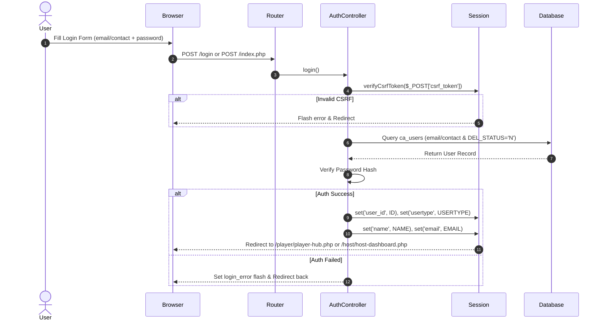
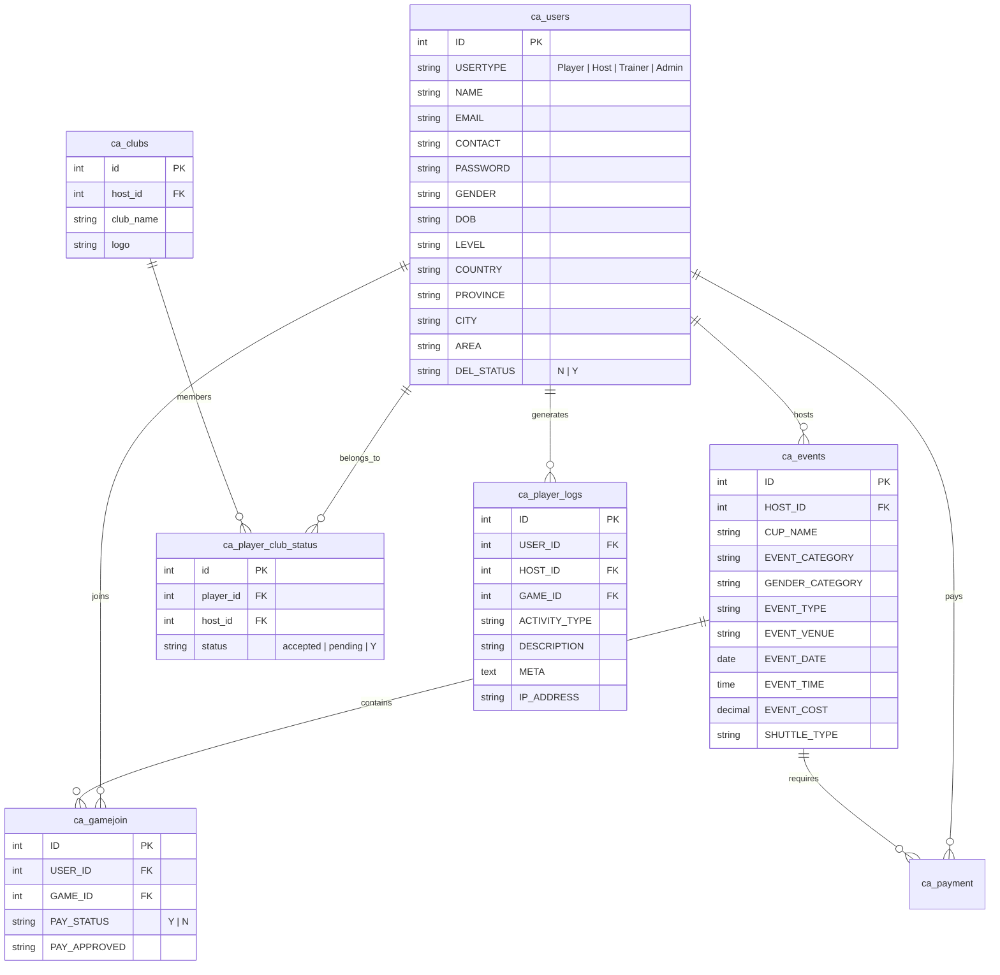

# 🏗️ Milestone 0 — Baseline & Freeze Audit

> **Priority: P0 — Architectural Baseline & Freeze Specification**  
> *Principle: "Understand First → Refactor Safely Second" (Existing UI & Logic Preserved 100%)*

---

## 📑 Table of Contents
1. [Modular Routes Inventory](#1-modular-routes-inventory)
2. [Authentication & Session Flow](#2-authentication--session-flow)
3. [Role & Permission Matrix](#3-role--permission-matrix)
4. [AJAX Endpoints Inventory](#4-ajax-endpoints-inventory)
5. [Database Tables & Relationship Map](#5-database-tables--relationship-map)
6. [Session Variables Inventory](#6-session-variables-inventory)
7. [Cookies Inventory](#7-cookies-inventory)
8. [JavaScript Dependencies Inventory](#8-javascript-dependencies-inventory)
9. [Global Helper Functions Inventory](#9-global-helper-functions-inventory)

---

## 1. Modular Routes Inventory

The application utilizes a modular routing architecture registered in `app/routes/web.php` through a lightweight regex router (`App\Core\Router`).

```
routes/
├── auth.php        # Authentication & Logout Routes
├── host.php        # Protected Host & Trainer Management Routes
├── index.php       # Route Registry Integrator
├── pages.php       # Public & Legal Content Pages
├── player.php      # Protected Player Hub, Profile & API Routes
├── store.php       # E-Commerce & Product Listing Routes
├── tournament.php  # Tournament Management & Court Tools
└── web.php        # Primary Route Entry Point
```

### Complete Route Mapping:

| HTTP Method | Route URI | Handler / Controller Action | Protection / Middleware |
| :--- | :--- | :--- | :--- |
| `GET` / `POST` | `/`, `/index.php` | `HomeController::index` / `AuthController::login` | Public |
| `GET` | `/logout`, `/logout.php` | `AuthController::logout` | Public |
| `POST` | `/login`, `/login.php` | `AuthController::login` | Public |
| `GET` | `/reset.php` | Anonymous (Session Reset) | Development |
| `GET` | `/player/player-hub.php` | `PlayerController::hub` | `AuthGuard(['Player', 'Host', 'Admin'])` |
| `GET` | `/player/player-dashboard.php` | `PlayerController::dashboard` | `AuthGuard(['Player', 'Host', 'Admin'])` |
| `GET` | `/player/player-profile.php` | `PlayerController::profile` | `AuthGuard(['Player', 'Host', 'Admin'])` |
| `POST` | `/api/update_profile.php`, `/api/update-profile` | `PlayerController::updateProfile` | `AuthGuard(['Player', 'Host', 'Admin'])` |
| `GET` / `POST` | `/host/host-dashboard.php`, `/host/dashboard` | `HostController::dashboard` | `AuthGuard(['Host', 'Trainer'])` |
| `GET` | `/host/host-audit-log.php` | View Render (`host-audit-log.php`) | `AuthGuard(['Host', 'Trainer'])` |
| `GET` / `POST` | `/host/host-club-settings.php` | View Render (`host-club-settings.php`) | `AuthGuard(['Host', 'Trainer'])` |
| `GET` / `POST` | `/host/host-creat-game.php` | View Render (`host-creat-game.php`) | `AuthGuard(['Host', 'Trainer'])` |
| `GET` / `POST` | `/host/host-edit-tournament.php` | View Render (`host-edit-tournament.php`) | `AuthGuard(['Host', 'Trainer'])` |
| `GET` / `POST` | `/host/host-scheduled-game.php` | View Render (`host-scheduled-game.php`) | `AuthGuard(['Host', 'Trainer'])` |
| `GET` | `/host/host-roster.php` | View Render (`host-roster.php`) | `AuthGuard(['Host', 'Trainer'])` |
| `GET` | `/host/host-player-stats.php` | View Render (`host-player-stats.php`) | `AuthGuard(['Host', 'Trainer'])` |
| `GET` | `/about-us`, `/about-us.php` | View Render (`about-us.php`) | Public |
| `GET` | `/contact-us`, `/contact-us.php` | View Render (`contact-us.php`) | Public |
| `GET` / `POST` | `/contact-handler.php` | View Render (`contact-handler.php`) | Public |
| `GET` | `/casa-clubs`, `/casa-clubs.php` | View Render (`casa-clubs.php`) | Public |
| `GET` | `/casa-trainers`, `/casa-trainers.php` | View Render (`casa-trainers.php`) | Public |
| `GET` | `/discover-games.php` | View Render (`discover-games.php`) | Public |
| `GET` | `/privacy-policy`, `/termsCondition`, `/CancellationPolicy` | View Render (Legal Pages) | Public |
| `GET` | `/product-listing.php`, `/accessories-shop.php` | View Render (Store Pages) | Public / Role Check |
| `GET` / `POST` | `/tournament`, `/tournament/court-dashboard.php` | View Render (Tournament Tools) | Public / Auth Guard |

---

## 2. Authentication & Session Flow



### Session Invalidation (Logout Flow):
- `Session::logout()` clears `$_SESSION = []`.
- Deletes session cookie via `setcookie(session_name(), '', time() - 42000, ...)`.
- Calls `session_destroy()`.

---

## 3. Role & Permission Matrix

| Resource / Action | Guest | Player | Host | Trainer | Admin |
| :--- | :---: | :---: | :---: | :---: | :---: |
| Browse Home, About Us, Contact, Gallery | ✅ | ✅ | ✅ | ✅ | ✅ |
| View Store Product Listing (`canViewProductListing`) | ✅ | ✅ | ⚠️ (If Level != A/R) | ⚠️ (If Level != A/R) | ✅ |
| Access Player Hub (`/player/player-hub.php`) | ❌ | ✅ | ✅ | ✅ | ✅ |
| Asynchronously Update Profile (`/api/update-profile`) | ❌ | ✅ | ✅ | ✅ | ✅ |
| Access Host Dashboard (`/host/host-dashboard.php`) | ❌ | ❌ | ✅ | ✅ | ✅ |
| Create Game Events (`/host/host-creat-game.php`) | ❌ | ❌ | ✅ | ✅ | ✅ |
| Access Host Audit Logs (`/host/host-audit-log.php`) | ❌ | ❌ | ✅ | ✅ | ✅ |
| Manage Tournaments (`/host/host-edit-tournament.php`) | ❌ | ❌ | ✅ | ✅ | ✅ |

---

## 4. AJAX Endpoints Inventory

Below is the complete list of background asynchronous endpoints consumed by client JS scripts:

### Standardized MVC API Endpoints (`/api/`):
- `POST /api/update-profile` & `POST /api/update_profile.php` — Updates user profile attributes (Name, Contact, DOB, Gender, Level, Location).
- `POST /api/join_club.php` — Player request to join a host club.
- `POST /api/player_payment.php` — Submit tournament/event payment confirmation.
- `POST /api/add_tournament.php` — Create new tournament event.
- `POST /api/manage_tournament.php` — Update tournament settings.
- `POST /api/delete_product.php` — Remove store item.
- `POST /api/sync_player.php` — Synchronize player roster data.
- `POST /api/save_club_settings.php` — Update host club preferences.
- `POST /api/approve_member.php` — Host approval of player club membership.
- `POST /api/remove_member.php` — Host removal of club member.
- `POST /api/upload_profile_image.php` — Upload user avatar image.

### Legacy Root/Relative API Handlers (`../../api/`):
- `cancel_event.php`, `copy_event.php`, `delete_event.php`, `fetch_payment.php`
- `filter_schedule.php`, `com_filter_schedule.php`, `play_filter_schedule.php`, `player_filter_complete.php`
- `join_event.php`, `new-game-host.php`, `same_paymentByhost.php`, `save_confirm.php`, `save_invitation.php`
- `save_payment.php`, `search_result.php`, `update_event.php`, `update_inviteJoin.php`, `update_paymentHis.php`, `update_price.php`
- `view_game_player.php`, `view_joined_invited.php`, `view_player.php`, `view_player_pay.php`, `view_player_paylist.php`, `view_player_paymentHis.php`

---

## 5. Database Tables & Relationship Map



### Complete Database Tables List (33 Tables):
`ca_admin`, `ca_ads`, `ca_advertisements`, `ca_bride`, `ca_clubs`, `ca_contact_messages`, `ca_department`, `ca_description`, `ca_event_category`, `ca_events`, `ca_events_default`, `ca_expense`, `ca_gallery`, `ca_gamejoin`, `ca_gamejoin_default`, `ca_herobanners`, `ca_host_player_carry_forward_history`, `ca_host_subscription`, `ca_id`, `ca_landing_page_media`, `ca_orders`, `ca_orders_item`, `ca_payment`, `ca_player_club_status`, `ca_player_logs`, `ca_player_ratings`, `ca_product_type`, `ca_products`, `ca_reviews`, `ca_system_settings`, `ca_users`, `ca_venue`.

---

## 6. Session Variables Inventory

| Session Key | DataType | Description / Usage |
| :--- | :--- | :--- |
| `user_id` | `int` | Primary key ID of current logged-in user in `ca_users` |
| `usertype` | `string` | User role string (`Player`, `Host`, `Trainer`, `Admin`) |
| `name` | `string` | User display name |
| `email` | `string` | User email address |
| `contact` | `string` | User phone / WhatsApp number |
| `csrf_token` | `string` | 64-character hex CSRF token for request security |
| `_flash` | `array` | Flash messages storage for controller-to-view alerts |
| `role` | `string` | Alternate role indicator |
| `level` / `vlevel` | `string` | User skill level or host authorization level |
| `gender` | `string` | User gender |
| `country`, `province`, `city` | `string` | User location attributes |
| `profileImage` | `string` | Avatar image path |
| `cart` | `array` | E-commerce shopping cart items |
| `login_error`, `auth_error` | `string` | Transient authentication error messages |
| `mapped_host_id` | `int` | Host context ID mapping |

---

## 7. Cookies Inventory

| Cookie Name | Scope / Purpose |
| :--- | :--- |
| `PHPSESSID` | Standard PHP session identifier cookie |
| `csrf_cookie_name` | CSRF fallback verification token cookie |
| `remember_username` | Persistent login username storage |
| `remember_password` | Legacy persistent password storage token |
| `remember_token` | Secure auto-login persistent auth token |

---

## 8. JavaScript Dependencies Inventory

The application frontend relies on the following libraries and scripts loaded in `footer-links.php` and `header-links.php`:

| JS Library | Version / Source | Used For |
| :--- | :--- | :--- |
| **jQuery** | `3.6.0` (CDN) | DOM manipulation, AJAX requests (`$.ajax`), event delegation |
| **Bootstrap** | `5.0.2` & `5.3.2` (CDN) | Modals, responsive grids, navbars, dropdowns |
| **Slick Carousel** | `1.9.0` (CDN) | Home page banners & image sliders |
| **GLightbox** | Latest (CDN) | Image gallery lightbox modal popups |
| **AOS (Animate On Scroll)** | `2.3.1` (CDN) | Scroll-triggered element animations |
| **Toastr JS** | Latest (CDN) | User alert & success toast notifications |
| **ApexCharts** | `3.54.1` (CDN) | Host dashboard analytics & audit log charts |
| **SweetAlert2** | `11` (CDN) | Checkout & delete confirmation alert dialogs |
| **Tailwind CSS** | CDN (Script injection) | Host audit log UI styling |

---

## 9. Global Helper Functions Inventory

### `App\Helpers\Session` Class Methods:
- `start(): void` — Starts PHP session safely if not active.
- `get(string $key, mixed $default = null): mixed` — Retrieves session value.
- `set(string $key, mixed $value): void` — Stores session value.
- `has(string $key): bool` — Checks session key existence.
- `remove(string $key): void` — Unsets session key.
- `setFlash(string $key, mixed $message): void` — Sets flash alert.
- `getFlash(string $key, mixed $default = null): mixed` — Reads and clears flash message.
- `getCurrentUser($conn = null): ?array` — Gets logged-in user array with static request caching.
- `user($conn = null): ?object` — Gets normalized user DTO object.
- `getCurrentUserId(): ?int` / `userId(): ?int` — Gets active user ID.
- `getCurrentUserType(): ?string` — Gets active user role.
- `requireLogin(string $redirect = 'index.php'): void` — Enforces logged-in session.
- `requireUserType(array $allowedTypes, string $redirect = 'index.php'): void` — Enforces role guard.
- `logout(): void` — Destroys session & clears cookie.
- `normalizeRole(?string $rawRole): string` — Normalizes role string to lowercase.
- `normalizeUserData(array $user): object` — Constructs normalized user profile DTO object.
- `getUserInitials(string $userName): string` — Generates 2-letter user initials.
- `getCsrfToken(): string` / `verifyCsrfToken(?string $token): bool` — CSRF token lifecycle.
- `canViewProductListing(): bool` — Checks host/player product listing authorization.

### Global Procedural Wrappers (`app/Helpers/session_functions.php`):
`startSession()`, `getCurrentUser()`, `getCurrentUserId()`, `getCurrentUserType()`, `requireLogin()`, `requireUserType()`, `logoutUser()`, `normalizeRole()`, `normalizeUserData()`, `getUserInitials()`, `getCsrfToken()`, `verifyCsrfToken()`, `canViewProductListing()`.

### Global Formatting & Utilities (`helpers/helpers.php`):
- `e(mixed $value): string` — Global HTML escaping helper (`htmlspecialchars`).
- `generateBookingNo(): string` — Generates secure unique booking reference (`CASA...`).
- `formatDate($date, string $format)` — Formats DB date strings safely.
- `formatTime($time, string $format)` — Formats DB time strings safely.
- `formatCurrency($amount, string $currency)` — Formats CAD/USD currency.
- `getMonthOptions(): array` / `getYearOptions(): array` — Generates select option arrays.
- `uploadFile(array $file, string $targetDir, array $allowedExt)` — Secure file upload validator.
- `debugPrint($data, bool $exit)` — Pre-formatted print_r helper.
- `getCurrentPage(): string` — Extracts current script name.

### Activity & Audit Helpers (`app/Helpers/audit.php`):
- `auditResolveGameHost($conn, $game_id): int` — Resolves owning host ID from event.
- `auditResolveHostId($conn, $user_id, $game_id, $provided_host_id): int` — Contextual host ID resolver.
- `logPlayerActivity($conn, $user_id, $activity_type, $description, $host_id, $game_id, $meta): void` — Records activity in `ca_player_logs`.

### Player Hub UI Helpers (`app/Helpers/player_hub_helper.php`):
- `get_club_logo_url($logo): string` — Resolves club logo image path.
- `getPaymentState(array $row): string` — Returns payment status ('unpaid', 'pending', 'paid', 'not_joined').
- `resolveTournamentImage(?string $image, string $prefix, string $baseDir): string` — Static cached banner resolver.
- `formatEventQuote(?string $description): string` — Formats 8-word quote snippet.
- `prepareTournamentData(...)`: Centralized tournament record formatter.
- `render_scrollable_modal(...)`: Component renderer for Bootstrap scrollable modals.

---

## 🎯 Summary & Freeze Declaration

> **BUILD FREEZE COMPLETED**: All routes, auth flows, permission rules, AJAX APIs, database tables, session/cookie keys, JS dependencies, and global helper functions are **100% cataloged and frozen**. Any subsequent refactoring must preserve every behavior documented in this specification.
